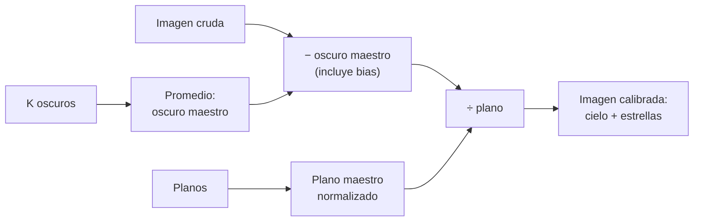

# B15-C09 — Procesamiento de imágenes digitales

<!-- nav:top -->
<!-- /nav -->

## 1. Ubicación, nivel y alcance

Novena clase del bloque B15 y apertura del tramo de imágenes. Hasta aquí trabajaste con series en una dimensión; una imagen es lo mismo en dos: una **matriz de números** que miden cuánta luz llegó a cada píxel. Aquí aprendes cómo se lee esa matriz, qué contiene además de la luz de los astros y cómo se **calibra** para quedarte solo con ellos, y cuánto ruido añaden las propias calibraciones. Nivel N3. Usas el ruido de [C03](../B15-C03-ruido-blanco-y-coloreado/CLASE.md) y la convolución de [C08](../B15-C08-convolucion-y-respuesta-impulsional/CLASE.md). No verás todavía el contraste y la visualización (C10), ni la deconvolución (C11).

## 2. Por qué esta clase existe

Una cámara de un telescopio no mide «luz de estrellas»: mide un número por píxel que incluye un desplazamiento electrónico, corriente de oscuridad, el cielo, la estrella y una sensibilidad que cambia de un píxel a otro. Si analizas el número crudo, mides la cámara, no el cielo. Y cada paso de limpieza introduce su propio ruido. Calibrar bien es la diferencia entre un flujo creíble y un artefacto.

La decisión central: **¿qué parte de cada píxel es cielo, y con cuánta incertidumbre la he separado?**

## 3. Lo que podrás hacer al terminar

1. Describir una imagen como matriz (forma, índices, tipo de dato) sin confundir filas con columnas.
2. Distinguir bias, oscuro, plano, cielo y señal en el modelo de un píxel.
3. Aplicar la ecuación de calibración a un conjunto pequeño a mano.
4. Calcular el ruido de la imagen calibrada y cómo baja al combinar calibraciones.
5. Medir el flujo de una estrella con una apertura y un anillo de fondo.
6. Evitar errores de tipo de dato (desbordamiento) y de orden de operaciones.

La evidencia es la **calibración de una imagen sintética** del ejercicio 12 (sección 20).

## 4. Con qué llegas y cómo comprobarlo

Necesitas matrices, promedios, ruido y desviación estándar. Cinco preguntas:

1. En una matriz con `shape = (64, 64)`, ¿cuántos píxeles hay?
2. Si el ruido de lectura es 5 ADU y el cielo aporta 50 e⁻ (ruido de Poisson), ¿cuánto vale la varianza total por píxel?
3. ¿Qué desviación tiene el promedio de 10 datos independientes de desviación 8?
4. ¿Qué es la convolución?
5. ¿Qué es la mediana?

<details>
<summary>Ver respuestas</summary>

1. 4096. 2. `25 + 50 = 75` ADU². 3. `8/√10 = 2,53`. 4. Suma de copias de una respuesta, escaladas y desplazadas (C08). 5. El valor central de los datos ordenados.
</details>

Con cuatro o cinco aciertos, sigue; si no, repasa C03 y C08.

## 5. Un caso real: una estrella en un detector

Una cámara toma una imagen de 64 × 64 píxeles de 60 s: un campo con una estrella cerca del píxel (columna 40, fila 24) sobre un cielo de 50 ADU. La guía de reducción de datos CCD de Astropy (S1) describe el modelo estándar: la imagen cruda es bias, corriente de oscuridad, ruido y un «plano» que multiplica al cielo y a las estrellas; resolver ese modelo da las cuentas de las estrellas. Todo lo que sigue usa **datos sintéticos** con esos componentes conocidos para poder comprobar el resultado. Es el **ejemplo conductor**.

## 6. Vocabulario

Una **imagen digital** es una matriz `I[y, x]`: `y` indexa filas (hacia abajo en la mayoría de los programas) y `x` columnas. Un **píxel** es una celda. El **ADU** (*analog-to-digital unit*) es la unidad del número que entrega el conversor. La **ganancia** es cuántos electrones corresponden a un ADU; aquí se supone 1 e⁻/ADU. El **bias** es el desplazamiento electrónico presente en toda lectura (S1). La **corriente de oscuridad** es la señal que se acumula sin luz y crece con la exposición (S1). El **campo plano** (*flat*) describe la sensibilidad relativa píxel a píxel (S1). El **ruido de lectura** viene de la electrónica; el **ruido de Poisson** (de fotones), de la naturaleza discreta de la luz: su varianza es igual a la señal en electrones. Una **apertura** es el conjunto de píxeles que se suman para medir una estrella y un **anillo de fondo** el conjunto alrededor que estima el cielo. Un **maestro** (*master*) es la combinación (promedio o mediana) de varias exposiciones de calibración.

## 7. Modelo mental: una bandeja de recipientes con tapas distintas

Cada píxel es un recipiente que recoge lluvia (fotones). Pero cada recipiente ya traía agua de fábrica (bias), recoge goteras (oscuro) y tiene una boca de distinto tamaño (plano). Para saber cuánta lluvia cayó, hay que quitar el agua de fábrica y las goteras, y dividir por el tamaño de la boca. Analogía: recipientes con bocas distintas. Su límite: la lluvia es aleatoria y la calibración también agrega azar; no se puede eliminar el ruido de la imagen cruda (S1).



*Descripción textual:* de la imagen cruda se resta el oscuro maestro (promedio de varios oscuros, que también contienen el bias), se divide por el plano maestro normalizado y se obtiene la imagen calibrada con el cielo y las estrellas.

## 8. La explicación, paso a paso

### 8.1 La imagen como matriz

En el código de esta clase, `I[y, x]` accede a la fila `y` y la columna `x`. Una estrella en «la columna 40, fila 24» es `I[24, 40]`. Confundir el orden es un error clásico. Además de los valores, importa el **tipo de dato**: en `uint16` (entero sin signo de 16 bits), `100 − 150` no da `−50` sino `65 486`, porque «da la vuelta». El laboratorio lo muestra. Convierte a coma flotante antes de restar.

### 8.2 Modelo de un píxel

`crudo = bias + oscuro + plano × (cielo + estrella) + ruido`. En el laboratorio: bias 100 ADU, oscuro 3 ADU, cielo 50 ADU, una estrella de flujo total 2000 ADU con perfil gaussiano de σ = 1,5 píxeles y un plano suave que baja de 1,00 en el centro a 0,80 en las esquinas.

### 8.3 La ecuación de calibración

`calibrada = (crudo − oscuro_maestro)/plano` (S1: restar bias y oscuro y luego dividir por el plano). El oscuro maestro es el promedio de oscuros, que ya llevan el bias dentro (S1). Sin ruido, el laboratorio recupera `cielo + estrella` con un error de `2,8 × 10⁻¹⁴ ADU`. Sin dividir por el plano, el «cielo» aparece entre 40 y 45 ADU en vez de 50: un error del 10 al 20 %.

### 8.4 El ruido de la imagen calibrada

La varianza de un píxel de cielo es: lectura `σ_L²` + fotones (`cielo + oscuro`) + el ruido del oscuro maestro, que vale `(σ_L² + oscuro)/K` si se promedian `K` oscuros. Con `σ_L = 5`, cielo 50 y oscuro 3: `σ² = 25 + 53 + 28/K`.
Con `K = 1`: `10,30` ADU (observado `10,34`). Con `K = 10`: `8,99` (observado `8,999`). Con `K = 100`: `8,85` (observado `8,866`). Un solo oscuro deja la imagen un 17 % más ruidosa que el límite `√78 = 8,83`; con `K = 10` ya se acerca a él (S1 advierte que un solo oscuro puede dejar la imagen igual o más ruidosa que la cruda).

### 8.5 Medir el flujo de una estrella

Se suman los píxeles de una apertura de radio 5 px (81 píxeles) y se resta el fondo estimado como la mediana de un anillo (de 8 a 12 píxeles de radio): `F = Σ_ap (I − fondo)`. La apertura contiene el 99,65 % del flujo (1993 de 2000 ADU). El laboratorio mide 1950 ADU con un fondo de 50,65 ADU. La diferencia (−43 ADU) es menor que la incertidumbre del flujo: `√(81 · 80,8 + 1993) = 92 ADU`, así que `SNR = 1993/92 = 21,6`.

### 8.6 Valores extremos: mediana frente a media

Al combinar exposiciones de calibración, un rayo cósmico (un valor muy alto en una sola de ellas) arrastra la media pero no la mediana. Con `[50; 52; 5000; 49; 51]` la media es 1040,4 y la mediana 51. La mediana pierde algo de eficiencia estadística, a cambio de robustez.

### 8.7 Errores de orden

Dividir por el plano antes de restar el oscuro, o restar un oscuro de otra duración sin escalar la corriente de oscuridad, produce errores sistemáticos. El orden de la ecuación es parte del método: declara el que usaste.

## 9. Magnitudes, símbolos y unidades

| Símbolo | Qué es | Unidad | Nota |
|---|---|---|---|
| `I[y, x]` | valor del píxel | ADU | fila `y`, columna `x` |
| bias | desplazamiento electrónico | ADU | 100 (sintético) |
| oscuro | corriente de oscuridad en la exposición | ADU | 3 |
| plano | sensibilidad relativa | adimensional | 0,80–1,00 |
| `σ_L` | ruido de lectura | ADU | 5 |
| `K` | número de oscuros combinados | — | 1, 10, 100 |
| `F`, SNR | flujo en apertura y relación señal–ruido | ADU, — | 1950; 21,6 |

## 10. Convenciones y referencias

Ganancia 1 e⁻/ADU. Índices en orden `[fila, columna]`, origen arriba a la izquierda. El ruido de Poisson tiene varianza igual a la señal en electrones. Todo es **sintético**; semilla 15009. Los datos se promedian en coma flotante.

## 11. De dónde sale lo que afirmamos

| ID | Fuente | Localizador | Respalda | Estado |
|---|---|---|---|---|
| S1 | Craig, M. y Chambers, L., *CCD Data Reduction Guide*, §1.4 «Calibration overview» (edición dev, © 2020–2023) | https://www.astropy.org/ccd-reduction-and-photometry-guide/v/dev/notebooks/01-05-Calibration-overview.html | Bias, corriente de oscuridad y campo plano; ecuación de calibración (restar bias y oscuro, dividir por el plano); el ruido de los maestros se propaga a la imagen | Consultada el 2026-11-05 mediante extracción automática |

Límites: las fórmulas de varianza de 8.4 y la ventaja de la mediana se deducen de resultados estándar de estadística y se comprueban numéricamente; el tratamiento de `uint16` es un hecho del lenguaje comprobado en el laboratorio. La guía S1 no se reprodujo.

## 12. Cómo ver la calibración

Equivalente accesible a las imágenes del laboratorio:

| Cantidad | Valor |
|---|---|
| Plano mínimo / máximo | 0,800 / 1,000 |
| Error de la calibración sin ruido | `2,8 × 10⁻¹⁴` ADU |
| Cielo sin dividir por el plano, esquina / centro | 40,00 / 45,00 ADU (real 50) |
| Desviación del cielo calibrado, `K` = 1 / 10 / 100 | 10,34 / 8,999 / 8,866 ADU |
| Flujo en apertura (real dentro: 1993) | 1950 ADU |

Descripción larga: la imagen cruda muestra un fondo con gradiente oscuro hacia las esquinas, ruido granulado y una mancha brillante circular en la columna 40, fila 24; la calibrada tiene un fondo plano en 50 ADU con el mismo grano.

## 13. Ejemplo trabajado: calibrar cuatro píxeles

**Paso 1 · Datos (sintéticos).** Crudo `[[143; 153]; [148; 153]]` ADU. Oscuro maestro (con bias) `103` ADU en todos. Plano `[[0,8; 1,0]; [0,9; 1,0]]`.

**Paso 2 · Restar.** `[[40; 50]; [45; 50]]`.

**Paso 3 · Dividir por el plano.** `[[50; 50]; [50; 50]]`.

**Paso 4 · Lectura.** El cielo es uniforme en 50 ADU: la diferencia aparente (40, 45, 50) era la sensibilidad de la cámara, no el cielo.

**Paso 5 · Incertidumbre.** Con ruido, cada píxel tiene `σ ≈ 9 ADU` (8.4): el valor 50 ± 9 ADU por píxel. Promediando una región de 100 píxeles, ±0,9 ADU.

**Paso 6 · Comprobación.** Con el modelo directo `crudo = 103 + plano · 50` se recuperan los 143, 153, 148 y 153.

## 14. Distintas formas de combinar calibraciones

El **promedio** reduce el ruido como `1/√K` pero un rayo cósmico lo contamina. La **mediana** es robusta pero pierde eficiencia (en datos gaussianos y muchas muestras, su varianza es unas 1,57 veces la de la media; resultado estándar sin cita en esta clase). El **promedio con rechazo** (sigma-clipping) descarta valores anómalos y luego promedia: combina ventajas. Elige y declara. Cuantas más exposiciones de calibración, menos ruido añaden a la imagen final.

## 15. Práctica guiada

**Ejercicio 1 · con los pasos indicados.** Una imagen tiene `shape = (64, 64)`. ¿Qué píxel es `I[24, 40]`? ¿En qué fila y columna está? *Pasos:* el primer índice es la fila.

<details><summary>Solución comentada</summary>

Fila 24, columna 40 (8.1). Hay `64 × 64 = 4096` píxeles.
</details>

**Ejercicio 2 · con una pista.** Calibra `[[143; 153]; [148; 153]]` con oscuro maestro 103 y plano `[[0,8; 1]; [0,9; 1]]`. *Pista:* resta y divide.

<details><summary>Solución comentada</summary>

Resta: `[[40; 50]; [45; 50]]`; división: `[[50; 50]; [50; 50]]` (8.3).
</details>

**Ejercicio 3 · casi autónomo.** Calcula la desviación del cielo calibrado con `K = 10` oscuros (lectura 5, cielo 50, oscuro 3).

<details><summary>Solución comentada</summary>

`σ² = 25 + 53 + 28/10 = 80,8`; `σ = 8,99` ADU (8.4).
</details>

## 16. Práctica autónoma, transferencia e integrador

**Ejercicio 4.** En un píxel de cielo de 50 e⁻ con lectura 5 ADU, ¿domina el ruido de lectura o el de fotones?

<details><summary>Solución comentada</summary>

Varianza de lectura 25, de fotones 50: domina el de fotones (`√50 = 7,07` frente a 5) (8.4).
</details>

**Ejercicio 5.** ¿Cuánto mejora la desviación del cielo al pasar de `K = 1` a `K = 100`? ¿Merece la pena pasar de 10 a 100?

<details><summary>Solución comentada</summary>

De 10,34 a 8,87: −14 %. De 10 a 100: de 8,999 a 8,866, solo −1,5 % (8.4).
</details>

**Ejercicio 6.** Un archivo `uint16` tiene un píxel de 100 y un oscuro de 150. ¿Qué obtienes al restar en `uint16`? ¿Cómo lo evitas?

<details><summary>Solución comentada</summary>

`65 486` en vez de `−50`. Convierte a `float` (32 o 64 bits) antes de restar (8.1).
</details>

**Ejercicio 7.** Calcula la SNR del flujo de la estrella: apertura de 81 píxeles, flujo 1993 ADU en la apertura, varianza por píxel del cielo calibrado 80,8 ADU².

<details><summary>Solución comentada</summary>

Ruido² = `81 · 80,8 + 1993 = 8538`; `σ = 92,4`; SNR = `1993/92,4 = 21,6` (8.5).
</details>

**Ejercicio 8.** Si no corriges el plano, ¿qué error relativo cometes en el flujo de una estrella en un píxel con sensibilidad 0,9875 (la del píxel (40, 24))?

<details><summary>Solución comentada</summary>

Subestimas el flujo en `1 − 0,9875 = 1,25 %`: 25 ADU de 2000 (8.2).
</details>

**Ejercicio 9 · transferencia.** El cielo real es uniforme, pero tu imagen sin plano muestra 40 ADU en las esquinas y 50 en el centro. ¿Qué concluyes sobre la diferencia?

<details><summary>Solución comentada</summary>

La caída del 20 % es la sensibilidad (viñeteo): con plano 0,8 en las esquinas, `0,8 × 50 = 40`. No es el cielo (8.2–8.3).
</details>

**Ejercicio 10 · transferencia.** Un colega resta un solo oscuro y afirma «el ruido es el mismo». Cuantifica el error con los valores de la clase.

<details><summary>Solución comentada</summary>

Con `K = 1` la desviación es 10,3 ADU frente a 8,83 del límite: 17 % mayor. Con unos 10 oscuros se acerca al límite (8.4).
</details>

**Ejercicio 11 · transferencia.** Tienes cinco oscuros de un píxel: `[50; 52; 5000; 49; 51]` (un rayo cósmico). ¿Qué maestro usas y por qué?

<details><summary>Solución comentada</summary>

La mediana (51), no la media (1040,4), que quedaría contaminada: restar 1040 ADU a ese píxel en todas las imágenes lo estropearía (8.6).
</details>

**Ejercicio 12 · integrador.** Elabora tu *calibración de una imagen sintética*: genera tu imagen con una estrella, bias, oscuro, plano y ruido; calibra con oscuros maestros de `K = 1, 10, 50`; reporta desviación del cielo observada y teórica, el flujo de la estrella con su incertidumbre y SNR, y un caso con error de tipo de dato.

<details><summary>Solución modelo</summary>

Tabla con desviaciones cercanas a la fórmula `√(σ_L² + cielo + oscuro + (σ_L² + oscuro)/K)` (dentro de 5 %), flujo dentro de 2σ del real, SNR calculada, y demostración del desbordamiento `uint16`. Datos sintéticos, semilla y versiones declaradas; fuente S1 con fecha.
</details>

## 17. Laboratorio: calibrar y medir una estrella

El script [calibracion.py](calibracion.py) genera la imagen sintética, comprueba que la calibración sin ruido es exacta, muestra el desbordamiento de `uint16`, compara la desviación del cielo calibrado con la fórmula de 8.4 para tres valores de `K` y mide el flujo de la estrella con apertura y anillo.

**Datos:** sintéticos, semilla 15009. **Predice antes de ejecutar:** ¿qué desviación esperas para `K = 10`? (8,99.) **Ejecución del 2026-11-05 (Python 3.12.9, NumPy 2.4.4):**

```text
plano: mín 0.800, máx 1.000
(1) sin ruido: error máximo de la calibración = 2.8e-14 ADU
    sin dividir por el plano, el cielo varía de 40.00 a 45.00 ADU (real 50)
(2) uint16: 100 - 150 = 65486 ; en float: -50.0
(3) cielo calibrado (plano uniforme = 1): media, desviación observada y teórica
    K =   1 oscuros: media  50.04 ADU (real 50); sigma 10.340 (teoría 10.296)
    K =  10 oscuros: media  50.00 ADU (real 50); sigma 8.999 (teoría 8.989)
    K = 100 oscuros: media  49.99 ADU (real 50); sigma 8.866 (teoría 8.848)
(4) flujo en apertura de radio 5 px: 1950 ADU (real 1993 dentro de la apertura, 2000 total); fondo 50.65 ADU
Pruebas superadas.
```

```bash
python programa/clases/B15/B15-C09-procesamiento-de-imagenes-digitales/calibracion.py
```

**Límites:** el plano es conocido exactamente (no se estima con ruido); ganancia 1; sin saturación, sin píxeles calientes ni rayos cósmicos; la medida de ruido del cielo se hace con plano uniforme para comparar con la fórmula.

## 18. Errores frecuentes y cómo corregirlos

**Confundir filas y columnas.** Se corrige con el ejercicio 1.

**Restar en enteros sin signo.** Se corrige con el ejercicio 6.

**No dividir por el plano.** Se corrige con los ejercicios 8 y 9.

**Calibrar con un solo oscuro.** Se corrige con los ejercicios 5 y 10.

**Combinar con la media en presencia de rayos cósmicos.** Se corrige con el ejercicio 11.

## 19. Cómo sabrás que vas bien

Tras 8.3: ¿calibras cuatro píxeles a mano? Si no, ejercicio 2. Tras 8.4: ¿por qué un solo oscuro empeora la imagen? Si no, ejercicios 3 y 10. Tras 8.5: ¿cómo mides el flujo de una estrella? Si no, ejercicio 7.

## 20. Qué entregas y cómo se evalúa

El producto es tu **calibración de una imagen sintética** (ejercicio 12).

| Criterio | Inicial | En desarrollo | Logrado | Destacado |
|---|---|---|---|---|
| Modelo del píxel | Sin modelo | Parcial | Completo con unidades | Relaciona cada término con su causa |
| Calibración | Orden incorrecto | Correcta sin verificar | Verificada sin ruido | Cuantifica la propagación del ruido |
| Flujo | Sin fondo | Fondo sin justificar | Apertura, anillo y SNR | Estima la incertidumbre y la valida |
| Robustez | Ignora valores extremos | Los menciona | Usa mediana o rechazo | Compara métodos |
| Fuentes y rótulos | Sin fuente | Sin fecha | Con localizador y fecha | Rotula sintético vs publicado |

**Condiciones críticas (no se compensan con promedio):** declarar el orden de operaciones y el tipo de dato; reportar la incertidumbre del flujo; citar solo fuentes consultadas.

## 21. Ética, seguridad y límites

Una imagen calibrada con supuestos erróneos produce flujos erróneos que parecen precisos. Conserva las imágenes crudas, registra la calibración aplicada y no mezcles datos sintéticos con observados. Accesibilidad: las imágenes tienen descripción y tabla equivalente; el laboratorio funciona sin conexión.

## 22. Para cerrar y seguir

Una imagen es una matriz que mezcla electrónica, oscuridad, sensibilidad, cielo y estrellas; la calibración `(crudo − oscuro)/plano` aísla el cielo y las estrellas, pero con el ruido de los maestros; el flujo se mide con apertura y anillo. Queda abierta una pregunta: una vez calibrada, ¿cómo se muestran los datos para ver tanto el cielo débil como la estrella brillante sin falsear nada?

**Glosario español–inglés.** imagen digital · *digital image*; píxel · *pixel*; campo plano · *flat field*; corriente de oscuridad · *dark current*; ruido de lectura · *read noise*; apertura · *aperture*; maestro · *master frame*; ganancia · *gain*.

**Continuidad.** B15-C10 reutiliza tu imagen calibrada para estudiar **histogramas y normalización**.

**Referencias:** ver sección 11.

<!-- nav:bottom -->
<!-- /nav -->
