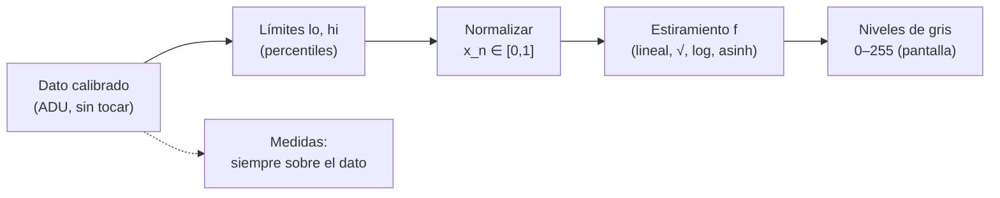

# B15-C10 — Histogramas y normalización

<!-- nav:top -->
<!-- /nav -->

## 1. Ubicación, nivel y alcance

Décima clase del bloque B15. Tienes una imagen calibrada ([C09](../B15-C09-procesamiento-de-imagenes-digitales/CLASE.md)); ahora debes **mirarla**. Una pantalla muestra, como mucho, 256 niveles de gris, mientras que la imagen contiene valores desde el ruido del cielo hasta estrellas miles de veces más brillantes. Aquí aprendes a leer el histograma de una imagen, a elegir los límites de visualización, a aplicar estiramientos (lineal, raíz, logarítmico, asinh) y, sobre todo, a recordar que **mostrar no es medir**. Nivel N3. Usas la imagen y el ruido de C09. No verás deconvolución (C11) ni detección (C12).

## 2. Por qué esta clase existe

Tienes una imagen con un cielo de 50 ADU, una estructura difusa tenue 15 ADU por encima y una estrella de 9000 ADU. Si la muestras con una escala lineal entre mínimo y máximo, el cielo y la estructura quedan en los niveles de gris 1 y 2 de 255: parece una pantalla negra con un punto. Si la estiras demasiado, la estrella se vuelve una mancha blanca y las proporciones de brillo desaparecen. Las decisiones de visualización cambian lo que *parece* haber, y las publicaciones, las alertas y los informes dependen de ellas.

La decisión central: **¿qué escala y qué límites muestran lo que me interesa sin falsear lo que mido?**

## 3. Lo que podrás hacer al terminar

1. Construir e interpretar el histograma de una imagen.
2. Normalizar a [0, 1] con límites mínimo–máximo o por percentiles.
3. Aplicar y comparar los estiramientos lineal, raíz, logarítmico y asinh.
4. Calcular los niveles de gris que corresponden a un valor dado y decidir si una estructura es visible.
5. Explicar por qué no se mide flujo sobre una imagen estirada.
6. Probar un estiramiento contra sus propiedades analíticas (extremos, monotonía, pendiente inicial).

La evidencia es la **imagen normalizada con escala declarada** del ejercicio 12 (sección 20).

## 4. Con qué llegas y cómo comprobarlo

Necesitas calibración y ruido (C09), logaritmos y raíces. Cinco preguntas:

1. Si el ruido del cielo es 9 ADU, ¿qué valor es «+1σ» sobre un cielo de 50 ADU?
2. ¿Cuánto es `√0,25`?
3. ¿Cuánto es `log₁₀ 1000`?
4. ¿Cuántos niveles distintos tiene una imagen de 8 bits?
5. ¿Qué es la mediana?

<details>
<summary>Ver respuestas</summary>

1. 59 ADU. 2. 0,5. 3. 3. 4. 256. 5. El valor central de los datos ordenados.
</details>

Con cuatro o cinco aciertos, sigue; si no, repasa C09 y B03.

## 5. Un caso real: ver el cielo y la estrella a la vez

Una imagen **sintética** de 128 × 128 píxeles, ya calibrada: cielo de 50 ADU con ruido de 9 ADU, una estructura difusa de 15 ADU de amplitud y 12 estrellas con flujos entre 300 y 200 000 ADU. El máximo es 9337 ADU, el mínimo 10,6 y la mediana 51,9. El 98,5 % de los píxeles cae en el primer intervalo de un histograma de 50 intervalos: el histograma lineal es casi una sola barra pegada a la izquierda. Es el **ejemplo conductor**.

## 6. Vocabulario

El **histograma** cuenta cuántos píxeles caen en cada intervalo de valores. La **normalización** transforma los valores a [0, 1] con `x_n = (x − lo)/(hi − lo)`, recortando lo que queda fuera; Astropy llama a esa operación «normalización» y la separa del **estiramiento** (*stretch*), que es la función `f` aplicada después sobre [0, 1] (S1, que subraya su finalidad de visualización). Un **intervalo** o **límite** define `lo` y `hi`: mínimo–máximo o por **percentiles** (el percentil `p` es el valor bajo el cual está `p`% de los datos). La **ecualización** reasigna valores para que el histograma sea casi plano. El estiramiento **asinh** `f(t) = asinh(t/b)/asinh(1/b)` se comporta como una recta cerca de 0 y como un logaritmo para valores grandes; fue propuesto en astronomía por Lupton y colaboradores (S2). El **recorte** (*clipping*) lleva a 0 o 1 lo que está fuera de los límites. La **saturación de pantalla** ocurre cuando muchos valores distintos se muestran con el mismo gris.

## 7. Modelo mental: un ecualizador de sonido

Un ecualizador amplifica unas zonas del volumen y atenúa otras para oír mejor a un músico débil junto a otro fuerte. El estiramiento hace eso con los brillos. Pero un ecualizador no cambia la grabación original: solo la forma de escucharla. Analogía: ecualizador. Su límite: en el sonido, el oído está acostumbrado a escuchar distorsionado; en imágenes, es fácil leer un gris como si fuera un flujo proporcional, y no lo es.



*Descripción textual:* el dato calibrado se normaliza con límites elegidos, se estira con una función `f` y se convierte a niveles de gris; las medidas (flujo, posiciones) se hacen siempre sobre el dato calibrado, no sobre la imagen mostrada.

## 8. La explicación, paso a paso

### 8.1 El histograma y qué cuenta

El histograma dice qué valores existen y cuántos píxeles tienen cada uno. En una imagen astronómica típica, casi todos los píxeles son cielo y forman un pico estrecho (aquí cerca de 50 ADU con ancho de 9 ADU), y las estrellas forman una cola larga a la derecha. El pico da el nivel y el ruido del cielo; la cola, el rango de los objetos. El laboratorio comprueba que el recuento total es `128 × 128 = 16 384`.

### 8.2 Elegir los límites

Con **mínimo–máximo**, `hi = 9337` ADU domina: 1σ del cielo (9 ADU) equivale a `255 × 9/9326 = 0,25` niveles de gris, invisible. Con **percentiles 1 y 99,5**, los límites son 30,1 y 1312,4 ADU: 1σ equivale a unos `255 × 9/1282 = 1,8` niveles. La contrapartida es que todo lo que supera 1312 ADU se muestra blanco: las estrellas brillantes pierden detalle interno.

### 8.3 Cuatro estiramientos

- **Lineal**: `f(t) = t`. Conserva proporciones.
- **Raíz cuadrada**: `f(t) = √t`. Realza lo débil; por ejemplo, `f(0,25) = 0,5` (coincide con el ejemplo de S1).
- **Logarítmico**: `f(t) = log₁₀(1 + a t)/log₁₀(1 + a)`, con `a = 1000`: `f(0,001) = 0,100` y `f(0,01) = 0,347`.
- **Asinh**: `f(t) = asinh(t/b)/asinh(1/b)`. Con `b = 0,02`, la pendiente inicial es `1/(b asinh(1/b)) = 10,86`: los valores cercanos a 0 se multiplican por casi 11, y para `t ≫ b` se parece a un logaritmo (el laboratorio: `f(0,5) = 0,8496`, aproximación logarítmica `0,8495`). Mantiene el detalle de las estrellas brillantes y realza lo débil sin el problema de `log(0)`.

El laboratorio verifica para las cuatro: `f(0) = 0`, `f(1) = 1` y que son crecientes en [0, 1].

### 8.4 Qué verías con cada combinación

Del laboratorio, niveles de gris 0–255 para el cielo, +1σ (+9 ADU) y la estructura (+15 ADU):

| Límites / estiramiento | Cielo | +9 ADU | +15 ADU |
|---|---|---|---|
| mín–máx, lineal | 1 | 1 | 2 |
| mín–máx, asinh | 12 | 15 | 16 |
| percentil 1–99,5, lineal | 4 | 6 | 7 |
| percentil 1–99,5, asinh | 43 | 56 | 64 |

Solo la última combinación separa de forma visible el cielo de la estructura (21 niveles de diferencia entre cielo y estructura, frente a 1 con mín–máx lineal).

### 8.5 Ecualización

La ecualización por función de distribución acumulada reasigna cada valor a su rango: el histograma resultante es casi plano (en el laboratorio, la desviación máxima respecto a un histograma plano de 20 intervalos es `0,0000`, porque casi todos los valores son distintos). Muestra el máximo de contraste local, pero destruye toda relación cuantitativa entre el gris y el valor.

### 8.6 Mostrar no es medir

Dos estrellas con flujos 1000 y 2000 ADU deben tener razón 2,000. Sumadas tras normalizar a [0, 1] y estirar, el laboratorio da: lineal `2,000`; raíz `1,414`; asinh `1,839`. Cualquier medida cuantitativa debe hacerse sobre el dato calibrado en ADU (o convertido a unidades físicas), con la incertidumbre de C09, nunca sobre un JPEG o una imagen estirada. El laboratorio verifica además que la visualización se aplica a una copia: la matriz de datos no cambia.

### 8.7 Declarar la escala

Una figura publicada debe indicar los límites, el estiramiento y su parámetro (por ejemplo, «percentiles 1–99,5, asinh con `b = 0,02`»). Sin eso, dos observadores no pueden reproducir lo que ven.

## 9. Magnitudes, símbolos y unidades

| Símbolo | Qué es | Unidad | Nota |
|---|---|---|---|
| `x` | valor del píxel calibrado | ADU | dato; no se modifica |
| `lo`, `hi` | límites de visualización | ADU | mín–máx o percentiles |
| `t` o `x_n` | valor normalizado | adimensional | `[0, 1]` |
| `f(t)` | estiramiento | adimensional | `f(0)=0`, `f(1)=1` |
| `a`, `b` | parámetros del log y del asinh | adimensional | 1000; 0,02 |
| nivel | gris mostrado | 0–255 | `255 f(t)` |

## 10. Convenciones y referencias

Las imágenes mostradas son una derivación de los datos; los datos son los ADU calibrados. Se usa la definición de percentil con interpolación lineal (la de NumPy). Los parámetros `a = 1000` y `b = 0,02` son elecciones de esta clase, no valores de referencia. Todo es **sintético**; semilla 15010.

## 11. De dónde sale lo que afirmamos

| ID | Fuente | Localizador | Respalda | Estado |
|---|---|---|---|---|
| S1 | Astropy, *Image stretching and normalization* (`astropy.visualization`, v8.0.2) | https://docs.astropy.org/en/stable/visualization/normalization.html | La normalización a [0:1] y los estiramientos son transformaciones para visualización; `SqrtStretch` lleva 0,25 a 0,5; intervalos mín–máx y por percentil | Consultada el 2026-11-05 mediante extracción automática |
| S2 | Lupton, R. y otros, *Preparing Red-Green-Blue (RGB) Images from CCD Data*, arXiv:astro-ph/0312483 (2003) | https://arxiv.org/abs/astro-ph/0312483 | Introducen un estiramiento asinh que muestra objetos débiles sin saturar los brillantes | Solo resumen consultado el 2026-11-05 |

Límites: la forma concreta de `f` para log y asinh de 8.3 es la definida en esta clase (no la copia de ninguna biblioteca); S1 no describe `LogStretch` ni `AsinhStretch` en la página consultada; S2 se leyó solo en su resumen. Los datos son sintéticos.

## 12. Cómo ver la normalización

Equivalente accesible a los histogramas y a las imágenes estiradas:

| Cantidad | Valor |
|---|---|
| Mín / mediana / máx del dato | 10,6 / 51,9 / 9337 ADU |
| Píxeles en el primer intervalo (de 50) | 98,5 % |
| Límites percentil 1–99,5 | 30,1 – 1312,4 ADU |
| Pendiente inicial del asinh con `b = 0,02` | 10,857 |
| Razón de flujos 1000:2000 tras estirar (lineal / raíz / asinh) | 2,000 / 1,414 / 1,839 |

Descripción larga: el histograma lineal es una barra alta junto al 50 con una cola casi invisible; con escala logarítmica en las cuentas se ve la cola de las estrellas hasta 9000 ADU. La imagen mín–máx lineal es casi negra con unos puntos; la percentil-asinh muestra la estructura difusa como una mancha tenue y las estrellas con halo.

## 13. Ejemplo trabajado: ¿se ve la estructura tenue?

**Paso 1 · Datos (sintéticos).** Cielo `51,9` ADU (mediana); estructura `+15` ADU; ruido `9` ADU; límites `lo = 30,1`, `hi = 1312,4`.

**Paso 2 · Normalizar.** `t_cielo = (51,9 − 30,1)/1282,3 = 0,0170`; `t_estructura = (66,9 − 30,1)/1282,3 = 0,0287`.

**Paso 3 · Estirar con asinh (`b = 0,02`).** `asinh(1/b) = asinh(50) = 4,6053`. `f(0,0170) = asinh(0,85)/4,6053 = 0,7714/4,6053 = 0,1675`; `f(0,0287) = asinh(1,435)/4,6053 = 1,1581/4,6053 = 0,2515`.

**Paso 4 · Niveles de gris.** `255 × 0,1675 = 42,7 ≈ 43`; `255 × 0,2515 = 64,1 ≈ 64`. (Coincide con el laboratorio.)

**Paso 5 · Visibilidad.** La estructura se muestra 21 niveles más clara que el cielo, mientras que el ruido de 9 ADU equivale a unos 13 niveles. Es visible como mancha extendida, aunque el ruido de cada píxel es comparable: la promediarías mentalmente sobre una región.

**Paso 6 · Lectura.** La estructura *existe* en el dato (15 ADU) y la visualización la hizo visible; el brillo de la estructura se mide en ADU sobre el dato, no en niveles de gris.

## 14. Distintas formas de elegir una escala

**Mín–máx lineal**: fiel y objetiva, pero inútil con rangos dinámicos grandes. **Percentiles + lineal**: buena para campos con poca diferencia. **Raíz o log**: realzan lo débil, pero pierden proporcionalidad. **Asinh**: es lineal cerca de cero y logarítmica arriba; exige elegir `b`. **Ecualización**: máxima visibilidad local, ninguna proporcionalidad. Decide según la pregunta (ver una estructura débil, comparar brillos, publicar) y siempre declara la escala.

## 15. Práctica guiada

**Ejercicio 1 · con los pasos indicados.** Cuenta el histograma de `[1; 2; 2; 3; 3; 3; 4]` con intervalos `[0,5; 1,5), [1,5; 2,5), [2,5; 3,5), [3,5; 4,5)`.

<details><summary>Solución comentada</summary>

`1, 2, 3, 1` (suman 7) (8.1).
</details>

**Ejercicio 2 · con una pista.** Con `lo = 0`, `hi = 200`, normaliza `x = 50` y aplica el estiramiento raíz. ¿Qué nivel de gris (0–255) resulta? *Pista:* `t = 0,25`.

<details><summary>Solución comentada</summary>

`t = 0,25`; `f = 0,5`; nivel `255 × 0,5 = 127,5 ≈ 128` (8.3).
</details>

**Ejercicio 3 · casi autónomo.** Para los 100 valores `1, 2, …, 100`, ¿cuánto valen el percentil 50 y el percentil 10 (interpolación lineal)?

<details><summary>Solución comentada</summary>

Percentil `p` está en la posición `1 + (p/100) × 99`: `p = 50 → 50,5`; `p = 10 → 10,9` (8.2).
</details>

## 16. Práctica autónoma, transferencia e integrador

**Ejercicio 4.** Con límites mín–máx (10,6 a 9337 ADU) y estiramiento lineal, ¿cuántos niveles de gris abarca 1σ = 9 ADU? ¿Se ve el ruido?

<details><summary>Solución comentada</summary>

`255 × 9/9326,4 = 0,25` niveles: menos de uno; el ruido y el cielo caen en el mismo gris (8.2).
</details>

**Ejercicio 5.** ¿Cuánto vale la pendiente inicial del asinh con `b = 0,02`? ¿Qué implica para valores cercanos a 0?

<details><summary>Solución comentada</summary>

`1/(0,02 × asinh 50) = 1/(0,02 × 4,6053) = 10,86`: los valores pequeños se amplifican casi 11 veces respecto al lineal (8.3).
</details>

**Ejercicio 6.** Calcula el estiramiento logarítmico (`a = 1000`) en `t = 0,001` y `t = 0,01`.

<details><summary>Solución comentada</summary>

`log₁₀(2)/log₁₀(1001) = 0,30103/3,00043 = 0,1003`; `log₁₀(11)/3,00043 = 1,04139/3,00043 = 0,3471` (8.3).
</details>

**Ejercicio 7.** Con límites percentil 1–99,5 (30,1 y 1312,4 ADU) y estiramiento lineal, ¿qué nivel de gris tiene un píxel de 500 ADU? ¿Y uno de 2000 ADU?

<details><summary>Solución comentada</summary>

500: `(500 − 30,1)/1282,3 = 0,3664` → nivel 93. 2000: recortado a `t = 1` → 255, igual que cualquier valor por encima de 1312 (8.2): se pierde detalle de las estrellas brillantes.
</details>

**Ejercicio 8.** Con `lo = 0`, `hi = 200` y estiramiento raíz, un píxel se muestra en gris 128. ¿Qué valor en ADU tiene?

<details><summary>Solución comentada</summary>

`t = (128/255)² = 0,2520`; `x = 0,2520 × 200 = 50,4` ADU (8.3). Invertir es posible si conoces la escala y no hay recorte.
</details>

**Ejercicio 9 · transferencia.** Mides las dos estrellas sobre la imagen estirada con raíz y obtienes razón 1,414. ¿Qué error cometes respecto a la razón real de flujos (2,000)?

<details><summary>Solución comentada</summary>

La razón medida es `√2` en lugar de 2: subestimas la razón en un 29 % (`1,414/2 = 0,707`). La raíz comprime los valores de cada píxel; hay que medir sobre el dato en ADU (8.6).
</details>

**Ejercicio 10 · transferencia.** Un colega mide flujos con un programa de dibujo sobre una imagen JPEG de una nota de prensa. Evalúa.

<details><summary>Solución comentada</summary>

La imagen está estirada y comprimida con pérdida, normalmente con parámetros no declarados: los niveles de gris no son proporcionales al flujo. No es válido para fotometría; hay que partir del dato calibrado (8.6, 8.7).
</details>

**Ejercicio 11 · transferencia.** Quieres que 1σ del cielo (9 ADU) ocupe unos 10 niveles de gris con límites 30,1–1312,4 ADU. ¿Qué pendiente inicial necesita el asinh y qué `b` aproximado?

<details><summary>Solución comentada</summary>

Lineal: 1,8 niveles. Se necesita una pendiente `s ≈ 10/1,8 = 5,6`. `s = 1/(b asinh(1/b))`: con `b = 0,05`, `asinh 20 = 3,689`, `s = 5,42`; con `b = 0,048`, `s = 5,58`. Basta `b ≈ 0,05` (8.3).
</details>

**Ejercicio 12 · integrador.** Elabora tu *imagen normalizada con escala declarada*: con una imagen sintética propia, calcula el histograma, elige límites por percentiles, aplica dos estiramientos, indica los niveles de gris del cielo, de +1σ y de una estructura tenue, demuestra con dos estrellas que solo el lineal conserva la razón de flujos y redacta el pie de figura que declara la escala.

<details><summary>Solución modelo</summary>

Tabla de niveles como la de 8.4, razón 2,000 (lineal) frente a valores distintos de 2 (raíz, asinh), y un pie del tipo «percentiles 1–99,5; asinh con `b = 0,02`; datos sintéticos calibrados; semilla…». Fuente S1 con fecha; S2 declarada como «solo resumen».
</details>

## 17. Laboratorio: histograma, estiramientos y razón de flujos

El script [histogramas.py](histogramas.py) construye la imagen sintética, cuenta el histograma, comprueba las propiedades analíticas de los cuatro estiramientos (extremos, monotonía, `√0,25 = 0,5`, pendiente inicial y límite logarítmico del asinh), calcula los niveles de gris con cuatro combinaciones, ecualiza y demuestra que solo el estiramiento lineal conserva la razón de flujos.

**Datos:** sintéticos, semilla 15010. **Predice antes de ejecutar:** ¿qué razón dará el estiramiento raíz? (`√2 = 1,414`.) **Ejecución del 2026-11-05 (Python 3.12.9, NumPy 2.4.4):**

```text
(1) mín 10.6, mediana 51.9, máx 9337 ADU; el 98.5 % de los píxeles cae en el primer intervalo (de 50)
(2) asinh: pendiente inicial 10.8571 (teoría 10.8571); f(0.5) = 0.8496, log aprox. = 0.8495
    límites percentil 1-99,5: 30.1 a 1312.4 ADU
(3) niveles de gris (0-255) del cielo (mediana y +1 sigma = +9 ADU) y de la estructura tenue (+15 ADU sobre el cielo):
    min-max           lineal : cielo   1, +9 ADU   1, +15 ADU   2
    min-max           asinh  : cielo  12, +9 ADU  15, +15 ADU  16
    percentil 1-99,5  lineal : cielo   4, +9 ADU   6, +15 ADU   7
    percentil 1-99,5  asinh  : cielo  43, +9 ADU  56, +15 ADU  64
(4) ecualización por CDF: desviación máxima del histograma respecto a plano = 0.0000
(5) razón entre las 'sumas' de dos estrellas de flujos 1000 y 2000 (real 2.000): lineal 2.000, raíz 1.414, asinh 1.839
Pruebas superadas.
```

```bash
python programa/clases/B15/B15-C10-histogramas-y-normalizacion/histogramas.py
```

**Límites:** las funciones `log` y `asinh` son las definidas en el script; no se comparan con una biblioteca; la imagen es sintética y de 8 bits; el recuento del histograma se limita a verificar que suma el total de píxeles.

## 18. Errores frecuentes y cómo corregirlos

**Medir flujo o brillo relativo en una imagen estirada.** Se corrige con los ejercicios 9 y 10.

**Usar mín–máx en imágenes con estrellas muy brillantes.** Se corrige con los ejercicios 4 y 7.

**No declarar límites ni estiramiento.** Sección 8.7.

**Creer que la ecualización «mejora» los datos.** Solo mejora la visibilidad; sección 8.5.

**Recortar y olvidar que se perdió detalle en lo brillante.** Se corrige con el ejercicio 7.

## 19. Cómo sabrás que vas bien

Tras 8.2: ¿cuántos niveles ocupa 1σ con mín–máx? Si no, ejercicio 4. Tras 8.3: ¿evalúas el log y el asinh en un punto? Si no, ejercicios 5 y 6. Tras 8.6: ¿por qué no se mide sobre la imagen estirada? Si no, ejercicios 9 y 10.

## 20. Qué entregas y cómo se evalúa

El producto es tu **imagen normalizada con escala declarada** (ejercicio 12).

| Criterio | Inicial | En desarrollo | Logrado | Destacado |
|---|---|---|---|---|
| Histograma | Sin interpretar | Describe el pico | Pico y cola con significado | Usa escala log en cuentas |
| Límites | Mín–máx por defecto | Percentiles sin justificar | Justificados | Compara dos y discute pérdidas |
| Estiramiento | Uno sin criterio | Dos sin comparar | Comparados con niveles de gris | Elige `b` o `a` con objetivo |
| Medida | Sobre la imagen mostrada | Sobre el dato sin incertidumbre | Sobre el dato con incertidumbre | Demuestra la distorsión |
| Fuentes y rótulos | Sin fuente | Sin fecha | Con localizador y fecha | Declara que S2 es solo resumen |

**Condiciones críticas (no se compensan con promedio):** declarar límites y estiramiento; no medir sobre la imagen mostrada; citar solo fuentes consultadas.

## 21. Ética, seguridad y límites

Una visualización agresiva puede crear la impresión de estructuras o de detecciones que no están en el dato, y una imagen publicada sin escala induce a error. Declara el procesado, conserva el dato y distingue «imagen ilustrativa» de «imagen científica». Accesibilidad: las imágenes llevan descripción textual y tabla de niveles; el laboratorio funciona sin conexión.

## 22. Para cerrar y seguir

El histograma resume los valores; los límites y el estiramiento deciden lo que se ve; el asinh combina sensibilidad a lo débil con detalle en lo brillante; las medidas se hacen sobre el dato, no sobre la imagen mostrada. Queda abierta una pregunta: si la imagen está borrosa porque el instrumento difumina cada punto, ¿se puede deshacer?

**Glosario español–inglés.** histograma · *histogram*; normalización · *normalization*; estiramiento · *stretch*; percentil · *percentile*; ecualización · *equalization*; recorte · *clipping*; saturación · *saturation*; nivel de gris · *gray level*.

**Continuidad.** B15-C11 reutiliza tu manejo de la imagen calibrada y de la convolución para tratar la **deconvolución y el enfoque**.

**Referencias:** ver sección 11.

<!-- nav:bottom -->
<!-- /nav -->
