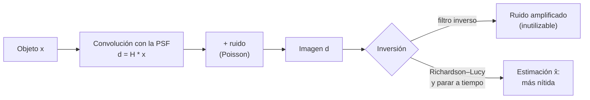

# B15-C11 — Deconvolución y enfoque

<!-- nav:top -->
[🏠 Programa](../../../../README.md) · [📚 Bloque B15](../../../tronco-comun/B15-senales-imagenes-y-estimacion-cientifica.md) · [← Anterior: B15-C10 — Histogramas y normalización](../B15-C10-histogramas-y-normalizacion/CLASE.md) · [Siguiente: B15-C12 — Detección de fuentes astronómicas →](../B15-C12-deteccion-de-fuentes-astronomicas/CLASE.md)
<!-- /nav -->

## 1. Ubicación, nivel y alcance

Undécima clase del bloque B15. En [C08](../B15-C08-convolucion-y-respuesta-impulsional/CLASE.md) viste que un sistema lineal e invariante *convoluciona* la entrada con su respuesta; una imagen desenfocada es el caso bidimensional: la luz de cada punto se reparte según la **función de dispersión del punto** (PSF). Aquí aprendes a describir el enfoque con la PSF, a intentar *deshacer* el desenfoque (deconvolución) con el método iterativo de Richardson–Lucy y, sobre todo, a entender por qué esa inversión es delicada: amplifica el ruido. Nivel N3. Usas la FFT ([C05](../B15-C05-transformada-rapida-de-fourier/CLASE.md)), la convolución (C08) y el ruido de [C09](../B15-C09-procesamiento-de-imagenes-digitales/CLASE.md). No verás detección de fuentes (C12) ni óptica adaptativa (B42).

## 2. Por qué esta clase existe

Un telescopio con un defecto de enfoque convierte cada estrella en una mancha. Dos estrellas cercanas pueden fundirse en una sola; el brillo de una galaxia, repartirse sobre sus vecinas. Si conoces la mancha (la PSF), puedes intentar recuperar la imagen original. Pero la matemática avisa: la información de los detalles más finos casi se pierde en el desenfoque, y revertirla multiplica el ruido. Hay que saber cuánto se puede recuperar y cuándo parar.

La decisión central: **¿cuánto detalle puedo recuperar de una imagen desenfocada sin inventar estructura ni disparar el ruido?**

## 3. Lo que podrás hacer al terminar

1. Describir el enfoque con la PSF y calcular su FWHM y la altura de su pico normalizado.
2. Expresar el desenfoque como convolución y entender su efecto en frecuencias.
3. Explicar por qué el filtro inverso amplifica el ruido.
4. Aplicar Richardson–Lucy a mano en un caso pequeño y con código en uno grande.
5. Elegir el número de iteraciones y justificar cuándo detenerse.
6. Reconocer lo que la deconvolución conserva (flujo total) y lo que no (flujo local).

La evidencia es la **deconvolución con medida de mejora y de artefactos** del ejercicio 12 (sección 20).

## 4. Con qué llegas y cómo comprobarlo

Necesitas convolución, FFT y ruido de Poisson. Cinco preguntas:

1. ¿Cuánto vale el área (suma) de una PSF normalizada?
2. ¿Qué dice el teorema de convolución?
3. Si el ruido de Poisson de una cuenta de 100 e⁻ es `√100`, ¿cuánto es?
4. ¿Cuánto es `exp(−2)`?
5. ¿Qué es el FWHM?

<details>
<summary>Ver respuestas</summary>

1. 1. 2. La DFT de la convolución (circular) es el producto de las DFT (C04, C08). 3. 10. 4. 0,135. 5. El ancho total de un pico a la mitad de su altura máxima.
</details>

Con cuatro o cinco aciertos, sigue; si no, repasa C08 y C09.

## 5. Un caso real: el defecto óptico del Hubble

Según el relato histórico de ESA/Hubble (S1), tras el lanzamiento el telescopio tenía un defecto de enfoque que le impedía tomar imágenes nítidas: el borde de su espejo estaba demasiado plano «por una cincuentava parte del ancho de un cabello humano». La solución definitiva no fue software: un paquete de óptica correctora, instalado por astronautas en la primera misión de servicio (diciembre de 1993). Sirve de advertencia: **la mejor «deconvolución» es una óptica bien enfocada**. Para estudiar el fenómeno sin datos reales, usamos una imagen **sintética** de 64 × 64 píxeles con tres fuentes puntuales y una PSF gaussiana de σ = 2 píxeles (FWHM 4,71 píxeles). Dos fuentes, de flujo 1000, distan 4 píxeles; la tercera, de flujo 500, está aislada. Es el **ejemplo conductor**.

## 6. Vocabulario

La **PSF** (*point spread function*) es la imagen que el sistema da de una fuente puntual; en el modelo, la respuesta impulsional bidimensional de C08. Una PSF **gaussiana** de desviación `σ` tiene **FWHM** `= 2√(2 ln 2) σ = 2,355 σ`. El **desenfoque** es la convolución `d = H ∗ x`. La **función de transferencia** `Ĥ(f)` es la DFT de la PSF: para una gaussiana, `Ĥ(f) = exp(−2π²σ²f²)`, que cae muy rápido con la frecuencia espacial `f`. La **deconvolución** intenta recuperar `x` a partir de `d` y `H`. El **filtro inverso** divide la DFT de `d` por `Ĥ`. El método de **Richardson–Lucy** (RL) es iterativo, conserva la positividad y es el que implementan bibliotecas como scikit-image (S2). Un **artefacto** es una estructura generada por el procesado, no presente en el objeto. La **regularización** limita la solución para controlar el ruido; en RL, el número de iteraciones «hace de regularización» (S2).

## 7. Modelo mental: una foto movida y un corrector

Una foto movida es la imagen verdadera arrastrada por la sacudida; si conoces cómo se movió la cámara, puedes intentar des-arrastrarla. Pero cuanto más fino era el detalle, más se borró; y al intentar devolverlo, el grano se multiplica. Analogía: foto movida. Su límite: en una foto movida a veces puedes inferir el movimiento; en astronomía, la PSF debe medirse (por ejemplo, con una estrella aislada) y puede variar por el campo.



*Descripción textual:* el objeto se convoluciona con la PSF y se le añade ruido; invertir con el filtro inverso amplifica el ruido hasta inutilizar la imagen, mientras que el método iterativo de Richardson–Lucy, detenido a tiempo, produce una estimación más nítida.

## 8. La explicación, paso a paso

### 8.1 El enfoque en números

Con PSF gaussiana: `FWHM = 2,355 σ` y pico normalizado `1/(2πσ²)`. Para `σ = 1`: FWHM 2,35 y pico 0,1592; para `σ = 1,5`: 3,53 y 0,0707; para `σ = 2`: 4,71 y 0,0398. Una estrella en foco concentra más luz en su píxel central: el cociente *pico/flujo* es una medida simple de enfoque.

### 8.2 Cuándo se funden dos fuentes

Dos fuentes iguales con perfil gaussiano de desviación `σ`, a distancia `d`, producen un único máximo si `d < 2σ`, y dos máximos si `d > 2σ` (resultado estándar de la suma de dos gaussianas). Con `σ = 2`, el límite es `d = 4`, que es justo nuestro caso: el laboratorio ve un solo máximo en la imagen borrosa, un caso al borde.

### 8.3 El filtro inverso y por qué falla

Como `d = H ∗ x`, la DFT cumple `d̂ = Ĥ x̂` (C04, C08). Despejar `x̂ = d̂/Ĥ` parece sencillo. Pero `Ĥ(f) = exp(−2π²σ²f²)` con `σ = 2`: en `f = 0,1` ciclos/píxel vale `0,454` (se amplifica 2,2 veces), en `f = 0,25` vale `0,0072` (139 veces) y en la esquina de Nyquist es del orden de `10⁻¹⁷`. El ruido, que está en todas las frecuencias, se multiplica por esos factores. El laboratorio da un error RMS de `3,9 × 10¹⁵` frente a `22,6` de los datos: inutilizable.

### 8.4 Richardson–Lucy

Con `x_0 = d` (o una imagen plana positiva), cada iteración hace
`x_{k+1} = x_k · [ (d / (H ∗ x_k)) ⋆ H ]`,
donde `⋆` es la correlación con la PSF (convolución con la PSF volteada). Qué hace: calcula cómo se vería la estimación actual (`H ∗ x_k`), compara con los datos (`d` dividido por ello) y corrige multiplicando donde faltó o sobró luz. Mantiene los valores positivos y, con PSF normalizada y convolución circular, **conserva el flujo total**: el laboratorio muestra `22 980,000000` antes y después de 1, 10, 100 y 300 iteraciones.

### 8.5 Qué recupera, sin ruido

Con datos sin ruido, a 100 iteraciones aparecen **dos** máximos en la fila de las dos fuentes (había uno en la imagen borrosa y en la de 10 iteraciones). El error RMS respecto a la verdad pasa de `22,69` (borrosa) a `20,49` (100 iteraciones) y `19,12` (300). El píxel de la fuente aislada (verdad `505`) pasa de `24,9` en la imagen borrosa a `52,1`, `100,4` y `131,8` tras 10, 100 y 300 iteraciones: RL converge **lentamente** para fuentes puntuales, y no recupera el valor del pico.

### 8.6 Con ruido: cuándo parar

Con ruido de Poisson, el error RMS de los datos es `22,610`. Con RL baja a `20,502` a las 200 iteraciones (mínimo `20,488` en 169) y sube después: `21,244` a las 500 y `22,849` a las 1000 (peor que los datos). Las iteraciones adicionales ajustan el ruido, no la señal. El máximo de la imagen sube de 97 (5 iteraciones) a 383 (1000), lo que indica concentración y «picos espurios». No existe un número universal; se elige por validación (una simulación con verdad conocida), por criterio de discrepancia o por inspección declarada.

### 8.7 Qué se puede y qué no se puede fiar

La deconvolución puede **resolver mejor** estructuras (separar dos máximos) y sacar **flujo total** conservado. No garantiza el flujo local (el pico de 505 solo llegó a 131,8), ni evita artefactos (anillos, picos). Por eso la fotometría y las posiciones de precisión se hacen, cuando es posible, sobre la imagen original ajustando el modelo de la PSF (C16), no sobre la deconvolucionada.

### 8.8 Enfocar es mejor que deconvolucionar

El caso del Hubble (S1) lo muestra: restaurar una óptica corrige a la vez *todas* las frecuencias espaciales; la deconvolución solo puede devolver lo que sobrevivió al desenfoque por encima del ruido.

## 9. Magnitudes, símbolos y unidades

| Símbolo | Qué es | Unidad | Nota |
|---|---|---|---|
| `x`, `d` | objeto verdadero e imagen observada | cuentas (e⁻ o ADU) | 2D |
| `H` | PSF normalizada | adimensional | suma = 1 |
| `σ` | desviación de la PSF | píxeles | 2 en el ejemplo |
| FWHM | ancho a media altura | píxeles | `2,355 σ` |
| `Ĥ(f)` | función de transferencia | adimensional | `exp(−2π²σ²f²)` |
| `f` | frecuencia espacial | ciclos/píxel | 0 a 0,5 |
| `k` | iteración de RL | — | número de pasos |

## 10. Convenciones y referencias

La convolución se hace de forma **circular** (con FFT), lo que supone una imagen periódica; en datos reales hay que rellenar los bordes. La PSF está centrada en el píxel (0, 0) para la FFT. Se trabaja con fuentes positivas y un fondo constante de 5. Todo es **sintético**; semilla 15011.

## 11. De dónde sale lo que afirmamos

| ID | Fuente | Localizador | Respalda | Estado |
|---|---|---|---|---|
| S1 | ESA/Hubble, *History: How Hubble Came About* | https://esahubble.org/about/history/ | Defecto de enfoque; espejo demasiado plano por una cincuentava parte del ancho de un cabello; corrección con óptica correctora en la primera misión de servicio (diciembre de 1993) | Consultada el 2026-11-05 mediante extracción automática |
| S2 | scikit-image, `skimage.restoration.richardson_lucy` (API estable) | https://scikit-image.org/docs/stable/api/skimage.restoration.html | Recupera una imagen degradada conociendo la PSF; `num_iter` (50 por defecto) «hace de regularización»; `filter_epsilon` evita divisiones por valores pequeños | Consultada el 2026-11-05 mediante extracción automática |

Límites: la iteración de RL escrita en 8.4, la función de transferencia gaussiana y el criterio `d = 2σ` son resultados estándar verificados numéricamente aquí, no contra un texto citado; el laboratorio usa una implementación propia (scikit-image no estaba instalado). La página de S1 no menciona la deconvolución. Los datos son sintéticos.

## 12. Cómo ver la deconvolución

Equivalente accesible a las imágenes del laboratorio:

| Cantidad | Valor |
|---|---|
| FWHM, separación de las dos fuentes | 4,71 px; 4 px |
| Máximos locales en la fila 32: borrosa / 10 / 100 / 300 it. | 1 / 1 / 2 / 2 |
| Pico de la fuente aislada: verdad / borrosa / 10 / 100 / 300 it. | 505 / 24,9 / 52,1 / 100,4 / 131,8 |
| Error RMS con ruido: datos / 5 / 50 / 200 / 1000 it. | 22,61 / 22,06 / 20,95 / 20,50 / 22,85 |
| Filtro inverso con ruido | 3,9 × 10¹⁵ |

Descripción larga: la imagen borrosa muestra tres manchas redondas (la de la izquierda doble pero fundida); tras 100 iteraciones la doble se ve con dos centros y la tercera es más pequeña y brillante; tras muchas iteraciones con ruido, aparece un moteado de puntitos brillantes sobre el fondo.

## 13. Ejemplo trabajado: una iteración de RL en cuatro píxeles

**Paso 1 · Datos (sintéticos).** Objeto `x = [0; 4; 0; 0]`; PSF `h = [0,25; 0,5; 0,25]` (circular, de longitud 4); convolución: `d = [1; 2; 1; 0]` (suma 4).

**Paso 2 · Estimación inicial.** `x₀ = d = [1; 2; 1; 0]`.

**Paso 3 · Cómo se vería.** `H ∗ x₀`: en cada píxel, `0,5 × (propio) + 0,25 × (dos vecinos circulares)`: `[0,5 + 0,25(0 + 2); 1 + 0,25(1 + 1); 0,5 + 0,25(2 + 0); 0 + 0,25(1 + 1)] = [1; 1,5; 1; 0,5]`.

**Paso 4 · Cociente.** `d/(H ∗ x₀) = [1; 1,333; 1; 0]`.

**Paso 5 · Correlación con la PSF (simétrica).** `[0,5 + 0,25(0 + 1,333); 0,667 + 0,25(1 + 1); 0,5 + 0,25(1,333 + 0); 0 + 0,25(1 + 1)] = [0,833; 1,167; 0,833; 0,5]`.

**Paso 6 · Actualizar.** `x₁ = x₀ · [0,833; 1,167; 0,833; 0,5] = [0,833; 2,333; 0,833; 0]`. Suma: `4,000` (conservada). El pico subió de 2 a 2,333 y el objeto verdadero (4) está aún lejos: convergencia lenta.

## 14. Distintas formas de deshacer el desenfoque

El **filtro inverso**: simple y exacto sin ruido, inutilizable con ruido. El **filtro de Wiener** (no se desarrolla aquí) limita la amplificación según la relación señal–ruido. **Richardson–Lucy**: iterativo, positivo, conserva el flujo; hay que decidir cuándo parar. **Ajuste de modelos** (C16): si sabes que hay pocas fuentes puntuales, ajustar la PSF a cada una da posiciones y flujos más fiables. Y la mejor opción: **mejorar el instrumento** (S1).

## 15. Práctica guiada

**Ejercicio 1 · con los pasos indicados.** Calcula el FWHM y el pico normalizado de una PSF gaussiana con `σ = 1,5` píxeles. *Pasos:* `2,355 σ` y `1/(2πσ²)`.

<details><summary>Solución comentada</summary>

FWHM `= 2,355 × 1,5 = 3,53`; pico `= 1/(2π × 2,25) = 0,0707` (8.1).
</details>

**Ejercicio 2 · con una pista.** Dos fuentes iguales con PSF de `σ = 2`: ¿a qué separación aparecen dos máximos en la imagen borrosa? *Pista:* `d > 2σ`.

<details><summary>Solución comentada</summary>

`d > 4` píxeles (0,85 del FWHM). Con `d = 4` está justo en el límite (8.2).
</details>

**Ejercicio 3 · casi autónomo.** Una imagen borrosa suma 22 980. ¿Cuánto suma tras 50 iteraciones de RL con PSF normalizada y convolución circular?

<details><summary>Solución comentada</summary>

22 980: el flujo total se conserva (8.4).
</details>

## 16. Práctica autónoma, transferencia e integrador

**Ejercicio 4.** En el ejemplo de 13, comprueba que la segunda estimación `x₁ = [0,833; 2,333; 0,833; 0]` conserva la suma de `d`.

<details><summary>Solución comentada</summary>

`0,833 + 2,333 + 0,833 + 0 = 4,000` = suma de `d` (8.4, 13).
</details>

**Ejercicio 5.** Para `σ = 2`, calcula `Ĥ` en `f = 0,1` y en `f = 0,25` y el factor de amplificación del filtro inverso.

<details><summary>Solución comentada</summary>

`Ĥ(0,1) = exp(−2π² · 4 · 0,01) = exp(−0,790) = 0,454` ⇒ ×2,2. `Ĥ(0,25) = exp(−2π² · 4 · 0,0625) = exp(−4,935) = 0,0072` ⇒ ×139 (8.3).
</details>

**Ejercicio 6.** Una cuenta de 100 e⁻ tiene ruido de Poisson de 10 e⁻. ¿Qué ruido tendría, en esa frecuencia, el filtro inverso con amplificación 139?

<details><summary>Solución comentada</summary>

`10 × 139 = 1390` e⁻: mayor que la señal (8.3).
</details>

**Ejercicio 7.** En el laboratorio con ruido, el error RMS vale 22,61 en los datos, 20,49 en el mínimo (169 iteraciones) y 22,85 a las 1000. ¿Qué concluyes sobre iterar 1000 veces?

<details><summary>Solución comentada</summary>

Empeora los datos: el algoritmo ajusta el ruido. Hay que detener las iteraciones antes (8.6).
</details>

**Ejercicio 8.** Dos imágenes de la misma estrella tienen PSF con `σ = 1,5` y `σ = 2`. ¿Cuál está mejor enfocada y cuánto mayor es su pico normalizado?

<details><summary>Solución comentada</summary>

La de `σ = 1,5`; pico `0,0707/0,0398 = 1,78 = (2/1,5)²` (8.1).
</details>

**Ejercicio 9 · transferencia.** ¿Por qué la corrección óptica del Hubble (S1) restauró la imagen mejor que cualquier deconvolución posible?

<details><summary>Solución comentada</summary>

Porque la óptica corregida recupera todas las frecuencias espaciales en el propio detector; la deconvolución parte de datos en los que las frecuencias altas quedaron casi borradas bajo el ruido (`Ĥ` muy pequeña, 8.3, 8.8).
</details>

**Ejercicio 10 · transferencia.** Deconvolucionas con una PSF de `σ = 1,8` cuando la real es `σ = 2,0`. ¿Qué esperas? ¿Y si usas `σ = 2,4`?

<details><summary>Solución comentada</summary>

Con `σ` subestimada (1,8), queda desenfoque residual (la imagen sigue algo borrosa). Con `σ` sobrestimada (2,4), la corrección es excesiva y aparecen anillos y picos espurios. Una PSF errónea es una fuente de artefactos; por eso se mide la PSF en el propio campo (8.7).
</details>

**Ejercicio 11 · transferencia.** Tras 300 iteraciones, el píxel de la fuente aislada pasó de 24,9 a 131,8 (verdad 505). ¿Puedes medir el flujo de esa fuente en el pico de la imagen deconvolucionada?

<details><summary>Solución comentada</summary>

No: el pico no ha convergido (26 % del valor), y cambia con las iteraciones. Mide el flujo sumando una apertura (que sí se conserva aproximadamente) o ajustando la PSF a la imagen original (8.5, 8.7).
</details>

**Ejercicio 12 · integrador.** Elabora tu *deconvolución con medida de mejora y de artefactos*: con tu propia imagen sintética (dos fuentes cercanas y una aislada), PSF gaussiana y ruido de Poisson, aplica RL, grafica o tabula el error RMS frente al número de iteraciones, indica el número elegido y por qué, cuenta máximos en la fila de las dos fuentes, verifica la conservación del flujo y muestra el resultado del filtro inverso.

<details><summary>Solución modelo</summary>

Tabla de error con mínimo a un cierto número de iteraciones (no 0 ni el máximo), conteo de máximos pasando de 1 a 2, flujo conservado con diferencia relativa menor que `10⁻⁸`, filtro inverso con error de varios órdenes de magnitud mayor que los datos, y la advertencia de que el pico no converge. Datos sintéticos, semilla y versiones; fuentes S1–S2 con fecha.
</details>

## 17. Laboratorio: Richardson–Lucy contra el filtro inverso

El script [deconvolucion.py](deconvolucion.py) genera la imagen sintética, la difumina con una PSF gaussiana por FFT, aplica RL propio con y sin ruido, comprueba la conservación del flujo y la aparición de dos máximos, busca el número de iteraciones que minimiza el error y compara con el filtro inverso.

**Datos:** sintéticos, semilla 15011. **Predice antes de ejecutar:** ¿conserva RL la suma de la imagen? (sí, `22 980`.) **Ejecución del 2026-11-05 (Python 3.12.9, NumPy 2.4.4):**

```text
FWHM = 4.71 px; separación de las dos fuentes = 4 px; flujo total = 22980
mín |H| = 4.06e-18 (teoría en la esquina de Fourier, exp(-2 pi^2 sigma^2 (0.25+0.25)) = 7.16e-18)
(1) sin ruido: suma de la imagen borrosa 22980.000000; tras 1/10/100/300 it.: 22980.000000, 22980.000000, 22980.000000, 22980.000000
    máximos locales entre x=24..40 en la fila 32: borrosa 1, 10 it. 1, 100 it. 2, 300 it. 2
    error RMS respecto a la verdad: borrosa 22.690; 10 it. 22.032; 100 it. 20.486; 300 it. 19.119
    valor del píxel de la fuente aislada (14,14): verdad 505; borrosa 24.9; 10 it. 52.1; 100 it. 100.4; 300 it. 131.8
(2) con ruido de Poisson: error RMS respecto a la verdad
    datos borrosos y ruidosos: 22.610
       5 iteraciones: 22.064   (máx. 97, mín. 0.00)
      10 iteraciones: 21.805   (máx. 113, mín. 0.00)
      20 iteraciones: 21.469   (máx. 131, mín. 0.00)
      50 iteraciones: 20.946   (máx. 167, mín. 0.00)
     100 iteraciones: 20.599   (máx. 205, mín. 0.00)
     200 iteraciones: 20.502   (máx. 247, mín. 0.00)
     500 iteraciones: 21.244   (máx. 291, mín. 0.00)
    1000 iteraciones: 22.849   (máx. 383, mín. 0.00)
    mínimo del error en 169 iteraciones: 20.488
(3) filtro inverso con ruido: error RMS 3.889e+15 (datos: 22.610)
(4) PSF gaussiana sigma = 1.0: FWHM 2.35 px; valor máximo de la PSF normalizada = 0.1592
(4) PSF gaussiana sigma = 1.5: FWHM 3.53 px; valor máximo de la PSF normalizada = 0.0707
(4) PSF gaussiana sigma = 2.0: FWHM 4.71 px; valor máximo de la PSF normalizada = 0.0398
Pruebas superadas.
```

```bash
python programa/clases/B15/B15-C11-deconvolucion-y-enfoque/deconvolucion.py
```

**Límites:** convolución circular; PSF conocida, uniforme y gaussiana; sin PSF desajustada; el error RMS global está dominado por los píxeles de las fuentes, por lo que mejora poco en cifras aunque la resolución mejore claramente.

## 18. Errores frecuentes y cómo corregirlos

**Aplicar el filtro inverso a datos con ruido.** Se corrige con los ejercicios 5 y 6.

**Iterar «hasta que se vea bien» sin criterio.** Se corrige con el ejercicio 7.

**Medir flujos en el pico de una imagen deconvolucionada.** Se corrige con el ejercicio 11.

**Usar una PSF que no corresponde al instrumento y al campo.** Se corrige con el ejercicio 10.

**Presentar una imagen deconvolucionada como si fuera el dato.** Siempre se rotula como procesada.

## 19. Cómo sabrás que vas bien

Tras 8.1: ¿calculas FWHM y pico para una `σ` dada? Si no, ejercicio 1. Tras 8.3: ¿por qué falla el filtro inverso? Si no lo explicas, ejercicios 5 y 6. Tras 8.6: ¿cuándo detienes RL? Si no, ejercicio 7.

## 20. Qué entregas y cómo se evalúa

El producto es tu **deconvolución con medida de mejora y de artefactos** (ejercicio 12).

| Criterio | Inicial | En desarrollo | Logrado | Destacado |
|---|---|---|---|---|
| PSF | No la declara | La declara sin medirla | Declarada con FWHM y normalización | Discute su incertidumbre |
| Método | Solo filtro inverso | RL sin criterio de parada | RL con número de iteraciones justificado | Compara con otro método |
| Mejora | Cualitativa | Un indicador | Error RMS, máximos y flujo | Distingue resolución y fotometría |
| Artefactos | Ignorados | Mencionados | Identificados con ejemplos | Cuantificados |
| Fuentes y rótulos | Sin fuente | Sin fecha | Con localizador y fecha | Rotula la imagen como procesada |

**Condiciones críticas (no se compensan con promedio):** declarar la PSF y el número de iteraciones; no presentar la imagen deconvolucionada como dato; citar solo fuentes consultadas.

## 21. Ética, seguridad y límites

La deconvolución puede crear estructuras que no existen. Una imagen deconvolucionada nunca debe usarse como evidencia de detección sin comprobarla en el dato original. Rotula siempre el procesado y conserva el original. Accesibilidad: las imágenes tienen descripción y tabla; el laboratorio funciona sin conexión.

## 22. Para cerrar y seguir

Un desenfoque es una convolución con la PSF; invertirlo directamente amplifica el ruido; Richardson–Lucy lo hace con positividad y conserva el flujo, pero hay que parar a tiempo y no confiar en los picos; el mejor enfoque es el óptico. Queda abierta una pregunta: dada una imagen con muchas fuentes y ruido, ¿cómo decidimos cuáles son reales?

**Glosario español–inglés.** función de dispersión del punto · *point spread function*; deconvolución · *deconvolution*; desenfoque · *blur*; filtro inverso · *inverse filter*; función de transferencia · *transfer function*; regularización · *regularization*; artefacto · *artifact*.

**Continuidad.** B15-C12 reutiliza tu manejo de la PSF y del ruido para la **detección de fuentes astronómicas**.

**Referencias:** ver sección 11.

<!-- nav:bottom -->
---

[← Anterior: B15-C10 — Histogramas y normalización](../B15-C10-histogramas-y-normalizacion/CLASE.md) · [📚 Bloque B15](../../../tronco-comun/B15-senales-imagenes-y-estimacion-cientifica.md) · [Siguiente: B15-C12 — Detección de fuentes astronómicas →](../B15-C12-deteccion-de-fuentes-astronomicas/CLASE.md)
<!-- /nav -->
