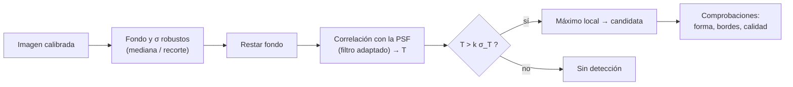

# B15-C12 — Detección de fuentes astronómicas

<!-- nav:top -->
[🏠 Programa](../../../../README.md) · [📚 Bloque B15](../../../tronco-comun/B15-senales-imagenes-y-estimacion-cientifica.md) · [← Anterior: B15-C11 — Deconvolución y enfoque](../B15-C11-deconvolucion-y-enfoque/CLASE.md) · [Siguiente: B15-C13 — Segmentación de imágenes →](../../../tronco-comun/B15-senales-imagenes-y-estimacion-cientifica.md#b15-c13)
<!-- /nav -->

## 1. Ubicación, nivel y alcance

Duodécima clase del bloque B15. Tienes imágenes calibradas ([C09](../B15-C09-procesamiento-de-imagenes-digitales/CLASE.md)), sabes mostrarlas ([C10](../B15-C10-histogramas-y-normalizacion/CLASE.md)) y conoces cómo la PSF las difumina ([C11](../B15-C11-deconvolucion-y-enfoque/CLASE.md)). Ahora la pregunta clave de un catálogo: **¿qué puntos de la imagen son fuentes reales?** Aprenderás a estimar el fondo y el ruido, a aplicar un filtro adaptado a la PSF, a fijar un umbral con las falsas alarmas y la completitud como criterios y a leer los resultados iniciales. Nivel N3. No verás segmentación de objetos extensos (C13) ni seguimiento (C17).

## 2. Por qué esta clase existe

Un catálogo de fuentes es el producto básico de una imagen astronómica, y de él salen cuentas, colores y candidatos a objetos nuevos. Si el umbral es bajo, el catálogo se llena de ruido; si es alto, se pierden las fuentes débiles. Y el número exacto importa: con 40 000 píxeles, un umbral de 3σ produce decenas de falsas detecciones; uno de 5σ, casi ninguna, pero se pierde media población de fuentes cercanas al límite. Detectar es un compromiso medible, no una impresión visual.

La decisión central: **¿qué umbral y qué filtro uso para que el catálogo tenga pocas falsas fuentes y pierda pocas reales, y cuánto vale cada cosa?**

## 3. Lo que podrás hacer al terminar

1. Estimar el fondo y el ruido de una imagen con fuentes sin que estas lo sesguen.
2. Construir un filtro adaptado a una PSF gaussiana y calcular el ruido de su salida.
3. Calcular la relación señal–ruido de una fuente de flujo conocido.
4. Predecir la tasa de falsas alarmas y la completitud para un umbral dado.
5. Elegir un umbral con criterios declarados.
6. Verificar un detector con simulaciones de verdad conocida.

La evidencia es el **catálogo de fuentes con criterios de detección** del ejercicio 12 (sección 20).

## 4. Con qué llegas y cómo comprobarlo

Necesitas la convolución, la PSF y la probabilidad gaussiana. Cinco preguntas:

1. ¿Qué fracción de una distribución normal supera `+1σ`? (aproximada, 16 %.) ¿Y `+3σ`?
2. ¿Cuántos píxeles tiene una imagen de 200 × 200?
3. ¿Cuál es la desviación de la media de `N` datos blancos de desviación `σ`?
4. ¿Qué hace una correlación con una PSF?
5. ¿Qué es la mediana?

<details>
<summary>Ver respuestas</summary>

1. 15,9 % y 0,135 %. 2. 40 000. 3. `σ/√N`. 4. Compara la imagen con la forma de la PSF en cada posición (como la convolución con la PSF volteada). 5. El valor central de los datos ordenados.
</details>

Con cuatro o cinco aciertos, sigue; si no, repasa C03, C08 y C11.

## 5. Un caso real: el estándar de «5 sigma»

Las bibliotecas de detección usadas en astronomía, como `photutils` (S1, documentación 3.1.1), siguen el mismo esquema: restar una estimación robusta del fondo, convolucionar con un núcleo gaussiano (su ejemplo usa un FWHM de 2,5 píxeles) y marcar los máximos que superan un umbral dado en unidades del ruido (su ejemplo usa 5 veces la desviación del fondo), filtrando después por redondez y nitidez. Nuestro caso es **sintético**: una imagen de 200 × 200 con fondo 100 ADU, ruido blanco gaussiano de 5 ADU y fuentes puntuales con PSF gaussiana de σ = 1,5 píxeles, para poder contar aciertos y errores con verdad conocida. Es el **ejemplo conductor**.

## 6. Vocabulario

El **fondo** (*background*) es el nivel del cielo sin fuentes; el **ruido** `σ` su desviación. La **relación señal–ruido** (SNR) de una medida es su valor dividido por su incertidumbre. El **filtro adaptado** (*matched filter*) es la correlación de la imagen con la propia PSF normalizada `p` (suma 1): maximiza la SNR de una fuente puntual en ruido blanco. El **umbral** `k` se expresa en unidades del ruido de la imagen filtrada, `σ_T`. Una **falsa alarma** es una detección que no corresponde a ninguna fuente; su **tasa** es la fracción de píxeles (o el número por imagen) que superan el umbral solo por ruido. La **completitud** es la fracción de fuentes reales de un flujo dado que se detectan. El **recorte iterativo** (*sigma clipping*) estima fondo y ruido descartando valores muy alejados. La estimación se complica por la **contaminación**: las alas de las fuentes elevan el fondo medido.

## 7. Modelo mental: buscar una nota en una sala ruidosa

Buscar una estrella débil es como buscar una nota de flauta en una sala ruidosa: sabes cómo suena (la PSF), así que escuchas selectivamente esa forma (filtro adaptado) en lugar de cada píxel por separado. Y decides cuánto debe sobresalir para declararla (umbral). Analogía: oír una nota conocida. Su límite: en una sala hay notas parecidas (galaxias compactas, rayos cósmicos, artefactos) que el filtro no distingue por sí solo.



*Descripción textual:* se estima y resta el fondo, se filtra con la PSF, se compara cada píxel filtrado con un umbral en unidades de su ruido, se toman los máximos locales como candidatas y se revisan con criterios de forma y calidad.

## 8. La explicación, paso a paso

### 8.1 Fondo y ruido sin que las fuentes los sesguen

Si hay fuentes, la media sube y la desviación también. En el laboratorio, 100 fuentes brillantes de flujo 1000 ADU elevan la **media** del fondo a 102,50 ADU (real 100,0) y la desviación global a 10,34 (real 5,0). La **mediana** (100,82) y la desviación robusta por la mediana de desviaciones absolutas, `1,4826 · mediana|d − mediana|` (5,59), sesgan menos. Con **recorte iterativo a 3σ**, la media baja a 100,53 y la desviación a 5,21. Ninguno es perfecto: las alas débiles de las fuentes siguen contaminando, por lo que en la práctica se enmascaran las fuentes y se repite (S1 usa un recorte a 3σ para el fondo).

### 8.2 El filtro adaptado

Para ruido blanco de desviación `σ` y una PSF normalizada `p` (con `Σ p = 1`), la imagen filtrada es `T = p ⋆ (d − fondo)`. Cada valor de `T` es una suma ponderada de ruido independiente, con desviación

`σ_T = σ √(Σ p²)`.

Para `σ_p = 1,5` píxeles, `Σ p² = 0,03537` (aproximación continua `1/(4πσ_p²) = 0,03537`), `√Σp² = 0,1881` y `σ_T = 0,940 ADU` con `σ = 5` ADU. El laboratorio mide `0,9420`.

### 8.3 La SNR de una fuente

Una fuente de flujo `F` centrada en un píxel da `T = F Σ p²` en ese píxel, de modo que

`SNR = T/σ_T = F √(Σ p²)/σ`.

Un pixel aislado daría `F p₀/σ` con `p₀ = 0,0707` (el valor máximo de la PSF normalizada): el filtro adaptado gana un factor `√(Σp²)/p₀ = 0,1881/0,0707 = 2,66`. Para `SNR = 5` hace falta `F = 5 · 5/0,1881 = 132,9 ADU`.

### 8.4 Umbral y falsas alarmas

Con umbral `T > k σ_T`, la probabilidad de que un píxel de puro ruido lo supere es `Q(k) = 1 − Φ(k)`: `3,17 × 10⁻⁵` para `k = 4`, `2,87 × 10⁻⁷` para `k = 5`. En 100 imágenes de ruido de 200 × 200 el laboratorio cuenta 117 píxeles sobre 4σ; se esperan 127. En una imagen de 40 000 píxeles, `k = 4` da `1,3` falsos píxeles y `k = 5` da `0,011`. Los píxeles vecinos del filtrado están correlacionados, de modo que los excesos vienen en grupos: el número de *detecciones* es menor que el de píxeles. El umbral hay que elegirlo para la cantidad de píxeles que se examinan (el «factor de ensayos» de C06).

### 8.5 Completitud

Si una fuente tiene SNR `s` y el umbral es `k`, la probabilidad de detectarla es `Φ(s − k)`. En el laboratorio, con umbral 4: `s = 3` → 16,1 % (teoría 15,9 %); `s = 4` → 50,7 % (50 %); `s = 5` → 84,6 % (84,1 %); `s = 6` → 97,6 % (97,7 %); `s = 7` → 99,9 %. La completitud es 50 % cuando la SNR iguala al umbral y sube rápido unas unidades por encima.

### 8.6 Elegir el umbral

No hay un `k` universal. Si necesitas que al menos el 95 % de las fuentes de SNR 5 se detecten, `Φ(5 − k) ≥ 0,95` exige `k ≤ 3,36`, con un coste de unas 16 falsas por imagen de 40 000 píxeles. Si necesitas menos de una falsa en 10⁸ píxeles, `Q(k) < 10⁻⁸` exige `k ≈ 5,6` y pierdes toda fuente de SNR menor que ese valor (el 50 % de las de SNR 5,6). El umbral depende del objetivo: un catálogo limpio, o uno completo con seguimiento posterior.

### 8.7 Lo que el detector no sabe

Un máximo sobre el umbral es una *candidata*. Puede ser un rayo cósmico, un píxel caliente, una galaxia compacta o un reflejo. Los detectores reales añaden pruebas de redondez y nitidez (S1) y los equipos verifican con imágenes repetidas. El laboratorio supone ruido gaussiano blanco, PSF conocida y fuentes aisladas; en datos reales, el ruido está correlacionado tras el remuestreo y la PSF cambia por el campo: mide `σ_T` directamente en la imagen filtrada.

## 9. Magnitudes, símbolos y unidades

| Símbolo | Qué es | Unidad | Nota |
|---|---|---|---|
| `d` | imagen calibrada | ADU | fondo 100 |
| `σ` | ruido blanco por píxel | ADU | 5 |
| `p` | PSF normalizada | adimensional | `Σ p = 1`, `σ_p = 1,5` px |
| `Σp²` | suma de cuadrados de la PSF | adimensional | 0,03537 |
| `T`, `σ_T` | imagen filtrada y su ruido | ADU | `σ_T = 0,940` |
| `F` | flujo de la fuente | ADU | 79,8–186,1 |
| `SNR` | relación señal–ruido | adimensional | `F√Σp²/σ` |
| `k` | umbral | en unidades de `σ_T` | 4 |
| `Q(k)`, `Φ` | cola y distribución normal | — | |

## 10. Convenciones y referencias

Las fuentes están centradas en el píxel (caso ideal para que `SNR` sea exacta; con centrado arbitrario, la SNR en el píxel central es menor). `Φ` es la distribución normal estándar. Correlación circular con FFT para el laboratorio. Todo es **sintético**; semilla 15012.

## 11. De dónde sale lo que afirmamos

| ID | Fuente | Localizador | Respalda | Estado |
|---|---|---|---|---|
| S1 | Astropy/photutils, *Point-like Source Detection (photutils.detection)*, documentación 3.1.1 | https://docs.astropy.org/projects/photutils/en/stable/user_guide/detection.html | Fondo con recorte a 3σ; umbral en unidades del ruido del fondo (ejemplo: 5 veces la desviación); convolución con núcleo gaussiano (FWHM 2,5 píxeles en el ejemplo); filtrado por redondez y nitidez | Consultada el 2026-11-05 mediante extracción automática |

Límites: las fórmulas de `σ_T`, de la SNR y de la completitud se deducen de resultados estándar de ruido gaussiano y se verifican en el laboratorio, no contra un texto citado; S1 se usó solo para el esquema general de detección. Los datos son sintéticos.

## 12. Cómo ver la detección

Equivalente accesible a los mapas del laboratorio:

| Cantidad | Valor |
|---|---|
| `Σp²`, `σ_T` esperada / medida | 0,03537; 0,9403 / 0,9420 ADU |
| Píxeles sobre 4σ en 100 imágenes de ruido (observado / esperado) | 117 / 127 |
| Completitud con umbral 4 (SNR 3, 4, 5, 6, 7) | 0,161 / 0,507 / 0,846 / 0,976 / 0,999 |
| Teoría `Φ(SNR − 4)` | 0,159 / 0,500 / 0,841 / 0,977 / 0,999 |
| Fondo con media / mediana / recorte | 102,50 / 100,82 / 100,53 ADU (real 100) |

Descripción larga: la imagen filtrada es más suave que la original y, en ella, cada fuente es un máximo redondeado; el ruido forma grumos de un tamaño similar al de la PSF, sobre los cuales solo los más altos pasan el umbral.

## 13. Ejemplo trabajado: ¿se detecta una fuente de 106 ADU?

**Paso 1 · Datos (sintéticos).** `σ = 5`, `σ_p = 1,5`, umbral `k = 4`. Fuente de `F = 106,3` ADU.

**Paso 2 · Ruido filtrado.** `σ_T = 5 · 0,1881 = 0,940` ADU.

**Paso 3 · Señal filtrada.** `T = F Σp² = 106,3 · 0,03537 = 3,760` ADU.

**Paso 4 · SNR.** `3,760/0,940 = 4,00`.

**Paso 5 · Probabilidad de detección.** `Φ(4,00 − 4) = Φ(0) = 0,50`. El laboratorio: 50,7 %.

**Paso 6 · Falsas alarmas del umbral.** `Q(4) = 3,17 × 10⁻⁵` por píxel: 1,3 por imagen de 40 000 píxeles.

**Paso 7 · Lectura.** Con este umbral, una fuente de 106 ADU se detecta en la mitad de los casos y la imagen contiene en promedio una falsa. Si el objetivo es un catálogo fiable, esta fuente se descarta o se confirma con otra observación.

## 14. Distintas formas de detectar

**Umbral en píxeles individuales**: simple, pero con una SNR 2,7 veces menor que la del filtro adaptado (8.3). **Filtro adaptado**: óptimo para fuentes puntuales en ruido blanco, y sensible a la forma de la PSF. **Segmentación por umbral** (C13): sirve para objetos extensos. **Ajuste de modelos** (C16): da posiciones y flujos refinados una vez detectada la candidata. **Detección con varias imágenes** (apilado): sube la SNR como `√n`.

## 15. Práctica guiada

**Ejercicio 1 · con los pasos indicados.** Con `σ = 5` ADU y `Σp² = 0,03537`, calcula `σ_T`. *Pasos:* `σ √Σp²`.

<details><summary>Solución comentada</summary>

`√0,03537 = 0,1881`; `σ_T = 5 · 0,1881 = 0,940` ADU (8.2).
</details>

**Ejercicio 2 · con una pista.** Calcula la SNR de una fuente de `F = 106,3` ADU. *Pista:* `F √Σp²/σ`.

<details><summary>Solución comentada</summary>

`106,3 · 0,1881/5 = 4,00` (8.3).
</details>

**Ejercicio 3 · casi autónomo.** ¿Qué flujo da `SNR = 5`?

<details><summary>Solución comentada</summary>

`F = 5 · 5/0,1881 = 132,9` ADU (8.3).
</details>

## 16. Práctica autónoma, transferencia e integrador

**Ejercicio 4.** ¿Cuánto mejora la SNR el filtro adaptado respecto a mirar solo el píxel central, para `σ_p = 1,5`?

<details><summary>Solución comentada</summary>

Un píxel: `F p₀/σ` con `p₀ = 0,0707`; filtro: `F √Σp²/σ` con `0,1881`. Razón `2,66` (8.3). Con `F = 132,9`: SNR 1,88 frente a 5.
</details>

**Ejercicio 5.** ¿Cuántos píxeles falsos esperas en una imagen de 40 000 píxeles con umbrales 3σ y 5σ? Usa `Q(3) = 1,35 × 10⁻³` y `Q(5) = 2,87 × 10⁻⁷`.

<details><summary>Solución comentada</summary>

3σ: `40 000 · 1,35 × 10⁻³ = 54`; 5σ: `40 000 · 2,87 × 10⁻⁷ = 0,011` (8.4).
</details>

**Ejercicio 6.** Un sondeo examina 10⁸ píxeles y quieres menos de una falsa detección. ¿Qué `k` aproximado necesitas?

<details><summary>Solución comentada</summary>

`Q(k) < 10⁻⁸` ⇒ `k ≈ 5,6` (8.6).
</details>

**Ejercicio 7.** ¿Por qué la completitud es 50 % cuando la SNR de la fuente iguala al umbral?

<details><summary>Solución comentada</summary>

El valor filtrado tiene distribución normal centrada en `SNR` con desviación 1; está sobre `k = SNR` con probabilidad `Φ(0) = 0,5` (8.5).
</details>

**Ejercicio 8.** Quieres detectar el 95 % de las fuentes de SNR 5. ¿Qué umbral máximo usas y cuántas falsas por imagen de 40 000 píxeles hay (con `Q(3,36) ≈ 3,9 × 10⁻⁴`)?

<details><summary>Solución comentada</summary>

`Φ(5 − k) = 0,95` ⇒ `5 − k = 1,645` ⇒ `k = 3,36`. Falsas: `40 000 · 3,9 × 10⁻⁴ ≈ 16` (8.6).
</details>

**Ejercicio 9 · transferencia.** El fondo se estima con la media y sale 2,5 ADU alto (como en el laboratorio). ¿Cómo afecta eso a `T` y a las detecciones?

<details><summary>Solución comentada</summary>

Como `Σp = 1`, `T` queda sesgada en −2,5 ADU, es decir, `−2,5/0,94 = −2,66σ_T`: las fuentes pierden casi 3σ de SNR y la completitud cae. Si el sesgo fuera de signo contrario, `Q(4 − 2,66) = Q(1,34) ≈ 9 %` de los píxeles superarían el umbral. El fondo hay que estimarlo bien (8.1).
</details>

**Ejercicio 10 · transferencia.** Buscas en 40 000 píxeles y aparece un candidato a 5,2σ. ¿Cuál es la probabilidad de que el ruido genere al menos un valor así? (`Q(5,2) = 9,96 × 10⁻⁸`.)

<details><summary>Solución comentada</summary>

`40 000 · 9,96 × 10⁻⁸ ≈ 4,0 × 10⁻³` (0,4 %). Es muy improbable por ruido gaussiano, pero conviene descartar artefactos antes de aceptarlo (8.7).
</details>

**Ejercicio 11 · transferencia.** Tras remuestrear la imagen, el ruido de píxeles vecinos está correlacionado. ¿Sigue valiendo `σ_T = σ√Σp²`? ¿Qué haces?

<details><summary>Solución comentada</summary>

No: la fórmula supone ruido blanco. Mide `σ_T` directamente en la imagen filtrada (con estimación robusta) y úsalo en el umbral (8.7).
</details>

**Ejercicio 12 · integrador.** Elabora tu *catálogo de fuentes con criterios de detección*: con una imagen sintética propia, estima fondo y ruido con recorte, filtra con la PSF, fija un umbral, detecta máximos locales, compara con la lista de fuentes inyectadas (aciertos, falsas, perdidas), y reporta completitud por intervalo de SNR y falsas por imagen contra la teoría.

<details><summary>Solución modelo</summary>

Tabla con fondo y `σ` estimados, `σ_T` medida, número de detecciones, falsas por imagen (~`N_pix Q(k)`), completitud `≈ Φ(SNR − k)` por SNR y la justificación del umbral. Datos sintéticos, semilla, versiones y fuente S1 con fecha.
</details>

## 17. Laboratorio: filtro adaptado, falsas alarmas y completitud

El script [deteccion.py](deteccion.py) comprueba que el ruido filtrado mide `σ √Σp²`, que la tasa de falsos píxeles coincide con `Q(k)`, que la completitud coincide con `Φ(SNR − k)` para cinco niveles de SNR (4000 intentos por nivel) y que el recorte iterativo acerca el fondo al valor real mejor que la media o la mediana.

**Datos:** sintéticos, semilla 15012. **Predice antes de ejecutar:** ¿qué completitud tendrá una fuente con SNR 4 y umbral 4? (≈ 50 %.) **Ejecución del 2026-11-05 (Python 3.12.9, NumPy 2.4.4):**

```text
Sum p^2 = 0.03537 (aprox. continua 1/(4 pi sigma_p^2) = 0.03537); std(T) esperada = 0.9403 ADU
(1) std(T) medida = 0.9420 (esperada 0.9403)
(2) píxeles sobre 4 sigma en 100 imágenes de ruido: 117 (esperados 127)
(3) completitud con umbral 4 sigma (fuentes centradas en un píxel):
    SNR = 3: flujo   79.8 ADU; detectadas 0.161; teórico 0.159
    SNR = 4: flujo  106.3 ADU; detectadas 0.507; teórico 0.500
    SNR = 5: flujo  132.9 ADU; detectadas 0.846; teórico 0.841
    SNR = 6: flujo  159.5 ADU; detectadas 0.976; teórico 0.977
    SNR = 7: flujo  186.1 ADU; detectadas 0.999; teórico 0.999
(4) con 100 fuentes brillantes (fondo real 100.0, sigma real 5.0):
    media 102.50; mediana 100.82; media con recorte a 3 sigma 100.53
    sigma: desviación global 10.34; robusta (MAD) 5.59; con recorte 5.21
Pruebas superadas.
```

```bash
python programa/clases/B15/B15-C12-deteccion-de-fuentes-astronomicas/deteccion.py
```

**Límites:** ruido blanco gaussiano; fuentes aisladas y centradas en el píxel; la detección se evalúa en la posición conocida (no se busca el máximo en toda la imagen); no se prueba la separación de fuentes cercanas ni de objetos extensos.

## 18. Errores frecuentes y cómo corregirlos

**Estimar el fondo con la media en un campo con fuentes.** Se corrige con el ejercicio 9.

**Fijar un umbral «de siempre» sin contar píxeles.** Se corrige con los ejercicios 5 y 6.

**Confundir candidata con fuente real.** Sección 8.7 y ejercicio 10.

**Usar `σ√Σp²` con ruido correlacionado.** Se corrige con el ejercicio 11.

**Reportar el catálogo sin completitud ni falsas alarmas.** Se corrige con el ejercicio 12.

## 19. Cómo sabrás que vas bien

Tras 8.2: ¿calculas `σ_T`? Si no, ejercicio 1. Tras 8.5: ¿por qué 50 % de completitud con SNR igual al umbral? Si no, ejercicio 7. Tras 8.6: ¿cómo elegirías `k` para un sondeo grande? Si no, ejercicios 6 y 8.

## 20. Qué entregas y cómo se evalúa

El producto es tu **catálogo de fuentes con criterios de detección** (ejercicio 12).

| Criterio | Inicial | En desarrollo | Logrado | Destacado |
|---|---|---|---|---|
| Fondo y ruido | Media simple | Mediana | Recorte iterativo y comparación | Enmascara fuentes y repite |
| Filtro y umbral | Píxel a píxel | Filtro sin justificar | Filtro adaptado y `k` calculado | Justifica `k` por falsas y completitud |
| Verificación | Sin simulación | Una simulación | Falsas y completitud contra la teoría | Prueba con ruido correlacionado |
| Informe | Lista de posiciones | Con flujos | Con SNR y criterios | Con completitud por flujo |
| Fuentes y rótulos | Sin fuente | Sin fecha | Con localizador y fecha | Rotula sintético vs observado |

**Condiciones críticas (no se compensan con promedio):** declarar umbral, falsas alarmas y completitud; no presentar candidatas como confirmadas; citar solo fuentes consultadas.

## 21. Ética, seguridad y límites

Un catálogo con falsas fuentes contamina estadísticas y puede disparar alertas innecesarias; uno incompleto sesga las poblaciones. Cuando la detección activa una alerta (por ejemplo, un objeto potencialmente peligroso), exige confirmación independiente y procedimientos específicos. Accesibilidad: los mapas tienen tabla equivalente y el laboratorio funciona sin conexión.

## 22. Para cerrar y seguir

Detectar es filtrar con la PSF, comparar con el ruido de la imagen filtrada y fijar un umbral según las falsas alarmas y la completitud que puedes aceptar; el fondo debe estimarse con robustez y las candidatas, confirmarse. Queda abierta una pregunta: ¿cómo se delimitan los objetos extensos, que no son puntuales?

**Glosario español–inglés.** detección de fuentes · *source detection*; fondo · *background*; filtro adaptado · *matched filter*; umbral · *threshold*; falsa alarma · *false alarm*; completitud · *completeness*; relación señal–ruido · *signal-to-noise ratio*; recorte iterativo · *sigma clipping*.

**Continuidad.** B15-C13 reutiliza tu manejo del fondo, del ruido y del umbral para la **segmentación de imágenes**.

**Referencias:** ver sección 11.

<!-- nav:bottom -->
---

[← Anterior: B15-C11 — Deconvolución y enfoque](../B15-C11-deconvolucion-y-enfoque/CLASE.md) · [📚 Bloque B15](../../../tronco-comun/B15-senales-imagenes-y-estimacion-cientifica.md) · [Siguiente: B15-C13 — Segmentación de imágenes →](../../../tronco-comun/B15-senales-imagenes-y-estimacion-cientifica.md#b15-c13)
<!-- /nav -->
