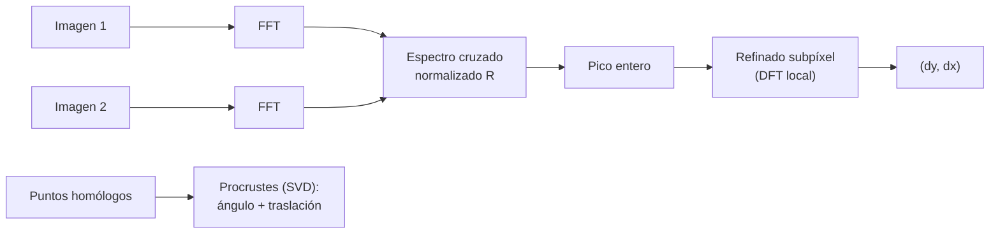

# B15-C14 — Registro y alineación

<!-- nav:top -->
[🏠 Programa](../../../../README.md) · [📚 Bloque B15](../../../tronco-comun/B15-senales-imagenes-y-estimacion-cientifica.md) · [← Anterior: B15-C13 — Segmentación de imágenes](../B15-C13-segmentacion-de-imagenes/CLASE.md) · [Siguiente: B15-C15 — Estimación de parámetros — Señales, imágenes y estimación científica →](../B15-C15-estimacion-de-parametros-senales-imagenes-y-estimacion-cientifica/CLASE.md)
<!-- /nav -->

## 1. Ubicación, nivel y alcance

Decimocuarta clase del bloque B15 y cierre del tramo de imágenes. Para apilar exposiciones, restar una imagen de otra (buscar lo que cambió) o combinar sensores, hay que **superponer** las imágenes con precisión de una fracción de píxel. Aprenderás dos métodos: la correlación de fase (que usa la FFT, [C05](../B15-C05-transformada-rapida-de-fourier/CLASE.md)) y el ajuste por puntos homólogos con rotación y traslación (Procrustes). Nivel N3. Usas FFT, ruido ([C09](../B15-C09-procesamiento-de-imagenes-digitales/CLASE.md)) y álgebra lineal básica ([B10](../../../tronco-comun/B10-algebra-lineal-y-matematicas-geometricas.md)). No verás registro con deformaciones no lineales ni fusión de sensores (B15-C24, programada).

## 2. Por qué esta clase existe

El telescopio apunta con deriva, la nave rota entre tomas y el campo gira un poco. Apilar diez imágenes sin alinearlas emborrona las estrellas; restar dos sin alinear crea falsos «residuos». Para detectar un objeto que se mueve, o una supernova en una galaxia, la alineación debe ser mucho mejor que el tamaño de la PSF. Y hay que saber cuánto error queda.

La decisión central: **¿qué transformación relaciona las dos imágenes, con qué precisión la estimo y cómo sé que no me equivoqué?**

## 3. Lo que podrás hacer al terminar

1. Estimar un desplazamiento entero con correlación de fase.
2. Refinarlo a una fracción de píxel y declarar su precisión.
3. Reconocer cuándo la correlación de fase falla por ruido.
4. Estimar rotación y traslación a partir de pares de puntos (Procrustes).
5. Calcular la incertidumbre del ángulo y de la traslación y entender el brazo de palanca.
6. Fijar y verificar la convención de signos del desplazamiento.

La evidencia es la **alineación con error medido** del ejercicio 12 (sección 20).

## 4. Con qué llegas y cómo comprobarlo

Necesitas la DFT y el teorema del desplazamiento. Cinco preguntas:

1. Si desplazas una señal `d` muestras, ¿cómo cambia su DFT? (multiplica por `e^{−2πi k d/N}`.)
2. ¿Cuánto vale el módulo de `e^{iθ}`?
3. ¿Qué es una matriz de rotación 2 × 2 de ángulo `θ`?
4. ¿Cuánto es `0,1·√2/√20`?
5. ¿Qué es la desviación estándar de un estimador?

<details>
<summary>Ver respuestas</summary>

1. Se multiplica cada coeficiente por ese factor de fase. 2. 1. 3. `[[cos θ, −sen θ], [sen θ, cos θ]]`. 4. 0,0316. 5. La dispersión de sus valores al repetir la medición.
</details>

Con cuatro o cinco aciertos, sigue; si no, repasa C04 y B10.

## 5. Un caso real: dos exposiciones de un mismo campo

Dos exposiciones del mismo campo estelar difieren por un desplazamiento de apuntado de unos pocos píxeles, a veces fraccionarios. Aquí usamos un campo **sintético** de 64 × 64 con 12 estrellas gaussianas (σ = 2 px, flujos 300–1000) y generamos la segunda imagen con un desplazamiento conocido mediante el teorema de Fourier. Es el **ejemplo conductor**. La biblioteca scikit-image implementa el mismo esquema (S1): una correlación por FFT y un refinado subpíxel con precisión `1/upsample_factor`.

## 6. Vocabulario

El **registro** (*registration*) estima la transformación que lleva una imagen a otra. Un **desplazamiento** `(dy, dx)` es una traslación; una **transformación rígida** añade rotación; una **afín** añade escala y cizalla. La **correlación cruzada** mide cuánto se parecen dos imágenes al desplazarlas. La **correlación de fase** usa solo la fase del espectro cruzado: `R = conj(F₁) F₂ / |conj(F₁) F₂|`, y su transformada inversa tiene un pico en el desplazamiento. El **espectro cruzado** es `conj(F₁) F₂`. La **precisión subpíxel** es la fracción de píxel con la que se estima. Los **puntos homólogos** son posiciones del mismo objeto en las dos imágenes. **Procrustes** es el ajuste por mínimos cuadrados de rotación y traslación entre dos conjuntos de puntos. El **brazo de palanca** es la distancia desde el centroide al origen de la traslación; amplifica el error angular.

## 7. Modelo mental: dos transparencias

Dos transparencias con las mismas estrellas: deslizas una sobre la otra hasta que coinciden. La correlación de fase hace ese deslizamiento con la FFT, de una sola vez. Con puntos homólogos, en cambio, hallas la rotación y la traslación que mejor los hacen coincidir. Analogía: transparencias superpuestas. Su límite: las transparencias son rígidas; los instrumentos reales añaden distorsiones que dependen de la posición en el campo.



*Descripción textual:* con las dos imágenes se calcula el espectro cruzado normalizado, cuyo pico da el desplazamiento entero, que se refina de forma local; alternativamente, con pares de puntos homólogos se estiman ángulo y traslación por Procrustes.

## 8. La explicación, paso a paso

### 8.1 Desplazar en Fourier

Si `im₂[y, x] = im₁[y − dy, x − dx]`, entonces `F₂ = F₁ · e^{−2πi (k_y dy + k_x dx)}` (con la convención de exponente negativo de NumPy, S2 de C05). Esto es exacto para señales de banda limitada y periódicas; sirve también para generar el par sintético. Por convención, `(dy, dx)` es el desplazamiento de la imagen 2 respecto de la 1.

### 8.2 Correlación de fase

`R = conj(F₁) F₂/|conj(F₁) F₂| = e^{−2πi k·d}`: toda la información está en la fase. La inversa de `R` es un impulso en `d`. Su pico da el desplazamiento entero. En el laboratorio, para `d = (3, −5)` el pico cae exactamente en `(3, −5)`. Un error de signo es fácil de cometer: verifica siempre con un desplazamiento conocido.

### 8.3 Refinado subpíxel

Se evalúa la inversa de `R` en una rejilla fina (aquí cada 0,01 px, en ±1 px del pico entero) usando solo las sumas necesarias, sin rellenar toda la imagen: es la idea de S1 (la DFT se muestrea más fino solo en el entorno del pico). Con `d = (3,4; −2,7)` el laboratorio estima `(3,39; −2,71)` y con `(−0,25; 6,15)`, `(−0,24; 6,14)`: error de 0,01 px, igual al paso de la rejilla. Con `upsample_factor = 100` en S1 la precisión sería `1/100` px.

### 8.4 El ruido arruina la fase

La normalización da el mismo peso a todas las frecuencias, también a las dominadas por ruido. Del laboratorio, con 30 ensayos y un desplazamiento (3,4; −2,7):

| Ruido (pico estelar ≈ 500) | Desviación (px, y/x) | Fallos > 1 px |
|---|---|---|
| 5 | 0,216 / 0,195 | 0/30 |
| 50 | 0,593 / 0,511 | 5/30 |
| 200 | 5,19 / 6,39 | 13/30 |

Con ruido bajo, el error es sub-píxel aunque 20 veces peor que sin ruido; con ruido alto, falla. Una alternativa es correlacionar solo las bajas frecuencias o usar correlación sin normalizar.

### 8.5 Registro por puntos: Procrustes

Con puntos `P` (imagen 1) y `Q` (imagen 2) relacionados por `Q = R P + t` (rotación `R`, traslación `t`), se centran ambos conjuntos, se calcula la SVD de `(P − p̄)ᵀ(Q − q̄)` y se obtiene `R`; luego `t = q̄ − R p̄`. Sin ruido, el laboratorio recupera un ángulo de `0,800000°` y una traslación de `(2,500000; −1,250000)` con error `< 10⁻⁸`.

### 8.6 Incertidumbre con ruido y brazo de palanca

Con error `σ_p` por coordenada en ambos conjuntos, el ángulo estimado tiene desviación `σ_θ ≈ σ_p√2/√S`, con `S = Σ|P − p̄|²`. En el laboratorio, `σ_p = 0,1` px y 20 puntos: `σ_θ = 0,00445°` (teoría `0,00459°`). La traslación referida al origen `t = q̄ − R p̄` incluye `|p̄| σ_θ`: con puntos cerca de 500 px del origen, su error es de `0,05` px, mayor que `σ_p√2/√N = 0,032` px. Conviene reportar la traslación en el centroide o declarar el origen.

### 8.7 Cuál usar

Correlación de fase: no necesita identificar estrellas, es rápida (FFT), pero solo traslaciones (con extensiones para giros) y sufre con ruido. Puntos homólogos: exige emparejar puntos (por ejemplo, detectados como en C12) pero admite rotación, escala y ajuste con incertidumbre. Siempre se valida con un par conocido y se informa el error residual.

## 9. Magnitudes, símbolos y unidades

| Símbolo | Qué es | Unidad | Nota |
|---|---|---|---|
| `(dy, dx)` | desplazamiento de la imagen 2 | px | puede ser fraccionario |
| `F₁`, `F₂` | DFT de las imágenes | — | exponente negativo |
| `R` | espectro cruzado normalizado / matriz de rotación | — | según contexto |
| `θ`, `t` | ángulo y traslación | grados, px | 0,8°; (2,5; −1,25) |
| `σ_p` | error de posición por coordenada | px | 0,1 |
| `S` | `Σ|P − p̄|²` | px² | brazo del ajuste |

## 10. Convenciones y referencias

Orden de ejes `(y, x)` = (fila, columna). El desplazamiento es de la imagen 2 respecto de la 1. Convención de DFT de NumPy. Los resultados de scikit-image definen el desplazamiento como el vector que registra la imagen móvil con la de referencia (S1): el signo puede ser el opuesto al de esta clase. Todo es **sintético**; semilla 15014.

## 11. De dónde sale lo que afirmamos

| ID | Fuente | Localizador | Respalda | Estado |
|---|---|---|---|---|
| S1 | scikit-image, `skimage.registration.phase_cross_correlation` (API estable) | https://scikit-image.org/docs/stable/api/skimage.registration.html | Correlación por FFT con refinado subpíxel local; `upsample_factor` da precisión `1/upsample_factor`; devuelve desplazamiento, error y diferencia de fase | Consultada el 2026-11-05 mediante extracción automática |

Límites: el teorema del desplazamiento, Procrustes por SVD y la fórmula de `σ_θ` son resultados estándar verificados en el laboratorio, no contra un texto citado; la implementación del laboratorio es propia (scikit-image no estaba instalado). La página S1 no fija explícitamente el signo del desplazamiento. Los datos son sintéticos.

## 12. Cómo ver la alineación

| Cantidad | Valor |
|---|---|
| Desplazamiento entero (3, −5) | recuperado exactamente |
| Subpíxel sin ruido: (3,4; −2,7) y (−0,25; 6,15) | error máx. 0,010 px y 0,010 px |
| Desviación con ruido 5 / 50 / 200 | 0,2 / 0,5–0,6 / 5–6 px |
| Procrustes sin ruido | 0,800000°; (2,500000; −1,250000) |
| `σ_θ` observada / teórica | 0,00445° / 0,00459° |

Descripción larga: la diferencia de dos imágenes sin alinear muestra cada estrella como un par claro–oscuro; alineadas, el residuo es solo ruido gris.

## 13. Ejemplo trabajado: un desplazamiento de (3, −5) en una señal diminuta

**Paso 1 · Datos (sintéticos).** Señal 1D `x = [0; 1; 4; 1; 0; 0; 0; 0]` y `y` = `x` desplazada 2 muestras (circular): `y = [0; 0; 0; 1; 4; 1; 0; 0]`.

**Paso 2 · Idea.** La correlación circular `c[d] = Σ_n x[n] y[n + d]` es máxima en el desplazamiento.

**Paso 3 · Valores.** `c[0] = 1·0 + 4·0 + 1·1 = 1`; `c[1] = x[1]y[2] + x[2]y[3] + x[3]y[4] = 0 + 4 + 4 = 8`; `c[2] = x[1]y[3] + x[2]y[4] + x[3]y[5] = 1 + 16 + 1 = 18`; `c[3] = x[1]y[4] + x[2]y[5] + x[3]y[6] = 4 + 4 + 0 = 8`.

**Paso 4 · Pico.** El máximo está en `d = 2` (18): desplazamiento de 2 muestras.

**Paso 5 · En 2D.** El mismo razonamiento, hecho con la FFT, da en el laboratorio `(3, −5)`.

**Paso 6 · Lectura.** Verificar el signo con un caso conocido es obligatorio: aquí `y` está desplazada a la derecha y el pico es positivo.

## 14. Distintas formas de registrar

**Correlación de fase**: traslaciones, rápida, sensible al ruido. **Correlación cruzada normalizada**: más robusta al ruido, algo más lenta. **Puntos homólogos + Procrustes**: admite rotación, da incertidumbre, exige emparejar. **Ajuste de transformaciones afines o con distorsión**: para campos grandes. Elige según el tipo de transformación y el ruido; valida siempre.

## 15. Práctica guiada

**Ejercicio 1 · con los pasos indicados.** Si `im₂` es `im₁` desplazada `(dy, dx) = (3, −5)`, ¿qué factor multiplica a `F₁` en el punto `(k_y, k_x) = (1/64, 2/64)`? *Pasos:* `e^{−2πi(k_y dy + k_x dx)}`.

<details><summary>Solución comentada</summary>

Exponente: `−2πi(3/64 − 10/64) = +2πi · 7/64`: factor `e^{2πi·7/64}`, de módulo 1 (8.1).
</details>

**Ejercicio 2 · con una pista.** Con los datos del ejemplo 13, calcula `c[0]` y comprueba que es menor que `c[2]`. *Pista:* solo suman los términos con índices válidos.

<details><summary>Solución comentada</summary>

`c[0] = Σ x[n]y[n] = 1·0 + 4·0 + 1·1 = 1 < 18` (13).
</details>

**Ejercicio 3 · casi autónomo.** Una rotación de `0,8°` es una matriz `R`; calcula `cos` y `sen` de 0,8° (en radianes: 0,01396).

<details><summary>Solución comentada</summary>

`cos = 0,99990`; `sen = 0,013962` (8.5).
</details>

## 16. Práctica autónoma, transferencia e integrador

**Ejercicio 4.** El refinado usa una rejilla de 0,01 px. ¿Qué `upsample_factor` de S1 equivale?

<details><summary>Solución comentada</summary>

`1/upsample_factor = 0,01` ⇒ 100 (8.3).
</details>

**Ejercicio 5.** Con ruido 50, la desviación del desplazamiento es ≈ 0,55 px y hay 5 fallos de 30. ¿Es fiable un registro individual?

<details><summary>Solución comentada</summary>

No: el error de 0,55 px es comparable a la PSF (σ = 2 px) y 1 de cada 6 casos falla por más de 1 px. Hay que reducir el ruido, filtrar altas frecuencias o usar otro método (8.4).
</details>

**Ejercicio 6.** Calcula `σ_p√2/√N` para `σ_p = 0,1` y `N = 20`, y `σ_p√2/√N` para `N = 80`.

<details><summary>Solución comentada</summary>

`0,0316` y `0,0158` (8.6): cuadruplicar los puntos reduce el error a la mitad.
</details>

**Ejercicio 7.** Con centroide a 500 px del origen y `σ_θ = 0,00445° = 7,8 × 10⁻⁵` rad, ¿qué error de traslación añade el brazo de palanca?

<details><summary>Solución comentada</summary>

`500 × 7,8 × 10⁻⁵ = 0,039` px, comparable al error del centroide (8.6).
</details>

**Ejercicio 8.** ¿Por qué se verifica el signo con un desplazamiento conocido antes de usar el método con datos?

<details><summary>Solución comentada</summary>

Porque las convenciones (exponente de la DFT, qué imagen es la referencia, orden de los ejes) varían entre programas; un signo invertido desplaza en lugar de alinear (8.2, sección 10).
</details>

**Ejercicio 9 · transferencia.** Apilas 10 imágenes alineadas con un error de 0,5 px cada una (σ de la posición). La estrella tiene σ = 2 px. ¿En cuánto se ensancha el perfil apilado?

<details><summary>Solución comentada</summary>

Varianzas: `2² + 0,5² = 4,25`; `σ = 2,06` px, +3 %. Con error de 2 px: `√8 = 2,83`, +41 % (8.4).
</details>

**Ejercicio 10 · transferencia.** Restas dos imágenes alineadas con 0,3 px de error. Una estrella de flujo 1000 deja un residuo. Estima su amplitud relativa para una PSF gaussiana de σ = 2 px.

<details><summary>Solución comentada</summary>

Residuo máximo ≈ `δ/σ · e^{−1/2}` del pico: `0,3/2 · 0,607 = 9,1 %` del pico, de orden. Dos estrellas brillantes dejarían falsos «cambios» (8.7).
</details>

**Ejercicio 11 · transferencia.** Quieres registrar dos imágenes con rotación de 0,8° y campo de 4096 px. ¿Cuánto se desplaza una estrella en el borde (a 2048 px del centro) por esa rotación? ¿Sirve solo una traslación?

<details><summary>Solución comentada</summary>

`2048 × 0,01396 = 28,6` px. No sirve: la traslación solo iguala el centro (8.5).
</details>

**Ejercicio 12 · integrador.** Elabora tu *alineación con error medido*: genera tu campo sintético, desplázalo con un valor conocido, estima el desplazamiento por correlación de fase (verifica el signo), repite con tres niveles de ruido, y estima con Procrustes una rotación + traslación con puntos con error; reporta errores, desviaciones y fallos.

<details><summary>Solución modelo</summary>

Tabla como la de 8.4 y 12, signo verificado, `σ_θ` observada cercana a la teórica, discusión del brazo de palanca y un criterio de aceptación (por ejemplo, error < 0,1 px). Datos sintéticos, semilla y versiones; fuente S1 con fecha.
</details>

## 17. Laboratorio: correlación de fase y Procrustes

El script [registro.py](registro.py) implementa la correlación de fase con refinado local y Procrustes, comprueba desplazamientos conocidos, mide el error con tres niveles de ruido y compara la desviación del ángulo con la teoría.

**Datos:** sintéticos, semilla 15014. **Predice antes de ejecutar:** ¿qué precisión alcanza el refinado sin ruido? (0,01 px, el paso de la rejilla.) **Ejecución del 2026-11-05 (Python 3.12.9, NumPy 2.4.4):**

```text
(1) desplazamiento entero (3, -5): estimado (np.int64(3), np.int64(-5))
(2) desplazamiento (3.4, -2.7): estimado (3.39, -2.71); error máx. 0.010 px
(2) desplazamiento (-0.25, 6.15): estimado (-0.24, 6.14); error máx. 0.010 px
(3) ruido     5 (pico estelar ~ 500): sesgo (+0.041, +0.066); desviación (0.216, 0.195) px; fallos groseros (>1 px): 0/30
(3) ruido    50 (pico estelar ~ 500): sesgo (+0.145, +0.039); desviación (0.593, 0.511) px; fallos groseros (>1 px): 5/30
(3) ruido   200 (pico estelar ~ 500): sesgo (+0.968, +0.843); desviación (5.190, 6.387) px; fallos groseros (>1 px): 13/30
(4) Procrustes sin ruido: ángulo 0.800000° (real 0.8); traslación (2.500000, -1.250000) (real [2.5, -1.25])
(5) puntos con error 0.1 px, N = 20: desviación del ángulo 0.00445° (teoría 0.00459°); desviación de la traslación en el origen [0.057, 0.047] px (incluye el brazo de palanca |centroide| * sigma_theta)
Pruebas superadas.
```

```bash
python programa/clases/B15/B15-C14-registro-y-alineacion/registro.py
```

**Límites:** traslaciones periódicas (la FFT supone bordes cíclicos); sin distorsión ni escala; la rejilla de refinado limita la precisión a 0,01 px; 30 ensayos por nivel de ruido (incertidumbre de las desviaciones ≈ 13 %).

## 18. Errores frecuentes y cómo corregirlos

**Invertir el signo del desplazamiento.** Se corrige con el ejercicio 8.

**Usar correlación de fase con mucho ruido.** Se corrige con el ejercicio 5.

**Ignorar la rotación en campos grandes.** Se corrige con el ejercicio 11.

**Reportar la traslación sin decir el origen.** Se corrige con el ejercicio 7.

**No cuantificar el error de alineación antes de apilar o restar.** Se corrige con los ejercicios 9 y 10.

## 19. Cómo sabrás que vas bien

Tras 8.2: ¿recuperas un desplazamiento entero con el signo correcto? Si no, ejercicios 1 y 8. Tras 8.5: ¿qué error de ángulo esperas? Si no, ejercicio 6. Tras 8.6: ¿por qué crece el error de la traslación en el origen? Si no lo explicas, ejercicio 7.

## 20. Qué entregas y cómo se evalúa

El producto es tu **alineación con error medido** (ejercicio 12).

| Criterio | Inicial | En desarrollo | Logrado | Destacado |
|---|---|---|---|---|
| Convención | Sin declarar | Declarada sin probar | Verificada con un caso | Contrasta con otra biblioteca |
| Estimación | Solo entera | Subpíxel sin ruido | Subpíxel con ruido | Compara dos métodos |
| Error | Sin medir | Un ensayo | Desviación y fallos | Relaciona con la teoría |
| Rotación | Ignorada | Menciona | Procrustes verificado | Brazo de palanca discutido |
| Fuentes y rótulos | Sin fuente | Sin fecha | Con localizador y fecha | Rotula sintético vs observado |

**Condiciones críticas (no se compensan con promedio):** verificar el signo con un caso conocido; reportar el error de alineación; citar solo fuentes consultadas.

## 21. Ética, seguridad y límites

Una alineación defectuosa produce falsos transitorios o borra señales reales. Documenta el método, el error y los criterios de rechazo. Accesibilidad: las imágenes tienen descripción y tabla; el laboratorio funciona sin conexión.

## 22. Para cerrar y seguir

Registrar es estimar la transformación entre imágenes; la correlación de fase da traslaciones con precisión subpíxel pero sufre con el ruido; Procrustes estima rotación y traslación a partir de puntos con una incertidumbre calculable; el signo y el origen se declaran. Queda abierta una pregunta: ¿cómo se estima en general un parámetro a partir de datos ruidosos, y cuánto error es inevitable?

**Glosario español–inglés.** registro de imágenes · *image registration*; correlación de fase · *phase correlation*; espectro cruzado · *cross-power spectrum*; puntos homólogos · *tie points*; brazo de palanca · *lever arm*; precisión subpíxel · *subpixel accuracy*; transformación rígida · *rigid transformation*.

**Continuidad.** B15-C15 reutiliza tu manejo de errores de posición para presentar la **estimación de parámetros**.

**Referencias:** ver sección 11.

<!-- nav:bottom -->
---

[← Anterior: B15-C13 — Segmentación de imágenes](../B15-C13-segmentacion-de-imagenes/CLASE.md) · [📚 Bloque B15](../../../tronco-comun/B15-senales-imagenes-y-estimacion-cientifica.md) · [Siguiente: B15-C15 — Estimación de parámetros — Señales, imágenes y estimación científica →](../B15-C15-estimacion-de-parametros-senales-imagenes-y-estimacion-cientifica/CLASE.md)
<!-- /nav -->
