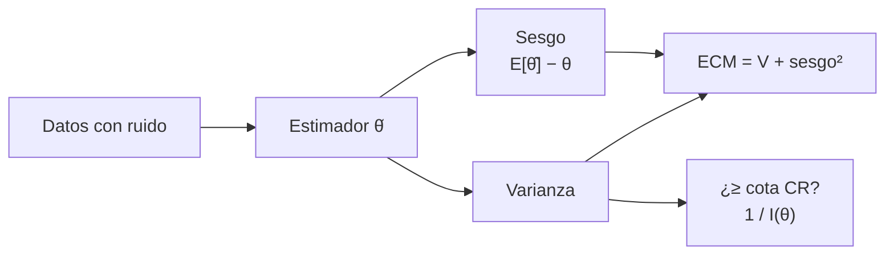

# B15-C15 — Estimación de parámetros — Señales, imágenes y estimación científica

<!-- nav:top -->
<!-- /nav -->

## 1. Ubicación, nivel y alcance

Decimoquinta clase del bloque B15 y apertura del tramo de estimación. Hasta aquí extrajiste cantidades de señales e imágenes (una frecuencia, una posición, un flujo). Ahora preguntas cuánto vale *de verdad* esa cantidad y cuánta incertidumbre es inevitable: un **estimador** convierte datos en una cifra; su **sesgo**, su **varianza** y la **cota de Cramér–Rao** dicen qué tan bueno es. Nivel N3. Retoma el tratamiento general de [B12-C07](../../../tronco-comun/B12-probabilidad-estadistica-e-incertidumbre.md) aplicado a señales e imágenes, con simulaciones de verdad conocida. No verás ajuste de curvas (C16) ni filtros de Kalman (C17).

## 2. Por qué esta clase existe

Un telescopio recoge 100 fotones de una estrella y quieres su posición con la mayor exactitud posible. ¿Basta con promediar las posiciones? ¿Se puede hacer mejor? ¿Cuántos fotones hacen falta para 0,05 píxeles? Un estimador sin análisis puede esconder un sesgo, y una incertidumbre mal declarada arruina las comparaciones entre misiones.

La decisión central: **¿qué estimador uso, qué sesgo y qué varianza tiene, y cuál es el mejor error al que puedo aspirar con estos datos?**

## 3. Lo que podrás hacer al terminar

1. Definir estimador, sesgo, varianza y error cuadrático medio.
2. Calcular el estimador de máxima verosimilitud en casos sencillos (gaussiano, Poisson, exponencial).
3. Calcular la información de Fisher y la cota de Cramér–Rao.
4. Reconocer sesgos de muestra pequeña y corregirlos.
5. Dimensionar cuántos datos hacen falta para una precisión dada.
6. Verificar un estimador con simulaciones de Monte Carlo.

La evidencia es el **estimador comparado con su cota** del ejercicio 12 (sección 20).

## 4. Con qué llegas y cómo comprobarlo

Necesitas media, varianza y la distribución normal y de Poisson ([B12](../../../tronco-comun/B12-probabilidad-estadistica-e-incertidumbre.md)). Cinco preguntas:

1. ¿Cuánto vale la desviación de la media de 25 datos de desviación 3?
2. ¿Cuál es la varianza de una distribución de Poisson de media `λ`?
3. ¿Qué es un logaritmo de un producto?
4. ¿Qué es la derivada de `ln λ`?
5. ¿Qué es un sesgo?

<details>
<summary>Ver respuestas</summary>

1. 0,6. 2. `λ`. 3. La suma de logaritmos. 4. `1/λ`. 5. La diferencia entre el valor esperado del estimador y el valor verdadero.
</details>

Con cuatro o cinco aciertos, sigue; si no, repasa C03 y B12.

## 5. Un caso real: posición de una estrella con pocos fotones

Un detector recoge `N = 100` fotones de una estrella cuyo perfil es gaussiano de σ_p = 2 px; la posición de cada fotón es un dato. El estimador natural del centro es la media de las posiciones. Es el **ejemplo conductor** (simulado, **sintético**); el mismo razonamiento se usa con cuentas de Poisson y con tiempos exponenciales.

## 6. Vocabulario

Un **parámetro** `θ` es la cantidad desconocida. Un **estimador** `θ̂(datos)` es una función de los datos. El **sesgo** es `E[θ̂] − θ`. La **varianza** es `Var(θ̂)`. El **error cuadrático medio** es `ECM = Var + sesgo²`. La **verosimilitud** `L(θ)` es la probabilidad de los datos observados en función de `θ`; el **estimador de máxima verosimilitud** (MLE) es el valor que la maximiza; para muestras grandes sus propiedades son buenas, y con muestras pequeñas puede estar muy sesgado (S1). La **información de Fisher** `I(θ)` mide cuánta información sobre `θ` contienen los datos; para `N` datos independientes se suma. La **cota de Cramér–Rao** (CRB) dice que cualquier estimador sin sesgo cumple `Var(θ̂) ≥ 1/I(θ)`. Un estimador **eficiente** la alcanza.

## 7. Modelo mental: apuntar con la mejor puntería posible

Imagina lanzar dardos a una diana con un temblor. Un estimador es tu estrategia de apuntar: puede ser buena (sin sesgo) pero temblorosa (varianza). La CRB es el mínimo temblor que alguien con tu información puede lograr. Analogía: diana y puntería. Su límite: en una diana ves el centro; en la estimación no lo conoces, solo la dispersión de tus intentos simulados.



*Descripción textual:* los datos con ruido alimentan un estimador; de su sesgo y su varianza sale el error cuadrático medio; la varianza de un estimador sin sesgo se compara con la cota de Cramér–Rao.

## 8. La explicación, paso a paso

### 8.1 Media gaussiana

Para `N` datos `N(μ, σ²)`, el MLE de `μ` es la media muestral: sin sesgo y con varianza `σ²/N`. La información de Fisher es `N/σ²`, así que la CRB es `σ²/N` y la media la alcanza. En el laboratorio (`N = 25`, `σ = 3`): sesgo `+0,0014`, desviación `0,6020` (cota `0,6000`).

### 8.2 Estimar la varianza

El estimador con divisor `N` tiene valor esperado `(N−1)σ²/N` (sesgado a la baja); el de divisor `N−1` es insesgado. Con `N = 5` y `σ² = 9`: `7,2` frente a `9`; el laboratorio da `7,191` y `8,988`. Pero el sesgado tiene menor error cuadrático medio: `(2N−1)σ⁴/N² = 29,16` contra `2σ⁴/(N−1) = 40,5` (laboratorio: `29,0` y `40,2`). Un estimador sesgado no es necesariamente peor; todo depende del criterio.

### 8.3 Poisson: contar fotones

Para cuentas `k₁…k_N` de Poisson de tasa `λ`, el logaritmo de la verosimilitud es `Σ k_i ln λ − N λ + constante`; su derivada `Σk/λ − N` se anula en `λ̂ = media(k)`. La información es `N/λ`; la CRB, `λ/N`. Con `λ = 4`, `N = 50`: cota `0,2828`; el laboratorio: desviación `0,2827`. El MLE numérico (búsqueda en una rejilla) coincide con la media: `3,9200`.

### 8.4 Centroide de fotones

Si las posiciones de `N` fotones son gaussianas con `σ_p`, el MLE del centro es su media, con desviación `σ_p/√N`. Con `N = 100`, `σ_p = 2`: `0,200` (laboratorio: `0,2002`). Para llegar a 0,05 px hacen falta `N = (σ_p/0,05)² = 1600` fotones.

### 8.5 Sesgo del MLE con pocos datos

Para una exponencial de tasa `λ`, el MLE es `1/media`. Con `N = 5`, `E[λ̂] = λN/(N−1) = 1,25 λ`: sesgo del 25 % (laboratorio: `2,495` frente a `2,0 × 5/4 = 2,5`). El estimador corregido `(N−1)/Σt` es insesgado. S1 avisa de que con muestras pequeñas los MLE pueden estar muy sesgados.

### 8.6 Para qué sirve la cota

Dice cuánta precisión es posible: si tu estimador tiene desviación 0,6 y la cota es 0,6, no hay más que ganar con ese modelo; si tienes 1,2, hay margen. Una cota solo vale para estimadores insesgados y para el modelo asumido; si el modelo está mal, la cota es una ilusión.

### 8.7 Incertidumbre de la media: no confundas `s` con `s/√N`

La dispersión de los datos (`s = 3`) no es la incertidumbre del promedio (`s/√N = 0,6`). Se declaran ambas con su significado.

## 9. Magnitudes, símbolos y unidades

| Símbolo | Qué es | Unidad | Nota |
|---|---|---|---|
| `θ`, `θ̂` | parámetro y estimador | las del parámetro | |
| `E[θ̂] − θ` | sesgo | las de `θ` | |
| `Var`, `ECM` | varianza y error cuadrático medio | (unidad)² | `ECM = Var + sesgo²` |
| `L(θ)` | verosimilitud | — | |
| `I(θ)` | información de Fisher | 1/(unidad)² | CRB `= 1/I` |
| `N` | número de datos | — | 100 fotones |
| `σ_p` | ancho del perfil | px | 2 |

## 10. Convenciones y referencias

Datos independientes e idénticamente distribuidos. «Desviación» del estimador significa desviación estándar sobre repeticiones simuladas. Los resultados son de Monte Carlo con semilla 15015 (200 000 repeticiones, 50 000 en Poisson y centroide). Todo es **sintético**.

## 11. De dónde sale lo que afirmamos

| ID | Fuente | Localizador | Respalda | Estado |
|---|---|---|---|---|
| S1 | NIST/SEMATECH, *Engineering Statistics Handbook* §8.4.1.2 «Maximum likelihood estimation» | https://www.itl.nist.gov/div898/handbook/apr/section4/apr412.htm | Definición informal de la verosimilitud y del MLE; con muestras grandes los MLE son aproximadamente normales e insesgados de varianza mínima; con muestras pequeñas pueden estar muy sesgados | Consultada el 2026-11-05 mediante extracción automática |

Límites: la cota de Cramér–Rao, la información de Fisher y las fórmulas de sesgo y ECM son resultados estándar de estadística verificados por simulación, no contra un texto citado. Los datos son sintéticos.

## 12. Cómo ver la estimación

| Estimador | Sesgo/valor esperado | Desviación observada | Cota o teoría |
|---|---|---|---|
| Media (N = 25, σ = 3) | +0,0014 | 0,6020 | 0,6000 |
| Varianza (N = 5), divisor N / N−1 | 7,191 / 8,988 | — | 7,2 / 9,0 |
| Poisson (λ = 4, N = 50) | — | 0,2827 | 0,2828 |
| Centroide (N = 100, σ_p = 2) | — | 0,2002 | 0,2000 |
| Tasa exponencial (N = 5) | 2,495 | — | 2,5 |

Descripción larga: el histograma de las estimaciones de la media es una campana centrada en 10 de ancho 0,6; el del MLE exponencial está desplazado a la derecha de la verdad y tiene cola larga.

## 13. Ejemplo trabajado: tasa de Poisson con cinco datos

**Paso 1 · Datos (sintéticos).** Cuentas `[3; 5; 4; 2; 6]`, `N = 5`.

**Paso 2 · Verosimilitud.** `ln L = Σk ln λ − Nλ + c = 20 ln λ − 5λ + c`.

**Paso 3 · MLE.** Derivada: `20/λ − 5 = 0` ⇒ `λ̂ = 4`.

**Paso 4 · Información de Fisher.** `I = N/λ = 5/4 = 1,25`.

**Paso 5 · Cota.** Desviación mínima `1/√I = 0,894`.

**Paso 6 · Lectura.** El promedio vale `4,0 ± 0,9` (con la cota en el valor estimado). La desviación muestral de los datos es `1,58`, no `0,89`: es la dispersión de los datos, no la del promedio.

## 14. Distintas formas de estimar

**Método de los momentos**: iguala promedios teóricos y observados; simple, pero menos eficiente. **Máxima verosimilitud**: eficiente para muestras grandes, con sesgo en pequeñas. **Mínimos cuadrados** (C16): coincide con el MLE si el ruido es gaussiano. **Bayesiano** (B12-C12): incorpora información previa. Declara siempre el modelo de ruido.

## 15. Práctica guiada

**Ejercicio 1 · con los pasos indicados.** Para `[3; 5; 4; 2; 6]` calcula media y varianza con divisor `N−1`. *Pasos:* desviaciones `−1, 1, 0, −2, 2`.

<details><summary>Solución comentada</summary>

Media 4; suma de cuadrados `1 + 1 + 0 + 4 + 4 = 10`; varianza `10/4 = 2,5`; desviación `1,58` (C01, 8.3).
</details>

**Ejercicio 2 · con una pista.** Calcula la CRB del centroide con `N = 100` fotones y `σ_p = 2` px, y con `σ_p = 1`. *Pista:* `σ_p/√N`.

<details><summary>Solución comentada</summary>

`0,2` px y `0,1` px (8.4).
</details>

**Ejercicio 3 · casi autónomo.** ¿Cuántos fotones para 0,05 px con `σ_p = 2`?

<details><summary>Solución comentada</summary>

`N = (2/0,05)² = 1600` (8.4).
</details>

## 16. Práctica autónoma, transferencia e integrador

**Ejercicio 4.** La varianza con divisor `N` y `N = 10`, `σ² = 9`: ¿qué valor esperado tiene?

<details><summary>Solución comentada</summary>

`(9/10) · 9 = 8,1` (8.2).
</details>

**Ejercicio 5.** Compara el ECM de ambos estimadores de la varianza para `N = 5` (en unidades de `σ⁴`).

<details><summary>Solución comentada</summary>

Divisor `N`: `(2N−1)/N² = 9/25 = 0,36`; divisor `N−1`: `2/(N−1) = 0,5`. El sesgado gana en ECM (8.2).
</details>

**Ejercicio 6.** El MLE de la tasa exponencial con `N = 5` está sesgado un 25 %. Escribe el estimador corregido y su valor esperado.

<details><summary>Solución comentada</summary>

`λ̃ = (N−1)/Σt = 4/Σt`; `E[λ̃] = λ` (8.5).
</details>

**Ejercicio 7.** Con `λ = 4`, ¿cuántos datos de Poisson dan una precisión relativa del 1 %?

<details><summary>Solución comentada</summary>

`σ/λ = 1/√(λN) = 0,01` ⇒ `λN = 10⁴` ⇒ `N = 2500` (8.3).
</details>

**Ejercicio 8.** Calcula la CRB de la media gaussiana con `N = 25` y `σ = 3`.

<details><summary>Solución comentada</summary>

`I = N/σ² = 25/9`; CRB (varianza) `0,36`; desviación `0,6` (8.1).
</details>

**Ejercicio 9 · transferencia.** Una estrella entrega `10⁴` fotones. ¿Cuál es el mejor error relativo posible en su flujo (limitado por fotones)?

<details><summary>Solución comentada</summary>

`1/√10⁴ = 1 %` (8.3). Con cielo y ruido de lectura (C09) será peor.
</details>

**Ejercicio 10 · transferencia.** Un colega publica «flujo = 100 ± 10» con 25 mediciones de dispersión 10. ¿Es correcto el ±10?

<details><summary>Solución comentada</summary>

No si es la incertidumbre del promedio: sería `10/√25 = 2`. El ±10 es la dispersión de los datos (8.7).
</details>

**Ejercicio 11 · transferencia.** Un método da, con 100 fotones, una desviación de 0,15 px cuando la CRB es 0,20. ¿Qué sospechas?

<details><summary>Solución comentada</summary>

La CRB vale solo para estimadores sin sesgo: o el método está sesgado (por ejemplo, encogido hacia un valor), o el modelo del ruido es otro, o hay un error en la simulación. Mide el sesgo antes de celebrar (8.6).
</details>

**Ejercicio 12 · integrador.** Elabora tu *estimador comparado con su cota*: elige un modelo (centroide de fotones o tasa de Poisson), simula 10 000 repeticiones con verdad conocida, estima sesgo y desviación, compara con la CRB y calcula cuántos datos se necesitan para una precisión objetivo.

<details><summary>Solución modelo</summary>

Sesgo compatible con 0, desviación igual a la CRB dentro de 2 %, `N` requerida por la fórmula y verificada con una nueva simulación. Datos sintéticos, semilla y versiones; fuente S1 con fecha.
</details>

## 17. Laboratorio: sesgo, varianza y cota de Cramér–Rao

El script [estimadores.py](estimadores.py) simula 200 000 repeticiones por caso con verdad conocida y falla si la media, la varianza, el MLE de Poisson, el centroide o el MLE exponencial se alejan de la teoría.

**Datos:** sintéticos, semilla 15015. **Predice antes de ejecutar:** ¿qué sesgo tendrá el MLE exponencial con 5 datos? (+25 %.) **Ejecución del 2026-11-05 (Python 3.12.9, NumPy 2.4.4):**

```text
(1) media (N=25): sesgo +0.00137; desviación 0.60198 (cota CR s/sqrt(N) = 0.60000)
(2) N=5: E[var/N] = 7.1907 (teoría 7.2000); E[var/(N-1)] = 8.9884 (teoría 9.0000)
    ECM divisor N = 29.005 (teoría 29.160); ECM divisor N-1 = 40.205 (teoría 40.500)
(3) Poisson: MLE numérico de una muestra = 3.9200, media muestral = 3.9200
    desviación del MLE = 0.2827 (cota CR sqrt(lambda/N) = 0.2828)
(4) centroide de 100 fotones, sigma_p = 2.0: desviación 0.2002 (cota CR sigma_p/sqrt(N) = 0.2000)
(5) tasa exponencial, N=5: E[MLE] = 2.495 (teoría lambda N/(N-1) = 2.500); sesgo 25 %
Pruebas superadas.
```

```bash
python programa/clases/B15/B15-C15-estimacion-de-parametros-senales-imagenes-y-estimacion-cientifica/estimadores.py
```

**Límites:** datos independientes con el modelo correcto; la cota se compara con la desviación simulada; los errores de Monte Carlo son de ≈ 0,2–0,3 %.

## 18. Errores frecuentes y cómo corregirlos

**Confundir dispersión de los datos con incertidumbre del promedio.** Se corrige con el ejercicio 10.

**Usar un MLE con pocos datos sin corregir el sesgo.** Se corrige con el ejercicio 6.

**Suponer que el estimador insesgado es siempre el mejor.** Se corrige con el ejercicio 5.

**Aplicar la cota a un estimador sesgado o a un modelo erróneo.** Se corrige con el ejercicio 11.

**No simular para verificar.** Se corrige con el ejercicio 12.

## 19. Cómo sabrás que vas bien

Tras 8.3: ¿obtienes el MLE de Poisson a mano? Si no, ejercicio 1 y el ejemplo 13. Tras 8.4: ¿cuántos fotones necesitas? Si no, ejercicio 3. Tras 8.5: ¿por qué el MLE exponencial sale alto? Si no lo explicas, ejercicio 6.

## 20. Qué entregas y cómo se evalúa

El producto es tu **estimador comparado con su cota** (ejercicio 12).

| Criterio | Inicial | En desarrollo | Logrado | Destacado |
|---|---|---|---|---|
| Modelo | No declarado | Declarado sin comprobar | Declarado y justificado | Discute su validez |
| Estimador | Sin fórmula | Fórmula sin deducir | MLE deducido | Compara con otro estimador |
| Sesgo y varianza | Sin medir | Uno de los dos | Ambos por simulación | ECM y comparación con la teoría |
| Cota | Ausente | Citada | Calculada y comparada | Interpreta la distancia a la cota |
| Fuentes y rótulos | Sin fuente | Sin fecha | Con localizador y fecha | Rotula sintético vs observado |

**Condiciones críticas (no se compensan con promedio):** declarar el modelo de ruido; distinguir dispersión de datos e incertidumbre del estimador; citar solo fuentes consultadas.

## 21. Ética, seguridad y límites

Declarar una incertidumbre menor que la real puede sostener decisiones indebidas. Publica el modelo, el estimador y su validación. Accesibilidad: las gráficas tienen tabla equivalente y el laboratorio funciona sin conexión.

## 22. Para cerrar y seguir

Un estimador se juzga por sesgo y varianza; el MLE es eficiente con muchos datos pero sesgado con pocos; la cota de Cramér–Rao fija el mínimo error posible para estimadores sin sesgo; se verifica por simulación. Queda abierta una pregunta: cuando los parámetros definen una curva (una órbita, un tránsito), ¿cómo se estiman todos a la vez?

**Glosario español–inglés.** estimador · *estimator*; sesgo · *bias*; error cuadrático medio · *mean squared error*; máxima verosimilitud · *maximum likelihood*; información de Fisher · *Fisher information*; cota de Cramér–Rao · *Cramér–Rao bound*; eficiente · *efficient*.

**Continuidad.** B15-C16 reutiliza tu manejo de modelos de ruido y de la verosimilitud para el **ajuste de curvas**.

**Referencias:** ver sección 11.

<!-- nav:bottom -->
<!-- /nav -->
