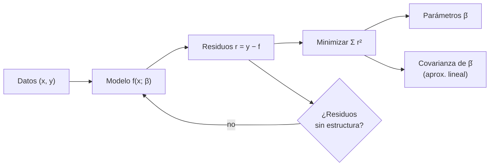

# B15-C16 — Ajuste de curvas

<!-- nav:top -->
<!-- /nav -->

## 1. Ubicación, nivel y alcance

Decimosexta clase del bloque B15. Un ajuste de curvas estima los parámetros de un modelo (una recta, una exponencial, un tránsito, una órbita) para que pase lo más cerca posible de los datos. Aprenderás el método de mínimos cuadrados, la diferencia entre modelos lineales y no lineales en los parámetros, cómo leer los residuos y las incertidumbres de los parámetros, y cómo verificar un programa de ajuste con valores certificados por el NIST. Nivel N3. Usas la estimación de [C15](../B15-C15-estimacion-de-parametros-senales-imagenes-y-estimacion-cientifica/CLASE.md), álgebra lineal ([B10](../../../tronco-comun/B10-algebra-lineal-y-matematicas-geometricas.md)) y la tendencia de [C01](../B15-C01-series-temporales-discretas/CLASE.md). No verás inferencia bayesiana (B12-C12) ni regresión robusta (B12-C11).

## 2. Por qué esta clase existe

En C01 una recta ajustada a 2,8 periodos de una oscilación dio una pendiente de −2,24 × 10⁻⁴ por día cuando la real era −1,00 × 10⁻⁴: el modelo estaba mal planteado. Ajustar bien no es solo «pasar una línea»: es elegir un modelo, estimar sus parámetros con incertidumbre, comprobar los residuos y verificar el código con respuestas conocidas.

La decisión central: **¿qué modelo ajusto, con qué método, cuánto valen sus parámetros y cuánto puedo fiarme de ellos?**

## 3. Lo que podrás hacer al terminar

1. Plantear el ajuste de mínimos cuadrados y resolver uno lineal con ecuaciones normales o `lstsq`.
2. Ajustar un modelo no lineal de forma iterativa y escalar los parámetros.
3. Obtener la matriz de covarianza y las desviaciones de los parámetros.
4. Examinar los residuos y detectar un modelo inadecuado.
5. Ajustar tendencia y oscilación a la vez y comparar con el ajuste incorrecto.
6. Verificar el código contra los valores certificados del NIST.

La evidencia es el **ajuste con residuos y parámetros con error** del ejercicio 12 (sección 20).

## 4. Con qué llegas y cómo comprobarlo

Necesitas derivadas, matrices y estimación (C15). Cinco preguntas:

1. ¿Qué recta pasa por `(0, 3)` y `(2, 2)`?
2. ¿Cuál es el residuo de un punto `y = 5` si el modelo predice 4,6?
3. ¿Cuánto es `Σ r²` para residuos `0,1; −0,2; 0,1`?
4. ¿Qué es la matriz inversa de una 2 × 2 diagonal `diag(2, 4)`?
5. ¿Qué es la desviación estándar de un estimador?

<details>
<summary>Ver respuestas</summary>

1. `y = 3 − 0,5 x`. 2. `+0,4`. 3. `0,06`. 4. `diag(0,5; 0,25)`. 5. La dispersión de sus valores al repetir la medición.
</details>

Con cuatro o cinco aciertos, sigue; si no, repasa C15 y B10.

## 5. Un caso real: datos de adsorción del NIST

Para verificar un programa de ajuste hay conjuntos de referencia con respuesta certificada. El NIST publica el conjunto *Misra1a* (S1) de su colección de regresión no lineal: 14 observaciones de volumen frente a presión de un experimento de adsorción monomolecular en investigación dental, con modelo `y = b₁(1 − e^{−b₂x})` y valores certificados `b₁ = 238,942 129 18`, `b₂ = 5,501 564 318 1 × 10⁻⁴`. Son **datos reales y publicados** con respuesta oficial; la segunda parte de la clase usa una serie **sintética**. Es el **ejemplo conductor**.

## 6. Vocabulario

Un **modelo** `f(x; β)` predice `y` a partir de `x` y de los **parámetros** `β`. Un **residuo** es `r_i = y_i − f(x_i; β)`. **Mínimos cuadrados** elige `β` para minimizar la suma de cuadrados `S(β) = Σ r_i²`; con pesos `1/σ_i²` es el estadístico `χ²` (S2 describe esa minimización con y sin `sigma`). Un modelo es **lineal en los parámetros** si `f = Σ β_j φ_j(x)` (aunque las `φ_j` no sean rectas); entonces la solución es directa. En un modelo **no lineal** se itera (por ejemplo, Levenberg–Marquardt, el método por defecto de `curve_fit`, S2). La **matriz de covarianza** de los parámetros tiene en su diagonal las varianzas; S2 aclara que se calcula con una aproximación lineal y puede ser poco fiable. La **desviación residual** es `s = √(S/(N − p))`, con `p` parámetros. Los **grados de libertad** son `N − p`. La **sobreparametrización** es usar más parámetros de los que los datos sostienen.

## 7. Modelo mental: una cuerda tensada entre datos

Imagina cada dato como un clavo y el modelo como una cuerda que puede deformarse según sus parámetros. Mínimos cuadrados elige la forma que tensa menos la cuerda con todos los clavos a la vez. Analogía: cuerda y clavos. Su límite: una cuerda real puede quedar atrapada en una forma local que no es la mejor; en ajustes no lineales el resultado depende del punto de partida (S2 lo advierte).



*Descripción textual:* se compara el modelo con los datos mediante residuos, se minimiza su suma de cuadrados, se obtienen los parámetros y su covarianza, y se revisan los residuos; si tienen estructura, se cambia el modelo.

## 8. La explicación, paso a paso

### 8.1 Mínimos cuadrados lineales

Para el modelo `y = Σ β_j φ_j(x)`, se arma la matriz de diseño `A` con `A_ij = φ_j(x_i)` y se resuelve `β = argmin ‖y − Aβ‖²`, es decir, `AᵀA β = Aᵀy` (ecuaciones normales). En la práctica se usa `lstsq`, más estable. Para una recta exacta `y = 3 − 0,5 x` sin ruido, el laboratorio recupera `3,000000000000` y `−0,500000000000`.

### 8.2 Incertidumbres

Si el ruido tiene varianza `σ²` constante, `Cov(β̂) = σ² (AᵀA)⁻¹`; como `σ²` se desconoce, se estima con `s² = S/(N − p)`. Las desviaciones de los parámetros son las raíces de la diagonal.

### 8.3 Modelos no lineales

Para `y = b₁(1 − e^{−b₂x})`, que no es lineal en `b₂`, se parte de valores iniciales y se itera. Los parámetros de magnitudes muy distintas (`b₁ ≈ 239`, `b₂ ≈ 5,5 × 10⁻⁴`) complican la iteración; S2 sugiere escalar. En el laboratorio se reparametriza con `b₂ = c₂ · 10⁻⁴`.

### 8.4 Verificación contra el NIST

Con ambos puntos de partida del conjunto, el laboratorio obtiene:

| Cantidad | Calculado (inicio 1) | Certificado |
|---|---|---|
| `b₁` | 238,942 129 73 | 238,942 129 18 |
| `b₂` | 5,501 564 303 × 10⁻⁴ | 5,501 564 318 × 10⁻⁴ |
| sd(`b₁`) | 2,707 007 0 | 2,707 007 5 |
| sd(`b₂`) | 7,266 867 × 10⁻⁶ | 7,266 869 × 10⁻⁶ |
| Suma de cuadrados | 0,124 551 39 | 0,124 551 39 |
| Desviación residual | 0,101 878 76 | 0,101 878 76 |

Los parámetros coinciden con los certificados en la 8.ª o 9.ª cifra significativa: código verificado. Con un inicio de `b₁ = 250` y `b₂ = 5 × 10⁻⁴` el resultado es el mismo.

### 8.5 Los residuos

Los residuos de ese ajuste van de `−0,132` a `+0,130`, con desviación `0,102`. Pero 11 de los 13 pares de residuos consecutivos tienen el mismo signo: hay estructura, es decir, el modelo no es perfecto o el ruido no es independiente. Un ajuste «bueno» por `S` pequeña puede ocultarlo. Un gráfico de residuos frente a `x` y su autocorrelación (C01) lo revelan.

### 8.6 ¿Son fiables las desviaciones? Cobertura

Se simulan 1000 conjuntos con el modelo certificado y ruido de desviación `0,1019`. El intervalo `±1 sd` contiene el valor verdadero el `65,3 %` de las veces para `b₁` y el `65,9 %` para `b₂`, algo menos que el `68,3 %` del caso lineal ideal: la covarianza de un ajuste no lineal con 14 puntos es aproximada.

### 8.7 Ajuste conjunto de tendencia y oscilación

Se retoma la serie sintética de C01 (7 días, 120 s, hueco de 12 h, tendencia `−1,0 × 10⁻⁴`/d, oscilación de 2,5 d y amplitud `2,0 × 10⁻³`). El modelo `a + b t + c sen(2πt/P) + d cos(2πt/P)` es lineal en `a, b, c, d`. El ajuste da `b = −0,948 × 10⁻⁴ ± 0,036 × 10⁻⁴` por día, compatible con la real, una amplitud de `1,997 × 10⁻³` y una desviación residual de `4,97 × 10⁻⁴` (real `5,0 × 10⁻⁴`). El ajuste de una recta sola daba `−2,238 × 10⁻⁴`, a más de 30 veces la incertidumbre del ajuste conjunto de la verdad. Modelar todo lo que hay en los datos evita sesgos.

### 8.8 Lo que el ajuste no garantiza

Un buen ajuste no demuestra que el modelo sea correcto ni que los parámetros tengan significado físico. Hay que comparar modelos alternativos, vigilar la sobreparametrización y declarar los supuestos del ruido.

## 9. Magnitudes, símbolos y unidades

| Símbolo | Qué es | Unidad | Nota |
|---|---|---|---|
| `x`, `y` | variable independiente y respuesta | las del conjunto | Misra1a: presión, volumen |
| `β`, `b₁`, `b₂` | parámetros | las que correspondan | |
| `r_i`, `S` | residuo y suma de cuadrados | (unidad de `y`), (unidad)² | |
| `A` | matriz de diseño | — | `N × p` |
| `s` | desviación residual | unidad de `y` | `√(S/(N−p))` |
| `Cov(β̂)` | covarianza de los parámetros | — | `s²(AᵀA)⁻¹` (lineal) |

## 10. Convenciones y referencias

Los datos de Misra1a se copian como los publica el NIST; sus unidades no se especifican en el archivo consultado más allá de «volumen» y «presión». Los valores certificados y el modelo son los de S1. La serie de 8.7 es **sintética** (semilla 15001, la de C01). `curve_fit` usa Levenberg–Marquardt por defecto (S2).

## 11. De dónde sale lo que afirmamos

| ID | Fuente | Localizador | Respalda | Estado |
|---|---|---|---|---|
| S1 | NIST/ITL, *Statistical Reference Datasets (StRD): Nonlinear Regression, Misra1a* | https://www.itl.nist.gov/div898/strd/nls/data/misra1a.shtml ; https://www.itl.nist.gov/div898/strd/nls/data/LINKS/DATA/Misra1a.dat | Modelo `y = b₁(1 − e^{−b₂x})`; 14 observaciones; valores iniciales, valores certificados de `b₁`, `b₂`, sus desviaciones, suma de cuadrados residual y desviación residual; datos | Consultada el 2026-11-05 mediante extracción automática (los datos y certificados se tomaron del archivo `.dat`) |
| S2 | SciPy, `scipy.optimize.curve_fit`, manual v1.18.0 | https://docs.scipy.org/doc/scipy/reference/generated/scipy.optimize.curve_fit.html | Minimiza la suma de cuadrados (ponderada con `sigma`); método por defecto `lm`; `pcov` desde una aproximación lineal; advertencias sobre escalas y sobre mínimos locales | Consultada el 2026-11-05 mediante extracción automática |

Límites: las ecuaciones normales y la fórmula de la covarianza lineal son resultados estándar verificados por simulación; la descripción de Misra1a como datos «dentales» es la de S1. Los valores del archivo se transcribieron de una extracción automática; se comprobaron porque el ajuste reproduce los certificados.

## 12. Cómo ver el ajuste

| Cantidad | Valor |
|---|---|
| Recta exacta recuperada | 3,000000000000 y −0,500000000000 |
| `b₁` calculado / certificado | 238,94212973 / 238,94212918 |
| Suma de cuadrados | 0,12455139 (ambos) |
| Cobertura de ±1 sd (`b₁`, `b₂`) | 65,3 %, 65,9 % |
| Pendiente: recta sola / conjunto / real | −2,238 / −0,948 ± 0,036 / −1,000 (×10⁻⁴ por día) |

Descripción larga: los puntos de Misra1a suben desde 10 hasta 82 con una curva que se aplana; la curva ajustada los atraviesa y los residuos oscilan alrededor de cero entre −0,13 y +0,13 con rachas del mismo signo.

## 13. Ejemplo trabajado: una recta con cuatro puntos

**Paso 1 · Datos (sintéticos).** `(0; 1,1)`, `(1; 2,9)`, `(2; 5,2)`, `(3; 6,8)`.

**Paso 2 · Medias.** `x̄ = 1,5`, `ȳ = 4,0`.

**Paso 3 · Pendiente.** `b = Σ(x − x̄)(y − ȳ)/Σ(x − x̄)²`. Numerador: `(−1,5)(−2,9) + (−0,5)(−1,1) + (0,5)(1,2) + (1,5)(2,8) = 4,35 + 0,55 + 0,6 + 4,2 = 9,7`. Denominador: `2,25 + 0,25 + 0,25 + 2,25 = 5`. `b = 1,94`.

**Paso 4 · Ordenada.** `a = ȳ − b x̄ = 4,0 − 2,91 = 1,09`.

**Paso 5 · Residuos.** Predicciones `1,09; 3,03; 4,97; 6,91`; residuos `0,01; −0,13; 0,23; −0,11`; `S = 0,0001 + 0,0169 + 0,0529 + 0,0121 = 0,082`.

**Paso 6 · Incertidumbres.** `s² = 0,082/2 = 0,041`; `sd(b) = s/√Σ(x−x̄)² = 0,2025/2,236 = 0,0906`. Resultado: `b = 1,94 ± 0,09`.

## 14. Distintas formas de ajustar

**Ecuaciones normales**: transparentes, numéricamente delicadas. **`lstsq` (QR/SVD)**: estable. **Levenberg–Marquardt**: para no lineales, depende del inicio. **Ajuste ponderado**: si los `σ_i` difieren, se pesa por `1/σ_i²`. **Remuestreo (bootstrap, Monte Carlo)**: comprueba las incertidumbres sin la aproximación lineal, como en 8.6. Verifica siempre con un caso conocido.

## 15. Práctica guiada

**Ejercicio 1 · con los pasos indicados.** Ajusta una recta a `(0; 2)`, `(1; 4)`, `(2; 6)`. *Pasos:* pendiente y ordenada.

<details><summary>Solución comentada</summary>

Los puntos están alineados: `y = 2 + 2x`, residuos cero (8.1).
</details>

**Ejercicio 2 · con una pista.** Con el ejemplo 13, calcula `a` si cambia el último punto a `(3; 6,0)`. *Pista:* recalcula `ȳ` y la pendiente.

<details><summary>Solución comentada</summary>

`ȳ = (1,1 + 2,9 + 5,2 + 6,0)/4 = 3,8`; numerador `(−1,5)(−2,7) + (−0,5)(−0,9) + (0,5)(1,4) + (1,5)(2,2) = 4,05 + 0,45 + 0,7 + 3,3 = 8,5`; `b = 1,7`; `a = 3,8 − 2,55 = 1,25`.
</details>

**Ejercicio 3 · casi autónomo.** Calcula la desviación residual `s` con `S = 0,082`, `N = 4`, `p = 2`.

<details><summary>Solución comentada</summary>

`s = √(0,082/2) = 0,2025` (8.2).
</details>

## 16. Práctica autónoma, transferencia e integrador

**Ejercicio 4.** Misra1a: calcula el volumen predicho para `x = 400` con los parámetros certificados y compáralo con la tendencia de los datos.

<details><summary>Solución comentada</summary>

`238,942 (1 − e^{−5,5016×10⁻⁴·400}) = 238,942 (1 − e^{−0,22006}) = 238,942 × 0,19753 = 47,2`. Entre 378,4 (44,82) y 434,8 (50,76) la interpolación lineal da `≈ 47,1`: coherente (8.4).
</details>

**Ejercicio 5.** ¿Cuántos grados de libertad tiene el ajuste de Misra1a (N = 14, p = 2)?

<details><summary>Solución comentada</summary>

12 (S1 también lo declara). `s = √(0,12455/12) = 0,10188` ✓.
</details>

**Ejercicio 6.** El modelo `y = a + b x + c x²` ¿es lineal o no lineal en los parámetros? ¿Y `y = a e^{−bx}`?

<details><summary>Solución comentada</summary>

El primero es lineal en `a, b, c` (aunque curvo en `x`); el segundo no lineal en `b` (8.3).
</details>

**Ejercicio 7.** Con 14 puntos y 2 parámetros, un ajuste tiene `S = 0,1246`. ¿Qué `S` esperarías si el ruido tiene `σ = 0,10`?

<details><summary>Solución comentada</summary>

`E[S] = σ²(N − p) = 0,01 × 12 = 0,12`; el valor observado 0,1246 es coherente (8.2).
</details>

**Ejercicio 8.** En Misra1a, ¿por qué se reparametrizó `b₂ = c₂ · 10⁻⁴`?

<details><summary>Solución comentada</summary>

Para que los parámetros tengan magnitudes similares y el optimizador no tenga pasos mal condicionados (S2 aconseja escalar) (8.3).
</details>

**Ejercicio 9 · transferencia.** El ajuste de la recta sola a la curva de luz da la pendiente `−2,24 × 10⁻⁴` con una incertidumbre formal pequeña. ¿Por qué la verdad está lejos?

<details><summary>Solución comentada</summary>

El modelo omite la oscilación, que se correlaciona con `t` en una ventana de 2,8 periodos: el error es sistemático y la incertidumbre formal solo recoge el ruido. El ajuste conjunto lo corrige (8.7).
</details>

**Ejercicio 10 · transferencia.** El intervalo `±1 sd` cubre el verdadero valor el 65 % de las veces en lugar del 68 %. ¿Qué haces al reportar la incertidumbre?

<details><summary>Solución comentada</summary>

La aproximación lineal es imperfecta con pocos datos; comprueba por simulación o bootstrap y, si es crítico, reporta un intervalo ampliado y su método (8.6).
</details>

**Ejercicio 11 · transferencia.** 11 de 13 pares de residuos consecutivos tienen el mismo signo. ¿Qué hipótesis planteas y qué haces?

<details><summary>Solución comentada</summary>

Residuos con memoria: modelo incompleto o ruido correlacionado. Prueba un modelo con más términos (con cuidado de no sobreparametrizar), calcula la autocorrelación de los residuos (C01) y usa incertidumbres que lo tengan en cuenta (8.5).
</details>

**Ejercicio 12 · integrador.** Elabora tu *ajuste con residuos y parámetros con error*: verifica tu código con Misra1a (diferencia relativa con los certificados), ajusta una serie sintética propia con tendencia y oscilación por un modelo conjunto, compara con el ajuste incorrecto, tabula parámetros con desviaciones y comenta los residuos.

<details><summary>Solución modelo</summary>

Diferencias relativas < 10⁻⁶ con el NIST, pendiente conjunta compatible con la real y el ajuste incorrecto sesgado por varias desviaciones, residuos sin estructura marcada (o discutida). Datos sintéticos/NIST rotulados, semilla y versiones; fuentes S1–S2 con fecha.
</details>

## 17. Laboratorio: ajustes contra valores certificados

El script [ajuste.py](ajuste.py) resuelve una recta exacta, ajusta Misra1a desde dos puntos de partida y exige coincidir con los valores certificados del NIST, estima la cobertura de las incertidumbres por simulación y ajusta de forma conjunta tendencia y oscilación en la serie de C01.

**Datos:** NIST StRD Misra1a (reales) y serie sintética con semilla 15001/15016. **Predice antes de ejecutar:** ¿qué pendiente da el ajuste conjunto? (≈ −1,0 × 10⁻⁴.) **Ejecución del 2026-11-05 (Python 3.12.9, NumPy 2.4.4, SciPy 1.17.1):**

```text
(1) recta sin ruido: 3.000000000000 + -0.500000000000 x (real 3 y -0.5)
(2) Misra1a, inicio 1 (500, 1e-4): b1 = 238.94212973 (cert. 238.94212918); b2 = 5.5015643031e-04 (cert. 5.5015643181e-04)
    sd(b1) = 2.7070070 (cert. 2.7070075); sd(b2) = 7.266867e-06 (cert. 7.266869e-06); RSS = 0.12455139 (cert. 0.12455139); s = 0.10187876 (cert. 0.10187876)
(2) Misra1a, inicio 2 (250, 5e-4): b1 = 238.94212980 (cert. 238.94212918); b2 = 5.5015643014e-04 (cert. 5.5015643181e-04)
    sd(b1) = 2.7070080 (cert. 2.7070075); sd(b2) = 7.266870e-06 (cert. 7.266869e-06); RSS = 0.12455139 (cert. 0.12455139); s = 0.10187876 (cert. 0.10187876)
    residuos (unidades de volumen del conjunto): mín -0.132, máx +0.130; correlación de signos consecutivos: 11 de 13 pares con el mismo signo
(3) cobertura de ±1 sd en 1000 simulaciones: b1 0.653, b2 0.659 (teoría 0.683 para modelo lineal; menor o mayor en modelos no lineales con N = 14)
(4) pendiente: solo recta -2.238e-4/d; ajuste conjunto -0.948e-4 ± 0.036e-4 (real -1.000e-4); amplitud 1.997e-3 (real 2.000e-3); desviación residual 4.971e-4 (real 5.0e-4)
Pruebas superadas.
```

```bash
python programa/clases/B15/B15-C16-ajuste-de-curvas/ajuste.py
```

**Límites:** ruido independiente de varianza constante; frecuencia de la oscilación conocida en 8.7; cobertura con 1000 simulaciones (incertidumbre ≈ 1,5 puntos porcentuales).

## 18. Errores frecuentes y cómo corregirlos

**Ajustar un modelo incompleto y creer la incertidumbre formal.** Se corrige con el ejercicio 9.

**No escalar parámetros de magnitudes muy distintas.** Se corrige con el ejercicio 8.

**Ignorar los residuos.** Se corrige con el ejercicio 11.

**No verificar el código con un caso conocido.** Se corrige con el ejercicio 12.

**Creer que la covarianza es exacta en un modelo no lineal.** Se corrige con el ejercicio 10.

## 19. Cómo sabrás que vas bien

Tras 8.1: ¿ajustas una recta a mano? Si no, ejercicios 1 y 2. Tras 8.4: ¿qué significa coincidir con el NIST? Si no, ejercicio 5. Tras 8.7: ¿por qué falla la recta sola? Si no lo explicas, ejercicio 9.

## 20. Qué entregas y cómo se evalúa

El producto es tu **ajuste con residuos y parámetros con error** (ejercicio 12).

| Criterio | Inicial | En desarrollo | Logrado | Destacado |
|---|---|---|---|---|
| Modelo | Sin justificar | Justificado sin comparar | Justificado y comparado | Discute alternativas |
| Verificación | Ninguna | Con un ejemplo propio | Contra valores certificados | Y con simulación de cobertura |
| Incertidumbres | Sin reportar | Sin explicar | Con covarianza y supuestos | Con comprobación independiente |
| Residuos | No examinados | Gráfico sin lectura | Estructura evaluada | Corrige el modelo |
| Fuentes y rótulos | Sin fuente | Sin fecha | Con localizador y fecha | Rotula real, certificado y sintético |

**Condiciones críticas (no se compensan con promedio):** verificar el código con una respuesta independiente; examinar los residuos; citar solo fuentes consultadas.

## 21. Ética, seguridad y límites

Un ajuste forzado puede «confirmar» un modelo erróneo. Publica modelo, método, residuos y límites. Accesibilidad: las gráficas tienen tabla equivalente y el laboratorio funciona sin conexión.

## 22. Para cerrar y seguir

Ajustar es minimizar la suma de cuadrados de los residuos; los modelos lineales se resuelven directamente y los no lineales por iteración; los parámetros llevan incertidumbre aproximada; los residuos revelan modelos incompletos; el código se verifica con valores certificados. Queda abierta una pregunta: cuando los parámetros cambian con el tiempo (la posición de un objeto en movimiento), ¿cómo se estiman paso a paso?

**Glosario español–inglés.** mínimos cuadrados · *least squares*; residuo · *residual*; matriz de diseño · *design matrix*; covarianza · *covariance*; grados de libertad · *degrees of freedom*; sobreparametrización · *overfitting / over-parameterization*; valor certificado · *certified value*.

**Continuidad.** B15-C17 reutiliza tu manejo de modelos y residuos para los **filtros de Kalman introductorios**.

**Referencias:** ver sección 11.

<!-- nav:bottom -->
<!-- /nav -->
