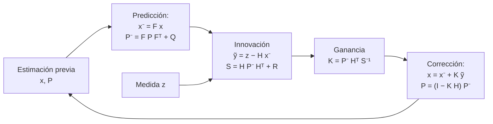

# B15-C17 — Filtros de Kalman introductorios

<!-- nav:top -->
[🏠 Programa](../../../../README.md) · [📚 Bloque B15](../../../tronco-comun/B15-senales-imagenes-y-estimacion-cientifica.md) · [← Anterior: B15-C16 — Ajuste de curvas](../B15-C16-ajuste-de-curvas/CLASE.md) · [Siguiente: B15-C18 — Filtros de partículas iniciales →](../B15-C18-filtros-de-particulas-iniciales/CLASE.md)
<!-- /nav -->

## 1. Ubicación, nivel y alcance

Decimoséptima clase del bloque B15. En [C16](../B15-C16-ajuste-de-curvas/CLASE.md) ajustaste un modelo a todos los datos de una vez. Cuando los datos llegan uno a uno y el objeto se mueve (un vehículo, un residuo orbital, el apuntado de un telescopio), conviene actualizar la estimación en cada medida: es lo que hace el **filtro de Kalman**. Aprenderás sus dos pasos (predecir y corregir), el papel de las covarianzas `Q` y `R`, cómo comprobar que el filtro es coherente y qué pasa si el modelo es erróneo. Nivel N3. Usas matrices ([B10](../../../tronco-comun/B10-algebra-lineal-y-matematicas-geometricas.md)), estimación (C15) y sistemas de estado ([B16](../../../tronco-comun/B16-sistemas-dinamicos-y-control-automatico.md)). No verás versiones no lineales (extendido, sin perfume) ni suavizado.

## 2. Por qué esta clase existe

Un radar mide la distancia a un objeto cada segundo, con 5 m de ruido. Si solo usas la última medida, tu error es de 5 m. Pero el objeto no salta al azar: su velocidad cambia poco. Un filtro que combina un modelo de movimiento con cada medida puede bajar ese error a cerca de 2 m y, además, estimar la velocidad que nadie midió directamente. El precio: declarar un modelo y sus ruidos; si se declaran mal, el filtro se vuelve arrogante y se equivoca con confianza.

La decisión central: **¿cómo combino, en cada instante, lo que predice mi modelo y lo que mide el sensor, y cómo sé que el filtro es honesto sobre su propia incertidumbre?**

## 3. Lo que podrás hacer al terminar

1. Escribir el modelo de estado y de medida de un objeto con velocidad casi constante.
2. Aplicar a mano un paso de predicción y uno de corrección.
3. Interpretar la ganancia de Kalman y la covarianza del estado.
4. Comprobar el filtro contra la media aritmética y contra la ecuación de Riccati.
5. Evaluar su coherencia con el error normalizado (NEES).
6. Detectar un modelo mal planteado y rechazar una medida atípica.

La evidencia es el **seguimiento filtrado frente a verdad conocida** del ejercicio 12 (sección 20).

## 4. Con qué llegas y cómo comprobarlo

Necesitas el producto de matrices, la inversa de un escalar y las covarianzas. Cinco preguntas:

1. ¿Cuánto es `F x` para `F = [[1, 1],[0, 1]]` y `x = [100; 7]`?
2. ¿Qué es la covarianza de un estimador?
3. ¿Cuánto es `R/k` para `R = 25`, `k = 25`?
4. ¿Qué es un residuo (innovación)?
5. ¿Cuánto es `4/(4 + 4)`?

<details>
<summary>Ver respuestas</summary>

1. `[107; 7]`. 2. La matriz de varianzas y covarianzas de su error. 3. 1. 4. La diferencia entre la medida y lo que predice el modelo. 5. 0,5.
</details>

Con cuatro o cinco aciertos, sigue; si no, repasa C15, C16 y B10.

## 5. Un caso real: seguimiento de la distancia a un objeto

Un sensor entrega cada `Δt = 1 s` la posición de un objeto en una dimensión, con ruido de 5 m. El objeto se mueve a unos 7 m/s, con pequeñas aceleraciones aleatorias de 0,1 m/s². El caso es **sintético**: la trayectoria verdadera se genera con el modelo para poder medir el error del filtro. Es el **ejemplo conductor**. La forma del filtro es la estándar (S1, que es una fuente secundaria): el estado se predice con el modelo y se corrige con la medida usando la ganancia de Kalman.

## 6. Vocabulario

El **estado** `x` reúne lo que quieres saber (posición y velocidad). La **matriz de transición** `F` lo avanza un paso. La **matriz de medida** `H` dice qué parte del estado se mide. `Q` es la **covarianza del ruido de proceso** (cuánto se aparta el movimiento real del modelo) y `R` la **covarianza del ruido de medida** (S1). La **predicción** produce `x⁻ = F x` y `P⁻ = F P Fᵀ + Q`. La **innovación** es `ỹ = z − H x⁻`; su covarianza es `S = H P⁻ Hᵀ + R`. La **ganancia de Kalman** es `K = P⁻ Hᵀ S⁻¹`. La **corrección** da `x = x⁻ + K ỹ` y `P = (I − K H) P⁻` (S1). El **NEES** (*normalized estimation error squared*) es `eᵀ P⁻¹ e`, con `e` el error real; si el filtro es coherente, su media es la dimensión del estado. La **ecuación de Riccati** da la covarianza estacionaria del filtro.

## 7. Modelo mental: dos testigos con distinta fiabilidad

El modelo es un testigo que dice «el objeto debería estar aquí» con una fiabilidad `P⁻`; el sensor es otro testigo que dice «lo medí aquí» con fiabilidad `R`. La ganancia pesa cada testigo según su fiabilidad: si el modelo es más fiable, `K` es pequeña; si el sensor lo es, `K` es grande. Analogía: dos testigos ponderados. Su límite: los testigos de un juicio pueden mentir de forma coordinada; en el filtro se supone que los ruidos son independientes y blancos.



*Descripción textual:* con la estimación previa se predice el estado siguiente; la medida produce una innovación; la ganancia pondera la innovación según las incertidumbres; la corrección produce la nueva estimación, que alimenta el siguiente paso.

## 8. La explicación, paso a paso

### 8.1 El modelo

Estado `x = [posición; velocidad]`. Con `Δt = 1 s`, `F = [[1, Δt],[0, 1]]`: la posición avanza velocidad × tiempo. Se mide solo la posición, `H = [1, 0]`. Las pequeñas aceleraciones aleatorias de desviación `σ_a = 0,1 m/s²` se modelan con `Q = σ_a² [[Δt⁴/4, Δt³/2],[Δt³/2, Δt²]]` (modelo estándar de aceleración blanca; la deducción no se reproduce). El ruido de medida es `R = σ² = 25 m²`.

### 8.2 El caso escalar

Con un estado constante (`F = 1`, `Q = 0`) y una incertidumbre inicial enorme, el filtro da exactamente la media aritmética de las medidas, y `P_k = R/k`. En el laboratorio, la diferencia con la media es `2,5 × 10⁻⁶` con `P₀ = 10¹²` (la precisión finita de `P₀` explica esa diferencia). Es la primera comprobación del código.

### 8.3 Un paso a mano (escalar)

Con `x⁻ = 10`, `P⁻ = 4`, medida `z = 12`, `R = 4`: `S = 8`, `K = 4/8 = 0,5`, `x = 10 + 0,5 · 2 = 11`, `P = (1 − 0,5) · 4 = 2`. La estimación queda a mitad de camino y su incertidumbre baja a la mitad.

### 8.4 El régimen estacionario

Con el modelo de 8.1, la covarianza de predicción converge a una matriz fija, solución de la ecuación de Riccati: `P⁻ = [[5,533; 0,553],[0,553; 0,105]]`, con ganancia `K = [0,1812; 0,0181]`. La desviación posterior de la posición es `2,128 m` y la de la velocidad `0,308 m/s`: el filtro mejora la posición de 5 a 2,1 m y estima la velocidad sin medirla. En el laboratorio, la covarianza del filtro al final de la simulación coincide con la solución de Riccati (calculada con una función de SciPy, no consultada como fuente).

### 8.5 Simulación

Con 300 trayectorias de 200 pasos, tras 100 pasos de transitorio: el RMSE de la posición medida es `5,005 m` (el ruido del sensor); el del filtro, `2,182 m` (teoría `2,128 m`). El NEES medio es `2,066`, cerca del valor ideal 2: el filtro es **coherente** (su incertidumbre declarada coincide con su error real).

### 8.6 Si el modelo es erróneo

Si se declara `Q` 10 000 veces menor que la real (se cree que el objeto no acelera), el filtro confía demasiado en su modelo: el RMSE sube a `17,1 m` y el NEES a `5019`, muy por encima de 2. El NEES delata el problema: el error es enorme comparado con la incertidumbre que el filtro cree tener. Con `Q` o `R` mal ajustados, un filtro puede ser inexacto y aun así parecer seguro.

### 8.7 Medidas atípicas

La innovación normalizada `ỹ²/S` sigue una distribución `χ²` con 1 grado de libertad si todo está bien. Con umbral 9 (equivalente a 3σ), una medida con `ỹ²/S` mayor se rechaza. Una medida que da una innovación de 50 m con `S = 51 m²` tiene `ỹ²/S = 49`, y se rechaza.

### 8.8 Límites

El filtro es óptimo para modelos lineales con ruido blanco y covarianzas conocidas (S1). Si el modelo es no lineal (una medida de distancia a un punto fuera de la trayectoria, por ejemplo) hacen falta variantes o filtros de partículas (C18). Si no sabes `Q` y `R`, hay que ajustarlos con datos y revisar el NEES.

## 9. Magnitudes, símbolos y unidades

| Símbolo | Qué es | Unidad | Nota |
|---|---|---|---|
| `x` | estado `[posición; velocidad]` | m, m/s | |
| `F`, `H` | transición y medida | — | `[[1, Δt],[0, 1]]`, `[1, 0]` |
| `Q`, `R` | covarianzas de proceso y de medida | m², etc. | `σ_a = 0,1 m/s²`; `R = 25 m²` |
| `P⁻`, `P` | covarianzas previa y posterior | — | |
| `K` | ganancia | — | `[0,181; 0,018]` en estacionario |
| `ỹ`, `S` | innovación y su covarianza | m, m² | |
| NEES | error normalizado | adimensional | ideal = 2 |

## 10. Convenciones y referencias

Notación `x⁻`, `P⁻` para previo (a priori) y `x`, `P` para posterior, como en S1. Datos **sintéticos**, semilla 15017. Se usan las formas de las ecuaciones de S1; la de la covarianza `(I − K H) P⁻` es válida con la ganancia óptima (S1 también da una forma más estable numéricamente, la de Joseph).

## 11. De dónde sale lo que afirmamos

| ID | Fuente | Localizador | Respalda | Estado |
|---|---|---|---|---|
| S1 | Wikipedia, *Kalman filter* (artículo; fuente secundaria que localiza, no sustituye una referencia primaria) | https://en.wikipedia.org/wiki/Kalman_filter | Ecuaciones de predicción y actualización, innovación, ganancia, covarianza; supuestos del modelo (lineal, ruidos gaussianos blancos); optimalidad | Consultada el 2026-11-05 mediante extracción automática (primeros 100 000 de 191 322 caracteres) |

Límites: no se pudo consultar el tutorial de Welch y Bishop ni la referencia original de Kalman (páginas no disponibles), por lo que la clase se apoya en una fuente secundaria para las ecuaciones y las verifica numéricamente; la ecuación de Riccati se resolvió con `scipy.linalg.solve_discrete_are`, cuya documentación no se consultó. Los datos son sintéticos.

## 12. Cómo ver el filtro

| Cantidad | Valor |
|---|---|
| Filtro escalar vs media aritmética | diferencia 2,5 × 10⁻⁶ |
| Ganancia estacionaria `[K₁; K₂]` | `[0,1812; 0,0181]` |
| RMSE de la posición: medida / filtro (teoría) | 5,005 / 2,182 (2,128) m |
| NEES medio con modelo correcto / con `Q` × 10⁻⁴ | 2,066 / 5019 |
| RMSE con `Q` × 10⁻⁴ | 17,1 m |

Descripción larga: la gráfica de la posición mostraría los puntos medidos dispersos ±5 m alrededor de la recta; la estimación del filtro es una curva suave que sigue la recta con ±2 m; con `Q` demasiado pequeña, la curva se separa de la trayectoria real y sigue sin enterarse, con una banda de incertidumbre estrecha.

## 13. Ejemplo trabajado: dos pasos en dos dimensiones de estado

**Paso 1 · Datos (sintéticos).** `x = [100; 7]`, `P = diag(25, 1)`, `Δt = 1`, `σ_a = 0,1`, `R = 25`.

**Paso 2 · Predicción del estado.** `x⁻ = F x = [107; 7]`.

**Paso 3 · Predicción de la covarianza.** `F P Fᵀ = [[26, 1],[1, 1]]`; `Q = 0,01 [[0,25; 0,5],[0,5; 1]] = [[0,0025; 0,005],[0,005; 0,01]]`. `P⁻ = [[26,0025; 1,005],[1,005; 1,01]]`.

**Paso 4 · Medida.** `z = 110`, innovación `ỹ = 110 − 107 = 3`; `S = 26,0025 + 25 = 51,0025`.

**Paso 5 · Ganancia.** `K = [26,0025; 1,005]/51,0025 = [0,5098; 0,0197]`.

**Paso 6 · Corrección.** `x = [107 + 0,5098 · 3; 7 + 0,0197 · 3] = [108,53; 7,059]`. La posición se corrige 1,53 m (la medida pesa 51 %) y la velocidad sube 0,06 m/s, porque la medida estuvo por encima de la predicción.

## 14. Distintas formas de seguir un objeto

**Ajuste de una trayectoria a todos los datos** (C16): óptimo si el modelo es exacto, pero no se actualiza en tiempo real. **Media móvil** (C07): sencilla, retrasa y no estima velocidad. **Filtro de Kalman**: recursivo, con incertidumbre declarada, óptimo en el caso lineal gaussiano. **Filtro de partículas** (C18): para casos no lineales o no gaussianos. Elige según la linealidad, la rapidez y la información sobre los ruidos.

## 15. Práctica guiada

**Ejercicio 1 · con los pasos indicados.** Un paso escalar con `x⁻ = 10`, `P⁻ = 4`, `z = 12`, `R = 4`. *Pasos:* `K`, `x`, `P`.

<details><summary>Solución comentada</summary>

`K = 4/8 = 0,5`; `x = 11`; `P = 2` (8.3).
</details>

**Ejercicio 2 · con una pista.** Predice `P⁻` para `P = diag(25, 1)`, `Δt = 1`, `σ_a = 0,1`. *Pista:* `F P Fᵀ + Q`.

<details><summary>Solución comentada</summary>

`F P Fᵀ = [[26, 1],[1, 1]]`; con `Q`: `[[26,0025; 1,005],[1,005; 1,01]]` (13).
</details>

**Ejercicio 3 · casi autónomo.** Con ese `P⁻`, `R = 25` y `z − Hx⁻ = 3`, calcula `K` y la corrección.

<details><summary>Solución comentada</summary>

`S = 51,0025`; `K = [0,5098; 0,0197]`; corrección `[1,529; 0,059]` (13).
</details>

## 16. Práctica autónoma, transferencia e integrador

**Ejercicio 4.** Con estado constante y muchas medidas de ruido 5 m, ¿qué incertidumbre tiene la estimación tras 25 medidas?

<details><summary>Solución comentada</summary>

`P = R/k = 25/25 = 1` m² ⇒ 1 m de desviación (8.2).
</details>

**Ejercicio 5.** El filtro reduce el error de 5 a 2,13 m. ¿Cuántas veces mejora? ¿Qué cantidad adicional estima?

<details><summary>Solución comentada</summary>

`5/2,128 = 2,35` veces. Estima la velocidad con desviación `0,31` m/s, que no se midió (8.4).
</details>

**Ejercicio 6.** En régimen estacionario, `K₁ = 0,18`. Interpreta ese valor.

<details><summary>Solución comentada</summary>

Cada medida corrige el 18 % de su diferencia con la predicción: el filtro confía más en el modelo que en una medida aislada (8.4).
</details>

**Ejercicio 7.** El NEES medio vale 5019 con `Q` demasiado pequeña. ¿Qué indica y qué corriges?

<details><summary>Solución comentada</summary>

Que el error real es mucho mayor que el declarado (filtro arrogante). Aumenta `Q` (o revisa el modelo) hasta que el NEES se acerque a 2 (8.6).
</details>

**Ejercicio 8.** Escalar con `P⁻ = 4`: calcula `K` para `R = 4` y para `R = 16`. ¿Qué cambia?

<details><summary>Solución comentada</summary>

`K = 0,5` y `K = 4/20 = 0,2`. Con un sensor más ruidoso, el filtro hace caso menos a la medida (8.3).
</details>

**Ejercicio 9 · transferencia.** El objeto acelera de forma sostenida pero el modelo supone velocidad constante con `Q` pequeña. ¿Qué verías en la innovación y qué haces?

<details><summary>Solución comentada</summary>

Innovaciones con signo persistente (retraso del filtro) y NEES alto. Aumenta `Q` o amplía el estado con la aceleración (8.6).
</details>

**Ejercicio 10 · transferencia.** Llega una medida con innovación 50 m y `S = 51 m²`. ¿La aceptas con umbral `χ² = 9`?

<details><summary>Solución comentada</summary>

`ỹ²/S = 2500/51 = 49 > 9`: se rechaza (8.7).
</details>

**Ejercicio 11 · transferencia.** El sensor mide la distancia oblicua `√(x² + h²)` a un objeto que se mueve en `x`. ¿Es aplicable el filtro lineal de la clase?

<details><summary>Solución comentada</summary>

No directamente: la medida no es lineal en el estado. Se necesita linealizar (variantes no lineales) o un filtro de partículas (C18) (8.8).
</details>

**Ejercicio 12 · integrador.** Elabora tu *seguimiento filtrado frente a verdad conocida*: simula 300 trayectorias con el modelo de la clase, filtra, calcula el RMSE de la posición y de la velocidad, compáralos con la teoría de Riccati, calcula el NEES y repite con un `Q` equivocado.

<details><summary>Solución modelo</summary>

RMSE de la posición ≈ 2,1–2,2 m (medida: 5 m), NEES ≈ 2, con `Q` equivocado un NEES de miles. Datos sintéticos, semilla y versiones; fuente S1 con fecha y su carácter secundario declarado.
</details>

## 17. Laboratorio: Kalman contra la media y contra Riccati

El script [kalman.py](kalman.py) implementa el filtro, comprueba que en el caso escalar coincide con la media aritmética y que `P_k = R/k`, que la covarianza converge a la solución de Riccati, que el RMSE es el predicho y que el NEES es coherente, y muestra el NEES con un `Q` erróneo.

**Datos:** sintéticos, semilla 15017. **Predice antes de ejecutar:** ¿qué RMSE tendrá el filtro? (≈ 2,1 m.) **Ejecución del 2026-11-05 (Python 3.12.9, NumPy 2.4.4, SciPy 1.17.1):**

```text
(1) caso escalar: diferencia con la media aritmética 2.5e-06; |P_k k/R - 1| máx. 5.6e-06
(2) Riccati: P- = [[5.533, 0.553], [0.553, 0.105]]; K = [0.1812, 0.0181]; sd posterior de la posición = 2.128 m, de la velocidad = 0.3084 m/s
(3) RMSE de la posición: medidas 5.005 m; filtro 2.182 m (teoría posterior 2.128 m); NEES medio 2.066 (ideal 2)
    P- al final [[5.533, 0.553], [0.553, 0.105]] (estacionaria [[5.533, 0.553], [0.553, 0.105]])
(4) con Q multiplicada por 1e-4: RMSE 17.096 m; NEES medio 5018.8 (ideal 2): filtro demasiado confiado
Pruebas superadas.
```

```bash
python programa/clases/B15/B15-C17-filtros-de-kalman-introductorios/kalman.py
```

**Límites:** modelo lineal con covarianzas conocidas; una dimensión; sin outliers en la simulación; el RMSE se compara con la teoría con una tolerancia del 10 %.

## 18. Errores frecuentes y cómo corregirlos

**Elegir `Q` y `R` al azar.** Se corrige con los ejercicios 7 y 8.

**No comprobar la coherencia (NEES).** Se corrige con el ejercicio 7.

**Aplicar el filtro lineal a una medida no lineal.** Se corrige con el ejercicio 11.

**Aceptar medidas atípicas.** Se corrige con el ejercicio 10.

**Olvidar que la incertidumbre del filtro es la del modelo.** Sección 8.6.

## 19. Cómo sabrás que vas bien

Tras 8.3: ¿haces un paso escalar a mano? Si no, ejercicio 1. Tras 8.4: ¿qué significa `K`? Si no, ejercicio 6. Tras 8.6: ¿cómo detectas un `Q` erróneo? Si no, ejercicio 7.

## 20. Qué entregas y cómo se evalúa

El producto es tu **seguimiento filtrado frente a verdad conocida** (ejercicio 12).

| Criterio | Inicial | En desarrollo | Logrado | Destacado |
|---|---|---|---|---|
| Modelo | Sin declarar | Declarado sin ruido | Con `F`, `H`, `Q`, `R` y unidades | Justifica `Q` y `R` |
| Implementación | Sin verificar | Contra un ejemplo | Contra media aritmética y Riccati | Y contra otra biblioteca |
| Evaluación | Solo gráfica | RMSE | RMSE y NEES | Con modelo erróneo comparado |
| Atípicos | Ignorados | Mencionados | Prueba `χ²` | Calibra el umbral |
| Fuentes y rótulos | Sin fuente | Sin fecha | Con localizador y fecha | Declara el carácter secundario de S1 |

**Condiciones críticas (no se compensan con promedio):** declarar `Q` y `R`; comprobar la coherencia con el NEES; citar solo fuentes consultadas.

## 21. Ética, seguridad y límites

El filtro de esta clase es didáctico. No debe usarse para navegación, seguimiento de residuos orbitales o decisiones de seguridad sin validación independiente, datos reales y procedimientos específicos. Declara supuestos, covarianzas y comprobaciones. Accesibilidad: las gráficas tienen tabla equivalente y el laboratorio funciona sin conexión.

## 22. Para cerrar y seguir

El filtro de Kalman alterna predicción (con el modelo) y corrección (con la medida), ponderadas por sus incertidumbres; reduce el error, estima lo no medido y es coherente solo si `Q` y `R` son razonables, lo que verifica el NEES. Queda abierta una pregunta: ¿qué pasa cuando el modelo no es lineal o la incertidumbre no es gaussiana?

**Glosario español–inglés.** filtro de Kalman · *Kalman filter*; estado · *state*; innovación · *innovation*; ganancia de Kalman · *Kalman gain*; ruido de proceso · *process noise*; ruido de medida · *measurement noise*; coherencia · *consistency*; ecuación de Riccati · *Riccati equation*.

**Continuidad.** B15-C18 reutiliza tu manejo de predicción, corrección y coherencia para los **filtros de partículas iniciales**.

**Referencias:** ver sección 11.

<!-- nav:bottom -->
---

[← Anterior: B15-C16 — Ajuste de curvas](../B15-C16-ajuste-de-curvas/CLASE.md) · [📚 Bloque B15](../../../tronco-comun/B15-senales-imagenes-y-estimacion-cientifica.md) · [Siguiente: B15-C18 — Filtros de partículas iniciales →](../B15-C18-filtros-de-particulas-iniciales/CLASE.md)
<!-- /nav -->
