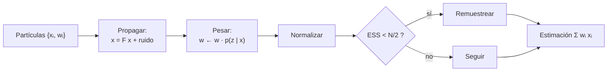

# B15-C18 — Filtros de partículas iniciales

<!-- nav:top -->
<!-- /nav -->

## 1. Ubicación, nivel y alcance

Decimoctava clase del bloque B15. El filtro de Kalman ([C17](../B15-C17-filtros-de-kalman-introductorios/CLASE.md)) es exacto si el modelo es lineal y los ruidos gaussianos. Cuando la medida es una función no lineal del estado, o la incertidumbre tiene varias «jorobas», hace falta representar la incertidumbre de otra forma: con una nube de **partículas**, cada una con un peso. Aprenderás el filtro de partículas de tipo *bootstrap* (propagar, pesar, remuestrear), el tamaño efectivo de muestra y cuándo gana al filtro lineal. Nivel N3. Usas simulación y ruido ([C03](../B15-C03-ruido-blanco-y-coloreado/CLASE.md)), estimación (C15) y el modelo de C17. No verás filtros con muestreo de importancia optimizado ni de Rao–Blackwell.

## 2. Por qué esta clase existe

Un sensor mide la distancia oblicua a un objeto que pasa junto a él. Cuando el objeto está justo frente al sensor, un pequeño cambio de posición casi no cambia la distancia: la medida no distingue bien un lado del otro, y la incertidumbre de la posición deja de ser una campana. Un filtro lineal sería engañoso; uno de partículas lo representa tal cual, a cambio de más cálculo.

La decisión central: **¿cuántas partículas necesito, cómo evito que mueran casi todas y cómo sé que el filtro supera a una alternativa simple?**

## 3. Lo que podrás hacer al terminar

1. Describir el filtro de partículas bootstrap: propagar, pesar, remuestrear.
2. Calcular el tamaño efectivo de muestra y decidir cuándo remuestrear.
3. Implementar el remuestreo sistemático y comprobar su propiedad.
4. Verificar el filtro frente a Kalman en un caso lineal gaussiano.
5. Aplicarlo a una medida no lineal y compararlo con la inversión directa.
6. Elegir el número de partículas por convergencia.

La evidencia es el **seguimiento por partículas comparado con Kalman** del ejercicio 12 (sección 20).

## 4. Con qué llegas y cómo comprobarlo

Necesitas probabilidades, muestreo aleatorio y el filtro de C17. Cinco preguntas:

1. ¿Cuál es la desviación estándar de una media de `N` datos?
2. ¿Qué es la verosimilitud de una medida gaussiana?
3. ¿Qué hacen los pasos de predicción y de corrección de C17?
4. ¿Cuánto es `1/Σw²` con `N` pesos iguales a `1/N`?
5. ¿Qué es una función no lineal?

<details>
<summary>Ver respuestas</summary>

1. `σ/√N`. 2. La densidad de la medida dado el estado: `exp(−(z − h(x))²/2σ²)`. 3. Predecir con el modelo y corregir con la medida. 4. `N`. 5. Una cuya gráfica no es una recta (por ejemplo, `√(x² + h²)`).
</details>

Con cuatro o cinco aciertos, sigue; si no, repasa C15 y C17.

## 5. Un caso real: distancia oblicua a un objeto que pasa

Un sensor está a `h = 20 m` de la pista por la que se mueve un objeto a unos 5 m/s, de `x = −150 m` a `x = +150 m`. Mide la distancia `r = √(x² + h²)` cada segundo con 2 m de ruido. La relación entre `r` y `x` es no lineal y casi plana junto al punto de máximo acercamiento. La situación es **sintética**: se simulan las trayectorias para conocer la verdad. Es el **ejemplo conductor**. Las ideas generales —pesos de verosimilitud, remuestreo, degeneración, aptitud para modelos no lineales— son las descritas en S1.

## 6. Vocabulario

Una **partícula** es una muestra del estado con su propio peso. El **conjunto ponderado** aproxima la distribución del estado. **Propagar** es avanzar cada partícula con el modelo, incluida su aleatoriedad. **Pesar** es multiplicar el peso por la verosimilitud de la medida y normalizar. La **degeneración** ocurre cuando casi todo el peso se concentra en pocas partículas (S1). El **tamaño efectivo de muestra** es `ESS = 1/Σ w_i²`: vale `N` con pesos uniformes y 1 con un solo peso no nulo. El **remuestreo** sustituye las partículas de peso despreciable por copias de las de peso alto (S1); el **remuestreo sistemático** usa un solo número aleatorio y puntos equiespaciados. El filtro **bootstrap** es la versión que propaga con el modelo y pesa con la verosimilitud (S1 lo atribuye a Gordon y colaboradores, 1993). La **estimación** es el promedio ponderado `Σ w_i x_i`.

## 7. Modelo mental: exploradores que informan y se reagrupan

Mil exploradores se reparten por el mapa, cada uno con una hipótesis de dónde está el objeto. Cada medida es una pista: los que quedan consistentes con ella ganan crédito (peso); los demás, no. De vez en cuando, los exploradores sin crédito se reubican junto a los que sí lo tienen. Analogía: exploradores y pistas. Su límite: si todos los exploradores empiezan lejos de la verdad (mala distribución inicial), ninguno puede ganar crédito y el grupo no se recupera.



*Descripción textual:* las partículas se propagan con el modelo, se pesan con la verosimilitud de la medida, se normalizan y, si el tamaño efectivo cae por debajo de la mitad, se remuestrean; la estimación es el promedio ponderado.

## 8. La explicación, paso a paso

### 8.1 Propagar

Cada partícula avanza `x ← F x + G a`, con `a` una aceleración aleatoria de desviación `σ_a` (`G = [Δt²/2; Δt]`). Esa aleatoriedad es la que mantiene la diversidad de la nube.

### 8.2 Pesar

Para una medida `z` con ruido gaussiano de desviación `σ`, el peso se multiplica por `exp(−(z − h(x))²/(2σ²))`, con `h(x)` la medida predicha (la posición en el caso lineal; `√(x² + h²)` en el no lineal). Luego se normaliza para que sumen 1.

### 8.3 Tamaño efectivo y remuestreo

`ESS = 1/Σ w²`. El laboratorio comprueba que vale `100,0` con 100 pesos iguales y `1,0` si uno solo pesa. Cuando `ESS < N/2` se remuestrea. En el remuestreo sistemático se toma un único número aleatorio `u ∈ [0,1)` y se eligen las partículas cuyo peso acumulado contiene a los puntos `(u + i)/N`: el número de copias de la partícula `j` difiere de `N w_j` en menos de 1 (en el laboratorio, `0,598` como máximo con `N = 10`). Tras remuestrear, todos los pesos vuelven a `1/N`.

### 8.4 Comprobación frente a Kalman

En el caso lineal gaussiano de C17 (medida de la posición con ruido 5 m, `σ_a = 0,1 m/s²`), el filtro de Kalman es exacto. El laboratorio compara el RMSE de la posición (20 trayectorias de 60 pasos, descartando 20) del filtro de partículas con el de Kalman; el cociente es:

| Partículas | RMSE partículas (m) | RMSE Kalman (m) | Cociente |
|---|---|---|---|
| 50 | 2,872 | 2,083 | 1,379 |
| 200 | 2,115 | 2,057 | 1,028 |
| 1000 | 2,126 | 2,111 | 1,007 |
| 5000 | 1,914 | 1,923 | 0,995 |

Cada fila usa trayectorias simuladas distintas, por eso la columna de Kalman varía; lo informativo es el cociente. Con pocas partículas el filtro es claramente peor; con muchas, coincide con el exacto.

### 8.5 El caso no lineal

Con la distancia oblicua, el filtro de partículas con 2000 partículas da un RMSE de `1,25 m` en la posición, frente a `2,57 m` de la inversión directa de cada medida (`x = ±√(r² − h²)`, con el signo conocido). La inversión es mala donde la distancia casi no varía con la posición (junto al punto de máximo acercamiento). El tamaño efectivo mínimo observado fue 111 de 2000 y se remuestreó 12,2 veces por trayectoria de 60 pasos.

### 8.6 Cuántas partículas

No hay un número universal: depende de la dimensión del estado y de lo informativas que sean las medidas. Se aumenta `N` hasta que la estimación deja de cambiar (convergencia), como en la tabla de 8.4. Si el ESS baja a unos pocos valores con frecuencia, las medidas son muy informativas o el modelo de proceso es muy estrecho: aumenta `N` o ensancha el ruido de proceso.

### 8.7 Qué cuesta y qué arriesga

El coste crece con `N` y con la dimensión del estado. La nube puede colapsar (todas las partículas iguales) si se remuestrea mucho sin ruido de proceso. Y el filtro hereda los errores del modelo: si el modelo o las covarianzas son erróneos, la nube es confiada y equivocada, como el filtro de Kalman (C17, 8.6).

## 9. Magnitudes, símbolos y unidades

| Símbolo | Qué es | Unidad | Nota |
|---|---|---|---|
| `x_i`, `w_i` | partícula y su peso | m, m/s; — | `Σ w = 1` |
| `N` | número de partículas | — | 50–5000 |
| `ESS` | tamaño efectivo | — | `1/Σw²` |
| `h(x)` | medida predicha | m | `x`, o `√(x² + h²)` |
| `σ`, `σ_a` | ruidos de medida y de proceso | m; m/s² | 5 m o 2 m; 0,1 o 0,05 |
| `h` | desplazamiento del sensor | m | 20 |

## 10. Convenciones y referencias

Notación como en C17. La verosimilitud es gaussiana con `σ` conocida. El remuestreo se hace cuando `ESS < N/2` (criterio habitual, que el laboratorio fija; S1 menciona criterios adaptativos sin dar fórmula). Todo es **sintético**; semilla 15018. Los resultados dependen de la semilla; se declaran los tamaños de las simulaciones.

## 11. De dónde sale lo que afirmamos

| ID | Fuente | Localizador | Respalda | Estado |
|---|---|---|---|---|
| S1 | Wikipedia, *Particle filter* (fuente secundaria que localiza, no sustituye una referencia primaria) | https://en.wikipedia.org/wiki/Particle_filter | Pesos de verosimilitud; degeneración; remuestreo; criterios adaptativos de remuestreo; aplicabilidad a modelos no lineales y no gaussianos frente al filtro de Kalman; filtro bootstrap atribuido a Gordon y colaboradores (1993) | Consultada el 2026-11-05 mediante extracción automática (primeros 100 000 de 175 453 caracteres; no se leyó la sección del algoritmo SIR) |

Límites: la fórmula del ESS, el criterio `N/2` y el remuestreo sistemático son resultados estándar verificados numéricamente aquí, no contra el texto de S1 (que en la parte consultada no los da). No se consultó el artículo original de 1993. Los datos son sintéticos.

## 12. Cómo ver el filtro

| Cantidad | Valor |
|---|---|
| Remuestreo sistemático: máx |copias − N w| (N = 10) | 0,598 |
| ESS con 100 pesos iguales / un solo peso | 100,0 / 1,0 |
| Cociente de RMSE partículas/Kalman, N = 50 / 200 / 1000 / 5000 | 1,379 / 1,028 / 1,007 / 0,995 |
| RMSE no lineal: partículas / inversión directa | 1,25 / 2,57 m |
| ESS mínimo; remuestreos por trayectoria | 111 de 2000; 12,2 de 60 |

Descripción larga: la nube de partículas empieza ancha en torno a −150 m y se estrecha con cada medida; junto al punto de máximo acercamiento se ensancha hacia ambos lados de la pista y vuelve a estrecharse después.

## 13. Ejemplo trabajado: un paso con cuatro partículas

**Paso 1 · Datos (sintéticos).** Posiciones de cuatro partículas tras propagar: `98; 100; 103; 106` m, pesos `0,25` cada una. Medida `z = 101` con `σ = 2`.

**Paso 2 · Verosimilitudes.** `exp(−(z − x)²/8)`: `exp(−9/8) = 0,325`; `exp(−1/8) = 0,882`; `exp(−4/8) = 0,607`; `exp(−25/8) = 0,044`.

**Paso 3 · Pesos.** Producto con `0,25` y normalización: suma de verosimilitudes `1,858`; pesos `0,175; 0,475; 0,327; 0,024`.

**Paso 4 · Estimación.** `Σ w x ≈ 0,175·98 + 0,475·100 + 0,327·103 + 0,024·106 ≈ 100,8` m (con los pesos sin redondear, 100,77 m).

**Paso 5 · ESS.** `Σ w² ≈ 0,0306 + 0,2256 + 0,1069 + 0,0006 ≈ 0,364`; `ESS ≈ 2,75`. Menor que `N/2 = 2`? No (2,75 > 2): no se remuestrea, pero queda cerca.

**Paso 6 · Lectura.** La estimación (≈ 100,8) se acerca a la medida (101); la partícula en 106 casi no cuenta.

## 14. Distintas formas de filtrar

**Kalman**: exacto y barato en casos lineales gaussianos. **Variantes no lineales de Kalman** (no se desarrollan): aproximan linealizando. **Partículas**: sin suposición de linealidad ni de gaussianidad, a costa de cálculo y de ruido de Monte Carlo. **Ajuste por lotes** (C16): óptimo si el modelo es exacto, sin actualización recursiva. Elige por la no linealidad y el presupuesto de cálculo.

## 15. Práctica guiada

**Ejercicio 1 · con los pasos indicados.** Calcula el ESS de los pesos `[0,5; 0,5; 0; 0]`. *Pasos:* `1/Σw²`.

<details><summary>Solución comentada</summary>

`Σ w² = 0,5`; `ESS = 2` (8.3).
</details>

**Ejercicio 2 · con una pista.** Con partículas `98; 100; 103; 106`, `z = 101`, `σ = 2`, calcula la verosimilitud de la primera. *Pista:* `exp(−9/8)`.

<details><summary>Solución comentada</summary>

`0,325` (13).
</details>

**Ejercicio 3 · casi autónomo.** Normaliza los pesos `[0,325; 0,882; 0,607; 0,044]` (iguales a priori) y calcula la estimación.

<details><summary>Solución comentada</summary>

Suma 1,858; pesos `0,175; 0,475; 0,327; 0,024`; estimación `≈ 100,8` m (13).
</details>

## 16. Práctica autónoma, transferencia e integrador

**Ejercicio 4.** ¿Cuánto vale el ESS si los pesos son `[0,7; 0,1; 0,1; 0,1]`? ¿Remuestrearías (N = 4)?

<details><summary>Solución comentada</summary>

`Σ w² = 0,49 + 0,03 = 0,52`; ESS `= 1,92 < 2`: sí (8.3).
</details>

**Ejercicio 5.** Remuestreo sistemático con `N = 4`, pesos `[0,1; 0,4; 0,3; 0,2]` y `u = 0,3`. ¿Cuántas copias recibe cada partícula? *Pasos:* puntos `(u + i)/4`, pesos acumulados `0,1; 0,5; 0,8; 1,0`.

<details><summary>Solución comentada</summary>

Puntos `0,075; 0,325; 0,575; 0,825`. Caen en: `0,075 → partícula 1 (≤ 0,1)`; `0,325 → partícula 2 (≤ 0,5)`; `0,575 → partícula 3 (≤ 0,8)`; `0,825 → partícula 4 (≤ 1,0)`. Copias `[1; 1; 1; 1]`; esperadas `N w = [0,4; 1,6; 1,2; 0,8]`; las diferencias son menores que 1 (8.3).
</details>

**Ejercicio 6.** Con N = 50 el RMSE es 2,87 m y con N = 5000 es 1,91 m en simulaciones distintas. ¿Basta esa comparación para decir que las partículas mejoraron la estimación?

<details><summary>Solución comentada</summary>

No: son trayectorias distintas. Hay que comparar con Kalman sobre las mismas trayectorias; por eso se informa el cociente (1,379 frente a 0,995) (8.4).
</details>

**Ejercicio 7.** La medida `r = √(x² + 400)` vale 20,1 m. ¿Cuánto vale `|x|` por inversión directa y qué sensibilidad `dr/dx` tiene en ese punto?

<details><summary>Solución comentada</summary>

`|x| = √(20,1² − 400) = √4,01 = 2,0` m; `dr/dx = x/r = 2,0/20,1 = 0,1`: un error de 2 m en `r` corresponde a un error de ~20 m en `x`. Por eso la inversión es mala cerca del máximo acercamiento (8.5).
</details>

**Ejercicio 8.** El ESS mínimo observado fue 111 de 2000 (5,6 %). ¿Qué conclusión sacas sobre el número de partículas?

<details><summary>Solución comentada</summary>

Las medidas son informativas (el peso se concentra tras algunas medidas); aun así el filtro no colapsó. Si bajara a unas decenas, convendría aumentar `N` o ensanchar el ruido de proceso (8.6).
</details>

**Ejercicio 9 · transferencia.** Un colega usa 50 partículas «porque es más rápido». ¿Qué le muestras?

<details><summary>Solución comentada</summary>

Que con 50 partículas el RMSE es 38 % peor que el de Kalman en el caso en que Kalman es exacto; con 200 ya es el 3 % (8.4). El coste de más partículas suele ser pequeño frente al error.
</details>

**Ejercicio 10 · transferencia.** El objeto sale de la distribución inicial que supusiste (empezaba en +300 m en vez de −150 m). ¿Qué ocurre con las partículas?

<details><summary>Solución comentada</summary>

Ninguna partícula es consistente con las medidas: los pesos se concentran en las menos malas y el filtro no se recupera (ESS colapsado). Hay que iniciar con una distribución amplia o reiniciar con detección (7, 8.7).
</details>

**Ejercicio 11 · transferencia.** ¿Qué ventaja tiene el filtro de partículas si la distribución del estado tiene dos máximos?

<details><summary>Solución comentada</summary>

Puede representarlos (dos grupos de partículas), mientras que un filtro de Kalman solo conserva una media y una covarianza (S1: no requiere suponer una forma de distribución). Pero la estimación `Σ w x` quedaría entre ambos máximos; hay que informar la distribución, no solo la media.
</details>

**Ejercicio 12 · integrador.** Elabora tu *seguimiento por partículas comparado con Kalman*: simula trayectorias del caso lineal y compara el RMSE con 100, 1000 y 5000 partículas con el de Kalman sobre las mismas trayectorias; luego aplica el filtro al caso no lineal y compara con la inversión directa; reporta ESS mínimo y número de remuestreos.

<details><summary>Solución modelo</summary>

Cociente de RMSE que baja hacia 1 al aumentar `N`; en el caso no lineal, RMSE del filtro menor que el de la inversión; ESS mínimo y remuestreos reportados. Datos sintéticos, semilla y versiones; fuente S1 con su carácter secundario.
</details>

## 17. Laboratorio: partículas frente a Kalman

El script [particulas.py](particulas.py) implementa el filtro bootstrap con remuestreo sistemático, comprueba la propiedad del remuestreo y el ESS, lo compara con Kalman en el caso lineal gaussiano para cuatro valores de `N` y lo aplica al caso no lineal frente a la inversión directa.

**Datos:** sintéticos, semilla 15018. **Predice antes de ejecutar:** ¿qué cociente de RMSE esperas con 5000 partículas? (≈ 1.) **Ejecución del 2026-11-05 (Python 3.12.9, NumPy 2.4.4):**

```text
(1) remuestreo sistemático (N=10): máx |copias - N w| = 0.598
(2) ESS: uniforme (N=100) 100.0; degenerado 1.0
(3) lineal gaussiano, RMSE de la posición (m) tras 20 pasos:
    N =    50 partículas: filtro de partículas 2.872; Kalman (exacto) 2.083; cociente 1.379
    N =   200 partículas: filtro de partículas 2.115; Kalman (exacto) 2.057; cociente 1.028
    N =  1000 partículas: filtro de partículas 2.126; Kalman (exacto) 2.111; cociente 1.007
    N =  5000 partículas: filtro de partículas 1.914; Kalman (exacto) 1.923; cociente 0.995
(4) distancia oblicua (sensor a 20 m de la pista, ruido 2.0 m), 2000 partículas, 20 trayectorias:
    RMSE posición: filtro de partículas 1.25 m; inversión directa 2.57 m
    ESS mínimo observado 111 de 2000; remuestreos por trayectoria 12.2 de 60
Pruebas superadas.
```

```bash
python programa/clases/B15/B15-C18-filtros-de-particulas-iniciales/particulas.py
```

**Límites:** 20 trayectorias por caso (los RMSE tienen incertidumbre de unos 5 %); modelo y ruidos conocidos; en el caso no lineal no se compara con variantes no lineales de Kalman.

## 18. Errores frecuentes y cómo corregirlos

**Pocas partículas sin comprobar convergencia.** Se corrige con los ejercicios 6 y 9.

**Remuestrear en cada paso sin ruido de proceso.** Colapsa la nube; sección 8.7.

**Iniciar la nube lejos de la verdad.** Se corrige con el ejercicio 10.

**Comparar filtros con trayectorias distintas.** Se corrige con el ejercicio 6.

**Informar solo la media de una distribución multimodal.** Se corrige con el ejercicio 11.

## 19. Cómo sabrás que vas bien

Tras 8.3: ¿calculas el ESS y decides? Si no, ejercicios 1 y 4. Tras 8.4: ¿cómo verificas el filtro? Si no, ejercicio 6. Tras 8.5: ¿por qué falla la inversión? Si no, ejercicio 7.

## 20. Qué entregas y cómo se evalúa

El producto es tu **seguimiento por partículas comparado con Kalman** (ejercicio 12).

| Criterio | Inicial | En desarrollo | Logrado | Destacado |
|---|---|---|---|---|
| Algoritmo | Sin remuestreo | Remuestrea siempre | ESS y remuestreo sistemático | Verifica la propiedad del remuestreo |
| Verificación | Ninguna | Una trayectoria | Contra Kalman en caso lineal | Con convergencia en `N` |
| Caso no lineal | No lo hace | Sin comparación | Contra inversión directa | Y discute multimodalidad |
| Diagnóstico | Sin ESS | ESS sin interpretar | ESS interpretado | Ajusta `N` o ruido de proceso |
| Fuentes y rótulos | Sin fuente | Sin fecha | Con localizador y fecha | Declara lo no leído de S1 |

**Condiciones críticas (no se compensan con promedio):** comparar con trayectorias idénticas; informar ESS; citar solo fuentes consultadas.

## 21. Ética, seguridad y límites

Un filtro de partículas mal ajustado puede dar la falsa impresión de una incertidumbre pequeña. No debe usarse para decisiones de seguridad (colisión, navegación) sin validación independiente y datos reales. Accesibilidad: las gráficas tienen tabla equivalente y el laboratorio funciona sin conexión.

## 22. Para cerrar y seguir

El filtro de partículas representa la incertidumbre con muestras ponderadas: propaga con el modelo, pesa con la verosimilitud y remuestrea cuando el tamaño efectivo cae; con muchas partículas coincide con Kalman en el caso lineal y lo supera en el no lineal; cuesta más cálculo. Queda abierta una pregunta: ¿cómo se reconstruyen señales e imágenes cuando faltan datos?

**Glosario español–inglés.** filtro de partículas · *particle filter*; partícula · *particle*; peso · *weight*; tamaño efectivo de muestra · *effective sample size*; remuestreo · *resampling*; degeneración · *degeneracy*; verosimilitud · *likelihood*.

**Continuidad.** B15-C19 reutiliza tu manejo de modelos y de la incertidumbre para la **reconstrucción con datos incompletos**.

**Referencias:** ver sección 11.

<!-- nav:bottom -->
<!-- /nav -->
