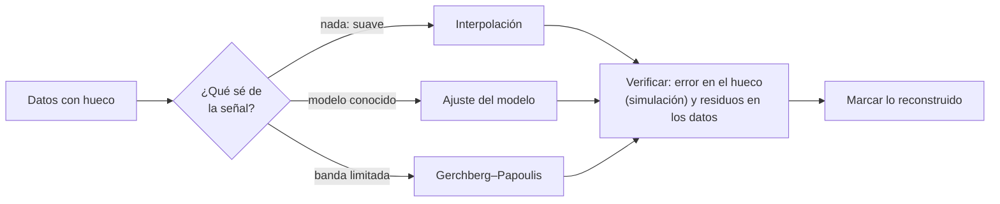

# B15-C19 — Reconstrucción por datos incompletos

<!-- nav:top -->
[🏠 Programa](../../../../README.md) · [📚 Bloque B15](../../../tronco-comun/B15-senales-imagenes-y-estimacion-cientifica.md) · [← Anterior: B15-C18 — Filtros de partículas iniciales](../B15-C18-filtros-de-particulas-iniciales/CLASE.md) · [Siguiente: B15-C20 — Proyecto de detección y seguimiento →](../B15-C20-proyecto-de-deteccion-y-seguimiento/CLASE.md)
<!-- /nav -->

## 1. Ubicación, nivel y alcance

Decimonovena clase del bloque B15. Casi toda serie real tiene huecos: la telemetría se corta, el clima cierra una noche, una nave se pone en eclipse, un píxel falla. Reconstruir los datos que faltan es un problema de ingeniería con requisitos (¿para qué se necesita la reconstrucción?), componentes (modelo, método, regularización) y criterios de comprobación (¿cuánto error queda?). Verás tres métodos —interpolación, ajuste de un modelo y extrapolación de banda limitada— y, sobre todo, cuándo **no** debe reconstruirse. Nivel N3. Usas series ([C01](../B15-C01-series-temporales-discretas/CLASE.md)), Fourier ([C04](../B15-C04-transformada-de-fourier/CLASE.md)), espectros con huecos ([C06](../B15-C06-analisis-espectral-de-senales/CLASE.md)) y ajuste ([C16](../B15-C16-ajuste-de-curvas/CLASE.md)). No verás reconstrucción tomográfica ni aprendizaje automático de relleno.

## 2. Por qué esta clase existe

Si falta el 8 % de una serie, ¿se puede rellenar sin contaminar el análisis? Depende de lo que se sepa de la señal: si es suave y se conoce su forma, el relleno es casi exacto; si es un evento breve que cayó en el hueco, no hay método que lo recupere. Reconstruir mal produce datos que parecen reales y no lo son, y que arrastran errores a los espectros, los ajustes y las decisiones.

La decisión central: **¿qué sé de la señal que permita reconstruirla, cuánto error queda y cómo marco lo reconstruido para no confundirlo con lo medido?**

## 3. Lo que podrás hacer al terminar

1. Formular los requisitos de una reconstrucción (qué se usa después, qué error es tolerable).
2. Calcular el error de la interpolación lineal sobre una oscilación y la longitud máxima de hueco tolerable.
3. Reconstruir con un modelo ajustado y estimar el error por la fórmula `σ√(p/N)`.
4. Aplicar la extrapolación de banda limitada de Gerchberg–Papoulis y ver su convergencia.
5. Detectar un modelo incompleto con los residuos en los puntos con datos.
6. Marcar y documentar lo reconstruido.

La evidencia es la **reconstrucción con error medido** del ejercicio 12 (sección 20).

## 4. Con qué llegas y cómo comprobarlo

Necesitas interpolación, ajuste lineal y la DFT. Cinco preguntas:

1. ¿Qué valor da la interpolación lineal en el punto medio entre `(0, 2)` y `(2, 6)`?
2. ¿Cuánto es `1 − cos(0,5)`?
3. ¿Cuánto es `0,1 · √(5/236)`?
4. ¿Qué es un filtro paso bajo?
5. ¿Qué es un residuo?

<details>
<summary>Ver respuestas</summary>

1. 4. 2. 0,1224. 3. 0,0146. 4. Uno que deja pasar las frecuencias bajas y elimina las altas (C07). 5. La diferencia entre el dato y lo que predice el modelo.
</details>

Con cuatro o cinco aciertos, sigue; si no, repasa C06, C07 y C16.

## 5. Un caso real: un hueco en una serie con dos oscilaciones

Una serie de 256 muestras contiene dos oscilaciones periódicas en la ventana (5 y 12 ciclos) y le faltan 20 muestras consecutivas (las números 100 a 119, el 7,8 %). El caso es **sintético**: conocemos la señal verdadera y podemos medir el error de cada método. Es el **ejemplo conductor**; las ideas valen para una curva de luz con un hueco de descarga, un registro magnético con una pérdida de telemetría o una columna de píxeles perdida.

## 6. Vocabulario

Un **hueco** (*gap*) es un tramo sin datos. La **interpolación** estima valores dentro del rango de los datos. La **reconstrucción** estima los valores que faltan usando un modelo o una restricción. La **extrapolación de banda limitada** (*Gerchberg–Papoulis*) alterna dos operaciones: imponer los datos conocidos y filtrar a la banda de frecuencias donde se sabe que está la señal. La **regularización** limita las soluciones posibles para evitar que el relleno invente estructura. El **modelo incompleto** omite componentes reales. La **sobreparametrización** usa más parámetros de los que los datos sostienen (C16). Un dato **reconstruido** nunca es un dato **medido**: debe marcarse con una bandera.

## 7. Modelo mental: completar un puzzle con la imagen de la caja

Rellenar un puzzle sin la imagen de la caja es adivinar; con la imagen, las piezas que faltan se deducen. La imagen de la caja es el modelo o la restricción (banda limitada, periodicidad, suavidad). Pero si la caja está equivocada, las piezas «deducidas» no encajan con las reales. Analogía: puzzle con la imagen de la caja. Su límite: en un puzzle ves si la pieza encaja; en una serie, lo que falta no se puede comprobar contra lo medido.



*Descripción textual:* según lo que se sepa de la señal se elige interpolación, ajuste de modelo o extrapolación de banda limitada; el resultado se verifica con una simulación de hueco conocido y con los residuos en los puntos medidos, y lo reconstruido se marca.

## 8. La explicación, paso a paso

### 8.1 Requisitos primero

Antes de elegir un método, se decide para qué se usará la serie: un espectro (necesita no introducir frecuencias falsas), un ajuste de tránsito (necesita el hueco lejos del tránsito) o una gráfica (basta con una línea). Y se fija un error tolerable. Una reconstrucción que no puede validarse no debería entrar en un análisis cuantitativo.

### 8.2 Interpolación lineal sobre una oscilación

Para `A cos(ω t)` con datos en `t = −a` y `t = +a`, la recta entre ellos vale `A cos(ω a)` en `t = 0`; el valor verdadero es `A`. El error es exactamente `A (1 − cos(ω a))`. El laboratorio con `a = 10`, `ω = 0,2`: `1,416147`, igual a la fórmula. Para una oscilación de periodo `P` y un hueco de `g` muestras (espaciadas 1), `ω a = π g/P`. Con `P = 51,2` muestras (el bin 5 de 256) y `g = 20`: `π · 20/51,2 = 1,227`, y el error en el centro es `1 − cos(1,227) = 66 %` de la amplitud. Para que sea menor del 5 %, el hueco debe medir menos de 5,2 muestras (un décimo del periodo).

### 8.3 Reconstrucción con un modelo

Si se sabe que la señal es una suma de senoides de frecuencias conocidas, se ajustan sus amplitudes y fases con los datos disponibles (C16) y se evalúa el modelo en el hueco. Sin ruido y con el modelo correcto, el error en el hueco es `7 × 10⁻¹⁶`: exacto. Con ruido `σ = 0,1` y `p = 5` parámetros (constante, dos cosenos, dos senos) y 236 datos, el error RMS del ajuste en los puntos con datos es `0,0141`, y la teoría `σ√(p/N_datos) = 0,0146`. En el hueco el error RMS es `0,0148`, apenas mayor, porque la estructura del modelo está bien definida.

### 8.4 Banda limitada: Gerchberg–Papoulis

Si solo se sabe que la señal no tiene frecuencias por encima de cierto bin `k_max` (aquí 14), se alterna: (1) calcular la DFT, anular las frecuencias sobre `k_max` y volver al tiempo; (2) restituir los datos conocidos. Cada ciclo reduce el error en el hueco. En el laboratorio sin ruido, el error RMS en el hueco es `0,427` a las 10 iteraciones, `0,190` a las 100, `6,9 × 10⁻⁵` a las 1000 y `7 × 10⁻¹⁵` a las 5000. Con ruido de 0,1 y 300 iteraciones, el error es `0,209`: peor que el del modelo porque la convergencia no terminó y porque una banda amplia admite más soluciones que un modelo exacto. La convergencia es lenta y depende del tamaño del hueco.

### 8.5 Comparación

Con ruido `σ = 0,1`, error RMS en el hueco:

| Método | Error RMS |
|---|---|
| Interpolación lineal | 0,819 |
| Modelo de dos senoides | 0,0148 |
| Gerchberg–Papoulis (300 iteraciones) | 0,209 |

La interpolación lineal falla porque el hueco abarca casi medio periodo de la oscilación mayor; el modelo gana cuando es correcto.

### 8.6 El modelo incompleto se delata en los datos

Si el modelo omite la oscilación de menor amplitud (`0,5 cos(…)`), sin ruido, el error en el hueco es `0,349` y también `0,354` **en los puntos con datos**. Es el RMS del término omitido (`0,5/√2 = 0,354`). La diferencia con 0 en los datos mostró que el modelo era incompleto aunque el hueco no se vea: los residuos en los puntos medidos son la mejor alarma.

### 8.7 Lo que no se puede reconstruir

Un evento breve completamente dentro del hueco (un tránsito de 3 horas con un hueco de 12) no deja rastro en los datos medidos. No hay modelo que lo recupere, salvo que se suponga su existencia. Y un relleno suave en un espectro reduce la potencia en altas frecuencias y puede crear picos falsos. Por eso lo reconstruido se marca, no se usa como si fuera independiente y se analiza el efecto de rellenar en el resultado final.

## 9. Magnitudes, símbolos y unidades

| Símbolo | Qué es | Unidad | Nota |
|---|---|---|---|
| `N`, `g` | muestras totales y del hueco | — | 256 y 20 |
| `P` | periodo de la oscilación | muestras | 51,2 (bin 5) |
| `ω a` | semiancho angular del hueco | rad | `π g/P` |
| `p` | parámetros del modelo | — | 5 |
| `σ` | ruido por muestra | unidad de la serie | 0,1 |
| `k_max` | frecuencia máxima de la banda | bin | 14 |
| `RMSE` | error cuadrático medio | unidad de la serie | en el hueco |

## 10. Convenciones y referencias

Muestras espaciadas 1 (unidad de muestra). Los bins se refieren a la DFT de 256 puntos (convención de NumPy, [C05](../B15-C05-transformada-rapida-de-fourier/CLASE.md)). Los datos son **sintéticos**; semilla 15019. El RMSE se calcula respecto a la señal verdadera, que en un caso real se desconoce: por eso se valida simulando huecos sobre datos completos.

## 11. De dónde sale lo que afirmamos

| ID | Fuente | Localizador | Respalda | Estado |
|---|---|---|---|---|
| S1 | NumPy, *Discrete Fourier Transform (`numpy.fft`)*, documentación estable | https://numpy.org/doc/stable/reference/routines.fft.html | Convención de la DFT y su inversa (usadas para filtrar a la banda) | Consultada el 2026-11-05 mediante extracción automática |
| S2 | VanderPlas, J. T., *Understanding the Lomb–Scargle Periodogram*, arXiv:1703.09824 | https://arxiv.org/abs/1703.09824 | Alternativa a rellenar: analizar directamente datos con muestreo irregular (resumen) | Solo resumen consultado el 2026-11-05 |

Límites: el error de la interpolación lineal sobre un coseno, la fórmula `σ√(p/N)` y la convergencia de Gerchberg–Papoulis se deducen de resultados estándar y se verifican numéricamente; no se consultó ninguna referencia sobre el algoritmo de Gerchberg–Papoulis. Los datos son sintéticos.

## 12. Cómo ver la reconstrucción

| Cantidad | Valor |
|---|---|
| Error de la interpolación lineal en `t = 0` (`a = 10`, `ω = 0,2`) | 1,416147 (= `A(1 − cos ωa)`) |
| RMS en el hueco sin ruido: lineal / modelo | 0,8125 / 7,2 × 10⁻¹⁶ |
| G–P sin ruido: 10 / 100 / 1000 / 5000 iteraciones | 4,3 × 10⁻¹ / 1,9 × 10⁻¹ / 6,9 × 10⁻⁵ / 7,2 × 10⁻¹⁵ |
| RMS en el hueco con ruido 0,1: lineal / modelo / G–P | 0,819 / 0,0148 / 0,209 |
| Modelo incompleto: RMS en el hueco / en los datos | 0,349 / 0,354 |

Descripción larga: la serie original es una onda con dos componentes; en el hueco, la recta de la interpolación lineal cruza como una cuerda sin seguir las oscilaciones; la curva del modelo coincide con la verdadera; la de Gerchberg–Papoulis se aproxima a ella conforme avanzan las iteraciones.

## 13. Ejemplo trabajado: cuánto hueco tolera una oscilación

**Paso 1 · Datos (sintéticos).** Oscilación de periodo `P = 51,2` muestras, amplitud `A = 1`. Hueco de `g` muestras.

**Paso 2 · Error central.** `ε(g) = A (1 − cos(π g/P))`.

**Paso 3 · `g = 20`.** `π · 20/51,2 = 1,2272`; `cos = 0,3361`; `ε = 0,664`.

**Paso 4 · `g = 5`.** `π · 5/51,2 = 0,3068`; `cos = 0,9533`; `ε = 0,0467` (4,7 %).

**Paso 5 · Hueco máximo para 5 %.** `cos(θ) = 0,95` ⇒ `θ = 0,3176`; `g = 0,3176 · 51,2/π = 5,18` muestras.

**Paso 6 · Lectura.** Con 20 muestras el relleno lineal es inútil (66 % de error); con 5, tolerable. El criterio práctico: la interpolación lineal solo sirve para huecos de una fracción pequeña del periodo (aquí 10 %).

## 14. Distintas formas de tratar un hueco

**No rellenar**: usar métodos que admiten muestreo irregular (Lomb–Scargle, ajuste directo); evita inventar datos. **Interpolación**: sencilla; solo para huecos cortos y señales suaves. **Modelo**: potente si es correcto y se verifica. **Banda limitada**: no necesita un modelo exacto, converge despacio. **Rellenar con ruido o con ceros**: puede distorsionar el espectro. La opción más honesta, cuando se puede, es no rellenar.

## 15. Práctica guiada

**Ejercicio 1 · con los pasos indicados.** Calcula el error de la interpolación lineal en el centro de un hueco para `A = 2`, `ω = 0,1`, `a = 5`. *Pasos:* `A (1 − cos(ωa))`.

<details><summary>Solución comentada</summary>

`ω a = 0,5`; `1 − cos 0,5 = 0,1224`; error `0,245` (8.2).
</details>

**Ejercicio 2 · con una pista.** ¿Qué fracción de la serie falta si el hueco son 20 de 256 muestras? ¿Cuántos datos quedan? *Pista:* `20/256`.

<details><summary>Solución comentada</summary>

7,8 %; quedan 236 datos.
</details>

**Ejercicio 3 · casi autónomo.** Calcula la desviación esperada del ajuste en los puntos con datos para `σ = 0,1`, `p = 5`, 236 datos.

<details><summary>Solución comentada</summary>

`0,1 √(5/236) = 0,0146` (8.3); el laboratorio da `0,0141`.
</details>

## 16. Práctica autónoma, transferencia e integrador

**Ejercicio 4.** Con `P = 51,2` y `g = 20`, ¿cuánto vale el error central de la interpolación lineal (como fracción de `A`)?

<details><summary>Solución comentada</summary>

`1 − cos(1,227) = 0,664` (13, paso 3).
</details>

**Ejercicio 5.** ¿Qué longitud máxima de hueco da un error central menor del 5 % para `P = 51,2`?

<details><summary>Solución comentada</summary>

`g < 5,18` muestras (13, paso 5).
</details>

**Ejercicio 6.** En Gerchberg–Papoulis el error pasó de `0,190` (100 iteraciones) a `6,9 × 10⁻⁵` (1000). ¿Qué factor por iteración implica (suponiendo decrecimiento geométrico)? ¿Cuántas iteraciones adicionales para llegar a `10⁻¹⁰`?

<details><summary>Solución comentada</summary>

`ln(0,190/6,9×10⁻⁵) = 7,92` en 900 iteraciones ⇒ `0,0088` por iteración (factor 0,9912). De `6,9 × 10⁻⁵` a `10⁻¹⁰`: `ln(6,9 × 10⁵) = 13,4` ⇒ `≈ 1500` iteraciones más (≈ 2500 en total). El laboratorio llegó a `7 × 10⁻¹⁵` a las 5000 (8.4).
</details>

**Ejercicio 7.** El modelo omite un término `0,5 cos(…)`. ¿Qué error RMS esperas en los datos? ¿Cómo sirve eso para detectar el problema?

<details><summary>Solución comentada</summary>

El RMS de `0,5 cos` es `0,5/√2 = 0,354`: el laboratorio da `0,354`. Un error en los datos del tamaño del término omitido indica que el modelo es incompleto, aunque el hueco no se vea (8.6).
</details>

**Ejercicio 8.** Con ruido 0,1, la interpolación lineal da 0,819 y sin ruido 0,8125. ¿Qué te dice?

<details><summary>Solución comentada</summary>

Que el error de la interpolación es sistemático (de modelo), no de ruido: sube de 0,8125 a 0,819 apenas. Más datos o menos ruido no lo arreglan (8.5).
</details>

**Ejercicio 9 · transferencia.** Un tránsito de 3 h cae completamente en un hueco de 12 h. ¿Qué método lo recupera?

<details><summary>Solución comentada</summary>

Ninguno: los datos medidos no contienen información sobre él. Si el modelo incluyera un tránsito, lo estarías suponiendo, no midiendo (8.7).
</details>

**Ejercicio 10 · transferencia.** Rellenas un hueco con una interpolación suave y calculas el espectro. ¿Qué efecto esperas y qué haces?

<details><summary>Solución comentada</summary>

La región rellena es más suave que los datos (menos potencia en altas frecuencias) y sus errores no son independientes; el espectro puede quedar sesgado. Es preferible un método de muestreo irregular (C06) o, si se rellena, comparar el resultado con y sin relleno y marcar los datos reconstruidos (8.7).
</details>

**Ejercicio 11 · transferencia.** Para «ser flexible», ajustas 40 senoides (81 parámetros) a 236 datos. ¿Qué ruido tiene el ajuste en los puntos con datos respecto al de 5 parámetros?

<details><summary>Solución comentada</summary>

`0,1 √(81/236) = 0,059` frente a `0,0146`: 4 veces peor, y en el hueco puede ser mucho peor (C16, sobreparametrización) (8.3).
</details>

**Ejercicio 12 · integrador.** Elabora tu *reconstrucción con error medido*: elige tu propia señal (con un modelo declarado), crea un hueco, reconstruye con tres métodos, mide el RMS en el hueco (con y sin ruido), compara con las fórmulas de la clase, comprueba los residuos en los datos y redacta cómo marcarías lo reconstruido.

<details><summary>Solución modelo</summary>

Tabla de RMS por método; interpolación lineal comparada con `A(1 − cos ωa)`; modelo comparado con `σ√(p/N)`; G–P con curva de convergencia; residuos en los datos; una bandera de «reconstruido» y la advertencia de eventos no recuperables. Datos sintéticos, semilla y versiones; fuentes S1–S2 con fecha.
</details>

## 17. Laboratorio: tres reconstrucciones de un hueco

El script [reconstruccion.py](reconstruccion.py) verifica el error analítico de la interpolación lineal, ajusta el modelo de dos senoides (exacto sin ruido y con la varianza teórica con ruido), implementa Gerchberg–Papoulis y muestra cómo un modelo incompleto se delata en los datos.

**Datos:** sintéticos, semilla 15019. **Predice antes de ejecutar:** ¿qué error dará el modelo sin ruido? (≈ 0.) **Ejecución del 2026-11-05 (Python 3.12.9, NumPy 2.4.4):**

```text
(1) interpolación lineal de A cos(w t) con a = 10.0, w = 0.2: error en t=0 = 1.416147 (A(1-cos(w a)) = 1.416147)
(2) sin ruido, error RMS en el hueco (20 muestras): interpolación lineal 0.8125; ajuste del modelo 7.19e-16
    Gerchberg-Papoulis (banda hasta el bin 14), error RMS en el hueco: 10 it.: 4.27e-01, 100 it.: 1.90e-01, 1000 it.: 6.92e-05, 5000 it.: 7.16e-15
(3) con ruido sigma = 0.1: RMS en el hueco: lineal 0.8187; modelo 0.0148; G-P (300 it.) 0.2087
    RMS del ajuste en los puntos con datos: 0.0141 (teoría sigma sqrt(p/N_datos) = 0.0146)
(4) con el modelo incompleto (solo bin 5), sin ruido: error RMS en el hueco 0.349; en los datos 0.354
Pruebas superadas.
```

```bash
python programa/clases/B15/B15-C19-reconstruccion-por-datos-incompletos/reconstruccion.py
```

**Límites:** un único hueco; señal periódica en la ventana (frecuencias en bins enteros); ruido blanco; Gerchberg–Papoulis sin regularización; 300 repeticiones para los errores con ruido.

## 18. Errores frecuentes y cómo corregirlos

**Interpolar linealmente un hueco largo respecto al periodo.** Se corrige con los ejercicios 4 y 5.

**Creer que un buen ajuste en los datos garantiza el hueco.** Se corrige con el ejercicio 7.

**Usar el relleno como si fuera dato medido.** Se corrige con los ejercicios 9 y 10.

**Sobreparametrizar.** Se corrige con el ejercicio 11.

**No marcar lo reconstruido.** Sección 8.7.

## 19. Cómo sabrás que vas bien

Tras 8.2: ¿cuánto error comete la interpolación para un hueco dado? Si no, ejercicios 1, 4 y 5. Tras 8.3: ¿qué error tiene un ajuste con ruido? Si no, ejercicio 3. Tras 8.6: ¿cómo delatan los datos un modelo incompleto? Si no, ejercicio 7.

## 20. Qué entregas y cómo se evalúa

El producto es tu **reconstrucción con error medido** (ejercicio 12).

| Criterio | Inicial | En desarrollo | Logrado | Destacado |
|---|---|---|---|---|
| Requisitos | No declarados | Parciales | Uso y error tolerable | Los verifica al final |
| Métodos | Uno | Dos sin comparar | Tres comparados | Con límites explicados |
| Error | Sin medir | Visual | RMS contra la verdad simulada | Contra la teoría |
| Diagnóstico | Ninguno | Gráfico de residuos | Residuos en los datos interpretados | Detecta modelo incompleto |
| Marcado | No marca | Menciona | Bandera en los datos | Efecto en el análisis posterior |
| Fuentes y rótulos | Sin fuente | Sin fecha | Con localizador y fecha | Rotula sintético vs medido |

**Condiciones críticas (no se compensan con promedio):** no presentar datos reconstruidos como medidos; medir el error con huecos simulados; citar solo fuentes consultadas.

## 21. Ética, seguridad y límites

Rellenar datos y presentarlos como medidos es una falta de integridad científica. Documenta el método, marca lo reconstruido y conserva los datos originales. Accesibilidad: las gráficas tienen tabla equivalente y el laboratorio funciona sin conexión.

## 22. Para cerrar y seguir

Reconstruir exige saber algo de la señal: suavidad (interpolación), un modelo (ajuste) o una banda (Gerchberg–Papoulis); el error se mide simulando huecos y revisando los residuos en los datos; lo que cae por completo en el hueco no se recupera; y lo reconstruido se marca. Queda abierta una pregunta: ¿cómo se integran detección, alineación, estimación y seguimiento en un proyecto completo?

**Glosario español–inglés.** reconstrucción · *reconstruction*; hueco · *gap*; interpolación · *interpolation*; banda limitada · *band-limited*; regularización · *regularization*; modelo incompleto · *incomplete model*; dato reconstruido · *reconstructed value*.

**Continuidad.** B15-C20 reutiliza tu manejo de los métodos del bloque para el **proyecto de detección y seguimiento**.

**Referencias:** ver sección 11.

<!-- nav:bottom -->
---

[← Anterior: B15-C18 — Filtros de partículas iniciales](../B15-C18-filtros-de-particulas-iniciales/CLASE.md) · [📚 Bloque B15](../../../tronco-comun/B15-senales-imagenes-y-estimacion-cientifica.md) · [Siguiente: B15-C20 — Proyecto de detección y seguimiento →](../B15-C20-proyecto-de-deteccion-y-seguimiento/CLASE.md)
<!-- /nav -->
