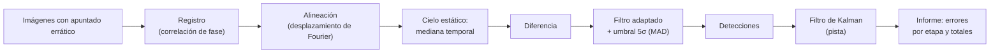

# B15-C20 — Proyecto de detección y seguimiento

<!-- nav:top -->
<!-- /nav -->

## 1. Ubicación, nivel y alcance

Vigésima y última clase de la malla base del bloque B15. Es un **proyecto de ingeniería**: con una secuencia de imágenes de un campo estelar donde se mueve un objeto débil, encadenas lo aprendido —registro ([C14](../B15-C14-registro-y-alineacion/CLASE.md)), cielo estático y resta ([C09](../B15-C09-procesamiento-de-imagenes-digitales/CLASE.md)), filtro adaptado y umbral ([C12](../B15-C12-deteccion-de-fuentes-astronomicas/CLASE.md)) y filtro de Kalman ([C17](../B15-C17-filtros-de-kalman-introductorios/CLASE.md))— y mides cada etapa contra una verdad conocida. Nivel N3. Los datos son **sintéticos**. No verás clasificación de imágenes ni fusión de sensores (B15-C22 a C24, programadas).

## 2. Por qué esta clase existe

Detectar y seguir un objeto móvil —un asteroide, un fragmento de basura espacial, un satélite— combina varios problemas: la cámara no apunta exactamente igual en cada imagen, las estrellas fijas saturan la escena, el objeto es débil y la medida es ruidosa. Si cada etapa se evalúa por separado y la cadena completa no, un error pequeño al alinear se convierte en una falsa detección o en una pista perdida. Un proyecto integrado fuerza a definir requisitos, medir errores acumulados y declarar límites.

La decisión central: **¿qué requisitos debe cumplir la cadena, qué evidencia demuestra que los cumple y qué no puedo afirmar con ella?**

## 3. Lo que podrás hacer al terminar

1. Traducir un objetivo («detectar y seguir un objeto débil») en requisitos medibles.
2. Montar la cadena de registro, alineación, resta del cielo, detección y seguimiento.
3. Verificar cada etapa con una cifra y la cadena con una prueba de extremo a extremo.
4. Calcular qué completitud cabe esperar de la SNR del objeto y comprobarla.
5. Diagnosticar por qué falla una detección (SNR, alineación, resta, umbral).
6. Documentar un proyecto reproducible con versiones, semilla y límites.

La evidencia es el **proyecto con datos sintéticos, código verificado e informe** del ejercicio 12 (sección 20).

## 4. Con qué llegas y cómo comprobarlo

Necesitas las clases C09, C12, C14 y C17. Cinco preguntas:

1. ¿Qué mide la relación señal–ruido de una fuente en el filtro adaptado (C12, 8.3)?
2. ¿Qué probabilidad de detección da un umbral `k` a una fuente de SNR `s`?
3. ¿Qué devuelve la correlación de fase?
4. ¿Qué hace la corrección de un filtro de Kalman?
5. ¿Por qué se resta una mediana temporal?

<details>
<summary>Ver respuestas</summary>

1. `F√(Σp²)/σ`. 2. `Φ(s − k)`. 3. El desplazamiento entre dos imágenes (con precisión subpíxel tras refinar). 4. Combina la predicción con la medida ponderándolas por sus incertidumbres. 5. Porque lo fijo aparece en todas las imágenes y lo móvil solo en cada una en una posición distinta.
</details>

Con cuatro o cinco aciertos, sigue; si no, repasa las clases citadas.

## 5. Un caso real: un objeto débil entre estrellas fijas

Se simulan 12 imágenes de 64 × 64 píxeles (fondo 100 ADU, ruido 5 ADU, PSF gaussiana de σ = 1,5 px) con seis estrellas fijas de flujo 1500 y un objeto móvil de flujo 300 (SNR de filtro adaptado `300 · 0,1881/5 = 11,3`) que avanza `(+1,8; +0,6)` píxeles por imagen. Cada imagen tiene un error de apuntado aleatorio de hasta ±3 píxeles. El objeto pasa a unos 2 píxeles de una estrella: es un caso difícil de fusión visual. Todo es **sintético**; la verdad se conoce en cada etapa. Es el **ejemplo conductor**.

## 6. Vocabulario

Un **requisito** es una condición medible que la cadena debe cumplir. Una **prueba de extremo a extremo** evalúa la cadena completa. La **mediana temporal** de las imágenes alineadas es una estimación del cielo estático. La **imagen de diferencia** resulta de restarla de cada imagen. Una **detección** es un máximo local de la imagen filtrada sobre el umbral. Una **detección falsa** no corresponde al objeto. Una **pista** (*track*) es la trayectoria estimada. La **asociación** relaciona detecciones con la pista (aquí por distancia a la verdad, solo en la simulación). Un **presupuesto de error** distribuye el error total entre etapas.

## 7. Modelo mental: una cadena de montaje con controles de calidad

Cada etapa es una estación con su control: la alineación se mide por el error de registro, la resta por el ruido residual, la detección por completitud y falsas, el seguimiento por RMSE. Un fallo en una estación contamina las siguientes. Analogía: cadena de montaje. Su límite: en una fábrica los defectos se localizan en cada estación; en la cadena de datos, el error de una etapa se disfraza de ruido en la siguiente, por eso hay que medir en cada paso con verdad conocida.



*Descripción textual:* las imágenes se registran y alinean, se obtiene el cielo estático con la mediana temporal, se resta, se filtra y se umbraliza para obtener detecciones, que alimentan un filtro de Kalman; el informe recoge los errores de cada etapa y el total.

## 8. La explicación, paso a paso

### 8.1 Requisitos

Para este proyecto se fijan: (R1) error de registro menor que 0,1 px; (R2) detectar el objeto en al menos 11 de las 12 imágenes; (R3) a lo sumo una detección falsa en toda la secuencia; (R4) RMSE de la pista menor que el de las detecciones sin filtrar; (R5) velocidad final estimada a menos de 0,1 px/imagen de la verdad. Los requisitos se escriben antes de ejecutar, no después.

### 8.2 Registro y alineación

La correlación de fase de C14, con una ponderación de baja frecuencia (gaussiana de ancho 0,08 ciclos/px) que reduce el peso de las altas frecuencias dominadas por ruido, estima cada desplazamiento respecto a la imagen 0. Resultado: error máximo `0,080 px` y RMS `0,032 px` con apuntados de hasta ±3 px (R1 cumplido). Sin la ponderación, en un ensayo previo de esta misma simulación el error máximo fue `0,554 px`: la elección importa. Luego cada imagen se desplaza de vuelta por el teorema de Fourier.

### 8.3 Cielo estático y resta

La mediana de las 12 imágenes alineadas en cada píxel da el cielo estático; el objeto, que cambia de píxel entre imágenes, casi no entra en la mediana. Al restarla, quedan el ruido y el objeto. La resta aumenta el ruido en un factor `≈ √(1 + π/(2K)) = 1,06` para `K = 12` (resultado estándar para la mediana de datos gaussianos; no se cita). La estrella que el objeto cruza se elimina por completo.

### 8.4 Filtro adaptado y umbral

Se correlaciona la imagen de diferencia con la PSF y se estima `σ_T` con la mediana de las desviaciones absolutas (C12, 8.1): `0,94 ADU` (teoría `σ√Σp² · 1,06 = 1,00`). El umbral es `5 σ_T`; se ignoran 8 píxeles de borde. Con SNR 11,3 y umbral 5, la probabilidad de detectar es `Φ(11,3 − 5) ≈ 1`. Resultado: `12 de 12` detecciones del objeto y `0` falsas (R2 y R3 cumplidos). En un ensayo previo con flujo 200 (SNR 7,5) la cadena detectó solo `9 de 12`: la teoría `Φ(7,5 − 5) = 99,4 %` no se cumplió porque el objeto rara vez está centrado en un píxel, la alineación y la resta añaden ruido y la SNR efectiva es menor que la ideal. Con SNR cerca del umbral, el requisito R2 falla.

### 8.5 Seguimiento

Las posiciones detectadas (centroide de 3 × 3 sobre la imagen filtrada) alimentan un filtro de Kalman de velocidad constante en 2D (C17), con `σ_a = 0,05 px/imagen²`, `R = 0,3² px²`, estado inicial de velocidad `(0,6; 1,8)` px/imagen (aproximada) y salto de la actualización cuando falta la detección. Resultado: RMSE de las detecciones `0,446 px`; del filtro, `0,341 px` (R4 cumplido). La velocidad final estimada es `(0,680; 1,824)` px/imagen, frente a `(0,600; 1,800)`: el error de `0,084` px/imagen cumple R5 (< 0,1) pero con poco margen, porque con 12 imágenes la velocidad está poco determinada.

### 8.6 Presupuesto de error

El error de posición de las detecciones (0,45 px) mezcla el error del centroide por ruido, la cuantización y la alineación (0,03 px: despreciable). La mejora del filtro es de 24 %: con solo 12 puntos hay poco que promediar. En una secuencia más larga, la mejora sería mayor. Los errores se suman en cuadratura si son independientes.

### 8.7 Qué no demuestra este proyecto

Con datos sintéticos, PSF conocida y error de apuntado puramente de traslación, el resultado demuestra que la cadena está bien implementada, no que funcione sobre datos reales: faltan rayos cósmicos, PSF variable, rotación del campo, estelas, estrellas variables y otros objetos móviles. Tampoco prueba la asociación de varios objetos, que en la simulación se hace con la verdad.

## 9. Magnitudes, símbolos y unidades

| Símbolo | Qué es | Unidad | Nota |
|---|---|---|---|
| `K` | número de imágenes | — | 12 |
| `F` | flujo del objeto / de las estrellas | ADU | 300 / 1500 |
| `σ`, `σ_T` | ruido por píxel y de la imagen filtrada | ADU | 5; 0,94 |
| `(dy, dx)` | error de apuntado | px | hasta ±3 |
| `v` | velocidad del objeto | px/imagen | (0,6; 1,8) |
| `k` | umbral en unidades de `σ_T` | — | 5 |
| RMSE | error de la posición | px | 0,446; 0,341 |

## 10. Convenciones y referencias

Orden `(y, x)`. Convenciones de signo del registro como en C14. El umbral se aplica sobre `σ_T` robusta. La asociación entre detecciones y verdad en la simulación usa un radio de 3 px; en datos reales se necesita un asociador propio. Todo es **sintético**; semilla 15020. Las etapas reutilizan las implementaciones de los laboratorios anteriores, compactadas en un solo script.

## 11. De dónde sale lo que afirmamos

| ID | Fuente | Localizador | Respalda | Estado |
|---|---|---|---|---|
| S1 | Astropy/photutils, *Point-like Source Detection*, documentación 3.1.1 | https://docs.astropy.org/projects/photutils/en/stable/user_guide/detection.html | Esquema de detección: restar el fondo, convolucionar con un núcleo gaussiano y umbral en unidades del ruido (ejemplo con 5 veces la desviación) | Consultada el 2026-11-05 mediante extracción automática |
| S2 | scikit-image, `skimage.registration.phase_cross_correlation` | https://scikit-image.org/docs/stable/api/skimage.registration.html | Registro por correlación con refinado subpíxel local | Consultada el 2026-11-05 mediante extracción automática |
| S3 | Wikipedia, *Kalman filter* (fuente secundaria) | https://en.wikipedia.org/wiki/Kalman_filter | Ecuaciones de predicción y actualización | Consultada el 2026-11-05 mediante extracción automática |

Límites: el proyecto reutiliza resultados de C09–C17 (con sus propias fuentes); el factor de ruido de la mediana y el comportamiento del script son resultados estándar o empíricos verificados aquí. Los datos son sintéticos.

## 12. Cómo ver el proyecto

| Etapa | Resultado | Requisito |
|---|---|---|
| Registro: error máx. / RMS | 0,080 / 0,032 px | R1 (< 0,1) ✓ |
| `σ_T` medida / teórica | 0,94 / 1,00 ADU | — |
| Detecciones del objeto; falsas | 12 de 12; 0 | R2, R3 ✓ |
| RMSE: detecciones / Kalman | 0,446 / 0,341 px | R4 ✓ |
| Velocidad final estimada | (0,680; 1,824) vs (0,600; 1,800) | R5 ✓ (0,084 < 0,1) |

Descripción larga: la imagen original es un campo con seis estrellas brillantes y un objeto débil; tras restar el cielo solo quedan el ruido y un punto que cruza la escena de izquierda a derecha y ligeramente hacia abajo; la pista del filtro es una línea casi recta que atraviesa esos puntos.

## 13. Ejemplo trabajado: del flujo a la probabilidad de detectar

**Paso 1 · Datos (sintéticos).** `F = 300` ADU, `σ = 5`, `σ_p = 1,5` ⇒ `Σp² = 0,03537`.

**Paso 2 · SNR ideal.** `300 · √0,03537/5 = 300 · 0,1881/5 = 11,3`.

**Paso 3 · Umbral.** `k = 5` (en unidades de `σ_T`).

**Paso 4 · Probabilidad ideal.** `Φ(11,3 − 5) = Φ(6,3) ≈ 1 − 1,5 × 10⁻¹⁰`.

**Paso 5 · Con pérdidas.** Si la SNR efectiva fuera 60 % de la ideal (6,8) por el centrado, el ruido de la alineación y la resta, `Φ(6,8 − 5) = Φ(1,8) = 96,4 %`: aún 11,6 de 12 detecciones. Con flujo 200 (ideal 7,5; efectiva 4,5 al 60 %), `Φ(4,5 − 5) = 31 %`: de 12 imágenes, entre 3 y 4, y el ensayo previo dio 9: la pérdida real fue menor que 40 %, pero suficiente para fallar el requisito.

**Paso 6 · Lectura.** Con pérdidas desconocidas, hay que dejar margen en la SNR (aquí 2 o más veces el umbral) y medir la SNR efectiva con inyecciones de fuentes de flujo conocido.

## 14. Distintas formas de diseñar la cadena

**Resta de una referencia** (aquí la mediana): simple, requiere varias imágenes. **Apilado antes de detectar**: sube la SNR si el objeto no se mueve; con objeto móvil lo borra. **Detección en cada imagen + asociación**: la elegida. **Seguimiento antes de detectar** (apilar siguiendo trayectorias hipotéticas): permite objetos más débiles a costa de cálculo. Elige según la SNR y la velocidad del objeto.

## 15. Práctica guiada

**Ejercicio 1 · con los pasos indicados.** Calcula la SNR del filtro adaptado para `F = 150`, `σ = 5`, `Σp² = 0,03537`. *Pasos:* `F√Σp²/σ`.

<details><summary>Solución comentada</summary>

`150 · 0,1881/5 = 5,64` (13). Apenas supera el umbral 5: probabilidad ideal `Φ(0,64) = 74 %`.
</details>

**Ejercicio 2 · con una pista.** ¿Qué flujo da `SNR = 7,5`? *Pista:* `F = SNR · σ/√Σp²`.

<details><summary>Solución comentada</summary>

`7,5 · 5/0,1881 = 199` ≈ 200 ADU.
</details>

**Ejercicio 3 · casi autónomo.** Con requisitos R1–R5 de 8.1 y los resultados de 12, ¿qué margen tiene cada uno?

<details><summary>Solución comentada</summary>

R1: 0,080 de 0,10 (20 %); R2: 12 de 11 (1 imagen); R3: 0 de 1; R4: 0,341 < 0,446 (24 %); R5: 0,084 de 0,10 (16 %). Los márgenes de R1 y R5 son estrechos (8.5).
</details>

## 16. Práctica autónoma, transferencia e integrador

**Ejercicio 4.** El objeto avanza `(0,6; 1,8)` px/imagen. ¿Cuánto se desplaza en las 12 imágenes (11 intervalos)?

<details><summary>Solución comentada</summary>

`(6,6; 19,8)` px; distancia `20,9` px.
</details>

**Ejercicio 5.** La mediana temporal de 12 imágenes aumenta el ruido de la diferencia en un factor aproximado `√(1 + π/(2·12))`. Calcúlalo.

<details><summary>Solución comentada</summary>

`√(1 + 0,1309) = 1,063` (8.3).
</details>

**Ejercicio 6.** Un error de registro de 0,5 px (sin ponderación en frecuencia) desplaza una estrella de flujo 1500 respecto de la mediana. Estima el residuo máximo de la resta como fracción del pico (PSF gaussiana σ = 1,5).

<details><summary>Solución comentada</summary>

Residuo máximo ≈ `δ/σ · e^{−1/2}` del pico `= 0,5/1,5 · 0,607 = 20 %`. El pico de una estrella es `1500 · 0,0707 = 106` ADU: residuo ≈ 21 ADU, muy por encima del umbral (`5σ_T ≈ 5 ADU`): falsas detecciones. Por eso importa el registro (8.2).
</details>

**Ejercicio 7.** Con el registro de 0,08 px de error máximo, repite la estimación del ejercicio 6.

<details><summary>Solución comentada</summary>

`0,08/1,5 · 0,607 = 3,2 %` del pico: 3,4 ADU, bajo el umbral de ~5 ADU, pero no despreciable frente a `σ_T`. Margen estrecho (8.2).
</details>

**Ejercicio 8.** Si el umbral fuera `k = 4` en vez de 5, ¿cuántas falsas esperas en las 12 imágenes (borde de 8 px: 48 × 48 píxeles)? (`Q(4) = 3,17 × 10⁻⁵`.)

<details><summary>Solución comentada</summary>

Píxeles: `12 · 48² = 27 648`; falsas esperadas `≈ 0,88` (C12, 8.4). Cerca del requisito R3 (a lo sumo 1).
</details>

**Ejercicio 9 · transferencia.** Con el objeto de flujo 200 detectado solo 9 de 12 veces, ¿cómo ajustas la cadena sin violar R3?

<details><summary>Solución comentada</summary>

Bajar el umbral a 4σ da ≈ 0,9 falsas (ej. 8) y subiría la completitud; añadir una pista exige además asociar con el filtro de Kalman, de modo que las detecciones aisladas lejos de la predicción se rechacen. También: aumentar la SNR integrando exposiciones o inyectar fuentes de prueba para medir la SNR efectiva (13, paso 6).
</details>

**Ejercicio 10 · transferencia.** La velocidad estimada tiene un error de 0,084 px/imagen. ¿Cuánto error de posición produce tras 10 imágenes más?

<details><summary>Solución comentada</summary>

`0,084 · 10 = 0,84` px acumulados: la predicción se aparta casi 1 px de la posición real si no se corrige con nuevas detecciones (8.5).
</details>

**Ejercicio 11 · transferencia.** ¿Qué cambiaría en el proyecto si el campo además girase 0,2° entre imágenes?

<details><summary>Solución comentada</summary>

La traslación sola no basta: hay que estimar rotación y traslación (Procrustes con las estrellas, C14). A 30 px del centro, 0,2° son `30 · 0,0035 = 0,1` px: no despreciable (C14, 8.5–8.6).
</details>

**Ejercicio 12 · integrador.** Elabora tu *proyecto de detección y seguimiento*: modifica la semilla, el flujo del objeto (tres valores) y la velocidad; ejecuta la cadena; reporta una tabla de requisitos y resultados; mide la completitud real frente a la esperada por la SNR; diagnostica cualquier requisito que falle; y redacta las limitaciones.

<details><summary>Solución modelo</summary>

Tabla con R1–R5 y márgenes; completitud por flujo (por ejemplo 300 → 12/12; 200 → 9/12) con comparación con `Φ(SNR − 5)` y explicación de la brecha; diagnóstico de la etapa responsable; limitaciones de 8.7; semilla, versiones y datos sintéticos rotulados; fuentes S1–S3 con fecha.
</details>

## 17. Laboratorio: cadena completa contra verdad conocida

El script [proyecto.py](proyecto.py) genera la secuencia sintética, estima el apuntado, alinea, resta el cielo estático, detecta con el filtro adaptado, sigue con Kalman y falla si no se cumplen el registro (< 0,1 px), la completitud (≥ 11 de 12), las falsas (≤ 1), la mejora del filtro y la velocidad final.

**Datos:** sintéticos, semilla 15020. **Predice antes de ejecutar:** ¿cuántas detecciones del objeto esperas con SNR 11? (12 de 12.) **Ejecución del 2026-11-06 (Python 3.12.9, NumPy 2.4.4):**

```text
(1) registro: error máximo 0.080 px; error RMS 0.032 px (apuntado hasta ±3 px)
(2) sigma de la imagen filtrada (MAD): 0.94 ADU (teoría sigma sqrt(Sum p^2) * 1.06 = 1.00); SNR esperada del objeto (centrado) = 11.3
    detecciones del objeto: 12 de 12; detecciones falsas: 0
(3) seguimiento: RMSE de la posición: detecciones sin filtrar 0.446 px; filtro de Kalman 0.341 px
    velocidad estimada final (0.680, 1.824) px/imagen (verdad 0.600, 1.800)
Pruebas superadas.
```

```bash
python programa/clases/B15/B15-C20-proyecto-de-deteccion-y-seguimiento/proyecto.py
```

**Límites:** una sola semilla y un solo objeto; PSF conocida; apuntado como traslación pura; asociación con la verdad; el ensayo con flujo 200 mencionado en 8.2 y 8.4 se hizo durante el desarrollo del script y no está en la versión final, que usa flujo 300 (el lector puede reproducirlo cambiando `MOV_F`).

## 18. Errores frecuentes y cómo corregirlos

**Medir solo la etapa final.** Se corrige con el ejercicio 3.

**Ponderar el registro por todas las frecuencias.** Se corrige con los ejercicios 6 y 7.

**Esperar la completitud ideal en un caso con pérdidas.** Se corrige con el ejercicio 9.

**Escribir los requisitos después de ver los resultados.** Sección 8.1.

**Declarar el sistema validado con datos que lo construyeron.** Sección 8.7.

## 19. Cómo sabrás que vas bien

Tras 8.2: ¿por qué pondera frecuencias el registro? Si no, ejercicios 6 y 7. Tras 8.4: ¿qué SNR necesitas para detectar con seguridad? Si no, ejercicios 1 y 2. Tras 8.7: ¿qué no demuestra el proyecto? Si no, relee esa sección.

## 20. Qué entregas y cómo se evalúa

El producto es tu **proyecto con datos sintéticos, código verificado e informe** (ejercicio 12).

| Criterio | Inicial | En desarrollo | Logrado | Destacado |
|---|---|---|---|---|
| Requisitos | No escritos | Escritos tras los resultados | Medibles y previos | Con presupuesto de error |
| Cadena | Etapas sueltas | Cadena sin medir etapas | Cada etapa medida | Prueba de extremo a extremo y de sensibilidad |
| Verificación | Ninguna | Visual | Contra verdad sintética | Contra inyecciones y variación de semilla |
| Diagnóstico | Ninguno | Descripción | Causa localizada | Corrección verificada |
| Documentación | Sin versiones | Parcial | Semilla, versiones, límites | Reproducible por un tercero |
| Fuentes y rótulos | Sin fuente | Sin fecha | Con localizador y fecha | Rotula sintético; declara lo no probado |

**Condiciones críticas (no se compensan con promedio):** requisitos escritos antes; verdad conocida declarada; no presentar resultados sintéticos como validación con datos reales; citar solo fuentes consultadas.

## 21. Ética, seguridad y límites

La detección y el seguimiento de objetos en órbita o cercanos a la Tierra apoyan decisiones de seguridad; este proyecto es didáctico y **no** debe usarse para ellas. Cualquier uso real exige datos con procedencia, validación independiente, tratamiento de incertidumbre y procedimientos de la organización responsable. Declara siempre qué es simulado y qué no se probó. Accesibilidad: las imágenes tienen descripción y tabla equivalente; el script funciona sin conexión.

## 22. Para cerrar y seguir

Una cadena de detección y seguimiento se diseña con requisitos medibles, se verifica etapa por etapa con verdad conocida y se prueba de extremo a extremo; la SNR efectiva, no la ideal, decide la completitud; el filtro de Kalman mejora la pista y estima la velocidad; y un resultado sintético no equivale a una validación con datos reales. Con esto se cierra la malla base de B15; las clases programadas B15-C21 a C24 amplían a series multivariadas, clasificación y fusión.

**Glosario español–inglés.** requisito · *requirement*; prueba de extremo a extremo · *end-to-end test*; imagen de diferencia · *difference image*; pista · *track*; asociación · *data association*; presupuesto de error · *error budget*; completitud · *completeness*.

**Continuidad.** B15-C21 amplía el análisis de series con **modelos multivariados y regresión dinámica**.

**Referencias:** ver sección 11.

<!-- nav:bottom -->
<!-- /nav -->
