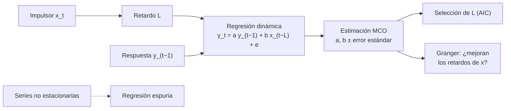

# B15-C21 — Series temporales multivariadas y regresión dinámica

<!-- nav:top -->
[🏠 Programa](../../../../README.md) · [📚 Bloque B15](../../../tronco-comun/B15-senales-imagenes-y-estimacion-cientifica.md) · [← Anterior: B15-C20 — Proyecto de detección y seguimiento](../B15-C20-proyecto-de-deteccion-y-seguimiento/CLASE.md) · [Siguiente: B15-C22 — Clasificación supervisada de imágenes →](../B15-C22-clasificacion-supervisada-de-imagenes/CLASE.md)
<!-- /nav -->

## 1. Ubicación, nivel y alcance

Primera clase programada del bloque B15 (necesidad registrada en el catálogo de la estructura vigente): hasta C20 las series eran de una sola variable; para relacionar el viento solar con un índice geomagnético hacen falta modelos con **varias series** y **retardos**. Aprenderás la regresión dinámica (una respuesta que depende de su propio pasado y del pasado de un impulsor), la selección del retardo, la prueba de causalidad en el sentido de Granger y el peligro de la regresión espuria. Nivel N3. Usas series ([C01](../B15-C01-series-temporales-discretas/CLASE.md)), ruido coloreado ([C03](../B15-C03-ruido-blanco-y-coloreado/CLASE.md)) y ajuste ([C16](../B15-C16-ajuste-de-curvas/CLASE.md)). Los datos son **sintéticos**; no se usan datos reales de viento solar.

## 2. Por qué esta clase existe

El índice Kp de actividad geomagnética se publica en intervalos de 3 horas y refleja las perturbaciones del campo magnético terrestre (S1). Un pronosticador quiere saber cuánto y con qué retardo responde ese índice a una variable del viento solar. Dos series que crecen juntas parecen relacionadas aunque no lo estén, y una correlación sin retardo oculta que el impulsor actúa horas antes. Sin un modelo dinámico, ni se estima el retardo ni se distingue un efecto real de una coincidencia.

La decisión central: **¿cuántos retardos incluyo, cómo sé que un impulsor ayuda de verdad a predecir la respuesta y cómo evito conclusiones espurias?**

## 3. Lo que podrás hacer al terminar

1. Plantear una regresión dinámica `y_t = a y_{t−1} + b x_{t−L} + e_t`.
2. Estimar sus coeficientes por mínimos cuadrados con sus errores estándar.
3. Elegir el retardo con un criterio de información (AIC).
4. Aplicar una prueba de Granger por razón de F.
5. Reconocer y evitar la regresión espuria con series no estacionarias.
6. Verificar el procedimiento con simulaciones de verdad conocida.

La evidencia es el **modelo dinámico con retardo y su verificación** del ejercicio 12 (sección 20).

## 4. Con qué llegas y cómo comprobarlo

Necesitas mínimos cuadrados (C16), autocorrelación y ruido (C03). Cinco preguntas:

1. ¿Qué es un residuo?
2. Si `r₁ = 0,8`, ¿la serie tiene memoria?
3. ¿Qué es un paseo aleatorio (C03)?
4. ¿Qué mide el AIC? (Menor es mejor.)
5. ¿Cuántas muestras de 3 h hay en un día?

<details>
<summary>Ver respuestas</summary>

1. La diferencia entre el dato y la predicción. 2. Sí, fuerte. 3. La suma acumulada de ruido blanco, sin media estable. 4. Un compromiso entre el ajuste y el número de parámetros. 5. 8.
</details>

Con cuatro o cinco aciertos, sigue; si no, repasa C03 y C16.

## 5. Un caso real: un índice cada tres horas

El índice Kp planetario es un entero de 0 a 9 calculado cada 3 horas a partir de las fluctuaciones del campo magnético en observatorios de latitudes medias; 5 o más indica tormenta geomagnética (S1). Aquí **no** se usan datos reales: se simulan 3000 pasos de 3 h (unos 375 días) de un impulsor `x` autorregresivo (`φ = 0,8`) y una respuesta `y_t = 0,5 y_{t−1} + 0,8 x_{t−2} + e_t` (ruido de desviación 0,5), con un retardo de 2 pasos (6 h) conocido. Es el **ejemplo conductor**.

## 6. Vocabulario

Una **serie multivariada** es un vector de series observadas a la vez. La **regresión dinámica** modela `y` con sus propios retardos y con retardos de otras series. Un **proceso autorregresivo vectorial** VAR(`p`) escribe el vector `Y_t = ν + A₁Y_{t−1} + … + A_pY_{t−p} + u_t` (S2). Un **retardo** (*lag*) de `L` pasos desplaza una serie `L` muestras. El **criterio de información de Akaike** (AIC) penaliza los parámetros: `n ln(RSS/n) + 2k`. La **causalidad de Granger** pregunta si los retardos de `x` mejoran la predicción de `y` más allá de sus propios retardos; se contrasta con una razón de F entre el modelo restringido y el completo (S2 menciona la prueba con Wald o F). Es predictiva, no causal en sentido físico. La **regresión espuria** es la relación aparente entre series no estacionarias independientes.

## 7. Modelo mental: eco con retardo

La respuesta es un eco del impulsor: lo que pasó hace 6 horas se oye ahora, más lo que el propio sistema recuerda de sí mismo. Analogía: eco con memoria. Su límite: un eco es siempre una copia; una respuesta real puede ser no lineal, saturarse o depender de otras variables.



*Descripción textual:* el impulsor retardado y el pasado de la respuesta alimentan una regresión dinámica; se estiman coeficientes con sus errores, se elige el retardo con AIC y se contrasta con Granger si el impulsor ayuda a predecir; con series no estacionarias hay riesgo de regresión espuria.

## 8. La explicación, paso a paso

### 8.1 Estimar

Con `Y = [y_t]` y la matriz de diseño con columnas `y_{t−1}` y `x_{t−2}`, se resuelve por mínimos cuadrados (C16) y se obtiene `Cov(β̂) = s²(XᵀX)⁻¹`. El laboratorio da `a = 0,5060 ± 0,0056` y `b = 0,7910 ± 0,0081` (reales 0,5 y 0,8): ambos a menos de 3 errores estándar.

### 8.2 Elegir el retardo

Se ajusta el modelo con `x_{t−L}` para `L = 0 … 5` y se compara el AIC. Valores del laboratorio: `−551` (L=0), `−1110` (L=1), **`−4176` (L=2)**, `−436` (L=3), `101` (L=4), `45` (L=5). El mínimo está en `L = 2`, el retardo real. Los coeficientes de `x` también delatan el retardo: `0,31; 0,44; 0,79; 0,62; −0,05; −0,15`, porque el impulsor tiene memoria (`φ = 0,8`) y `x_{t−1}` y `x_{t−3}` correlacionan con `x_{t−2}`.

### 8.3 Granger

Con 4 retardos de `y` en el modelo restringido y 4 de `y` más 4 de `x` en el completo, `F = [(RSS₀ − RSS₁)/p]/[RSS₁/(n − 2p)]`. Cuando `x` impulsa a `y`, `F = 2227` (p por debajo de la precisión numérica, impreso como 0); con un impulsor independiente del mismo tipo, `F = 1,02` y `p = 0,394`. Granger muestra utilidad predictiva, no un mecanismo.

### 8.4 Regresión espuria

Si `u` y `v` son paseos aleatorios independientes, regresar `v` sobre `u` da `|t| > 2` en el `80 %` de los casos (500 simulaciones con `n = 200`), en vez del 5 % que se espera de series independientes; los residuos tienen autocorrelación fuerte (C03). Al trabajar con **diferencias** `Δu`, `Δv`, la fracción baja a `5 %`. Antes de relacionar dos series, comprueba su estacionariedad (por ejemplo, con la autocorrelación) y diferencia si hace falta.

### 8.5 Varias series a la vez: VAR

Un VAR(`p`) generaliza esto a un vector de `K` series, con matrices `A_i` de `K × K` (S2). Se elige `p` con un criterio de información. Cuesta `K² p` parámetros, de modo que con muchas series y pocos datos se sobreparametriza (C16).

### 8.6 Antes de modelar datos reales

Alinea las series en el tiempo con la misma escala (UTC, [B13](../../../tronco-comun/B13-metrologia-tiempo-y-mediciones-cientificas.md)), trata los huecos (C19), declara el promedio temporal de cada variable (un índice de 3 h frente a un viento solar de 1 min) y valida con datos no usados para estimar.

## 9. Magnitudes, símbolos y unidades

| Símbolo | Qué es | Unidad | Nota |
|---|---|---|---|
| `x_t`, `y_t` | impulsor y respuesta | arbitraria | sintéticas |
| `a`, `b` | coeficientes | adimensional | 0,5; 0,8 |
| `L` | retardo | pasos de 3 h | 2 (6 h) |
| `e_t` | ruido | unidad de `y` | desviación 0,5 |
| AIC | criterio | adimensional | menor es mejor |
| `F`, `p` | estadístico y valor p de Granger | — | |

## 10. Convenciones y referencias

Paso temporal de 3 h (tomado del Kp, S1). Series simuladas con semilla 15021. El AIC se calcula como `n ln(RSS/n) + 2k` con `k = 2`; el valor p de F usa la distribución F de SciPy. Todo es **sintético**.

## 11. De dónde sale lo que afirmamos

| ID | Fuente | Localizador | Respalda | Estado |
|---|---|---|---|---|
| S1 | NOAA/NWS Space Weather Prediction Center, *Planetary K-index* | https://www.spaceweather.gov/products/planetary-k-index | Kp: entero 0–9, valor cada 3 h, derivado de las fluctuaciones máximas del campo magnético en 13 observatorios; 5 o más = tormenta | Consultada el 2026-11-06 mediante extracción automática |
| S2 | statsmodels, *Vector Autoregressions `tsa.vector_ar`* (0.15.0) | https://www.statsmodels.org/stable/vector_ar.html | Definición del VAR(p); selección de orden por criterios de información; prueba de causalidad de Granger por Wald o F | Consultada el 2026-11-06 mediante extracción automática |

Límites: la fórmula del AIC, la razón de F y el fenómeno de regresión espuria son resultados estándar verificados por simulación; no se usó ningún dato real. Los retardos y coeficientes son ficticios y no representan la física del acoplamiento Sol–Tierra.

## 12. Cómo ver los resultados

| Cantidad | Valor |
|---|---|
| `a`, `b` estimados (reales 0,5 y 0,8) | 0,5060 ± 0,0056; 0,7910 ± 0,0081 |
| AIC mínimo | L = 2 (−4176) |
| Granger: impulsor real / independiente | F = 2227 / F = 1,02 (p = 0,394) |
| Regresión espuria: |t| > 2, niveles / diferencias | 0,80 / 0,05 |

Descripción larga: la serie `y` sigue con retraso a `x`, suavizada por su propia memoria; el gráfico de AIC frente a `L` tiene un mínimo agudo en 2; las dos caminatas aleatorias independientes parecen subir y bajar juntas en tramos largos.

## 13. Ejemplo trabajado: elegir entre dos retardos a mano

**Paso 1 · Datos (sintéticos).** Con `n = 100` puntos, dos modelos tienen `RSS(L=1) = 60` y `RSS(L=2) = 25`, ambos con 2 parámetros.

**Paso 2 · AIC.** `n ln(RSS/n) + 2k`: `L = 1`: `100 ln 0,6 + 4 = −51,1 + 4 = −47,1`; `L = 2`: `100 ln 0,25 + 4 = −138,6 + 4 = −134,6`.

**Paso 3 · Decisión.** `L = 2` tiene AIC menor por 87,5.

**Paso 4 · Granger (4 retardos, p = 4).** Con `RSS₀ = 40` y `RSS₁ = 25`, `n − 2p = 92`: `F = (15/4)/(25/92) = 13,8`; mucho mayor que 2,5 (valor típico al 5 %): los retardos de `x` ayudan.

**Paso 5 · Lectura.** El impulsor mejora la predicción; no prueba que lo cause físicamente.

## 14. Distintas formas de relacionar series

**Correlación cruzada**: rápida, pero ignora la memoria propia y no separa efectos. **Regresión dinámica**: estima el retardo y el efecto con memoria. **VAR**: varias series con interacciones. **Modelos físicos**: explican el mecanismo; los estadísticos solo predicen. Combínalos con la teoría.

## 15. Práctica guiada

**Ejercicio 1 · con los pasos indicados.** Para `y_t = 0,5 y_{t−1} + 0,8 x_{t−2}` con `y_{t−1} = 1` y `x_{t−2} = 2`, ¿cuánto vale `y_t` sin ruido? *Pasos:* sustituye.

<details><summary>Solución comentada</summary>

`0,5 · 1 + 0,8 · 2 = 2,1`.
</details>

**Ejercicio 2 · con una pista.** ¿Cuántas muestras de 3 h abarca un retardo de 6 h? *Pista:* divide.

<details><summary>Solución comentada</summary>

2 (8.2).
</details>

**Ejercicio 3 · casi autónomo.** Calcula el AIC de un modelo con `n = 100`, `RSS = 50` y `k = 2`.

<details><summary>Solución comentada</summary>

`100 ln 0,5 + 4 = −69,3 + 4 = −65,3`.
</details>

## 16. Práctica autónoma, transferencia e integrador

**Ejercicio 4.** Con `a = 0,5060 ± 0,0056` y real 0,5, ¿a cuántos errores estándar está?

<details><summary>Solución comentada</summary>

`0,0060/0,0056 = 1,07` (8.1): compatible.
</details>

**Ejercicio 5.** En la tabla de AIC, ¿cuánto mejora L=2 respecto a L=1?

<details><summary>Solución comentada</summary>

`−4176 − (−1110) = −3066`: una diferencia enorme a favor de L=2 (8.2).
</details>

**Ejercicio 6.** ¿Por qué el coeficiente de `x` con `L = 3` es 0,62 si el verdadero retardo es 2?

<details><summary>Solución comentada</summary>

Porque `x` tiene memoria (`φ = 0,8`): `x_{t−3}` está correlacionado con `x_{t−2}`; sin incluir `x_{t−2}` el modelo atribuye el efecto a `x_{t−3}` (8.2).
</details>

**Ejercicio 7.** Con `F = 1,02` y p = 0,394, ¿qué concluyes sobre un impulsor independiente?

<details><summary>Solución comentada</summary>

No mejora la predicción: no se rechaza que sus retardos no aporten nada (8.3).
</details>

**Ejercicio 8.** Dos series de 200 datos de paseos aleatorios independientes dan `|t| = 5` en una regresión. ¿Qué haces?

<details><summary>Solución comentada</summary>

Desconfiar: el 80 % de los casos pasan `|t| > 2` (8.4). Diferencia las series, vuelve a ajustar y comprueba el comportamiento de los residuos.
</details>

**Ejercicio 9 · transferencia.** Quieres relacionar una variable de 1 min con un índice de 3 h. ¿Cómo preparas los datos?

<details><summary>Solución comentada</summary>

Promedia (o toma el valor adecuado) la variable en intervalos de 3 h alineados con los del índice, con la misma escala de tiempo, y declara el tratamiento de huecos (8.6).
</details>

**Ejercicio 10 · transferencia.** Un VAR(3) con 5 series: ¿cuántos coeficientes (sin contar constantes ni covarianzas)?

<details><summary>Solución comentada</summary>

`K² p = 25 · 3 = 75` (8.5). Con pocas observaciones hay riesgo de sobreparametrizar.
</details>

**Ejercicio 11 · transferencia.** Granger concluye que la actividad solar «causa» el índice. ¿Qué matiz exiges?

<details><summary>Solución comentada</summary>

Que es causalidad predictiva: los retardos mejoran la predicción. La causa física requiere un mecanismo y descartar variables comunes (8.3, 14).
</details>

**Ejercicio 12 · integrador.** Elabora tu *modelo dinámico con retardo y su verificación*: simula un impulsor y una respuesta con un retardo propio, estima coeficientes con errores, elige el retardo por AIC, aplica Granger con un impulsor real y otro independiente, y demuestra la regresión espuria con paseos aleatorios.

<details><summary>Solución modelo</summary>

Coeficientes dentro de 3 errores estándar, AIC mínimo en el retardo sembrado, `F` grande frente a `F ≈ 1`, y fracciones 0,8 (niveles) y 0,05 (diferencias). Datos sintéticos, semilla y versiones; fuentes S1–S2 con fecha.
</details>

## 17. Laboratorio: regresión dinámica y regresión espuria

El script [regresion_dinamica.py](regresion_dinamica.py) simula el impulsor y la respuesta, estima los coeficientes, elige el retardo por AIC, calcula la prueba de Granger y mide la fracción de regresiones espurias con y sin diferenciar.

**Datos:** sintéticos, semilla 15021. **Predice antes de ejecutar:** ¿qué retardo elegirá el AIC? (2.) **Ejecución del 2026-11-06 (Python 3.12.9, NumPy 2.4.4, SciPy 1.17.1):**

```text
(1) y_t = a y_(t-1) + b x_(t-2): a = 0.5060 ± 0.0056 (real 0.5); b = 0.7910 ± 0.0081 (real 0.8)
(2) AIC al usar x_(t-L) (con y_(t-1)):
    L = 0: AIC = -550.9; coeficiente de x = +0.309
    L = 1: AIC = -1110.2; coeficiente de x = +0.441
    L = 2: AIC = -4176.3; coeficiente de x = +0.791
    L = 3: AIC = -435.9; coeficiente de x = +0.624
    L = 4: AIC = 100.6; coeficiente de x = -0.052
    L = 5: AIC = 45.0; coeficiente de x = -0.147
(3) Granger (4 retardos): x impulsa a y: F = 2227.5, p = 0.00e+00; x independiente: F = 1.02, p = 0.394
(4) dos paseos aleatorios independientes (n = 200): |t| > 2 en 0.80 de los casos con niveles; en 0.05 con diferencias (esperado ≈ 0.05)
Pruebas superadas.
```

```bash
python programa/clases/B15/B15-C21-series-temporales-multivariadas-y-regresion-dinamica/regresion_dinamica.py
```

**Límites:** modelo lineal con un solo retardo; ruido blanco gaussiano; sin datos reales; la fracción de espurias se estima con 500 simulaciones (incertidumbre ≈ 2 puntos).

## 18. Errores frecuentes y cómo corregirlos

**Correlacionar series con tendencia sin diferenciar.** Se corrige con el ejercicio 8.

**Tomar el máximo de la correlación cruzada como retardo.** Se corrige con el ejercicio 6.

**Confundir causalidad de Granger con causa física.** Se corrige con el ejercicio 11.

**No alinear escalas de tiempo y promedios.** Se corrige con el ejercicio 9.

**Sobreparametrizar un VAR.** Se corrige con el ejercicio 10.

## 19. Cómo sabrás que vas bien

Tras 8.1: ¿estimas `a` y `b` con errores? Si no, ejercicio 4. Tras 8.2: ¿eliges un retardo por AIC? Si no, ejercicios 3 y 5. Tras 8.4: ¿por qué falla la regresión con tendencias? Si no, ejercicio 8.

## 20. Qué entregas y cómo se evalúa

El producto es tu **modelo dinámico con retardo y su verificación** (ejercicio 12).

| Criterio | Inicial | En desarrollo | Logrado | Destacado |
|---|---|---|---|---|
| Modelo | Sin retardo | Retardo supuesto | Retardo elegido por AIC | Compara con VAR |
| Estimación | Sin errores | Errores sin interpretar | Coeficientes con errores estándar | Verificados por simulación |
| Causalidad | La asume | Correlación | Granger bien interpretado | Discute variables comunes |
| Espuria | Ignorada | La menciona | La demuestra | Corrige con diferencias |
| Fuentes y rótulos | Sin fuente | Sin fecha | Con localizador y fecha | Rotula sintético; declara límites |

**Condiciones críticas (no se compensan con promedio):** comprobar estacionariedad antes de regresar; no presentar Granger como causalidad física; citar solo fuentes consultadas.

## 21. Ética, seguridad y límites

Un pronóstico geomagnético basado en un modelo estadístico sin validar puede inducir falsas alarmas o falsa seguridad; esta clase es didáctica y no sirve para operar alertas. Accesibilidad: las gráficas tienen tabla equivalente y el laboratorio funciona sin conexión.

## 22. Para cerrar y seguir

La regresión dinámica relaciona una respuesta con su pasado y con el pasado de un impulsor; el AIC elige el retardo, Granger contrasta la utilidad predictiva y las series no estacionarias exigen diferenciar para evitar regresiones espurias. Queda abierta una pregunta: cuando los datos son imágenes, ¿cómo se asigna cada píxel a una clase?

**Glosario español–inglés.** serie multivariada · *multivariate series*; regresión dinámica · *dynamic regression*; retardo · *lag*; causalidad de Granger · *Granger causality*; regresión espuria · *spurious regression*; criterio de Akaike · *Akaike information criterion*; autorregresión vectorial · *vector autoregression*.

**Continuidad.** B15-C22 aplica tu manejo de modelos y validación a la **clasificación supervisada de imágenes**.

**Referencias:** ver sección 11.

<!-- nav:bottom -->
---

[← Anterior: B15-C20 — Proyecto de detección y seguimiento](../B15-C20-proyecto-de-deteccion-y-seguimiento/CLASE.md) · [📚 Bloque B15](../../../tronco-comun/B15-senales-imagenes-y-estimacion-cientifica.md) · [Siguiente: B15-C22 — Clasificación supervisada de imágenes →](../B15-C22-clasificacion-supervisada-de-imagenes/CLASE.md)
<!-- /nav -->
