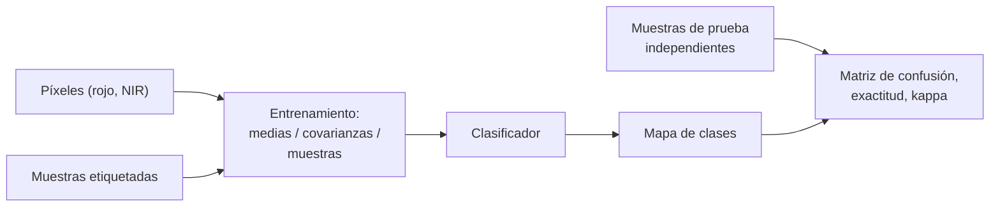

# B15-C22 — Clasificación supervisada de imágenes

<!-- nav:top -->
[🏠 Programa](../../../../README.md) · [📚 Bloque B15](../../../tronco-comun/B15-senales-imagenes-y-estimacion-cientifica.md) · [← Anterior: B15-C21 — Series temporales multivariadas y regresión dinámica](../B15-C21-series-temporales-multivariadas-y-regresion-dinamica/CLASE.md) · [Siguiente: B15-C23 — Clasificación no supervisada y agrupamiento de imágenes →](../B15-C23-clasificacion-no-supervisada-y-agrupamiento-de-imagenes/CLASE.md)
<!-- /nav -->

## 1. Ubicación, nivel y alcance

Segunda clase programada del bloque B15. En [C13](../B15-C13-segmentacion-de-imagenes/CLASE.md) separaste objetos con un umbral; para producir un mapa temático (agua, vegetación, suelo) hay que asignar a cada píxel una **clase** usando varias bandas y **muestras de entrenamiento** etiquetadas. Aprenderás los clasificadores de distancia mínima, de máxima verosimilitud gaussiana y de vecino más cercano, la matriz de confusión, la exactitud, el coeficiente kappa y la regla de oro: **evaluar siempre con datos que no se usaron para entrenar**. Nivel N3. Usas estimación ([C15](../B15-C15-estimacion-de-parametros-senales-imagenes-y-estimacion-cientifica/CLASE.md)) y probabilidad ([B12](../../../tronco-comun/B12-probabilidad-estadistica-e-incertidumbre.md)). Los datos son **sintéticos**. No verás aprendizaje profundo (B17).

## 2. Por qué esta clase existe

Un mapa de cobertura de suelo parece una verdad; en realidad es una predicción con un error que depende de las muestras elegidas y de cuánto se solapan las clases en el espacio espectral. Cifras como «90 % de exactitud» no significan nada sin decir con qué datos se midieron, ni cómo se reparte el error entre clases. Y una evaluación con las mismas muestras que entrenaron al clasificador puede dar el 100 % sin que el mapa sirva.

La decisión central: **¿qué clasificador y qué muestras uso, y cómo estimo sin trampas su error?**

## 3. Lo que podrás hacer al terminar

1. Describir los píxeles como vectores espectrales y calcular el NDVI.
2. Entrenar y aplicar tres clasificadores sencillos.
3. Construir una matriz de confusión y calcular exactitud y kappa.
4. Comparar el error observado con el error de Bayes en un caso analítico.
5. Reconocer la fuga entre entrenamiento y prueba.
6. Explicar cómo el solapamiento de clases limita la exactitud.

La evidencia es el **mapa clasificado con matriz de confusión** del ejercicio 12 (sección 20).

## 4. Con qué llegas y cómo comprobarlo

Necesitas media, covarianza y la distribución normal. Cinco preguntas:

1. ¿Cuánto vale el NDVI de un píxel con rojo 0,04 y NIR 0,45?
2. ¿Qué es la distancia euclídea entre `(0,03; 0,02)` y `(0,04; 0,45)`?
3. ¿Qué es `Φ(−1)`? (≈ 0,159.)
4. ¿Qué es una matriz de confusión?
5. ¿Por qué no se evalúa con los datos de entrenamiento?

<details>
<summary>Ver respuestas</summary>

1. `(0,45 − 0,04)/(0,45 + 0,04) = 0,84`. 2. `√(0,01² + 0,43²) = 0,430`. 3. 0,159. 4. Una tabla que cuenta cuántos píxeles de cada clase verdadera se asignan a cada clase predicha. 5. Porque el clasificador ya conoce esas respuestas y el resultado sobreestima la generalización.
</details>

Con cuatro o cinco aciertos, sigue; si no, repasa C15 y B12.

## 5. Un caso real: tres coberturas en rojo e infrarrojo

El instrumento OLI de Landsat 8 y 9 mide, entre otras, la banda del rojo (0,64–0,67 µm) y la del infrarrojo cercano (0,85–0,88 µm) (S1). La vegetación sana refleja poco rojo y mucho infrarrojo, el agua poco de ambos y el suelo desnudo algo de ambos. Aquí simulamos **píxeles sintéticos** con reflectancias ficticias de tres clases —agua `(0,03; 0,02)`, vegetación `(0,04; 0,45)` y suelo `(0,20; 0,28)`— y desviación de 0,09 en cada banda, para poder conocer la clase verdadera. Es el **ejemplo conductor**.

## 6. Vocabulario

El **vector espectral** de un píxel reúne su valor en cada banda. El **NDVI** (*índice de vegetación de diferencia normalizada*) es `(NIR − rojo)/(NIR + rojo)`. Una **clase** es una categoría del mapa. Las **muestras de entrenamiento** son píxeles con clase conocida usados para estimar el clasificador; las **muestras de prueba** son píxeles independientes con clase conocida para evaluarlo. El clasificador de **distancia mínima** asigna la clase de la media más cercana. El de **máxima verosimilitud gaussiana** (QDA) usa media y covarianza de cada clase. El de **vecino más cercano** (k-NN, `k = 1`) copia la clase del píxel de entrenamiento más próximo. La **matriz de confusión** cuenta aciertos y confusiones. La **exactitud global** es la fracción de aciertos. El **coeficiente kappa de Cohen** es `(p_o − p_e)/(1 − p_e)`, el acuerdo respecto del esperado por azar. El **error de Bayes** es el mínimo error posible dadas las distribuciones.

## 7. Modelo mental: clasificar frutas en la mesa

Para separar naranjas, limones y limas por color, miras dónde cae cada fruta en un gráfico de color. Si los tres grupos están lejos, cualquier regla funciona; si se solapan, algunas frutas quedan en tierra de nadie y cualquier regla se equivoca con ellas. Analogía: frutas en un gráfico de color. Su límite: en el gráfico ves los grupos; en una imagen real, las clases no son gaussianas ni están bien definidas, y las muestras de entrenamiento pueden estar sesgadas.



*Descripción textual:* las muestras etiquetadas entrenan un clasificador que se aplica a los píxeles; las muestras de prueba independientes, comparadas con la predicción, dan la matriz de confusión, la exactitud y el kappa.

## 8. La explicación, paso a paso

### 8.1 El caso analítico: error de Bayes

Con dos clases gaussianas de igual varianza, separadas `d` desviaciones, el mejor umbral es el punto medio y el error es `Φ(−d/2)`. Para `d = 2`: `Φ(−1) = 0,15866`. El laboratorio (400 000 muestras por clase) da `0,15842`. Es la referencia con la que se verifica el procedimiento.

### 8.2 Vectores espectrales y NDVI

Con las medias ficticias, el NDVI es `−0,20` (agua), `+0,84` (vegetación) y `+0,17` (suelo). El NDVI condensa dos bandas en una; no sustituye al clasificador, pero ilustra por qué las bandas separan clases.

### 8.3 Tres clasificadores

Con 30 muestras de entrenamiento por clase y 5000 de prueba por clase, el laboratorio da:

| Clasificador | Exactitud de prueba | Kappa |
|---|---|---|
| Distancia mínima | 0,9047 | 0,8571 |
| Máxima verosimilitud | 0,9029 | 0,8543 |
| 1 vecino | 0,8485 | 0,7728 |

Las covarianzas de las clases son iguales en la simulación, por lo que la distancia mínima es casi óptima y la máxima verosimilitud (que estima más parámetros con solo 30 muestras) no gana. El 1-NN, que memoriza los datos de entrenamiento, es el peor.

### 8.4 La matriz de confusión

Para máxima verosimilitud (filas = verdad; columnas = predicción, en el orden agua, vegetación, suelo): `[4736, 7, 257]`, `[25, 4533, 442]`, `[252, 474, 4274]`. Los errores se concentran entre suelo y las otras dos clases: la vegetación se confunde con el suelo en 442 casos (8,8 %) y el suelo con la vegetación en 474 (9,5 %). La exactitud global (90,3 %) oculta esa asimetría.

### 8.5 Kappa

`κ = (p_o − p_e)/(1 − p_e)`, con `p_o` la exactitud y `p_e` el acuerdo esperado por azar según los totales de fila y columna. Con 3 clases equiprobables `p_e = 1/3`: `κ = (0,903 − 0,333)/0,667 = 0,855`, igual al del laboratorio. Una matriz diagonal da `κ = 1`.

### 8.6 La trampa: evaluar con los datos de entrenamiento

El 1-NN evaluado con sus propios datos de entrenamiento acierta el `100 %` (cada píxel es su propio vecino), pero con datos independientes, el `84,9 %`. La evaluación honesta exige muestras de prueba separadas (o validación cruzada).

### 8.7 El solapamiento limita la exactitud

Si el suelo se acerca a la vegetación (media `(0,10; 0,40)` en vez de `(0,20; 0,28)`), la exactitud de distancia mínima baja de `0,910` a `0,765`: ningún clasificador de estas bandas puede mejorarlo mucho porque el solapamiento es propiedad de los datos. Para mejorar hay que añadir bandas, índices o información de contexto.

## 9. Magnitudes, símbolos y unidades

| Símbolo | Qué es | Unidad | Nota |
|---|---|---|---|
| `ρ_R`, `ρ_NIR` | reflectancia en rojo y NIR | adimensional | bandas 4 y 5 de OLI (S1) |
| NDVI | índice de vegetación | adimensional | −1 a 1 |
| `μ_c`, `Σ_c` | media y covarianza de la clase `c` | — | de las muestras |
| `σ` | dispersión por banda | adimensional | 0,09 |
| `p_o`, `p_e` | acuerdo observado y esperado | — | |
| `κ` | kappa de Cohen | — | |

## 10. Convenciones y referencias

Las reflectancias y las clases son **ficticias**; las longitudes de onda de las bandas son las publicadas por el USGS (S1). Filas de la matriz = clase verdadera, columnas = predicha. Las muestras de prueba son independientes de las de entrenamiento. Semilla 15022.

## 11. De dónde sale lo que afirmamos

| ID | Fuente | Localizador | Respalda | Estado |
|---|---|---|---|---|
| S1 | USGS, *What are the best Landsat spectral bands for use in my research?* | https://www.usgs.gov/faqs/what-are-best-landsat-spectral-bands-use-my-research | Bandas de Landsat 8/9 OLI: rojo 0,64–0,67 y NIR 0,85–0,88 (valores de la tabla de la página; sin unidades listadas en ella, que se interpretan como µm); pancromática 0,50–0,68 con 15 m | Consultada el 2026-11-06 mediante extracción automática |

Límites: la fórmula del NDVI, el error de Bayes y el kappa de Cohen son resultados estándar verificados numéricamente; las reflectancias de las clases son ficticias y no proceden de ninguna escena. S1 no da el significado físico de las coberturas.

## 12. Cómo ver la clasificación

| Cantidad | Valor |
|---|---|
| Error de Bayes (d = 2σ), observado / teórico | 0,15842 / 0,15866 |
| Exactitud de distancia mínima / máx. verosimilitud / 1-NN | 0,9047 / 0,9029 / 0,8485 |
| 1-NN en entrenamiento | 1,000 |
| Distancia mínima con suelo cercano a la vegetación | 0,765 (frente a 0,910) |

Descripción larga: en el plano rojo–NIR, el agua queda abajo a la izquierda, la vegetación arriba a la izquierda y el suelo en el centro a la derecha; las nubes de puntos se tocan en los bordes, donde caen los errores.

## 13. Ejemplo trabajado: asignar un píxel por distancia mínima

**Paso 1 · Datos (sintéticos).** Medias: agua `(0,03; 0,02)`, vegetación `(0,04; 0,45)`, suelo `(0,20; 0,28)`. Píxel `(0,12; 0,33)`.

**Paso 2 · Distancias al cuadrado.** Agua: `0,09² + 0,31² = 0,0081 + 0,0961 = 0,1042`. Vegetación: `0,08² + 0,12² = 0,0064 + 0,0144 = 0,0208`. Suelo: `0,08² + 0,05² = 0,0064 + 0,0025 = 0,0089`.

**Paso 3 · Decisión.** La menor es el suelo (0,0089).

**Paso 4 · NDVI del píxel.** `(0,33 − 0,12)/(0,33 + 0,12) = 0,47`: intermedio entre el suelo (0,17) y la vegetación (0,84).

**Paso 5 · Lectura.** Cae entre dos clases: las distancias a suelo y vegetación (0,094 y 0,144) no difieren mucho. Es un píxel «de frontera», donde el error es probable.

## 14. Distintas formas de clasificar

**Distancia mínima**: sencillo, bueno con pocas muestras y covarianzas parecidas. **Máxima verosimilitud**: usa la forma de cada clase, necesita más muestras. **k-NN**: sin supuestos, sensible al ruido de las muestras. **Árboles, máquinas de vectores y redes** (B17): más flexibles, más riesgo de sobreajuste. Elige por las muestras disponibles y valida con datos independientes.

## 15. Práctica guiada

**Ejercicio 1 · con los pasos indicados.** Calcula el NDVI de `(rojo, NIR) = (0,20; 0,28)`. *Pasos:* `(NIR − rojo)/(NIR + rojo)`.

<details><summary>Solución comentada</summary>

`0,08/0,48 = 0,167` (8.2).
</details>

**Ejercicio 2 · con una pista.** Clasifica `(0,05; 0,10)` por distancia mínima. *Pista:* calcula las tres distancias cuadradas.

<details><summary>Solución comentada</summary>

Agua: `0,02² + 0,08² = 0,0068`; vegetación: `0,01² + 0,35² = 0,1226`; suelo: `0,15² + 0,18² = 0,0549`. Agua (13).
</details>

**Ejercicio 3 · casi autónomo.** Calcula `κ` para una exactitud de 0,90 y tres clases equiprobables.

<details><summary>Solución comentada</summary>

`p_e = 1/3`; `κ = (0,90 − 0,333)/0,667 = 0,85` (8.5).
</details>

## 16. Práctica autónoma, transferencia e integrador

**Ejercicio 4.** ¿Cuánto vale `Φ(−d/2)` para `d = 3`? (`Φ(−1,5) = 0,0668`.)

<details><summary>Solución comentada</summary>

0,0668 (6,7 % de error) (8.1).
</details>

**Ejercicio 5.** En la matriz de 8.4, calcula la exactitud por clase (fracción de aciertos de cada fila).

<details><summary>Solución comentada</summary>

Agua `4736/5000 = 0,947`; vegetación `4533/5000 = 0,907`; suelo `4274/5000 = 0,855`. Total `0,903`.
</details>

**Ejercicio 6.** En la misma matriz, ¿qué fracción del suelo verdadero se asigna a vegetación y qué fracción de la vegetación al suelo?

<details><summary>Solución comentada</summary>

`474/5000 = 9,5 %` y `442/5000 = 8,8 %` (8.4).
</details>

**Ejercicio 7.** Un 1-NN acierta el 100 % en entrenamiento y el 84,9 % en prueba. ¿Cuál reportas?

<details><summary>Solución comentada</summary>

El de prueba (84,9 %): el de entrenamiento es trivial (8.6).
</details>

**Ejercicio 8.** Con clases solapadas la exactitud baja a 0,765. ¿Qué haces para mejorar?

<details><summary>Solución comentada</summary>

Añadir bandas o índices que separen las clases, usar contexto espacial o fusionar fechas; cambiar de clasificador cambia poco porque el solapamiento es de los datos (8.7).
</details>

**Ejercicio 9 · transferencia.** Un mapa tiene el 95 % de exactitud global, pero la clase «cultivo de interés» ocupa el 2 % del área. ¿Qué pides?

<details><summary>Solución comentada</summary>

La matriz de confusión y la exactitud por clase: un mapa que nunca asigna esa clase podría acertar el 98 %. Hay que evaluar la clase rara (C13, 8.6).
</details>

**Ejercicio 10 · transferencia.** Tomas las muestras de prueba al lado de las de entrenamiento (píxeles vecinos del mismo campo). ¿Qué sesgo introduces?

<details><summary>Solución comentada</summary>

Los píxeles vecinos están correlacionados (misma parcela), así que la prueba no es independiente y la exactitud sale optimista. Separa por parcela o región.
</details>

**Ejercicio 11 · transferencia.** Entrenas con una escena de verano y aplicas el modelo a otra de invierno. ¿Qué esperas?

<details><summary>Solución comentada</summary>

Las firmas espectrales cambian con la estación (fenología, iluminación), así que el clasificador pierde exactitud; hay que reentrenar o normalizar y evaluar con datos de la misma condición.
</details>

**Ejercicio 12 · integrador.** Elabora tu *mapa clasificado con matriz de confusión*: simula tus tres clases con tu semilla, entrena distancia mínima y máxima verosimilitud con 30 muestras por clase, evalúa con 5000 independientes, informa la matriz, la exactitud global y por clase, kappa, el efecto del solapamiento y el error de Bayes del caso 1D.

<details><summary>Solución modelo</summary>

Matriz 3 × 3 con errores concentrados en las clases cercanas; exactitud ≈ 0,9 y κ ≈ 0,85; ejemplo de fuga con el 1-NN; error de Bayes 1D comparado con el observado. Datos sintéticos, semilla y versiones; fuente S1 con fecha.
</details>

## 17. Laboratorio: tres clasificadores y una matriz de confusión

El script [clasificacion.py](clasificacion.py) verifica el error de Bayes de un caso analítico, entrena tres clasificadores con 30 muestras por clase, los evalúa con 5000 independientes, calcula la matriz de confusión y kappa, muestra la fuga del 1-NN y el efecto del solapamiento.

**Datos:** sintéticos, semilla 15022. **Predice antes de ejecutar:** ¿qué exactitud en entrenamiento tendrá el 1-NN? (1,0.) **Ejecución del 2026-11-06 (Python 3.12.9, NumPy 2.4.4):**

```text
(1) dos gaussianas separadas 2.0 sigma: error observado 0.15842; Phi(-d/2) = 0.15866
    NDVI de la media de cada clase: agua -0.20, vegetación +0.84, suelo +0.17
(2) distancia mínima      : exactitud de prueba 0.9047; kappa 0.8571
(2) máxima verosimilitud  : exactitud de prueba 0.9029; kappa 0.8543
(2) 1 vecino              : exactitud de prueba 0.8485; kappa 0.7728
    matriz de confusión (filas verdad, columnas predicción; agua, vegetación, suelo), máxima verosimilitud:
     [4736, 7, 257]
     [25, 4533, 442]
     [252, 474, 4274]
    1 vecino evaluado con los datos de entrenamiento: exactitud 1.000 (fuga: no es una medida de generalización)
(3) clases separadas: exactitud con distancia mínima 0.9101
(3) clases solapadas: exactitud con distancia mínima 0.7647
Pruebas superadas.
```

```bash
python programa/clases/B15/B15-C22-clasificacion-supervisada-de-imagenes/clasificacion.py
```

**Límites:** clases gaussianas con la misma dispersión; una sola repetición del entrenamiento (los resultados varían con la semilla); sin imágenes reales ni contexto espacial.

## 18. Errores frecuentes y cómo corregirlos

**Evaluar con los datos de entrenamiento.** Se corrige con el ejercicio 7.

**Reportar solo la exactitud global.** Se corrige con los ejercicios 5, 6 y 9.

**Muestras de prueba correlacionadas con las de entrenamiento.** Se corrige con el ejercicio 10.

**Aplicar un modelo a condiciones distintas de las de entrenamiento.** Se corrige con el ejercicio 11.

**Esperar que un clasificador más complejo resuelva el solapamiento.** Se corrige con el ejercicio 8.

## 19. Cómo sabrás que vas bien

Tras 8.3: ¿clasificas un píxel por distancia mínima? Si no, ejercicio 2. Tras 8.5: ¿calculas kappa? Si no, ejercicio 3. Tras 8.6: ¿por qué no se reporta el 100 %? Si no, ejercicio 7.

## 20. Qué entregas y cómo se evalúa

El producto es tu **mapa clasificado con matriz de confusión** (ejercicio 12).

| Criterio | Inicial | En desarrollo | Logrado | Destacado |
|---|---|---|---|---|
| Muestras | Sin separar | Separadas sin criterio | Entrenamiento y prueba independientes | Separación por región |
| Clasificador | Uno sin justificar | Dos sin comparar | Comparados con matriz | Con referencia analítica |
| Métricas | Solo exactitud | Exactitud y kappa | Matriz, exactitud por clase y kappa | Interpreta la confusión |
| Límites | No declarados | Mencionados | Solapamiento y sesgo discutidos | Cuantificados |
| Fuentes y rótulos | Sin fuente | Sin fecha | Con localizador y fecha | Rotula sintético vs observado |

**Condiciones críticas (no se compensan con promedio):** evaluar con datos independientes; informar la matriz de confusión; citar solo fuentes consultadas.

## 21. Ética, seguridad y límites

Un mapa temático puede orientar políticas de uso del suelo, ayudas o gestión de desastres: sus errores afectan a personas. Publica exactitud por clase, fuentes de las muestras y limitaciones. Esta clase es didáctica y usa datos ficticios. Accesibilidad: las matrices tienen texto equivalente y el laboratorio funciona sin conexión.

## 22. Para cerrar y seguir

Clasificar es asignar cada píxel a una clase con un modelo entrenado en muestras; se evalúa con datos independientes mediante matriz de confusión, exactitud por clase y kappa; el error mínimo lo marca el solapamiento de las clases. Queda abierta una pregunta: ¿qué se hace si no hay muestras etiquetadas?

**Glosario español–inglés.** clasificación supervisada · *supervised classification*; muestras de entrenamiento · *training samples*; matriz de confusión · *confusion matrix*; exactitud global · *overall accuracy*; coeficiente kappa · *kappa coefficient*; error de Bayes · *Bayes error*; vecino más cercano · *nearest neighbour*.

**Continuidad.** B15-C23 reutiliza tu manejo del espacio espectral para el **agrupamiento sin muestras etiquetadas**.

**Referencias:** ver sección 11.

<!-- nav:bottom -->
---

[← Anterior: B15-C21 — Series temporales multivariadas y regresión dinámica](../B15-C21-series-temporales-multivariadas-y-regresion-dinamica/CLASE.md) · [📚 Bloque B15](../../../tronco-comun/B15-senales-imagenes-y-estimacion-cientifica.md) · [Siguiente: B15-C23 — Clasificación no supervisada y agrupamiento de imágenes →](../B15-C23-clasificacion-no-supervisada-y-agrupamiento-de-imagenes/CLASE.md)
<!-- /nav -->
