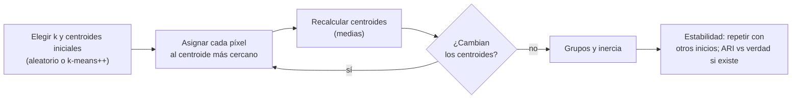

# B15-C23 — Clasificación no supervisada y agrupamiento de imágenes

<!-- nav:top -->
[🏠 Programa](../../../../README.md) · [📚 Bloque B15](../../../tronco-comun/B15-senales-imagenes-y-estimacion-cientifica.md) · [← Anterior: B15-C22 — Clasificación supervisada de imágenes](../B15-C22-clasificacion-supervisada-de-imagenes/CLASE.md) · [Siguiente: B15-C24 — Fusión de imágenes de distintos sensores →](../B15-C24-fusion-de-imagenes-de-distintos-sensores/CLASE.md)
<!-- /nav -->

## 1. Ubicación, nivel y alcance

Tercera clase programada del bloque B15. En [C22](../B15-C22-clasificacion-supervisada-de-imagenes/CLASE.md) las clases se conocían de antemano y había muestras etiquetadas. Cuando no las hay —una escena nueva, un planeta sin mapa— se **agrupan** los píxeles por similitud espectral y se interpreta después qué es cada grupo. Aprenderás el algoritmo k-medias, la elección del número de grupos, los mínimos locales y cómo medir el acuerdo con una verdad cuando existe (índice de Rand ajustado). Nivel N3. Usas distancias y medias (C22), estimación ([C15](../B15-C15-estimacion-de-parametros-senales-imagenes-y-estimacion-cientifica/CLASE.md)) y álgebra lineal ([B10](../../../tronco-comun/B10-algebra-lineal-y-matematicas-geometricas.md)). Los datos son **sintéticos**.

## 2. Por qué esta clase existe

Un satélite fotografía una región que nadie ha cartografiado. Sin muestras, no se puede entrenar un clasificador, pero sí se puede preguntar cuántos «tipos» de superficie distintos hay en las bandas. El agrupamiento ofrece una respuesta, pero no es neutral: depende del número de grupos pedido, de la inicialización y de qué bandas se usen. Sin una verificación, se corre el riesgo de dar nombre a grupos que son artefactos.

La decisión central: **¿cuántos grupos busco, cuánto confío en que el resultado es estable y cómo interpreto cada grupo sin inventarle un significado?**

## 3. Lo que podrás hacer al terminar

1. Escribir y aplicar el algoritmo de k-medias (Lloyd).
2. Calcular la inercia y comprobar que no aumenta.
3. Elegir `k` con la curva de inercia y entender sus límites.
4. Medir el acuerdo con una verdad mediante el índice de Rand ajustado.
5. Comparar inicializaciones y reconocer los mínimos locales.
6. Verificar el código contra una biblioteca y contra fórmulas exactas.

La evidencia es el **mapa de grupos con medida de estabilidad** del ejercicio 12 (sección 20).

## 4. Con qué llegas y cómo comprobarlo

Necesitas distancias, medias y la matriz de confusión de C22. Cinco preguntas:

1. ¿Cuál es la media de `(1, 3)`, `(3, 5)`, `(5, 1)`?
2. ¿Qué distancia cuadrada hay entre `(0, 0)` y `(3, 4)`?
3. ¿Qué significa «sin supervisión»?
4. ¿Qué es una inicialización aleatoria?
5. ¿Qué es la inercia (suma de distancias cuadradas al centroide)?

<details>
<summary>Ver respuestas</summary>

1. `(3, 3)`. 2. 25. 3. Que no se usan etiquetas para agrupar. 4. Elegir al azar los puntos de partida de un algoritmo iterativo. 5. La suma, sobre todos los puntos, de la distancia cuadrada al centro del grupo al que pertenecen.
</details>

Con cuatro o cinco aciertos, sigue; si no, repasa C22 y C15.

## 5. Un caso real: agrupar píxeles sin etiquetas

Los mismos tres tipos de cobertura de C22 (agua, vegetación, suelo; reflectancias ficticias en las bandas del rojo y del infrarrojo cercano de un instrumento como OLI, S2), pero ahora **sin usar las etiquetas** para agrupar: 3000 píxeles sintéticos y la pregunta de si el algoritmo descubre los tres grupos. Las etiquetas solo se usan al final para evaluar. Es el **ejemplo conductor**.

## 6. Vocabulario

El **agrupamiento** (*clustering*) divide los datos en grupos de elementos similares. **k-medias** busca `k` centroides que minimicen la **inercia** `Σ ‖x_i − c_{g(i)}‖²`. El **algoritmo de Lloyd** alterna dos pasos: asignar cada punto al centroide más cercano y recalcular cada centroide como media de sus puntos; scipy implementa esa idea con distintas inicializaciones, entre ellas `'++'` (k-means++, siembra cuidadosa) y `'matrix'` (centroides dados) (S1). Un **mínimo local** es una solución que ningún paso del algoritmo mejora aunque exista otra mejor. El **codo** es el valor de `k` donde la inercia deja de bajar rápido. El **índice de Rand ajustado** (ARI) compara dos agrupaciones: 1 si coinciden, ≈ 0 si coinciden como el azar. La **estabilidad** es que repetir el agrupamiento con otros inicios dé lo mismo.

## 7. Modelo mental: repartir a los invitados en mesas

Colocas `k` mesas al azar; cada invitado se sienta en la más cercana; luego cada mesa se mueve al centro de sus invitados; los invitados vuelven a elegir. Tras unas rondas, nadie cambia. Analogía: mesas que se mueven. Su límite: el reparto final depende de dónde pusiste las mesas al principio, y el algoritmo nunca pregunta si «tres mesas» era el número correcto.



*Descripción textual:* se eligen `k` centroides, se asigna cada píxel al más cercano, se recalculan las medias y se repite hasta que no cambian; el resultado se evalúa repitiendo con otros inicios y, si hay verdad, con el ARI.

## 8. La explicación, paso a paso

### 8.1 El algoritmo

Con puntos `x_i` y centroides `c_j`: (1) `g(i) = argmin_j ‖x_i − c_j‖²`; (2) `c_j = media{x_i : g(i) = j}`; se repite hasta que los centroides no cambian. Cada paso no aumenta la inercia: asignar al más cercano la disminuye o la mantiene; recalcular la media también (la media minimiza la suma de cuadrados). En el laboratorio, con `σ = 0,05`, convergió en 6 iteraciones, la inercia pasó de `31,86` a `14,76` y el cambio entre iteraciones fue siempre ≤ 0.

### 8.2 Un caso exacto

Con `k = 1`, el centroide es la media global y la inercia es `N · tr(Σ)`, con `Σ` la covarianza de los datos: el laboratorio da `127,6578` en ambos cálculos. Es una comprobación de que la inercia está bien calculada.

### 8.3 Contraste con una biblioteca

Con los mismos centroides iniciales, el algoritmo propio y `kmeans2(…, minit='matrix')` de SciPy (S1) dan los mismos centroides: la diferencia máxima es `0`. Verificar contra una implementación independiente protege de errores de código.

### 8.4 Qué tan bien descubre los grupos

Con verdad conocida, el ARI de la mejor de 10 ejecuciones (k-means++) es: `1,000` con `σ = 0,02`; `0,978` con `0,05`; `0,742` con `0,09`; `0,387` con `0,15`. El agrupamiento puede recuperar las clases solo si están separadas respecto a su dispersión; con mucho solapamiento, el resultado se parece poco a las clases reales.

### 8.5 Cuántos grupos

La inercia siempre baja al aumentar `k`. En el laboratorio (3 clases reales, `σ = 0,05`): `127,1; 41,3; 15,0; 13,2; 11,6; 10,0` para `k = 1…6`. El «codo» está en `k = 3`, donde la bajada pasa de 86 y 26 unidades a solo 2 por paso. Con clases solapadas, el codo se borra. Elegir `k` por la inercia es una regla práctica; conviene apoyarla con conocimiento del terreno.

### 8.6 Mínimos locales e inicialización

Con `k = 6` (más grupos que clases reales) hay varias formas de repartir, y la inicialización importa. En 300 ejecuciones, la mejor inercia fue `9,800`: el inicio con puntos al azar la alcanza (±1 %) en el `32,3 %` de las veces, y k-means++ en el `47,0 %`. La inercia media es `10,271` y `10,135`. Por eso se repite varias veces y se conserva el mejor resultado; con `k = 3` y buena separación, todos los inicios llegan al mismo.

### 8.7 Interpretar sin inventar

Un grupo no tiene nombre: hay que asignárselo con conocimiento externo (NDVI, mapas, trabajo de campo). Se informa `k`, la inicialización, las bandas y la inercia; y se evalúa estabilidad. Los grupos con muy pocos píxeles o centroides cercanos suelen ser artefactos.

## 9. Magnitudes, símbolos y unidades

| Símbolo | Qué es | Unidad | Nota |
|---|---|---|---|
| `x_i` | vector espectral del píxel | reflectancia | (rojo, NIR) |
| `c_j` | centroide del grupo `j` | reflectancia | |
| `k` | número de grupos | — | 3 |
| Inercia | suma de distancias cuadradas | reflectancia² | 14,76 con `σ = 0,05` |
| ARI | índice de Rand ajustado | adimensional | −0,5 a 1 |
| `σ` | dispersión por banda | reflectancia | 0,02–0,15 |

## 10. Convenciones y referencias

Distancia euclídea. Las bandas no se normalizan (ambas son reflectancias). Semilla 15023. Los resultados dependen de la inicialización; se declara cuál. Todo es **sintético**.

## 11. De dónde sale lo que afirmamos

| ID | Fuente | Localizador | Respalda | Estado |
|---|---|---|---|---|
| S1 | SciPy, `scipy.cluster.vq.kmeans2`, manual | https://docs.scipy.org/doc/scipy/reference/generated/scipy.cluster.vq.kmeans2.html | Algoritmo de k-medias; inicializaciones `random`, `points`, `++` y `matrix`; devuelve centroides y etiquetas; los resultados dependen de la inicialización | Consultada el 2026-11-06 mediante extracción automática |
| S2 | USGS, *What are the best Landsat spectral bands for use in my research?* | https://www.usgs.gov/faqs/what-are-best-landsat-spectral-bands-use-my-research | Bandas rojo (0,64–0,67) y NIR (0,85–0,88) de Landsat 8/9 | Consultada el 2026-11-06 mediante extracción automática |

Límites: la monotonía de la inercia, el resultado de `k = 1` y el ARI son resultados estándar verificados en el laboratorio; la comparación entre inicializaciones es empírica en un caso. No se consultó una referencia sobre k-means++ más allá de lo que menciona S1.

## 12. Cómo ver los grupos

| Cantidad | Valor |
|---|---|
| Convergencia (σ = 0,05) | 6 iteraciones; inercia 31,86 → 14,76 |
| `k = 1`: inercia / `N tr(Σ)` | 127,6578 / 127,6578 |
| Propio vs SciPy | diferencia 0 |
| ARI con σ = 0,02 / 0,05 / 0,09 / 0,15 | 1,000 / 0,978 / 0,742 / 0,387 |
| Inercia con `k` = 1…6 | 127,1; 41,3; 15,0; 13,2; 11,6; 10,0 |

Descripción larga: en el plano rojo–NIR, tres nubes de puntos; con poca dispersión, los centroides caen en el centro de cada nube; con mucha, las nubes se mezclan y los límites entre grupos (rectas a igual distancia de dos centroides) cortan las nubes.

## 13. Ejemplo trabajado: una iteración a mano

**Paso 1 · Datos (sintéticos).** Cinco puntos 1D: `1; 2; 3; 10; 11`; `k = 2`; centroides iniciales `c₁ = 1`, `c₂ = 3`.

**Paso 2 · Asignar.** Distancias: `1 → c₁`; `2 → c₁ (1) o c₂ (1)`, empate: elige `c₁`; `3 → c₂`; `10 → c₂`; `11 → c₂`. Grupos: `{1, 2}` y `{3, 10, 11}`. Inercia: `(0 + 1) + (0 + 49 + 64) = 114`.

**Paso 3 · Recalcular.** `c₁ = 1,5`; `c₂ = 8`.

**Paso 4 · Reasignar.** `1 → c₁`; `2 → c₁`; `3`: a `c₁` (1,5) vs `c₂` (5): `c₁`; `10 → c₂`; `11 → c₂`. Grupos: `{1, 2, 3}` y `{10, 11}`.

**Paso 5 · Recalcular.** `c₁ = 2`, `c₂ = 10,5`. Inercia: `(1 + 0 + 1) + (0,25 + 0,25) = 2,5`.

**Paso 6 · Lectura.** La inercia bajó de 114 a 2,5; al reasignar no hay más cambios: convergió.

## 14. Distintas formas de agrupar

**k-medias**: rápido, grupos redondos, exige `k`. **Mezclas gaussianas**: grupos elípticos y probabilidades, más parámetros. **Jerárquico**: no exige `k`, árbol de fusiones, costoso en imágenes grandes. **Basado en densidad**: detecta formas arbitrarias y ruido. Elige por la forma de los grupos y el tamaño de la imagen.

## 15. Práctica guiada

**Ejercicio 1 · con los pasos indicados.** Con puntos `1; 2; 3; 10; 11` y centroides `c₁ = 1`, `c₂ = 10`, asigna y recalcula una vez. *Pasos:* distancias, grupos, medias.

<details><summary>Solución comentada</summary>

`1 → c₁`, `2 → c₁`, `3 → c₁` (2 frente a 7), `10, 11 → c₂`. Nuevos centroides `2` y `10,5` (13).
</details>

**Ejercicio 2 · con una pista.** Calcula la inercia de ese agrupamiento. *Pista:* suma de cuadrados al centroide.

<details><summary>Solución comentada</summary>

`(1 + 0 + 1) + (0,25 + 0,25) = 2,5`.
</details>

**Ejercicio 3 · casi autónomo.** Con `k = 1` y datos `1; 2; 3`, ¿cuánto vale la inercia?

<details><summary>Solución comentada</summary>

Media 2; `1 + 0 + 1 = 2` (8.2).
</details>

## 16. Práctica autónoma, transferencia e integrador

**Ejercicio 4.** En 8.5, ¿cuánto baja la inercia de `k = 2` a `k = 3` y de `k = 3` a `k = 4`?

<details><summary>Solución comentada</summary>

`41,3 − 15,0 = 26,3` y `15,0 − 13,2 = 1,8`: el codo está en 3 (8.5).
</details>

**Ejercicio 5.** Un ARI de 0,387 con σ = 0,15, ¿qué dice?

<details><summary>Solución comentada</summary>

Que el agrupamiento coincide solo débilmente con las clases reales: las clases se solapan demasiado en estas dos bandas (8.4).
</details>

**Ejercicio 6.** Con `k = 6`, el 32 % de las ejecuciones con inicio al azar alcanzan la mejor inercia. ¿Cuántas ejecuciones necesitas para que la probabilidad de no alcanzarla nunca sea menor del 1 %?

<details><summary>Solución comentada</summary>

`(1 − 0,323)^n < 0,01` ⇒ `n > ln 0,01/ln 0,677 = 11,8` ⇒ 12 ejecuciones (8.6).
</details>

**Ejercicio 7.** ¿Por qué la inercia siempre baja al aumentar `k`, y por qué eso no basta para elegir `k`?

<details><summary>Solución comentada</summary>

Con más centroides hay más libertad para acercarse a los puntos (en el límite `k = N`, inercia 0). Por eso se busca el codo y se razona con conocimiento externo (8.5).
</details>

**Ejercicio 8.** Si una banda se mide en unidades 1000 veces mayores que otra, ¿qué pasa con k-medias?

<details><summary>Solución comentada</summary>

La banda con valores grandes domina la distancia y la otra apenas cuenta. Hay que normalizar o estandarizar las bandas antes de agrupar (10).
</details>

**Ejercicio 9 · transferencia.** El algoritmo propone 8 grupos en una escena; uno tiene 12 píxeles. ¿Qué haces?

<details><summary>Solución comentada</summary>

Verificar si es un artefacto (ruido, bordes, píxeles defectuosos); probar con otros inicios; fusionar con un grupo vecino si su centroide es cercano. No darle significado físico sin evidencia externa (8.7).
</details>

**Ejercicio 10 · transferencia.** Tienes datos de dos fechas. ¿Agrupas los píxeles de ambas juntos o por separado?

<details><summary>Solución comentada</summary>

Juntos si quieres comparar grupos entre fechas (las mismas etiquetas); por separado si buscas la estructura de cada una. Declara la decisión: los grupos separados no son comparables sin una correspondencia.
</details>

**Ejercicio 11 · transferencia.** El algoritmo propio y SciPy dan distintos centroides con inicios distintos. ¿Es un error?

<details><summary>Solución comentada</summary>

No necesariamente: con distinta inicialización pueden converger a mínimos locales distintos. Para compararlos, usa los mismos centroides iniciales (8.3).
</details>

**Ejercicio 12 · integrador.** Elabora tu *mapa de grupos con medida de estabilidad*: simula tus tres clases con tu semilla y cuatro dispersiones, agrupa con k-means++ (mejor de 10), informa el ARI, la curva de inercia con su codo, la fracción de ejecuciones que alcanzan la mejor inercia con `k = 6` y la comparación con SciPy.

<details><summary>Solución modelo</summary>

ARI decreciente con la dispersión (≈ 1 → < 0,5), codo en 3, fracción de éxito < 1 con `k = 6` y mayor para k-means++, diferencia 0 con SciPy a igual inicio. Datos sintéticos, semilla y versiones; fuentes S1–S2 con fecha.
</details>

## 17. Laboratorio: k-medias, ARI y mínimos locales

El script [agrupamiento.py](agrupamiento.py) implementa k-medias, comprueba la monotonía de la inercia, el caso `k = 1`, la coincidencia con SciPy, el ARI para cuatro dispersiones, la fracción de ejecuciones que alcanzan la mejor inercia con dos inicios y la curva de inercia frente a `k`.

**Datos:** sintéticos, semilla 15023. **Predice antes de ejecutar:** ¿qué ARI tendrá σ = 0,02? (1.) **Ejecución del 2026-11-06 (Python 3.12.9, NumPy 2.4.4, SciPy 1.17.1):**

```text
(1) k-medias (sigma = 0.05): 6 iteraciones; inercia 31.8563 -> 14.7630; mayor cambio de inercia entre iteraciones -2.8e-05 (siempre ≤ 0)
(2) k = 1: inercia 127.6578; N tr(Sigma) = 127.6578
(3) propio vs scipy.cluster.vq.kmeans2: diferencia máxima de centroides 0.00e+00
(4) índice de Rand ajustado (ARI) de las agrupaciones frente a las clases verdaderas:
    sigma = 0.02: ARI = 1.000
    sigma = 0.05: ARI = 0.978
    sigma = 0.09: ARI = 0.742
    sigma = 0.15: ARI = 0.387
(5) k = 6, 300 ejecuciones por tipo de inicio; mejor inercia 9.800
    inicio aleatoria (puntos)  : fracción que alcanza la mejor inercia (±1 %): 0.323; inercia media 10.271; peor 11.500
    inicio k-means++           : fracción que alcanza la mejor inercia (±1 %): 0.470; inercia media 10.135; peor 11.499
(6) inercia frente a k (sigma = 0.05, 3 clases reales):
    k = 1: 127.092
    k = 2: 41.279
    k = 3: 14.989
    k = 4: 13.192
    k = 5: 11.596
    k = 6: 10.047
Pruebas superadas.
```

```bash
python programa/clases/B15/B15-C23-clasificacion-no-supervisada-y-agrupamiento-de-imagenes/agrupamiento.py
```

**Límites:** grupos gaussianos esféricos de igual dispersión; una sola semilla; las cifras de (5) y (6) varían con ella; el valor de inercia de (6) para `k=1` (127,092) difiere ligeramente del de (2) (127,658) porque son muestras distintas de las mismas distribuciones.

## 18. Errores frecuentes y cómo corregirlos

**Confiar en una sola ejecución.** Se corrige con el ejercicio 6.

**Elegir `k` solo por la inercia.** Se corrige con el ejercicio 7.

**No normalizar bandas de distinta escala.** Se corrige con el ejercicio 8.

**Dar nombre a un grupo sin evidencia externa.** Se corrige con el ejercicio 9.

**Comparar grupos de escenas distintas como si fueran las mismas clases.** Se corrige con el ejercicio 10.

## 19. Cómo sabrás que vas bien

Tras 8.1: ¿haces una iteración a mano? Si no, ejercicios 1 y 2. Tras 8.5: ¿dónde está el codo? Si no, ejercicio 4. Tras 8.6: ¿cuántas ejecuciones necesitas? Si no, ejercicio 6.

## 20. Qué entregas y cómo se evalúa

El producto es tu **mapa de grupos con medida de estabilidad** (ejercicio 12).

| Criterio | Inicial | En desarrollo | Logrado | Destacado |
|---|---|---|---|---|
| Algoritmo | Caja negra | Aplica sin verificar | Verificado contra una biblioteca | Y con casos exactos |
| Elección de `k` | Arbitraria | Una prueba | Curva de inercia y codo | Con criterio externo |
| Estabilidad | Una ejecución | Varias sin informar | Fracción de éxito y mejor inercia | Compara inicializaciones |
| Evaluación | Visual | Sin verdad | ARI frente a verdad sintética | Interpreta su caída |
| Fuentes y rótulos | Sin fuente | Sin fecha | Con localizador y fecha | Rotula sintético vs observado |

**Condiciones críticas (no se compensan con promedio):** declarar `k`, inicialización y bandas; repetir con distintos inicios; citar solo fuentes consultadas.

## 21. Ética, seguridad y límites

Un mapa de grupos presentado como «clases de cobertura» sin validación puede inducir decisiones erróneas (agrícolas, ambientales). Informa su carácter exploratorio. Accesibilidad: las gráficas tienen tabla equivalente y el laboratorio funciona sin conexión.

## 22. Para cerrar y seguir

K-medias agrupa píxeles sin etiquetas alternando asignación y promedio; la inercia baja siempre, así que `k` se elige con criterio; el resultado depende de la inicialización y se evalúa con estabilidad y, si hay verdad, con el ARI. Queda abierta una pregunta: ¿cómo se combinan imágenes de distinta resolución espacial y espectral?

**Glosario español–inglés.** agrupamiento · *clustering*; k-medias · *k-means*; centroide · *centroid*; inercia · *inertia*; mínimo local · *local minimum*; índice de Rand ajustado · *adjusted Rand index*; inicialización · *initialization*.

**Continuidad.** B15-C24 reutiliza tu manejo de bandas y escalas para la **fusión de imágenes de distintos sensores**.

**Referencias:** ver sección 11.

<!-- nav:bottom -->
---

[← Anterior: B15-C22 — Clasificación supervisada de imágenes](../B15-C22-clasificacion-supervisada-de-imagenes/CLASE.md) · [📚 Bloque B15](../../../tronco-comun/B15-senales-imagenes-y-estimacion-cientifica.md) · [Siguiente: B15-C24 — Fusión de imágenes de distintos sensores →](../B15-C24-fusion-de-imagenes-de-distintos-sensores/CLASE.md)
<!-- /nav -->
