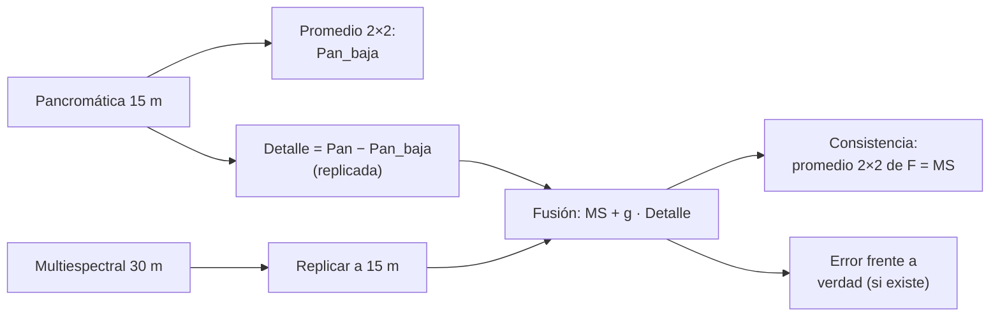

# B15-C24 — Fusión de imágenes de distintos sensores

<!-- nav:top -->
[🏠 Programa](../../../../README.md) · [📚 Bloque B15](../../../tronco-comun/B15-senales-imagenes-y-estimacion-cientifica.md) · [← Anterior: B15-C23 — Clasificación no supervisada y agrupamiento de imágenes](../B15-C23-clasificacion-no-supervisada-y-agrupamiento-de-imagenes/CLASE.md) · [Siguiente: B16-C01 — Modelos dinámicos y estados →](../../B16/B16-C01-modelos-dinamicos-y-estados/CLASE.md)
<!-- /nav -->

## 1. Ubicación, nivel y alcance

Cuarta y última clase programada del bloque B15. Un sensor ofrece mucha resolución espacial pero una sola banda ancha (pancromática); otro, varias bandas espectrales pero con píxeles más grandes. La **fusión** (en inglés *pansharpening* cuando combina una pancromática con bandas multiespectrales) produce una imagen con la resolución espacial de la primera y los colores de la segunda. Aprenderás la inyección aditiva de detalle, cómo comprobar su consistencia con los datos originales (protocolo de Wald), cómo medir el error con una verdad de alta resolución y, sobre todo, cuándo la fusión **inventa** detalle. Nivel N3. Usas convolución y filtros ([C07](../B15-C07-filtrado-digital/CLASE.md), [C08](../B15-C08-convolucion-y-respuesta-impulsional/CLASE.md)), registro ([C14](../B15-C14-registro-y-alineacion/CLASE.md)) y clasificación ([C22](../B15-C22-clasificacion-supervisada-de-imagenes/CLASE.md)). Los datos son **sintéticos**; no se usa ninguna escena real.

## 2. Por qué esta clase existe

Un mapa de cobertura exige distinguir objetos pequeños (caminos, parcelas) y también su firma espectral (si son vegetación o suelo). Ninguna imagen entrega ambas cosas a la vez. Fusionar ayuda a ver mejor, pero cada píxel fusionado de más resolución no es una medida nueva: es una estimación que mezcla datos de dos sensores. Si el detalle de la pancromática no se relaciona con la banda que se quiere afinar, el resultado es bonito y falso.

La decisión central: **¿qué bandas puedo afinar con esta pancromática, con qué ganancia, y cómo compruebo que no inventé estructura ni alteré los colores?**

## 3. Lo que podrás hacer al terminar

1. Describir la relación de resolución y de cobertura espectral entre una pancromática y las bandas multiespectrales.
2. Aplicar la inyección aditiva de detalle con ganancia fija o de regresión.
3. Comprobar la consistencia de la fusión con el promedio de bloques.
4. Medir el error frente a una verdad de alta resolución y la correlación del detalle.
5. Predecir qué bandas mejoran y cuáles empeoran según la cobertura espectral de la pancromática.
6. Redactar la advertencia que debe acompañar a un producto fusionado.

La evidencia es el **producto fusionado con consistencia y error medidos** del ejercicio 12 (sección 20).

## 4. Con qué llegas y cómo comprobarlo

Necesitas promedios de bloques, correlación y regresión. Cinco preguntas:

1. ¿Qué promedio de bloque 2 × 2 tiene `[[1, 3],[5, 7]]`?
2. ¿Qué correlación tienen dos series idénticas?
3. ¿Qué pendiente da la regresión de `y = 2x`?
4. ¿Qué es un filtro paso alto?
5. ¿Por qué un píxel de 30 m no puede contener detalles de 15 m?

<details>
<summary>Ver respuestas</summary>

1. 4. 2. 1. 3. 2. 4. Uno que deja pasar las variaciones rápidas (C07). 5. Porque ya promedió la luz de toda su área; el detalle interno se perdió.
</details>

Con cuatro o cinco aciertos, sigue; si no, repasa C07 y C08.

## 5. Un caso real: pancromática y bandas de un satélite de observación terrestre

Según la tabla del USGS (S1), la banda pancromática (banda 8) de Landsat 8 y 9 cubre de 0,50 a 0,68 µm con una resolución de 15 m, es decir, verde y rojo, no el infrarrojo cercano (0,85–0,88 µm); las bandas multiespectrales (verde 0,53–0,59, rojo 0,64–0,67, infrarrojo cercano 0,85–0,88 µm) se suelen producir con píxeles de 30 m, dato que la página consultada no indica y que aquí se **supone**. Con esa geometría se construye un caso **sintético** con verdad conocida: tres bandas de alta resolución (verde, rojo, NIR) de 64 × 64; el detalle fino es común al verde y al rojo y es independiente en el NIR; la pancromática es la media de verde y rojo; las bandas de baja resolución son promedios de bloques 2 × 2. Es el **ejemplo conductor**.

## 6. Vocabulario

La **fusión** combina datos de sensores distintos. El **pansharpening** fusiona una pancromática de alta resolución con bandas multiespectrales de menor resolución. La **resolución espacial** es el tamaño de píxel (aquí 15 m y 30 m). La **cobertura espectral** es el rango de longitudes de onda de una banda. La **inyección de detalle** suma a la banda de baja resolución, replicada, el detalle de alta frecuencia de la pancromática: `F_b = MS_b + g_b (Pan − Pan_baja)`, con `Pan_baja` el promedio de bloques de la pancromática replicado. La **ganancia** `g_b` modula cuánto detalle se inyecta. La **consistencia** (protocolo de Wald) exige que, al degradar la imagen fusionada a la resolución original, se recupere la multiespectral. La **distorsión espectral** es el cambio de los colores respecto al original.

## 7. Modelo mental: un boceto nítido y una acuarela borrosa

La pancromática es un dibujo a lápiz muy preciso pero sin color; las bandas multiespectrales, una acuarela con colores pero desenfocada. Fusionar es colorear el dibujo con la acuarela. Funciona si el lápiz dibuja los contornos de lo que la acuarela pinta. Analogía: dibujo a lápiz y acuarela. Su límite: si la acuarela pinta algo que el lápiz no dibuja (una banda en la que la pancromática no ve), los contornos del dibujo se «pegan» a donde no corresponde.



*Descripción textual:* de la pancromática se extrae el detalle (diferencia con su versión degradada); se suma, con una ganancia, a la multiespectral replicada; la imagen fusionada se valida comprobando que al promediar bloques recupera la multiespectral y, si hay verdad, midiendo su error.

## 8. La explicación, paso a paso

### 8.1 Qué se puede y qué no se puede conocer

La multiespectral de 30 m solo contiene el promedio de la luz de cada bloque de 2 × 2 píxeles de 15 m. El detalle interno de cada bloque no está en esas bandas. La pancromática lo contiene, pero de una sola banda ancha. Entonces, la fusión asume que el detalle de cada banda se parece al de la pancromática. Esa asunción es la que se debe verificar.

### 8.2 Inyección aditiva

Se calcula `Pan_baja` (promedio de bloques 2 × 2 replicado) y el detalle `Δ = Pan − Pan_baja`, que por construcción tiene promedio cero en cada bloque. La banda fusionada es `F_b = MS_b^{(15 m)} + g_b Δ`. Con `g_b = 1`, la banda toma todo el detalle de la pancromática; con la ganancia de regresión `g_b = cov(MS_b, Pan_baja)/var(Pan_baja)` (a baja resolución), se inyecta en proporción a lo que la banda y la pancromática varían juntas.

### 8.3 Consistencia exacta

Como `Δ` tiene promedio cero en cada bloque, el promedio de bloques de `F_b` es exactamente `MS_b`, para cualquier ganancia. El laboratorio lo comprueba: diferencia máxima `1,1 × 10⁻¹⁶`. La consistencia garantiza que la fusión no altera los colores promediados a la resolución original; **no** garantiza que el detalle inyectado sea correcto.

### 8.4 Resultados con verdad conocida

Con `g = 1`:

| Banda | RMSE sin fusionar | RMSE fusionada | Correlación del detalle |
|---|---|---|---|
| Verde | 0,02452 | 0,00427 | +0,985 |
| Rojo | 0,02436 | 0,00427 | +0,985 |
| NIR | 0,02491 | **0,03412** | +0,030 |

Para el verde y el rojo, el error se reduce a una sexta parte (porque la pancromática es su media y comparte su detalle). Para el NIR, cuyo detalle es independiente de la pancromática, la fusión **empeora** el error de 0,0249 a 0,0341: el detalle inyectado es falso, aunque la consistencia sea perfecta.

### 8.5 Ganancia de regresión

Con la ganancia estimada a baja resolución, el verde recibe `g = 1,105`, el rojo `0,895` y el NIR `0,216`. El error del verde y el rojo es `0,00492` (algo mayor que con `g = 1`, porque la regresión a baja resolución mezcla las variaciones lentas con el detalle); el del NIR es `0,02530`, casi igual al no fusionado (`0,02491`): la ganancia pequeña protege la banda cuyo detalle no se relaciona con la pancromática. La correlación del detalle del NIR sigue en `0,030`: no se aprende detalle nuevo.

### 8.6 Consecuencias para el uso

Si fusionas para **ver** mejor, puede bastar. Si vas a **medir** (índices, clasificación, áreas), el detalle inyectado altera la medida: el NDVI de un píxel fusionado de 15 m no es una medida de 15 m. Para análisis cuantitativos conviene trabajar con las bandas originales y usar la fusión para localizar o visualizar.

### 8.7 Qué reportar

Sensores y fechas, resolución de cada banda, método y ganancias, verificación de la consistencia, y la advertencia de que el detalle de las bandas fuera del rango de la pancromática no es medido. Y, si se dispone de una verdad (por ejemplo, un sensor de mayor resolución), el error.

## 9. Magnitudes, símbolos y unidades

| Símbolo | Qué es | Unidad | Nota |
|---|---|---|---|
| `MS_b` | banda multiespectral `b` | reflectancia | verde, rojo, NIR |
| `Pan` | pancromática | reflectancia | 0,50–0,68 µm (S1) |
| `Pan_baja` | promedio de bloques replicado | reflectancia | 30 m → 15 m |
| `Δ` | detalle `Pan − Pan_baja` | reflectancia | promedio cero por bloque |
| `g_b` | ganancia de inyección | adimensional | 1; 1,105; 0,895; 0,216 |
| `F_b` | banda fusionada | reflectancia | 15 m |
| RMSE | error frente a la verdad | reflectancia | 0,004–0,034 |

## 10. Convenciones y referencias

Los rangos espectrales de las bandas son los de la tabla del USGS (S1; la página no lista unidades, interpretadas como µm). La resolución de 30 m de las multiespectrales es un supuesto (no figura en la página consultada); la de 15 m de la pancromática sí. Las imágenes son **sintéticas**; semilla 15024. El promedio de bloques es 2 × 2 sin solapamiento.

## 11. De dónde sale lo que afirmamos

| ID | Fuente | Localizador | Respalda | Estado |
|---|---|---|---|---|
| S1 | USGS, *What are the best Landsat spectral bands for use in my research?* | https://www.usgs.gov/faqs/what-are-best-landsat-spectral-bands-use-my-research | Rangos de las bandas de Landsat 8/9 (verde 0,53–0,59; rojo 0,64–0,67; NIR 0,85–0,88; pancromática 0,50–0,68 con resolución de 15 m) | Consultada el 2026-11-06 mediante extracción automática |

Límites: la resolución de 30 m de las multiespectrales no se verificó en la fuente; el protocolo de Wald, la inyección aditiva y las métricas se definen en la clase y se verifican numéricamente. No se consultó literatura sobre fusión de imágenes. Los datos son sintéticos.

## 12. Cómo ver la fusión

| Cantidad | Valor |
|---|---|
| Consistencia (promedio 2×2 de F frente a MS) | ≤ 1,1 × 10⁻¹⁶ |
| RMSE verde / rojo / NIR sin fusionar | 0,02452 / 0,02436 / 0,02491 |
| RMSE con `g = 1`, verde / rojo / NIR | 0,00427 / 0,00427 / 0,03412 |
| RMSE con `g` de regresión | 0,00492 / 0,00492 / 0,02530 |
| Correlación del detalle verde / rojo / NIR | 0,985 / 0,985 / 0,030 |

Descripción larga: la imagen de verde de 30 m muestra manchas grandes y bordes escalonados; la fusionada recupera líneas finas y contornos; en el NIR fusionado con `g = 1` aparecen líneas finas que no existen en el NIR verdadero.

## 13. Ejemplo trabajado: un bloque de 2 × 2

**Paso 1 · Datos (sintéticos).** Pancromática en un bloque: `[[0,30; 0,40],[0,50; 0,60]]` (promedio `0,45`). Banda multiespectral del bloque: `0,50` (un solo valor de 30 m).

**Paso 2 · Pan_baja.** Replicada: `0,45` en los 4 píxeles.

**Paso 3 · Detalle.** `Δ = [[−0,15; −0,05],[0,05; 0,15]]`; promedio `0`.

**Paso 4 · Fusión con `g = 1`.** `F = 0,50 + Δ = [[0,35; 0,45],[0,55; 0,65]]`; promedio `0,50` ✓ (consistente).

**Paso 5 · Con `g = 0,5`.** `F = [[0,425; 0,475],[0,525; 0,575]]`; promedio `0,50` ✓.

**Paso 6 · Lectura.** El detalle se reparte alrededor del valor medido sin cambiar el promedio; la ganancia decide cuánto contraste fino se añade. Si en esa banda el detalle verdadero fuera plano, `g = 1` inventaría un contraste de 0,3 dentro del bloque.

## 14. Distintas formas de fusionar

**Sustitución de componentes** (por ejemplo, de intensidad): rápida, con riesgo de distorsión espectral. **Inyección de detalle con modulación** (como aquí): conserva la consistencia. **Métodos con modelo del sensor** (respuesta espectral y óptica): más fieles, más datos. **Aprendizaje automático** (B17): potente, difícil de verificar. Siempre se comprueba la consistencia y, si hay verdad, el error.

## 15. Práctica guiada

**Ejercicio 1 · con los pasos indicados.** Calcula el detalle de la pancromática `[[0,2; 0,4],[0,6; 0,8]]` en un bloque 2 × 2. *Pasos:* promedio y diferencia.

<details><summary>Solución comentada</summary>

Promedio 0,5; `Δ = [[−0,3; −0,1],[0,1; 0,3]]` (8.2).
</details>

**Ejercicio 2 · con una pista.** Con la multiespectral del bloque `0,40` y `g = 1`, calcula la banda fusionada del ejercicio 1. *Pista:* `MS + Δ`.

<details><summary>Solución comentada</summary>

`[[0,10; 0,30],[0,50; 0,70]]`; promedio `0,40` ✓.
</details>

**Ejercicio 3 · casi autónomo.** Repite con `g = 0,5`.

<details><summary>Solución comentada</summary>

`[[0,25; 0,35],[0,45; 0,55]]`; promedio `0,40`.
</details>

## 16. Práctica autónoma, transferencia e integrador

**Ejercicio 4.** ¿Por qué el promedio de bloques de la banda fusionada siempre es igual a la multiespectral?

<details><summary>Solución comentada</summary>

Porque `Δ` tiene promedio cero en cada bloque (8.3).
</details>

**Ejercicio 5.** El RMSE del verde baja de 0,02452 a 0,00427. ¿Cuántas veces menor?

<details><summary>Solución comentada</summary>

`0,02452/0,00427 = 5,7` veces (8.4).
</details>

**Ejercicio 6.** El RMSE del NIR sube de 0,02491 a 0,03412 con `g = 1`. ¿Qué causa la subida?

<details><summary>Solución comentada</summary>

El detalle de la pancromática no está relacionado con el NIR (correlación 0,030); inyectarlo añade estructura falsa. La pancromática no cubre el NIR (S1) (8.4).
</details>

**Ejercicio 7.** ¿Qué ganancia de regresión recibe el NIR y por qué es pequeña?

<details><summary>Solución comentada</summary>

`0,216`: la regresión a baja resolución detecta poca relación entre el NIR y la pancromática y, por tanto, inyecta poco detalle (8.5).
</details>

**Ejercicio 8.** La fusión del verde con `g = 1,105` da 0,00492 y con `g = 1`, 0,00427. ¿Por qué es peor la ganancia «estimada»?

<details><summary>Solución comentada</summary>

La regresión a baja resolución mezcla variaciones lentas con el detalle fino; aquí la relación fina entre verde y pancromática es exactamente 1. La ganancia estimada protege el NIR, pero en las bandas bien relacionadas introduce un pequeño error (8.5).
</details>

**Ejercicio 9 · transferencia.** Calculas el NDVI sobre las bandas fusionadas de 15 m. ¿Qué advertencia añades?

<details><summary>Solución comentada</summary>

Que el NIR fusionado puede contener detalle inyectado no medido; el NDVI de 15 m es una estimación. Para medir, usa las bandas originales (8.6).
</details>

**Ejercicio 10 · transferencia.** Las dos imágenes tienen un desfase de 0,5 píxeles de 15 m. ¿Qué efecto tiene en la fusión?

<details><summary>Solución comentada</summary>

El detalle de la pancromática queda desplazado respecto de la multiespectral: bordes fantasma y correlación del detalle menor. El registro previo (C14) con error de una fracción pequeña de píxel es una condición de la fusión.
</details>

**Ejercicio 11 · transferencia.** Una pancromática que cubre 0,50–0,68 µm, ¿es adecuada para afinar una banda del infrarrojo de onda corta (1,57–1,65 µm)? ¿Y una del verde (0,53–0,59)?

<details><summary>Solución comentada</summary>

Verde: sí, está dentro del rango. Infrarrojo de onda corta: no hay solape espectral, es improbable que el detalle coincida (S1) (8.4).
</details>

**Ejercicio 12 · integrador.** Elabora tu *producto fusionado con consistencia y error medidos*: construye una verdad de tres bandas con detalle común a dos de ellas, genera la pancromática y las bandas degradadas, fusiona con `g = 1` y con ganancia de regresión, comprueba la consistencia y el RMSE frente a la verdad, y redacta la advertencia para la banda cuyo detalle no comparte la pancromática.

<details><summary>Solución modelo</summary>

Consistencia ≈ 10⁻¹⁶; RMSE de las dos bandas con detalle común, varias veces menor que sin fusionar; RMSE del NIR mayor que sin fusionar con `g = 1` y casi igual con ganancia de regresión; advertencia sobre el detalle no medido. Datos sintéticos, semilla y versiones; fuente S1 con fecha.
</details>

## 17. Laboratorio: inyección de detalle con verdad conocida

El script [fusion.py](fusion.py) genera la verdad sintética de tres bandas, degrada por bloques, aplica la inyección con dos ganancias y exige consistencia exacta, mejora en las bandas con detalle común y empeoramiento en la que no lo comparte.

**Datos:** sintéticos, semilla 15024. **Predice antes de ejecutar:** ¿qué banda empeora con `g = 1`? (el NIR.) **Ejecución del 2026-11-06 (Python 3.12.9, NumPy 2.4.4):**

```text
Resultados (RMSE frente a la verdad de 15 m; correlación del detalle de alta frecuencia con el verdadero):
  inyección g = 1:
    verde: g = +1.000; RMSE sin fusionar 0.02452; fusionada 0.00427; correlación del detalle +0.985; consistencia 1.1e-16
    rojo : g = +1.000; RMSE sin fusionar 0.02436; fusionada 0.00427; correlación del detalle +0.985; consistencia 1.1e-16
    NIR  : g = +1.000; RMSE sin fusionar 0.02491; fusionada 0.03412; correlación del detalle +0.030; consistencia 1.1e-16
  inyección g de regresión:
    verde: g = +1.105; RMSE sin fusionar 0.02452; fusionada 0.00492; correlación del detalle +0.985; consistencia 1.1e-16
    rojo : g = +0.895; RMSE sin fusionar 0.02436; fusionada 0.00492; correlación del detalle +0.985; consistencia 5.6e-17
    NIR  : g = +0.216; RMSE sin fusionar 0.02491; fusionada 0.02530; correlación del detalle +0.030; consistencia 1.1e-16
Pruebas superadas.
```

```bash
python programa/clases/B15/B15-C24-fusion-de-imagenes-de-distintos-sensores/fusion.py
```

**Límites:** el detalle común es exactamente igual en verde y rojo y la pancromática es su media (caso ideal); bloques 2 × 2 sin respuesta óptica del sensor; sin ruido ni desfase; una sola semilla.

## 18. Errores frecuentes y cómo corregirlos

**Creer que la consistencia garantiza que el detalle es correcto.** Se corrige con el ejercicio 6.

**Fusionar bandas fuera de la cobertura de la pancromática con ganancia 1.** Se corrige con el ejercicio 11.

**Calcular índices cuantitativos sobre bandas fusionadas.** Se corrige con el ejercicio 9.

**No registrar antes de fusionar.** Se corrige con el ejercicio 10.

**No declarar sensores, resolución y método.** Sección 8.7.

## 19. Cómo sabrás que vas bien

Tras 8.2: ¿calculas el detalle de un bloque? Si no, ejercicios 1–3. Tras 8.3: ¿por qué es consistente? Si no, ejercicio 4. Tras 8.4: ¿por qué empeora el NIR? Si no, ejercicio 6.

## 20. Qué entregas y cómo se evalúa

El producto es tu **producto fusionado con consistencia y error medidos** (ejercicio 12).

| Criterio | Inicial | En desarrollo | Logrado | Destacado |
|---|---|---|---|---|
| Método | Caja negra | Aplica sin explicar | Inyección aditiva explicada | Compara ganancias |
| Consistencia | No comprobada | Visual | Exacta, verificada | Argumentada por construcción |
| Error | No medido | Solo visual | RMSE y correlación del detalle | Por banda con interpretación |
| Límites | Ausentes | Genéricos | Banda sin cobertura identificada | Advertencia redactada |
| Fuentes y rótulos | Sin fuente | Sin fecha | Con localizador y fecha | Declara el supuesto de 30 m |

**Condiciones críticas (no se compensan con promedio):** comprobar la consistencia; advertir que el detalle inyectado no es medido; citar solo fuentes consultadas.

## 21. Ética, seguridad y límites

Una imagen fusionada puede parecer una medida de alta resolución cuando no lo es. Cuando se publica o se usa en decisiones (catastro, defensa, emergencias), debe etiquetarse como producto derivado y conservar los originales. Esta clase es didáctica y usa datos ficticios. Accesibilidad: las imágenes tienen descripción y tabla; el laboratorio funciona sin conexión.

## 22. Para cerrar y seguir

La fusión suma a la multiespectral el detalle de la pancromática modulado por una ganancia; es consistente por construcción, mejora las bandas que comparten el detalle y empeora las que no; el detalle inyectado es una estimación, no una medida. Con esto se cierran las cuatro clases programadas de B15: series multivariadas, clasificación supervisada, agrupamiento y fusión.

**Glosario español–inglés.** fusión de imágenes · *image fusion*; pansharpening · *pansharpening*; pancromática · *panchromatic*; multiespectral · *multispectral*; inyección de detalle · *detail injection*; consistencia · *consistency*; distorsión espectral · *spectral distortion*.

**Continuidad.** El bloque B15 termina aquí; las técnicas de series, imágenes y estimación se reutilizan en los bloques de instrumentación, observación y misiones.

**Referencias:** ver sección 11.

<!-- nav:bottom -->
---

[← Anterior: B15-C23 — Clasificación no supervisada y agrupamiento de imágenes](../B15-C23-clasificacion-no-supervisada-y-agrupamiento-de-imagenes/CLASE.md) · [📚 Bloque B15](../../../tronco-comun/B15-senales-imagenes-y-estimacion-cientifica.md) · [Siguiente: B16-C01 — Modelos dinámicos y estados →](../../B16/B16-C01-modelos-dinamicos-y-estados/CLASE.md)
<!-- /nav -->
