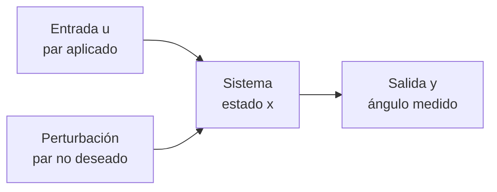

# B16-C01 — Modelos dinámicos y estados

<!-- nav:top -->
[🏠 Programa](../../../../README.md) · [📚 Bloque B16](../../../tronco-comun/B16-sistemas-dinamicos-y-control-automatico.md) · [← Anterior: B15-C24 — Fusión de imágenes de distintos sensores](../../../tronco-comun/B15-senales-imagenes-y-estimacion-cientifica.md#b15-c24) · [Siguiente: B16-C02 — Representaciones en espacio de estados →](../B16-C02-representaciones-en-espacio-de-estados/CLASE.md)
<!-- /nav -->

## 1. Ubicación, nivel y alcance

Primera clase del bloque B16. Vienes de las derivadas (B09-C03) y de las ecuaciones diferenciales ordinarias y los sistemas de ecuaciones (B11-C01 y B11-C04). Aquí empiezas a usar esas herramientas para una pregunta de ingeniería: **cómo responde un sistema a lo que le hacemos**, para poder después decidir qué hacerle. Nivel de entrada del control automático.

Verás qué es un modelo dinámico, qué es el *estado* de un sistema, cómo se pasa de una ley física a ecuaciones de estado y cómo se clasifican los modelos. No verás todavía la representación matricial general (C02), la función de transferencia (C05) ni ninguna ley de control.

## 2. Por qué esta clase existe

Un telescopio espacial tiene que apuntar a una estrella y mantenerse allí. El telescopio Hubble lo hace con una desviación de no más de 0,007 segundos de arco durante al menos 24 horas (fuente S2). Nadie logra eso a ojo ni por tanteo: se logra porque existe un modelo de cómo gira el telescopio cuando se le aplica un par, y un sistema que usa ese modelo para corregir.

La pregunta motivadora de la clase es: **¿cuál es la información mínima que necesito conocer hoy para predecir lo que hará el sistema mañana, si sé lo que le voy a aplicar?** Esa información mínima se llama estado. La decisión central es qué variables forman el estado y qué ecuaciones lo hacen evolucionar. Todo lo demás del bloque (estabilidad, controladores, observadores) se construye sobre ese modelo.

## 3. Lo que podrás hacer al terminar

1. Distinguir entrada, salida, estado, parámetro y perturbación en un sistema físico.
2. Escribir las ecuaciones de estado de un eje rotatorio y de una rueda de primer orden.
3. Determinar el orden de un modelo y el número de condiciones iniciales que necesita.
4. Clasificar un modelo como lineal o no lineal, continuo o discreto, invariante o variante.
5. Decidir hasta qué ángulo sirve una linealización y justificarlo con un número.
6. Integrar un modelo con un método numérico y comprobarlo contra una solución exacta.

La evidencia es la **ficha de modelo** del ejercicio 12 (sección 20).

## 4. Con qué llegas y cómo comprobarlo

Necesitas derivar, resolver una ecuación diferencial sencilla y manejar unidades. Cinco preguntas:

1. Deriva `x(t) = 3t² + 2t`. ¿Qué derivada es la velocidad y cuál la aceleración?
2. Resuelve `y′ = −2y` con `y(0) = 5`.
3. ¿Cuántas condiciones iniciales exige una ecuación diferencial de segundo orden?
4. ¿Qué unidad tiene un par (momento de una fuerza) en el SI?
5. Convierte 0,007″ (segundos de arco) a radianes. (1 rad = 206 265″.)

<details>
<summary>Ver respuestas</summary>

1. `x′ = 6t + 2` es la velocidad; `x″ = 6` la aceleración. 2. `y = 5 e^(−2t)`. 3. Dos (posición y velocidad iniciales). 4. N·m (kg·m²·s⁻²). 5. `0,007 / 206 265 ≈ 3,4 × 10⁻⁸ rad`.
</details>

Con cuatro o cinco aciertos, sigue; si fallaste la 3, repasa B11-C02.

## 5. Un caso real: apuntar el Hubble

La ficha de la NASA sobre los sensores de guiado fino del Hubble (S2) explica que el sistema de control de apuntamiento usa tres sensores que miden la posición de estrellas guía y detectan las derivas que se quieren corregir; con ello el telescopio permanece apuntado a un objetivo con no más de 0,007″ de desviación durante al menos 24 horas. La página de archivo del sistema de control de apuntamiento (S3) añade el lado de los actuadores: cuatro ruedas de reacción, cada una un volante que se acelera o frena hasta unas 3000 rpm, y cuatro magnetopares que gestionan la velocidad de esas ruedas. Cuando una rueda cambia su giro, cambia su momento angular y el telescopio, por conservación, gira en sentido opuesto.

Lo importante para esta clase es la estructura: hay algo que se quiere gobernar (la orientación), algo que se aplica (un par), algo que se mide (posición de estrellas, velocidad de giro) y un modelo que relaciona todo. Trabajaremos con una versión **sintética** y simplificada: un telescopio que gira solo alrededor de un eje, con inercia ficticia `J = 50 kg·m²`. Son cifras inventadas para aprender, no las del Hubble.

## 6. Vocabulario

Un **sistema** es la parte del mundo que modelas; lo demás es entorno. La **entrada** `u` es lo que tú puedes aplicar (aquí, el par `τ`). Una **perturbación** es una entrada que no controlas (por ejemplo, un par gravitatorio o de presión de radiación). La **salida** `y` es lo que mides. Un **parámetro** es una constante del modelo (la inercia `J`). El **estado** `x` es el menor conjunto de variables que, junto con la entrada futura, determina todo el futuro del sistema. El **orden** es la cantidad de variables de estado. Un modelo es **lineal** si cumple superposición (lo precisa C03), **invariante** si sus parámetros no cambian con el tiempo, **continuo** si el tiempo es una variable real `t` y **discreto** si solo existe en instantes `kT`.

## 7. Modelo mental: la caja con memoria

Piensa en el sistema como una caja con memoria. Le entra un par, sale una medida, y dentro guarda el estado. Lo que haces hoy no cambia el pasado pero sí cambia el estado, y el estado es lo único del pasado que le importa al futuro.



*Descripción textual:* un bloque central (el sistema, con su estado interno) recibe dos flechas, la entrada que tú controlas y la perturbación que no controlas, y emite una flecha de salida, la medida.

La analogía es una cuenta bancaria: el saldo es el estado, los depósitos son la entrada y lo que ves en el cajero es la salida. Su límite: el saldo no tiene inercia, mientras que en un cuerpo que gira el estado incluye una velocidad que se arrastra aunque dejes de empujar.

## 8. La explicación, paso a paso

### 8.1 De la ley física a la ecuación

La ley de Newton para la rotación alrededor de un eje fijo dice que el par neto `τ` es la inercia `J` por la aceleración angular `θ̈` (la segunda derivada del ángulo): `J θ̈ = τ`. Es un modelo de **cuerpo rígido**: supone que el telescopio no se deforma. La inercia `J` se mide en kg·m²; el ángulo `θ` en rad.

### 8.2 Por qué el estado tiene dos variables

Si conoces el par futuro pero solo el ángulo de hoy, no puedes predecir nada: no sabes si el telescopio ya estaba girando. Necesitas también la velocidad angular `ω = θ̇`. Dos variables bastan: con `θ(0)` y `ω(0)` y el par `τ(t)` queda determinado todo. Llamamos `x = [θ, ω]`. Las ecuaciones de estado son

```text
θ̇ = ω
ω̇ = τ / J
```

Son dos ecuaciones de primer orden en lugar de una de segundo. Esta forma es la que usan los integradores numéricos (B11-C04) y la que usaremos en C02. El orden del modelo es 2.

### 8.3 Un modelo de primer orden: la rueda

Una rueda de reacción no entrega el par que le pides al instante: su motor y su electrónica tienen un retardo. Un modelo habitual y muy simple es `ẇ = −a w + b u`, donde `w` es la velocidad de la rueda (rad/s), `u` la orden (adimensional aquí), `a` el inverso de la constante de tiempo (s⁻¹) y `b` la ganancia. Con `u` constante, la solución es `w(t) = (b u / a)(1 − e^(−a t))`: se acerca al valor final `b u/a` sin pasarlo. Tras `1/a` segundos alcanza el 63,2 % de ese valor; tras `3/a`, el 95 %.

### 8.4 Cómo se clasifica un modelo

El modelo de la sección 8.2 es lineal (el estado aparece solo multiplicado por constantes), invariante (`J` no cambia), continuo y de orden 2. Si el telescopio liberara combustible y `J` variara, sería variante. Si la sección 8.1 incluyera un par que depende de `sen θ` (el gradiente de gravedad o un péndulo), sería **no lineal**. Saber la clase del modelo decide qué herramientas valen: casi todo este bloque, hasta C16, es para sistemas lineales e invariantes.

### 8.5 Cuándo se puede reemplazar `sen θ` por `θ`

Muchos modelos reales traen `sen θ`. Para ángulos pequeños, `sen θ ≈ θ` (B09-C01). El error relativo `|sen θ − θ|/sen θ` vale 0,17 % a 0,1 rad, 4,3 % a 0,5 rad y 19 % a 1 rad. Reemplazar y obtener un modelo lineal se llama **linealizar** alrededor de un punto de equilibrio; la clase C17 lo retoma. Lo esencial aquí es que linealizar tiene un dominio de validez que se mide, no se supone.

### 8.6 Simular: integrar el modelo

Cuando la solución exacta no existe, se integra numéricamente. El método de Runge-Kutta de cuarto orden (B11-C07) avanza en pasos `h`: con `h = 0,01 s` el error en los dos ejemplos de arriba es menor que 10⁻⁹ relativo. Siempre que puedas, comprueba tu integrador contra un caso con solución exacta antes de confiarle uno sin ella.

## 9. Magnitudes, símbolos y unidades

| Símbolo | Qué es | Unidad SI | Nota |
|---|---|---|---|
| `t` | tiempo | s | variable independiente |
| `θ` | ángulo del eje | rad | respecto de una referencia declarada |
| `ω = θ̇` | velocidad angular | rad/s | |
| `τ` | par aplicado | N·m | entrada `u` |
| `J` | inercia respecto del eje | kg·m² | parámetro; sintético, 50 |
| `w` | velocidad de la rueda | rad/s | modelo de primer orden |
| `a` | inverso de la constante de tiempo | s⁻¹ | `1/a` en segundos |
| `x` | vector de estado | mezcla | aquí `[θ, ω]` |

El radián es una unidad derivada del SI. Las unidades base (segundo, metro, kilogramo) están en la fuente S4.

## 10. Convenciones y referencias

El ángulo `θ` positivo sigue la regla de la mano derecha respecto del eje elegido; el par `τ` positivo acelera `θ` en sentido positivo. Se declara siempre el sistema de referencia respecto del cual se mide `θ` (aquí, una dirección inercial fija). La orientación completa en 3 ejes (S1 compara los modelos con ángulos de Euler y con cuaternios) aparece en B10-C13 a B10-C15 y en el control de actitud de B87.

## 11. De dónde sale lo que afirmamos

| ID | Fuente | Localizador | Respalda | Estado |
|---|---|---|---|---|
| S1 | Yang, Y., *Spacecraft Modeling, Attitude Determination, and Control: Quaternion-Based Approach*, CRC Press (copia en NASA NTRS) | https://ntrs.nasa.gov/citations/20240009554 | Que el control de actitud usa modelos de cuerpo rígido linealizados o no lineales; prefacio y capítulo 1 | Extraído del PDF el 2026-11-05; solo introducción y fragmentos |
| S2 | NASA Facts FS-2018-10-285-GSFC, *Hubble Space Telescope: Fine Guidance Sensors* | https://smd-cms.nasa.gov/wp-content/uploads/2023/04/hst_fine_guidance_fact_sheet1_0.pdf | Tres sensores de guiado fino; apuntamiento a no más de 0,007″ durante al menos 24 h | Extraído del PDF el 2026-11-05 |
| S3 | NASA GSFC, *Pointing Control System* (archivo del Hubble, actualizada 2021-03-29) | https://asd.gsfc.nasa.gov/archive/hubble/technology/pcs.html | Cuatro ruedas de reacción (hasta 3000 rpm); magnetopares que gestionan su velocidad; sensores y giróscopos | Consultada el 2026-11-05; archivada, ya no se actualiza |
| S4 | BIPM, *SI base units* | https://www.bipm.org/en/measurement-units/si-base-units | Unidades base: s, m, kg | Consultada el 2026-11-05 |

Límites: la página S3 declara 0,01″ y S2 declara 0,007″; son documentos de fechas distintas (2021 de archivo y 2018 de ficha) y aquí se usa S2. Todas las cifras del modelo (J, a, b, par) son **sintéticas**. No se verificaron las tolerancias del Hubble contra un informe de misión.

## 12. Cómo ver el modelo

La tabla es la versión accesible de la trayectoria del ejemplo trabajado (datos **simulados**).

| t (s) | θ (rad) con par constante 0,2 N·m | ω (rad/s) |
|---|---|---|
| 0 | 0,0100 | 0,0020 |
| 20 | 0,8500 | 0,0820 |
| 40 | 3,2900 | 0,1620 |
| 60 | 7,3300 | 0,2420 |

Para un gráfico, dibuja `θ(t)` con el eje horizontal en segundos y el vertical en radianes; la curva es una parábola. Usa líneas con marcadores distintos para `θ` y `ω`, no solo colores.

## 13. Ejemplo trabajado: el telescopio que se escapa

El telescopio sintético tiene `J = 50 kg·m²`, parte con `θ(0) = 0,01 rad` y `ω(0) = 0,002 rad/s` y recibe un par constante `τ = 0,2 N·m` (una perturbación, digamos). ¿Dónde está a los 60 s?

**Paso 1 · aceleración.** `α = τ/J = 0,2/50 = 0,004 rad/s²`.
**Paso 2 · velocidad.** `ω(t) = ω(0) + α t`, es decir `0,002 + 0,004·60 = 0,242 rad/s`.
**Paso 3 · ángulo.** `θ(t) = θ(0) + ω(0) t + ½ α t²`: `0,01 + 0,12 + 0,5·0,004·3600 = 7,33 rad`.
**Paso 4 · lectura.** 7,33 rad son más de una vuelta (2π ≈ 6,28). Un par de solo 0,2 N·m, aplicado un minuto, hace perder por completo el apuntamiento. Un sistema sin realimentación no se estabiliza solo.

El laboratorio de la sección 17 repite el cálculo con un integrador y obtiene el mismo valor.

## 14. Distintos tipos de modelo, y cuándo dejan de servir

Un **modelo físico** parte de leyes (como `J θ̈ = τ`); sus parámetros tienen significado y se extrapola bien, pero hay que conocerlos. Un **modelo identificado** se ajusta a datos de entrada y salida (B22); sirve cuando la física es complicada, pero se extrapola mal fuera de las condiciones ensayadas. Un modelo **continuo** describe el fenómeno; uno **discreto** describe lo que ve el computador de a bordo, que mide y actúa cada `T` segundos (C02). Un modelo de baja fidelidad basta para diseñar; uno de alta fidelidad se reserva para verificar (C19).

## 15. Práctica guiada

**Ejercicio 1 · pasos indicados.** Escribe las ecuaciones de estado de un eje con inercia `J = 20 kg·m²`. Identifica estado, entrada, salida (el ángulo) y parámetro. *Pasos:* aplica 8.1 y 8.2.

<details><summary>Solución comentada</summary>

Estado `x = [θ, ω]`, entrada `τ`, salida `y = θ`, parámetro `J = 20`. `θ̇ = ω`, `ω̇ = τ/20`. Orden 2; necesita `θ(0)` y `ω(0)`.
</details>

**Ejercicio 2 · con pista.** La rueda tiene `a = 0,5 s⁻¹`, `b = 0,5` y recibe `u = 1`. ¿Cuál es su velocidad final y cuánto tarda en llegar al 95 %? *Pista:* sección 8.3.

<details><summary>Solución comentada</summary>

Final: `b u/a = 1 rad/s`. El 95 % se alcanza hacia `3/a = 6 s` (`1 − e^(−3) = 0,950`). El laboratorio da 0,9502 a los 6 s.
</details>

**Ejercicio 3 · casi autónomo.** Clasifica `J θ̈ = τ − k sen θ`, con `k` constante positiva, y `J(t) θ̈ = τ` con `J(t)` decreciente. ¿Cuál es no lineal y cuál variante?

<details><summary>Solución comentada</summary>

La primera es no lineal (por `sen θ`), invariante, continua, de orden 2. La segunda es lineal pero variante (su parámetro cambia con el tiempo). Es un buen ejemplo de que las propiedades se evalúan por separado.
</details>

## 16. Práctica autónoma, transferencia e integrador

**Ejercicio 4.** Un eje con `J = 80 kg·m²` recibe `τ = 0,4 N·m` desde el reposo en `θ = 0`. Calcula `ω` y `θ` a los 30 s. *(Sección 13.)*

<details><summary>Solución comentada</summary>

`α = 0,005 rad/s²`; `ω = 0,15 rad/s`; `θ = ½·0,005·900 = 2,25 rad`.
</details>

**Ejercicio 5.** Para qué ángulo el error relativo de `sen θ ≈ θ` pasa de 1 %? Estima con la tabla de 8.5 y comprueba con la calculadora.

<details><summary>Solución comentada</summary>

A 0,2 rad el error es 0,67 %, a 0,5 rad es 4,3 %; el 1 % ocurre cerca de 0,245 rad (≈ 14°). Se comprueba `sen 0,245 = 0,24256`, error `(0,245 − 0,24256)/0,24256 = 1,0 %`.
</details>

**Ejercicio 6.** Si doblas la inercia y aplicas el mismo par, ¿qué pasa con el ángulo a un tiempo dado? ¿Y con el tiempo para girar un ángulo dado?

<details><summary>Solución comentada</summary>

El ángulo (desde el reposo) se reduce a la mitad. El tiempo para girar un ángulo dado crece en un factor `√2`, porque `θ = ½ (τ/J) t²`.
</details>

**Ejercicio 7.** Una rueda con `a = 2 s⁻¹` recibe un escalón. ¿En cuántos segundos llega al 63 % de su valor final? ¿Y al 99 %?

<details><summary>Solución comentada</summary>

63 % a `1/a = 0,5 s`. 99 % cuando `e^(−a t) = 0,01`: `t = ln(100)/2 = 2,30 s`.
</details>

**Ejercicio 8.** Explica por qué un modelo `θ̈ = τ/J` no necesita como estado el par `τ`.

<details><summary>Solución comentada</summary>

Porque el par es la entrada, que tú aportas en cada instante; el estado resume el pasado, y el par no depende de lo que ya ocurrió. Si el par vinculara con su valor anterior (una rueda lenta, 8.3), entonces sí pasaría a ser un estado.
</details>

**Ejercicio 9 · transferencia.** Añade la rueda de 8.3 delante del eje: la orden `u` produce una velocidad de rueda `w`, y el par sobre el telescopio es proporcional a `ẇ`. Indica cuántas variables de estado tendría el modelo conjunto y cuáles son.

<details><summary>Solución comentada</summary>

Tres: `θ`, `ω` y `w`. El orden suma los órdenes de los subsistemas conectados. (Esto se formaliza en C02 y C06.)
</details>

**Ejercicio 10 · transferencia.** Un satélite despliega paneles y su inercia sube un 30 %. ¿Qué parámetro cambia, qué consecuencia tiene para el tiempo de giro de un ejercicio como el 6 y cómo se llama esa incertidumbre?

<details><summary>Solución comentada</summary>

`J` sube 30 %; el tiempo para girar un ángulo dado crece `√1,3 = 1,14` (14 %). Es **incertidumbre paramétrica**; C16 la trata con control robusto.
</details>

**Ejercicio 11 · transferencia.** Explica por qué el Hubble necesita sensores (S2, S3) aunque tenga un buen modelo `J θ̈ = τ`.

<details><summary>Solución comentada</summary>

Porque el modelo ignora perturbaciones y errores de parámetros: el telescopio deriva (ejemplo 13) y hay que medir para corregir. Un modelo permite predecir; la medida permite corregir lo que el modelo no predijo.
</details>

**Ejercicio 12 · integrador.** Redacta la **ficha de modelo** de un sistema espacial a tu elección (un eje de un satélite, un calentador de un detector, un depósito que se vacía): entrada, salida, estado, perturbación, parámetros con unidades, ecuaciones, clasificación, dominio de validez y una comprobación numérica con solución exacta.

<details><summary>Solución modelo</summary>

Una ficha válida lista las magnitudes con unidades, escribe las ecuaciones de estado, declara orden y clasificación, da el rango donde el modelo es válido (por ejemplo `|θ| < 0,25 rad` si linealiza) y verifica un integrador con un caso exacto. Se acepta cualquier sistema coherente.
</details>

## 17. Laboratorio: integrar y comprobar

El script [modelo_de_estados.py](modelo_de_estados.py) integra con RK4 el eje con par constante y la rueda de primer orden, los compara con la solución exacta y muestra el error de linealizar `sen θ`.

**Datos:** sintéticos (simulados). **Predice antes de ejecutar:** ¿qué ángulo esperas a 60 s? (7,33 rad.) **Ejecución del 2026-11-05 (Python 3.12.9, numpy 2.4.4):**

```text
theta(60 s) = 7.330000000 rad (exacto 7.330000000);  omega = 0.242000000 rad/s (exacto 0.242000000)
rueda: w(6 s) = 0.950212932 (exacto 0.950212932); fracción del valor final = 0.9502
error relativo de sin(th) ~ th:
  th = 0.05 rad ->  0.042 %
  th = 0.10 rad ->  0.167 %
  th = 0.20 rad ->  0.670 %
  th = 0.50 rad ->  4.291 %
  th = 1.00 rad -> 18.840 %
Pruebas superadas.
```

```bash
python programa/clases/B16/B16-C01-modelos-dinamicos-y-estados/modelo_de_estados.py
```

**Límites:** cuerpo rígido, un eje, sin perturbaciones; el script detiene la ejecución si el error supera 10⁻⁹ relativo.

## 18. Errores frecuentes y cómo corregirlos

**Confundir estado con salida.** Medir el ángulo no significa conocer el estado. Se corrige con el ejercicio 8.

**Olvidar una condición inicial.** Un modelo de orden 2 necesita dos. Se corrige con el ejercicio 1.

**Linealizar sin medir el error.** Se corrige con el ejercicio 5.

**Mezclar unidades (grados y radianes).** Se corrige con la pregunta 5 de la sección 4.

**Tratar un parámetro incierto como si fuera exacto.** Se corrige con el ejercicio 10.

## 19. Cómo sabrás que vas bien

Tras 8.2: ¿puedes explicar por qué el estado tiene dos variables y no una? Si no, rehaz el ejercicio 1. Tras 8.4: ¿clasificas un modelo nuevo sin ayuda? Haz el ejercicio 3. Tras el ejemplo trabajado: ¿resuelves el ejercicio 4 sin mirar? Al final: ¿tu ficha de modelo incluye un dominio de validez con número? Si no, vuelve a 8.5.

## 20. Qué entregas y cómo se evalúa

El producto es la **ficha de modelo** (una página) del ejercicio 12.

| Criterio | Inicial | En desarrollo | Logrado | Destacado |
|---|---|---|---|---|
| Magnitudes y unidades | Faltan unidades | Unidades parciales | Todas con unidad | Distingue entrada, perturbación y parámetro |
| Ecuaciones de estado | Sin ecuaciones | Con errores | Correctas y de orden adecuado | Verificadas con un caso exacto |
| Clasificación | No clasifica | Clasifica sin justificar | Clasifica con razón | Da dominio de validez numérico |
| Fuentes y datos | Sin rótulo | Rotula parcial | Rotula observado/sintético | Cita solo lo consultado |

**Condiciones críticas:** no presentar datos sintéticos como de misión; declarar las unidades; no omitir condiciones iniciales.

## 21. Ética, seguridad y límites

Un modelo es una simplificación y en un sistema real equivocarlo puede costar una misión: no se usan modelos sin declarar su dominio. Estas cifras son didácticas y no sirven para operar un vehículo. Accesibilidad: las tablas y descripciones textuales sustituyen los gráficos; el laboratorio corre sin conexión.

## 22. Para cerrar y seguir

Un modelo dinámico relaciona entradas, estado y salidas; el estado es la memoria mínima del sistema. Un eje rotatorio es de orden 2 (`θ`, `ω`) y una rueda lenta de orden 1; el modelo se clasifica como lineal o no, invariante o variante, y se comprueba contra casos exactos. Queda abierta una pregunta: ¿cómo se escriben juntas, de forma ordenada, todas las ecuaciones de un sistema grande?

**Glosario español–inglés.** estado · *state*; entrada · *input*; salida · *output*; perturbación · *disturbance*; orden · *order*; linealizar · *linearize*; par · *torque*; rueda de reacción · *reaction wheel*.

**Continuidad.** B16-C02 pasa estas ecuaciones a forma matricial `ẋ = A x + B u`. B16-C17 vuelve al modelo no lineal.

**Referencias:** ver sección 11.

<!-- nav:bottom -->
---

[← Anterior: B15-C24 — Fusión de imágenes de distintos sensores](../../../tronco-comun/B15-senales-imagenes-y-estimacion-cientifica.md#b15-c24) · [📚 Bloque B16](../../../tronco-comun/B16-sistemas-dinamicos-y-control-automatico.md) · [Siguiente: B16-C02 — Representaciones en espacio de estados →](../B16-C02-representaciones-en-espacio-de-estados/CLASE.md)
<!-- /nav -->
