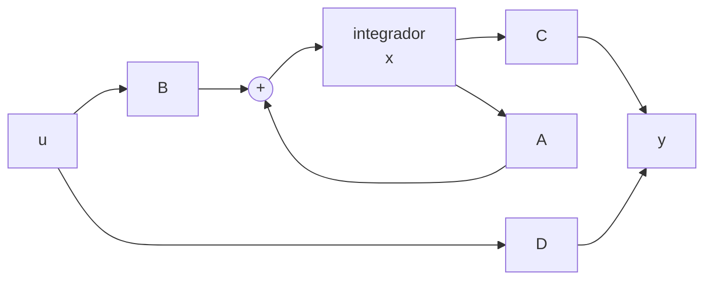

# B16-C02 — Representaciones en espacio de estados

<!-- nav:top -->
[🏠 Programa](../../../../README.md) · [📚 Bloque B16](../../../tronco-comun/B16-sistemas-dinamicos-y-control-automatico.md) · [← Anterior: B16-C01 — Modelos dinámicos y estados](../B16-C01-modelos-dinamicos-y-estados/CLASE.md) · [Siguiente: B16-C03 — Sistemas lineales invariantes →](../B16-C03-sistemas-lineales-invariantes/CLASE.md)
<!-- /nav -->

## 1. Ubicación, nivel y alcance

Segunda clase del bloque B16. En [B16-C01](../B16-C01-modelos-dinamicos-y-estados/CLASE.md) escribiste el modelo de un eje como dos ecuaciones de primer orden. Ahora aprendes la forma matricial general, `ẋ = A x + B u`, que sirve igual para dos variables que para doscientas, y cómo se resuelve con la exponencial de una matriz. Necesitas multiplicar matrices y conocer autovalores (B10-C03, B10-C08).

No verás todavía la respuesta en frecuencia ni funciones de transferencia (C05), ni la estabilidad (C07).

## 2. Por qué esta clase existe

El computador de a bordo de un satélite no maneja ecuaciones sueltas: maneja vectores y matrices, y una sola rutina sirve para cualquier eje, rueda o sensor que se le añada. La pregunta motivadora es: **¿cómo escribo un sistema lineal de modo que una misma fórmula lo resuelva, lo simule y lo analice, y que además cuadre con lo que mide el sensor?**

La decisión central es elegir cuatro matrices: `A` (cómo evoluciona el estado solo), `B` (cómo lo empuja la entrada), `C` (qué parte del estado vemos) y `D` (cuánto pasa de la entrada a la salida directamente). El resto del bloque trabaja con ellas.

## 3. Lo que podrás hacer al terminar

1. Escribir `A`, `B`, `C`, `D` para un sistema a partir de sus ecuaciones.
2. Calcular `e^(At)` en un caso sencillo y usarla para resolver `x(t)`.
3. Discretizar un modelo continuo con retenedor de orden cero y justificar el paso `T`.
4. Mostrar que dos representaciones relacionadas por cambio de base describen el mismo sistema.
5. Reconocer que sistemas físicos distintos comparten una misma forma matricial.
6. Verificar una discretización contra una fórmula cerrada.

La evidencia es la **hoja de matrices verificada** del ejercicio 12 (sección 20).

## 4. Con qué llegas y cómo comprobarlo

1. Multiplica `[[1,2],[0,1]]` por `[3,4]ᵀ`.
2. ¿Cuáles son los autovalores de `[[0,1],[0,0]]`?
3. ¿Cuánto vale `e^0`? ¿Y `e^(−2t)` en `t = 0`?
4. Convierte `θ̇ = ω`, `ω̇ = τ/J` en forma de vector `x = [θ, ω]ᵀ`.
5. ¿Qué es una discretización en el tiempo?

<details>
<summary>Ver respuestas</summary>

1. `[11, 4]ᵀ`. 2. Ambos cero (la matriz es triangular con ceros en la diagonal). 3. 1 y 1. 4. `ẋ = [[0,1],[0,0]] x + [0, 1/J]ᵀ τ`. 5. Quedarse con los valores del sistema en instantes `kT`.
</details>

Con cuatro o cinco aciertos, sigue; con tres o menos, repasa B10-C03 y B16-C01.

## 5. Un caso real: lo que miden los sensores del Hubble

La página de archivo del sistema de control de apuntamiento del Hubble (S3) lista tres unidades de sensores de velocidad con dos giróscopos cada una, tres sensores de guiado fino y tres rastreadores de estrellas: unos miden **velocidad angular**, otros **posición angular**. Según qué sensor uses, la salida `y` del mismo sistema físico es distinta: `y = ω` con giróscopo, `y = θ` con rastreador. Cambia `C` y no cambia el sistema. Esa separación entre lo que es el sistema (`A`, `B`) y lo que observas de él (`C`, `D`) es la gran ventaja de la forma de estados.

Trabajamos con el telescopio sintético de un eje (`J = 50 kg·m²`, datos **simulados**) y un sensor de ángulo ideal.

## 6. Vocabulario

La **representación en espacio de estados** de un sistema lineal e invariante continuo es el par de ecuaciones `ẋ = A x + B u` (ecuación de estado) y `y = C x + D u` (ecuación de salida). Si `x` tiene `n` componentes, `u` tiene `m` y `y` tiene `p`, las matrices tienen tamaños `n×n`, `n×m`, `p×n` y `p×m`. La **exponencial matricial** `e^(At)` se define con la serie `I + At + (At)²/2! + …`. La **matriz de transición** es `Φ(t) = e^(At)`. Un **retenedor de orden cero** (ZOH) mantiene la entrada constante entre dos muestras. Una **transformación de semejanza** es el cambio de base `x = P z`.

## 7. Modelo mental: cuatro matrices, un sistema

`A` es el carácter propio del sistema: qué haría si lo soltaras. `B` es la palanca que tú tienes. `C` es la ventana por la que miras. `D` rara vez importa en la física de cuerpos con inercia (la entrada de par no se ve instantáneamente en el ángulo).



*Descripción textual:* la entrada `u` pasa por `B`, se suma con la realimentación interna `A x` y se integra para dar el estado `x`; `C x` más el término directo `D u` forman la salida `y`.

La analogía: `A` y `B` son el motor y el volante de un coche; `C` y `D` son el tablero. Su límite: el tablero no cambia el movimiento, mientras que en un sistema con realimentación (C06) lo que mides sí vuelve a actuar.

## 8. La explicación, paso a paso

### 8.1 Escribir las matrices

Del eje de B16-C01: `θ̇ = ω`, `ω̇ = τ/J`. En forma matricial, con `x = [θ, ω]ᵀ` y `u = τ`:

```text
A = [[0, 1],      B = [[0   ],      C = [1, 0]  (mide θ),   D = 0
     [0, 0]]           [1/J]]
```

Para el giróscopo, `C = [0, 1]`. Para medir ambos, `C` es la identidad. Cada fila de `A` es la ecuación de una variable de estado.

### 8.2 Resolver con la exponencial matricial

Sin entrada, `ẋ = A x` tiene solución `x(t) = e^(At) x(0)`: igual que la exponencial escalar de `ẏ = a y`. Con entrada, `x(t) = e^(At) x(0) + ∫₀ᵗ e^(A(t−s)) B u(s) ds`. En nuestro eje, `A² = 0` (la matriz es *nilpotente*), por lo que la serie se corta: `e^(At) = I + At = [[1, t],[0, 1]]`. Lee la primera fila: `θ(t) = θ(0) + t ω(0)`, el movimiento uniforme. Es una comprobación inmediata de que el modelo es coherente con la física.

### 8.3 Discretizar con retenedor de orden cero

El computador solo conoce y manda valores en `t = kT`. Si el par se mantiene constante entre muestras, el estado exacto cumple `x[k+1] = A_d x[k] + B_d u[k]` con `A_d = e^(AT)` y `B_d = ∫₀ᵀ e^(As) B ds`. Para nuestro eje y con `T = 0,5 s`: `A_d = [[1, T],[0, 1]] = [[1, 0,5],[0, 1]]` y `B_d = [T²/(2J), T/J]ᵀ = [0,0025, 0,01]ᵀ`. El método exacto no tiene error de truncamiento; el error aparece solo si el par real **no** es constante entre muestras. La elección de `T` se discute en C19.

### 8.4 Cambiar de base no cambia el sistema

Si `x = P z` con `P` invertible, el modelo en `z` tiene `Ā = P⁻¹ A P`, `B̄ = P⁻¹ B`, `C̄ = C P`. Los autovalores de `A` y `Ā` coinciden, porque describen el mismo comportamiento. Hay infinitas representaciones de un sistema; unas son más cómodas (matriz diagonal, forma canónica, variables físicas) pero ninguna cambia la respuesta de `y` a `u`.

### 8.5 Un mismo molde para sistemas distintos

Una masa `m = 2 kg` con resorte `k = 8 N/m` y amortiguador `c = 0,4 N·s/m` tiene `x = [posición, velocidad]` y `A = [[0, 1],[−k/m, −c/m]]`. Sus autovalores son `−0,1 ± 1,9975 j`, de módulo `√(k/m) = 2 rad/s`. Es el mismo molde que el eje, con otro significado. Un panel solar flexible se modela, en primera aproximación, como esa masa-resorte; por eso los modos flexibles aparecen en el control de actitud real.

## 9. Magnitudes, símbolos y unidades

| Símbolo | Qué es | Unidad | Nota |
|---|---|---|---|
| `x` | vector de estado (`n`) | mezcla | aquí `[rad, rad/s]` |
| `u` | entrada (`m`) | N·m | |
| `y` | salida (`p`) | rad o rad/s | según `C` |
| `A, B, C, D` | matrices del modelo | mezcla | las unidades de cada elemento dependen de las filas y columnas |
| `T` | periodo de muestreo | s | 0,5 en el ejemplo |
| `A_d, B_d` | matrices discretas | — | ZOH |
| `P` | matriz de cambio de base | — | invertible |

## 10. Convenciones y referencias

Se usa `ẋ` para derivada respecto del tiempo continuo y `x[k]` para la muestra `k`-ésima. Las unidades de cada elemento de `A` deben ser coherentes: el elemento `A₁₂ = 1` convierte rad/s a rad/s, así que es adimensional. Conviene escribir el vector de estado explícitamente junto a las matrices: sin él, las matrices no significan nada.

## 11. De dónde sale lo que afirmamos

| ID | Fuente | Localizador | Respalda | Estado |
|---|---|---|---|---|
| S1 | NASA GSFC, *Pointing Control System* (archivo del Hubble, actualizada 2021-03-29) | https://asd.gsfc.nasa.gov/archive/hubble/technology/pcs.html | Existencia de giróscopos (velocidad) y rastreadores y sensores de guiado fino (posición); cuatro ruedas de reacción | Consultada el 2026-11-05; archivada |
| S2 | Verificación propia con `scipy.linalg.expm` | cálculo del script | La exponencial matricial se compara con la fórmula cerrada `[[1,t],[0,1]]` | Ejecutado el 2026-11-05 |

Límites: la exponencial matricial, la discretización ZOH y la semejanza son resultados estándar de álgebra lineal y sistemas, no citados a un texto; se verifican numéricamente en la sección 17. Las cifras del eje son **sintéticas**.

## 12. Cómo ver las matrices

Una forma accesible de ver un modelo es una tabla de bloques con su efecto:

| Bloque | Tamaño (n = 2, m = 1, p = 1) | Qué hace en el ejemplo |
|---|---|---|
| `A` | 2×2 | La velocidad alimenta al ángulo |
| `B` | 2×1 | El par acelera `ω` con `1/J` |
| `C` | 1×2 | Sólo el ángulo llega al sensor |
| `D` | 1×1 | Cero: el par no mueve el ángulo al instante |

Si dibujas el diagrama de la sección 7, rotula cada flecha con su matriz y usa trazos distintos para el camino de realimentación interna.

## 13. Ejemplo trabajado: del eje a las muestras

Para el eje de `J = 50 kg·m²` con muestreo `T = 0,5 s`, ¿dónde está a los 60 s con par constante 0,2 N·m desde `[0,01; 0,002]`?

**Paso 1.** `A_d = [[1; 0,5],[0; 1]]`, `B_d = [0,0025; 0,01]`.
**Paso 2.** Aplica 120 veces `x[k+1] = A_d x[k] + B_d·0,2` (120·0,5 s = 60 s).
**Paso 3.** Cada paso aumenta `ω` en `0,01·0,2 = 0,002 rad/s`, de modo que `ω(60) = 0,002 + 120·0,002 = 0,242 rad/s`, igual que en C01.
**Paso 4.** `θ(60) = 7,33 rad`, la fórmula cerrada. La discretización exacta no acumula error.

## 14. Distintos métodos de discretización

La discretización **exacta con ZOH** (8.3) conserva la respuesta si la entrada es constante entre muestras. El método de **Euler** `A_d ≈ I + A T` es más simple pero solo es de primer orden: para este eje coincide en `A_d` (porque `A²=0`) pero en `B_d` pierde el término `T²/(2J)`. El método de **Tustin** (bilineal) conserva mejor la respuesta en frecuencia (C10). Un método es adecuado mientras `T` sea pequeña frente a la dinámica más rápida; con `T` grande el modelo discreto engaña (C19).

## 15. Práctica guiada

**Ejercicio 1 · con pasos.** Un eje con `J = 25 kg·m²` y giróscopo (mide `ω`). Escribe `A, B, C, D`. *Pasos:* 8.1.

<details><summary>Solución comentada</summary>

`A = [[0,1],[0,0]]`, `B = [0, 0,04]ᵀ`, `C = [0, 1]`, `D = 0`. Mide solo la velocidad; el ángulo no se ve directamente (el tema de C13).
</details>

**Ejercicio 2 · con pista.** Calcula `e^(At)` para `A = [[0, 1],[0, 0]]` con `t = 4` y úsalo para hallar `x(4)` si `x(0) = [0,1; 0,05]`, sin entrada. *Pista:* la serie se corta (8.2).

<details><summary>Solución comentada</summary>

`e^(At) = [[1, 4],[0, 1]]`; `x(4) = [0,1 + 4·0,05; 0,05] = [0,3; 0,05]`.
</details>

**Ejercicio 3 · casi autónomo.** Discretiza el eje con `J = 20` y `T = 0,2 s`.

<details><summary>Solución comentada</summary>

`A_d = [[1; 0,2],[0; 1]]`; `B_d = [T²/(2J); T/J] = [0,001; 0,01]`.
</details>

## 16. Práctica autónoma, transferencia e integrador

**Ejercicio 4.** Para `A = [[0,1],[−4,−0,4]]` (masa 1, `k = 4`, `c = 0,4`) calcula la traza y el determinante y deduce `ωn` y el amortiguamiento (`ωn² = det`, `2ζωn = −traza`). *(8.5.)*

<details><summary>Solución comentada</summary>

Traza `−0,4`, det `4`. `ωn = 2 rad/s`, `ζ = 0,4/(2·2) = 0,1`.
</details>

**Ejercicio 5.** Con la discretización del ejercicio 3, calcula `ω` tras 10 pasos con par 0,3 N·m desde el reposo.

<details><summary>Solución comentada</summary>

Cada paso suma `0,01·0,3 = 0,003 rad/s`: `ω = 0,03 rad/s`. Para `θ`: suma de `T·ω[k] + 0,001·0,3` por paso; `θ = 0,2·(0,003·(0+1+…+9)) + 10·0,0003 = 0,2·0,135 + 0,003 = 0,030 rad`.
</details>

**Ejercicio 6.** Demuestra que `Ā = P⁻¹ A P` conserva la traza.

<details><summary>Solución comentada</summary>

`tr(P⁻¹ A P) = tr(A P P⁻¹) = tr(A)` por la propiedad cíclica de la traza.
</details>

**Ejercicio 7.** ¿Qué `C` mide la suma `θ + ω`? ¿Y por qué sería una mala salida física?

<details><summary>Solución comentada</summary>

`C = [1, 1]`. Suma magnitudes con unidades distintas (rad y rad/s): no tiene sentido físico, y el coeficiente 1 oculta una constante con unidad de tiempo.
</details>

**Ejercicio 8.** Un sensor mide `y = θ` y tiene un retardo constante `T_s`. ¿Puede escribirse con las cuatro matrices tal cual?

<details><summary>Solución comentada</summary>

No exactamente: un retardo puro necesita un estado por cada muestra retardada (en discreto) o una aproximación (C07). La representación `A, B, C, D` de dimensión finita no contiene retardos continuos.
</details>

**Ejercicio 9 · transferencia.** Añade la rueda de reacción (C01, `ẇ = −a w + b u`) delante del eje, de modo que el par sobre el telescopio sea `τ = k_w w`. Escribe `A` de 3×3 con `x = [θ, ω, w]`.

<details><summary>Solución comentada</summary>

`θ̇ = ω`, `ω̇ = (k_w/J) w`, `ẇ = −a w + b u`. `A = [[0,1,0],[0,0,k_w/J],[0,0,−a]]`, `B = [0,0,b]ᵀ`, `C = [1,0,0]`.
</details>

**Ejercicio 10 · transferencia.** Un computador de vuelo muestrea a 10 Hz. ¿Qué `T` usa y para qué dinámica del telescopio de este ejemplo es suficiente?

<details><summary>Solución comentada</summary>

`T = 0,1 s`. El eje tiene autovalores cero (sin dinámica rápida propia); con un lazo de ancho de banda del orden de 0,6 rad/s (C04), `T` es muy pequeña frente a `1/ωn ≈ 1,6 s`, así que basta.
</details>

**Ejercicio 11 · transferencia.** Explica por qué la forma de estados es preferible a ecuaciones sueltas cuando el sistema añade un segundo eje y un sensor.

<details><summary>Solución comentada</summary>

Porque las dimensiones crecen y las mismas rutinas (exponencial matricial, simulación, análisis) siguen valiendo con matrices más grandes; con ecuaciones sueltas habría que rehacer el análisis a mano.
</details>

**Ejercicio 12 · integrador.** Entrega una **hoja de matrices verificada**: para un sistema de tu elección (un eje con rueda, un calentador con inercia térmica, un resorte flexible) escribe `x, u, y`, las cuatro matrices con unidades, `A_d, B_d` para un `T` justificado, y una comprobación contra una solución exacta.

<details><summary>Solución modelo</summary>

Un entregable correcto muestra las matrices con tamaños consistentes, el cálculo de `e^(AT)` (a mano o con una biblioteca) y una prueba, por ejemplo la conservación de la trayectoria cerrada del eje o la invariancia de la traza al cambiar de base.
</details>

## 17. Laboratorio: exponencial y discretización

El script [matrices_de_estado.py](matrices_de_estado.py) construye las matrices del eje, calcula `e^(At)` con SciPy y la compara con `[[1,t],[0,1]]`, discretiza con ZOH por el método del bloque aumentado, simula 120 pasos y comprueba que los autovalores no cambian tras una semejanza.

**Datos:** sintéticos. **Predice:** `θ(60)` discreto igual al cerrado (7,33 rad). **Ejecución del 2026-11-05 (Python 3.12.9, numpy 2.4.4, scipy 1.17.1):**

```text
A = [[0.0, 1.0], [0.0, 0.0]]  B = [0.0, 0.02]  C = [1.0, 0.0]  D = 0
expm(A t) con t = 3: [[1.0, 2.999999999999999], [0.0, 0.9999999999999996]]
Ad = [[1.0, 0.5], [0.0, 1.0]] 
Bd = [0.0025, 0.01]
theta(60 s) discreto = 7.330000000 rad; cerrado = 7.330000000 rad
autovalores de A: [0. 0.]  de P^-1 A P: [0. 0.]
masa-resorte-amortiguador: autovalores -0.1000+1.9975j, -0.1000-1.9975j; wn = 2.0000 rad/s
Pruebas superadas.
```

```bash
python programa/clases/B16/B16-C02-representaciones-en-espacio-de-estados/matrices_de_estado.py
```

**Límites:** sistemas LTI, sin retardos, par constante entre muestras.

## 18. Errores frecuentes y cómo corregirlos

**Olvidar escribir el vector de estado junto a las matrices.** Se corrige con el ejercicio 1.

**Creer que la representación es única.** Se corrige con el ejercicio 6.

**Discretizar con Euler y llamarlo exacto.** Se corrige con la comparación de 8.3 y 14.

**Mezclar unidades en `C`.** Se corrige con el ejercicio 7.

**Ignorar el retardo del sensor.** Se corrige con el ejercicio 8.

## 19. Cómo sabrás que vas bien

Tras 8.1: ¿escribes las matrices de un eje con giróscopo y con rastreador? Haz el ejercicio 1. Tras 8.3: ¿discretizas sin mirar? Ejercicio 3. Tras el ejemplo: ¿puedes explicar por qué `A_d` y `B_d` dan la trayectoria exacta? Si no, relee 8.3. Al final: ¿tu hoja verifica contra una solución exacta?

## 20. Qué entregas y cómo se evalúa

El producto es la **hoja de matrices verificada** del ejercicio 12.

| Criterio | Inicial | En desarrollo | Logrado | Destacado |
|---|---|---|---|---|
| Matrices y estado | Sin vector de estado | Tamaños incoherentes | Correctas con unidades | Con varias salidas `C` justificadas |
| Discretización | No discretiza | Usa Euler sin comentar | ZOH correcto | Justifica `T` |
| Verificación | Sin prueba | Prueba sin referencia | Prueba contra caso exacto | Prueba además la semejanza |
| Rótulo de datos | Sin rótulo | Parcial | Sintético/observado claro | Cita solo lo consultado |

**Condiciones críticas:** vector de estado declarado; unidades; no presentar datos sintéticos como de misión.

## 21. Ética, seguridad y límites

La misma matriz puede describir un panel solar o un telescopio: antes de usar un modelo, declara qué representa. Cifras didácticas, no operativas. Accesibilidad: tablas y descripciones textuales; laboratorio sin conexión.

## 22. Para cerrar y seguir

Un sistema lineal e invariante se escribe con cuatro matrices; su solución usa la exponencial matricial; el computador de vuelo trabaja con su versión discreta, exacta si la entrada es constante entre muestras; y cambiar de base no cambia el sistema. Queda una pregunta: ¿qué propiedades tienen *todos* los sistemas que se pueden escribir así?

**Glosario español–inglés.** espacio de estados · *state space*; matriz de transición · *state-transition matrix*; retenedor de orden cero · *zero-order hold*; semejanza · *similarity transformation*; discretización · *discretization*.

**Continuidad.** B16-C03 enuncia las propiedades de superposición e invariancia y la respuesta al impulso. B16-C13 usa `A, B, C` para la controlabilidad y la observabilidad.

**Referencias:** ver sección 11.

<!-- nav:bottom -->
---

[← Anterior: B16-C01 — Modelos dinámicos y estados](../B16-C01-modelos-dinamicos-y-estados/CLASE.md) · [📚 Bloque B16](../../../tronco-comun/B16-sistemas-dinamicos-y-control-automatico.md) · [Siguiente: B16-C03 — Sistemas lineales invariantes →](../B16-C03-sistemas-lineales-invariantes/CLASE.md)
<!-- /nav -->
