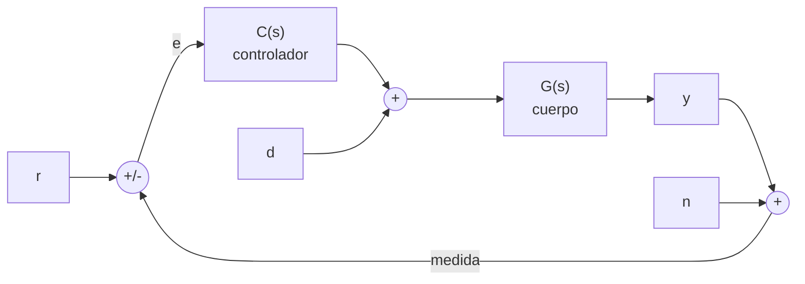

# B16-C06 — Diagramas de bloques

<!-- nav:top -->
[🏠 Programa](../../../../README.md) · [📚 Bloque B16](../../../tronco-comun/B16-sistemas-dinamicos-y-control-automatico.md) · [← Anterior: B16-C05 — Funciones de transferencia](../B16-C05-funciones-de-transferencia/CLASE.md) · [Siguiente: B16-C07 — Realimentación y estabilidad →](../B16-C07-realimentacion-y-estabilidad/CLASE.md)
<!-- /nav -->

## 1. Ubicación, nivel y alcance

Sexta clase del bloque B16. En [C05](../B16-C05-funciones-de-transferencia/CLASE.md) resumiste cada sistema en una función de transferencia. Ahora aprendes a **conectarlas**: en serie, en paralelo y con realimentación, y a reducir un diagrama a una sola expresión. Necesitas álgebra de polinomios y la idea de función de transferencia.

No verás todavía cuándo el lazo es estable (C07) ni cómo diseñarlo (C09 a C12).

## 2. Por qué esta clase existe

Un sistema de control de actitud tiene sensores, un computador, ruedas y un cuerpo, todos conectados y, sobre todo, con la salida de vuelta a la entrada. Para entender qué hace el conjunto no basta conocer las partes: hay que saber **cómo se combinan**. Un error típico de ingeniería es leer mal un diagrama y calcular el lazo con un signo o un bloque equivocados. La pregunta motivadora es: **¿cómo paso de un dibujo de bloques a la función de transferencia de todo el sistema, y qué relaciones dice sobre referencia, perturbación y ruido?**

La decisión central: qué señal se realimenta, dónde se suma, y qué función conecta cada entrada (referencia, perturbación, ruido) con la salida.

## 3. Lo que podrás hacer al terminar

1. Dibujar e interpretar un diagrama de bloques con sumadores, bloques y puntos de bifurcación.
2. Reducir conexiones en serie, paralelo y realimentación.
3. Calcular las funciones de lazo `L`, sensibilidad `S` y sensibilidad complementaria `T`.
4. Escribir la función que va de cada entrada a la salida.
5. Distinguir derivada sobre el error y derivada sobre la medida, y predecir su efecto.
6. Comprobar una reducción de bloques contra una simulación del lazo.

La evidencia es la **reducción comentada** del ejercicio 12 (sección 20).

## 4. Con qué llegas y cómo comprobarlo

1. Multiplica `(s+1)(s+2)`.
2. Suma `1/s + 1/(s+1)`.
3. Resuelve `y = g(r − y)` para `y` en función de `r` y `g`.
4. ¿Qué función de transferencia tiene un integrador?
5. ¿Qué valor tiene `1/(1+g)` si `g = 9`?

<details>
<summary>Ver respuestas</summary>

1. `s² + 3s + 2`. 2. `(2s+1)/(s(s+1))`. 3. `y = g r/(1+g)`. 4. `1/s`. 5. `0,1`.
</details>

Con cuatro o cinco aciertos, sigue; si fallaste la 3, repasa álgebra de B09.

## 5. Un caso real: el lazo de apuntamiento del Hubble

La página de archivo del sistema de control de apuntamiento del Hubble (S1) lista sensores (guiado fino, rastreadores de estrellas, giróscopos), un computador y actuadores (ruedas de reacción y magnetopares). Dibujados como bloques, forman un lazo: el sensor mide el ángulo, se compara con el deseado, el computador calcula el par, las ruedas lo aplican, el cuerpo gira y el sensor vuelve a medir. Nuestro modelo sintético simplifica el lazo a: cuerpo `G(s) = 1/(J s²)` con `J = 50 kg·m²`, controlador PD `C(s) = Kp + Kd s` con `Kp = 20 N·m/rad`, `Kd = 40 N·m·s/rad`, y sensor ideal `H = 1`.

## 6. Vocabulario

Un **diagrama de bloques** representa cada subsistema con un rectángulo y su función de transferencia, y cada señal con una flecha. Un **sumador** (círculo) combina señales con signo. Un **punto de bifurcación** reparte una señal sin modificarla. En un **lazo cerrado**, la **referencia** `r` es lo que se desea, la **salida** `y` lo que se tiene, el **error** `e = r − H y` su diferencia, `d` una **perturbación** y `n` el **ruido de medida**. La **función de lazo** es `L = C G H` (lo que da una vuelta al lazo). La **función de sensibilidad** es `S = 1/(1 + L)` y la **complementaria** `T = L/(1+L)`.

## 7. Modelo mental: seguir una señal por el lazo

Recorre una señal: sale del sumador como error, pasa por el controlador, el cuerpo, llega a la salida, vuelve por el sensor al sumador. Lo que da la vuelta completa es `L`. Si `L` es grande, el error es pequeño: la realimentación «presta» ganancia para corregir.



*Descripción textual:* la referencia `r` entra a un sumador que resta la medida; el error `e` alimenta al controlador `C`; su salida se suma con la perturbación `d` y entra al cuerpo `G`; la salida `y` se mide, se le suma el ruido `n` y vuelve al primer sumador.

La analogía es el termostato de una casa: compara la temperatura deseada con la medida y enciende o apaga. Su límite: el termostato típico es de dos estados (todo o nada), mientras que aquí el control es continuo.

## 8. La explicación, paso a paso

### 8.1 Serie, paralelo y realimentación

En **serie**, los bloques se multiplican: `G₁ G₂`. En **paralelo**, con las salidas sumadas, las funciones se suman: `G₁ + G₂`. En **realimentación negativa**, `y = G (u − H y)`, luego `y = G u/(1 + G H)`: la función de transferencia en lazo cerrado es `G/(1 + G H)`. Con realimentación positiva sería `G/(1 − G H)`, que casi nunca se quiere.

### 8.2 El lazo del ejemplo

Con `H = 1`, `L = C G = (Kd s + Kp)/(J s²)`. Entonces `T = L/(1+L) = (Kd s + Kp)/(J s² + Kd s + Kp)` y `S = 1/(1+L) = J s²/(J s² + Kd s + Kp)`. Siempre `S + T = 1`: lo que no se transmite como seguimiento queda como error. En nuestras cifras `T(s) = (40 s + 20)/(50 s² + 40 s + 20)`, igual que en C05.

### 8.3 De cada entrada a la salida

Con `y = θ`, el lazo de la figura cumple (para `H = 1`): `Θ = T R + [G/(1+L)] D − T N`. La perturbación `d` (par) llega a `θ` por `G S = G/(1+L)`; en nuestro caso su ganancia estática es `1/Kp = 0,05 rad` por N·m, como en C04. El ruido de medida `n` llega a `θ` con la misma `T` que la referencia pero con signo contrario: el lazo sigue fielmente tanto la referencia como el ruido, por eso se filtra (C14).

### 8.4 Mover sumadores y bifurcaciones

Se puede trasladar un sumador o una bifurcación a través de un bloque si se compensa con ese mismo bloque. Ejemplo: mover una bifurcación de la salida de `G` a su entrada exige poner `G` en la rama derivada. Estas reglas dan siempre la misma función de transferencia, pero se evita cometer errores.

### 8.5 Derivada sobre el error o sobre la medida

El PD `C(s) = Kp + Kd s` aplicado al error `e = r − y` incluye `Kd s R`: ante un escalón, `ṙ` es un impulso y el par se dispara. Una variante común deriva solo la medida: `u = Kp(r − y) − Kd ẏ`. Entonces la función de la referencia a la salida es `Kp/(J s² + Kd s + Kp)`, **sin el cero** en `−Kp/Kd`, mientras el lazo tiene los mismos polos. El cero hace la respuesta más rápida pero con más sobreimpulso. Con nuestras cifras, el sobreimpulso es 7,69 % con la derivada sobre la medida y 23,53 % con la derivada sobre el error.

## 9. Magnitudes, símbolos y unidades

| Símbolo | Qué es | Unidad | Nota |
|---|---|---|---|
| `r` | referencia | rad | |
| `e` | error | rad | `r − H y` |
| `d` | perturbación de par | N·m | |
| `n` | ruido de medida | rad | |
| `C(s)` | controlador | N·m/rad | `Kp + Kd s` |
| `G(s)` | cuerpo | rad/(N·m) | `1/(J s²)` |
| `H` | sensor | — | ideal: 1 |
| `L, S, T` | lazo, sensibilidad, complementaria | — | adimensionales |

## 10. Convenciones y referencias

La realimentación se supone negativa. Los signos se dibujan junto a cada sumador. Se declara dónde se aplica la derivada y dónde entra cada perturbación. Un diagrama debe poder leerse sin su texto: todas las flechas con nombre y unidad.

## 11. De dónde sale lo que afirmamos

| ID | Fuente | Localizador | Respalda | Estado |
|---|---|---|---|---|
| S1 | NASA GSFC, *Pointing Control System* (archivo del Hubble, actualizada 2021-03-29) | https://asd.gsfc.nasa.gov/archive/hubble/technology/pcs.html | Sensores, computador y actuadores que forman el lazo de apuntamiento | Consultada el 2026-11-05; archivada |

Límites: las reglas de álgebra de bloques y las funciones `S`, `T` son resultados estándar de control clásico, no citados a un texto, y se verifican numéricamente. El lazo de la clase es **sintético** y simplificado; el Hubble real tiene más elementos.

## 12. Cómo ver el diagrama

| Lazo | Función de la referencia a la salida | Sobreimpulso (simulado) |
|---|---|---|
| PD sobre el error | `(40s+20)/(50s²+40s+20)` | 23,53 % |
| Derivada sobre la medida | `20/(50s²+40s+20)` | 7,69 % |

Para ver el diagrama usa una descripción textual por cada flecha («de `C` a la suma de par», «de `y` a `H`»). Si lo dibujas, indica el signo en cada sumador con texto, no solo con color.

## 13. Ejemplo trabajado: reducir y verificar

Dado el lazo del ejemplo, ¿cuál es la función de la perturbación a la salida y cuál el valor final ante una perturbación constante?

**Paso 1 · lazo.** `L = (40 s + 20)/(50 s²)`.
**Paso 2 · perturbación.** `G/(1+L) = (1/(50 s²))/(1 + L) = 1/(50 s² + 40 s + 20)`.
**Paso 3 · valor final.** Con `d` escalón de 1 N·m, `lim s · [1/(50 s²+40 s+20)]/s = 1/20 = 0,05 rad`: un par constante de 1 N·m desplaza el equilibrio 50 mrad.
**Paso 4 · comprobación.** El laboratorio calcula la ganancia estática perturbación→ángulo y obtiene 0,0500. También simula el lazo con la derivada sobre la medida y compara con `Kp/(J s²+Kd s+Kp)`: error máximo 3×10⁻¹² rad.

## 14. Distintas maneras de reducir

**Álgebra de bloques** (esta clase) es visual y suficiente para lazos simples. El **diagrama de flujo de señales** con la regla de Mason sirve para redes con muchos lazos entrelazados. El **espacio de estados** (C02) construye el lazo como una sola matriz `A − BK` y es lo más cómodo en código. Se prefiere el espacio de estados cuando hay varias entradas y salidas o cuando se va a simular; el diagrama de bloques, para razonar.

## 15. Práctica guiada

**Ejercicio 1 · con pasos.** Dos bloques `G₁ = 1/(s+1)` y `G₂ = 2/(s+3)` en serie. Calcula la función de transferencia total y su ganancia estática. *Pasos:* 8.1.

<details><summary>Solución comentada</summary>

`G = 2/((s+1)(s+3))`; `G(0) = 2/3`.
</details>

**Ejercicio 2 · con pista.** Realimentación negativa unitaria sobre `G = 4/(s+2)`. Halla `T` y el polo en lazo cerrado. *Pista:* `G/(1+G)`.

<details><summary>Solución comentada</summary>

`T = (4/(s+2))/(1 + 4/(s+2)) = 4/(s+6)`; polo `−6`, ganancia estática `2/3`.
</details>

**Ejercicio 3 · casi autónomo.** Para el lazo PD del ejemplo, ¿qué valor tiene `S(0)`? ¿Y qué indica?

<details><summary>Solución comentada</summary>

`S = J s²/(J s² + Kd s + Kp)`; `S(0) = 0`. La sensibilidad a baja frecuencia es cero: el lazo sigue una referencia constante sin error.
</details>

## 16. Práctica autónoma, transferencia e integrador

**Ejercicio 4.** Con `G = 1/(50 s²)` y `C = 20` (solo proporcional), halla `T` y los polos. *(C07 los usa.)*

<details><summary>Solución comentada</summary>

`T = 20/(50 s² + 20)`; polos `±j√(0,4) = ±j0,632`. Sin amortiguamiento, oscila de forma indefinida.
</details>

**Ejercicio 5.** Verifica `S + T = 1` con `L = 9`.

<details><summary>Solución comentada</summary>

`S = 1/10`, `T = 9/10`; suman 1.
</details>

**Ejercicio 6.** Con realimentación unitaria y `L = K/(s(s+1))`, calcula `T` y ubica el polo doble: ¿qué `K` lo logra?

<details><summary>Solución comentada</summary>

`T = K/(s² + s + K)`. Raíces dobles cuando `1 − 4K = 0`: `K = 0,25`, con polo en `−0,5`.
</details>

**Ejercicio 7.** El sensor tiene ganancia `H = 0,5` (calibración equivocada). ¿A qué valor se estabiliza la salida ante `r = 1` si `L` es muy grande?

<details><summary>Solución comentada</summary>

`T = G C/(1 + G C H) → 1/H = 2`. La salida llega a 2: un sensor mal calibrado fija el error final. Por eso se calibra (B87-C08).
</details>

**Ejercicio 8.** Con el lazo del ejemplo, ¿en qué factor se reduce el ruido de medida de baja frecuencia al llegar a `θ`?

<details><summary>Solución comentada</summary>

No se reduce: `−T(0) = −1`, el ruido de baja frecuencia pasa íntegro a la salida. Solo se atenúa donde `|T|` es pequeño (alta frecuencia).
</details>

**Ejercicio 9 · transferencia.** Añade al lazo una rueda de primer orden `W(s) = 0,5/(s+0,5)` entre el controlador y el cuerpo (C01). Escribe `L(s)` y el orden del lazo.

<details><summary>Solución comentada</summary>

`L = (Kd s + Kp) · 0,5/(s+0,5) · 1/(J s²)`; el denominador `s²(s+0,5)` tiene grado 3: el lazo es de tercer orden (C07, C08).
</details>

**Ejercicio 10 · transferencia.** Explica con 8.5 qué pasa con el par de control cuando se aplica un escalón de 0,5 rad y se deriva el error.

<details><summary>Solución comentada</summary>

La derivada del escalón es un impulso: la orden de par intenta un pico teóricamente infinito (en la práctica, saturación). Derivar la medida evita ese pico: la medida es continua.
</details>

**Ejercicio 11 · transferencia.** Un compañero reduce un lazo y obtiene `T = L/(1−L)`. ¿Qué error probable cometió?

<details><summary>Solución comentada</summary>

Confundió el signo del sumador: usó realimentación positiva. Para un lazo negativo, `T = L/(1+L)`.
</details>

**Ejercicio 12 · integrador.** Entrega una **reducción comentada**: dibuja (con descripción textual) un lazo de tu elección con perturbación y ruido, escribe `L`, `S`, `T` y las funciones de `r`, `d` y `n` a `y`, y contrasta con una simulación.

<details><summary>Solución modelo</summary>

Debe contener el diagrama con signos, las cinco funciones, la identidad `S + T = 1` verificada en un punto y una comparación con una integración del lazo con error declarado.
</details>

## 17. Laboratorio: álgebra de bloques y lazo simulado

El script [algebra_de_bloques.py](algebra_de_bloques.py) define una clase de funciones racionales con serie, suma y realimentación, reduce el lazo del ejemplo, verifica `S + T = 1`, compara la respuesta simulada con la derivada sobre la medida y mide los sobreimpulsos.

**Datos:** sintéticos (simulados). **Predice:** sobreimpulso del PD sobre el error mayor que el de la derivada sobre la medida. **Ejecución del 2026-11-05 (Python 3.12.9, numpy 2.4.4, scipy 1.17.1):**

```text
L(s): num [40. 20.]  den [50.  0.  0.]
T(s): num [40. 20.]  den [50. 40. 20.]
identidad S + T = 1 en s = (0.4+1.3j): 0.0e+00
polos de T: [-0.4-0.4899j -0.4+0.4899j]
derivada sobre la medida: simulación vs Kp/(Js^2+Kds+Kp), error máx = 3.24e-12 rad
sobreimpulso: derivada sobre la medida 7.69 %, PD sobre el error 23.53 %
ganancia estática perturbación->ángulo = 0.0500 rad/(N m) = 1/Kp = 0.0500
Pruebas superadas.
```

```bash
python programa/clases/B16/B16-C06-diagramas-de-bloques/algebra_de_bloques.py
```

**Límites:** lazo SISO (una entrada, una salida), sensor ideal, sin retardos; el script no simplifica factores comunes de forma simbólica.

## 18. Errores frecuentes y cómo corregirlos

**Confundir el signo del sumador.** Se corrige con el ejercicio 11.

**Olvidar que `T` también transmite el ruido.** Se corrige con el ejercicio 8.

**Derivar la referencia sin querer.** Se corrige con el ejercicio 10.

**Suponer sensor ideal.** Se corrige con el ejercicio 7.

**Mover un sumador sin compensar.** Se corrige releyendo 8.4.

## 19. Cómo sabrás que vas bien

Tras 8.1: ¿reduces una conexión en serie y una realimentación? Ejercicios 1 y 2. Tras 8.3: ¿escribes las tres funciones a la salida? Ejercicio 12. Tras el ejemplo: ¿obtienes `1/Kp` para la perturbación sin mirar?

## 20. Qué entregas y cómo se evalúa

El producto es la **reducción comentada** del ejercicio 12.

| Criterio | Inicial | En desarrollo | Logrado | Destacado |
|---|---|---|---|---|
| Diagrama | Sin signos | Con signos parciales | Completo con descripción | Con unidades en cada flecha |
| Reducción | Errores de álgebra | Correcta en lo simple | Correcta con `L, S, T` | Verifica `S + T = 1` |
| Entradas | Solo la referencia | Referencia y perturbación | Las tres | Interpreta el ruido |
| Fuentes y datos | Sin rótulo | Parcial | Rotula sintético | Cita solo lo consultado |

**Condiciones críticas:** declarar signos y puntos de entrada; contrastar con simulación.

## 21. Ética, seguridad y límites

Un diagrama mal leído produce una ley de control equivocada; revisa siempre signos y unidades. Cifras didácticas. Accesibilidad: cada diagrama con descripción textual.

## 22. Para cerrar y seguir

Las conexiones de bloques se reducen con tres reglas; el lazo da `L`, `S` y `T` con `S + T = 1`; cada entrada llega a la salida por una función propia; derivar el error o la medida cambia el cero y el sobreimpulso. Queda abierta una pregunta: ¿para qué ganancias es estable ese lazo?

**Glosario español–inglés.** diagrama de bloques · *block diagram*; sumador · *summing junction*; función de lazo · *loop transfer function*; sensibilidad · *sensitivity*; sensibilidad complementaria · *complementary sensitivity*; ruido de medida · *measurement noise*.

**Continuidad.** B16-C07 estudia la estabilidad del lazo cerrado. B16-C11 introduce la acción integral. B16-C14 trata el filtrado del ruido con observadores.

**Referencias:** ver sección 11.

<!-- nav:bottom -->
---

[← Anterior: B16-C05 — Funciones de transferencia](../B16-C05-funciones-de-transferencia/CLASE.md) · [📚 Bloque B16](../../../tronco-comun/B16-sistemas-dinamicos-y-control-automatico.md) · [Siguiente: B16-C07 — Realimentación y estabilidad →](../B16-C07-realimentacion-y-estabilidad/CLASE.md)
<!-- /nav -->
