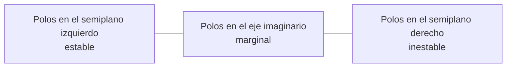

# B16-C07 — Realimentación y estabilidad

<!-- nav:top -->
[🏠 Programa](../../../../README.md) · [📚 Bloque B16](../../../tronco-comun/B16-sistemas-dinamicos-y-control-automatico.md) · [← Anterior: B16-C06 — Diagramas de bloques](../B16-C06-diagramas-de-bloques/CLASE.md) · [Siguiente: B16-C08 — Criterio de Routh-Hurwitz →](../B16-C08-criterio-de-routh-hurwitz/CLASE.md)
<!-- /nav -->

## 1. Ubicación, nivel y alcance

Séptima clase del bloque B16. En [C06](../B16-C06-diagramas-de-bloques/CLASE.md) aprendiste a escribir un lazo cerrado. Ahora respondes la pregunta que decide si un diseño sirve: **¿el lazo es estable?** Verás qué es la estabilidad, cómo la realimentación mueve los polos, por qué un control solo proporcional sobre un doble integrador oscila sin fin, y cómo un retardo reduce la ganancia admisible. Necesitas polos y funciones de transferencia (C05) y autovalores (B10-C08).

No verás todavía el criterio algebraico de Routh (C08), el lugar de las raíces (C09) ni los márgenes en frecuencia (C10).

## 2. Por qué esta clase existe

Un lazo de control puede estabilizar un sistema inestable o desestabilizar uno estable. Un telescopio con el lazo mal diseñado no solo apunta mal: oscila, consume propergol o energía de las ruedas y puede perder el objetivo. La pregunta motivadora es: **¿qué debo comprobar para estar seguro de que el lazo cerrado no se escapa, y cuánto margen tengo antes de que lo haga?**

La decisión central: elegir ganancias y estructura (por ejemplo, con o sin término derivativo) de modo que todos los polos del lazo cerrado estén en el semiplano izquierdo con margen suficiente frente a retardos y errores de modelo.

## 3. Lo que podrás hacer al terminar

1. Definir estabilidad asintótica y marginal en términos de polos.
2. Calcular los polos del lazo cerrado de un sistema con realimentación de estados o PD.
3. Explicar por qué un control proporcional sobre un doble integrador es marginalmente estable.
4. Mostrar cómo la realimentación reduce la sensibilidad a variaciones de la planta.
5. Estimar cuánto baja la ganancia máxima admisible al añadir retardo en la medida.
6. Verificar un diagnóstico de estabilidad por dos caminos independientes.

La evidencia es el **dossier de estabilidad** del ejercicio 12 (sección 20).

## 4. Con qué llegas y cómo comprobarlo

1. ¿Qué raíces tiene `s² + 0,4 = 0`?
2. ¿Cómo crece `e^(0,1 t)` y cómo decae `e^(−0,4 t)`?
3. ¿Cuál es la matriz de lazo cerrado de `ẋ = A x + B u` con `u = −K x`?
4. ¿Qué es el radio espectral de una matriz?
5. En un sistema discreto `x[k+1] = a x[k]`, ¿cuándo decae `x`?

<details>
<summary>Ver respuestas</summary>

1. `s = ± j 0,632`. 2. La primera crece sin límite; la segunda decae a cero. 3. `A − B K`. 4. El mayor módulo entre sus autovalores. 5. Cuando `|a| < 1`.
</details>

Con cuatro o cinco aciertos, sigue; si fallaste la 4, repasa B10-C08.

## 5. Un caso real: latencia en el lazo de apuntamiento

El sistema de apuntamiento del Hubble combina sensores y ruedas de reacción en un lazo cerrado (S1). Entre que un sensor mide y la rueda reacciona hay procesamiento, y ese retardo es una de las razones de que no se pueda subir la ganancia de forma indefinida. No disponemos de cifras de latencia del Hubble; usamos un modelo **sintético**. El telescopio de un eje (`J = 50 kg·m²`) con control PD (`Kp = 20 N·m/rad`, `Kd = 40 N·m·s/rad`) muestreado cada `T = 0,1 s`, y se pregunta cuánto se puede subir la ganancia si la medida llega con 0, 1, 2 o 4 muestras de retraso.

## 6. Vocabulario

Un sistema LTI es **asintóticamente estable** si, ante cualquier condición inicial y sin entrada, su estado tiende a cero; esto ocurre si y solo si todos los polos (autovalores de `A`) tienen parte real negativa. Es **marginalmente estable** si no crece pero tampoco decae (polos simples sobre el eje imaginario). Es **inestable** si algún polo tiene parte real positiva. En un sistema discreto la condición es que todos los autovalores tengan módulo menor que 1. La **realimentación de estados** es `u = −K x`, que da el lazo cerrado `ẋ = (A − B K) x`. La **sensibilidad** de una función a un parámetro mide cuánto cambia la salida relativa por un cambio relativo del parámetro. Un **retardo** de `d` muestras de periodo `T` es una demora `d·T` entre medir y actuar.

## 7. Modelo mental: un resorte que se puede amortiguar o desbocar

Un lazo estable se parece a una bola en un valle: cualquier perturbación vuelve al fondo. Marginal es una bola en un valle sin fricción: oscila para siempre. Inestable es una bola sobre una colina. La realimentación puede cambiar la forma del paisaje.



*Descripción textual:* tres zonas ordenadas de izquierda a derecha del plano `s`: la izquierda del eje imaginario es estable, el eje imaginario es marginal y la derecha es inestable.

La analogía de la bola tiene un límite: describe estabilidad de un equilibrio, no la estabilidad de un lazo con retardos, donde el paisaje depende de cuándo se actúa.

## 8. La explicación, paso a paso

### 8.1 Solo proporcional: la oscilación sin fin

Con `u = −Kp θ` sobre `J θ̈ = u`, la ecuación es `J θ̈ + Kp θ = 0`: un oscilador. Los polos son `±j√(Kp/J)`, sobre el eje imaginario. Con `Kp = 20` y `J = 50`: `±j0,632 rad/s`, periodo `2π/0,632 = 9,9 s`. No hay amortiguamiento: la oscilación inicial se mantiene con la misma amplitud para siempre (el laboratorio comprueba la amplitud constante hasta 500 s). Subir `Kp` solo aumenta la frecuencia.

### 8.2 Añadir el término derivativo

Con `u = −Kp θ − Kd θ̇` queda `J θ̈ + Kd θ̇ + Kp θ = 0`: un oscilador con amortiguamiento. Los polos tienen parte real `−Kd/(2J)`: con `Kd = 40`, `−0,4 s⁻¹`. Es estable siempre que `Kp > 0` y `Kd > 0`. Un `Kd` negativo (signo equivocado de un cable o de un cálculo) desestabiliza: con `Kd = −10`, `Kp = 20`, los polos son `0,1 ± 0,62 j`.

### 8.3 La realimentación mueve los polos

En general, con `u = −K x`, los polos del lazo cerrado son los autovalores de `A − B K` y no los de `A`. Elegir `K` es elegir dónde quedan, dentro de lo que permita el sistema (C13). Para el eje, `A − BK = [[0,1],[−Kp/J, −Kd/J]]`. Es el cambio central del control de estados: la dinámica no es destino.

### 8.4 La realimentación reduce la sensibilidad

Para una planta de primer orden `G = 1/(s+1)` con ganancia de lazo `K` constante, la ganancia estática del lazo cerrado es `K/(1+K)` y el polo queda en `−(1+K)`. Con `K = 9`: ganancia `0,9` y polo `−10`. Si la ganancia de la planta sube un 20 % (de 1 a 1,2), la ganancia del lazo cerrado pasa de 0,9 a 0,915: un cambio de 1,69 %, cercano a `S × 20 % = 2 %` con `S = 1/(1+K) = 0,1`. La realimentación convierte un 20 % de incertidumbre en menos del 2 %. Es una de las razones principales para usarla.

### 8.5 Estabilidad con retardo en un lazo muestreado

Si la medida llega `d` muestras tarde, el controlador usa `x[k−d]`. El sistema aumentado tiene más estados (las muestras pasadas) y la estabilidad se decide por el radio espectral de su matriz. Con nuestras cifras y multiplicando `Kp` y `Kd` por un factor `g`:

| Retardo | Ganancia máxima estable `g` |
|---|---|
| 0 muestras (0 s) | 25,0 |
| 1 muestra (0,1 s) | 12,2 |
| 2 muestras (0,2 s) | 7,3 |
| 4 muestras (0,4 s) | 3,9 |

Para retardo 0, la velocidad cumple `ω[k+1] = (1 − g Kd T/J) ω[k] − g Kp (T/J) θ[k]`; el factor `|1 − g·0,08| < 1` da `g < 25`, que coincide con el resultado numérico. Los demás valores se obtienen solo numéricamente. La lección: **cada décima de segundo de retardo recorta a la mitad la ganancia admisible**, y menos ganancia significa lazos más lentos y más error.

## 9. Magnitudes, símbolos y unidades

| Símbolo | Qué es | Unidad | Nota |
|---|---|---|---|
| `K` | matriz de ganancias de estado | N·m/rad; N·m·s/rad | `u = −K x` |
| `A − B K` | matriz de lazo cerrado | s⁻¹ | sus autovalores son los polos |
| `g` | factor de escala de `Kp`, `Kd` | — | adimensional |
| `d` | retardo | muestras | `d·T` segundos |
| `T` | periodo de muestreo | s | 0,1 |
| `S` | sensibilidad | — | `1/(1+K)` en el ejemplo |

## 10. Convenciones y referencias

La estabilidad que usamos es la del equilibrio del sistema sin entrada (estabilidad interna). Se distingue de «la salida acotada para entradas acotadas». En discreto, el criterio es módulo menor que 1; en continuo, parte real negativa. Un lazo marginal se considera **no aceptable** en un diseño real, porque cualquier perturbación lo vuelve inestable o lo deja oscilando.

## 11. De dónde sale lo que afirmamos

| ID | Fuente | Localizador | Respalda | Estado |
|---|---|---|---|---|
| S1 | NASA GSFC, *Pointing Control System* (archivo del Hubble, actualizada 2021-03-29) | https://asd.gsfc.nasa.gov/archive/hubble/technology/pcs.html | Lazo de sensores y ruedas de reacción | Consultada el 2026-11-05; archivada |

Límites: los criterios de estabilidad (polos, radio espectral) y la sensibilidad `1/(1+K)` son resultados estándar de teoría de sistemas, no citados a un texto, y se verifican numéricamente. Las cifras de retardo y ganancia son **sintéticas**; no hay datos de latencia del Hubble.

## 12. Cómo ver la estabilidad

| Caso | Polos | Veredicto |
|---|---|---|
| Solo P (`Kp = 20`) | `±j0,632` | marginal |
| PD (`Kp=20`, `Kd=40`) | `−0,4 ± 0,49j` | estable |
| PD con `Kd = −10` | `+0,1 ± 0,62j` | inestable |
| PD con retardo 2 muestras y `g = 9,3` | radio espectral 1,07 | inestable |

Si dibujas el plano `s`, marca la zona estable con textura (no solo con color), y representa cada caso con un símbolo distinto.

## 13. Ejemplo trabajado: ¿cuánta ganancia admite un retardo de 0,2 s?

El lazo PD muestreado a 10 Hz con retardo de 2 muestras (0,2 s). ¿Para qué factor `g` sobre las ganancias nominales se vuelve inestable?

**Paso 1 · modelo.** Discretización exacta del eje (C02) con `T = 0,1`; el controlador usa `x[k−2]`. El estado aumentado tiene 6 componentes.
**Paso 2 · criterio.** Es estable si todos los autovalores de la matriz aumentada tienen módulo menor que 1.
**Paso 3 · búsqueda.** Se barre `g` entre 0,05 y 40: el último valor estable es `g ≈ 7,31`.
**Paso 4 · comprobación por simulación.** Con `g = 9,28` (por encima del límite), el radio espectral es 1,071 y una perturbación inicial de 10⁻³ crece hasta 4×10¹⁴ en 60 s: la simulación confirma el diagnóstico algebraico.
**Paso 5 · lectura.** Las ganancias nominales (`g = 1`) tienen un margen de 7,3 veces frente al retardo de 0,2 s. Un diseño con `g = 5` quedaría a 1,5× del borde: poco margen.

## 14. Distintas maneras de diagnosticar la estabilidad

Calcular **los polos** es directo para sistemas pequeños y es lo que hicimos. El **criterio de Routh–Hurwitz** (C08) decide sin hallar las raíces, útil para dejar una ganancia como símbolo. El **lugar de las raíces** (C09) muestra cómo se mueven los polos al variar la ganancia. Los **diagramas de Bode y Nyquist** (C10) dan además cuánto margen se tiene frente a retardos y errores. La **simulación** confirma, pero no prueba estabilidad: solo muestra el caso simulado.

## 15. Práctica guiada

**Ejercicio 1 · con pasos.** Con `J = 50` y solo `Kp = 10`, halla los polos y el periodo de oscilación. *Pasos:* 8.1.

<details><summary>Solución comentada</summary>

`ω₀ = √(10/50) = 0,447 rad/s`, polos `±j0,447`; periodo `2π/0,447 = 14,05 s`. Marginal.
</details>

**Ejercicio 2 · con pista.** Para `J = 50`, `Kp = 20`, `Kd = 40` verifica la parte real de los polos con `−Kd/(2J)`. *Pista:* 8.2.

<details><summary>Solución comentada</summary>

`−40/100 = −0,4`; los polos son `−0,4 ± 0,49 j`. Estable.
</details>

**Ejercicio 3 · casi autónomo.** Planta `1/(s+1)` con ganancia de lazo `K = 4`: polo y ganancia estática del lazo cerrado.

<details><summary>Solución comentada</summary>

Polo `−5`; ganancia estática `4/5 = 0,8`.
</details>

## 16. Práctica autónoma, transferencia e integrador

**Ejercicio 4.** Con `J = 50`, `Kp = 20`, `Kd = −10`, calcula los polos y di si es estable. *(8.2.)*

<details><summary>Solución comentada</summary>

`50 s² − 10 s + 20 = 0` → `s = (10 ± √(100 − 4000))/100 = 0,1 ± j0,6245`. Parte real positiva: inestable.
</details>

**Ejercicio 5.** Con `K = 19` en la planta `1/(s+1)`, `S = 0,05`. Si la ganancia de la planta sube 10 %, ¿cuánto cambia la ganancia del lazo cerrado?

<details><summary>Solución comentada</summary>

Nominal `19/20 = 0,95`; con 1,1: `20,9/21,9 = 0,9543`; cambio `0,46 %`, cercano a `0,05 × 10 % = 0,5 %`.
</details>

**Ejercicio 6.** Según la tabla de 8.5, ¿por qué factor se reduce la ganancia admisible al pasar de 0 a 1 muestra de retardo?

<details><summary>Solución comentada</summary>

`25,0/12,2 = 2,05`: casi a la mitad.
</details>

**Ejercicio 7.** Sistema discreto `x[k+1] = 1,1 x[k] + 0,5 u[k]` con `u = −k x`. ¿Para qué `k` es estable?

<details><summary>Solución comentada</summary>

Polo `1,1 − 0,5 k`; estable si `|1,1 − 0,5 k| < 1`, es decir `0,2 < k < 4,2`. Con `k = 0,4` el polo es 0,9; con `k = 0,1`, 1,05: inestable.
</details>

**Ejercicio 8.** Explica con las ecuaciones por qué un control solo proporcional sobre un doble integrador nunca amortigua.

<details><summary>Solución comentada</summary>

`J θ̈ + Kp θ = 0` no tiene término en `θ̇`: es el oscilador sin fricción; los polos están sobre el eje imaginario para cualquier `Kp > 0`. El amortiguamiento hace falta añadirlo con `Kd`.
</details>

**Ejercicio 9 · transferencia.** Una rueda de primer orden (C01) se pone entre el controlador y el cuerpo. ¿Qué orden tiene el lazo y por qué la ganancia deja de poder subirse sin límite?

<details><summary>Solución comentada</summary>

Orden 3. El retardo de la rueda añade fase negativa; a ganancias altas los polos cruzan al semiplano derecho (C08 calcula el límite exacto).
</details>

**Ejercicio 10 · transferencia.** El sensor tarda 0,3 s en entregar la medida con `T = 0,1 s`. ¿Qué ganancia máxima admite la tabla de 8.5 (interpola)? ¿Qué implica para `ωn`?

<details><summary>Solución comentada</summary>

Entre 7,3 (2 muestras) y 3,9 (4 muestras) para 3 muestras: del orden de 5,4. Como `ωn ∝ √Kp`, bajar `Kp` por ~5 reduce `ωn` en `√5 ≈ 2,2`: el lazo será más lento. Es una estimación por interpolación; verifica con el script.
</details>

**Ejercicio 11 · transferencia.** Un colega propone subir `Kp` para reducir el error estacionario (C04, C07). Da un argumento a favor y uno en contra.

<details><summary>Solución comentada</summary>

A favor: `e_ss = d/Kp` baja. En contra: sube `ωn`, aumenta el ruido amplificado y reduce el margen frente al retardo (8.5): puede desestabilizar el lazo.
</details>

**Ejercicio 12 · integrador.** Entrega un **dossier de estabilidad**: para un lazo de tu elección calcula los polos, clasifica el lazo, estima un margen de ganancia frente a un retardo con un modelo muestreado y confirma el resultado con una simulación.

<details><summary>Solución modelo</summary>

Debe tener polos con su veredicto, el barrido de ganancia con el límite, la simulación del caso inestable y la diferencia entre el diagnóstico algebraico y el simulado.
</details>

## 17. Laboratorio: oscilador, PD, sensibilidad y retardo

El script [estabilidad_con_retardo.py](estabilidad_con_retardo.py) comprueba los polos del control P y PD, la amplitud constante del oscilador, la desensibilización por realimentación y barre la ganancia admisible con retardos de 0, 1, 2 y 4 muestras; el caso inestable se confirma por simulación.

**Datos:** sintéticos (simulados). **Predice:** `g_max = 25` con retardo nulo. **Ejecución del 2026-11-05 (Python 3.12.9, numpy 2.4.4, scipy 1.17.1):**

```text
(a) solo P: polos 0.000000+0.632456j, 0.000000-0.632456j; esperado +-j0.632456
    amplitud normalizada en t = 0, 50, 500 s: 0.100000, 0.100000, 0.100000
(b) PD: polos -0.4000+0.4899j, -0.4000-0.4899j; -Kd/(2J) = -0.4000
(c) K = 1.0: polo -2.0, ganancia estática 0.5000
(c) K = 9.0: polo -10.0, ganancia estática 0.9000
    G0 +20 % -> T cambia 1.69 % (primera aproximación S*20 % = 2.00 %)
(d) ganancia máxima estable g_max (escala sobre Kp, Kd) según retardo:
    retardo 0 muestras (0.0 s): g_max ~ 25.00
    retardo 1 muestras (0.1 s): g_max ~ 12.16
    retardo 2 muestras (0.2 s): g_max ~ 7.31
    retardo 4 muestras (0.4 s): g_max ~ 3.86
    con g = 9.28 y retardo 2: |x| tras 60 s = 4.406e+14 (radio 1.071 > 1)
Pruebas superadas.
```

```bash
python programa/clases/B16/B16-C07-realimentacion-y-estabilidad/estabilidad_con_retardo.py
```

**Límites:** el retardo se aplica solo a la medida; la rejilla de `g` tiene paso ≈ 0,01 y el valor límite es aproximado a ese paso; sin ruido ni saturación.

## 18. Errores frecuentes y cómo corregirlos

**Creer que más ganancia siempre es mejor.** Se corrige con el ejercicio 11.

**Aceptar un lazo marginal.** Se corrige con el ejercicio 8.

**Olvidar el signo de la acción derivativa.** Se corrige con el ejercicio 4.

**Ignorar el retardo de la medida.** Se corrige con el ejercicio 10.

**Tomar una simulación estable como prueba.** Solo prueba el caso simulado; se corrige releyendo la sección 14.

## 19. Cómo sabrás que vas bien

Tras 8.1: ¿explicas por qué solo P oscila sin fin? Ejercicio 8. Tras 8.4: ¿calculas el efecto de una variación de planta? Ejercicio 5. Tras 8.5: ¿interpretas la tabla de retardo? Ejercicio 6. Al final: ¿tu dossier contrasta algebra y simulación?

## 20. Qué entregas y cómo se evalúa

El producto es el **dossier de estabilidad** del ejercicio 12.

| Criterio | Inicial | En desarrollo | Logrado | Destacado |
|---|---|---|---|---|
| Polos y veredicto | Sin cálculo | Cálculo incompleto | Correcto con clasificación | Con margen cuantificado |
| Retardo | Ignorado | Mencionado | Modelado y barrido | Interpretado en el diseño |
| Contraste | Un solo método | Dos métodos sin comparar | Algebra y simulación | Explica diferencias |
| Fuentes y datos | Sin rótulo | Parcial | Rotula sintético | Cita solo lo consultado |

**Condiciones críticas:** no aceptar un lazo marginal; declarar el retardo supuesto; no presentar cifras sintéticas como del Hubble.

## 21. Ética, seguridad y límites

Un lazo inestable en un vehículo real puede destruir el hardware; por eso se exige margen, no solo estabilidad nominal. Cifras didácticas. Accesibilidad: tablas y descripciones textuales.

## 22. Para cerrar y seguir

Un lazo es estable si todos sus polos están en el semiplano izquierdo (o dentro del círculo unidad en discreto). La realimentación mueve los polos, reduce la sensibilidad y puede desestabilizar si hay retardos. Solo proporcional sobre un doble integrador es marginal; el término derivativo amortigua. Queda abierta la pregunta: ¿cómo decidir la estabilidad sin calcular los polos?

**Glosario español–inglés.** estabilidad · *stability*; marginalmente estable · *marginally stable*; realimentación de estados · *state feedback*; sensibilidad · *sensitivity*; retardo · *delay*; radio espectral · *spectral radius*.

**Continuidad.** B16-C08 enseña el criterio de Routh–Hurwitz. B16-C09 sigue los polos al variar la ganancia. B16-C10 mide el margen en frecuencia. B16-C19 verifica el lazo con un muestreo concreto.

**Referencias:** ver sección 11.

<!-- nav:bottom -->
---

[← Anterior: B16-C06 — Diagramas de bloques](../B16-C06-diagramas-de-bloques/CLASE.md) · [📚 Bloque B16](../../../tronco-comun/B16-sistemas-dinamicos-y-control-automatico.md) · [Siguiente: B16-C08 — Criterio de Routh-Hurwitz →](../B16-C08-criterio-de-routh-hurwitz/CLASE.md)
<!-- /nav -->
