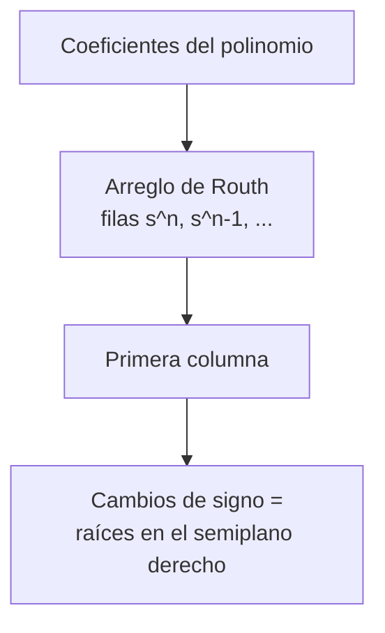

# B16-C08 — Criterio de Routh-Hurwitz

<!-- nav:top -->
[🏠 Programa](../../../../README.md) · [📚 Bloque B16](../../../tronco-comun/B16-sistemas-dinamicos-y-control-automatico.md) · [← Anterior: B16-C07 — Realimentación y estabilidad](../B16-C07-realimentacion-y-estabilidad/CLASE.md) · [Siguiente: B16-C09 — Lugar de las raíces →](../../../tronco-comun/B16-sistemas-dinamicos-y-control-automatico.md#b16-c09)
<!-- /nav -->

## 1. Ubicación, nivel y alcance

Octava clase del bloque B16. En [C07](../B16-C07-realimentacion-y-estabilidad/CLASE.md) decidiste la estabilidad calculando los polos. Aquí aprendes a decidirla **sin calcularlos**, a partir de los coeficientes del polinomio característico, y a obtener la ganancia crítica en la que el lazo deja de ser estable. Cierra el primer tramo del bloque (modelos, respuesta y estabilidad). Necesitas polinomios y la idea de polos (C05, C07).

No verás aún la visualización del movimiento de los polos (C09) ni los márgenes en frecuencia (C10).

## 2. Por qué esta clase existe

Al diseñar un lazo, la ganancia `K` es una incógnita que quieres elegir. Calcular las raíces para cada `K` es posible con un computador, pero no da la **frontera**: el valor exacto de `K` por encima del cual el sistema se desestabiliza. Esa frontera también se necesita en una expresión simbólica cuando el diseño tiene varios parámetros. La pregunta motivadora es: **¿puedo saber si un polinomio de grado alto tiene raíces en el semiplano derecho sin hallar ninguna raíz, y obtener la ganancia crítica en una fórmula?**

La decisión central: qué rango de parámetros mantiene todas las raíces a la izquierda, y cuánto margen hay hasta la frontera.

## 3. Lo que podrás hacer al terminar

1. Enunciar la condición necesaria sobre los signos de los coeficientes.
2. Construir el arreglo de Routh y contar las raíces en el semiplano derecho.
3. Obtener la ganancia crítica de un lazo de tercer orden y su frecuencia de cruce.
4. Reconocer y tratar los dos casos especiales (cero en la primera columna; fila de ceros).
5. Verificar un resultado de Routh contra el cálculo directo de raíces.
6. Interpretar la cercanía a la frontera: estabilidad con poco margen.

La evidencia es la **tabla de estabilidad paramétrica** del ejercicio 12 (sección 20).

## 4. Con qué llegas y cómo comprobarlo

1. ¿Qué polinomio característico tiene un lazo con `L = K/(s(s+1)(s+2))`? (Es `1 + L = 0` con denominador común.)
2. ¿Cuál es el número de raíces de un polinomio de grado 3?
3. ¿Qué raíces tiene `s² + 2 = 0`?
4. ¿Qué significa «parte real positiva»?
5. ¿Qué es el cociente `(a·d − b·c)/a` si `a = 2, b = 1, c = 4, d = 3`?

<details>
<summary>Ver respuestas</summary>

1. `s³ + 3s² + 2s + K = 0`. 2. Tres, contando multiplicidades y complejas. 3. `±j√2`. 4. Que la raíz está en el semiplano derecho: su exponencial crece. 5. `(6 − 4)/2 = 1`.
</details>

Con cuatro o cinco aciertos, sigue.

## 5. Un caso real: una rueda con retardo en el lazo

La página de archivo del Hubble (S1) lista las ruedas de reacción, que giran hasta unas 3000 rpm, como los actuadores del apuntamiento. Un actuador real no entrega el par al instante: su respuesta se puede aproximar con un retardo de primer orden. Un lazo con el cuerpo (integrador doble), un controlador y ese retardo es de tercer orden. Con parámetros **normalizados y sintéticos**, se quiere saber cuánta ganancia se puede aplicar antes de que el lazo se vuelva inestable. Usaremos el lazo `L(s) = K/(s(s+1)(s+2))`, con `K` en s⁻³ en unidades normalizadas.

## 6. Vocabulario

El **polinomio característico** de un lazo cerrado es el numerador de `1 + L(s)`; sus raíces son los polos del lazo cerrado. La condición de **Hurwitz** dice que, para que todas las raíces tengan parte real negativa, todos los coeficientes deben ser del mismo signo y distintos de cero (condición necesaria, no suficiente). El **arreglo de Routh** es una tabla construida con los coeficientes; el **criterio de Routh–Hurwitz** dice que el número de cambios de signo en su primera columna es el número de raíces con parte real positiva. La **ganancia crítica** `K_crit` es el valor en el que el lazo pasa de estable a inestable, con raíces sobre el eje imaginario.

## 7. Modelo mental: una balanza de coeficientes

Un polinomio de tercer grado `a₃ s³ + a₂ s² + a₁ s + a₀` es estable si el producto de los dos coeficientes centrales supera al de los extremos: `a₂ a₁ > a₃ a₀`. Es una balanza: si los términos de alta frecuencia (`a₃`, `a₀`) pesan más que los intermedios, la estabilidad se pierde.



*Descripción textual:* de los coeficientes se construye el arreglo de Routh por filas; se lee su primera columna; el número de cambios de signo es el número de raíces inestables.

La analogía de la balanza es solo para el caso cúbico; en grados mayores la condición es una cadena de desigualdades, que el arreglo organiza.

## 8. La explicación, paso a paso

### 8.1 Construir el arreglo

Para `a₀ sⁿ + a₁ sⁿ⁻¹ + a₂ sⁿ⁻² + …` la fila `sⁿ` contiene `a₀, a₂, a₄, …` y la fila `sⁿ⁻¹` contiene `a₁, a₃, a₅, …`. Cada fila siguiente se calcula con las dos anteriores: si dos filas son `[a, b, …]` y `[c, d, …]`, el primer elemento de la fila nueva es `(c·b − a·d)/c`, y los siguientes siguen el mismo patrón con las columnas desplazadas. Se repite hasta llegar a `s⁰`.

Para `s³ + 3s² + 2s + K`:

```text
s³ :  1      2
s² :  3      K
s¹ :  (3·2 − 1·K)/3 = (6 − K)/3
s⁰ :  K
```

### 8.2 Leer la primera columna

La primera columna es `1, 3, (6−K)/3, K`. Para `K > 0`, los dos primeros son positivos y el último también; el tercero es positivo si `K < 6`. Entonces el lazo es estable para `0 < K < 6`. Para `K > 6`, la columna tiene dos cambios de signo (de `3` a `(6−K)/3` negativo y de este a `K` positivo): dos raíces en el semiplano derecho. Con `K = 10` las raíces son `−3,31` y `0,15 ± 1,73 j` (el laboratorio las calcula).

### 8.3 La frontera: ganancia crítica

En `K = 6` la fila `s¹` vale cero: caso especial (8.4). El polinomio auxiliar sale de la fila anterior, `3s² + K = 0`, es decir `3s² + 6 = 0`, con `s = ± j√2 = ± j1,414 rad/s`. Es la frecuencia de oscilación sostenida. Para el cúbico general `s³ + a₁ s² + a₂ s + K`, `K_crit = a₁ a₂`. Para `K = 5,9` las raíces complejas tienen parte real `−0,0046 s⁻¹`: el sistema es estable, pero casi oscilatorio; la constante de tiempo es de `1/0,0046 ≈ 220 s`. Estable no significa bien amortiguado.

### 8.4 Casos especiales

**Cero en la primera columna** (con el resto de la fila no nula): se sustituye por un número pequeño `ε` positivo y se sigue; el signo de los siguientes elementos al hacer `ε → 0` cuenta los cambios. **Fila completa de ceros**: indica raíces simétricas respecto al origen (por ejemplo `±j√2`); se forma el polinomio auxiliar con la fila anterior, se deriva y se usan sus coeficientes para reemplazar la fila de ceros. Eso es lo que ocurre en `K = 6`. Las raíces del polinomio auxiliar son también raíces del polinomio original.

### 8.5 Sobre el alcance del criterio

Routh–Hurwitz dice **cuántas** raíces están a la derecha, pero no **dónde** están ni cuánto margen de ganancia o fase tienes. Funciona con polinomios de coeficientes reales y finitos; un retardo puro (`e^(−sτ)`) no es un polinomio y exige una aproximación. En el laboratorio comprobamos el criterio con 2 000 polinomios aleatorios de grado 2 a 7: el número de cambios de signo coincidió siempre con el número de raíces con parte real positiva calculadas con `numpy.roots`.

## 9. Magnitudes, símbolos y unidades

| Símbolo | Qué es | Unidad | Nota |
|---|---|---|---|
| `aᵢ` | coeficientes del polinomio característico | s⁻ⁱ (según potencia) | reales |
| `K` | ganancia de lazo | s⁻³ (normalizada) | variable de diseño |
| `K_crit` | ganancia crítica | s⁻³ | frontera de estabilidad |
| `ω_c` | frecuencia de oscilación en la frontera | rad/s | `√a₂` para el cúbico |
| `ε` | número pequeño positivo | — | caso especial |

## 10. Convenciones y referencias

Se escribe el polinomio con el coeficiente de mayor grado positivo. La primera columna se examina en orden; se cuentan cambios de signo entre elementos consecutivos. En este bloque se llama «caso regular» al que no tiene ceros en la primera columna. El criterio se aplica al polinomio **cerrado**, no a `L(s)`.

## 11. De dónde sale lo que afirmamos

| ID | Fuente | Localizador | Respalda | Estado |
|---|---|---|---|---|
| S1 | NASA GSFC, *Pointing Control System* (archivo del Hubble, actualizada 2021-03-29) | https://asd.gsfc.nasa.gov/archive/hubble/technology/pcs.html | Ruedas de reacción como actuadores del apuntamiento (hasta 3000 rpm) | Consultada el 2026-11-05; archivada |

Límites: el criterio de Routh–Hurwitz y la condición del cúbico `K_crit = a₁ a₂` son resultados clásicos de teoría de estabilidad, no citados a un texto; se verifican numéricamente contra el cálculo de raíces. Los parámetros normalizados del lazo son **sintéticos**.

## 12. Cómo ver el arreglo

| Fila | Elementos para `s³ + 3s² + 2s + K` |
|---|---|
| `s³` | `1`, `2` |
| `s²` | `3`, `K` |
| `s¹` | `(6 − K)/3` |
| `s⁰` | `K` |

Valores simulados del laboratorio (primera columna):

| `K` | Primera columna | Cambios de signo | Raíces |
|---|---|---|---|
| 2,0 | 1; 3; 1,333; 2 | 0 | −2,52; −0,24 ± 0,86j |
| 5,9 | 1; 3; 0,033; 5,9 | 0 | −2,99; −0,0046 ± 1,40j |
| 6,1 | 1; 3; −0,033; 6,1 | 2 | −3,01; 0,0045 ± 1,42j |
| 10,0 | 1; 3; −1,333; 10 | 2 | −3,31; 0,15 ± 1,73j |

Subraya o sombrea la fila con el cambio de signo, y no uses solo color.

## 13. Ejemplo trabajado: el techo de ganancia con un actuador lento

Para `L(s) = K/(s(s + 1)(s + 2))`, ¿qué `K` mantiene estable el lazo y qué pasa en la frontera?

**Paso 1 · polinomio.** `1 + L = 0` → `s(s+1)(s+2) + K = s³ + 3s² + 2s + K = 0`.
**Paso 2 · condición necesaria.** Todos los coeficientes positivos si `K > 0`.
**Paso 3 · arreglo.** Primera columna `1, 3, (6−K)/3, K`.
**Paso 4 · rango.** Estable para `0 < K < 6`.
**Paso 5 · frontera.** En `K = 6`, `3s² + 6 = 0`, raíces `±j1,414 rad/s`. El lazo oscila de forma sostenida a 1,414 rad/s (periodo 4,44 s).
**Paso 6 · verificación.** Con `np.roots([1,3,2,6])` el laboratorio devuelve raíces imaginarias `±1,414214j`.
**Paso 7 · lectura.** Con `K = 2` el sistema tiene un margen de ganancia de `6/2 = 3` (puede multiplicarse por 3 antes de desestabilizarse). Con `K = 5,9`, el margen es 1,02: casi nulo.

## 14. Distintos modos de decidir la estabilidad

**Calcular las raíces** (C07) da todo, incluida la posición, pero requiere números concretos. **Routh–Hurwitz** da el rango simbólico y el número de raíces inestables sin hallarlas. **El lugar de las raíces** (C09) muestra la trayectoria de las raíces al variar `K`. **Nyquist y Bode** (C10) aceptan retardos puros y dan márgenes. Si tienes un parámetro libre, usa Routh; si necesitas margen o hay retardo, usa frecuencia.

## 15. Práctica guiada

**Ejercicio 1 · con pasos.** Para `s³ + 4s² + 5s + K`, halla el rango de `K` estable. *Pasos:* 8.1 y 8.2.

<details><summary>Solución comentada</summary>

Arreglo: `1, 5 / 4, K / (20 − K)/4 / K`. Primera columna `1, 4, (20−K)/4, K`. Estable para `0 < K < 20`. Se confirma con `K_crit = a₁ a₂ = 20`.
</details>

**Ejercicio 2 · con pista.** ¿Es estable `s² + 2s + 5`? ¿Y `s² − 2s + 5`? *Pista:* grado 2.

<details><summary>Solución comentada</summary>

La primera: todos los coeficientes positivos, estable (raíces `−1 ± 2j`). La segunda tiene un coeficiente negativo; condición de Hurwitz incumplida, inestable (raíces `1 ± 2j`).
</details>

**Ejercicio 3 · casi autónomo.** ¿Qué polos tiene el lazo en la frontera de `s³ + 4s² + 5s + K`?

<details><summary>Solución comentada</summary>

En `K = 20`, polinomio auxiliar `4s² + 20 = 0`, `s = ± j√5 = ± j2,236 rad/s`; la tercera raíz es `−4`.
</details>

## 16. Práctica autónoma, transferencia e integrador

**Ejercicio 4.** Para `s⁴ + 2s³ + 3s² + 4s + 5` construye el arreglo y cuenta las raíces del semiplano derecho.

<details><summary>Solución comentada</summary>

`s⁴: 1, 3, 5`; `s³: 2, 4`; `s²: (2·3 − 1·4)/2 = 1, (2·5 − 0)/2 = 5`; `s¹: (1·4 − 2·5)/1 = −6`; `s⁰: 5`. Columna `1, 2, 1, −6, 5`: dos cambios de signo, dos raíces inestables.
</details>

**Ejercicio 5.** ¿Puede ser estable `s³ + 2s + 5`? Justifica.

<details><summary>Solución comentada</summary>

No: falta el término en `s²` (coeficiente cero), incumple la condición necesaria de Hurwitz.
</details>

**Ejercicio 6.** Para `s³ + 3s² + 2s + K`, ¿cuántas raíces inestables hay si `K = 8`?

<details><summary>Solución comentada</summary>

Primera columna `1, 3, (6−8)/3 = −0,667, 8`: dos cambios de signo; dos raíces inestables.
</details>

**Ejercicio 7.** Para `L = K/(s(s + 0,5)(s + 2))`, halla `K_crit` y la frecuencia de oscilación.

<details><summary>Solución comentada</summary>

Polinomio `s³ + 2,5 s² + s + K`. `K_crit = a₁ a₂ = 2,5·1 = 2,5`; frecuencia `√a₂ = 1 rad/s`.
</details>

**Ejercicio 8.** Explica con el arreglo por qué al acercar `K` a 6 por debajo el sistema se vuelve cada vez menos amortiguado.

<details><summary>Solución comentada</summary>

El elemento `(6−K)/3` tiende a cero; las raíces complejas se acercan al eje imaginario (parte real `−0,0046` a `K = 5,9`). El sistema es estable pero con constante de tiempo creciente.
</details>

**Ejercicio 9 · transferencia.** Un cuerpo `1/(s²)` (normalizado) con una rueda de retardo `1/(s+0,5)` y un controlador PD `0,8 s + 0,2` da el polinomio `s³ + 0,5 s² + 0,8 s + 0,2`. ¿Es estable?

<details><summary>Solución comentada</summary>

Primera columna: `1, 0,5, (0,5·0,8 − 1·0,2)/0,5 = 0,4, 0,2`. Todos positivos: estable.
</details>

**Ejercicio 10 · transferencia.** En el lazo anterior, ¿qué ganancia derivativa `Kd'` mínima mantiene la estabilidad si `s³ + 0,5 s² + Kd' s + 0,2`?

<details><summary>Solución comentada</summary>

Condición: `0,5·Kd' > 0,2` → `Kd' > 0,4`. Por debajo, el lazo se vuelve inestable.
</details>

**Ejercicio 11 · transferencia.** Un compañero dice que, como `K = 5,9` está dentro del rango estable, es un buen diseño. Argumenta con la sección 8.3.

<details><summary>Solución comentada</summary>

Está a 1,7 % de la frontera: poco margen, oscilaciones que duran cientos de segundos y sensibilidad extrema a variaciones de la planta. Routh dice estable, no bien amortiguado.
</details>

**Ejercicio 12 · integrador.** Entrega una **tabla de estabilidad paramétrica**: para un lazo de tercer orden con un parámetro libre de tu elección, obtén el rango estable con Routh, la frontera con su frecuencia de oscilación y comprueba tres puntos con el cálculo de raíces.

<details><summary>Solución modelo</summary>

La tabla debe incluir el polinomio, el arreglo simbólico, el rango, el polinomio auxiliar en la frontera y tres filas de verificación (una estable, una en el borde, una inestable) con las raíces calculadas.
</details>

## 17. Laboratorio: Routh contra las raíces

El script [arreglo_de_routh.py](arreglo_de_routh.py) implementa el arreglo de Routh, evalúa el lazo `s³ + 3s² + 2s + K` para varios `K`, comprueba la frontera `K = 6` y compara el criterio contra `numpy.roots` en 2 000 polinomios aleatorios.

**Datos:** sintéticos (simulados). **Predice:** dos cambios de signo para `K = 6,1`. **Ejecución del 2026-11-05 (Python 3.12.9, numpy 2.4.4):**

```text
K =  2.0: primera columna [1.     3.     1.3333 2.    ]; cambios de signo 0; raíces [-2.5214+0.j     -0.2393+0.8579j -0.2393-0.8579j]
K =  5.9: primera columna [1.     3.     0.0333 5.9   ]; cambios de signo 0; raíces [-2.9909+0.j     -0.0046+1.4045j -0.0046-1.4045j]
K =  6.1: primera columna [ 1.      3.     -0.0333  6.1   ]; cambios de signo 2; raíces [-3.009 +0.j      0.0045+1.4238j  0.0045-1.4238j]
K = 10.0: primera columna [ 1.      3.     -1.3333 10.    ]; cambios de signo 2; raíces [-3.3089+0.j      0.1545+1.7316j  0.1545-1.7316j]
K crítico = 6: raíces imaginarias [0.+1.414214j 0.-1.414214j]; sqrt(2) = 1.414214
aleatorios: 2000 coincidencias exactas con np.roots; 0 casos especiales omitidos
Pruebas superadas.
```

```bash
python programa/clases/B16/B16-C08-criterio-de-routh-hurwitz/arreglo_de_routh.py
```

**Límites:** solo el caso regular (el script omite los casos con ceros en la primera columna); coeficientes reales; semilla fija 16.

## 18. Errores frecuentes y cómo corregirlos

**Pensar que coeficientes positivos bastan.** Solo es condición necesaria; se corrige con el ejercicio 4.

**Aplicar Routh a `L(s)` en vez de al polinomio cerrado.** Se corrige releyendo 10.

**Equivocar la fórmula de la fila siguiente.** Se corrige con el ejercicio 1.

**Confundir estable con bien amortiguado.** Se corrige con el ejercicio 11.

**Aplicar el criterio con un retardo puro sin aproximarlo.** Se corrige releyendo 8.5.

## 19. Cómo sabrás que vas bien

Tras 8.1: ¿construyes el arreglo de un cúbico sin ayuda? Ejercicio 1. Tras 8.3: ¿obtienes `K_crit` y la frecuencia? Ejercicio 7. Tras el ejemplo: ¿explicas por qué `K = 5,9` es mal diseño? Ejercicio 11.

## 20. Qué entregas y cómo se evalúa

El producto es la **tabla de estabilidad paramétrica** del ejercicio 12.

| Criterio | Inicial | En desarrollo | Logrado | Destacado |
|---|---|---|---|---|
| Arreglo | Con errores | Correcto en lo simple | Correcto con fila de ceros | Con caso especial tratado |
| Rango y frontera | Sin rango | Rango sin frontera | Con polinomio auxiliar | Con interpretación de margen |
| Verificación | Sin cálculo | Un punto | Tres puntos | Con el criterio vs raíces aleatorias |
| Fuentes y datos | Sin rótulo | Parcial | Rotula sintético | Cita solo lo consultado |

**Condiciones críticas:** no confundir estable con bien amortiguado; contrastar con cálculo de raíces.

## 21. Ética, seguridad y límites

Un criterio que dice «estable» no garantiza un vehículo seguro: exige margen y verificación (C19). Cifras didácticas. Accesibilidad: el arreglo se da como tabla, sin depender de color.

## 22. Para cerrar y seguir

El criterio de Routh–Hurwitz cuenta las raíces del semiplano derecho a partir de los coeficientes y permite hallar la ganancia crítica. En un cúbico, `K_crit = a₁ a₂`. Los casos especiales y el margen real requieren más cuidado. Queda abierta una pregunta: ¿cómo ver el movimiento de todos los polos al variar `K`, y no solo la frontera?

**Glosario español–inglés.** criterio de Routh–Hurwitz · *Routh–Hurwitz criterion*; polinomio característico · *characteristic polynomial*; ganancia crítica · *ultimate gain*; polinomio auxiliar · *auxiliary polynomial*; semiplano derecho · *right half-plane*; margen de ganancia · *gain margin*.

**Continuidad.** B16-C09 sigue los polos al variar `K`. B16-C10 calcula el margen de ganancia en frecuencia. B16-C12 usa la ganancia crítica para sintonizar controladores PID.

**Referencias:** ver sección 11.

<!-- nav:bottom -->
---

[← Anterior: B16-C07 — Realimentación y estabilidad](../B16-C07-realimentacion-y-estabilidad/CLASE.md) · [📚 Bloque B16](../../../tronco-comun/B16-sistemas-dinamicos-y-control-automatico.md) · [Siguiente: B16-C09 — Lugar de las raíces →](../../../tronco-comun/B16-sistemas-dinamicos-y-control-automatico.md#b16-c09)
<!-- /nav -->
