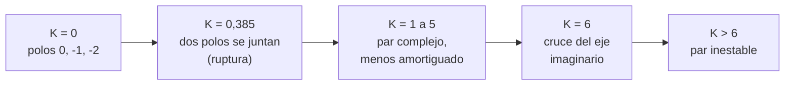

# B16-C09 — Lugar de las raíces

<!-- nav:top -->
[🏠 Programa](../../../../README.md) · [📚 Bloque B16](../../../tronco-comun/B16-sistemas-dinamicos-y-control-automatico.md) · [← Anterior: B16-C08 — Criterio de Routh-Hurwitz](../B16-C08-criterio-de-routh-hurwitz/CLASE.md) · [Siguiente: B16-C10 — Diagramas de Bode y Nyquist →](../B16-C10-diagramas-de-bode-y-nyquist/CLASE.md)
<!-- /nav -->

## 1. Ubicación, nivel y alcance

Novena clase del bloque B16. En [C08](../B16-C08-criterio-de-routh-hurwitz/CLASE.md) obtuviste la ganancia crítica. Ahora ves **toda la trayectoria**: cómo se mueven los polos del lazo cerrado cuando la ganancia `K` crece desde 0. Es una herramienta de diseño: te deja elegir `K` mirando dónde quedan los polos. Necesitas polos, raíces de polinomios y números complejos (C05, C07, C08).

No verás aún los márgenes en frecuencia (C10) ni el diseño de un PID (C11).

## 2. Por qué esta clase existe

Subir la ganancia de un lazo hace que responda más rápido, pero también más oscilante, hasta que se desestabiliza. Para decidir cuánta ganancia usar necesitas ver el compromiso de un vistazo. La pregunta motivadora es: **¿cómo cambia la respuesta de mi lazo al variar un solo parámetro, y qué ganancia da el amortiguamiento que quiero?**

La decisión central: elegir `K` sobre el lugar de las raíces para obtener un `ζ` y un tiempo de asentamiento aceptables, sabiendo dónde está el borde de la inestabilidad.

## 3. Lo que podrás hacer al terminar

1. Definir el lugar de las raíces y la condición de ángulo.
2. Calcular asíntotas, punto de ruptura y cruce del eje imaginario de un lazo sencillo.
3. Leer sobre el lugar el amortiguamiento y la frecuencia para un `K` dado.
4. Comprobar el cruce con el criterio de Routh de C08.
5. Verificar numéricamente el lugar con invariantes (suma de raíces, condición de ángulo).
6. Explicar por qué un polo dominante simplifica el análisis.

La evidencia es la **ficha de lugar de las raíces** del ejercicio 12 (sección 20).

## 4. Con qué llegas y cómo comprobarlo

1. Calcula las raíces de `s² + 2s + 5`.
2. ¿Cuánto vale la suma de las raíces de `s³ + 3s² + 2s + K`?
3. ¿Cuál es el ángulo de `−1 + j` respecto del eje real positivo?
4. Si un polo está en `−0,3 ± 0,4 j`, ¿cuánto valen `ωn` y `ζ`?
5. ¿Qué ganancia crítica tenía `s³ + 3s² + 2s + K`?

<details>
<summary>Ver respuestas</summary>

1. `−1 ± 2j`. 2. `−3`, por Vieta. 3. 135°. 4. `ωn = 0,5`, `ζ = 0,6`. 5. `K_crit = 6`.
</details>

Con cuatro o cinco aciertos, sigue.

## 5. Un caso real: cuánta ganancia admite un actuador lento

Seguimos con el lazo normalizado de C08, `L(s) = K/(s(s+1)(s+2))`, que representa un cuerpo con un integrador, un actuador de retardo y un controlador proporcional. Las ruedas de reacción del Hubble giran hasta unas 3000 rpm (S1), y en el lazo real los actuadores, sensores y el computador añaden retardos. Aquí el parámetro es una ganancia `K` normalizada y **sintética**.

## 6. Vocabulario

El **lugar de las raíces** es el conjunto de raíces de `1 + K·P(s) = 0` (con `P` conocida) cuando `K` varía de 0 a ∞. Con `P(s) = N(s)/D(s)` hay `n` ramas, una por polo de `P`. Las ramas **parten** de los polos de `P` (con `K=0`) y **terminan** en los ceros de `P` o van al infinito siguiendo **asíntotas**. Un **punto de ruptura** es donde dos ramas reales se juntan y salen al plano complejo. La **condición de ángulo** pide `arg P(s) = 180°` (mod 360°) en cada punto del lugar; la **condición de módulo** da `K = 1/|P(s)|`.

## 7. Modelo mental: polos que viajan

Con `K = 0`, los polos del lazo cerrado son los de `L` (0, −1, −2). Al subir `K`, se desplazan: los dos primeros se acercan, se encuentran y salen hacia el plano complejo; el tercero se aleja por el eje real negativo. A cierta `K`, el par complejo cruza el eje imaginario.



*Descripción textual:* de izquierda a derecha, la ganancia crece: los polos arrancan en 0, −1 y −2; a `K = 0,385` dos se encuentran; luego forman un par complejo cada vez menos amortiguado; en `K = 6` llegan al eje imaginario; después son inestables.

La analogía: tres corredores que parten de posiciones distintas y se mueven por una pista según una palanca; solo uno de ellos se escapa hacia el borde. Su límite: la palanca (`K`) no mueve los polos a velocidad uniforme.

## 8. La explicación, paso a paso

### 8.1 Invariantes útiles

En `s³ + 3s² + 2s + K` el coeficiente de `s²` no depende de `K`, de modo que la **suma de las tres raíces es −3 para cualquier `K`**. Si dos raíces van hacia la derecha, la tercera debe ir hacia la izquierda. Esto sirve de comprobación: el laboratorio lo verifica en 2 001 valores de `K`.

### 8.2 Asíntotas

Para `K` muy grande, las `n − m` ramas que no terminan en ceros (aquí 3, porque `P` no tiene ceros) se alinean con rectas desde el **centroide** `σ = (Σ polos − Σ ceros)/(n − m) = (0 − 1 − 2)/3 = −1`, con ángulos `(2k+1)·180°/(n − m) = 60°, 180°, 300°`. A `K = 10⁶` el laboratorio encuentra raíces con centroide `−1,0000` y ángulos `180°` y `±60°`.

### 8.3 Punto de ruptura

En el punto de ruptura la ganancia `K(s) = −s(s+1)(s+2)` tiene un extremo local: `dK/ds = −(3s² + 6s + 2) = 0`, `s = −1 ± 1/√3`. Solo `s = −0,42265` está sobre el lugar (entre 0 y −1). Allí `K = 2/(3√3) = 0,3849`. Para `K < 0,3849` los tres polos son reales; para mayores, dos pasan a ser complejos conjugados. En `K = 0,3849` las raíces son `−2,1547` y `−0,42265` doble.

### 8.4 Cruce del eje imaginario

En `K = 6` el par llega a `±j√2 = ±j1,414 rad/s` (el mismo resultado de Routh en C08, ahora con la frecuencia de cruce). Para `K > 6` la parte real es positiva.

### 8.5 Elegir `K` por el amortiguamiento

El amortiguamiento de un par complejo `σ ± jωd` es `ζ = −σ/√(σ² + ωd²)`. El laboratorio calcula:

| `K` | Polos dominantes | `ζ` |
|---|---|---|
| 0,2 | reales: −2,088; −0,791; −0,121 | — |
| 0,5 | −0,404 ± 0,254j | 0,846 |
| 1,0 | −0,338 ± 0,562j | 0,515 |
| 2,0 | −0,239 ± 0,858j | 0,269 |
| 4,0 | −0,102 ± 1,192j | 0,085 |

Para `ζ ≈ 0,5` conviene `K ≈ 1`. Un `K` mayor responde con más energía pero con una oscilación mucho más débil. Dado que el tercer polo está lejos a la izquierda (≈ −2,3 en `K = 1`), el par complejo es el **dominante** y las fórmulas de C04 son una buena aproximación.

## 9. Magnitudes, símbolos y unidades

| Símbolo | Qué es | Unidad | Nota |
|---|---|---|---|
| `K` | ganancia de lazo | s⁻³ (normalizada) | parámetro del lugar |
| `P(s)` | función abierta sin la ganancia | — | `1/(s(s+1)(s+2))` |
| `σ` | centroide de las asíntotas | s⁻¹ | −1 |
| `s_b, K_b` | punto de ruptura y su ganancia | s⁻¹; s⁻³ | −0,42265; 0,3849 |
| `ζ` | amortiguamiento del par dominante | — | `−σ/|s|` |

## 10. Convenciones y referencias

Se traza para `K ≥ 0` y realimentación negativa. Las ramas se marcan con ×, los ceros con ○. Se indican ángulos en grados medidos desde el eje real positivo. Con `K < 0` (lugar complementario) la condición de ángulo cambia a 0°; no se trata aquí.

## 11. De dónde sale lo que afirmamos

| ID | Fuente | Localizador | Respalda | Estado |
|---|---|---|---|---|
| S1 | NASA GSFC, *Pointing Control System* (archivo del Hubble, actualizada 2021-03-29) | https://asd.gsfc.nasa.gov/archive/hubble/technology/pcs.html | Ruedas de reacción de hasta 3000 rpm como actuadores del lazo | Consultada el 2026-11-05; archivada |

Límites: las reglas del lugar de las raíces (asíntotas, ruptura, condición de ángulo) son resultados clásicos, no citados a un texto, y se verifican contra el cálculo directo de raíces. Los parámetros son **sintéticos** y normalizados.

## 12. Cómo ver el lugar

Un gráfico accesible del lugar tiene tres ramas con estilos de trazo distintos y marcas en `K = 0,385; 1; 6`. La tabla es su equivalente:

| `K` | Raíces |
|---|---|
| 0 | 0; −1; −2 |
| 0,385 | −0,423 (doble); −2,155 |
| 1 | −0,338 ± 0,562j; −2,324 |
| 6 | ±1,414j; −3 |
| 10 | 0,155 ± 1,732j; −3,309 |

## 13. Ejemplo trabajado: elegir la ganancia para ζ = 0,5

Quieres el amortiguamiento 0,5 en el lazo `K/(s(s+1)(s+2))`.

**Paso 1 · condición.** El par dominante es `-σ ± jωd` con `σ > 0` y `ωd = σ√3` (porque `ζ = cos 60° = 0,5`).
**Paso 2 · suma de raíces.** La suma fija da el tercer polo: `p₃ = −3 + 2σ`.
**Paso 3 · ganancia.** Con el polinomio `(s + σ)² + 3σ²` multiplicado por `(s − p₃)` y comparando coeficientes (`s¹`: 2), se obtiene `σ = 1/3`, `p₃ = −7/3` y `K = 28/27 = 1,037`. El cálculo numérico confirma las raíces `−0,3333 ± 0,5774 j` y `−2,3333`.
**Paso 4 · asentamiento.** Con `σ = 1/3`, `ts ≈ 4/σ = 12 s` (unidades normalizadas).
**Paso 5 · margen.** `K_crit/K = 6/1,037 = 5,8` (≈ 15 dB de margen de ganancia): el diseño no está cerca de la frontera. El tercer polo (−2,33) es siete veces más rápido que la parte real del par, así que el par domina.

## 14. Distintos modos de elegir la ganancia

El **lugar de las raíces** muestra polos y es ideal con un parámetro. **Routh** da la frontera exacta. **Bode y Nyquist** (C10) dan márgenes y aceptan retardos puros. El **diseño por asignación de polos** (C12, C15) coloca los polos directamente con ganancias de estado. Úsalo cuando haya un solo parámetro libre y quieras ver el compromiso; pasa a métodos de estado cuando haya varios.

## 15. Práctica guiada

**Ejercicio 1 · con pasos.** Para `P(s) = 1/(s(s+4))` halla el punto de ruptura y su `K`. *Pasos:* 8.3.

<details><summary>Solución comentada</summary>

`K(s) = −s(s+4)`; `dK/ds = −(2s+4) = 0` → `s = −2`; `K = 4`. Para `K > 4` los polos son `−2 ± j√(K−4)`.
</details>

**Ejercicio 2 · con pista.** Para `P = 1/(s(s+1)(s+2))` calcula el centroide y los ángulos de asíntota. *Pista:* 8.2.

<details><summary>Solución comentada</summary>

Centroide `−1`; ángulos `60°`, `180°`, `300°`.
</details>

**Ejercicio 3 · casi autónomo.** ¿Cuál es la suma de raíces de `s³ + 5s² + 6s + K`? ¿Y de su lugar en `K = 10`?

<details><summary>Solución comentada</summary>

`−5`, por Vieta, para cualquier `K`.
</details>

## 16. Práctica autónoma, transferencia e integrador

**Ejercicio 4.** Para `P = 1/(s(s+4))`, ¿qué `K` da `ζ = 0,707`?

<details><summary>Solución comentada</summary>

Polos `−2 ± j√(K−4)`; `ζ = 2/√(4 + K − 4) = 2/√K = 0,707` → `K = 8`.
</details>

**Ejercicio 5.** Usa la tabla 8.5 para estimar `ts` (2 %) con `K = 2`.

<details><summary>Solución comentada</summary>

`σ = 0,239`; `ts ≈ 4/0,239 = 16,7 s` (normalizado). El tercer polo (−2,52) es rápido, así que el par domina.
</details>

**Ejercicio 6.** Verifica con la condición de ángulo que `s = −1 + j` no está en el lugar de `1/(s(s+1)(s+2))`.

<details><summary>Solución comentada</summary>

`arg P = −(135° + 90° + 45°)`: `arg s = 135°`, `arg(s+1) = 90°`, `arg(s+2) = 45°`; suma 270°, `arg P = −270° ≡ 90° ≠ 180°`. No pertenece.
</details>

**Ejercicio 7.** ¿Qué `K` hace que `s = −0,5` sea raíz de `s³ + 3s² + 2s + K`?

<details><summary>Solución comentada</summary>

`K = −s(s+1)(s+2) = 0,5·0,5·1,5 = 0,375`. Está cerca de `K_b = 0,385` (es una de las dos raíces reales cercanas, antes de juntarse).
</details>

**Ejercicio 8.** Explica por qué la suma constante de raíces obliga a que, si dos ramas se van hacia la derecha, la tercera vaya hacia la izquierda.

<details><summary>Solución comentada</summary>

La suma es fija (−3). Si la parte real de dos ramas aumenta, la de la tercera debe disminuir en la misma cantidad.
</details>

**Ejercicio 9 · transferencia.** Un PD añade un cero en `−0,5` al lazo anterior: `P = (s+0,5)/(s(s+1)(s+2))`. ¿Cuántas asíntotas hay y cuál es su centroide?

<details><summary>Solución comentada</summary>

`n − m = 2` asíntotas; centroide `(0 − 1 − 2 + 0,5)/2 = −1,25`; ángulos ±90°. El cero atrae el lugar hacia la izquierda y estabiliza el lazo para todo `K`.
</details>

**Ejercicio 10 · transferencia.** Para el lazo del ejercicio 9, ¿puede el lazo volverse inestable al subir `K`? Justifica con las asíntotas.

<details><summary>Solución comentada</summary>

No: las asíntotas son verticales en `−1,25`, en el semiplano izquierdo, así que todas las ramas terminan en el semiplano izquierdo. Un cero bien ubicado quita el techo de ganancia (en teoría; los retardos reales lo vuelven a imponer).
</details>

**Ejercicio 11 · transferencia.** El sensor añade un retardo que aproximas por un polo en −5. ¿Qué cambia en el lugar?

<details><summary>Solución comentada</summary>

Un polo más: 4 ramas y asíntotas a ±45°, ±135° con centroide mayor; la ganancia crítica baja. Es el mecanismo por el que un retardo reduce la ganancia admisible (C07).
</details>

**Ejercicio 12 · integrador.** Entrega una **ficha de lugar de las raíces**: elige un lazo con tres polos, calcula asíntotas, ruptura y cruce, tabula tres valores de `K` con sus raíces y `ζ`, y comprueba con invariantes.

<details><summary>Solución modelo</summary>

Debe incluir el cálculo de asíntotas, `dK/ds = 0` con la raíz válida, el cruce coincidente con Routh, tres filas de verificación numérica y una frase de elección de `K` con su margen.
</details>

## 17. Laboratorio: raíces, invariantes y ángulo

El script [lugar_de_las_raices.py](lugar_de_las_raices.py) calcula las raíces para 2 001 valores de `K`, comprueba la suma constante, el centroide, el punto de ruptura, el cruce del eje y la condición de ángulo en cinco ganancias.

**Datos:** sintéticos (normalizados). **Predice:** `K_b = 0,3849`. **Ejecución del 2026-11-05 (Python 3.12.9, numpy 2.4.4):**

```text
suma de las tres raíces = -3 en 2001 valores de K
K = 1e6: raíces [-101. +0.j    49.+86.6j   49.-86.6j]; centroide medio -1.0000; ángulos [180.  60. -60.]
ruptura: s = -0.42265, K = 0.3849; raíces en K = K_b: [-2.1547  -0.42265 -0.42265]
cruce: K = 6, raíces sobre el eje imaginario [0.+1.414214j 0.-1.414214j]
condición de ángulo arg L(s) = 180 grados (mod 360) verificada en 5 valores de K
  K    polos dominantes             zeta
  0.2  todas reales [-2.088  -0.7909 -0.1211]
  0.5  -0.4043 ± 0.2544j    0.846
  1.0  -0.3376 ± 0.5623j    0.515
  2.0  -0.2393 ± 0.8579j    0.269
  4.0  -0.1018 ± 1.1917j    0.085
Pruebas superadas.
```

```bash
python programa/clases/B16/B16-C09-lugar-de-las-raices/lugar_de_las_raices.py
```

**Límites:** solo `K ≥ 0`; el script detiene la ejecución si los invariantes difieren más de 10⁻⁹.

## 18. Errores frecuentes y cómo corregirlos

**Elegir `K` solo por el amortiguamiento sin mirar el tercer polo.** Se corrige con el ejercicio 5.

**Aceptar un punto de ruptura que no está en el lugar.** Se corrige con el ejercicio 1.

**Confundir el centroide con el punto de ruptura.** Se corrige con los ejercicios 1 y 2.

**Olvidar que `K` está normalizada.** Se corrige releyendo 9.

**Creer que un cero siempre ayuda.** Se corrige con los ejercicios 9 y 10 y con el retardo (ejercicio 11).

## 19. Cómo sabrás que vas bien

Tras 8.2: ¿calculas asíntotas de un lazo nuevo? Ejercicio 2. Tras 8.3: ¿hallas la ruptura? Ejercicio 1. Tras el ejemplo: ¿eliges `K` para un `ζ` dado? Ejercicio 4.

## 20. Qué entregas y cómo se evalúa

El producto es la **ficha de lugar de las raíces** del ejercicio 12.

| Criterio | Inicial | En desarrollo | Logrado | Destacado |
|---|---|---|---|---|
| Reglas | Sin cálculos | Algunas reglas | Asíntotas, ruptura y cruce | Con condición de ángulo verificada |
| Elección de `K` | Sin criterio | Por intuición | Por `ζ` y `ts` | Con margen respecto de la frontera |
| Verificación | Sin números | Un punto | Tres puntos e invariantes | Contrasta con Routh |
| Fuentes y datos | Sin rótulo | Parcial | Rotula sintético | Cita solo lo consultado |

**Condiciones críticas:** rotular los parámetros normalizados; declarar el margen respecto de la frontera.

## 21. Ética, seguridad y límites

Elegir una ganancia cerca del borde de estabilidad porque «la simulación se ve bien» es peligroso. Cifras didácticas. Accesibilidad: tabla de raíces equivalente al gráfico.

## 22. Para cerrar y seguir

El lugar de las raíces muestra los polos del lazo cerrado en función de la ganancia. Sus reglas (asíntotas, ruptura, ángulo) se verifican con invariantes; el cruce coincide con Routh. Queda abierta una pregunta: ¿cómo cuantificar el margen frente a retardos y errores de modelo?

**Glosario español–inglés.** lugar de las raíces · *root locus*; asíntota · *asymptote*; punto de ruptura · *breakaway point*; condición de ángulo · *angle condition*; polo dominante · *dominant pole*.

**Continuidad.** B16-C10 mide el margen en frecuencia. B16-C11 y B16-C12 aplican el lugar al diseño de un PID.

**Referencias:** ver sección 11.

<!-- nav:bottom -->
---

[← Anterior: B16-C08 — Criterio de Routh-Hurwitz](../B16-C08-criterio-de-routh-hurwitz/CLASE.md) · [📚 Bloque B16](../../../tronco-comun/B16-sistemas-dinamicos-y-control-automatico.md) · [Siguiente: B16-C10 — Diagramas de Bode y Nyquist →](../B16-C10-diagramas-de-bode-y-nyquist/CLASE.md)
<!-- /nav -->
