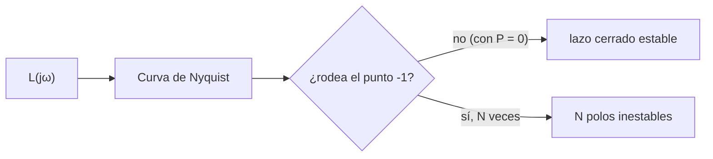

# B16-C10 — Diagramas de Bode y Nyquist

<!-- nav:top -->
[🏠 Programa](../../../../README.md) · [📚 Bloque B16](../../../tronco-comun/B16-sistemas-dinamicos-y-control-automatico.md) · [← Anterior: B16-C09 — Lugar de las raíces](../B16-C09-lugar-de-las-raices/CLASE.md) · [Siguiente: B16-C11 — Control proporcional integral derivativo →](../B16-C11-control-proporcional-integral-derivativo/CLASE.md)
<!-- /nav -->

## 1. Ubicación, nivel y alcance

Décima clase del bloque B16. Hasta aquí has juzgado la estabilidad con polos (C07), con Routh (C08) y con el lugar de las raíces (C09). Ahora lo haces con **frecuencia**: cómo responde el lazo a sinusoides de distinta frecuencia, y cuánto margen tiene antes de desestabilizarse. Necesitas números complejos, funciones de transferencia (C05) y logaritmos.

No verás aún el diseño de controladores PID (C11, C12) ni la robustez formal (C16).

## 2. Por qué esta clase existe

Los modelos nunca son exactos: la inercia varía, el sensor tarda más de lo supuesto, un modo flexible aparece. La estabilidad nominal no basta; hay que saber **cuánto error aguanta** el lazo. Los márgenes de ganancia y de fase lo cuantifican con dos números, y se leen sobre una medida experimental (la respuesta en frecuencia se puede medir en un ensayo, aun sin modelo). La pregunta motivadora es: **¿cuánta ganancia extra o cuánto retardo adicional soporta mi lazo antes de volverse inestable?**

La decisión central: aceptar un diseño solo si sus márgenes superan umbrales fijados de antemano.

## 3. Lo que podrás hacer al terminar

1. Calcular el módulo (en dB) y la fase de `L(jω)`.
2. Obtener las frecuencias de cruce y los márgenes de ganancia y de fase.
3. Contar vueltas del diagrama de Nyquist y deducir el número de polos inestables.
4. Convertir un margen de fase en un margen de retardo.
5. Comprobar el criterio de Nyquist contra las raíces del polinomio característico.
6. Interpretar un lazo con poco margen aunque sea nominalmente estable.

La evidencia es el **informe de márgenes** del ejercicio 12 (sección 20).

## 4. Con qué llegas y cómo comprobarlo

1. ¿Cuánto vale `|1/(j2 + 1)|`?
2. ¿Cuántos dB son un factor 2 en amplitud? (`20 log₁₀ 2`.)
3. ¿Qué argumento tiene `−1 − j`?
4. ¿Qué ganancia crítica tenía `K/(s(s+1)(s+2))`?
5. ¿Qué es la frecuencia en rad/s y cómo se pasa a Hz?

<details>
<summary>Ver respuestas</summary>

1. `1/√5 = 0,447`. 2. 6,02 dB. 3. −135° (o 225°). 4. 6. 5. `f = ω/(2π)`.
</details>

Con cuatro o cinco aciertos, sigue.

## 5. Un caso real: medir la respuesta en frecuencia de un satélite

Una práctica habitual es excitar un vehículo con pares sinusoidales de frecuencia creciente y medir la amplitud y fase de la respuesta; así se obtiene `G(jω)` sin conocer la inercia ni los modos flexibles. El Hubble, con ruedas de reacción de hasta 3000 rpm y sensores de guiado fino (S1), es un ejemplo de sistema cuyo comportamiento en frecuencia depende de actuadores, sensores y estructura. No tenemos datos de ensayo en frecuencia del Hubble: usamos un lazo **sintético normalizado**, `L(s) = K/(s(s+1)(s+2))`, el mismo de C08 y C09.

## 6. Vocabulario

La **respuesta en frecuencia** de `L` es `L(jω)`, con `ω` en rad/s: el módulo es la amplificación de una sinusoide y la fase es su desfase. Un **diagrama de Bode** grafica el módulo en dB y la fase en grados contra `ω` en escala logarítmica. El **cruce de ganancia** `ω_gc` es donde `|L| = 1` (0 dB); el **cruce de fase** `ω_pc` es donde la fase es −180°. El **margen de fase** (MF) es `180° + fase(ω_gc)`; el **margen de ganancia** (MG) es `1/|L(jω_pc)|`. Un **diagrama de Nyquist** traza `L(jω)` en el plano complejo para `ω` de −∞ a ∞. Un **margen de retardo** es el retardo adicional que consume el margen de fase.

## 7. Modelo mental: ¿cuánto falta para el −1?

En el plano complejo, el punto crítico es `−1`. Si la curva `L(jω)` pasa justo por `−1`, el lazo oscila sin amortiguar. Cuanto más lejos esté la curva de `−1`, más margen hay. El margen de ganancia es cuánto se puede estirar la curva en el eje real negativo antes de tocar `−1`; el margen de fase es cuánto se puede girar.



*Descripción textual:* se calcula `L(jω)`; se traza la curva de Nyquist; si no rodea el punto `−1` (y `L` no tiene polos inestables) el lazo cerrado es estable; si lo rodea `N` veces en sentido horario, hay `N` polos inestables.

La analogía: un equilibrista que se acerca al borde; el margen es la distancia al borde. Su límite: en un lazo hay dos distancias (ganancia y fase) que pueden ser muy distintas.

## 8. La explicación, paso a paso

### 8.1 De sinusoide a número complejo

Si entra `u = sen(ωt)` a un LTI estable, en régimen permanente la salida es `|G(jω)| sen(ωt + ∠G(jω))`. Es decir, `G(jω)` resume qué hace el sistema con cada frecuencia (la ecuación de C05 evaluada en `s = jω`). Para `L = K/(s(s+1)(s+2))`:
`|L(jω)| = K/(ω√(ω²+1)√(ω²+4))` y fase `−90° − arctan ω − arctan(ω/2)`.

### 8.2 Los márgenes

El cruce de fase ocurre en `ω_pc = √2 = 1,414 rad/s`, donde `|L| = K/(√2·√3·√6) = K/6`. Entonces `MG = 6/K`, el mismo `K_crit = 6` de Routh y de C09: tres métodos, un mismo resultado. En dB, `MG_dB = 20 log₁₀(6/K)`. El margen de fase se mide en `ω_gc`, donde `|L| = 1`; se calcula numéricamente.

### 8.3 Tabla de márgenes

| `K` | `ω_gc` (rad/s) | MF (°) | `ω_pc` (rad/s) | MG | MG (dB) |
|---|---|---|---|---|---|
| 0,5 | 0,241 | 69,6 | 1,414 | 12,0 | 21,6 |
| 1,0 | 0,446 | 53,4 | 1,414 | 6,0 | 15,6 |
| 2,0 | 0,749 | 32,6 | 1,414 | 3,0 | 9,5 |
| 4,0 | 1,143 | 11,4 | 1,414 | 1,5 | 3,5 |
| 5,5 | 1,353 | 2,4 | 1,414 | 1,09 | 0,8 |

Ten en cuenta que `K = 1` (con `ζ = 0,52` en C09) tiene `MF = 53°` y `MG = 15,6 dB`: coherente. Un margen de fase de unos 45° a 60° y uno de ganancia de unos 6 a 10 dB son valores de práctica habituales como orientación, no como norma.

### 8.4 El criterio de Nyquist

Sea `P` el número de polos de `L` en el semiplano derecho (aquí 0). El número de ceros de `1 + L` en el semiplano derecho (polos inestables del lazo cerrado) es `Z = N + P`, con `N` las vueltas **horarias** de `L` alrededor de `−1` cuando `s` recorre el contorno de Nyquist (el eje imaginario con una pequeña indentación por la derecha del polo en el origen y un arco grande por el semiplano derecho). El laboratorio cuenta esas vueltas contando el cambio de argumento de `1 + L` sobre el contorno: da `Z = 0` para `K = 0,5; 1; 2; 4; 5,5` y `Z = 2` para `K = 6,5; 8; 20`, igual que las raíces calculadas.

### 8.5 Del margen de fase al retardo

Un retardo `τ` añade `−ω τ` radianes de fase sin cambiar el módulo. El retardo que lleva la fase en `ω_gc` hasta −180° es `τ_max = MF(rad)/ω_gc`. Para `K = 1`: `MF = 53,41° = 0,932 rad`, `ω_gc = 0,4457`, `τ_max = 2,09` (en las unidades de tiempo normalizadas). Es la contraparte en frecuencia de la ganancia máxima con retardo de C07.

## 9. Magnitudes, símbolos y unidades

| Símbolo | Qué es | Unidad | Nota |
|---|---|---|---|
| `ω` | frecuencia angular | rad/s | `f = ω/(2π)` en Hz |
| `|L|` | módulo del lazo | adimensional o dB | `dB = 20 log₁₀|L|` |
| `∠L` | fase | grados o rad | |
| `ω_gc, ω_pc` | cruces de ganancia y fase | rad/s | |
| `MF, MG` | márgenes de fase y ganancia | ° ; adimensional o dB | |
| `τ_max` | margen de retardo | s | `MF/ω_gc` |
| `P, N, Z` | polos inestables, vueltas, ceros inestables | — | `Z = N + P` |

## 10. Convenciones y referencias

Se toma `ω` positiva para Bode y la simetría para Nyquist. La fase se desenrolla de forma continua desde baja frecuencia. El margen de fase se define sobre la fase de `L` (lazo abierto, realimentación negativa). Siempre se informa qué lazo se mide (¿cortado antes del actuador o del sensor?), porque los márgenes dependen del punto de corte.

## 11. De dónde sale lo que afirmamos

| ID | Fuente | Localizador | Respalda | Estado |
|---|---|---|---|---|
| S1 | NASA GSFC, *Pointing Control System* (archivo del Hubble, actualizada 2021-03-29) | https://asd.gsfc.nasa.gov/archive/hubble/technology/pcs.html | Ruedas de reacción (hasta 3000 rpm) y sensores de guiado fino como elementos del lazo | Consultada el 2026-11-05; archivada |

Límites: el criterio de Nyquist, los márgenes y la relación margen de fase–retardo son resultados estándar de control clásico, no citados a un texto; se verifican contra el cálculo directo de raíces. Los valores de 45°–60° y 6–10 dB son orientaciones de práctica, **no consultadas en una norma**. El lazo es **sintético** y normalizado.

## 12. Cómo ver el diagrama

Bode: dos paneles, módulo en dB y fase en grados, con el eje de frecuencia logarítmico y líneas de referencia en 0 dB y −180°. Nyquist: curva en el plano complejo con el punto `−1` marcado. La tabla de 8.3 es el equivalente textual. Usa marcadores en `ω_gc` y `ω_pc`, y no solo color.

## 13. Ejemplo trabajado: ¿aguanta K = 2 un retardo adicional?

**Paso 1 · cruce de ganancia.** Se resuelve `|L(jω)| = 1` con `K = 2`: `ω_gc = 0,749 rad/s`.
**Paso 2 · fase.** La fase ahí es `−180° + 32,6°`: `MF = 32,6°`.
**Paso 3 · margen de ganancia.** `ω_pc = 1,414`, `|L| = 2/6 = 1/3`, `MG = 3` (9,5 dB).
**Paso 4 · retardo.** `τ_max = 32,6°·(π/180)/0,749 = 0,76` (unidades normalizadas).
**Paso 5 · lectura.** Con `K = 2`, el lazo tolera triplicar la ganancia, pero el margen de fase de 33° es bajo: la respuesta será oscilatoria (`ζ ≈ 0,27` en C09). El MF corresponde a un `ζ` aproximado de `MF/100` (regla de práctica), lo que sugiere ≈ 0,33, del orden del valor observado.

## 14. Distintos modos de medir el margen

El **lugar de las raíces** es intuitivo con un parámetro. **Bode** permite diseñar por partes y funciona con medidas. **Nyquist** maneja polos inestables y retardos puros. La **norma H∞ del pico de `S`** (C16) combina ambos márgenes en un solo número. Un margen de ganancia grande con uno de fase pequeño (o al revés) indica que el diseño es frágil ante cierto tipo de error; hay que mirar los dos.

## 15. Práctica guiada

**Ejercicio 1 · con pasos.** Calcula `|L(j1)|` y la fase de `L = 2/(s(s+1)(s+2))` en `ω = 1`. *Pasos:* 8.1.

<details><summary>Solución comentada</summary>

`|L| = 2/(1·√2·√5) = 0,632` (−4,0 dB). Fase: `−90° − 45° − 26,57° = −161,6°`.
</details>

**Ejercicio 2 · con pista.** Un lazo tiene `|L(jω_pc)| = 0,25`. ¿Cuál es el margen de ganancia en veces y en dB? *Pista:* 8.2.

<details><summary>Solución comentada</summary>

`MG = 1/0,25 = 4`; `20 log₁₀ 4 = 12,04 dB`.
</details>

**Ejercicio 3 · casi autónomo.** Con `ω_gc = 0,5 rad/s` y `MF = 60°`, calcula el margen de retardo.

<details><summary>Solución comentada</summary>

`τ_max = (60·π/180)/0,5 = 1,047/0,5 = 2,09` en las unidades de tiempo del lazo (segundos si `ω` está en rad/s).
</details>

## 16. Práctica autónoma, transferencia e integrador

**Ejercicio 4.** Con la fórmula `MG = 6/K`, ¿qué `K` da 6 dB de margen?

<details><summary>Solución comentada</summary>

6 dB ≈ factor 2: `6/K = 2` → `K = 3`.
</details>

**Ejercicio 5.** Usa la tabla 8.3 para decir qué `K` cumple `MF ≥ 45°` y `MG ≥ 6 dB`.

<details><summary>Solución comentada</summary>

`K = 1` (MF 53°, MG 15,6 dB) cumple; `K = 2` (MF 33°) no cumple el de fase aunque sí el de ganancia. El MF cae a 45° hacia `K ≈ 1,3` (45,9°); por eso `K ≤ 1,3` cumple ambos.
</details>

**Ejercicio 6.** Un lazo tiene `P = 0` y su curva de Nyquist rodea el punto `−1` dos veces en sentido horario. ¿Cuántos polos inestables tiene el lazo cerrado?

<details><summary>Solución comentada</summary>

`Z = N + P = 2 + 0 = 2`. Es el caso de `K = 8`.
</details>

**Ejercicio 7.** Un lazo abierto tiene un polo inestable (`P = 1`) y la curva rodea `−1` una vez en sentido antihorario (`N = −1`). ¿Es estable el lazo cerrado?

<details><summary>Solución comentada</summary>

`Z = N + P = −1 + 1 = 0`: estable. La realimentación estabiliza un sistema inestable.
</details>

**Ejercicio 8.** Explica por qué un retardo puro no cambia el módulo de `L` pero sí reduce el margen de fase.

<details><summary>Solución comentada</summary>

`e^(−jωτ)` tiene módulo 1 y fase `−ωτ`, que resta fase en `ω_gc` sin alterar `|L|`.
</details>

**Ejercicio 9 · transferencia.** Un lazo con `ω_gc = 0,2 rad/s` y `MF = 40°` se implementa con un computador que añade 0,3 s de latencia. ¿Sigue estable?

<details><summary>Solución comentada</summary>

El retardo resta `0,2·0,3 = 0,06 rad = 3,4°` de fase; `MF = 36,6°`: sigue estable. El margen de retardo era `0,698/0,2 = 3,5 s`.
</details>

**Ejercicio 10 · transferencia.** Si subes la ganancia al doble, ¿hacia dónde se mueve `ω_gc` y qué pasa con el margen de fase en un lazo como el de esta clase?

<details><summary>Solución comentada</summary>

`ω_gc` sube (la curva de módulo se desplaza hacia arriba) y, como la fase cae con `ω`, el margen de fase disminuye. Con `K` de 1 a 2: `ω_gc` de 0,446 a 0,749 y MF de 53° a 33°.
</details>

**Ejercicio 11 · transferencia.** Un ensayo en frecuencia de un satélite muestra un pico de resonancia a 4 rad/s fuera del ancho de banda del lazo (`ω_gc` = 0,5). ¿Qué riesgo corre el lazo y cómo se mitiga?

<details><summary>Solución comentada</summary>

Si el módulo del lazo en el pico supera 0 dB con la fase equivocada, aparece inestabilidad en el modo flexible. Se mitiga con filtros (muescas) o reduciendo la ganancia en alta frecuencia (roll-off).
</details>

**Ejercicio 12 · integrador.** Entrega un **informe de márgenes**: elige un lazo de tres polos, calcula `ω_gc`, `ω_pc`, MF y MG para tres ganancias, cuenta las vueltas de Nyquist y compara con el cálculo de raíces; añade el margen de retardo.

<details><summary>Solución modelo</summary>

El informe debe tener la tabla de márgenes, el conteo de vueltas por caso con `Z = N + P`, la comprobación con raíces, el margen de retardo y una recomendación sobre qué ganancia usar.
</details>

## 17. Laboratorio: márgenes y conteo de vueltas

El script [margenes_y_nyquist.py](margenes_y_nyquist.py) calcula cruces y márgenes con `brentq`, cuenta las vueltas de `1 + L` sobre el contorno de Nyquist con indentación y las compara con las raíces del polinomio.

**Datos:** sintéticos (normalizados). **Predice:** `MG = 6/K` y `ω_pc = √2`. **Ejecución del 2026-11-05 (Python 3.12.9, numpy 2.4.4):**

```text
  K    w_gc    MF (grados)   w_pc     MG       MG (dB)   Z (Nyquist)   raíces inestables
  0.5  0.2413      69.56    1.4142  12.0000     21.58        0             0
  1.0  0.4457      53.41    1.4142   6.0000     15.56        0             0
  2.0  0.7494      32.61    1.4142   3.0000      9.54        0             0
  4.0  1.1432      11.42    1.4142   1.5000      3.52        0             0
  5.5  1.3534       2.37    1.4142   1.0909      0.76        0             0
  6.5  (inestable)       MG = 0.9231 < 1   Z (Nyquist) = 2   raíces inestables = 2
  8.0  (inestable)       MG = 0.7500 < 1   Z (Nyquist) = 2   raíces inestables = 2
 20.0  (inestable)       MG = 0.3000 < 1   Z (Nyquist) = 2   raíces inestables = 2
fase de L (continua desde w -> 0) en w = sqrt(2): -180.000000 grados
K = 1: margen de retardo ≈ MF/(180/pi)/w_gc = 2.091 s
Pruebas superadas.
```

```bash
python programa/clases/B16/B16-C10-diagramas-de-bode-y-nyquist/margenes_y_nyquist.py
```

**Límites:** lazo sin retardo puro; el conteo de vueltas usa una rejilla fina (`ε = 10⁻³`, `R = 10³`); «s» del margen de retardo son unidades de tiempo normalizadas.

## 18. Errores frecuentes y cómo corregirlos

**Mirar solo un margen.** Se corrige con el ejercicio 5.

**Contar las vueltas en sentido contrario.** Se corrige con los ejercicios 6 y 7.

**Olvidar desenrollar la fase.** Se corrige releyendo la sección 10.

**Ignorar el punto de corte del lazo.** Se corrige releyendo la sección 10.

**Creer que un MF de 33° está bien porque es positivo.** Se corrige con el ejemplo 13.

## 19. Cómo sabrás que vas bien

Tras 8.2: ¿calculas `MG` desde `ω_pc`? Ejercicio 2. Tras 8.4: ¿cuentas vueltas? Ejercicios 6 y 7. Tras 8.5: ¿conviertes MF en retardo? Ejercicio 3.

## 20. Qué entregas y cómo se evalúa

El producto es el **informe de márgenes** del ejercicio 12.

| Criterio | Inicial | En desarrollo | Logrado | Destacado |
|---|---|---|---|---|
| Cruces y márgenes | Sin cálculo | Uno de los márgenes | MF y MG | Más margen de retardo |
| Nyquist | No cuenta | Cuenta sin contrastar | Cuenta y contrasta con raíces | Con polos inestables en `L` |
| Recomendación | Sin criterio | Genérica | Con umbrales declarados | Con sensibilidad a la ganancia |
| Fuentes y datos | Sin rótulo | Parcial | Rotula sintético | Cita solo lo consultado |

**Condiciones críticas:** declarar el punto de corte del lazo; no presentar los umbrales de práctica como normas.

## 21. Ética, seguridad y límites

Un margen calculado sobre un modelo no es un margen del hardware: se mide en el ensayo. Cifras didácticas. Accesibilidad: gráficos con tabla y descripción.

## 22. Para cerrar y seguir

La respuesta en frecuencia da la estabilidad y el margen: MG y MF se leen en Bode y en Nyquist, coinciden con Routh y el lugar de las raíces, y un margen de fase se traduce en un retardo tolerable. Queda abierta una pregunta: ¿qué controlador realista da márgenes buenos?

**Glosario español–inglés.** respuesta en frecuencia · *frequency response*; diagrama de Bode · *Bode plot*; diagrama de Nyquist · *Nyquist plot*; margen de fase · *phase margin*; margen de ganancia · *gain margin*; margen de retardo · *delay margin*.

**Continuidad.** B16-C11 introduce el controlador PID. B16-C16 combina ambos márgenes en el pico de la sensibilidad. B16-C19 verifica los márgenes en el lazo real.

**Referencias:** ver sección 11.

<!-- nav:bottom -->
---

[← Anterior: B16-C09 — Lugar de las raíces](../B16-C09-lugar-de-las-raices/CLASE.md) · [📚 Bloque B16](../../../tronco-comun/B16-sistemas-dinamicos-y-control-automatico.md) · [Siguiente: B16-C11 — Control proporcional integral derivativo →](../B16-C11-control-proporcional-integral-derivativo/CLASE.md)
<!-- /nav -->
