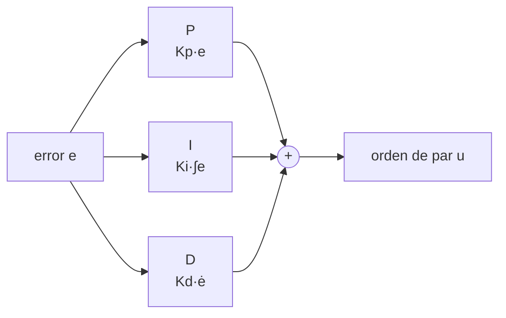

# B16-C11 — Control proporcional integral derivativo

<!-- nav:top -->
[🏠 Programa](../../../../README.md) · [📚 Bloque B16](../../../tronco-comun/B16-sistemas-dinamicos-y-control-automatico.md) · [← Anterior: B16-C10 — Diagramas de Bode y Nyquist](../B16-C10-diagramas-de-bode-y-nyquist/CLASE.md) · [Siguiente: B16-C12 — Sintonía de controladores PID →](../B16-C12-sintonia-de-controladores-pid/CLASE.md)
<!-- /nav -->

## 1. Ubicación, nivel y alcance

Undécima clase del bloque B16. Ya sabes analizar un lazo (C05–C10). Ahora diseñas el controlador más usado en ingeniería: el **PID**, que combina una acción proporcional, una integral y una derivativa. Verás qué hace cada una, por qué la integral elimina el error ante una perturbación constante y qué límite impone a la ganancia integral. Necesitas el lazo PD de C06–C07 y el criterio de Routh (C08).

No verás aún cómo elegir las ganancias de forma sistemática (C12) ni la saturación del actuador (C18).

## 2. Por qué esta clase existe

En el espacio actúan pares pequeños pero persistentes: presión de radiación solar, gradiente de gravedad, fugas de un propulsor. Un lazo PD termina con un error constante `d/Kp` (C04). Subir `Kp` lo reduce pero gasta margen (C07). La pregunta motivadora es: **¿cómo consigo que el error estacionario ante una perturbación constante sea cero sin subir la ganancia indefinidamente?**

La decisión central: añadir una acción integral y elegir su ganancia sin sacar el lazo de la zona estable.

## 3. Lo que podrás hacer al terminar

1. Escribir la ley PID en el dominio del tiempo y en función de transferencia.
2. Explicar el papel de cada acción (P, I, D) con un efecto observable.
3. Calcular el error estacionario con PD y mostrar que se anula con PID.
4. Obtener con Routh el rango estable de la ganancia integral.
5. Decidir si la derivada actúa sobre el error o sobre la medida y justificarlo.
6. Verificar un diseño PID con una simulación contra el balance de pares.

La evidencia es la **comparación PD frente a PID** del ejercicio 12 (sección 20).

## 4. Con qué llegas y cómo comprobarlo

1. ¿Qué es la integral de una constante `c` desde 0 hasta `t`?
2. ¿Cuál es el error estacionario de un lazo PD con `Kp = 20 N·m/rad` y `d = 0,5 N·m`?
3. ¿Qué condición da Routh para `a₃ s³ + a₂ s² + a₁ s + a₀`?
4. ¿Qué diferencia hay entre derivar el error y derivar la medida?
5. ¿Qué unidades tiene `Kd`?

<details>
<summary>Ver respuestas</summary>

1. `c t`. 2. `d/Kp = 25 mrad`. 3. Coeficientes positivos y `a₂ a₁ > a₃ a₀`. 4. Derivar el error incluye la derivada de la referencia (un impulso ante un escalón). 5. N·m·s/rad.
</details>

Con cuatro o cinco aciertos, sigue.

## 5. Un caso real: un par perturbador que no se va

Un par constante pequeño pero continuo actúa sobre cualquier vehículo en órbita (por ejemplo, la presión de radiación solar sobre paneles asimétricos). Las ruedas de reacción del Hubble, que giran hasta unas 3000 rpm, absorben momento angular y los magnetopares lo descargan (S1): el sistema debe contrarrestar esos pares de manera continua. Con un modelo **sintético**: eje de `J = 50 kg·m²`, perturbación `d = 0,5 N·m`, `Kp = 20 N·m/rad`, `Kd = 40 N·m·s/rad`. El lazo PD deja `θ = d/Kp = 25 mrad` de error, que es mucho para un telescopio de apuntamiento fino. La integral lo resuelve.

## 6. Vocabulario

La ley **PID** es `u(t) = Kp e(t) + Ki ∫₀ᵗ e(τ) dτ + Kd ė(t)`, con `e = r − y` el error; `Kp` es la ganancia proporcional (N·m/rad), `Ki` la integral (N·m/(rad·s)) y `Kd` la derivativa (N·m·s/rad). En función de transferencia, `C(s) = Kp + Ki/s + Kd s`. Una variante muy usada es la **derivada sobre la medida**: `u = Kp e + Ki ∫e − Kd ẏ`. El **tipo** de un lazo es el número de integradores en `L`; el tipo determina el error ante escalón y rampa. El **tiempo integral** es `Ti = Kp/Ki` (s) y el **derivativo** `Td = Kd/Kp` (s).

## 7. Modelo mental: pasado, presente y futuro

La acción proporcional mira el **presente** (cuánto error hay). La integral mira el **pasado** (cuánto error se acumuló). La derivada mira el **futuro** (hacia dónde va el error). Con las tres, el controlador reacciona, corrige lo persistente y frena antes de pasarse.



*Descripción textual:* el error alimenta tres ramas en paralelo (proporcional, integral y derivativa) que se suman para formar la orden de par.

La analogía es conducir: presente (dónde estás respecto del carril), pasado (llevas un rato desviándote a un lado), futuro (la curva que viene). Su límite: quien conduce anticipa por conocimiento, la derivada solo extrapola la pendiente actual y amplifica el ruido.

## 8. La explicación, paso a paso

### 8.1 Qué hace cada acción

`Kp` fija la rigidez: sube la frecuencia natural (`ωn = √(Kp/J)` en el eje). `Kd` aporta amortiguamiento (`ζ = Kd/(2√(Kp J))`). `Ki` hace que mientras haya error, la orden siga creciendo, hasta que el error sea cero.

### 8.2 Por qué la integral anula el error estacionario

En equilibrio todas las derivadas son cero: `θ̇ = 0`, `θ̈ = 0` y la integral `ξ = ∫e` se detiene, lo que exige `e = 0`. El balance de pares, con `r = 0`, es `0 = −Kp θ + Ki ξ + d`; con `e = −θ = 0` queda `Ki ξ = −d`, `ξ = −d/Ki`. En el laboratorio, con `d = 0,5` y `Ki = 2`: `ξ = −0,25 rad·s`, y `θ` termina en 0, frente a los 25 mrad del PD.

### 8.3 El costo: un polo más y un límite

El polinomio característico pasa a `J s³ + Kd s² + Kp s + Ki`. Por Routh (C08), es estable si `Kd Kp > J Ki`, es decir `Ki < Kd Kp/J = 16 N·m/(rad·s)` con las cifras del ejemplo. En `Ki = 16` los polos están en `±j√(Kp/J) = ±j0,632` más `−0,8`. Antes del límite, el lazo se vuelve cada vez menos amortiguado: con `Ki = 15,9` la parte real máxima es −0,001. Con `Ki = 2` los polos son `−0,336 ± 0,449j` y `−0,127`; con `Ki = 8`, `−0,584` y `−0,108 ± 0,512j`.

### 8.4 El polo lento

Cuando `Ki` es pequeño, aparece un polo real lento cerca del origen (`−0,127` con `Ki = 2`): la integral tarda en corregir. La constante de tiempo es `1/0,127 = 7,9 s`; el valor final se alcanza en unos `4/0,127 ≈ 31 s`. Subir `Ki` acelera la eliminación del error pero acerca los polos complejos al eje imaginario. Es el compromiso central del PID.

### 8.5 Derivada sobre el error o sobre la medida

Derivar el error añade a la orden el término `Kd ṙ`: ante un escalón de referencia, un impulso. Derivar solo la medida lo evita y mantiene los mismos polos (C06). Además, la derivada amplifica el ruido de medida; en la práctica se filtra (`Td s/(1 + Td s/N)`, con `N` del orden de 10 en nuestro ejemplo, un valor de partida y no una norma). Con **cuantización** o **ruido** en el sensor, conviene un filtro o un observador (C14).

## 9. Magnitudes, símbolos y unidades

| Símbolo | Qué es | Unidad | Nota |
|---|---|---|---|
| `e` | error | rad | `r − y` |
| `Kp, Ki, Kd` | ganancias | N·m/rad; N·m/(rad·s); N·m·s/rad | sintéticas |
| `ξ` | integral del error | rad·s | estado extra |
| `d` | par perturbador constante | N·m | 0,5 |
| `Ti, Td` | tiempos integral y derivativo | s | `Kp/Ki`, `Kd/Kp` |
| `Ki_crit` | límite de Routh | N·m/(rad·s) | `Kd Kp/J = 16` |

## 10. Convenciones y referencias

El signo de la perturbación se define positivo en el sentido de `θ` positivo. Se escribe la derivada sobre la medida salvo aviso. El PID se llama de «forma paralela» si usa `Kp, Ki, Kd` por separado y de «forma estándar» si usa `Kp, Ti, Td`; aquí usamos la paralela y damos las equivalencias. La implementación digital integra con paso `T` (C02, C19).

## 11. De dónde sale lo que afirmamos

| ID | Fuente | Localizador | Respalda | Estado |
|---|---|---|---|---|
| S1 | NASA GSFC, *Pointing Control System* (archivo del Hubble, actualizada 2021-03-29) | https://asd.gsfc.nasa.gov/archive/hubble/technology/pcs.html | Ruedas de reacción (hasta 3000 rpm) y magnetopares que gestionan su velocidad | Consultada el 2026-11-05; archivada |

Límites: la ley PID, el balance de pares y el límite de Routh son resultados estándar, no citados a un texto, y se verifican por simulación. La magnitud de la perturbación y todas las ganancias son **sintéticas**; no hay datos de pares perturbadores del Hubble.

## 12. Cómo ver la comparación

| Controlador | `θ` final (600 s) | Polos | Observación |
|---|---|---|---|
| PD (`Kp=20, Kd=40`) | 25,000 mrad | `−0,4 ± 0,49j` | error constante `d/Kp` |
| PID (`Ki=2`) | 0,000 mrad | `−0,336 ± 0,449j`; `−0,127` | `ξ = −0,25 rad·s` |
| PID (`Ki=16`) | — | `±0,632j`; `−0,8` | frontera de estabilidad |

Si dibujas la respuesta, usa líneas continua y punteada para PD y PID con una banda de ±2 mrad.

## 13. Ejemplo trabajado: quitar los 25 mrad

El telescopio parte con `θ(0) = 0,1 rad` y un par perturbador de 0,5 N·m. ¿Cómo evoluciona con PD y con PID?

**Paso 1 · PD.** Equilibrio: `Kp θ = d` → `θ = 0,5/20 = 0,025 rad = 25 mrad`.
**Paso 2 · PID.** Se agrega `Ki = 2` y la integral `ξ`. Equilibrio: `θ = 0`, `ξ = −d/Ki = −0,25`.
**Paso 3 · estabilidad.** `Ki = 2 < 16`: estable; polos `−0,336 ± 0,449j` y `−0,127`.
**Paso 4 · simulación.** A los 600 s, `θ = 25,000000 mrad` con PD y `−0,000000 mrad` con PID (error < 10⁻⁶ rad); `ξ = −0,250000`.
**Paso 5 · lectura.** El PID elimina el error persistente a costa de un polo lento (≈ 8 s) y de una cota `Ki < 16`. Con `Ki = 2` el margen respecto de la cota es 8×, razonable.

## 14. Distintas estructuras de control

**P**: simple; deja error y no amortigua. **PD**: amortigua; deja error ante perturbaciones constantes. **PI**: elimina el error pero sin amortiguar un doble integrador (insuficiente aquí). **PID**: combina todo. Para sistemas con perturbaciones variables o saturación, el PID tiene límites (C18). Para sistemas multivariable, el LQR (C15) ofrece una estructura más general.

## 15. Práctica guiada

**Ejercicio 1 · con pasos.** Calcula `ωn` y `ζ` del lazo PD con `J = 80`, `Kp = 32`, `Kd = 64`. *Pasos:* 8.1.

<details><summary>Solución comentada</summary>

`ωn = √(32/80) = 0,632 rad/s`; `ζ = 64/(2√(32·80)) = 64/(2·50,6) = 0,632`.
</details>

**Ejercicio 2 · con pista.** Con `d = 0,8 N·m` y `Ki = 4`, ¿cuánto vale `ξ` en equilibrio? *Pista:* 8.2.

<details><summary>Solución comentada</summary>

`ξ = −d/Ki = −0,2 rad·s`.
</details>

**Ejercicio 3 · casi autónomo.** ¿Cuál es `Ki_crit` para `J = 50`, `Kp = 10`, `Kd = 30`?

<details><summary>Solución comentada</summary>

`Kd Kp/J = 300/50 = 6`.
</details>

## 16. Práctica autónoma, transferencia e integrador

**Ejercicio 4.** Con PD y `d = 0,3`, ¿qué `Kp` da un error de 5 mrad?

<details><summary>Solución comentada</summary>

`Kp = d/e = 0,3/0,005 = 60 N·m/rad`.
</details>

**Ejercicio 5.** ¿Cuál es el efecto de `Ki` sobre el error ante una rampa en un lazo con doble integrador? Razona con el tipo del lazo.

<details><summary>Solución comentada</summary>

El doble integrador de la planta ya hace el lazo tipo 2 (con `Kp + Kd s`), así que sigue una rampa de referencia sin error; `Ki` añade un tercer integrador solo para rechazar perturbaciones constantes. Para una rampa de perturbación no hay error nulo con tipo 1 respecto de la perturbación.
</details>

**Ejercicio 6.** Con `Ki = 8`, ¿cuántas veces menor que `Ki_crit` es y qué polos tiene?

<details><summary>Solución comentada</summary>

2 veces menor que 16. Polos `−0,584` y `−0,108 ± 0,512j`.
</details>

**Ejercicio 7.** Explica por qué `Ki` demasiado grande desestabiliza usando el polinomio `J s³ + Kd s² + Kp s + Ki`.

<details><summary>Solución comentada</summary>

Routh pide `Kd Kp > J Ki`; si `Ki` supera ese valor, la primera columna cambia de signo y aparece un par de polos con parte real positiva. En `Ki = 16,1` la parte real es +0,00096.
</details>

**Ejercicio 8.** Con ruido de medida de 1 mrad rms a 10 Hz, ¿por qué la derivada es peligrosa? Estima el ruido de velocidad.

<details><summary>Solución comentada</summary>

La derivada multiplica por `ω = 2π·10 = 63 rad/s`: ruido de velocidad ≈ 63 mrad/s, y con `Kd = 40` una orden de par de unos 2,5 N·m, mayor que la perturbación nominal. Hay que filtrar.
</details>

**Ejercicio 9 · transferencia.** Un detector térmico con perturbación constante de potencia, ¿por qué un PI suele bastar? (La planta es de primer orden.)

<details><summary>Solución comentada</summary>

Una planta de primer orden no oscila: el PI elimina el error con un par de polos fáciles de ubicar; la derivada aporta poco y amplifica el ruido.
</details>

**Ejercicio 10 · transferencia.** Un satélite despliega paneles y `J` pasa de 50 a 65. ¿Cómo cambian `ωn`, `ζ` y `Ki_crit` con las mismas ganancias?

<details><summary>Solución comentada</summary>

`ωn = √(20/65) = 0,555` (baja); `ζ = 40/(2√(20·65)) = 0,555`; `Ki_crit = 800/65 = 12,3`. Todo se mueve en la dirección «más lento y menos amortiguado»; el límite sigue estando por encima de `Ki = 2`.
</details>

**Ejercicio 11 · transferencia.** Una ráfaga de perturbación de 5 N·m durante 1 s se aplica al lazo. ¿Qué papel tiene la integral y cuándo puede ser perjudicial?

<details><summary>Solución comentada</summary>

La integral acumula el error durante la ráfaga y, luego, tarda en deshacerse: puede producir sobreimpulso. Si el actuador satura, la integral sigue acumulando (windup, C18).
</details>

**Ejercicio 12 · integrador.** Entrega una **comparación PD frente a PID**: para un lazo de tu elección y una perturbación constante, calcula el error estacionario con ambas leyes, el límite de `Ki` con Routh, elige un `Ki` con margen y verifica con una simulación.

<details><summary>Solución modelo</summary>

Debe incluir el balance de pares de ambos casos, el polinomio característico y `Ki_crit`, los polos del `Ki` elegido y la simulación con el error final comparado con la predicción.
</details>

## 17. Laboratorio: PD frente a PID

El script [pid_con_perturbacion.py](pid_con_perturbacion.py) integra con `solve_ivp` el eje con PD y con PID ante `d = 0,5 N·m`, compara el valor final con el balance de pares y verifica el límite `Ki_crit = 16` con las raíces.

**Datos:** sintéticos (simulados). **Predice:** 25 mrad con PD y 0 con PID. **Ejecución del 2026-11-05 (Python 3.12.9, numpy 2.4.4, scipy 1.17.1):**

```text
PD : theta(600 s) = 25.000000 mrad; d/Kp = 25.000000 mrad
PID: theta(600 s) = -0.000000 mrad; xi(600 s) = -0.250000 rad s; -d/Ki = -0.250000
    máximo |theta| = 100.00 mrad (condición inicial 100 mrad)
Ki =   2.0: polos [-0.3364+0.4486j -0.3364-0.4486j -0.1272+0.j    ]  parte real máx = -0.12722
Ki =   8.0: polos [-0.5841+0.j     -0.1079+0.5121j -0.1079-0.5121j]  parte real máx = -0.10793
Ki =  15.9: polos [-0.7981+0.j     -0.001 +0.6312j -0.001 -0.6312j]  parte real máx = -0.00096
Ki =  16.1: polos [-0.8019+0.j      0.001 +0.6337j  0.001 -0.6337j]  parte real máx = +0.00096
Ki_crit = Kd Kp/J = 16.0; polos en la frontera [-0.8+0.j       -0. +0.632456j -0. -0.632456j]
Pruebas superadas.
```

```bash
python programa/clases/B16/B16-C11-control-proporcional-integral-derivativo/pid_con_perturbacion.py
```

**Límites:** sin saturación ni ruido; PID continuo (no la versión discreta); la prueba falla si el valor final difiere más de 10⁻⁶ rad.

## 18. Errores frecuentes y cómo corregirlos

**Esperar error nulo con solo PD.** Se corrige con el ejercicio 2 y la sección 8.2.

**Subir `Ki` sin mirar el límite.** Se corrige con los ejercicios 3 y 7.

**Derivar el error con referencias en escalón.** Se corrige releyendo 8.5.

**Ignorar el ruido en la derivada.** Se corrige con el ejercicio 8.

**Olvidar que la integral acumula durante la saturación.** Se corrige con el ejercicio 11.

## 19. Cómo sabrás que vas bien

Tras 8.2: ¿explicas por qué el error es cero con integral? Ejercicio 2. Tras 8.3: ¿calculas `Ki_crit`? Ejercicio 3. Tras el ejemplo: ¿propones un `Ki` con margen 5×?

## 20. Qué entregas y cómo se evalúa

El producto es la **comparación PD frente a PID** del ejercicio 12.

| Criterio | Inicial | En desarrollo | Logrado | Destacado |
|---|---|---|---|---|
| Error estacionario | Sin cálculo | Un controlador | PD y PID | Contrastado con simulación |
| Estabilidad | Sin límite | Límite sin justificar | `Ki_crit` por Routh | Con margen elegido y razonado |
| Derivada y ruido | No lo trata | Lo menciona | Elige medida o error y filtra | Estima el ruido amplificado |
| Fuentes y datos | Sin rótulo | Parcial | Rotula sintético | Cita solo lo consultado |

**Condiciones críticas:** declarar la perturbación como supuesta; verificar el límite de `Ki`.

## 21. Ética, seguridad y límites

Una integral sin límite en un actuador real puede saturar y empeorar el lazo (C18). Cifras didácticas. Accesibilidad: tabla de polos y descripciones textuales.

## 22. Para cerrar y seguir

El PID suma presente, pasado y futuro del error. La integral anula el error ante una perturbación constante, pero añade un polo y un límite de ganancia dado por Routh. Derivar la medida evita saltos y filtrar la derivada controla el ruido. Queda abierta una pregunta: ¿cómo elegir `Kp`, `Ki` y `Kd` de forma sistemática?

**Glosario español–inglés.** control PID · *PID control*; acción integral · *integral action*; acción derivativa · *derivative action*; tiempo integral · *integral time*; ganancia integral · *integral gain*; perturbación · *disturbance*.

**Continuidad.** B16-C12 sistematiza la sintonía. B16-C18 trata la saturación y el anti-windup de la integral. B16-C14 usa observadores para estimar la velocidad sin derivar.

**Referencias:** ver sección 11.

<!-- nav:bottom -->
---

[← Anterior: B16-C10 — Diagramas de Bode y Nyquist](../B16-C10-diagramas-de-bode-y-nyquist/CLASE.md) · [📚 Bloque B16](../../../tronco-comun/B16-sistemas-dinamicos-y-control-automatico.md) · [Siguiente: B16-C12 — Sintonía de controladores PID →](../B16-C12-sintonia-de-controladores-pid/CLASE.md)
<!-- /nav -->
