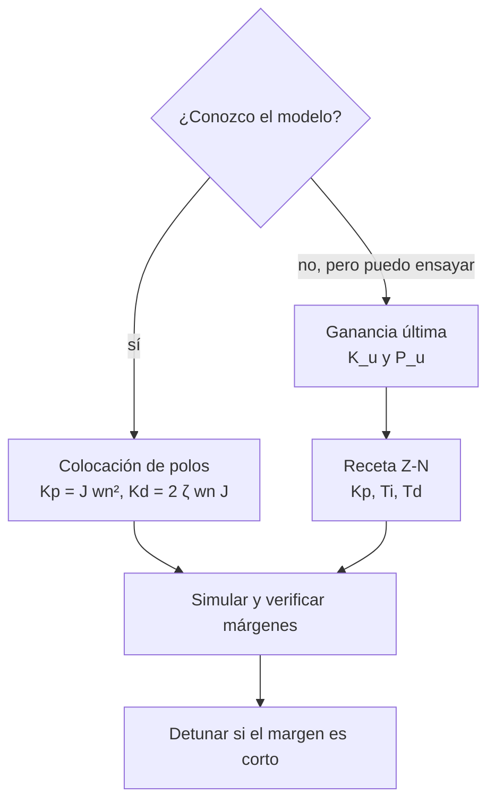

# B16-C12 — Sintonía de controladores PID

<!-- nav:top -->
[🏠 Programa](../../../../README.md) · [📚 Bloque B16](../../../tronco-comun/B16-sistemas-dinamicos-y-control-automatico.md) · [← Anterior: B16-C11 — Control proporcional integral derivativo](../B16-C11-control-proporcional-integral-derivativo/CLASE.md) · [Siguiente: B16-C13 — Observabilidad y controlabilidad →](../B16-C13-observabilidad-y-controlabilidad/CLASE.md)
<!-- /nav -->

## 1. Ubicación, nivel y alcance

Duodécima clase del bloque B16. En [C11](../B16-C11-control-proporcional-integral-derivativo/CLASE.md) viste qué hace cada acción del PID. Ahora aprendes a **elegir sus ganancias** con dos métodos: una regla empírica basada en el punto de oscilación sostenida (ganancia última) y la colocación de polos cuando se conoce el modelo. Necesitas Routh (C08), márgenes (C10) y el PID (C11).

No verás todavía el diseño óptimo (C15), el robusto (C16) ni el efecto de la saturación (C18).

## 2. Por qué esta clase existe

En un proyecto real, las ganancias iniciales de un lazo se eligen con pocas medidas y bajo presión de calendario: a veces no hay un modelo preciso. Hay reglas que solo piden hacer oscilar el lazo con un controlador proporcional y medir dos números. También hay casos (como el eje rígido) donde el modelo es sencillo y se pueden fijar los polos directamente. La pregunta motivadora es: **¿cómo paso de una especificación o de un ensayo a los tres números `Kp`, `Ki`, `Kd`, y cómo sé si la elección es razonable?**

La decisión central: qué método usar según el conocimiento del sistema, y cómo detunar el resultado para no sacrificar el margen.

## 3. Lo que podrás hacer al terminar

1. Determinar la ganancia última `K_u` y el periodo último `P_u` de un lazo.
2. Aplicar la regla de lazo cerrado de Ziegler–Nichols y evaluar su respuesta.
3. Colocar los polos de un doble integrador con PD para un `ωn` y `ζ` dados.
4. Comparar sintonías por sobreimpulso, tiempo de asentamiento y error integral (IAE).
5. Detunar un controlador y explicar el compromiso.
6. Verificar un método de sintonía contra una solución exacta.

La evidencia es el **informe de sintonía** del ejercicio 12 (sección 20).

## 4. Con qué llegas y cómo comprobarlo

1. ¿Qué es la ganancia crítica en Routh?
2. Con `J = 50`, ¿qué `Kp` da `ωn = 0,6 rad/s` en un PD?
3. ¿Qué es el sobreimpulso?
4. ¿Cuál es el periodo de una oscilación de frecuencia `ω = 1,73 rad/s`?
5. ¿Qué mide el IAE (integral del error absoluto)?

<details>
<summary>Ver respuestas</summary>

1. La ganancia en la que el lazo oscila sin amortiguar. 2. `Kp = J ωn² = 50·0,36 = 18`. 3. Cuánto excede la salida su valor final. 4. `2π/1,73 = 3,63`. 5. `∫|e| dt`, un resumen del error acumulado.
</details>

Con cuatro o cinco aciertos, sigue.

## 5. Un caso real: sintonizar sin conocer bien el modelo

Un detector infrarrojo de un telescopio se enfría y su temperatura se controla con un calentador de precisión. La dinámica térmica es una cascada de masas con resistencias: cada una añade un retraso de primer orden. Un modelo de tres inercias iguales, en unidades de tiempo normalizadas, es `G(s) = 1/(s+1)³` (**sintético**). No hay un modelo del Hubble ni de un detector real aquí. Para un lazo así, la regla de la ganancia última es aplicable: se sube `K` hasta que oscile y se toman dos números. Para el eje rígido de `J = 50 kg·m²` (también sintético), en cambio, se conoce todo y se coloca los polos.

## 6. Vocabulario

La **ganancia última** `K_u` es la ganancia proporcional con la que el lazo cerrado oscila de forma sostenida; el **periodo último** `P_u` es el periodo de esa oscilación (`P_u = 2π/ω_u`). La **regla de lazo cerrado de Ziegler–Nichols** es una receta empírica que da, para un PID, `Kp = 0,6 K_u`, `Ti = P_u/2`, `Td = P_u/8`. La **colocación de polos** elige las ganancias para que los polos del lazo cerrado queden en posiciones dadas. El **detuning** es reducir las ganancias respecto de una receta para ganar margen. El **IAE** es `∫|r − y| dt`, un resumen de la calidad de la respuesta.

## 7. Modelo mental: dos caminos para tres números

Con modelo: eliges dónde quieres los polos y calculas las ganancias. Sin modelo: pones el lazo en el borde de la oscilación, mides, aplicas una receta y la ajustas con una simulación o un ensayo.



*Descripción textual:* si hay modelo se coloca polos con fórmulas; si no, se ensaya la ganancia última y se aplica una receta; en ambos casos se simula, se verifican los márgenes y se reduce la ganancia si el margen es corto.

La analogía: afinar un instrumento de oído (receta) frente a calcular las frecuencias (colocación). Límite: afinar de oído no garantiza que suene bien en otra sala (otra planta).

## 8. La explicación, paso a paso

### 8.1 Hallar `K_u` y `P_u`

Para `G = 1/(s+1)³` con control proporcional `K`, el polinomio característico es `(s+1)³ + K = 0`. En el límite de estabilidad hay raíces en `s = jω_u`. La fase de `G(jω)` es `−3 arctan ω`; vale −180° cuando `arctan ω = 60°`, es decir `ω_u = √3 = 1,732 rad`. El módulo ahí es `1/(1 + 3)^{3/2} = 1/8`, luego `K_u = 8`. El periodo es `P_u = 2π/√3 = 3,628`. El laboratorio obtiene `K_u = 8,000000000` y `ω_u = 1,732050808` por búsqueda numérica del cruce de fase, y comprueba que con `K_u` hay dos raíces imaginarias. En un ensayo real se llegaría a `K_u` subiendo `K` hasta ver la oscilación sostenida, algo que puede ser peligroso en un vehículo (sección 21).

### 8.2 La receta de lazo cerrado

Con `K_u = 8` y `P_u = 3,628`: `Kp = 0,6·8 = 4,8`, `Ti = 1,814`, `Td = 0,453`. Esta es una regla **empírica clásica**; aquí la aplicamos y medimos su resultado, sin verificarla contra la literatura original (no consultada). La respuesta al escalón de este lazo, con filtro derivativo `N = 10`, da un **sobreimpulso de 42,7 %**, un asentamiento (2 %) de 9,19 y un IAE de 1,76. El sobreimpulso es grande: la receta apunta a rechazar perturbaciones rápido, no a seguir bien la referencia.

### 8.3 Detunar

Reducir `Kp` a la mitad (2,4) con los mismos `Ti` y `Td` baja el sobreimpulso a 26,4 % y el asentamiento a 7,85, con un IAE de 1,85 (algo peor). Un PI conservador (`Kp = 1,6`, `Ti = 3,02`, sin derivada) da 15,1 % de sobreimpulso, 9,48 de asentamiento y 2,43 de IAE. El compromiso es claro: menos sobreimpulso cuesta un mayor error acumulado. No existe una sintonía universalmente mejor; depende del requisito.

### 8.4 Colocación de polos en el eje rígido

Para `J s²θ = u` con `u = Kp(r−θ) − Kd ω`, el polinomio es `J s² + Kd s + Kp`. Quieres `s² + 2ζωn s + ωn²`, así que `Kp = J ωn²` y `Kd = 2ζωn J`. Ejemplos con `J = 50`: `ωn = 0,3`, `ζ = 0,7` → `Kp = 4,5`, `Kd = 21`, polos `−0,21 ± 0,214j`. `ωn = 0,6`, `ζ = 0,9` → `Kp = 18`, `Kd = 54`, polos `−0,54 ± 0,262j`. `ωn = 1`, `ζ = 0,7` → `Kp = 50`, `Kd = 70`, polos `−0,70 ± 0,714j`. Las posiciones salen exactamente (el laboratorio lo comprueba con tolerancia 10⁻⁹).

### 8.5 Elegir `ωn` con límites físicos

El `ωn` no se elige libremente: está acotado por el retardo del lazo (C07: ancho de banda ≲ una fracción de 1/retardo), por el ruido del sensor (la derivada lo amplifica) y por el par máximo de las ruedas (C18). Un punto de partida es `ωn` tal que el asentamiento `4/(ζωn)` cumpla el requisito con holgura, y luego se verifica el margen (C10) y el esfuerzo de control.

## 9. Magnitudes, símbolos y unidades

| Símbolo | Qué es | Unidad | Nota |
|---|---|---|---|
| `K_u` | ganancia última | adimensional (planta térmica normalizada) | 8 |
| `ω_u, P_u` | frecuencia y periodo último | rad/s; s | `√3`; 3,628 |
| `Kp, Ti, Td` | forma estándar del PID | ganancia; s; s | `Ki = Kp/Ti` |
| `N` | factor del filtro derivativo | — | 10 en el ejemplo |
| `IAE` | integral del error absoluto | rad·s o unidad·s | |
| `ωn, ζ` | objetivos de colocación | rad/s; — | |

## 10. Convenciones y referencias

Se emplea la forma estándar `C(s) = Kp(1 + 1/(Ti s) + Td s/(1 + Td s/N))`. El IAE se mide sobre un escalón unitario durante 60 unidades de tiempo. El asentamiento usa una banda de ±2 %. Las respuestas se calculan con el lazo cerrado lineal y sin saturación.

## 11. De dónde sale lo que afirmamos

| ID | Fuente | Localizador | Respalda | Estado |
|---|---|---|---|---|
| S1 | NASA GSFC, *Pointing Control System* (archivo del Hubble, actualizada 2021-03-29) | https://asd.gsfc.nasa.gov/archive/hubble/technology/pcs.html | Existencia del lazo de sensores y ruedas de reacción en un observatorio | Consultada el 2026-11-05; archivada |

Límites: la regla de Ziegler–Nichols es una receta empírica clásica cuyo texto original **no se consultó**; sus coeficientes (0,6; 1/2; 1/8) se presentan como la regla que se prueba, no como un resultado verificado. `K_u`, `P_u`, los polos colocados y las métricas se calculan en el laboratorio. La planta térmica y el eje son **sintéticos**.

## 12. Cómo ver la comparación

| Controlador | `Kp` | `Ti` | `Td` | Sobreimpulso | Asentamiento (2 %) | IAE |
|---|---|---|---|---|---|---|
| Z–N lazo cerrado | 4,800 | 1,814 | 0,453 | 42,7 % | 9,19 | 1,760 |
| Z–N, `Kp` a la mitad | 2,400 | 1,814 | 0,453 | 26,4 % | 7,85 | 1,851 |
| PI conservador | 1,600 | 3,023 | — | 15,1 % | 9,48 | 2,433 |

Si dibujas las tres respuestas, usa trazos distintos y una banda de ±2 %.

## 13. Ejemplo trabajado: del ensayo a la sintonía

**Paso 1 · ensayo.** Se sube `K` en el lazo térmico hasta oscilación sostenida: `K_u = 8` con periodo `P_u = 3,63`.
**Paso 2 · receta.** `Kp = 4,8`, `Ti = 1,81`, `Td = 0,45`.
**Paso 3 · simulación.** Sobreimpulso 42,7 %. Si el requisito es ≤ 20 %, no cumple.
**Paso 4 · ajuste.** Con `Kp = 2,4` queda 26,4 %: aún no. Un PI con `Kp = 1,6` da 15,1 %: cumple, con IAE un 38 % mayor que la receta original.
**Paso 5 · decisión.** Se elige el PI conservador para seguimiento y se documenta que el rechazo de perturbaciones será más lento. Se verifican los márgenes (C10) antes de aceptar.

## 14. Comparar métodos de sintonía

**Ganancia última (Z–N):** no necesita modelo, pero exige llevar el lazo al borde de la oscilación (arriesgado) y da respuestas oscilatorias. **Colocación de polos:** da la respuesta deseada exactamente, pero exige un modelo bueno. **Optimización (LQR, C15):** minimiza un costo explícito. **Auto-sintonía por relé:** hace oscilar el lazo de forma limitada para obtener `K_u` y `P_u` con menor riesgo (no se desarrolla aquí). Elige por lo que sabes de la planta y por el riesgo de ensayar.

## 15. Práctica guiada

**Ejercicio 1 · con pasos.** Con `K_u = 10` y `P_u = 4`, calcula `Kp`, `Ti` y `Td` de la regla de lazo cerrado. *Pasos:* 8.2.

<details><summary>Solución comentada</summary>

`Kp = 6`, `Ti = 2`, `Td = 0,5`.
</details>

**Ejercicio 2 · con pista.** Coloca los polos de un eje `J = 80` en `ωn = 0,5`, `ζ = 0,8`. *Pista:* 8.4.

<details><summary>Solución comentada</summary>

`Kp = 80·0,25 = 20`; `Kd = 2·0,8·0,5·80 = 64`; polos `−0,4 ± 0,3j`.
</details>

**Ejercicio 3 · casi autónomo.** ¿Qué `Ki_crit` tiene el PID anterior si se añade integral? (`Ki_crit = Kd Kp/J`.)

<details><summary>Solución comentada</summary>

`64·20/80 = 16`.
</details>

## 16. Práctica autónoma, transferencia e integrador

**Ejercicio 4.** Para `G = 1/(s+1)³`, comprueba que `K_u = 8` con Routh (`s³ + 3s² + 3s + 1 + K`).

<details><summary>Solución comentada</summary>

Condición `3·3 > 1 + K` → `K < 8`. En `K = 8`, polinomio auxiliar `3s² + 9 = 0` → `s = ±j√3`.
</details>

**Ejercicio 5.** Con la tabla 12, ¿cuánto aumenta el IAE al pasar de Z–N a PI conservador y cuánto baja el sobreimpulso?

<details><summary>Solución comentada</summary>

IAE de 1,760 a 2,433: +38 %. Sobreimpulso de 42,7 % a 15,1 %: −27,6 puntos porcentuales.
</details>

**Ejercicio 6.** Un eje `J = 50` debe tener `ts ≈ 8 s` con `ζ = 0,8`. Halla `ωn`, `Kp` y `Kd`.

<details><summary>Solución comentada</summary>

`ts = 4/(ζωn)` → `ωn = 4/(0,8·8) = 0,625`. `Kp = 50·0,39 = 19,5`; `Kd = 2·0,8·0,625·50 = 50`.
</details>

**Ejercicio 7.** Explica por qué una receta de ganancia última es peligrosa en un satélite real.

<details><summary>Solución comentada</summary>

Exige llevar el lazo al borde de la inestabilidad; en un vehículo real una oscilación sostenida puede saturar actuadores, dañar estructuras flexibles o perder el apuntamiento. Se prefiere un ensayo en tierra o en simulación.
</details>

**Ejercicio 8.** ¿Cómo cambia `Kd` si duplicas `ωn` manteniendo `ζ`?

<details><summary>Solución comentada</summary>

`Kd = 2ζωnJ` se duplica; `Kp = Jωn²` se cuadruplica.
</details>

**Ejercicio 9 · transferencia.** El sensor de un eje de `J = 50` tiene ruido de velocidad de 5 mrad/s rms. ¿Qué par de ruido genera `Kd = 70` y cómo se compara con 0,5 N·m?

<details><summary>Solución comentada</summary>

`70·0,005 = 0,35 N·m rms`, comparable con la perturbación nominal: el ruido consume gran parte del par. Se baja `Kd` (menor `ωn`) o se filtra.
</details>

**Ejercicio 10 · transferencia.** Un colega afirma que la receta Z–N «es la mejor». Refútalo con la tabla 12.

<details><summary>Solución comentada</summary>

Tiene el menor IAE, pero un sobreimpulso del 42,7 %: es la mejor solo si ese criterio es el único. Para seguimiento de referencia, el PI conservador cumple 15 %.
</details>

**Ejercicio 11 · transferencia.** El eje real tiene un modo flexible a 3 rad/s. Si colocas `ωn = 1 rad/s`, ¿qué riesgo hay y qué haces?

<details><summary>Solución comentada</summary>

Poco margen entre el ancho de banda y el modo: la ganancia del lazo en 3 rad/s puede excitarlo. Bajas `ωn`, añades un filtro de muesca o verificas el margen con el modelo flexible (C10, C16).
</details>

**Ejercicio 12 · integrador.** Entrega un **informe de sintonía**: para una planta de tu elección, obtén `K_u` y `P_u` (o el modelo), aplica la receta y una colocación de polos, compara tres sintonías por sobreimpulso, asentamiento e IAE, y recomienda una con argumentos de margen y esfuerzo.

<details><summary>Solución modelo</summary>

Debe incluir `K_u`, `P_u` verificados, tres sintonías con métricas, el margen de cada una (C10), el esfuerzo de control y una recomendación explícita con el requisito que la justifica.
</details>

## 17. Laboratorio: ganancia última y colocación

El script [sintonia_pid.py](sintonia_pid.py) halla `K_u` y `ω_u` por el cruce de fase, aplica tres sintonías a la planta térmica `1/(s+1)³` midiendo sobreimpulso, asentamiento e IAE, y comprueba la colocación de polos en el eje.

**Datos:** sintéticos (simulados). **Predice:** `K_u = 8`, `P_u = 3,628`. **Ejecución del 2026-11-05 (Python 3.12.9, numpy 2.4.4, scipy 1.17.1):**

```text
ganancia última: K_u = 8.000000000, w_u = 1.732050808 rad, P_u = 3.627599
controlador              Kp     Ti      Td     Mp(%)   ts(2%)   IAE
ZN lazo cerrado         4.800  1.814  0.453    42.7     9.19   1.760   estable=True
ZN, Kp a la mitad       2.400  1.814  0.453    26.4     7.85   1.851   estable=True
PI conservador          1.600  3.023  0.000    15.1     9.48   2.433   estable=True
colocación wn = 0.3, zeta = 0.7: Kp = 4.500, Kd = 21.000; polos [-0.21+0.21424j -0.21-0.21424j]
colocación wn = 0.6, zeta = 0.9: Kp = 18.000, Kd = 54.000; polos [-0.54+0.26153j -0.54-0.26153j]
colocación wn = 1.0, zeta = 0.7: Kp = 50.000, Kd = 70.000; polos [-0.7+0.71414j -0.7-0.71414j]
Pruebas superadas.
```

```bash
python programa/clases/B16/B16-C12-sintonia-de-controladores-pid/sintonia_pid.py
```

**Límites:** lazo lineal, sin saturación ni ruido; las métricas dependen de la rejilla (`dt = 10⁻³`); la receta Z–N se aplica sin verificar su origen.

## 18. Errores frecuentes y cómo corregirlos

**Aplicar la receta sin comprobar el sobreimpulso.** Se corrige con la tabla 12 y el ejercicio 10.

**Ensayar `K_u` en el vehículo.** Se corrige con el ejercicio 7.

**Colocar polos sin mirar el ruido.** Se corrige con el ejercicio 9.

**Ignorar los modos flexibles.** Se corrige con el ejercicio 11.

**Creer que un IAE menor es siempre mejor.** Se corrige con el ejercicio 5.

## 19. Cómo sabrás que vas bien

Tras 8.1: ¿hallas `K_u` y `P_u` de un lazo? Ejercicio 4. Tras 8.4: ¿colocas polos? Ejercicios 2 y 6. Tras el ejemplo: ¿justificas una sintonía con un requisito?

## 20. Qué entregas y cómo se evalúa

El producto es el **informe de sintonía** del ejercicio 12.

| Criterio | Inicial | En desarrollo | Logrado | Destacado |
|---|---|---|---|---|
| Método | Un método sin criterio | Aplica una receta | Receta y colocación | Con análisis de riesgo del ensayo |
| Métricas | Una métrica | Sobreimpulso y asentamiento | Con IAE | Con margen y esfuerzo |
| Recomendación | Sin argumentos | Argumento genérico | Ligada al requisito | Con sensibilidad al detuning |
| Fuentes y datos | Sin rótulo | Parcial | Rotula sintético | Declara lo no consultado |

**Condiciones críticas:** declarar que Z–N es una regla empírica no verificada; no proponer ensayos de oscilación sostenida en un vehículo.

## 21. Ética, seguridad y límites

Llevar un lazo al borde de la inestabilidad en hardware real es una operación de riesgo; requiere procedimiento y límites de seguridad. Cifras didácticas. Accesibilidad: tablas y descripciones textuales.

## 22. Para cerrar y seguir

Con modelo se colocan polos; sin modelo se mide la ganancia última y se aplica una receta que luego se detuna. Ninguna sintonía es óptima en todo: se elige por requisito, margen y esfuerzo. Queda abierta una pregunta: ¿cómo diseñar con varios estados a la vez, aunque no los midamos todos?

**Glosario español–inglés.** sintonía · *tuning*; ganancia última · *ultimate gain*; periodo último · *ultimate period*; colocación de polos · *pole placement*; detuning · *detuning*; error integral absoluto · *integral absolute error (IAE)*.

**Continuidad.** B16-C13 introduce controlabilidad y observabilidad, base del control por estados. B16-C15 sintoniza por optimización (LQR). B16-C16 estudia la robustez de la sintonía.

**Referencias:** ver sección 11.

<!-- nav:bottom -->
---

[← Anterior: B16-C11 — Control proporcional integral derivativo](../B16-C11-control-proporcional-integral-derivativo/CLASE.md) · [📚 Bloque B16](../../../tronco-comun/B16-sistemas-dinamicos-y-control-automatico.md) · [Siguiente: B16-C13 — Observabilidad y controlabilidad →](../B16-C13-observabilidad-y-controlabilidad/CLASE.md)
<!-- /nav -->
