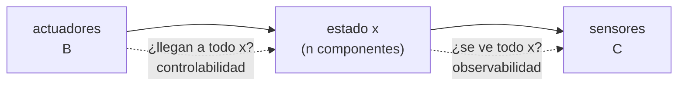

# B16-C13 — Observabilidad y controlabilidad

<!-- nav:top -->
[🏠 Programa](../../../../README.md) · [📚 Bloque B16](../../../tronco-comun/B16-sistemas-dinamicos-y-control-automatico.md) · [← Anterior: B16-C12 — Sintonía de controladores PID](../B16-C12-sintonia-de-controladores-pid/CLASE.md) · [Siguiente: B16-C14 — Observadores de estados →](../B16-C14-observadores-de-estados/CLASE.md)
<!-- /nav -->

## 1. Ubicación, nivel y alcance

Decimotercera clase del bloque B16 y primera del control moderno. Hasta C12 trabajaste con una entrada y una salida. Aquí vuelves al espacio de estados de [C02](../B16-C02-representaciones-en-espacio-de-estados/CLASE.md) y te preguntas dos cosas: ¿puedo llevar el sistema adonde quiero con los actuadores que tengo (**controlabilidad**)? y ¿puedo reconstruir su estado con los sensores que tengo (**observabilidad**)? Necesitas rango de una matriz (B10-C02, B10-C04) y las matrices `A, B, C`.

No verás todavía cómo diseñar el observador (C14) ni el regulador óptimo (C15).

## 2. Por qué esta clase existe

Un satélite puede perder actuadores o sensores en vuelo. Antes de diseñar una ley de control conviene saber si el problema tiene solución: ninguna ley, por ingeniosa que sea, mueve un estado que ningún actuador alcanza, ni estima uno que ningún sensor ve. La pregunta motivadora es: **¿con estos actuadores y estos sensores es posible, en principio, controlar y estimar todo el estado, y cuánto cuesta en energía hacerlo?**

La decisión central: qué actuadores y sensores incluir, y cuál es el costo (tiempo, par) de usarlos.

## 3. Lo que podrás hacer al terminar

1. Definir controlabilidad y observabilidad.
2. Aplicar las pruebas de rango de Kalman y la prueba PBH.
3. Determinar qué ejes de un satélite linealizado dejan de ser controlables si se pierde una rueda.
4. Calcular el grammiano de controlabilidad del eje rígido y la energía mínima de un giro.
5. Explicar por qué una función de transferencia puede ocultar un modo inestable.
6. Distinguir lo que afirma una prueba lineal de lo que afirma el sistema no lineal real.

La evidencia es el **informe de rango** del ejercicio 12 (sección 20).

## 4. Con qué llegas y cómo comprobarlo

1. ¿Cuál es el rango de `[[0, 1/50],[1/50, 0]]`?
2. ¿Cuál es el rango de `[[0, 1],[0, 0]]`?
3. Multiplica `A·B` con `A = [[0,1],[0,0]]` y `B = [0, 0,02]ᵀ`.
4. ¿Qué es un autovalor de `A`?
5. ¿Qué significa que una integral `∫ t² dt` desde 0 hasta `T` valga `T³/3`?

<details>
<summary>Ver respuestas</summary>

1. 2 (las columnas son independientes). 2. 1. 3. `[0,02, 0]ᵀ`. 4. Un `λ` con `A v = λ v` para algún `v ≠ 0`. 5. Que el área bajo la parábola crece con el cubo del tiempo.
</details>

Con cuatro o cinco aciertos, sigue; si fallaste la 1 o la 2, repasa B10-C02.

## 5. Un caso real: cuando fallan las ruedas de reacción

Según el artículo sobre el producto científico de la misión K2 (S1, resumen), la misión Kepler fue reconstituida como K2 tras el fallo, en mayo de 2013, de la segunda de sus cuatro ruedas de reacción; con ese cambio el apuntamiento pasó a producir un movimiento de giro mayor, de típicamente 1,0 píxel pico a pico en 6 horas en los bordes del campo, unos dos órdenes de magnitud más que en la misión original. La lección de ingeniería es general: con menos actuadores, ciertos movimientos dejan de poder controlarse del modo previsto. Usamos un modelo **sintético** y linealizado de tres ejes desacoplados con inercias 50, 40 y 30 kg·m² para ver el mecanismo, sin afirmar nada sobre cómo operaba Kepler.

## 6. Vocabulario

El sistema `ẋ = A x + B u` (con `n` estados) es **controlable** si, desde cualquier estado inicial, existe una entrada que lo lleva a cualquier otro estado en un tiempo finito. Es **observable** si el estado inicial puede deducirse de la salida `y = C x` y la entrada durante un tiempo finito. La **matriz de controlabilidad** es `𝒞 = [B, AB, A²B, …, Aⁿ⁻¹B]` y la de **observabilidad** es `𝒪 = [C; CA; …; CAⁿ⁻¹]` (apiladas). Según la **prueba de Kalman**, el sistema es controlable si `rango 𝒞 = n` y observable si `rango 𝒪 = n`. La **prueba PBH** (Popov–Belevitch–Hautus) dice: es controlable si `rango [λI − A, B] = n` para todo autovalor `λ`. El **grammiano de controlabilidad** en `[0, T]` es `W = ∫₀ᵀ e^{At} B Bᵀ e^{Aᵀt} dt`.

## 7. Modelo mental: ¿llego? ¿lo veo?

Controlabilidad pregunta si tus palancas alcanzan todas las direcciones del espacio de estados. Observabilidad pregunta si tus ventanas ven todas las direcciones. Una variable que ni se mueve con tus palancas ni se ve con tus ventanas es invisible e incontrolable.



*Descripción textual:* los actuadores actúan sobre el estado a través de `B`, y los sensores lo miran a través de `C`; la controlabilidad pregunta si los actuadores alcanzan todas las direcciones del estado, y la observabilidad si los sensores las ven.

La analogía: un conductor (actuadores) y quien lee el mapa (sensores); si el volante no gira a la izquierda, hay destinos inalcanzables; si el mapa no muestra una zona, hay lugares donde no sabes dónde estás. Su límite: la analogía no captura que en un sistema lineal es cuestión de rango, no de grado (aunque el costo sí tiene grados, sección 8.4).

## 8. La explicación, paso a paso

### 8.1 El eje rígido es controlable y observable (con el sensor adecuado)

Con `A = [[0,1],[0,0]]`, `B = [0, 1/J]ᵀ`: `AB = [1/J, 0]ᵀ`, luego `𝒞 = [[0, 1/J],[1/J, 0]]` de rango 2: controlable. Si el sensor mide el ángulo (`C = [1, 0]`), `𝒪 = [[1,0],[0,1]]` tiene rango 2: observable. Si solo mide la velocidad (`C = [0, 1]`), `𝒪 = [[0,1],[0,0]]` tiene rango 1: **no observable**, porque integrar la velocidad deja el ángulo inicial indeterminado. Un giróscopo solo no basta para saber la orientación absoluta; por eso se complementa con rastreadores de estrellas (S2).

### 8.2 Tres ejes, tres ruedas, dos ruedas

Con los tres ejes desacoplados linealizados en torno a la orientación nula y sin momento almacenado, el estado tiene 6 componentes. Con tres ruedas, `rango 𝒞 = 6`. Con dos (ejes x e y), `rango 𝒞 = 4`: se pierde el eje z. Con una, `rango 𝒞 = 2`. La prueba PBH localiza el problema: en el autovalor `λ = 0` el rango de `[λI − A, B]` cae por debajo de 6, que corresponde al modo del eje sin actuador. **Advertencia:** esto es el resultado del sistema **linealizado en un punto concreto**. El sistema no lineal real, con momento almacenado, puede ser controlable de otras maneras (por ejemplo, usando el acoplamiento giroscópico); la prueba lineal no lo afirma ni lo descarta. Para el control con un único actuador perdido hay que analizar el modelo no lineal (C17).

### 8.3 El grammiano y la energía mínima

Para el eje rígido, `e^{At}B = [t/J, 1/J]ᵀ`, y el grammiano en `[0, T]` es
`W = [[T³/(3J²), T²/(2J²)],[T²/(2J²), T/J²]]`. El laboratorio lo calcula por integración numérica y coincide con la fórmula cerrada con error relativo 2×10⁻¹⁶. La energía mínima `∫τ² dt` para llevar el estado de `0` a `x_f` en el tiempo `T` es `x_fᵀ W⁻¹ x_f`. Para un giro de reposo a reposo de ángulo `Δ`, `x_f = [Δ, 0]ᵀ` y resulta `E = 12 J² Δ²/T³`. Con `J = 50`, `Δ = 0,1 rad`, `T = 20 s`: `E = 0,0375 (N·m)²·s`. Reducir `T` a la mitad multiplica la energía por 8.

### 8.4 Controlable no es barato

Controlable significa «posible», no «razonable». La energía crece como `1/T³`: girar en 10 s cuesta 0,300, en 20 s 0,0375 y en 40 s 0,0047. En sistemas casi no controlables (un modo apenas influido por el actuador), el grammiano tiene un autovalor diminuto y la energía necesaria es enorme. Se mide con el número de condición del grammiano.

### 8.5 Modos ocultos: la transferencia no lo cuenta todo

Sea `ẋ₁ = −x₁ + u`, `ẋ₂ = 2x₂`, `y = x₁`. La función de transferencia es `1/(s+1)`: estable. Pero `x₂` crece como `e^{2t}` sin que la entrada lo toque (no controlable) y sin que la salida lo vea (no observable). En el laboratorio, con `x₂(0) = 10⁻⁶`, tras 10 s vale 485: la salida sigue acotada pero el estado se ha escapado. Es la consecuencia de lo advertido en C05 sobre cancelar polos inestables.

## 9. Magnitudes, símbolos y unidades

| Símbolo | Qué es | Unidad | Nota |
|---|---|---|---|
| `n` | número de estados | — | 2 (un eje), 6 (tres ejes) |
| `𝒞, 𝒪` | matrices de controlabilidad y observabilidad | mezcla | rango = `n` |
| `W` | grammiano de controlabilidad | mezcla (rad²/(N·m)²·…) | positivo definido si es controlable |
| `E` | energía mínima | (N·m)²·s | `∫τ² dt` |
| `T, Δ` | duración y ángulo del giro | s; rad | |
| `λ` | autovalor de `A` | s⁻¹ | para PBH |

## 10. Convenciones y referencias

Las pruebas son para sistemas LTI. Se dice «controlable» en el sentido de alcanzar cualquier estado (no solo el origen). El estado lineal está definido respecto de una orientación de referencia declarada. «Energía» designa `∫ u² dt`, no energía física: es un costo de control normalizado.

## 11. De dónde sale lo que afirmamos

| ID | Fuente | Localizador | Respalda | Estado |
|---|---|---|---|---|
| S1 | Van Cleve, J. E. et al., «That's How We Roll: The NASA K2 Mission Science Products and Their Performance Metrics», arXiv:1512.06162 | https://arxiv.org/abs/1512.06162 | Fallo de la segunda de cuatro ruedas de reacción en mayo de 2013; K2; movimiento de giro típico de 1,0 píxel pico a pico en 6 h en los bordes del campo, ≈ 2 órdenes de magnitud mayor que en Kepler | Solo resumen, consultado el 2026-11-05 |
| S2 | NASA GSFC, *Pointing Control System* (archivo del Hubble, actualizada 2021-03-29) | https://asd.gsfc.nasa.gov/archive/hubble/technology/pcs.html | El Hubble combina giróscopos, rastreadores de estrellas y sensores de guiado fino | Consultada el 2026-11-05; archivada |

Límites: las pruebas de Kalman y PBH, el grammiano y la fórmula `12 J²Δ²/T³` son resultados estándar de teoría de sistemas, no citados a un texto, y se verifican numéricamente. De S1 solo se leyó el resumen: no se afirma nada sobre el método de apuntamiento de K2. El modelo de tres ejes es **sintético** y linealizado.

## 12. Cómo ver los rangos

| Configuración | Rango de `𝒞` (de 6) | Observación |
|---|---|---|
| 3 ruedas (x, y, z) | 6 | controlable |
| 2 ruedas (x, y) | 4 | el eje z no es controlable (linealizado) |
| 1 rueda (x) | 2 | solo el eje x |

| Sensor del eje rígido | Rango de `𝒪` (de 2) |
|---|---|
| ángulo | 2 |
| solo velocidad | 1 |

## 13. Ejemplo trabajado: giro de 0,1 rad

¿Qué energía cuesta girar 0,1 rad de reposo a reposo en 20 s con `J = 50`?

**Paso 1 · grammiano.** `W = [[T³/(3J²), T²/(2J²)],[T²/(2J²), T/J²]]` con `T = 20`, `J = 50`: `[[1,067; 0,08],[0,08; 0,008]]` (aprox.).
**Paso 2 · estado final.** `x_f = [0,1; 0]ᵀ`.
**Paso 3 · energía.** `E = x_fᵀ W⁻¹ x_f = 12·2500·0,01/8000 = 0,0375 (N·m)²·s`.
**Paso 4 · par pico.** El perfil de mínima energía es un par lineal en el tiempo, `τ(t) = (6JΔ/T²)(1 − 2t/T)`, que va de `+6JΔ/T²` a `−6JΔ/T²` (acelera y luego frena); su energía `∫τ² dt = 12J²Δ²/T³` coincide con el resultado anterior. Pico: `6·50·0,1/400 = 0,075 N·m`.
**Paso 5 · lectura.** El par pico es modesto; girar en 5 s exigiría 16 veces más pico (escala `1/T²`). La controlabilidad no promete que el actuador alcance (C18).

## 14. Distintas pruebas, distintos usos

La **prueba de Kalman** es la más simple. La **PBH** señala qué modo falla. El **grammiano** da además cuánto cuesta y sirve para comparar configuraciones. La **controlabilidad no lineal** (álgebra de Lie) se usa cuando la linealización falla, y no se trata aquí. Elige Kalman para decidir y PBH o el grammiano para diagnosticar y cuantificar.

## 15. Práctica guiada

**Ejercicio 1 · con pasos.** Decide si `A = [[0,1],[0,0]]`, `B = [0, 1/20]ᵀ` es controlable. *Pasos:* 8.1.

<details><summary>Solución comentada</summary>

`AB = [1/20, 0]ᵀ`; `𝒞 = [[0, 0,05],[0,05, 0]]`, rango 2: controlable.
</details>

**Ejercicio 2 · con pista.** Con la misma `A` y `C = [0, 1]`, ¿es observable? *Pista:* 8.1.

<details><summary>Solución comentada</summary>

`CA = [0, 0]`; `𝒪 = [[0,1],[0,0]]`, rango 1: no observable. El ángulo inicial no se deduce de la velocidad.
</details>

**Ejercicio 3 · casi autónomo.** Con ruedas en x e y de un modelo de tres ejes desacoplados, ¿qué rango tiene `𝒞` y qué eje se pierde?

<details><summary>Solución comentada</summary>

Rango 4 de 6; se pierde el eje z (en el modelo linealizado).
</details>

## 16. Práctica autónoma, transferencia e integrador

**Ejercicio 4.** Calcula `E = 12J²Δ²/T³` para `J = 50`, `Δ = 0,2 rad`, `T = 20 s`.

<details><summary>Solución comentada</summary>

`12·2500·0,04/8000 = 0,15 (N·m)²·s`. Cuatro veces el caso de 0,1 rad, porque la energía va con `Δ²`.
</details>

**Ejercicio 5.** Si el mismo giro se hace en 40 s en vez de 20 s, ¿cuánto cambia la energía?

<details><summary>Solución comentada</summary>

Se divide por 8 (escala `1/T³`): de 0,0375 a 0,0047.
</details>

**Ejercicio 6.** ¿Es controlable `A = diag(−1, −2)` con `B = [1, 1]ᵀ`? ¿Y con `B = [1, 0]ᵀ`?

<details><summary>Solución comentada</summary>

Con `B = [1,1]ᵀ`: `AB = [−1, −2]ᵀ`, `𝒞 = [[1,−1],[1,−2]]`, det = −1: controlable. Con `B = [1,0]ᵀ`: `AB = [−1, 0]ᵀ`, `𝒞` de rango 1: el segundo modo no es controlable.
</details>

**Ejercicio 7.** En el sistema `ẋ₁ = −x₁ + u`, `ẋ₂ = 2x₂`, `y = x₁`, ¿qué dice la función de transferencia sobre `x₂`? ¿Qué mide el laboratorio?

<details><summary>Solución comentada</summary>

Nada: `1/(s+1)` no contiene el modo `x₂`. El laboratorio muestra que `x₂` crece de 10⁻⁶ a 485 en 10 s.
</details>

**Ejercicio 8.** Con un solo sensor de velocidad, ¿qué sensor adicional haría observable el eje y por qué?

<details><summary>Solución comentada</summary>

Uno de ángulo (rastreador de estrellas): con `C = [1,0]` el rango pasa a 2. El giróscopo aporta velocidad con bajo ruido; el rastreador, la referencia absoluta.
</details>

**Ejercicio 9 · transferencia.** Un satélite con tres ruedas pierde una. ¿Qué dice la prueba lineal sobre el eje sin rueda y por qué conviene prudencia al concluir que «se perdió el control» de ese eje?

<details><summary>Solución comentada</summary>

En el modelo linealizado sin momento almacenado, el eje es no controlable. En el sistema real hay acoplamientos (momento almacenado, magnetopares, presión solar) que pueden dar autoridad; hay que analizar el no lineal y los demás actuadores (C17, B87).
</details>

**Ejercicio 10 · transferencia.** Compara un giróscopo y un rastreador de estrellas como únicos sensores del eje rígido. ¿Cuál permite estimar el estado completo y cuál no?

<details><summary>Solución comentada</summary>

El rastreador (ángulo): rango 2, estima ángulo y, derivando o con un observador, la velocidad. El giróscopo solo: rango 1, no estima el ángulo absoluto (la deriva del sesgo, C14, lo agrava).
</details>

**Ejercicio 11 · transferencia.** Un requisito pide girar 0,1 rad en 2 s. Calcula la energía y compárala con la del giro de 20 s. ¿Qué concluyes?

<details><summary>Solución comentada</summary>

`E = 12·2500·0,01/8 = 37,5`: 1000 veces la del giro de 20 s (`10³`). El pico de par `6JΔ/T² = 7,5 N·m` probablemente excede lo que dan las ruedas: el requisito es controlable pero no realizable.
</details>

**Ejercicio 12 · integrador.** Entrega un **informe de rango**: para un sistema con varios actuadores y sensores de tu elección, determina con Kalman y PBH qué configuraciones son controlables y observables, calcula el grammiano o la energía de una maniobra y advierte el alcance de la linealización.

<details><summary>Solución modelo</summary>

Debe incluir las matrices, los rangos por configuración, el modo afectado por la falla, un cálculo de energía con comprobación numérica y una frase sobre qué no se puede concluir de la linealización.
</details>

## 17. Laboratorio: rangos, grammiano y modo oculto

El script [rangos_y_grammianos.py](rangos_y_grammianos.py) construye el modelo de tres ejes, calcula los rangos con 3, 2 y 1 ruedas, la prueba PBH, la observabilidad del eje, el grammiano por integración numérica frente a la fórmula cerrada, la energía mínima y el modo oculto.

**Datos:** sintéticos (simulados). **Predice:** rangos 6, 4 y 2. **Ejecución del 2026-11-05 (Python 3.12.9, numpy 2.4.4, scipy 1.17.1):**

```text
rango de controlabilidad con 3, 2 y 1 ruedas: 6, 4, 2 (n = 6)
PBH con 2 ruedas: autovalores no controlables [0.0]
observabilidad midiendo ángulo: rango 2; midiendo solo velocidad: rango 1 (n = 2)
grammiano numérico vs cerrado: error relativo máx = 2.08e-16
energía mínima de un giro de 0.1 rad en 20.0 s: 0.03750000 N^2 m^2 s (cerrada 0.03750000)
   T =   10 s -> energía 0.300000
   T =   20 s -> energía 0.037500
   T =   40 s -> energía 0.004688
modo oculto: rango de controlabilidad 1  | polos de la transferencia 1/(s+1) = -1, polos de A = [-1.  2.]
tras 10 s con x2(0) = 1e-6: x2 = 4.852e+02, la salida y = x1 sigue acotada
Pruebas superadas.
```

```bash
python programa/clases/B16/B16-C13-observabilidad-y-controlabilidad/rangos_y_grammianos.py
```

**Límites:** linealización en la orientación nula sin momento almacenado; los rangos usan la tolerancia por defecto de NumPy; la prueba PBH solo evalúa los autovalores de `A`.

## 18. Errores frecuentes y cómo corregirlos

**Concluir sobre el sistema no lineal a partir de la prueba lineal.** Se corrige con el ejercicio 9.

**Creer que un giróscopo solo estima la orientación.** Se corrige con los ejercicios 2 y 10.

**Confundir «controlable» con «barato».** Se corrige con los ejercicios 5 y 11.

**Confiar en la transferencia para detectar modos inestables.** Se corrige con el ejercicio 7.

**Contar los rangos sin tolerancia numérica.** Se corrige releyendo los límites de la sección 17.

## 19. Cómo sabrás que vas bien

Tras 8.1: ¿decides la controlabilidad y observabilidad del eje? Ejercicios 1 y 2. Tras 8.3: ¿calculas la energía de un giro? Ejercicio 4. Tras el ejemplo: ¿explicas por qué el requisito del ejercicio 11 no es realizable?

## 20. Qué entregas y cómo se evalúa

El producto es el **informe de rango** del ejercicio 12.

| Criterio | Inicial | En desarrollo | Logrado | Destacado |
|---|---|---|---|---|
| Pruebas | Sin pruebas | Una prueba | Kalman y PBH | Con grammiano |
| Diagnóstico | No identifica el modo | Lo identifica | Lo explica físicamente | Propone la mitigación |
| Alcance | Generaliza | Menciona la linealización | Declara qué no concluye | Cita el análisis no lineal |
| Fuentes y datos | Sin rótulo | Parcial | Rotula sintético | Cita solo lo consultado |

**Condiciones críticas:** no atribuir al sistema real una conclusión que solo vale para el linealizado; no afirmar sobre Kepler o K2 más que lo leído en el resumen.

## 21. Ética, seguridad y límites

Declarar «sin control» o «controlable» sobre la base de un modelo lineal puede llevar a decisiones operativas equivocadas. Cifras didácticas. Accesibilidad: tablas equivalentes a las matrices.

## 22. Para cerrar y seguir

Un sistema es controlable si sus actuadores alcanzan todo el estado y observable si sus sensores lo ven; se decide con el rango de `𝒞` y `𝒪` y se cuantifica con el grammiano. Perder una rueda quita autoridad sobre un eje en el modelo linealizado; un modo oculto puede crecer sin verse en la transferencia. Queda abierta una pregunta: ¿cómo reconstruir el estado cuando solo se mide una parte?

**Glosario español–inglés.** controlabilidad · *controllability*; observabilidad · *observability*; grammiano · *Gramian*; rango · *rank*; modo oculto · *hidden mode*; rueda de reacción · *reaction wheel*.

**Continuidad.** B16-C14 construye el observador que reconstruye el estado. B16-C15 usa la controlabilidad para el diseño óptimo. B87 (control de actitud) retoma el modelo de tres ejes con el momento almacenado.

**Referencias:** ver sección 11.

<!-- nav:bottom -->
---

[← Anterior: B16-C12 — Sintonía de controladores PID](../B16-C12-sintonia-de-controladores-pid/CLASE.md) · [📚 Bloque B16](../../../tronco-comun/B16-sistemas-dinamicos-y-control-automatico.md) · [Siguiente: B16-C14 — Observadores de estados →](../B16-C14-observadores-de-estados/CLASE.md)
<!-- /nav -->
