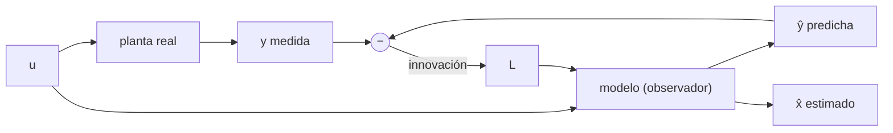

# B16-C14 — Observadores de estados

<!-- nav:top -->
[🏠 Programa](../../../../README.md) · [📚 Bloque B16](../../../tronco-comun/B16-sistemas-dinamicos-y-control-automatico.md) · [← Anterior: B16-C13 — Observabilidad y controlabilidad](../B16-C13-observabilidad-y-controlabilidad/CLASE.md) · [Siguiente: B16-C15 — Control óptimo LQR →](../B16-C15-control-optimo-lqr/CLASE.md)
<!-- /nav -->

## 1. Ubicación, nivel y alcance

Decimocuarta clase del bloque B16. En [C13](../B16-C13-observabilidad-y-controlabilidad/CLASE.md) viste cuándo el estado puede reconstruirse. Aquí lo reconstruyes: el **observador de estados** (de Luenberger) es un modelo del sistema que se corrige con la medida. Lo aplicarás a un caso real de ingeniería: estimar el **sesgo** de un giróscopo con las medidas de un rastreador de estrellas. Necesitas observabilidad (C13), colocación de polos (C12) y espacio de estados (C02).

No verás todavía el filtro de Kalman (B15-C17, B87-C09), que elige la ganancia óptima según el ruido.

## 2. Por qué esta clase existe

Los sensores miden poco y mal: un rastreador de estrellas da la orientación, pero a baja frecuencia y con ruido; un giróscopo da la velocidad con un sesgo que deriva. El controlador necesita el estado completo (C15) y limpio. La pregunta motivadora es: **¿cómo combino un modelo y medidas imperfectas para obtener una estimación del estado, incluida una variable que nadie mide (el sesgo)?**

La decisión central: elegir la velocidad con la que el observador corrige (su ancho de banda), sabiendo que más rápido sigue mejor al sistema pero deja pasar más ruido.

## 3. Lo que podrás hacer al terminar

1. Escribir un observador de Luenberger y su ecuación de error.
2. Ubicar los polos del error con la ganancia `L`.
3. Aumentar el estado con un sesgo constante y estimarlo.
4. Verificar el principio de separación entre control y observación.
5. Explicar el compromiso entre rapidez y ruido de la estimación.
6. Comprobar un observador contra casos exactos y con un experimento de ruido.

La evidencia es el **observador verificado** del ejercicio 12 (sección 20).

## 4. Con qué llegas y cómo comprobarlo

1. ¿Qué rango debe tener la matriz de observabilidad de un sistema de 2 estados?
2. Con `A = [[0,−1],[0,0]]` y `L = [L1, L2]ᵀ`, ¿cuál es `A − L C` si `C = [1, 0]`?
3. ¿Qué polinomio tiene polos en `−0,45 ± 0,218j`?
4. ¿Qué es un sesgo constante (offset) en un sensor?
5. ¿Qué es una innovación (residuo) `y − ŷ`?

<details>
<summary>Ver respuestas</summary>

1. Rango 2. 2. `[[−L1, −1],[−L2, 0]]`. 3. `s² + 0,9 s + 0,25`. 4. Un error fijo que se suma a la medida (aquí a la velocidad). 5. La diferencia entre lo medido y lo que el modelo predice medir.
</details>

Con cuatro o cinco aciertos, sigue.

## 5. Un caso real: giróscopo más rastreador de estrellas

El sistema de apuntamiento del Hubble usa unidades de giróscopos (que miden velocidad angular) y rastreadores de estrellas y sensores de guiado fino (que miden orientación) (S1). La razón de combinar sensores es justamente que se complementan: el giróscopo es suave y rápido pero acumula error por su sesgo; el rastreador es absoluto pero ruidoso y lento. Un observador los fusiona. Usamos cifras **sintéticas**: sesgo `b = 2,0×10⁻³ rad/s` (≈ 413″/s, ficticio) y ruido del rastreador de `10⁻⁴ rad` rms por muestra a 200 Hz.

## 6. Vocabulario

Un **observador de estados** es un sistema dinámico que recibe la entrada y la salida de la planta y produce una estimación `x̂`: `x̂̇ = A x̂ + B u + L (y − C x̂)`. La **ganancia del observador** `L` pondera la innovación `y − C x̂`. El **error de estimación** `e = x − x̂` cumple `ė = (A − L C) e`. El **sesgo** (*bias*) `b` es un offset de la medida del giróscopo; se modela como un estado constante `ḃ = 0` (**estado aumentado**). El **principio de separación** dice que, para sistemas lineales, el controlador y el observador se diseñan por separado y los polos del lazo completo son la unión de los de cada uno.

## 7. Modelo mental: un gemelo que se deja corregir

Haz funcionar una copia del sistema en el computador de a bordo, alimentada con las mismas órdenes. Si la copia coincidiera exactamente con la realidad, no haría falta medir. Como nunca coincide, se compara su salida con la medida y se usa la diferencia para empujar la copia hacia la realidad. La ganancia `L` decide cuánto confías en la medida frente al modelo.



*Descripción textual:* la misma entrada alimenta la planta y el modelo; la diferencia entre la salida medida y la predicha, multiplicada por `L`, corrige el modelo, cuyo estado es la estimación.

La analogía es la navegación a estima con correcciones de posición: avanzas con rumbo y velocidad conocidos y, cada vez que ves un faro, corriges. Su límite: aquí la corrección es continua y lineal, y confía en que el modelo sea correcto.

## 8. La explicación, paso a paso

### 8.1 Ecuación del error y colocación de polos

Si el modelo es exacto, restando las ecuaciones queda `ė = (A − L C) e`. Como el par `(A, C)` es observable (C13), se puede elegir `L` para que `A − L C` tenga los polos que quieras: el error decae con la velocidad que decidas.

### 8.2 Estimar el sesgo

Se modela el ángulo `θ` y el sesgo `b`: la velocidad medida es `ω_m = ω + b`, así que `θ̇ = ω_m − b` y `ḃ = 0`. Con estado `[θ, b]ᵀ`, `A = [[0, −1],[0, 0]]`, entrada `ω_m` y salida `y = θ` (rastreador), `C = [1, 0]`. El par es observable: `𝒪 = [[1,0],[0,−1]]` tiene rango 2. Entonces `A − L C = [[−L1, −1],[−L2, 0]]` y su polinomio es `s² + L1 s − L2`. Para obtener `s² + 2ζω₀ s + ω₀²` se elige `L1 = 2ζω₀` y `L2 = −ω₀²` (el signo negativo se debe a cómo entra el sesgo en la ecuación). Ejemplo: `ω₀ = 0,5`, `ζ = 0,9` → `L = [0,90; −0,25]`, polos `−0,45 ± 0,218j`.

### 8.3 Qué logra y cuánto tarda

Sin ruido y con `ω₀ = 0,5`, `ζ = 0,9`, tras 100 s el error de ángulo es 4,8×10⁻⁷ rad y el error de sesgo 2,6×10⁻⁷ rad/s (limitados por el paso de integración de 5 ms, método de Euler): el sesgo de 2 mrad/s se identifica. Sin esa estimación, el giróscopo solo acumularía `b·t = 0,2 rad` en 100 s: más de 11° de error.

### 8.4 El compromiso con el ruido

Con ruido de `10⁻⁴ rad` por muestra, el error rms del sesgo estimado crece con el ancho de banda:

| `ω₀` (rad/s) | rms error de ángulo (rad) | rms error de sesgo (rad/s) |
|---|---|---|
| 0,1 | 6,2×10⁻⁶ | 5,2×10⁻⁷ |
| 0,3 | 4,9×10⁻⁶ | 1,1×10⁻⁶ |
| 1,0 | 8,0×10⁻⁶ | 3,9×10⁻⁶ |

Un observador lento filtra más ruido pero tarda más en converger y en seguir cambios del sesgo; uno rápido converge rápido pero deja pasar más ruido. El error de ángulo no es monótono porque combina ruido y retardo de seguimiento.

### 8.5 Principio de separación

Para el eje rígido `J = 50` con `u = −K x̂`, `K = [20, 40]` y un observador de ángulo y velocidad con polos en `−0,6` (dobles), la matriz del lazo completo (4×4) tiene autovalores `−0,6, −0,6, −0,4 ± 0,49j`: exactamente la unión de los de `A − B K` y `A − L C`. Se puede diseñar `K` (C12, C15) y `L` por separado. Una regla de práctica es hacer el observador varias veces más rápido que el controlador, sin pasarse para no amplificar ruido (orientación, no norma).

## 9. Magnitudes, símbolos y unidades

| Símbolo | Qué es | Unidad | Nota |
|---|---|---|---|
| `x̂` | estado estimado | mezcla | |
| `L` | ganancia del observador | s⁻¹ ; s⁻² | `L1`, `L2` para `[θ, b]` |
| `e` | error de estimación | rad ; rad/s | |
| `b` | sesgo del giróscopo | rad/s | 2×10⁻³ sintético |
| `ω_m` | velocidad medida | rad/s | `ω + b` |
| `ω₀, ζ` | polos del observador | rad/s ; — | |

## 10. Convenciones y referencias

El observador usa el modelo discretizado con paso `h = 5 ms` (Euler hacia adelante) en el laboratorio; con pasos mayores se usaría la discretización exacta (C02). Se especifica siempre el ruido (valor y frecuencia de muestreo) junto con los resultados. Los valores de ruido y sesgo son ficticios.

## 11. De dónde sale lo que afirmamos

| ID | Fuente | Localizador | Respalda | Estado |
|---|---|---|---|---|
| S1 | NASA GSFC, *Pointing Control System* (archivo del Hubble, actualizada 2021-03-29) | https://asd.gsfc.nasa.gov/archive/hubble/technology/pcs.html | Giróscopos (velocidad), rastreadores de estrellas y sensores de guiado fino (orientación) en el mismo lazo | Consultada el 2026-11-05; archivada |

Límites: la teoría del observador de Luenberger y el principio de separación son resultados estándar, no citados a un texto, y se verifican numéricamente. El sesgo, el ruido y las ganancias son **sintéticos**; los resultados con ruido provienen de una sola semilla (14), de modo que son ilustrativos.

## 12. Cómo ver el observador

| Caso | Polos del error | `L` |
|---|---|---|
| `ω₀ = 0,2`, `ζ = 0,9` | `−0,18 ± 0,087j` | `[0,36; −0,04]` |
| `ω₀ = 0,5`, `ζ = 0,9` | `−0,45 ± 0,218j` | `[0,90; −0,25]` |
| `ω₀ = 1,0`, `ζ = 0,7` | `−0,70 ± 0,714j` | `[1,40; −1,00]` |

Para graficar, dibuja el sesgo estimado y el real con trazos distintos, y el error con su banda de ruido.

## 13. Ejemplo trabajado: estimar 2 mrad/s de sesgo

**Paso 1 · modelo.** Estado `[θ, b]`, `θ̇ = ω_m − b`, `ḃ = 0`, `y = θ + ruido`.
**Paso 2 · observabilidad.** Rango 2: se puede estimar `b`.
**Paso 3 · polos.** Elegimos `ω₀ = 0,5`, `ζ = 0,9`: `L1 = 0,9`, `L2 = −0,25`.
**Paso 4 · ejecución.** Sin ruido, a los 100 s: errores 4,8×10⁻⁷ rad y 2,6×10⁻⁷ rad/s.
**Paso 5 · tiempo.** Los polos tienen parte real `−0,45`; el 1 % se alcanza en `ln(100)/0,45 ≈ 10 s`.
**Paso 6 · lectura.** En 10 s el observador identifica un sesgo que dejaría una deriva de 0,02 rad (1,1°) en ese mismo lapso.

## 14. Comparar con otros enfoques

**Derivar la medida** para obtener la velocidad amplifica el ruido. El **observador de Luenberger** (esta clase) elige `L` por polos. El **filtro de Kalman** (B15-C17) elige `L(t)` minimizando la varianza del error según los ruidos del modelo y de la medida; es el observador óptimo para ruido gaussiano. Un **filtro complementario** (pasa-bajo para el rastreador y pasa-alto para el giróscopo) es una versión simple. Se usa Luenberger cuando se quiere razonar por polos y Kalman cuando el ruido es conocido y variable.

## 15. Práctica guiada

**Ejercicio 1 · con pasos.** Calcula `L` para `ω₀ = 0,4`, `ζ = 0,9`. *Pasos:* 8.2.

<details><summary>Solución comentada</summary>

`L1 = 2·0,9·0,4 = 0,72`, `L2 = −0,16`. Polinomio `s² + 0,72 s + 0,16`.
</details>

**Ejercicio 2 · con pista.** Con `L = [0,36; −0,04]` halla los polos de `A − L C`. *Pista:* `s² + L1 s − L2`.

<details><summary>Solución comentada</summary>

`s² + 0,36 s + 0,04` → `s = −0,18 ± 0,0872j`.
</details>

**Ejercicio 3 · casi autónomo.** ¿En cuánto tiempo decae el error al 1 % con polos de parte real `−0,18`?

<details><summary>Solución comentada</summary>

`ln(100)/0,18 = 25,6 s`.
</details>

## 16. Práctica autónoma, transferencia e integrador

**Ejercicio 4.** Con sesgo `b = 0,002 rad/s`, ¿cuánto error de ángulo acumula un giróscopo sin corregir en 60 s?

<details><summary>Solución comentada</summary>

`0,002·60 = 0,12 rad ≈ 6,9°`.
</details>

**Ejercicio 5.** Para `A = [[0,1],[0,0]]`, `C = [1,0]` (ángulo medido, estimar ángulo y velocidad) halla `L` que da un polo doble en `−0,6`.

<details><summary>Solución comentada</summary>

`A − L C = [[−L1, 1],[−L2, 0]]`, polinomio `s² + L1 s + L2`. Se quiere `(s+0,6)² = s² + 1,2 s + 0,36`: `L = [1,2; 0,36]`.
</details>

**Ejercicio 6.** Comprueba por qué un observador con `(A, C)` no observable no puede ubicar todos los polos.

<details><summary>Solución comentada</summary>

El modo no observable no aparece en `y`: `A − L C` conserva ese autovalor para cualquier `L`. Con solo velocidad medida, el autovalor en 0 del ángulo no se mueve.
</details>

**Ejercicio 7.** Según la tabla 8.4, ¿qué `ω₀` da el menor error de sesgo y qué cuesta?

<details><summary>Solución comentada</summary>

`ω₀ = 0,1` (5,2×10⁻⁷ rad/s). Cuesta tiempo: los polos están en `−0,09`, y el 1 % tarda `ln100/0,09 = 51 s`.
</details>

**Ejercicio 8.** Verifica el principio de separación: ¿cuántos autovalores tiene el lazo completo con 2 estados de planta y 2 del observador?

<details><summary>Solución comentada</summary>

Cuatro: dos de `A − B K` y dos de `A − L C`.
</details>

**Ejercicio 9 · transferencia.** En el eje rígido con solo ángulo medido (sin giróscopo), ¿cómo estimas la velocidad para el término derivativo del PD sin derivar la medida?

<details><summary>Solución comentada</summary>

Con un observador de ángulo y velocidad (ejercicio 5): `ω̂` sale del estado estimado, filtrada por el modelo. Se usa `u = −Kp θ̂ − Kd ω̂`.
</details>

**Ejercicio 10 · transferencia.** El sesgo real cambia lentamente (deriva con la temperatura). ¿Qué debes cambiar en el modelo y en el diseño?

<details><summary>Solución comentada</summary>

Sustituir `ḃ = 0` por `ḃ = ruido` (paseo aleatorio) y subir un poco el ancho de banda para seguir el cambio, a costa de ruido. Esto lleva naturalmente al filtro de Kalman.
</details>

**Ejercicio 11 · transferencia.** Si el modelo tiene una inercia equivocada en 20 %, ¿qué efecto tiene sobre el error de estimación y cómo se reduce?

<details><summary>Solución comentada</summary>

El modelo ya no coincide: el error ya no decae a cero, sino que queda un residuo proporcional al error de modelo, menor cuanto mayor es `L`. Se reduce con mejor identificación o un observador más rápido (a costa de ruido).
</details>

**Ejercicio 12 · integrador.** Entrega un **observador verificado**: para un sistema de tu elección, comprueba la observabilidad, coloca los polos, simula sin ruido (error cero) y con ruido (rms del error), y verifica el principio de separación con los autovalores.

<details><summary>Solución modelo</summary>

Debe contener el rango de observabilidad, `L` con los polos pedidos comprobados, la simulación sin ruido con error final, una tabla ruido–ancho de banda con la semilla declarada y la comparación de autovalores del lazo completo con la unión.
</details>

## 17. Laboratorio: sesgo de giróscopo y separación

El script [observador_de_sesgo.py](observador_de_sesgo.py) comprueba los polos del error, simula el observador sin y con ruido (semilla 14, 200 Hz) y verifica el principio de separación.

**Datos:** sintéticos (simulados). **Predice:** error de sesgo cercano a cero sin ruido. **Ejecución del 2026-11-05 (Python 3.12.9, numpy 2.4.4, scipy 1.17.1):**

```text
wo = 0.2, zeta = 0.9: L = [0.3600, -0.0400], polos [-0.18-0.0872j -0.18+0.0872j]
wo = 0.5, zeta = 0.9: L = [0.9000, -0.2500], polos [-0.45-0.2179j -0.45+0.2179j]
wo = 1.0, zeta = 0.7: L = [1.4000, -1.0000], polos [-0.7-0.7141j -0.7+0.7141j]
sin ruido, t = 100 s: error de ángulo +4.763e-07 rad, error de sesgo +2.620e-07 rad/s
con ruido de 1e-4 rad rms (t = 100..300 s):
   wo     rms error ángulo (rad)   rms error sesgo (rad/s)
   0.1     6.235e-06              5.184e-07
   0.3     4.884e-06              1.079e-06
   1.0     8.047e-06              3.893e-06
lazo completo: [-0.6-0.j     -0.6+0.j     -0.4-0.4899j -0.4+0.4899j]
unión de A-BK y A-LC: [-0.6+0.j     -0.6+0.j     -0.4-0.4899j -0.4+0.4899j]
Pruebas superadas.
```

```bash
python programa/clases/B16/B16-C14-observadores-de-estados/observador_de_sesgo.py
```

**Límites:** Euler con 5 ms; ruido blanco gaussiano de una semilla; modelo exacto (sin error de inercia); el script detiene la ejecución si el error sin ruido supera 10⁻⁶.

## 18. Errores frecuentes y cómo corregirlos

**Olvidar el signo de `L2`.** Se corrige con los ejercicios 1 y 2.

**Pedir polos del observador demasiado rápidos.** Se corrige con el ejercicio 7.

**Creer que el observador corrige un modelo equivocado.** Se corrige con el ejercicio 11.

**Intentar estimar un estado no observable.** Se corrige con el ejercicio 6.

**Tratar el resultado de una semilla como una medida definitiva.** Se corrige releyendo los límites de la sección 11.

## 19. Cómo sabrás que vas bien

Tras 8.1: ¿planteas la ecuación del error? Ejercicio 2. Tras 8.2: ¿calculas `L` para un par de polos? Ejercicios 1 y 5. Tras el ejemplo: ¿explicas el compromiso de la tabla 8.4?

## 20. Qué entregas y cómo se evalúa

El producto es el **observador verificado** del ejercicio 12.

| Criterio | Inicial | En desarrollo | Logrado | Destacado |
|---|---|---|---|---|
| Diseño | `L` sin justificar | `L` por polos | Con observabilidad previa | Con el sesgo aumentado |
| Verificación | Sin simulación | Sin ruido | Sin y con ruido | Con separación comprobada |
| Compromiso | No lo discute | Lo menciona | Lo cuantifica | Propone el filtro de Kalman |
| Fuentes y datos | Sin rótulo | Parcial | Rotula sintético | Cita solo lo consultado |

**Condiciones críticas:** declarar semilla y frecuencia de muestreo; no presentar el ruido sintético como medida.

## 21. Ética, seguridad y límites

Un observador con modelo equivocado entrega estimaciones que parecen buenas y no lo son; se contrastan con mediciones independientes. Cifras didácticas. Accesibilidad: tablas y descripciones textuales.

## 22. Para cerrar y seguir

Un observador reconstruye el estado con un modelo corregido por la medida; la ganancia `L` ubica los polos del error, permite estimar el sesgo del giróscopo y se diseña por separado del controlador. Más ancho de banda sigue mejor pero deja pasar más ruido. Queda abierta una pregunta: ¿cómo elegir la ley de control de forma óptima?

**Glosario español–inglés.** observador de estados · *state observer*; ganancia del observador · *observer gain*; sesgo · *bias*; innovación · *innovation*; principio de separación · *separation principle*; estado aumentado · *augmented state*.

**Continuidad.** B16-C15 diseña el regulador óptimo que usa este estado estimado. B15-C17 y B87-C09 desarrollan el filtro de Kalman y la estimación de actitud.

**Referencias:** ver sección 11.

<!-- nav:bottom -->
---

[← Anterior: B16-C13 — Observabilidad y controlabilidad](../B16-C13-observabilidad-y-controlabilidad/CLASE.md) · [📚 Bloque B16](../../../tronco-comun/B16-sistemas-dinamicos-y-control-automatico.md) · [Siguiente: B16-C15 — Control óptimo LQR →](../B16-C15-control-optimo-lqr/CLASE.md)
<!-- /nav -->
