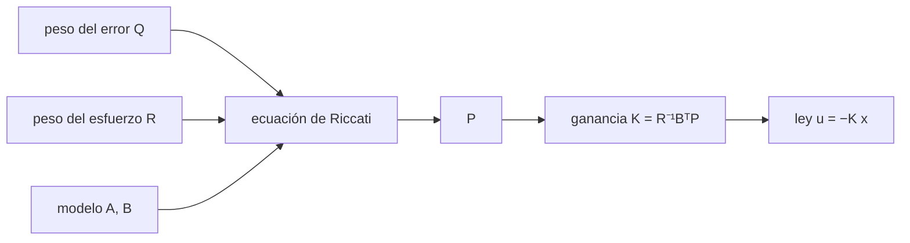

# B16-C15 — Control óptimo LQR

<!-- nav:top -->
[🏠 Programa](../../../../README.md) · [📚 Bloque B16](../../../tronco-comun/B16-sistemas-dinamicos-y-control-automatico.md) · [← Anterior: B16-C14 — Observadores de estados](../B16-C14-observadores-de-estados/CLASE.md) · [Siguiente: B16-C16 — Control robusto inicial →](../B16-C16-control-robusto-inicial/CLASE.md)
<!-- /nav -->

## 1. Ubicación, nivel y alcance

Decimoquinta clase del bloque B16. En C12 elegiste ganancias por reglas o por colocación de polos. Aquí las obtienes **optimizando** un costo que mide el compromiso entre error y esfuerzo: el **regulador cuadrático lineal (LQR)**. Necesitas controlabilidad (C13), espacio de estados (C02) y matrices simétricas positivas (B10-C08).

No verás todavía la versión con ruido (LQG/Kalman, B15-C17) ni la restricción explícita del par máximo (C18, B87-C21).

## 2. Por qué esta clase existe

Con un PD hay dos perillas, `Kp` y `Kd`, y no es obvio cuánto esfuerzo gasta cada combinación. En un satélite el esfuerzo tiene un costo real: energía de las ruedas, momento almacenado, desgaste. Con varios estados y actuadores las perillas se multiplican. La pregunta motivadora es: **¿cuál es la ley de realimentación de estados que mejor equilibra el error y el esfuerzo, definido por mí con dos pesos?**

La decisión central: elegir los pesos `Q` (cuánto duele el error) y `R` (cuánto cuesta el esfuerzo), y dejar que una ecuación calcule la ganancia.

## 3. Lo que podrás hacer al terminar

1. Escribir el costo cuadrático y la ley `u = −K x`.
2. Plantear la ecuación algebraica de Riccati y resolverla en un caso simple.
3. Obtener la solución analítica del doble integrador y su amortiguamiento constante.
4. Leer el efecto de `R` en la ganancia, la frecuencia y el par inicial.
5. Verificar un LQR con tres métodos independientes y con el costo integrado.
6. Explicar qué garantiza (estabilidad) y qué no (robustez ante todo, saturación).

La evidencia es el **diseño LQR comparado** del ejercicio 12 (sección 20).

## 4. Con qué llegas y cómo comprobarlo

1. ¿Qué es una matriz simétrica definida positiva? Da un ejemplo.
2. Calcula `x0ᵀ P x0` con `x0 = [0,1; 0]ᵀ` y `P = [[10, 5],[5, 6]]`.
3. ¿Qué polos tiene el eje `J = 50` con `Kp = 1`, `Kd = 10`?
4. ¿Qué es un costo que se integra en el tiempo?
5. ¿Cuántas ecuaciones independientes tiene una ecuación matricial simétrica de 2×2?

<details>
<summary>Ver respuestas</summary>

1. Simétrica con `xᵀPx > 0` para todo `x ≠ 0`; ejemplo `[[2,0],[0,1]]`. 2. `0,01·10 = 0,1`. 3. `50 s² + 10 s + 1 = 0` → `s = −0,1 ± 0,1j`. 4. Una suma, en cada instante, de lo que cuesta el estado y la acción de control. 5. Tres.
</details>

Con cuatro o cinco aciertos, sigue.

## 5. Un caso real: regulación de actitud con esfuerzo acotado

Un texto de modelado y control de naves espaciales disponible en el servidor de informes técnicos de la NASA (S1) presenta el control LQR para satélites que apuntan al nadir o a una dirección inercial: la ley es `u = −R⁻¹BᵀF x`, donde `F` resuelve la ecuación algebraica de Riccati (capítulo 9). Aquí usamos la misma estructura con un modelo **sintético** de un eje: `J = 50 kg·m²`, un desvío inicial de 0,1 rad y la tarea de volver a 0 con poco esfuerzo. Los pesos `q` y `r` se dan en unidades de costo normalizadas.

## 6. Vocabulario

El **costo cuadrático** es `C = ∫₀^∞ (xᵀ Q x + uᵀ R u) dt` con `Q` simétrica semidefinida positiva y `R` simétrica definida positiva. El **LQR** es la ley `u = −K x` que minimiza `C`; se obtiene con `K = R⁻¹ Bᵀ P`, donde `P` resuelve la **ecuación algebraica de Riccati** `AᵀP + PA − P B R⁻¹ Bᵀ P + Q = 0` (S2 la presenta como `X A + AᴴX − X B R⁻¹ Bᴴ X + Q = 0`). El costo óptimo desde `x₀` es `x₀ᵀ P x₀`.

## 7. Modelo mental: una balanza de dos platos

En un plato se pone el error y en el otro el esfuerzo. `Q` grande lo hace dominar el plato del error: ganancias altas, respuesta rápida, pares grandes. `R` grande lo hace dominar el plato del esfuerzo: ganancias bajas, respuesta lenta y suave.



*Descripción textual:* los pesos `Q` y `R` y el modelo `(A, B)` entran a la ecuación de Riccati; su solución `P` da la ganancia `K` y la ley de control `u = −K x`.

La analogía es el presupuesto: gastar más en velocidad (error pequeño) deja menos para el consumo (esfuerzo). Límite: el costo cuadrático penaliza mucho los picos y poco los ruidos pequeños; puede no reflejar un límite físico estricto.

## 8. La explicación, paso a paso

### 8.1 El planteamiento

Para `ẋ = A x + B u` con `A = [[0,1],[0,0]]`, `B = [0, 1/J]ᵀ`, elegimos `Q = diag(q, 0)` (se penaliza solo el ángulo) y `R = r`. Buscamos `K = [K1, K2]` con `u = −K1 θ − K2 ω`, igual que un PD con `Kp = K1`, `Kd = K2`. La diferencia es que `K` no sale de una regla, sino de resolver Riccati.

### 8.2 Resolver Riccati a mano

Con `P = [[p11, p12],[p12, p22]]`, la ecuación da tres igualdades escalares:
`q − p12²/(rJ²) = 0` → `p12 = J√(qr)`;
`p11 − p12 p22/(rJ²) = 0`;
`2p12 − p22²/(rJ²) = 0` → `p22 = J√(2 p12 r)`.
Entonces `K = R⁻¹ Bᵀ P = [p12, p22]/(rJ)`:
`K1 = √(q/r)`, `K2 = √(2J)·(q/r)^{1/4}`.

### 8.3 Una propiedad notable

El lazo cerrado tiene `ωn = √(K1/J)` y `ζ = K2/(2√(K1 J)) = 1/√2 = 0,7071` **siempre**, para cualquier `q` y `r`: cambiar los pesos solo cambia la escala de tiempo (`ωn`), no la forma. Es el amortiguamiento del filtro de Butterworth de segundo orden; el costo cuadrático con `Q = diag(q, 0)` lleva a él. Para cambiar `ζ` hay que penalizar también la velocidad (`Q` con un término en `ω`).

### 8.4 Cuánto cambia con `r` (con `q = 1`)

| `r` | `K1` | `K2` | `ωn` (rad/s) | `ζ` | `|u(0)|` con 0,1 rad (N·m) | costo óptimo |
|---|---|---|---|---|---|---|
| 1 | 1,0000 | 10,0000 | 0,1414 | 0,7071 | 0,1000 | 0,1000 |
| 100 | 0,1000 | 3,1623 | 0,0447 | 0,7071 | 0,0100 | 0,3162 |
| 10 000 | 0,0100 | 1,0000 | 0,0141 | 0,7071 | 0,0010 | 1,0000 |

Subir `r` cien veces baja el par inicial diez veces y alarga la respuesta `√10 ≈ 3,2` veces (`ωn ∝ r^{−1/4}`). El costo óptimo crece porque el error dura más.

### 8.5 Qué garantiza el LQR y qué no

Si `(A, B)` es controlable y `Q` es tal que `(Q^{1/2}, A)` es observable (condición de detectabilidad), el lazo es estable. La literatura clásica muestra además buenos márgenes en el caso de estado completo; aquí no los verificamos. No garantiza respetar límites de par: el par máximo ocurre en `t = 0` (comprobado en 2 001 instantes) y vale `K1·|θ₀|`; para respetarlo hay que elegir `r` (ejercicio 9). Tampoco garantiza robustez ante estados mal estimados (C14) o retardos (C07, C16).

## 9. Magnitudes, símbolos y unidades

| Símbolo | Qué es | Unidad | Nota |
|---|---|---|---|
| `Q, R` (`q, r`) | pesos del costo | normalizados | `q` penaliza `θ²`, `r` penaliza `u²` |
| `P` | solución de Riccati | normalizada | simétrica |
| `K = [K1, K2]` | ganancia | N·m/rad ; N·m·s/rad | como `Kp`, `Kd` |
| `C` | costo | normalizado | `∫ (q θ² + r u²) dt` |
| `ωn, ζ` | frecuencia y amortiguamiento del lazo | rad/s ; — | `ζ = 0,7071` |

## 10. Convenciones y referencias

El costo se escribe con pesos escalares normalizados; para pasar a unidades físicas conviene escalar cada variable por su valor máximo tolerable (regla de práctica, no consultada en una fuente). Se supone estado completo medido (o estimado, C14) y ausencia de saturación.

## 11. De dónde sale lo que afirmamos

| ID | Fuente | Localizador | Respalda | Estado |
|---|---|---|---|---|
| S1 | Yang, Y., *Spacecraft Modeling, Attitude Determination, and Control: Quaternion-Based Approach*, CRC Press (copia en NASA NTRS) | https://ntrs.nasa.gov/citations/20240009554 | Capítulo 9: ley LQR `u = −R⁻¹BᵀF x` con `F` solución de la ecuación algebraica de Riccati, para satélites que apuntan a nadir o a una dirección inercial | Extraído del PDF el 2026-11-05; solo el pasaje del capítulo 9 y la introducción |
| S2 | SciPy, `scipy.linalg.solve_continuous_are` | https://docs.scipy.org/doc/scipy/reference/generated/scipy.linalg.solve_continuous_are.html | Ecuación resuelta: `X A + AᴴX − X B R⁻¹ Bᴴ X + Q = 0` | Documentación v1.18.0 consultada el 2026-11-05; el laboratorio usa SciPy 1.17.1 |

Límites: la solución analítica del doble integrador se deriva en esta clase y se verifica con tres métodos (fórmula, hamiltoniano de numpy, `solve_continuous_are`) y con el costo integrado. Las afirmaciones sobre márgenes del LQR y sobre pesos de Bryson **no se consultaron** en una fuente. Los datos son **sintéticos**.

## 12. Cómo ver el compromiso

La tabla de 8.4 es la versión accesible. Para graficar, dibuja la trayectoria `θ(t)` y el par `u(t)` de los tres casos con trazos distintos; el par tiene su máximo en `t = 0`.

| Si subo… | Ganancia | Rapidez | Par inicial | Costo del error |
|---|---|---|---|---|
| `q` | sube | sube | sube | baja |
| `r` | baja | baja | baja | sube |

## 13. Ejemplo trabajado: elegir r con un límite de par

El actuador entrega como máximo 0,2 N·m. El desvío inicial es 0,1 rad y `q = 1`.

**Paso 1 · par inicial.** `|u(0)| = K1·0,1 = 0,1·√(q/r)`. Se exige `≤ 0,2`: `√(1/r) ≤ 2`, `r ≥ 0,25`.
**Paso 2 · ganancias.** Con `r = 0,25`: `K1 = 2`, `K2 = √100·(4)^{1/4} = 10·1,414 = 14,14`.
**Paso 3 · lazo.** `ωn = √(2/50) = 0,2 rad/s`, `ζ = 0,7071`; asentamiento (2 %) ≈ `4/(ζωn) = 28 s`.
**Paso 4 · comprobación.** La simulación muestra que el par máximo sigue en `t = 0` y vale 0,2 N·m, justo en el límite: se elige algo mayor (`r = 1`, 0,1 N·m) para dejar margen.
**Paso 5 · lectura.** Con `r = 1`: `ωn = 0,141`, asentamiento ≈ `4/(0,7071·0,1414) = 40 s`. Más margen de par cuesta tiempo: la balanza de la sección 7.

## 14. LQR frente a otros métodos

**PID** (C11–C12): tres perillas, funciona con una salida, ajusta a mano. **Colocación de polos** (C12): polos exactos, pero sin criterio de esfuerzo. **LQR**: con varias entradas y estados, define el compromiso con `Q` y `R`; requiere estado completo. **MPC** (B87-C21): como el LQR, pero con restricciones explícitas. Conviene LQR cuando el modelo es bueno y hay varios actuadores o ejes.

## 15. Práctica guiada

**Ejercicio 1 · con pasos.** Calcula `K1` y `K2` para `q = 1`, `r = 4`, `J = 50`. *Pasos:* 8.2.

<details><summary>Solución comentada</summary>

`K1 = √(1/4) = 0,5`; `K2 = √100·(1/4)^{1/4} = 10·0,7071 = 7,071`.
</details>

**Ejercicio 2 · con pista.** ¿Cuál es el `ωn` del ejercicio 1? *Pista:* `ωn = √(K1/J)`.

<details><summary>Solución comentada</summary>

`√(0,5/50) = 0,1 rad/s`; y `ζ = 0,7071`.
</details>

**Ejercicio 3 · casi autónomo.** Con `r = 100`, ¿cuál es el par inicial para 0,2 rad?

<details><summary>Solución comentada</summary>

`K1 = 0,1`; `u(0) = 0,1·0,2 = 0,02 N·m`.
</details>

## 16. Práctica autónoma, transferencia e integrador

**Ejercicio 4.** Resuelve el LQR escalar `ẋ = a x + b u` con `a = 1`, `b = 1`, `q = 1`, `r = 1`. (La Riccati escalar es `2 a p − b² p²/r + q = 0`.)

<details><summary>Solución comentada</summary>

`2p − p² + 1 = 0` → `p² − 2p − 1 = 0`, `p = 1 + √2 = 2,414` (la raíz positiva). `k = b p/r = 2,414`. Lazo: `a − b k = −1,414`: estable aunque la planta fuera inestable.
</details>

**Ejercicio 5.** ¿Qué `r` hace `K1 = 0,25` con `q = 1`?

<details><summary>Solución comentada</summary>

`√(1/r) = 0,25` → `r = 16`.
</details>

**Ejercicio 6.** El costo óptimo desde 0,1 rad con `r = 100` es 0,3162. ¿Qué indica el aumento respecto de `r = 1`?

<details><summary>Solución comentada</summary>

Pasa de 0,1000 a 0,3162: al frenar la respuesta, el error dura más y suma más costo. Es el compromiso: menos esfuerzo, más error acumulado.
</details>

**Ejercicio 7.** Explica por qué `ζ` es siempre 0,7071 con `Q = diag(q, 0)`.

<details><summary>Solución comentada</summary>

De 8.2: `K2/(2√(K1 J))` se simplifica a `1/√2` porque `K2² = 2J K1` (`K2² = 2J√(q/r) = 2J K1`). Los pesos solo escalan `ωn`.
</details>

**Ejercicio 8.** ¿Qué pasa si `Q` también penaliza la velocidad, `Q = diag(q, qω)`? ¿Qué cambia?

<details><summary>Solución comentada</summary>

El amortiguamiento ya no es fijo: penalizar `ω` hace que `K2` suba y `ζ` aumente. Se resuelve con el mismo método numérico (`solve_continuous_are`).
</details>

**Ejercicio 9 · transferencia.** Un satélite tiene un límite de 0,05 N·m y debe corregir 0,1 rad. ¿Qué `r` mínimo con `q = 1`? ¿Cuál es el `ωn` resultante?

<details><summary>Solución comentada</summary>

`0,1·√(1/r) ≤ 0,05` → `√(1/r) ≤ 0,5` → `r ≥ 4`. Entonces `K1 = 0,5` y `ωn = √(0,5/50) = 0,1 rad/s`; asentamiento ≈ `4/(0,7071·0,1) = 57 s`.
</details>

**Ejercicio 10 · transferencia.** Compara el LQR con `r = 1` (K = [1, 10]) con el PD de C06 (K = [20, 40]) ante 0,1 rad: ¿par inicial y `ωn`?

<details><summary>Solución comentada</summary>

LQR: 0,1 N·m y 0,141 rad/s. PD: 2 N·m y 0,632 rad/s. El PD es mucho más rápido y exige 20 veces más par inicial.
</details>

**Ejercicio 11 · transferencia.** El LQR asume estado completo. Si solo mides el ángulo, ¿qué otro bloque necesitas y qué garantiza la separación?

<details><summary>Solución comentada</summary>

Un observador (C14). El principio de separación dice que `K` y `L` se diseñan por separado y los polos del lazo completo son la unión.
</details>

**Ejercicio 12 · integrador.** Entrega un **diseño LQR comparado**: para un eje o sistema de tu elección, resuelve el LQR para tres valores de `r`, verifica `K` con dos métodos, informa par inicial, `ωn` y costo, y compara con un PD sintonizado.

<details><summary>Solución modelo</summary>

Debe incluir la tabla de tres valores de `r`, la comprobación por dos métodos independientes, el costo integrado frente a `x₀ᵀPx₀` y una conclusión sobre qué diseño elegir para un límite de par declarado.
</details>

## 17. Laboratorio: Riccati por tres caminos

El script [lqr_doble_integrador.py](lqr_doble_integrador.py) resuelve la ecuación de Riccati con `scipy.linalg.solve_continuous_are` y con el método del hamiltoniano (autovectores estables), compara con la fórmula cerrada y verifica el costo óptimo integrando la trayectoria.

**Datos:** sintéticos (simulados). **Predice:** `ζ = 0,7071` en los tres casos. **Ejecución del 2026-11-05 (Python 3.12.9, numpy 2.4.4, scipy 1.17.1):**

```text
   r       K1        K2     wn(rad/s)  zeta   |u(0)| (N m) con theta0 = 0.1 rad   costo optimo x0'Px0
       1   1.0000   10.0000   0.1414   0.7071     0.10000            0.100000 (integrado 0.100000)
     100   0.1000    3.1623   0.0447   0.7071     0.01000            0.316228 (integrado 0.316228)
   10000   0.0100    1.0000   0.0141   0.7071     0.00100            1.000000 (integrado 1.000000)
autovalores (r = 10000): [-0.01+0.01j -0.01-0.01j]
Pruebas superadas.
```

```bash
python programa/clases/B16/B16-C15-control-optimo-lqr/lqr_doble_integrador.py
```

**Límites:** modelo de un eje, estado completo; la prueba del par máximo usa 2 001 instantes; el script detiene la ejecución si los métodos difieren más de 10⁻⁹.

## 18. Errores frecuentes y cómo corregirlos

**Pensar que `Q` y `R` tienen unidades «físicas» obvias.** Se corrige releyendo 10.

**Creer que el LQR respeta el par máximo.** Se corrige con el ejercicio 9.

**Pedir `ζ` distinto a 0,7071 con solo `q` y `r`.** Se corrige con los ejercicios 7 y 8.

**Olvidar que requiere estado completo.** Se corrige con el ejercicio 11.

**Elegir la raíz negativa de Riccati.** Se corrige con el ejercicio 4.

## 19. Cómo sabrás que vas bien

Tras 8.2: ¿obtienes `K1` y `K2` para otro `r`? Ejercicio 1. Tras 8.4: ¿relacionas `r` con el par inicial? Ejercicio 3. Tras el ejemplo: ¿eliges `r` con un límite? Ejercicio 9.

## 20. Qué entregas y cómo se evalúa

El producto es el **diseño LQR comparado** del ejercicio 12.

| Criterio | Inicial | En desarrollo | Logrado | Destacado |
|---|---|---|---|---|
| Planteamiento | Sin costo | Costo sin pesos | Con `Q`, `R` justificados | Con escalado físico |
| Solución | Sin verificar | Un método | Dos métodos | Con costo integrado |
| Comparación | Sin comparar | Con PD sin criterio | Par, rapidez y costo | Con recomendación según el límite |
| Fuentes y datos | Sin rótulo | Parcial | Rotula sintético | Declara lo no consultado |

**Condiciones críticas:** verificar la solución de Riccati con un método independiente; declarar que los márgenes del LQR no se verificaron.

## 21. Ética, seguridad y límites

Un diseño óptimo respecto de un costo sigue siendo solo tan bueno como el modelo y el costo; se verifica con márgenes (C10, C16) y pruebas (C19). Cifras didácticas. Accesibilidad: tabla equivalente a las curvas.

## 22. Para cerrar y seguir

El LQR obtiene la ganancia `K = R⁻¹BᵀP` resolviendo Riccati; para el doble integrador sale en forma cerrada, con `ζ = 0,7071` y la rapidez fijada por `q/r`. Subir `r` ahorra par a costa de tiempo. No garantiza respetar límites de actuador ni robustez ante errores de modelo. Queda abierta una pregunta: ¿cuánto error de modelo tolera un lazo?

**Glosario español–inglés.** regulador cuadrático lineal · *linear-quadratic regulator (LQR)*; ecuación de Riccati · *Riccati equation*; costo cuadrático · *quadratic cost*; ganancia de realimentación · *feedback gain*; peso · *weight*.

**Continuidad.** B16-C16 estudia la robustez. B16-C18 trata el límite de par. B87-C21 (MPC) añade restricciones. B15-C17 combina el LQR con un filtro de Kalman (LQG).

**Referencias:** ver sección 11.

<!-- nav:bottom -->
---

[← Anterior: B16-C14 — Observadores de estados](../B16-C14-observadores-de-estados/CLASE.md) · [📚 Bloque B16](../../../tronco-comun/B16-sistemas-dinamicos-y-control-automatico.md) · [Siguiente: B16-C16 — Control robusto inicial →](../B16-C16-control-robusto-inicial/CLASE.md)
<!-- /nav -->
