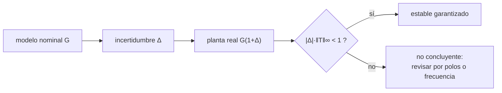

# B16-C16 — Control robusto inicial

<!-- nav:top -->
[🏠 Programa](../../../../README.md) · [📚 Bloque B16](../../../tronco-comun/B16-sistemas-dinamicos-y-control-automatico.md) · [← Anterior: B16-C15 — Control óptimo LQR](../B16-C15-control-optimo-lqr/CLASE.md) · [Siguiente: B16-C17 — Control no lineal →](../../../tronco-comun/B16-sistemas-dinamicos-y-control-automatico.md#b16-c17)
<!-- /nav -->

## 1. Ubicación, nivel y alcance

Decimosexta clase del bloque B16. Todos tus diseños anteriores supusieron un modelo exacto. Aquí aceptas que **el modelo es incierto** y aprendes a medir cuánta incertidumbre tolera un lazo: con los picos de las funciones de sensibilidad `S` y `T`, y con el teorema de la ganancia pequeña. Necesitas funciones de lazo, `S` y `T` (C06), márgenes (C10) y Routh (C08).

No verás la síntesis H∞ ni el análisis μ completos; esta clase es el primer paso hacia ellos.

## 2. Por qué esta clase existe

La inercia de un satélite cambia al desplegar paneles, consumir propergol o capturar una carga; el actuador envejece; el sensor tiene un retardo que no se conocía. El lazo diseñado con la inercia nominal debe seguir funcionando. La pregunta motivadora es: **¿cuánto puede equivocarse mi modelo antes de que el lazo deje de ser estable, y cómo lo cuantifico sin simular todos los casos?**

La decisión central: aceptar un diseño solo si su estabilidad y desempeño se mantienen en todo el rango de incertidumbre declarada.

## 3. Lo que podrás hacer al terminar

1. Definir incertidumbre paramétrica y multiplicativa.
2. Calcular los picos `‖S‖∞` y `‖T‖∞` de un lazo y relacionarlos con el amortiguamiento.
3. Aplicar el teorema de la ganancia pequeña y reconocer que es suficiente, no necesario.
4. Comparar la cota con la estabilidad real obtenida por polos.
5. Encontrar qué incertidumbre sí desestabiliza un lazo (el retardo del actuador) con Routh.
6. Cuantificar la dispersión del desempeño con un barrido aleatorio (Monte Carlo).

La evidencia es el **informe de robustez** del ejercicio 12 (sección 20).

## 4. Con qué llegas y cómo comprobarlo

1. ¿Qué dice `S + T = 1`?
2. ¿Cuál es el máximo de `|1/(1 + 0,5 s)|` en el eje imaginario?
3. Para un sistema de segundo orden con `ζ = 0,4`, ¿qué sobreimpulso aproximado tiene?
4. ¿Qué condición de Routh tiene `a₃ s³ + a₂ s² + a₁ s + a₀`?
5. ¿Qué es el valor máximo (supremo) de una función?

<details>
<summary>Ver respuestas</summary>

1. Que la sensibilidad y su complemento suman 1 en cada frecuencia: no pueden ser ambas pequeñas. 2. 1 (en `s = 0`). 3. ≈ 25 %. 4. Coeficientes positivos y `a₂ a₁ > a₃ a₀`. 5. El menor número que no es superado por ningún valor de la función.
</details>

Con cuatro o cinco aciertos, sigue.

## 5. Un caso real: la inercia cambia en vuelo

Un telescopio espacial despliega paneles solares, un parasol o una antena; su inercia respecto de cada eje cambia de forma apreciable, y el sistema de control debe seguir apuntando. La página del Hubble que usamos (S1) describe los sensores y actuadores del lazo de apuntamiento, pero no incluye cifras de inercia ni de cambios de configuración. Con un modelo **sintético**: inercia nominal `J = 50 kg·m²`, real `κ J` con `κ` entre 0,2 y 1,6, actuador de primer orden con `τ_a = 0,5 s`, y controlador PD `Kp = 20`, `Kd = 40`.

## 6. Vocabulario

La **incertidumbre paramétrica** es no conocer el valor exacto de un parámetro (aquí `κ`). La **incertidumbre multiplicativa** escribe la planta real como `G_real = G (1 + Δ)`, con `Δ` el error relativo. La **norma H∞** de una función `F(s)` es `‖F‖∞ = máx_ω |F(jω)|`. Los picos `Ms = ‖S‖∞` y `Mt = ‖T‖∞` miden la fragilidad del lazo: cuanto más grandes, menor margen. El **teorema de la ganancia pequeña** dice que, si el lazo nominal es estable y `|Δ|·‖T‖∞ < 1` (para `Δ` constante o con `|Δ(jω)| ≤ δ`), el lazo con incertidumbre multiplicativa sigue estable: es una condición **suficiente**. Un **barrido Monte Carlo** repite una simulación con parámetros aleatorios.

## 7. Modelo mental: un colchón alrededor del punto crítico

Imagina un círculo alrededor del punto `−1` en el plano de Nyquist. Cuanto más cerca pasa la curva `L(jω)` del punto, más pequeño es el círculo libre y menos incertidumbre tolera el lazo. Los picos de `S` y `T` miden la cercanía: el pico de `S` es el inverso de la distancia mínima de `L` a `−1`.



*Descripción textual:* a partir del modelo nominal y una incertidumbre relativa `Δ` se obtiene la planta real; si el producto `|Δ|·‖T‖∞` es menor que 1, la estabilidad está garantizada; si no, el criterio no concluye y hay que analizar por otros caminos.

La analogía es dimensionar un puente con coeficiente de seguridad: si la carga no supera la capacidad dividida por el coeficiente, está seguro; si la supera, no significa que se caiga, sino que no estás garantizado. Límite: el coeficiente de seguridad es un número, mientras que aquí `Δ` puede depender de la frecuencia.

## 8. La explicación, paso a paso

### 8.1 Los picos de `S` y `T`

Para un sistema de segundo orden estándar, `‖T‖∞ = 1/(2ζ√(1−ζ²))` si `ζ < 1/√2`. El laboratorio lo comprueba: `ζ = 0,2` → 2,55155; `0,4` → 1,36386; `0,6` → 1,04167, idénticos a la fórmula. Más amortiguamiento, menor pico. Para el lazo con actuador de la clase, `Ms = 1,667` y `Mt = 1,726` (en `ω ≈ 0,70 rad/s`). Un pico de `S` de 1,667 corresponde a una distancia mínima de `L` al punto `−1` de `1/1,667 = 0,60`.

### 8.2 Incertidumbre de inercia como `Δ` constante

Si la inercia real es `κ J`, entonces `G_real = G/κ`, es decir `Δ = 1/κ − 1`, constante en frecuencia. Para `κ = 0,7` (inercia 30 % menor), `Δ = +0,43`; para `κ = 1,3`, `Δ = −0,23`. La ganancia pequeña garantiza estabilidad si `|Δ| < 1/Mt = 0,579`.

### 8.3 La cota es conservadora

La tabla muestra, por polos, que el lazo es estable para **todos** los `κ` probados, incluso para los que la cota no garantiza:

| `κ` | `Δ` | Estable (polos) | Parte real máx. | Garantizado por ganancia pequeña |
|---|---|---|---|---|
| 1,6 | −0,38 | sí | −0,217 | sí |
| 1,3 | −0,23 | sí | −0,279 | sí |
| 1,0 | 0 | sí | −0,386 | sí |
| 0,7 | +0,43 | sí | −0,561 | sí |
| 0,5 | +1,00 | sí | −0,651 | no |
| 0,4 | +1,50 | sí | −0,639 | no |
| 0,3 | +2,33 | sí | −0,593 | no |
| 0,2 | +4,00 | sí | −0,556 | no |

La cota es suficiente pero no necesaria. En este lazo hay una razón exacta: el polinomio característico `κJτ_a s³ + κJ s² + Kd s + Kp` cumple Routh si y solo si `Kd > τ_a Kp`, **independientemente de `κ`**: la inercia, en este caso, no puede desestabilizar el lazo.

### 8.4 Lo que sí desestabiliza: el actuador lento

Con `Kd > τ_a Kp` como condición exacta (`τ_a < 40/20 = 2 s`), el actuador más lento sí puede: con `τ_a = 1,99 s` la parte real máxima es −0,00077 (estable al límite) y con `2,01 s` es +0,00077 (inestable); con `3 s`, +0,049. Aquí la incertidumbre relevante no es la inercia sino el retardo del actuador. Un diseño robusto identifica **cuál** es la incertidumbre que importa.

### 8.5 Dispersión del desempeño

Aunque la estabilidad no corra peligro, el desempeño varía. Con 400 inercias aleatorias uniformes en ±30 % (semilla 16), el sobreimpulso al escalón varía entre 43,4 % y 45,1 %, con media 44,0 %: una dispersión pequeña, que aquí no se analiza en detalle. Si la dispersión fuera grande, se rediseñaría o se haría ganancia programada. Un Monte Carlo no prueba robustez: muestrea.

## 9. Magnitudes, símbolos y unidades

| Símbolo | Qué es | Unidad | Nota |
|---|---|---|---|
| `κ` | factor de inercia real/nominal | — | 0,2 a 1,6 |
| `Δ` | incertidumbre relativa | — | `1/κ − 1` |
| `Ms, Mt` | picos de `S` y `T` | — | 1,667; 1,726 |
| `‖·‖∞` | norma H∞ | — | máximo del módulo |
| `τ_a` | constante de tiempo del actuador | s | 0,5 nominal; límite 2 |

## 10. Convenciones y referencias

La incertidumbre se declara con su rango y su origen (medida, tolerancia, estimación). Los picos se calculan sobre una rejilla de 200 001 frecuencias logarítmicas entre 10⁻³ y 10² rad/s. En el barrido se declara la semilla. Lo no incluido (ruido, saturación) se enumera.

## 11. De dónde sale lo que afirmamos

| ID | Fuente | Localizador | Respalda | Estado |
|---|---|---|---|---|
| S1 | NASA GSFC, *Pointing Control System* (archivo del Hubble, actualizada 2021-03-29) | https://asd.gsfc.nasa.gov/archive/hubble/technology/pcs.html | Elementos del lazo de apuntamiento del Hubble (sensores y ruedas de reacción) | Consultada el 2026-11-05; archivada |

Límites: el teorema de la ganancia pequeña, la norma H∞ y el pico de `T` de un sistema de segundo orden son resultados estándar, no citados a un texto; el pico se verifica contra su fórmula cerrada y la estabilidad contra el cálculo de polos. S1 no contiene cifras de inercia ni de cambios de configuración: la motivación sobre cambios de inercia al desplegar o perder elementos es una **suposición general**, no un dato de la fuente. Los valores del lazo son **sintéticos**.

## 12. Cómo ver la robustez

La tabla de 8.3 es la versión accesible. Para graficar, traza `|S(jω)|` y `|T(jω)|` en escala logarítmica con una línea horizontal en `1/|Δ|` (la cota); el lazo está garantizado donde `|T|` queda bajo esa línea. Usa trazos distintos para `S` y `T`.

## 13. Ejemplo trabajado: ¿aguanta el lazo un 70 % menos de inercia?

El telescopio pierde un panel y su inercia pasa de 50 a 15 kg·m² (`κ = 0,3`).

**Paso 1 · incertidumbre.** `Δ = 1/0,3 − 1 = +2,33`.
**Paso 2 · ganancia pequeña.** `|Δ|·Mt = 2,33·1,726 = 4,0 > 1`: no garantiza.
**Paso 3 · polos reales.** Polinomio `0,3·50·0,5 s³ + 15 s² + 40 s + 20`; Routh: `Kd = 40 > τ_a Kp = 10`. Estable, parte real máxima −0,593.
**Paso 4 · lectura.** La cota no concluye pero el análisis exacto sí: estable. Se anota que el desempeño cambia (`ωn` sube a `√(20/15) = 1,15 rad/s`), y que con un modo flexible o un retardo adicional esa mayor frecuencia podría ser un problema (C10).
**Paso 5 · decisión.** El diseño sirve en todo el rango de `κ` declarado; el riesgo no está en la inercia sino en `τ_a`, que debe mantenerse bajo 2 s.

## 14. Distintos enfoques de la robustez

El **margen de ganancia y fase** (C10) mide dos direcciones de incertidumbre. La **ganancia pequeña** (esta clase) cubre cualquier incertidumbre acotada con un número. El **análisis por polos en un barrido** es exacto pero solo en los puntos probados. La **síntesis H∞** y el **análisis μ** diseñan para la peor incertidumbre y se tratan en cursos avanzados. La **ganancia programada** adapta las ganancias a la configuración (por ejemplo, según la inercia estimada).

## 15. Práctica guiada

**Ejercicio 1 · con pasos.** Calcula `‖T‖∞` para `ζ = 0,5`. *Pasos:* 8.1.

<details><summary>Solución comentada</summary>

`1/(2·0,5·√0,75) = 1/0,866 = 1,1547`.
</details>

**Ejercicio 2 · con pista.** Con `Mt = 1,726`, ¿qué `Δ` máximo garantiza la ganancia pequeña? *Pista:* `1/Mt`.

<details><summary>Solución comentada</summary>

`1/1,726 = 0,579`.
</details>

**Ejercicio 3 · casi autónomo.** ¿Garantiza la ganancia pequeña `κ = 0,7`? (Usa `Δ = 1/κ − 1`.)

<details><summary>Solución comentada</summary>

`Δ = 0,4286 < 0,579`: sí.
</details>

## 16. Práctica autónoma, transferencia e integrador

**Ejercicio 4.** ¿Qué `κ` mínimo (inercia más pequeña) garantiza la ganancia pequeña para este lazo?

<details><summary>Solución comentada</summary>

`1/κ − 1 < 0,579` → `κ > 1/1,579 = 0,633`.
</details>

**Ejercicio 5.** Verifica con Routh que `Kd = 40`, `Kp = 20`, `τ_a = 0,5` es estable para cualquier `κ`.

<details><summary>Solución comentada</summary>

Polinomio `κJτ_a s³ + κJ s² + Kd s + Kp`: `κJ·Kd > κJτ_a·Kp` ⇔ `Kd > τ_a Kp` ⇔ `40 > 10`, independiente de `κ`.
</details>

**Ejercicio 6.** ¿Para qué `τ_a` pierde la estabilidad con `Kd = 40`, `Kp = 20`?

<details><summary>Solución comentada</summary>

`τ_a = Kd/Kp = 2 s`. Por encima, inestable.
</details>

**Ejercicio 7.** Si `Kd` se reduce a 8 con `Kp = 20` y `τ_a = 0,5`, ¿es estable?

<details><summary>Solución comentada</summary>

`Kd = 8 < τ_a Kp = 10`: inestable. Un cambio de ganancia pequeño en `Kd` rompe el lazo.
</details>

**Ejercicio 8.** Explica con `S + T = 1` por qué no puedes tener `Ms` y `Mt` pequeños a la vez en todas las frecuencias.

<details><summary>Solución comentada</summary>

Si `|S|` es pequeño en una frecuencia, `T = 1 − S` es cercano a 1 allí: buen rechazo de perturbaciones implica que el ruido de medida pasa. Por eso se busca `S` pequeño a baja frecuencia y `T` pequeño a alta frecuencia, donde `S ≈ 1`.
</details>

**Ejercicio 9 · transferencia.** Un parasol que se despliega aumenta `J` en 40 % (`κ = 1,4`). ¿Garantiza la ganancia pequeña la estabilidad y cómo cambian `ωn`?

<details><summary>Solución comentada</summary>

`Δ = 1/1,4 − 1 = −0,286`; `|Δ| = 0,286 < 0,579`: sí. `ωn = √(20/70) = 0,53 rad/s`, menor que 0,63: respuesta más lenta.
</details>

**Ejercicio 10 · transferencia.** El computador añade 0,2 s de latencia y la modelas como un polo extra. ¿Qué incertidumbre es y cuál herramienta de la clase usarías?

<details><summary>Solución comentada</summary>

Es un retardo en el lazo (no una variación de `J`): se mira con margen de fase y de retardo (C10) y con el barrido de `τ_a` o su equivalente (8.4).
</details>

**Ejercicio 11 · transferencia.** Un Monte Carlo de 400 muestras no encuentra ningún caso inestable. ¿Demuestra robustez? Justifica.

<details><summary>Solución comentada</summary>

No: solo muestra que esos 400 casos son estables. Una región pequeña de parámetros inestables puede quedar sin muestrear. Se complementa con una cota (ganancia pequeña) o un análisis exacto (Routh).
</details>

**Ejercicio 12 · integrador.** Entrega un **informe de robustez**: para un lazo de tu elección, declara la incertidumbre (rango y origen), calcula `Ms` y `Mt`, aplica la ganancia pequeña, compara con el análisis por polos en un barrido y con Routh, y da un Monte Carlo con semilla.

<details><summary>Solución modelo</summary>

Debe contener la tabla de `κ` (o del parámetro) con cota y polos, la condición exacta de Routh, el Monte Carlo con semilla y una frase sobre qué incertidumbre es la crítica.
</details>

## 17. Laboratorio: picos, ganancia pequeña y Routh

El script [robustez_de_inercia.py](robustez_de_inercia.py) verifica el pico de `T` contra la fórmula, calcula `Ms` y `Mt`, barre `κ` con polos y ganancia pequeña, comprueba la frontera de Routh `τ_a = Kd/Kp` y corre un Monte Carlo de 400 inercias.

**Datos:** sintéticos (simulados). **Predice:** estabilidad para todos los `κ`. **Ejecución del 2026-11-05 (Python 3.12.9, numpy 2.4.4, scipy 1.17.1):**

```text
zeta = 0.2: ||T||inf = 2.55155 (cerrada 2.55155)
zeta = 0.4: ||T||inf = 1.36386 (cerrada 1.36386)
zeta = 0.6: ||T||inf = 1.04167 (cerrada 1.04167)
lazo nominal: Ms = 1.667, Mt = 1.726 (en 0.699 rad/s); cota de ganancia pequeña |Delta| < 0.579
  kappa   Delta    estable (raíces)  parte real máx   garantizado por ganancia pequeña
   1.6   -0.38    True            -0.2174          True
   1.3   -0.23    True            -0.2787          True
   1.0   +0.00    True            -0.3863          True
   0.7   +0.43    True            -0.5606          True
   0.5   +1.00    True            -0.6508          False
   0.4   +1.50    True            -0.6389          False
   0.3   +2.33    True            -0.5927          False
   0.2   +4.00    True            -0.5558          False
condición exacta de Routh: Kd > tau_a Kp -> tau_a < 2.000 s para cualquier kappa
  tau_a =  0.50 s: parte real máx = -0.38626 -> estable
  tau_a =  1.90 s: parte real máx = -0.00813 -> estable
  tau_a =  1.99 s: parte real máx = -0.00077 -> estable
  tau_a =  2.01 s: parte real máx = +0.00077 -> inestable
  tau_a =  3.00 s: parte real máx = +0.04907 -> inestable
Monte Carlo (400 inercias en ±30 %): sobreimpulso medio 44.0 %, mínimo 43.4 %, máximo 45.1 %
Pruebas superadas.
```

```bash
python programa/clases/B16/B16-C16-control-robusto-inicial/robustez_de_inercia.py
```

**Límites:** incertidumbre solo en `J` y `τ_a`; sin ruido ni saturación; el Monte Carlo usa la semilla 16; tarda unos 17 s.

## 18. Errores frecuentes y cómo corregirlos

**Tomar la ganancia pequeña como condición necesaria.** Se corrige con la tabla 8.3 y el ejercicio 4.

**Creer que un Monte Carlo prueba robustez.** Se corrige con el ejercicio 11.

**Buscar la incertidumbre equivocada.** Se corrige con los ejercicios 5 a 7.

**Ignorar que `S` y `T` se contraponen.** Se corrige con el ejercicio 8.

**Confundir un rango de inercia con una distribución.** Se corrige releyendo 10.

## 19. Cómo sabrás que vas bien

Tras 8.1: ¿calculas `‖T‖∞` para un `ζ`? Ejercicio 1. Tras 8.3: ¿distingues cota y análisis exacto? Ejercicio 4. Tras el ejemplo: ¿identificas cuál incertidumbre es crítica?

## 20. Qué entregas y cómo se evalúa

El producto es el **informe de robustez** del ejercicio 12.

| Criterio | Inicial | En desarrollo | Logrado | Destacado |
|---|---|---|---|---|
| Incertidumbre | Sin rango | Rango sin origen | Rango y origen | Distingue la crítica |
| Cota | Sin cálculo | Cálculo sin interpretar | Con picos y ganancia pequeña | Compara con la exacta |
| Exactitud | Un solo caso | Barrido | Barrido y Routh | Con Monte Carlo y semilla |
| Fuentes y datos | Sin rótulo | Parcial | Rotula sintético | Declara supuestos no citados |

**Condiciones críticas:** no presentar la ganancia pequeña como necesaria; declarar los supuestos no citados.

## 21. Ética, seguridad y límites

Un diseño «robusto» solo lo es frente a la incertidumbre que declaraste; lo no declarado puede romperlo. Cifras didácticas. Accesibilidad: tabla equivalente a las curvas.

## 22. Para cerrar y seguir

La robustez se cuantifica con los picos de `S` y `T`, la ganancia pequeña da una cota suficiente y conservadora, y un análisis exacto (Routh, polos) revela cuál incertidumbre importa; aquí, el retardo del actuador y no la inercia. Un Monte Carlo muestra la dispersión pero no prueba robustez. Queda abierta una pregunta: ¿qué cambia cuando el sistema es intrínsecamente no lineal?

**Glosario español–inglés.** robustez · *robustness*; incertidumbre multiplicativa · *multiplicative uncertainty*; norma H-infinito · *H-infinity norm*; ganancia pequeña · *small gain*; pico de sensibilidad · *sensitivity peak*; Monte Carlo · *Monte Carlo*.

**Continuidad.** B16-C17 estudia el control no lineal. B16-C18 trata la saturación. B16-C19 reúne estas pruebas en la verificación del lazo cerrado.

**Referencias:** ver sección 11.

<!-- nav:bottom -->
---

[← Anterior: B16-C15 — Control óptimo LQR](../B16-C15-control-optimo-lqr/CLASE.md) · [📚 Bloque B16](../../../tronco-comun/B16-sistemas-dinamicos-y-control-automatico.md) · [Siguiente: B16-C17 — Control no lineal →](../../../tronco-comun/B16-sistemas-dinamicos-y-control-automatico.md#b16-c17)
<!-- /nav -->
