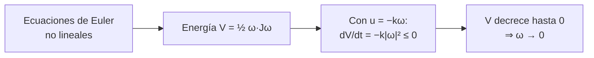

# B16-C17 — Control no lineal

<!-- nav:top -->
[🏠 Programa](../../../../README.md) · [📚 Bloque B16](../../../tronco-comun/B16-sistemas-dinamicos-y-control-automatico.md) · [← Anterior: B16-C16 — Control robusto inicial](../B16-C16-control-robusto-inicial/CLASE.md) · [Siguiente: B16-C18 — Saturación y anti-windup →](../B16-C18-saturacion-y-anti-windup/CLASE.md)
<!-- /nav -->

## 1. Ubicación, nivel y alcance

Decimoséptima clase del bloque B16. Hasta C16 todo era lineal. Un cuerpo rígido que gira en tres ejes **no lo es**: sus ecuaciones tienen términos cuadráticos en la velocidad angular. Aquí verás las ecuaciones de Euler, un comportamiento que ningún modelo lineal predice (el eje intermedio inestable) y la herramienta central del control no lineal, el **método de Lyapunov**. Necesitas el producto vectorial (B09-C19, B10), las ecuaciones diferenciales (B11) y la linealización (B16-C01).

No verás todavía los cuaterniones en detalle (C20), el control con saturación (C18) ni la dinámica completa de actitud de B87-C01.

## 2. Por qué esta clase existe

Cuando un satélite se separa del cohete puede salir girando de forma desordenada («volteando»). Su control debe frenar esa rotación aunque las ecuaciones sean no lineales y el modelo lineal sea inútil: linealizado en torno a la velocidad nula, el modelo dice `J ω̇ = u`, sin los términos que hacen que el cuerpo se comporte de forma sorprendente. La pregunta motivadora es: **¿cómo diseño y garantizo la estabilidad de un controlador cuando no puedo apoyarme en polos ni en la linealización?**

La decisión central: encontrar una función de energía que el control haga decrecer, y a partir de ella un control que lleve al sistema al reposo.

## 3. Lo que podrás hacer al terminar

1. Escribir las ecuaciones de Euler de un cuerpo rígido y explicar cada término.
2. Verificar las cantidades conservadas (energía y momento angular) de la rotación libre.
3. Predecir la inestabilidad del giro alrededor del eje de inercia intermedia con la linealización.
4. Aplicar el método de Lyapunov a una ley de frenado `u = −k ω`.
5. Distinguir cuándo vale una conclusión local (linealización) y cuándo una global (Lyapunov).
6. Comprobar los resultados contra soluciones exactas y la tasa de crecimiento teórica.

La evidencia es el **análisis de Lyapunov** del ejercicio 12 (sección 20).

## 4. Con qué llegas y cómo comprobarlo

1. Calcula `ω × (J ω)` para `J = diag(2,1,1)` y `ω = (0,1,1)`.
2. ¿Qué significa «conservar» una cantidad en un sistema que evoluciona?
3. ¿Cuál es la derivada de `V = ½ J ω²` respecto de `ω`?
4. ¿Qué es un punto de equilibrio?
5. Si `V̇ = −k ω²` con `k > 0`, ¿qué ocurre con `V` en el tiempo?

<details>
<summary>Ver respuestas</summary>

1. `J ω = (0,1,1)`; `ω × (Jω) = (0,1,1) × (0,1,1) = 0`. 2. Que su valor no cambia a lo largo de cualquier trayectoria. 3. `J ω`. 4. Un estado donde la derivada temporal es cero. 5. Decrece mientras `ω ≠ 0`.
</details>

Con cuatro o cinco aciertos, sigue; si fallaste la 1, repasa el producto vectorial.

## 5. Un caso real: el volteo tras la separación

Un satélite sale del lanzador con velocidades angulares residuales. Los textos de control de actitud, como el que consultamos (S1, que trata modelos de actitud con ángulos de Euler y con cuaterniones y diseños de control no lineal), distinguen los diseños basados en un modelo linealizado, que valen cerca de un punto, de los diseños no lineales con garantía global. En el Hubble, las ruedas de reacción (hasta 3000 rpm) y los magnetopares (S2) gestionan el momento angular, pero el frenado de un volteo fuerte suele necesitar otros actuadores, tema de B87-C16. Aquí trabajamos con un cuerpo **sintético** de inercias principales `(50, 40, 30) kg·m²` y velocidades iniciales `(0,10; 0,05; −0,08) rad/s`.

## 6. Vocabulario

Las **ecuaciones de Euler** para un cuerpo rígido con inercias principales `J = diag(J1, J2, J3)` en los ejes del cuerpo son `J ω̇ = −ω × (J ω) + u`, con `ω` la velocidad angular del cuerpo respecto de un sistema inercial, expresada en el sistema del cuerpo (rad/s), y `u` el par de control (N·m). El **momento angular** es `H = J ω` (N·m·s); la **energía cinética de rotación** es `T = ½ ω·J ω` (J). Un **eje principal** es un eje para el que `ω` paralelo a él da `H` paralelo. Una **función de Lyapunov** `V(x)` es una función definida positiva cuya derivada a lo largo de las trayectorias es no positiva. La **estabilidad asintótica global** significa que toda trayectoria tiende al equilibrio.

## 7. Modelo mental: una bola que solo baja

La función de Lyapunov es como la altura de una bola en un paisaje: si el control garantiza que la bola siempre baja (o se queda), y el único punto de reposo es el fondo, la bola termina en el fondo sin importar de dónde parta. No hace falta resolver las ecuaciones.



*Descripción textual:* de las ecuaciones de Euler se toma la energía como función de Lyapunov; con el control `u = −k ω` su derivada es `−k|ω|²`, que es negativa salvo en reposo; por tanto la energía baja a cero y la velocidad tiende a cero.

La analogía de la bola tiene un límite: asegura que la bola baja, pero no dice cuánto tarda; tampoco cubre el caso en que el paisaje tenga más de un fondo (equilibrios múltiples, como con la orientación en C20).

## 8. La explicación, paso a paso

### 8.1 Qué se conserva sin par

Con `u = 0` la energía `T` y el módulo del momento angular `|J ω|` no cambian. En el laboratorio, con `ω(0) = (0,10; 0,05; −0,08)` durante 200 s, la energía varía 3×10⁻¹² (relativo) y `|H|` varía 1,4×10⁻¹², solo error numérico. Para este estado, `H = (5,0; 2,0; −2,4) N·m·s`, `|H| = 5,90` y `T = 0,396 J`. Estas dos cantidades son la mejor comprobación de cualquier simulador de rotación (se reutilizan en C20).

### 8.2 El giro inestable del eje intermedio

Hay tres ejes principales: el mayor (J = 50), el intermedio (40) y el menor (30). Una rotación pura alrededor del mayor o del menor es estable: una pequeña perturbación permanece pequeña. Alrededor del intermedio es **inestable**. Linealizando en `ω = (0, Ω, 0)` y perturbando los otros dos ejes, la perturbación crece con la tasa
`λ = Ω √((J2 − J3)(J1 − J2)/(J1 J3))`.
Con `Ω = 0,2 rad/s`: `λ = 0,2·√(10·10/1500) = 0,0516 s⁻¹`. El laboratorio parte de una perturbación de 10⁻⁶ rad/s y ajusta la pendiente del logaritmo de la amplitud transversal entre 20 y 150 s: `0,05165 s⁻¹`, una diferencia de 0,02 % con la linealización. La amplitud llega a 0,207 rad/s a los 300 s: el crecimiento deja de ser exponencial y el cuerpo se voltea. Las rotaciones alrededor de los ejes mayor y menor mantienen la perturbación bajo 2×10⁻⁶ rad/s en 100 s.

### 8.3 Por qué la linealización no basta para el frenado

Linealizando `J ω̇ = −ω × (Jω) + u` en `ω = 0`, el término cuadrático desaparece (su Jacobiano es nulo) y queda `J ω̇ = u`: un triple integrador sin información sobre los efectos giroscópicos. Sirve para el diseño cerca del reposo (C20, ángulos pequeños) pero no para un volteo grande ni para garantizar convergencia global.

### 8.4 Lyapunov para el frenado

Con `V = ½ ω·J ω` (definida positiva) y `u = −k ω` (`k > 0`, en N·m·s/rad), la derivada es `V̇ = ω·J ω̇ = ω·(−ω × Jω + u) = −k|ω|²`, porque `ω·(ω × Jω) = 0`. Entonces `V̇ ≤ 0` y solo se anula en `ω = 0`: la velocidad angular tiende a cero **desde cualquier condición inicial**. El laboratorio lo verifica: `V` es monótona decreciente, la diferencia entre `dV/dt` numérica y `−k|ω|²` es 4×10⁻⁷, y al final `|ω| = 4×10⁻¹⁰ rad/s`. El caso isótropo (`J = 40 I`) tiene solución exacta `ω(t) = ω₀ e^{−kt/J}`, reproducida con error 10⁻¹³ rad/s.

### 8.5 Qué no da Lyapunov

La prueba garantiza que la velocidad tiende a cero, no cuánto tarda (depende de `k` y de `J`), ni dice nada de la orientación final (C20), ni respeta límites de par (C18). La condición «estable para toda condición inicial» es una propiedad global; la estabilidad por linealización solo es local. Cuando falla la función de Lyapunov propuesta, no se prueba nada: otra podría servir.

## 9. Magnitudes, símbolos y unidades

| Símbolo | Qué es | Unidad | Nota |
|---|---|---|---|
| `ω` | velocidad angular del cuerpo | rad/s | en el sistema del cuerpo |
| `J` | tensor de inercia (principal) | kg·m² | `diag(50, 40, 30)` |
| `H = J ω` | momento angular | N·m·s | |
| `T` | energía cinética de rotación | J | `½ ω·Jω` |
| `u` | par de control | N·m | `−k ω` |
| `k` | ganancia de frenado | N·m·s/rad | 8 en el ejemplo |
| `V` | función de Lyapunov | J | |
| `λ` | tasa de crecimiento linealizada | s⁻¹ | 0,0516 |

## 10. Convenciones y referencias

`ω × (J ω)` se escribe en componentes del cuerpo. La integración usa DOP853 con tolerancia relativa 10⁻¹². Los resultados de conservación se miden como variación relativa máxima. Se declara que el modelo es de cuerpo rígido: los líquidos y paneles flexibles añaden disipación o modos que cambian el análisis.

## 11. De dónde sale lo que afirmamos

| ID | Fuente | Localizador | Respalda | Estado |
|---|---|---|---|---|
| S1 | Yang, Y., *Spacecraft Modeling, Attitude Determination, and Control: Quaternion-Based Approach*, CRC Press (copia en NASA NTRS) | https://ntrs.nasa.gov/citations/20240009554 | Que el texto compara diseños basados en modelos linealizados (válidos cerca del punto de linealización) con diseños no lineales globalmente estabilizantes con cuaterniones; capítulo 9: un teorema de estabilidad (Teorema 9.1) que concluye estabilidad asintótica global del origen, y la observación (Observación 9.1) sobre el problema intrínseco de «enrollamiento» (*windup*) de la actitud con `q0 < 0` | Extraído del PDF el 2026-11-05; solo introducción y pasajes del capítulo 9 |
| S2 | NASA GSFC, *Pointing Control System* (archivo del Hubble, actualizada 2021-03-29) | https://asd.gsfc.nasa.gov/archive/hubble/technology/pcs.html | Ruedas de reacción de hasta 3000 rpm y magnetopares que gestionan su velocidad | Consultada el 2026-11-05; archivada |

Límites: las ecuaciones de Euler, la conservación de `T` y `|H|`, la tasa `λ` y el argumento de Lyapunov con `u = −kω` son resultados clásicos de mecánica y de control no lineal, no citados a un texto específico; se verifican numéricamente. La afirmación de que el frenado de un volteo fuerte «suele necesitar otros actuadores» es una **observación general** no verificada en S2. El cuerpo es **sintético**.

## 12. Cómo ver los resultados

| Verificación | Resultado (simulado) |
|---|---|
| Variación relativa de la energía, 200 s | 3,1×10⁻¹² |
| Variación relativa de `|H|`, 200 s | 1,4×10⁻¹² |
| Tasa de crecimiento en el eje intermedio | 0,05165 vs 0,05164 s⁻¹ |
| Isótropo: error contra la exponencial | 1,2×10⁻¹³ rad/s |
| `V` monótona decreciente con `u = −8 ω` | sí |

Para graficar, dibuja `|ω_perp|` en escala logarítmica para el eje intermedio: una recta creciente; y `V(t)` en el frenado: una curva decreciente sin oscilaciones.

## 13. Ejemplo trabajado: ¿cuánto tarda en frenarse el cuerpo?

Con `k = 8 N·m·s/rad` y las inercias `(50, 40, 30)`.

**Paso 1 · energía inicial.** `V(0) = ½(50·0,01 + 40·0,0025 + 30·0,0064) = 0,396 J`.
**Paso 2 · derivada.** `V̇(0) = −8·(0,01 + 0,0025 + 0,0064) = −0,1512 W`.
**Paso 3 · escala de tiempo.** Como `V̇ ≤ −2k V/J_máx` (porque `|ω|² ≥ 2V/J_máx = 2V/50`), `V(t) ≤ V(0) e^{−2kt/50}`: constante de tiempo de `V` de `50/(2·8) = 3,1 s`, cota superior no ajustada. El `|ω|` decae al menos como `e^{−kt/J_máx} = e^{−t/6,25}`.
**Paso 4 · tiempo al 1 %.** Del orden de `6,25·ln(100) = 28,8 s` (la cota ignora un factor constante `√(J_máx/J_mín)`).
**Paso 5 · comprobación.** El laboratorio termina a los 120 s con `V = 5×10⁻¹⁸ J`, coherente con la escala de la cota.

## 14. Distintos enfoques para controlar lo no lineal

**Linealizar** (C01) es simple y valioso cerca del punto de trabajo. **Lyapunov** (esta clase) da garantías globales con una ley sencilla, pero puede ser conservador y no dice la velocidad de convergencia. **Linealización por realimentación** (cancelar los términos no lineales) exige conocer bien el modelo. **Control por modos deslizantes y MPC no lineal** (B87-C21) tratan restricciones y robustez y se estudian en B87.

## 15. Práctica guiada

**Ejercicio 1 · con pasos.** Calcula `H`, `|H|` y `T` para `ω = (0,10; 0,05; −0,08)` y `J = diag(50, 40, 30)`. *Pasos:* 8.1.

<details><summary>Solución comentada</summary>

`H = (5,0; 2,0; −2,4)`; `|H| = √(25 + 4 + 5,76) = 5,896 N·m·s`; `T = ½(0,5 + 0,1 + 0,192) = 0,396 J`.
</details>

**Ejercicio 2 · con pista.** Calcula `λ` para `Ω = 0,3 rad/s` con las mismas inercias. *Pista:* 8.2.

<details><summary>Solución comentada</summary>

`λ = 0,3·√(100/1500) = 0,3·0,2582 = 0,0775 s⁻¹`; la perturbación se multiplica por `e` cada 12,9 s.
</details>

**Ejercicio 3 · casi autónomo.** ¿Alrededor de qué ejes es estable el giro y alrededor de cuál no?

<details><summary>Solución comentada</summary>

Estable alrededor del eje de mayor inercia (50) y del de menor (30); inestable alrededor del intermedio (40).
</details>

## 16. Práctica autónoma, transferencia e integrador

**Ejercicio 4.** Con el cuerpo isótropo `J = 40 I` y `k = 8`, ¿cuál es la constante de tiempo de `ω` y cuándo baja al 1 %?

<details><summary>Solución comentada</summary>

`J/k = 5 s`; 1 % a `5·ln(100) = 23 s`.
</details>

**Ejercicio 5.** Calcula `V̇` inicial para `u = −k ω` con `k = 5` y `ω = (0,10; 0,05; −0,08)`.

<details><summary>Solución comentada</summary>

`V̇ = −5·0,0189 = −0,0945 W`.
</details>

**Ejercicio 6.** Demuestra que `ω·(ω × Jω) = 0`.

<details><summary>Solución comentada</summary>

El producto triple `a·(a × b)` es cero porque `a × b` es perpendicular a `a`.
</details>

**Ejercicio 7.** El frenado con `u = −kω` no depende del tiempo que tarda: ¿qué cota inferior de tiempo impone un par limitado a ±0,5 N·m por eje?

<details><summary>Solución comentada</summary>

Sin perturbación externa, `dH/dt = u` en el espacio inercial; con `|u| ≤ 0,5√3 = 0,866 N·m` el tiempo mínimo para eliminar `|H| = 5,896` es al menos `5,896/0,866 = 6,8 s`. Es una cota, no el tiempo real.
</details>

**Ejercicio 8.** Si el frenado se aplica solo en dos ejes (`u₃ = 0`), ¿se puede aplicar el mismo argumento de Lyapunov?

<details><summary>Solución comentada</summary>

`V̇ = −k(ω1² + ω2²) ≤ 0` solo se anula con `ω1 = ω2 = 0`, no con `ω3 = 0`; hace falta un argumento adicional (principio de invariancia de LaSalle) que muestre que la dinámica fuerza `ω3 → 0`. No lo vemos aquí.
</details>

**Ejercicio 9 · transferencia.** Tras la separación, el satélite gira alrededor de su eje intermedio a 0,2 rad/s con ruido de 10⁻⁶ rad/s. ¿Cuánto tarda la perturbación en crecer a 10⁻² rad/s?

<details><summary>Solución comentada</summary>

`ln(10⁻²/10⁻⁶)/0,0516 = 9,21/0,0516 = 178 s`. Alrededor de 3 minutos para que el volteo sea apreciable.
</details>

**Ejercicio 10 · transferencia.** Un colega propone diseñar el frenado solo con el modelo linealizado `J ω̇ = u`. Da un argumento a favor y uno en contra.

<details><summary>Solución comentada</summary>

A favor: cerca de `ω = 0` es correcto y permite usar toda la teoría lineal. En contra: no garantiza convergencia desde un volteo grande, ni capta el efecto giroscópico; el argumento de Lyapunov sí da garantía global.
</details>

**Ejercicio 11 · transferencia.** Un satélite con tanque parcialmente lleno de líquido disipa energía en el chapoteo. ¿Qué pasa con el eje de menor inercia? (Piensa en `T` y `|H|`.)

<details><summary>Solución comentada</summary>

La disipación reduce la energía conservando `|H|`; el estado tiende a la mínima energía compatible con `H`, que es la rotación alrededor del eje de **mayor** inercia. Por eso un giro alrededor del eje menor puede volverse inestable con disipación interna. (Es una conclusión cualitativa de la mecánica; no la modelamos aquí.)
</details>

**Ejercicio 12 · integrador.** Entrega un **análisis de Lyapunov**: para un cuerpo con inercias elegidas, escribe las ecuaciones de Euler, verifica por simulación la conservación sin par, halla la tasa de inestabilidad del eje intermedio, propone `u = −k ω` con su derivada de Lyapunov y comprueba por simulación.

<details><summary>Solución modelo</summary>

Debe incluir las ecuaciones, la conservación con su error, la tasa teórica contra la ajustada, `V̇ = −k|ω|²` demostrada y comprobada, y una frase sobre lo que no garantiza (tiempo, orientación, límites de par).
</details>

## 17. Laboratorio: Euler, inestabilidad y Lyapunov

El script [euler_y_lyapunov.py](euler_y_lyapunov.py) integra las ecuaciones de Euler con DOP853, comprueba los invariantes, ajusta la tasa de crecimiento del eje intermedio contra la linealización, verifica el caso isótropo exacto y la función de Lyapunov.

**Datos:** sintéticos (simulados). **Predice:** tasa 0,0516 s⁻¹. **Ejecución del 2026-11-05 (Python 3.12.9, numpy 2.4.4, scipy 1.17.1):**

```text
sin par, 200 s: variación relativa de la energía 3.14e-12, del |H| 1.38e-12
eje intermedio: tasa linealizada 0.05164 s^-1; tasa ajustada 0.05165 s^-1 (0.02 % de diferencia)
   amplitud transversal: 1.4e-06 rad/s al inicio, máx 0.207 rad/s en 300 s (el modelo lineal deja de valer)
   giro estable alrededor del eje mayor (J=50): |w_perp| máx = 1.58e-06 rad/s
   giro estable alrededor del eje menor (J=30): |w_perp| máx = 1.87e-06 rad/s
cuerpo isótropo con u = -k w: error máx frente a w0 exp(-k t/J) = 1.25e-13 rad/s
Lyapunov: V monótona decreciente = True; max|dV/dt numérica - (-k|w|^2)| = 4.35e-07
   V(0) = 0.39600 J, V(120 s) = 4.970e-18 J; |w| final = 4.46e-10 rad/s
Pruebas superadas.
```

```bash
python programa/clases/B16/B16-C17-control-no-lineal/euler_y_lyapunov.py
```

**Límites:** cuerpo rígido, sin par perturbador ni saturación; el script detiene la ejecución si los invariantes varían más de 10⁻⁹ o la tasa difiere más del 3 %.

## 18. Errores frecuentes y cómo corregirlos

**Linealizar en `ω = 0` y concluir que no hay efectos giroscópicos.** Se corrige con la sección 8.3.

**Creer que todos los ejes principales son igual de estables.** Se corrige con los ejercicios 2, 3 y 9.

**Tomar `V̇ ≤ 0` como prueba de convergencia en tiempo finito.** Se corrige con el ejemplo 13.

**Olvidar que Lyapunov no respeta límites de par.** Se corrige con el ejercicio 7.

**Usar el cálculo de `T` y `|H|` sin unidades.** Se corrige con la tabla de la sección 9.

## 19. Cómo sabrás que vas bien

Tras 8.1: ¿calculas `H` y `T`? Ejercicio 1. Tras 8.2: ¿calculas `λ`? Ejercicio 2. Tras 8.4: ¿demuestras `V̇ = −k|ω|²`? Ejercicio 6.

## 20. Qué entregas y cómo se evalúa

El producto es el **análisis de Lyapunov** del ejercicio 12.

| Criterio | Inicial | En desarrollo | Logrado | Destacado |
|---|---|---|---|---|
| Modelo | Sin ecuaciones | Ecuaciones sin verificar | Con conservación verificada | Con tasa de inestabilidad contrastada |
| Lyapunov | Sin prueba | Prueba incompleta | `V̇ = −k|ω|²` demostrada | Con cota de tiempo |
| Alcance | Generaliza | Menciona límites | Declara lo que no garantiza | Propone la extensión (saturación, orientación) |
| Fuentes y datos | Sin rótulo | Parcial | Rotula sintético | Declara lo no consultado |

**Condiciones críticas:** verificar la conservación; no atribuir a la fuente resultados que no se leyeron; declarar el cuerpo como sintético.

## 21. Ética, seguridad y límites

Una prueba de estabilidad global no sustituye los ensayos con el hardware ni el análisis de modos flexibles y chapoteo. Cifras didácticas. Accesibilidad: tablas equivalentes a las gráficas.

## 22. Para cerrar y seguir

Las ecuaciones de Euler conservan energía y momento angular; el giro alrededor del eje intermedio es inestable con una tasa que la linealización predice (0,0516 s⁻¹ en el ejemplo); el método de Lyapunov garantiza que `u = −k ω` frena al cuerpo desde cualquier estado, sin decir cuánto tarda ni qué orientación queda. Queda abierta una pregunta: ¿qué pasa cuando el actuador no puede entregar el par pedido?

**Glosario español–inglés.** ecuaciones de Euler · *Euler's equations*; momento angular · *angular momentum*; eje principal · *principal axis*; función de Lyapunov · *Lyapunov function*; estabilidad global · *global stability*; volteo · *tumbling*.

**Continuidad.** B16-C18 trata la saturación del par. B16-C20 añade la orientación con cuaterniones. B87-C01 y B87-C16 desarrollan la dinámica de cuerpo rígido y el frenado tras el despliegue.

**Referencias:** ver sección 11.

<!-- nav:bottom -->
---

[← Anterior: B16-C16 — Control robusto inicial](../B16-C16-control-robusto-inicial/CLASE.md) · [📚 Bloque B16](../../../tronco-comun/B16-sistemas-dinamicos-y-control-automatico.md) · [Siguiente: B16-C18 — Saturación y anti-windup →](../B16-C18-saturacion-y-anti-windup/CLASE.md)
<!-- /nav -->
