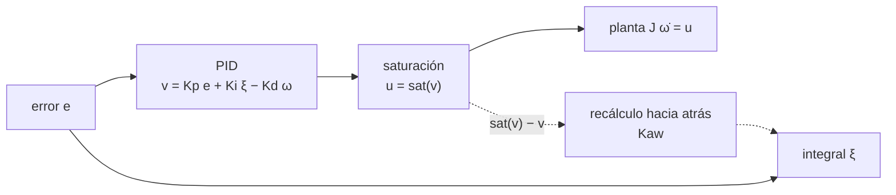

# B16-C18 — Saturación y anti-windup

<!-- nav:top -->
[🏠 Programa](../../../../README.md) · [📚 Bloque B16](../../../tronco-comun/B16-sistemas-dinamicos-y-control-automatico.md) · [← Anterior: B16-C17 — Control no lineal](../B16-C17-control-no-lineal/CLASE.md) · [Siguiente: B16-C19 — Verificación de lazo cerrado →](../B16-C19-verificacion-de-lazo-cerrado/CLASE.md)
<!-- /nav -->

## 1. Ubicación, nivel y alcance

Decimoctava clase del bloque B16. Todo lo anterior supuso un actuador capaz de entregar cualquier par que el controlador pida. Ninguno lo es. Aquí estudias qué ocurre cuando el actuador **satura**, por qué el término integral del PID (C11) se vuelve peligroso (*windup*) y cómo se corrige con el **anti-windup**. Necesitas el PID (C11), la linealidad (C03) y la simulación numérica (B11).

No verás todavía el control con restricciones formales (MPC, B87-C21) ni la descarga de momento de las ruedas (B87-C14).

## 2. Por qué esta clase existe

Una rueda de reacción entrega un par máximo y almacena un momento angular máximo (el Hubble usa ruedas de hasta unas 3000 rpm, y magnetopares para gestionar su velocidad, S1). Cuando el controlador pide más de lo que el actuador puede dar, el lazo deja de comportarse como se diseñó. En un PID con integral, el error sigue acumulándose en la integral mientras el actuador no puede reaccionar: al llegar al objetivo, la integral cargada empuja al sistema mucho más allá. La pregunta motivadora es: **¿cómo evito que un controlador «se acumule» mientras el actuador está al límite, sin perder el rechazo de perturbaciones?**

La decisión central: elegir una estrategia anti-windup y su ganancia, y comprobar que no cambia nada cuando el actuador no satura.

## 3. Lo que podrás hacer al terminar

1. Definir saturación y explicar por qué rompe la linealidad.
2. Describir el windup de la integral y reproducirlo en una simulación.
3. Implementar el anti-windup por recálculo hacia atrás.
4. Comprobar que, sin saturación, el anti-windup no altera el lazo.
5. Predecir el tramo inicial saturado con una fórmula cerrada.
6. Dimensionar cuánto tiempo tarda una rueda en saturarse en momento angular.

La evidencia es la **comparación con y sin anti-windup** del ejercicio 12 (sección 20).

## 4. Con qué llegas y cómo comprobarlo

1. ¿Qué devuelve `sat(v, 0,2)` para `v = 1,5` y para `v = −0,05`?
2. En el PID de C11, ¿qué es `ξ`?
3. ¿Cuánto avanza un cuerpo con aceleración constante `a` en un tiempo `t` desde el reposo?
4. ¿Qué es el momento angular de una rueda con inercia `I_w` a velocidad `Ω`?
5. ¿Qué dice la superposición (C03) sobre una saturación?

<details>
<summary>Ver respuestas</summary>

1. 0,2 y −0,05. 2. La integral del error. 3. `½ a t²`. 4. `h = I_w Ω`. 5. Que no se cumple: escalar la entrada no escala la salida.
</details>

Con cuatro o cinco aciertos, sigue.

## 5. Un caso real: la rueda que se llena

Según la página de archivo del sistema de control de apuntamiento del Hubble (S1), cada rueda de reacción puede girar hasta unas 3000 rpm y los magnetopares ayudan a gestionar la velocidad de las ruedas trabajando contra el campo magnético de la Tierra. Hay, pues, dos límites: el de **par** (cuánto acelera la rueda por segundo) y el de **momento** (cuánta velocidad admite). Aquí trabajamos el primero con un modelo **sintético**: eje `J = 50 kg·m²`, PID con derivada sobre la medida (`Kp = 4`, `Ki = 0,2`, `Kd = 30`), escalón de 0,5 rad y par máximo `u_max = 0,2 N·m`.

## 6. Vocabulario

La **saturación** limita la orden: `sat(v) = v` si `|v| ≤ u_max`, y `±u_max` si no. El **windup** es el crecimiento excesivo del estado integral cuando el actuador está saturado, porque la integral sigue acumulando error. El **anti-windup** es cualquier mecanismo que lo evita. El **recálculo hacia atrás** (*back-calculation*) realimenta la diferencia `sat(v) − v` a la integral: `ξ̇ = e + K_aw (sat(v) − v)`. La **integración condicional** (*clamping*) detiene la integral cuando hay saturación y el error tiene el mismo signo. El **momento saturado** es el límite `h_max = I_w Ω_max` de una rueda.

## 7. Modelo mental: un acelerador a fondo

Si pisas el acelerador a fondo y el coche ya va a su máxima aceleración, apretar más no sirve. Mientras tanto, tu «deseo de llegar» sigue creciendo (la integral). Al acercarte, sueltas pero ese deseo acumulado sigue empujando y te pasas.



*Descripción textual:* el error alimenta al PID, cuya orden `v` pasa por la saturación para dar `u`, que actúa sobre la planta; la diferencia `sat(v) − v` vuelve a la integral a través de la ganancia `Kaw` para frenar su acumulación.

La analogía del coche tiene un límite: quien conduce sabe que está al límite; el integrador de un PID no, a menos que se le informe.

## 8. La explicación, paso a paso

### 8.1 El tramo saturado

Con el escalón de 0,5 rad, la orden inicial es `Kp e = 4·0,5 = 2 N·m`, diez veces el máximo. Entonces `u = u_max = 0,2` y el eje acelera uniformemente `u_max/J = 0,004 rad/s²`: `θ = (u_max/2J) t²`. El laboratorio mide que el par permanece saturado durante 12,65 s, con `θ = 0,3195392 rad` simulado y cerrado `0,3195392` (coinciden a 10⁻⁹). Durante ese tramo, la orden `v` supera al límite y el error sigue siendo grande: la integral acumula.

### 8.2 El windup

Sin anti-windup, `ξ̇ = e` todo el tiempo, también durante la saturación. La integral llega a un máximo de 5,29 rad·s; con `Ki = 0,2` eso equivale a 1,06 N·m en la orden `v`, más de cinco veces el máximo del actuador, y esa carga hay que deshacerla con error de signo contrario, es decir, pasándose del objetivo. Resultado: sobreimpulso del **48,4 %** (frente al 22,6 % del lazo ideal sin límite, que ya sobrepasaba por sí mismo).

### 8.3 El recálculo hacia atrás

Con `ξ̇ = e + K_aw (sat(v) − v)` y `K_aw = 5`, mientras `v` supera el límite, `sat(v) − v` es negativo y grande, y contrarresta `e`: la integral deja de crecer y se mantiene cerca del valor que haría falta para no saturar. Resultado: la integral máxima es 0,099 rad·s (frente a 5,29), el sobreimpulso baja a **0,8 %** y el asentamiento (2 %) a 40,9 s (frente a 61,9 s sin anti-windup). `K_aw` es un parámetro de diseño: muy pequeño no corrige, muy grande puede inducir un comportamiento brusco al entrar y salir de saturación.

### 8.4 Sin saturación no debe cambiar nada

Una buena implementación del anti-windup es **transparente** cuando el actuador no satura. En el laboratorio, con `u_max = 10⁹` los lazos con y sin anti-windup son idénticos (diferencia máxima 0). Comprobarlo es obligatorio en la verificación (C19). Los polos del lazo lineal (`−0,438` y `−0,081 ± 0,051j`) son lentos: por eso incluso el lazo ideal tarda en asentarse.

### 8.5 El límite de momento

Una rueda con inercia `I_w` (sintética: 0,05 kg·m²) a 3000 rpm (S1) almacena `h = 0,05·314,16 = 15,7 N·m·s`. Un par perturbador constante de 0,5 N·m, si fuera absorbido íntegramente por la rueda, la llenaría en `15,7/0,5 = 31 s`: sin descarga (magnetopares, propulsores), tarde o temprano satura el momento y el lazo pierde autoridad. Es un límite distinto del del par y se trata en B87-C14.

## 9. Magnitudes, símbolos y unidades

| Símbolo | Qué es | Unidad | Nota |
|---|---|---|---|
| `v` | orden del PID antes del límite | N·m | |
| `u = sat(v)` | par entregado | N·m | `|u| ≤ u_max = 0,2` |
| `ξ` | integral del error | rad·s | estado del integrador |
| `K_aw` | ganancia de recálculo | rad·s/(N·m) | 5 (sintético) |
| `h, I_w, Ω` | momento, inercia y velocidad de la rueda | N·m·s; kg·m²; rad/s | |
| `Kp, Ki, Kd` | ganancias del PID | N·m/rad; N·m/(rad·s); N·m·s/rad | 4; 0,2; 30 |

## 10. Convenciones y referencias

La integración es RK4 de paso fijo `h = 0,01 s`, por lo que el resultado depende del paso en los cambios bruscos de pendiente (la saturación es continua pero no diferenciable); se declara. El sobreimpulso es relativo al escalón (0,5 rad). El asentamiento usa ±2 % del escalón.

## 11. De dónde sale lo que afirmamos

| ID | Fuente | Localizador | Respalda | Estado |
|---|---|---|---|---|
| S1 | NASA GSFC, *Pointing Control System* (archivo del Hubble, actualizada 2021-03-29) | https://asd.gsfc.nasa.gov/archive/hubble/technology/pcs.html | Ruedas de reacción de hasta 3000 rpm; magnetopares que gestionan su velocidad | Consultada el 2026-11-05; archivada |
| S2 | Yang, Y., *Spacecraft Modeling, Attitude Determination, and Control: Quaternion-Based Approach*, CRC Press (copia en NASA NTRS) | https://ntrs.nasa.gov/citations/20240009554 | Que el texto incluye un capítulo/figuras de control óptimo con restricción de saturación (lista de figuras: «Optimal control with saturation constraint») | Solo la lista de figuras y fragmentos, extraídos el 2026-11-05 |

Límites: el windup, el recálculo hacia atrás y la integración condicional son técnicas clásicas, no citadas a un texto; sus efectos se muestran en la simulación. De S2 solo se leyó la lista de figuras: no se afirma ningún contenido del capítulo. La inercia de la rueda (0,05 kg·m²) y todos los parámetros son **sintéticos**.

## 12. Cómo ver el windup

| Caso | Sobreimpulso | Asentamiento (2 %) | `ξ` máx (rad·s) |
|---|---|---|---|
| Lineal ideal (sin límite) | 22,6 % | 57,1 s | 2,893 |
| Saturado, sin anti-windup | 48,4 % | 61,9 s | 5,293 |
| Saturado, con anti-windup | 0,8 % | 40,9 s | 0,099 |

Para graficar, dibuja `θ(t)` de los tres casos con trazos distintos y la banda ±2 %, y debajo `ξ(t)`: la curva sin anti-windup sube mucho más.

## 13. Ejemplo trabajado: ¿merece la pena el anti-windup?

**Paso 1 · diagnóstico.** El escalón de 0,5 rad exige 2 N·m; el actuador da 0,2: saturación durante 12,65 s (tramo `θ = (u_max/2J)t²`).
**Paso 2 · sin protección.** Integral máxima 5,29 rad·s, sobreimpulso 48,4 %.
**Paso 3 · con recálculo.** Integral máxima 0,099 rad·s, sobreimpulso 0,8 %.
**Paso 4 · transparencia.** Con límite 10⁹, ambas versiones coinciden: el anti-windup no altera el diseño lineal.
**Paso 5 · lectura.** El anti-windup mejora el seguimiento de este escalón a costa de un parámetro más (`K_aw`). Pero no cambia el hecho de que 12,65 s del movimiento están limitados por el actuador: para ir más rápido hace falta más par.

## 14. Distintas estrategias

**Sin protección**: simple, malas con saturaciones largas. **Integración condicional** (detener la integral si hay saturación y el error empuja hacia más saturación): sin parámetros, pero con transiciones bruscas. **Recálculo hacia atrás**: suave, con un parámetro. **Limitar la referencia** (generar una trayectoria que el actuador pueda seguir, por ejemplo una rampa de aceleración acotada): evita saturar por diseño. **MPC** (B87-C21): considera el límite de forma explícita. Conviene combinar un generador de trayectoria con anti-windup.

## 15. Práctica guiada

**Ejercicio 1 · con pasos.** Para `e = 0,5`, `ξ = 0`, `ω = 0`, `Kp = 4`, `Ki = 0,2`, `Kd = 30`, ¿qué valen `v` y `u` con `u_max = 0,2`? *Pasos:* 6.

<details><summary>Solución comentada</summary>

`v = 4·0,5 + 0 − 0 = 2 N·m`; `u = sat(2) = 0,2 N·m`.
</details>

**Ejercicio 2 · con pista.** ¿Qué ángulo recorre el eje en los primeros 10 s con par saturado constante de 0,2 N·m y `J = 50`? *Pista:* 8.1.

<details><summary>Solución comentada</summary>

`θ = ½·0,004·100 = 0,2 rad`.
</details>

**Ejercicio 3 · casi autónomo.** Con la tabla 12, ¿en cuántas veces se reduce la integral máxima con anti-windup?

<details><summary>Solución comentada</summary>

`5,293/0,099 = 53` veces.
</details>

## 16. Práctica autónoma, transferencia e integrador

**Ejercicio 4.** Calcula la aceleración y la velocidad a los 12,65 s con par saturado constante.

<details><summary>Solución comentada</summary>

`a = 0,2/50 = 0,004 rad/s²`; `ω = 0,004·12,65 = 0,0506 rad/s`.
</details>

**Ejercicio 5.** Con `Ki = 0,2` y `ξ = 5,29`, ¿cuánto par aporta la integral y cómo se compara con `u_max`?

<details><summary>Solución comentada</summary>

`0,2·5,29 = 1,06 N·m`, 5,3 veces el máximo del actuador: la integral cargada «pide» mucho más de lo que el actuador puede dar.
</details>

**Ejercicio 6.** Explica por qué, sin saturación, el término `K_aw(sat(v) − v)` es cero.

<details><summary>Solución comentada</summary>

Si `|v| ≤ u_max`, `sat(v) = v` y la diferencia es nula; el integrador sigue `ξ̇ = e`. El laboratorio lo comprueba con diferencia máxima 0.
</details>

**Ejercicio 7.** Si `K_aw` fuese 0, ¿qué lazo obtienes?

<details><summary>Solución comentada</summary>

El PID sin anti-windup: `ξ̇ = e`.
</details>

**Ejercicio 8.** Calcula el momento de una rueda de `I_w = 0,05 kg·m²` a 3000 rpm, y el tiempo en llenarse con un par perturbador neto de 0,2 N·m.

<details><summary>Solución comentada</summary>

`Ω = 3000·2π/60 = 314,16 rad/s`; `h = 15,7 N·m·s`; `t = 15,7/0,2 = 78,5 s`.
</details>

**Ejercicio 9 · transferencia.** Un generador de trayectoria limita la aceleración angular de la referencia a `0,5 u_max/J`. ¿Qué efecto tiene sobre la saturación y el tiempo del giro de 0,5 rad?

<details><summary>Solución comentada</summary>

Evita saturar (el par pedido nunca excede la mitad del máximo en la fase de aceleración) a cambio de un giro más lento: con aceleración `0,002 rad/s²` y perfil de arranque-frenado, el tiempo es del orden de `2√(0,5/0,002) = 32 s` para el recorrido simétrico (aceleración y frenada iguales).
</details>

**Ejercicio 10 · transferencia.** El anti-windup mejora el escalón, pero ¿mejora el rechazo de una perturbación constante grande que satura el actuador? Razona.

<details><summary>Solución comentada</summary>

No: si la perturbación supera el par disponible, ningún controlador puede compensarla; el anti-windup solo evita que la integral empeore la recuperación. Hace falta más actuador o descargar el momento.
</details>

**Ejercicio 11 · transferencia.** El computador de vuelo limita el par a ±0,2 N·m y aplica el recálculo hacia atrás con `K_aw = 50`. Menciona un riesgo.

<details><summary>Solución comentada</summary>

Un `K_aw` grande hace que la integral siga rígidamente el límite: puede aparecer chattering y sensibilidad al ruido en la zona de entrada y salida de saturación. Se prueba en simulación con ruido (C19).
</details>

**Ejercicio 12 · integrador.** Entrega una **comparación con y sin anti-windup**: para un PID y un actuador limitado de tu elección, simula un escalón con y sin anti-windup y sin límite, mide sobreimpulso, asentamiento e integral máxima, y comprueba la transparencia sin saturación y el tramo saturado con la fórmula cerrada.

<details><summary>Solución modelo</summary>

La tabla de tres casos con las métricas, la comprobación de transparencia (diferencia máxima nula), el tramo saturado contrastado con `θ = (u_max/2J)t²` y una frase sobre el valor de `K_aw` elegido.
</details>

## 17. Laboratorio: windup y recálculo hacia atrás

El script [windup.py](windup.py) integra con RK4 el eje con PID y saturación, con y sin recálculo hacia atrás, compara con el lazo lineal ideal y verifica el tramo saturado y la transparencia.

**Datos:** sintéticos (simulados). **Predice:** menor sobreimpulso con anti-windup. **Ejecución del 2026-11-05 (Python 3.12.9, numpy 2.4.4):**

```text
sin saturación: con y sin anti-windup idénticos (diferencia máx 0.0e+00)
polos lineales: [-0.4383+0.j     -0.0809+0.0509j -0.0809-0.0509j]
par saturado (0.2 N m) durante 12.65 s; theta(t) = (u_max/2J) t^2: simulado 0.319539200, cerrado 0.319539200
                      sobreimpulso   asentamiento 2 % (s)   xi máx (rad s)
lineal ideal (sin límite)     22.6 %           57.1               2.893
con saturación, sin AW        48.4 %           61.9               5.293
con saturación, con AW         0.8 %           40.9               0.099
Pruebas superadas.
```

```bash
python programa/clases/B16/B16-C18-saturacion-y-anti-windup/windup.py
```

**Límites:** sin ruido, estado completo, un eje; paso fijo de 0,01 s; el valor de `K_aw` es el elegido (no optimizado).

## 18. Errores frecuentes y cómo corregirlos

**Diseñar el PID como si no hubiera límite.** Se corrige con los ejercicios 1 y 2.

**Medir el anti-windup solo en el caso saturado.** Se corrige con el ejercicio 6 y la sección 8.4.

**Creer que el anti-windup arregla una perturbación mayor que el par disponible.** Se corrige con el ejercicio 10.

**Confundir límite de par con límite de momento.** Se corrige con el ejercicio 8.

**Elegir `K_aw` sin simular con ruido.** Se corrige con el ejercicio 11.

## 19. Cómo sabrás que vas bien

Tras 8.1: ¿calculas el tramo saturado? Ejercicio 2. Tras 8.3: ¿explicas el efecto de `K_aw`? Ejercicio 7. Tras el ejemplo: ¿interpretas la tabla de tres casos?

## 20. Qué entregas y cómo se evalúa

El producto es la **comparación con y sin anti-windup** del ejercicio 12.

| Criterio | Inicial | En desarrollo | Logrado | Destacado |
|---|---|---|---|---|
| Reproduce el windup | No | Cualitativo | Con métricas | Con la integral graficada |
| Anti-windup | Ninguno | Implementado sin verificar | Con transparencia comprobada | Compara dos estrategias |
| Verificación | Sin fórmula | Tramo saturado aproximado | Contrastado con la cerrada | Con análisis de `K_aw` |
| Fuentes y datos | Sin rótulo | Parcial | Rotula sintético | Declara lo no leído |

**Condiciones críticas:** comprobar transparencia sin saturación; declarar el paso de integración.

## 21. Ética, seguridad y límites

Un lazo que satura sin protección puede perder el apuntamiento o el control de actitud; en un vehículo tripulado o con riesgo para terceros, es un requisito de seguridad. Cifras didácticas. Accesibilidad: tabla equivalente a las curvas.

## 22. Para cerrar y seguir

La saturación rompe la linealidad; con integral, el error acumulado durante la saturación causa windup. El recálculo hacia atrás lo evita sin alterar el lazo cuando no satura (sobreimpulso 48,4 % → 0,8 % en el ejemplo). El límite de momento de las ruedas es otro límite, distinto del de par. Queda abierta una pregunta: ¿cómo se prueba, en conjunto, que un lazo cerrado cumple sus requisitos?

**Glosario español–inglés.** saturación · *saturation*; windup · *integrator windup*; anti-windup · *anti-windup*; recálculo hacia atrás · *back-calculation*; integración condicional · *clamping / conditional integration*; momento almacenado · *stored momentum*.

**Continuidad.** B16-C19 organiza la verificación del lazo. B87-C14 trata la descarga de momento; B87-C21 el control con restricciones (MPC).

**Referencias:** ver sección 11.

<!-- nav:bottom -->
---

[← Anterior: B16-C17 — Control no lineal](../B16-C17-control-no-lineal/CLASE.md) · [📚 Bloque B16](../../../tronco-comun/B16-sistemas-dinamicos-y-control-automatico.md) · [Siguiente: B16-C19 — Verificación de lazo cerrado →](../B16-C19-verificacion-de-lazo-cerrado/CLASE.md)
<!-- /nav -->
