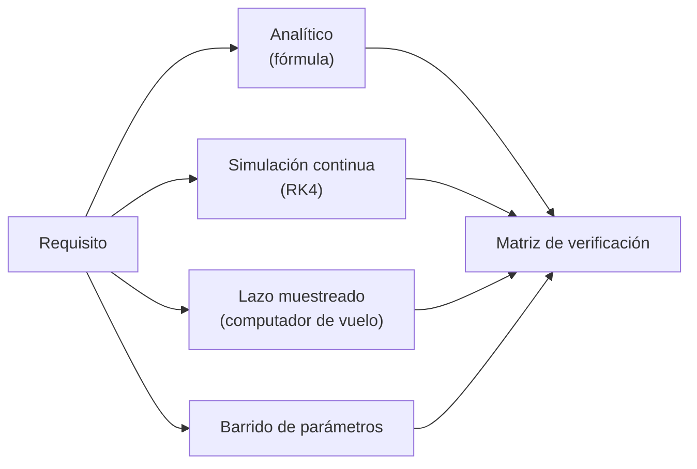

# B16-C19 — Verificación de lazo cerrado

<!-- nav:top -->
[🏠 Programa](../../../../README.md) · [📚 Bloque B16](../../../tronco-comun/B16-sistemas-dinamicos-y-control-automatico.md) · [← Anterior: B16-C18 — Saturación y anti-windup](../B16-C18-saturacion-y-anti-windup/CLASE.md) · [Siguiente: B16-C20 — Control de orientación en un simulador →](../B16-C20-control-de-orientacion-en-un-simulador/CLASE.md)
<!-- /nav -->

## 1. Ubicación, nivel y alcance

Decimonovena clase del bloque B16. Ya sabes diseñar un lazo. Aquí aprendes a **demostrar que cumple lo que se le pidió**: convertir los requisitos en comprobaciones, ejecutarlas con métodos independientes, verificar que el propio simulador es fiable y registrar el resultado en una matriz de verificación. Necesitas todo lo anterior del bloque, la simulación (B11) y la idea de verificación y validación (B23).

No verás la certificación de software de vuelo ni las normas de la industria; esta clase es un ejercicio de método.

## 2. Por qué esta clase existe

Un lazo que «se ve bien» en una simulación puede estar mal por tres razones: el diseño no cumple un requisito en parte del rango de parámetros, la discretización en el computador de vuelo cambia el comportamiento, o el simulador tiene un error numérico. La pregunta motivadora es: **¿qué debo comprobar, con qué método independiente y con qué criterio de aceptación, para poder afirmar que mi lazo cumple los requisitos?**

La decisión central: no declarar «cumple» ningún requisito sin una comprobación escrita, repetible y contrastada con un método distinto.

## 3. Lo que podrás hacer al terminar

1. Traducir requisitos de desempeño y estabilidad en comprobaciones numéricas.
2. Verificar el integrador: coincidencia con una fórmula y orden de convergencia.
3. Barrer parámetros inciertos para descubrir incumplimientos.
4. Comparar el lazo continuo con su versión muestreada y hallar el límite del periodo de muestreo.
5. Registrar los resultados en una matriz con «cumple» y «no cumple», y rediseñar cuando haga falta.
6. Distinguir verificación (¿lo construí bien?) de validación (¿construí lo correcto?).

La evidencia es el **informe de verificación** del ejercicio 12 (sección 20).

## 4. Con qué llegas y cómo comprobarlo

1. ¿Qué sobreimpulso tiene un sistema de segundo orden con `ζ = 0,632`?
2. ¿Qué orden de error tiene RK4 al reducir el paso a la mitad? (¿Por qué factor baja el error?)
3. ¿Cuál es la condición de estabilidad de un sistema discreto?
4. ¿Qué error estacionario deja un PD ante una perturbación `d`?
5. ¿Qué es un barrido de parámetros?

<details>
<summary>Ver respuestas</summary>

1. `exp(−π·0,632/√(1−0,4)) = 7,69 %`. 2. Orden 4: el error baja por un factor ≈ 16. 3. Radio espectral menor que 1. 4. `d/Kp`. 5. Repetir el análisis variando un parámetro en una rejilla de valores.
</details>

Con cuatro o cinco aciertos, sigue.

## 5. Un caso real: lo que se verifica antes de volar

El apuntamiento fino del Hubble (no más de 0,007″ durante al menos 24 h según S1) no se afirma por intuición: un sistema así se verifica con pruebas en tierra y en simulación antes de operar. No tenemos acceso a los requisitos reales ni a su plan de verificación, y no los inventamos. Usamos, en cambio, un conjunto de **requisitos inventados para la clase** sobre el eje sintético (`J = 50 kg·m²`, PD con `Kp = 20`, `Kd = 40`), para mostrar el método.

## 6. Vocabulario

Un **requisito** es una condición verificable que debe cumplir el sistema. La **verificación** comprueba que el sistema cumple su especificación; la **validación** comprueba que la especificación responde a la necesidad real. Una **matriz de verificación** lista cada requisito, el método de comprobación, el criterio de aceptación y el resultado. La **convergencia** de un integrador es la reducción del error al disminuir el paso; su **orden** `p` cumple `error ∝ h^p`. El **periodo de muestreo** `T` es el intervalo entre acciones del computador. Un **barrido** o un **Monte Carlo** exploran el rango de parámetros inciertos.

## 7. Modelo mental: tres preguntas, tres métodos

Para cada requisito pregunta: ¿la fórmula lo dice? ¿la simulación continua lo confirma? ¿la implementación real (muestreada) lo mantiene? Si los tres coinciden, tienes una afirmación sólida. Si discrepan, hay un error en algún método.



*Descripción textual:* cada requisito se comprueba por cuatro vías (fórmula, simulación continua, lazo muestreado y barrido de parámetros) y los resultados se reúnen en la matriz de verificación.

La analogía es revisar un puente con cálculo, ensayo de maqueta, inspección de la obra real y prueba con sobrecarga. Límite: en software la discrepancia entre métodos casi siempre revela un error de código o de supuestos, mientras que en un puente puede ser variabilidad física.

## 8. La explicación, paso a paso

### 8.1 Los requisitos de ejemplo

Para el lazo PD de la clase se inventan seis requisitos: **R1** estabilidad (polos continuos con parte real negativa y radio espectral menor que 1 con `T = 0,1 s`); **R2** sobreimpulso ≤ 10 %; **R3** asentamiento (2 %) ≤ 15 s; **R4** error estacionario ante `d = 0,5 N·m` ≤ 30 mrad; **R5** sobreimpulso ≤ 10 % para toda inercia entre 0,7 J y 1,3 J; **R6** la versión muestreada a `T = 0,1 s` difiere ≤ 5 % del continuo en sobreimpulso. Son ejemplos de formato, no requisitos de misión.

### 8.2 Primero se verifica el simulador

Antes de juzgar el lazo, se prueba la maquinaria: (a) el sobreimpulso por RK4 con paso 0,01 s es 7,6911 %, el analítico 7,6912 % (diferencia relativa < 10⁻³); (b) el error estacionario simulado ante `d` es 25,0000 mrad, igual a `d/Kp`; (c) el **orden de convergencia**: el error a `t = 20 s` es 4,1×10⁻⁹ con `h = 0,4`, 1,4×10⁻¹⁰ con 0,2 y 5,3×10⁻¹² con 0,1; los órdenes son 4,89 y 4,71, es decir, al menos 4, como corresponde a RK4. La razón por la que el orden medido supera ligeramente 4 es la constante del error y el rango de pasos; lo importante es que no sea menor.

### 8.3 La verificación del diseño inicial

Para el diseño inicial (`Kd = 40`):

| Requisito | Resultado | Veredicto |
|---|---|---|
| R1 | polos `−0,4 ± 0,49j`; radio espectral 0,9602 | cumple |
| R2 | 7,69 % | cumple |
| R3 | 9,48 s | cumple |
| R4 | 25,00 mrad | cumple |
| R5 | peor caso del barrido 12,31 %; Monte Carlo 11,92 % | **no cumple** |
| R6 | 7,86 % muestreado, 2,3 % de diferencia | cumple |

La verificación encontró un incumplimiento que el caso nominal no mostraba: con la inercia mayor del rango (1,3 J) el amortiguamiento baja (`ζ = 0,555`) y el sobreimpulso sube a 12,3 %, por encima del 10 % (ejercicio 8).

### 8.4 El rediseño

Subiendo `Kd` de 40 a 48 (más amortiguamiento) y repitiendo toda la matriz: R1 radio espectral 0,9518; R2 2,57 %; R3 8,94 s; R4 25,00 mrad; R5 peor caso 6,07 % y Monte Carlo 5,74 %; R6 2,5 % muestreado (2,8 % de diferencia). Todos cumplen. Fíjate en el procedimiento: **se repite la matriz completa** tras cada cambio, porque un cambio puede romper lo que antes cumplía.

### 8.5 El periodo de muestreo

La versión muestreada coincide con la continua cuando `T` es pequeño frente a la dinámica. Con `Kd = 40` el radio espectral es 0,9602 (`T = 0,1`), 0,8062 (0,5), 0,6325 (1,0), 0,4472 (2,0), 0,7712 (2,4) y 1,2066 (2,6: **inestable**). El sobreimpulso medido sobre las muestras es 7,86 %, 8,82 %, 11,20 %, 28,00 % y 15,20 % para `T` entre 0,1 y 2,4 s (a `T` grande las muestras ya no capturan el pico real). El límite de estabilidad ronda `T ≈ 2,5 s`; mucho antes de llegar a él el desempeño se degrada. Es una verificación que solo la versión muestreada puede hacer.

## 9. Magnitudes, símbolos y unidades

| Símbolo | Qué es | Unidad | Nota |
|---|---|---|---|
| `Mp` | sobreimpulso | % | |
| `ts` | tiempo de asentamiento (2 %) | s | |
| `e_ss` | error estacionario | rad (mrad) | |
| `h` | paso del integrador | s | 0,01; 0,4 a 0,1 en la convergencia |
| `T` | periodo de muestreo | s | 0,1 a 2,6 |
| `ρ` | radio espectral | — | < 1 estable |
| `p` | orden de convergencia | — | ≥ 4 |

## 10. Convenciones y referencias

Cada requisito tiene identificador, método, criterio y resultado. El criterio se escribe antes de ejecutar. Se declaran semilla (19 para el Monte Carlo) y pasos. Una comprobación que falla se informa como tal, sin ocultarla; después del rediseño se repite todo. Los requisitos de la clase son inventados y se rotulan así.

## 11. De dónde sale lo que afirmamos

| ID | Fuente | Localizador | Respalda | Estado |
|---|---|---|---|---|
| S1 | NASA Facts FS-2018-10-285-GSFC, *Hubble Space Telescope: Fine Guidance Sensors* | https://smd-cms.nasa.gov/wp-content/uploads/2023/04/hst_fine_guidance_fact_sheet1_0.pdf | Apuntamiento a no más de 0,007″ durante al menos 24 h | Extraído del PDF el 2026-11-05 |

Límites: las fórmulas de sobreimpulso, el orden del integrador y el criterio del radio espectral son resultados estándar, no citados a un texto, y se contrastan con el cálculo. Los requisitos R1 a R6 son **inventados**; no son requisitos de ninguna misión. No se consultó norma alguna de verificación de software.

## 12. Cómo ver la matriz

La tabla de 8.3 es la matriz del diseño inicial; la del rediseño:

| Requisito | Resultado | Veredicto |
|---|---|---|
| R1 | radio espectral 0,9518 | cumple |
| R2 | 2,57 % | cumple |
| R3 | 8,94 s | cumple |
| R4 | 25,00 mrad | cumple |
| R5 | 6,07 % (barrido), 5,74 % (Monte Carlo) | cumple |
| R6 | 2,5 %, diferencia 2,8 % | cumple |

## 13. Ejemplo trabajado: del «no cumple» al rediseño

**Paso 1 · simulador.** Se verifica que RK4 reproduce el sobreimpulso analítico (diferencia < 10⁻³) y el error estacionario; orden ≥ 4.
**Paso 2 · matriz inicial.** R1–R4 y R6 cumplen; R5 no (12,31 % > 10 %).
**Paso 3 · diagnóstico.** El barrido localiza el extremo del rango que lo causa: la inercia mayor, que baja `ζ` (ejercicio 8).
**Paso 4 · rediseño.** `Kd = 48` (+20 %). Se repite la matriz completa: todo cumple.
**Paso 5 · registro.** Se guarda la matriz inicial (con el «no cumple») y la final, con los parámetros y la semilla. La trazabilidad de un fallo es parte de la evidencia.
**Paso 6 · límites.** El rediseño solo cubre el rango declarado de inercia; no cubre saturación (C18), ruido ni retardo (C07).

## 14. Distintas maneras de verificar

**Analítica**: exacta pero solo en casos simples. **Simulación continua**: flexible; depende del integrador. **Simulación del lazo muestreado**: la más cercana al computador de vuelo. **Hardware-in-the-loop** (con el computador real en el lazo): más realista, más costosa (se menciona, no se desarrolla). **Barrido y Monte Carlo**: exploran el rango de incertidumbre pero no lo agotan (C16). Una buena práctica es combinar al menos dos métodos independientes por requisito.

## 15. Práctica guiada

**Ejercicio 1 · con pasos.** Calcula `ζ` y `Mp` del lazo `J = 50`, `Kp = 20`, `Kd = 48`. *Pasos:* 4 y 8.2.

<details><summary>Solución comentada</summary>

`ζ = 48/(2√1000) = 0,759`; `Mp = exp(−π·0,759/√(1−0,576)) = exp(−3,66) = 2,57 %`, el valor de la tabla de rediseño.
</details>

**Ejercicio 2 · con pista.** Con errores 4,1×10⁻⁹ (h = 0,4) y 1,4×10⁻¹⁰ (h = 0,2), calcula el orden. *Pista:* `p = log₂(e₁/e₂)`.

<details><summary>Solución comentada</summary>

`4,1×10⁻⁹/1,4×10⁻¹⁰ = 29,3`; `log₂ 29,3 = 4,87`. Coincide con 4,89 del laboratorio (por el redondeo de las cifras).
</details>

**Ejercicio 3 · casi autónomo.** ¿Qué requisito de la tabla 8.3 no cumple y por cuánto?

<details><summary>Solución comentada</summary>

R5: 12,31 % frente al límite de 10 %: excede por 2,31 puntos porcentuales.
</details>

## 16. Práctica autónoma, transferencia e integrador

**Ejercicio 4.** Con la tabla de 8.5, ¿qué periodo de muestreo es el mayor probado con sobreimpulso medido ≤ 12 %?

<details><summary>Solución comentada</summary>

`T = 1,0 s` (11,20 %). Con `T = 2,0` ya es 28,0 % (y a partir de ahí las muestras ya no capturan bien el pico).
</details>

**Ejercicio 5.** ¿Por qué se repite la matriz completa tras el rediseño?

<details><summary>Solución comentada</summary>

Porque subir `Kd` puede afectar otros requisitos (ruido, estabilidad muestreada, esfuerzo); una comprobación aislada puede dejar pasar una regresión. En el rediseño, el radio espectral cambió de 0,9602 a 0,9518.
</details>

**Ejercicio 6.** ¿Qué indica una discrepancia entre la fórmula y la simulación del 5 %?

<details><summary>Solución comentada</summary>

Un error: de código, de paso de integración demasiado grande o de supuestos distintos (por ejemplo, derivada sobre el error en uno y sobre la medida en otro, C06). Hay que encontrarlo antes de seguir.
</details>

**Ejercicio 7.** ¿Qué verifica el barrido que no verifica el caso nominal?

<details><summary>Solución comentada</summary>

Que el requisito se cumple en todo el rango de la incertidumbre declarada (inercia, aquí). El nominal solo prueba un punto.
</details>

**Ejercicio 8.** En el diseño inicial, ¿en qué extremo de la inercia es peor el sobreimpulso: con `J` pequeña o grande? Razona con `ζ = Kd/(2√(Kp J))` y confirma con el resultado de R5.

<details><summary>Solución comentada</summary>

`ζ` baja cuando `J` sube, así que el extremo de inercia **mayor** (1,3 J) es el menos amortiguado: `ζ = 40/(2√(20·65)) = 0,555`, `Mp = exp(−π·0,555/0,832) = 12,3 %`, coincidente con el peor caso del barrido (12,31 %). (Corrige la intuición equivocada: mayor inercia, menos amortiguamiento.)
</details>

**Ejercicio 9 · transferencia.** Un requisito dice «el lazo debe ser robusto». ¿Por qué no es verificable y cómo lo reescribes?

<details><summary>Solución comentada</summary>

No tiene criterio numérico ni rango. Reescritura: «el sobreimpulso será ≤ 10 % para inercias entre 0,7 J y 1,3 J y retardo del sensor ≤ 0,2 s», con método (barrido y simulación muestreada) y criterio de aceptación.
</details>

**Ejercicio 10 · transferencia.** El computador de vuelo solo puede ejecutar el lazo a `T = 2,5 s`. Con `Kd = 40`, ¿qué dice la verificación?

<details><summary>Solución comentada</summary>

Está cerca del límite de estabilidad (0,7712 a 2,4 s; inestable a 2,6): sin margen y con desempeño muy degradado. Se debe rediseñar para ese `T` (ganancias menores) o exigir un computador más rápido.
</details>

**Ejercicio 11 · transferencia.** ¿Qué distingue verificar de validar en este caso?

<details><summary>Solución comentada</summary>

Verificar: el lazo cumple R1–R6. Validar: R1–R6 expresan lo que el telescopio realmente necesita (¿es 10 % de sobreimpulso lo correcto para el instrumento?). Eso exige hablar con quien usa el sistema.
</details>

**Ejercicio 12 · integrador.** Entrega un **informe de verificación**: para un lazo de tu elección, escribe cinco requisitos con criterio, verifica el simulador (fórmula y orden de convergencia), ejecuta la matriz con barrido y versión muestreada, informa los incumplimientos, rediseña y repite.

<details><summary>Solución modelo</summary>

Debe incluir requisitos con criterio numérico, verificación del simulador, matriz inicial con al menos un «no cumple» o una justificación de por qué no lo hubo, el rediseño, la matriz final y semillas y pasos declarados.
</details>

## 17. Laboratorio: matriz de verificación

El script [verificacion_de_lazo.py](verificacion_de_lazo.py) verifica el integrador (fórmula y orden de convergencia), explora el periodo de muestreo y ejecuta la matriz R1–R6 para el diseño inicial y el rediseño.

**Datos:** sintéticos (simulados); requisitos inventados. **Predice:** R5 no cumple en el diseño inicial. **Ejecución del 2026-11-05 (Python 3.12.9, numpy 2.4.4):**

```text
maquinaria: Mp analítico 7.6912 % vs RK4 7.6911 %
convergencia RK4 (error a t = 20 s con h = 0.4, 0.2, 0.1): 4.10e-09, 1.39e-10, 5.31e-12; órdenes 4.89, 4.71
efecto del periodo de muestreo T (lazo muestreado exacto, Kd = 40):
      T (s)   radio espectral   sobreimpulso
      0.1        0.9602         7.86 %
      0.5        0.8062         8.82 %
      1.0        0.6325        11.20 %
      2.0        0.4472        28.00 %
      2.4        0.7712        15.20 %
      2.6        1.2066      inestable
--- diseño inicial: Kp = 20.0, Kd = 40.0 ---
  R1: CUMPLE   radio espectral 0.9602
  R2: CUMPLE   Mp = 7.69 %
  R3: CUMPLE   ts = 9.48 s
  R4: CUMPLE   e_ss = 25.00 mrad
  R5: NO CUMPLE  peor Mp barrido 12.31 %, Monte Carlo 11.92 %
  R6: CUMPLE   Mp muestreado 7.86 % (2.3 % de diferencia)
--- rediseño: Kp = 20.0, Kd = 48.0 ---
  R1: CUMPLE   radio espectral 0.9518
  R2: CUMPLE   Mp = 2.57 %
  R3: CUMPLE   ts = 8.94 s
  R4: CUMPLE   e_ss = 25.00 mrad
  R5: CUMPLE   peor Mp barrido 6.07 %, Monte Carlo 5.74 %
  R6: CUMPLE   Mp muestreado 2.50 % (2.8 % de diferencia)
Pruebas superadas.
```

```bash
python programa/clases/B16/B16-C19-verificacion-de-lazo-cerrado/verificacion_de_lazo.py
```

**Límites:** un eje, sin ruido ni saturación; el Monte Carlo es de 60 muestras con semilla 19; el sobreimpulso del lazo muestreado se mide sobre las muestras; tarda alrededor de un minuto.

## 18. Errores frecuentes y cómo corregirlos

**Declarar «cumple» sin barrer parámetros.** Se corrige con el ejercicio 7.

**No repetir la matriz completa tras un cambio.** Se corrige con el ejercicio 5.

**Confiar en el simulador sin comprobarlo.** Se corrige con la sección 8.2 y el ejercicio 2.

**Requisitos sin criterio numérico.** Se corrige con el ejercicio 9.

**Ocultar el «no cumple» inicial.** Se corrige releyendo el paso 5 del ejemplo.

## 19. Cómo sabrás que vas bien

Tras 8.2: ¿calculas el orden de convergencia? Ejercicio 2. Tras 8.3: ¿lees la matriz? Ejercicio 3. Tras el ejemplo: ¿propones un rediseño y repites todo?

## 20. Qué entregas y cómo se evalúa

El producto es el **informe de verificación** del ejercicio 12.

| Criterio | Inicial | En desarrollo | Logrado | Destacado |
|---|---|---|---|---|
| Requisitos | Sin criterio | Criterio parcial | Con método y criterio | Trazables a una necesidad |
| Simulador | No verificado | Una comprobación | Fórmula y convergencia | Con versión muestreada |
| Resultados | Solo lo que cumple | Informa fallos | Rediseña y repite todo | Guarda ambas matrices |
| Fuentes y datos | Sin rótulo | Parcial | Rotula inventado/sintético | Declara lo no consultado |

**Condiciones críticas:** informar los incumplimientos; declarar semillas y pasos; no presentar requisitos inventados como reales.

## 21. Ética, seguridad y límites

Una matriz verde no es una garantía de seguridad: depende de los requisitos que se escribieron y de los casos que se probaron. Ocultar un incumplimiento es una falta grave. Cifras didácticas. Accesibilidad: tablas en lugar de semáforos de color.

## 22. Para cerrar y seguir

Verificar un lazo es traducir requisitos en comprobaciones, contrastar métodos independientes, barrer la incertidumbre, comparar con la versión muestreada y repetir la matriz completa tras cada cambio. Aquí la verificación halló un incumplimiento (R5) que el caso nominal ocultaba, y el rediseño con más amortiguamiento lo resolvió. Queda abierta una pregunta: ¿cómo se reúne todo en un simulador de orientación completo?

**Glosario español–inglés.** verificación · *verification*; validación · *validation*; matriz de verificación · *verification matrix*; orden de convergencia · *order of convergence*; periodo de muestreo · *sampling period*; requisito · *requirement*.

**Continuidad.** B16-C20 reúne el bloque en un simulador de orientación con cuaterniones. B23 (verificación y validación de software científico) desarrolla el método con rigor.

**Referencias:** ver sección 11.

<!-- nav:bottom -->
---

[← Anterior: B16-C18 — Saturación y anti-windup](../B16-C18-saturacion-y-anti-windup/CLASE.md) · [📚 Bloque B16](../../../tronco-comun/B16-sistemas-dinamicos-y-control-automatico.md) · [Siguiente: B16-C20 — Control de orientación en un simulador →](../B16-C20-control-de-orientacion-en-un-simulador/CLASE.md)
<!-- /nav -->
