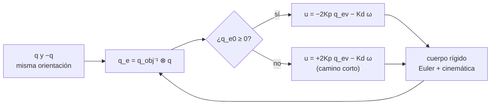

# B16-C20 — Control de orientación en un simulador

<!-- nav:top -->
[🏠 Programa](../../../../README.md) · [📚 Bloque B16](../../../tronco-comun/B16-sistemas-dinamicos-y-control-automatico.md) · [← Anterior: B16-C19 — Verificación de lazo cerrado](../B16-C19-verificacion-de-lazo-cerrado/CLASE.md) · [Siguiente: B17-C01 — Ingeniería de características científicas →](../../B17/B17-C01-ingenieria-de-caracteristicas-cientificas/CLASE.md)
<!-- /nav -->

## 1. Ubicación, nivel y alcance

Vigésima y última clase del bloque B16. Reúnes aquí lo aprendido: el modelo (C01–C02), el PD (C06, C11), la no linealidad (C17), la saturación (C18) y la verificación (C19) para construir y probar un **simulador de orientación en tres ejes** con cuaterniones. Necesitas cuaterniones unitarios (B10-C15, se resumen abajo), rotaciones (B10-C13) y las ecuaciones de Euler (C17).

No verás sensores ni estimación de actitud (B87-C03 a B87-C10) ni actuadores reales (B87-C11 a B87-C13): el simulador supone estado completo y par exacto.

## 2. Por qué esta clase existe

Un telescopio debe girar desde una orientación a otra y quedarse allí. Con tres ejes acoplados y rotaciones grandes, ni los ángulos de Euler (tienen singularidades y dependen de la secuencia de giros) ni el modelo lineal bastan. La pregunta motivadora es: **¿cómo represento la orientación sin singularidades, diseño una ley que lleve al cuerpo al objetivo por el camino corto y compruebo que mi simulador es correcto antes de confiar en sus resultados?**

La decisión central: elegir la representación (cuaterniones), la ley de control (PD de actitud con el signo correcto) y las pruebas que dan confianza al simulador.

## 3. Lo que podrás hacer al terminar

1. Usar un cuaternión unitario para representar y componer orientaciones.
2. Escribir la cinemática y la dinámica de un cuerpo rígido en tres ejes.
3. Implementar una ley PD de actitud con el signo del escalar del error.
4. Verificar el simulador con invariantes (momento angular, energía, norma) y con el límite lineal.
5. Comprobar y explicar el fenómeno de «desenrollado» cuando se omite el signo.
6. Ejecutar una maniobra grande con límite de par y medir su tiempo.

La evidencia es el **simulador verificado** del ejercicio 12 (sección 20).

## 4. Con qué llegas y cómo comprobarlo

1. ¿Qué cuaternión representa «sin rotación»?
2. ¿Qué norma tiene un cuaternión unitario?
3. Si `q = [cos(φ/2), sen(φ/2) n]`, ¿qué rotación representa?
4. ¿Cuál es el inverso (conjugado) de `[q0, q1, q2, q3]`?
5. ¿Qué cantidades se conservan en la rotación libre de un cuerpo rígido (C17)?

<details>
<summary>Ver respuestas</summary>

1. `[1, 0, 0, 0]`. 2. 1. 3. Una rotación de ángulo `φ` alrededor del eje unitario `n`. 4. `[q0, −q1, −q2, −q3]`. 5. La energía cinética y el momento angular.
</details>

Con cuatro o cinco aciertos, sigue; si fallaste varias, repasa B10-C15.

## 5. Un caso real: girar y apuntar

Los textos de control de actitud, como el de Yang disponible en NTRS (S1), señalan que los modelos con cuaterniones permiten leyes que estabilizan globalmente al cuerpo, no dependen de la secuencia de giros y no tienen puntos singulares, a diferencia de los modelos con ángulos de Euler, y que el cuaternión es lo que entregan la mayoría de los métodos de determinación de actitud. El mismo texto advierte de un problema intrínseco de «enrollamiento» (*windup*) de la actitud cuando el escalar es negativo. En el Hubble, la tarea es llevar el telescopio a un objetivo con ruedas de reacción (S2). Nuestro simulador es **sintético**: cuerpo con tensor de inercia `[[50, 1, 0,5],[1, 40, 2],[0,5, 2, 30]] kg·m²`, par máximo por eje opcional y ganancias `Kp = 12`, `Kd = 90`.

## 6. Vocabulario

Un **cuaternión unitario** `q = [q0, q_v]` (escalar primero, `q_v` de tres componentes) con `q0² + |q_v|² = 1` representa una rotación; usamos la convención de que lleva componentes del sistema inercial al del cuerpo. El **producto de cuaterniones** `a ⊗ b` compone rotaciones. El **cuaternión de error** es `q_e = q_obj⁻¹ ⊗ q`; vale `[1, 0, 0, 0]` (o su opuesto) cuando la orientación alcanzó el objetivo. La **cinemática** es `q̇ = ½ q ⊗ [0, ω]`, con `ω` la velocidad angular del cuerpo en su propio sistema. La **dinámica** es la de Euler (C17) con tensor de inercia completo. Dos cuaterniones opuestos, `q` y `−q`, representan la **misma** orientación.

## 7. Modelo mental: dos copias de cada orientación

El espacio de cuaterniones unitarios recubre dos veces el de las orientaciones: cada orientación tiene dos representaciones, `q` y `−q`. Una ley de control que no lo tenga en cuenta puede, estando a 0,1 rad del objetivo, empujar al cuerpo por el camino largo, dando una vuelta completa. La corrección consiste en elegir siempre la copia con escalar no negativo.



*Descripción textual:* se calcula el cuaternión de error entre la orientación y el objetivo; si su escalar es no negativo se aplica la ley normal, y si es negativo se invierte el signo de la parte proporcional para tomar el camino corto; el par actúa sobre el cuerpo cuya orientación realimenta el error.

La analogía: una puerta giratoria que se puede empujar en cualquier sentido para llegar al mismo sitio; la ley con signo elige el sentido corto. Límite: la analogía no refleja que en el punto antipodal (`q_e0 = 0`, error de 180°) el signo es ambiguo y el camino corto no es único.

## 8. La explicación, paso a paso

### 8.1 El modelo completo

El estado es `(q, ω)`, 7 variables. La cinemática `q̇ = ½ q ⊗ [0, ω]` conserva la norma de `q` de forma exacta en tiempo continuo; la dinámica es `J ω̇ = −ω × (J ω) + u`. Con tensor de inercia no diagonal (productos de inercia 1; 0,5; 2 kg·m²) los ejes no están desacoplados y el simulador no es trivial.

### 8.2 La ley PD de actitud

Con `q_e = [q_e0, q_ev]` el error, la ley es
`u = −2 Kp s q_ev − Kd ω`, con `s = +1` si `q_e0 ≥ 0` y `s = −1` si no,
saturada por eje en `±u_max`. Para ángulos pequeños, `q_ev ≈ θ/2`, de modo que `u ≈ −Kp θ − Kd ω`: el PD de C06 y C11 por eje. `Kp` se mide en N·m/rad y `Kd` en N·m·s/rad.

### 8.3 Cómo se verifica el simulador

Siguiendo C19, antes de mirar la maniobra se prueban tres cosas. **(a) Invariantes sin par.** Con orientación inicial `0,7 rad` alrededor de `(1, 2, −1)` y velocidad `(0,05; −0,03; 0,04) rad/s`, tras 200 s el momento angular en el sistema inercial varía 1,95×10⁻¹² (relativo), la energía 2,9×10⁻¹³ y la norma del cuaternión se desvía 4,8×10⁻¹³ de 1 (sin renormalizar). **(b) Límite lineal.** Con inercia diagonal `diag(50, 40, 30)` y un error inicial de 0,02 rad alrededor de x, la respuesta del simulador no lineal coincide con el modelo de segundo orden `θ̈ + (Kd/J₁) θ̇ + (Kp/J₁) θ = 0` (con `ωn = 0,490 rad/s` y `ζ = 1,84`, sobreamortiguado) con un error máximo de 7,8×10⁻⁸ rad. **(c) Signo del escalar.** Ver 8.4.

### 8.4 El desenrollado

Se parte de una orientación a **0,1 rad** del objetivo pero representada con `q_e0 = −0,9988 < 0` (el opuesto del cuaternión cercano). Con la ley con signo, el ángulo de error máximo es 5,73° (los 0,1 rad iniciales) y converge a 3×10⁻¹⁵°. Con la ley **sin** signo, el cuerpo es empujado en sentido contrario: el ángulo de error llega a **179,5°** y recién después vuelve al objetivo, tras casi una vuelta completa. Es el mismo estado físico, tratado de dos formas; la diferencia es una maniobra de 6° o de casi 360°. Es el fenómeno que S1 describe como problema de enrollamiento con `q0 < 0`.

### 8.5 Una maniobra grande con límite de par

Objetivo: 90° alrededor de `(1, 1, 1)`, partiendo del reposo en la orientación identidad. Sin límite de par, el error entra y se queda por debajo de 1° a los 32,4 s, con una velocidad máxima de 0,168 rad/s. Con `u_max = 0,5 N·m` por eje: 36,0 s y 0,127 rad/s. En ambos casos el error final es de 10⁻¹⁴ grados. La saturación hace la maniobra algo más lenta pero no la desestabiliza; al no haber integral, no hay windup (C18). Con una acción integral habría que añadir anti-windup.

## 9. Magnitudes, símbolos y unidades

| Símbolo | Qué es | Unidad | Nota |
|---|---|---|---|
| `q = [q0, q_v]` | cuaternión de orientación | — | unitario |
| `q_e` | cuaternión de error | — | `q_obj⁻¹ ⊗ q` |
| `ω` | velocidad angular del cuerpo | rad/s | en el sistema del cuerpo |
| `J` | tensor de inercia | kg·m² | simétrico, definido positivo |
| `u` | par de control | N·m | por eje |
| `Kp, Kd` | ganancias de actitud | N·m/rad ; N·m·s/rad | 12; 90 |
| `u_max` | límite de par por eje | N·m | 0,5 (o sin límite) |
| `s` | signo de `q_e0` | — | ±1 |

## 10. Convenciones y referencias

Cuaterniones con el escalar primero; la rotación lleva componentes del sistema inercial al del cuerpo; la velocidad angular está expresada en el sistema del cuerpo. Estas convenciones **se declaran siempre** porque cambian de un texto a otro y llevan a errores de signo y de orden. El ángulo de error es `2·atan2(|q_ev|, |q_e0|)`. Integración con DOP853 y tolerancias relativas de 10⁻¹². La matriz de rotación del script verifica la conservación del momento angular en el sistema inercial.

## 11. De dónde sale lo que afirmamos

| ID | Fuente | Localizador | Respalda | Estado |
|---|---|---|---|---|
| S1 | Yang, Y., *Spacecraft Modeling, Attitude Determination, and Control: Quaternion-Based Approach*, CRC Press (copia en NASA NTRS) | https://ntrs.nasa.gov/citations/20240009554 | Capítulo 1: ventajas de los modelos con cuaterniones (control global, sin dependencia de la secuencia de giros ni puntos singulares, cuaternión disponible desde la determinación de actitud) frente a los ángulos de Euler; capítulo 9: observación sobre el problema intrínseco de enrollamiento de la actitud con `q0 < 0` | Extraído del PDF el 2026-11-05; solo la introducción y pasajes del capítulo 9 |
| S2 | NASA GSFC, *Pointing Control System* (archivo del Hubble, actualizada 2021-03-29) | https://asd.gsfc.nasa.gov/archive/hubble/technology/pcs.html | Cuatro ruedas de reacción (hasta 3000 rpm) como actuadores del apuntamiento | Consultada el 2026-11-05; archivada |

Límites: la cinemática con cuaterniones, la ley PD con signo y las propiedades del producto de cuaterniones son resultados estándar, no citados a un texto específico; se verifican con los invariantes y el límite lineal. Del texto S1 solo se leyeron los pasajes indicados. El cuerpo, las ganancias y el límite de par son **sintéticos**; el simulador no modela sensores, actuadores reales ni perturbaciones.

## 12. Cómo ver los resultados

| Prueba | Resultado (simulado) |
|---|---|
| Momento angular inercial, 200 s | variación relativa 1,95×10⁻¹² |
| Energía, 200 s | 2,9×10⁻¹³ |
| Norma del cuaternión | desviación 4,8×10⁻¹³ |
| Límite lineal (0,02 rad) | error máximo 7,8×10⁻⁸ rad |
| Camino con signo | ángulo máximo 5,73° |
| Camino sin signo | ángulo máximo 179,5° |
| Maniobra 90°, sin límite | 32,4 s hasta quedar bajo 1° |
| Maniobra 90°, 0,5 N·m por eje | 36,0 s |

Para graficar, dibuja el ángulo de error contra el tiempo para el caso con signo y sin signo, con trazos distintos.

## 13. Ejemplo trabajado: un giro de 90° con límite de par

**Paso 1 · objetivo.** `q_obj = [cos 45°, sen 45°·(1,1,1)/√3] = [0,7071; 0,4082; 0,4082; 0,4082]`.
**Paso 2 · error inicial.** Con `q = [1, 0, 0, 0]`: `q_e = q_obj⁻¹ ⊗ q = [0,7071; −0,4082; −0,4082; −0,4082]`, escalar positivo; ángulo de error `2·atan2(0,7071; 0,7071) = 90°`.
**Paso 3 · par inicial.** `u = −2 Kp q_ev − Kd ω = 2·12·0,4082 = 9,80 N·m` por eje (sin límite); con `u_max = 0,5`, se satura en 0,5 N·m en cada eje: el giro empieza con aceleración limitada.
**Paso 4 · evolución.** La velocidad crece hasta un máximo de 0,127 rad/s y el término `Kd` frena al acercarse; el error entra a 1° en 36,0 s.
**Paso 5 · cierre.** Error final 10⁻¹⁴ °: llegó al objetivo. Sin límite habría sido 32,4 s con 0,168 rad/s de máximo. Se registra el resultado, las semillas (no hay) y los pasos del integrador.

## 14. Distintas representaciones y leyes

**Ángulos de Euler**: intuitivos, con singularidades y dependientes de la secuencia (S1). **Matriz de rotación**: sin singularidades, 9 números con 6 restricciones. **Cuaterniones**: 4 números con 1 restricción, sin singularidades, con doble cobertura. **Ley PD con cuaterniones** (esta clase): sencilla y de estabilidad casi global. **LQR** (C15): sobre el modelo linealizado en torno a la orientación objetivo. **Control no lineal avanzado o MPC** (B87): trata restricciones. Conviene la ley PD con signo para empezar y el LQR para sintonizar con criterio.

## 15. Práctica guiada

**Ejercicio 1 · con pasos.** Construye el cuaternión de una rotación de 60° alrededor de z. *Pasos:* sección 6.

<details><summary>Solución comentada</summary>

`q = [cos 30°, 0, 0, sen 30°] = [0,8660; 0; 0; 0,5]`. Norma: `0,75 + 0,25 = 1`.
</details>

**Ejercicio 2 · con pista.** Calcula el ángulo de error de `q_e = [0,9988; −0,0500; 0; 0]`. *Pista:* `2·atan2(|q_ev|, |q_e0|)`.

<details><summary>Solución comentada</summary>

`2·atan2(0,05; 0,9988) = 2·0,05001 = 0,1000 rad`.
</details>

**Ejercicio 3 · casi autónomo.** ¿Qué signo `s` aplica la ley si `q_e0 = −0,9988`? ¿Y qué ángulo de error mide la fórmula?

<details><summary>Solución comentada</summary>

`s = −1`; el ángulo es `2·atan2(|q_ev|, |q_e0|)` con valores absolutos: 0,1000 rad (el camino corto).
</details>

## 16. Práctica autónoma, transferencia e integrador

**Ejercicio 4.** Verifica la norma de `[0,7071; 0,4082; 0,4082; 0,4082]`.

<details><summary>Solución comentada</summary>

`0,5 + 3·0,1666 = 0,5 + 0,5 = 1,000`.
</details>

**Ejercicio 5.** Para ángulos pequeños, ¿por qué `u = −2 Kp q_ev` equivale a `−Kp θ`?

<details><summary>Solución comentada</summary>

Porque `q_ev ≈ (θ/2) n`; entonces `2 Kp q_ev ≈ Kp θ n`.
</details>

**Ejercicio 6.** Con `J₁ = 50`, `Kp = 12`, `Kd = 90`: calcula `ωn` y `ζ` del eje 1 en pequeño ángulo.

<details><summary>Solución comentada</summary>

`ωn = √(12/50) = 0,490 rad/s`; `ζ = 90/(2√(12·50)) = 90/49 = 1,84`: sobreamortiguado.
</details>

**Ejercicio 7.** El script compara el simulador con el modelo lineal y obtiene 7,8×10⁻⁸ rad. ¿Qué hubiera indicado un error de 10⁻² rad?

<details><summary>Solución comentada</summary>

Un error de implementación (un signo, el orden del producto de cuaterniones, una convención) o un paso de integración demasiado grande, pues con 0,02 rad la diferencia entre lineal y no lineal debe ser del orden del cuadrado (4×10⁻⁴ relativo), muy por debajo de 10⁻².
</details>

**Ejercicio 8.** ¿Qué pasa con el momento angular inercial si olvidas incluir el término `−ω × Jω`?

<details><summary>Solución comentada</summary>

Deja de conservarse: la prueba de invariantes (sin par) detecta el error. Es la razón de esa prueba.
</details>

**Ejercicio 9 · transferencia.** Cambia la convención a escalar último `[q1, q2, q3, q0]`. ¿Qué partes del simulador cambian?

<details><summary>Solución comentada</summary>

El producto de cuaterniones, el cuaternión identidad, el cálculo del ángulo y la matriz de rotación. Las pruebas (invariantes, límite lineal, ángulo 90°) deben seguir pasando: son las que revelan una mezcla de convenciones.
</details>

**Ejercicio 10 · transferencia.** Quieres que la maniobra de 90° dure menos de 20 s con el límite de 0,5 N·m. ¿Es posible? Estima con el modelo de aceleración constante en un eje equivalente (`J ≈ 40`, giro de 1,57 rad).

<details><summary>Solución comentada</summary>

Con un solo eje y par 0,5 N·m, `J = 40`: `α = 0,0125 rad/s²`; acelerar la primera mitad y frenar la segunda da `θ = αT²/4` → `T = 2√(1,57/0,0125) = 22,4 s`. Combinando los tres ejes a lo largo de la diagonal, el par útil es hasta `0,5√3 = 0,87 N·m` y la misma estimación da `T ≈ 17 s` (una estimación gruesa, que supone inercia efectiva 40). Entonces 20 s solo sería alcanzable con una ley casi de tiempo mínimo (acelerar y frenar a par máximo); el PD simulado tarda 36 s. Hace falta otra ley, más par, o aceptar más tiempo.
</details>

**Ejercicio 11 · transferencia.** El sensor entrega el cuaternión con signo aleatorio (a veces `q`, a veces `−q`). ¿Qué ley es robusta a eso?

<details><summary>Solución comentada</summary>

La ley con signo de `q_e0`: da el mismo par para `q` y `−q`. La ley sin signo cambia el sentido del par según la copia recibida.
</details>

**Ejercicio 12 · integrador.** Entrega un **simulador verificado**: implementa la cinemática y la dinámica con tu convención, la ley PD con signo y el límite de par; verifica invariantes, límite lineal y desenrollado; ejecuta una maniobra de tu elección y documenta convenciones, semillas y pasos.

<details><summary>Solución modelo</summary>

El entregable debe contener las convenciones declaradas, las cuatro verificaciones con sus cifras (momento angular, energía, norma; límite lineal; ángulos con y sin signo; maniobra con y sin límite) y una discusión de lo que el simulador no modela (sensores, actuadores, perturbaciones, flexibilidad).
</details>

## 17. Laboratorio: el simulador completo

El script [simulador_de_orientacion.py](simulador_de_orientacion.py) implementa los cuaterniones, la dinámica, la ley PD con signo y las cuatro verificaciones de esta clase.

**Datos:** sintéticos (simulados). **Predice:** 179,5° sin signo y 5,73° con signo. **Ejecución del 2026-11-05 (Python 3.12.9, numpy 2.4.4, scipy 1.17.1):**

```text
sin par, 200 s: dH/H = 1.95e-12, dE/E = 2.91e-13, max||q|-1| = 4.83e-13
pequeño ángulo: wn = 0.4899 rad/s, zeta = 1.837; error máx frente al modelo lineal = 7.83e-08 rad
orientación inicial a 0.100 rad del objetivo (q_e0 = -0.9988)
  ley con sgn(q_e0): ángulo de error máx =    5.73°, final = 3.18e-15°
  ley sin sgn(q_e0): ángulo de error máx =  179.50°, final = 1.29e-14°
90° alrededor de (1,1,1), sin límite: error final 1.42e-14°; entra y se queda en 1° a los 32.4 s; |w| máx 0.1681 rad/s
90° alrededor de (1,1,1), u_max = 0.5 N m por eje: error final 1.27e-14°; entra y se queda en 1° a los 36.0 s; |w| máx 0.1274 rad/s
Pruebas superadas.
```

```bash
python programa/clases/B16/B16-C20-control-de-orientacion-en-un-simulador/simulador_de_orientacion.py
```

**Límites:** cuerpo rígido, estado completo, par exacto, sin perturbaciones ni ruido; el script detiene la ejecución si los invariantes varían más de 10⁻⁹ o el límite lineal difiere más de 10⁻⁵ rad.

## 18. Errores frecuentes y cómo corregirlos

**Mezclar convenciones de cuaterniones.** Se corrige con el ejercicio 9 y la sección 10.

**Omitir el signo del escalar.** Se corrige con la sección 8.4 y el ejercicio 11.

**Confiar en el simulador sin invariantes.** Se corrige con el ejercicio 8.

**Olvidar `−ω × Jω` o usar un tensor equivocado.** Se corrige con el ejercicio 8.

**Pedir tiempos inalcanzables con el par disponible.** Se corrige con el ejercicio 10.

## 19. Cómo sabrás que vas bien

Tras 8.2: ¿conviertes un error de cuaternión en ángulo? Ejercicios 2 y 3. Tras 8.3: ¿explicas qué prueba detecta qué error? Ejercicios 7 y 8. Tras el ejemplo: ¿calculas el par inicial?

## 20. Qué entregas y cómo se evalúa

El producto es el **simulador verificado** del ejercicio 12.

| Criterio | Inicial | En desarrollo | Logrado | Destacado |
|---|---|---|---|---|
| Modelo | Incompleto | Sin tensor completo | Cinemática y dinámica correctas | Con convenciones declaradas |
| Verificación | Sin pruebas | Una prueba | Invariantes, límite lineal y signo | Con las pruebas que detectan cada error |
| Maniobra | Sin resultados | Un caso | Con y sin límite | Con tiempo mínimo estimado |
| Fuentes y datos | Sin rótulo | Parcial | Rotula sintético | Declara lo no modelado |

**Condiciones críticas:** declarar convenciones; no presentar el simulador como validado contra un vehículo real; incluir la prueba del signo del escalar.

## 21. Ética, seguridad y límites

Un simulador correcto en estas pruebas puede seguir sin modelar sensores, retrasos, flexibilidad o fallos; antes de usar una ley en un vehículo real se necesitan pruebas de hardware y la revisión de ingenieros de actitud. Cifras didácticas. Accesibilidad: tablas en vez de gráficos y descripciones textuales del diagrama.

## 22. Para cerrar y seguir

Un simulador de orientación con cuaterniones se verifica con los invariantes de la rotación libre, con el límite lineal y con la prueba del signo del escalar, que separa una maniobra de 6° de una de casi 360°. La ley PD de actitud lleva a un cuerpo de inercia completa a un objetivo de 90° en 32 s sin límite y 36 s con 0,5 N·m por eje. Con esto cierras el bloque; el siguiente paso es añadir sensores, estimación y actuadores reales.

**Glosario español–inglés.** cuaternión · *quaternion*; cuaternión de error · *error quaternion*; actitud · *attitude*; cinemática · *kinematics*; desenrollado · *unwinding*; ley PD de actitud · *PD attitude law*.

**Continuidad.** B87 (sensores y control de actitud) añade sensores, estimación (B87-C09, C10), ruedas (B87-C11), saturación y descarga de momento (B87-C14) y una simulación integral (B87-C20). B10-C15 desarrolla los cuaterniones.

**Referencias:** ver sección 11.

<!-- nav:bottom -->
---

[← Anterior: B16-C19 — Verificación de lazo cerrado](../B16-C19-verificacion-de-lazo-cerrado/CLASE.md) · [📚 Bloque B16](../../../tronco-comun/B16-sistemas-dinamicos-y-control-automatico.md) · [Siguiente: B17-C01 — Ingeniería de características científicas →](../../B17/B17-C01-ingenieria-de-caracteristicas-cientificas/CLASE.md)
<!-- /nav -->
