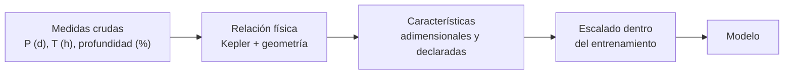

# B17-C01 — Ingeniería de características científicas

<!-- nav:top -->
[🏠 Programa](../../../../README.md) · [📚 Bloque B17](../../../tronco-comun/B17-aprendizaje-automatico-cientifico.md) · [← Anterior: B16-C20 — Control de orientación en un simulador](../../B16/B16-C20-control-de-orientacion-en-un-simulador/CLASE.md) · [Siguiente: B17-C02 — Aprendizaje supervisado →](../B17-C02-aprendizaje-supervisado/CLASE.md)
<!-- /nav -->

## 1. Ubicación, nivel y alcance

Primera clase del bloque B17. Hasta aquí trabajaste con datos como columnas de números (B14) y con su estadística (B12). Ahora empiezas a preparar esos números para un **modelo que aprende**: antes de entrenar nada, decides qué columnas le entregas, en qué unidades y con qué transformaciones. Nivel N2. Usas arreglos y unidades de B14, media y desviación estándar (B12-C04) y la tercera ley de Kepler. No verás todavía los modelos (C02) ni cómo evaluarlos sin trampa (C09).

## 2. Por qué esta clase existe

Un modelo de aprendizaje automático no sabe física: solo ve números. Si le das la duración de un tránsito en segundos y el periodo en días, la columna con números más grandes domina cualquier cálculo de distancias, y la clasificación depende de una elección de unidades que nada tiene que ver con el cielo. En cambio, si le das una cantidad **adimensional** construida con la física (cuántas veces mayor o menor que lo esperado es la duración observada), le entregas en una columna lo que un especialista miraría primero.

La decisión central: **¿qué variables construyo a partir de las medidas crudas, con qué unidades y escala, para que el modelo aprenda lo que importa con pocos datos y sin depender de convenciones arbitrarias?**

## 3. Lo que podrás hacer al terminar

1. Distinguir una columna cruda de una **característica** (variable construida) y declarar la unidad de cada una.
2. Construir características adimensionales a partir de una relación física (a/R★ y duración esperada de un tránsito).
3. Explicar por qué la escala de una columna altera a los modelos basados en distancias y cómo la estandarización lo corrige.
4. Decidir cuándo una transformación logarítmica es apropiada.
5. Verificar una característica contra un caso de referencia independiente y comprobar que se puede invertir.
6. Documentar un conjunto de características con unidad, fórmula, supuestos y dominio de validez.

La evidencia es la **ficha de características** del ejercicio 12 (sección 20).

## 4. Con qué llegas y cómo comprobarlo

1. ¿Cuáles son las dimensiones de `G·ρ` si `G` está en m³ kg⁻¹ s⁻² y `ρ` en kg m⁻³?
2. ¿Cuánto vale `log₁₀(1000)`? ¿Y `log₁₀(0,01)`?
3. ¿Cuáles son la media y la desviación estándar (poblacional) de {2, 4, 6, 8}?
4. Si el periodo orbital se multiplica por 8, ¿por cuánto se multiplica el semieje mayor, sabiendo que `a ∝ P^(2/3)`?
5. ¿Cuántos días son 2 horas?

<details>
<summary>Ver respuestas</summary>

1. s⁻² (el producto es una frecuencia al cuadrado). 2. 3 y −2. 3. Media 5; desviación `√5 ≈ 2,236`. 4. `8^(2/3) = 4`. 5. `2/24 ≈ 0,0833 d`.
</details>

Con cuatro o cinco aciertos, sigue; con tres o menos, repasa B12-C04 (esperanza y varianza) y B14-C02.

## 5. Un caso real: la densidad del Sol y la órbita de la Tierra

La ficha del Sol de la NASA da una densidad media de 1408 kg/m³ y un radio de 695 700 km (S1). Con la constante de gravitación `G = 6,674 30 × 10⁻¹¹ m³ kg⁻¹ s⁻²` (CODATA 2022, S2) y el periodo de la Tierra (365,25 d), la relación de la sección 8.3 predice que el semieje mayor de la Tierra mide unos **214,9 radios solares**. El cociente directo `1 au / R☉` da 215,03, con `1 au = 149 597 870 700 m` exactos (B01-C08). La diferencia es de 0,04 %.

Fíjate en lo que ocurrió: una característica (`a/R★`) se calculó con dos datos medidos (periodo y densidad) y una ley física, y se **comprobó contra una cifra independiente**. Esa es la práctica que repetirás: ninguna característica nueva entra a un modelo sin una comprobación así.

## 6. Vocabulario

Una **característica** (*feature*) es una variable de entrada del modelo; puede ser una columna medida o una calculada a partir de otras. La **variable objetivo** es lo que el modelo debe predecir. Una cantidad **adimensional** no tiene unidad (es un cociente de magnitudes con la misma dimensión), por lo que no cambia al cambiar de sistema de unidades. La **estandarización** resta a cada columna su media y divide por su desviación estándar (`z = (x − μ)/σ`), de modo que queda con media 0 y desviación 1. Un **modelo basado en distancias** (por ejemplo, k vecinos más cercanos) clasifica un punto según los más próximos en el espacio de características. La **razón de duración** que usaremos es `T_obs / T₀`, donde `T_obs` es la duración medida del tránsito y `T₀` la duración esperada.

## 7. Modelo mental: de la medida a la característica



*Descripción textual:* cinco cajas en cadena. Las medidas crudas, cada una con su unidad, pasan por una relación física que las combina; el resultado son características adimensionales y declaradas; se escalan usando solo datos de entrenamiento; y recién entonces llegan al modelo.

Una analogía: preparar los ingredientes antes de cocinar. Pelar y medir es parte de la receta, no un trámite. **Límite:** en la cocina todos los ingredientes se usan; en un modelo, una característica mal construida puede empeorar el resultado, y por eso se comprueba.

## 8. La explicación, paso a paso

### 8.1 Columnas crudas y características

Un catálogo de candidatos a tránsito trae columnas como el periodo `P` (d), la duración observada `T_obs` (d) y la profundidad `δ` (en %, la fracción de luz que se pierde). Cada una es una **medida con unidad**. Una característica puede ser una de ellas tal cual, o una combinación como `T_obs / P`. Lo importante es que **cada característica tenga una unidad declarada** (o sea adimensional) y una fórmula escrita.

### 8.2 La escala importa para los modelos basados en distancias

Dos candidatos difieren en 5 d de periodo y en 0,01 d de duración. Si ambos están en días, la distancia entre ellos es `√(5² + 0,01²) ≈ 5,00`: manda el periodo. Si pasas la duración a segundos, 0,01 d son 864 s y la distancia es `√(5² + 864²) ≈ 864,0`: manda la duración. **Nada cambió en el cielo, solo la unidad**, y el vecino más cercano cambió de candidato. Es el mismo candidato visto con dos reglas distintas.

La **estandarización** lo resuelve: al dividir cada columna por su desviación estándar, las unidades se cancelan y todas las columnas pesan igual. Una consecuencia útil: estandarizar es una transformación afín (`z = (x − μ)/σ`), y por lo tanto el resultado es el mismo en días o en segundos.

### 8.3 Una característica con física: a/R★ y la duración esperada

Para un planeta pequeño en órbita circular, la tercera ley de Kepler es `G·M·P² = 4π²·a³`, con `M` la masa de la estrella y `a` el radio de la órbita. Si la estrella es una esfera de densidad media `ρ` y radio `R★`, su masa es `M = (4/3)π R★³ ρ`. Sustituyendo y reordenando:

```text
a / R★ = ( G · ρ · P² / (3π) )^(1/3)
```

(`P` en segundos, `ρ` en kg/m³; el resultado no tiene unidad.) Durante un tránsito central, el planeta cruza el disco estelar de diámetro `2R★` con la velocidad orbital `2πa/P`. Por tanto, la duración esperada es

```text
T₀ = 2 R★ / (2π a / P) = P / ( π · a/R★ )          (tránsito central, Rp ≪ R★)
```

Dos observaciones. Primero, `T₀` depende de la **densidad** de la estrella y no de su masa y radio por separado, lo que permite comprobar si la duración observada es compatible con una estrella como la que se cree. Segundo, la **razón de duración** `T_obs / T₀` es adimensional: vale cerca de 1 para un planeta en una estrella como la supuesta y se aleja de 1 si la señal viene de otro fenómeno o de otra estrella (un falso positivo). Esa razón es la característica que un especialista miraría primero.

### 8.4 Cuándo usar logaritmos

Si una columna abarca varios órdenes de magnitud (la profundidad va de 0,01 % a 1 %), la distancia entre 0,01 y 0,02 y la distancia entre 0,98 y 0,99 son muy distintas aunque el cambio relativo sea comparable. `log₁₀` convierte cocientes en diferencias: duplicar suma `log₁₀2 ≈ 0,301` en cualquier punto de la escala. Úsalo con cantidades **positivas** que varían por factores (periodos, masas, flujos). No lo uses con temperaturas en °C (pueden ser negativas ni tienen cero físico) ni con cantidades que pueden ser cero.

### 8.5 Escalar sin mirar el futuro

La media y la desviación que usas para estandarizar se calculan **solo con los datos de entrenamiento** y se aplican después a los de prueba. Si las calculas con todo el conjunto, filtras información de la prueba al entrenamiento. El problema completo se trata en C09; aquí basta con la regla: el escalador se ajusta dentro de cada pliegue, y una `Pipeline` de scikit-learn lo hace automáticamente (S3).

## 9. Magnitudes, símbolos y unidades

| Símbolo | Qué es | Unidad | Nota |
|---|---|---|---|
| `P` | periodo orbital | d (en las fórmulas, s) | `1 d = 86 400 s` |
| `ρ` | densidad media de la estrella | kg/m³ | Sol: 1408 (S1) |
| `G` | constante de gravitación | m³ kg⁻¹ s⁻² | 6,674 30 × 10⁻¹¹ (S2) |
| `a/R★` | semieje en radios estelares | adimensional | sección 8.3 |
| `T₀` | duración esperada, tránsito central | d | `P/(π·a/R★)` |
| `T_obs` | duración medida | d | dato |
| `T_obs/T₀` | razón de duración | adimensional | la característica |
| `z` | valor estandarizado | adimensional | `(x − μ)/σ` |

## 10. Convenciones y referencias

Las fórmulas suponen órbita circular, tránsito central (parámetro de impacto 0), planeta mucho menor que la estrella y masa del planeta despreciable frente a la de la estrella. Se usa el logaritmo decimal `log₁₀`. Todo valor lleva su unidad; los cocientes lo declaran como adimensional. Los datos del laboratorio son **sintéticos**.

## 11. De dónde sale lo que afirmamos

| ID | Fuente | Localizador | Respalda | Estado |
|---|---|---|---|---|
| S1 | NASA NSSDC, *Sun Fact Sheet* (act. 9-may-2024) | https://nssdc.gsfc.nasa.gov/planetary/factsheet/sunfact.html | Densidad media 1408 kg/m³; radio volumétrico medio 695 700 km | Página consultada el 2026-11-05 |
| S2 | NIST, CODATA 2022, constante de gravitación | https://physics.nist.gov/cgi-bin/cuu/Value?bg | `G = 6,674 30 × 10⁻¹¹ m³ kg⁻¹ s⁻²` (incertidumbre estándar relativa 2,2 × 10⁻⁵) | Página consultada el 2026-11-05 |
| S3 | scikit-learn, «Cross-validation» y «Common pitfalls» | https://scikit-learn.org/stable/modules/cross_validation.html y https://scikit-learn.org/stable/common_pitfalls.html | El preprocesamiento (estandarizar, seleccionar) se ajusta solo con datos de entrenamiento; `Pipeline` lo evita | Páginas consultadas el 2026-11-05 (mutables; documentación de la versión estable) |
| S4 | B01-C08, sección 11 (S2, S3) | [B01-C08](../../B01/B01-C08-mediciones-y-unidades-astronomicas/CLASE.md) | `1 au = 149 597 870 700 m` exactamente | Referencia interna; no vuelta a consultar aquí |

Límites: la derivación de la sección 8.3 es tuya (Kepler más geometría), no se cita de una fuente; se comprueba numéricamente contra `au/R☉`. No se consultó literatura sobre selección de características para tránsitos.

## 12. Cómo ver los datos

La tabla muestra, para tres candidatos sintéticos con `P = 10 d` alrededor de una estrella como el Sol (`T₀ = 0,163 d = 3,91 h`), cómo la razón separa lo compatible de lo que no.

| Candidato | `T_obs` (h) | `T_obs/T₀` | Lectura |
|---|---|---|---|
| A | 3,9 | 1,00 | Compatible con planeta |
| B | 7,2 | 1,84 | Demasiado largo: otra estrella más difusa o un eclipse |
| C | 1,2 | 0,31 | Demasiado corto: ¿tránsito rasante o señal espuria? |

En un gráfico, dibujarías `log₁₀(T_obs/T₀)` en el eje horizontal y verías los planetas agrupados alrededor de 0 y los falsos positivos repartidos a ambos lados. Describe siempre el gráfico con palabras cuando lo publiques.

## 13. Ejemplo trabajado: una característica de principio a fin

**Caso.** Un candidato tiene `P = 10 d`, `T_obs = 0,30 d` y la estrella se supone parecida al Sol (`ρ = 1408 kg/m³`). ¿Es compatible con un planeta?

**Paso 1 · unidades.** `P = 10 × 86 400 = 8,64 × 10⁵ s`.

**Paso 2 · a/R★.** `G ρ P² / (3π) = 6,674 × 10⁻¹¹ × 1408 × (8,64 × 10⁵)² / 9,4248 ≈ 7,44 × 10³`; la raíz cúbica da `a/R★ ≈ 19,52`.

**Paso 3 · T₀.** `T₀ = 10 / (π × 19,52) = 0,163 d`, es decir, 3,91 h.

**Paso 4 · razón.** `T_obs/T₀ = 0,30/0,163 ≈ 1,84`.

**Paso 5 · lectura e incertidumbre.** Una razón de 1,84 es incompatible con un planeta en una estrella como el Sol, **si** la densidad supuesta es correcta. Es posible que la estrella sea menos densa (una subgigante), y entonces `T₀` sería mayor. La característica no condena al candidato: lo señala para revisión y deja explícita la hipótesis (densidad solar).

## 14. Comparación de formas de preparar los datos

Entregar las columnas crudas es sencillo, pero depende de las unidades y obliga al modelo a descubrir la física con muchos datos. Estandarizarlas elimina la dependencia de unidad y no añade conocimiento. Construir características físicas incorpora conocimiento y reduce los datos necesarios, pero sus supuestos (órbita circular, tránsito central) pueden fallar y hay que declararlos. En el laboratorio, un clasificador de vecinos más cercanos sobre columnas crudas con una unidad mezclada llega a 0,51–0,59; estandarizado, 0,76; con la razón de duración y `log₁₀ P`, 0,85. La física aportó más que la sola estandarización.

## 15. Práctica guiada

**Ejercicio 1 · con los pasos indicados.** Comprueba que `G·ρ·P²` es adimensional. *Pasos:* escribe las unidades de `G` y `ρ` y multiplica por s² (sección 9).

<details><summary>Solución comentada</summary>

`G·ρ` tiene unidades `m³ kg⁻¹ s⁻² · kg m⁻³ = s⁻²`. Multiplicado por `P²` (s²) queda sin unidad, y su raíz cúbica también. Si hubieras dejado `P` en días, el producto tendría un factor `86 400²` de error: la razón para convertir antes.
</details>

**Ejercicio 2 · con una pista.** Calcula `a/R★` para `P = 10 d` y `ρ = 1408 kg/m³`. *Pista:* usa la sección 8.3 y convierte `P` a segundos.

<details><summary>Solución comentada</summary>

`a/R★ = (6,6743 × 10⁻¹¹ × 1408 × 7,465 × 10¹¹ / 9,4248)^(1/3) = (7,44 × 10³)^(1/3) ≈ 19,52`. La órbita mide unos 19,5 radios estelares.
</details>

**Ejercicio 3 · casi autónomo.** Con el resultado anterior calcula `T₀` en horas.

<details><summary>Solución comentada</summary>

`T₀ = P/(π·a/R★) = 10/(π × 19,52) = 0,1630 d`, y `0,1630 × 24 = 3,91 h`. Fíjate en que la duración se obtiene de dos datos: periodo y densidad.
</details>

## 16. Práctica autónoma, transferencia e integrador

**Ejercicio 4.** Una estrella tiene la mitad de la densidad del Sol y el mismo `P = 10 d`. ¿Cómo cambian `a/R★` y `T₀`?

<details><summary>Solución comentada</summary>

`a/R★ ∝ ρ^(1/3)`, así que se multiplica por `2^(-1/3) = 0,794`: 15,50. `T₀ ∝ 1/(a/R★)`, así que se multiplica por 1,26: 0,2054 d = 4,93 h. Una estrella menos densa alarga el tránsito.
</details>

**Ejercicio 5.** Estandariza la columna {2, 4, 6, 8}. ¿Qué media y desviación tiene el resultado?

<details><summary>Solución comentada</summary>

Media 5, desviación `√5 = 2,236`: `z = {−1,342; −0,447; 0,447; 1,342}`. Media 0 y desviación 1 (sección 8.2).
</details>

**Ejercicio 6.** La profundidad de dos candidatos es 0,01 % y 1 %. ¿Cuántas unidades las separan en escala lineal y en `log₁₀`?

<details><summary>Solución comentada</summary>

Lineal: 0,99 puntos porcentuales. Logarítmica: `log₁₀1 − log₁₀0,01 = 0 − (−2) = 2`, es decir, dos órdenes de magnitud. El logaritmo da peso al cociente (100×), que es lo físicamente relevante aquí.
</details>

**Ejercicio 7.** Un candidato con `P = 10 d` y `T_obs = 0,30 d` rodea una estrella que se sospecha subgigante. ¿Qué densidad haría compatible la razón con 1?

<details><summary>Solución comentada</summary>

Se necesita `T₀ = 0,30 d`, es decir, `a/R★ = 10/(π × 0,30) = 10,61`. Entonces `ρ = 3π (a/R★)³/(G P²) = 9,4248 × 1194/(6,6743 × 10⁻¹¹ × 7,465 × 10¹¹) ≈ 226 kg/m³`, unas 6 veces menos densa que el Sol. Es una estrella evolucionada plausible; la hipótesis puede comprobarse con otra medida independiente de la estrella.
</details>

**Ejercicio 8.** Dos candidatos difieren en 5 d de periodo y 0,01 d de duración. Calcula su distancia con la duración en días y en segundos. ¿Qué columna domina en cada caso?

<details><summary>Solución comentada</summary>

Días: `√(25 + 0,0001) = 5,00`, domina el periodo. Segundos: 0,01 d = 864 s, `√(25 + 746 496) = 864,0`, domina la duración (sección 8.2).
</details>

**Ejercicio 9 · transferencia.** El valor de `au/R☉` es 215,03. ¿Qué densidad solar haría coincidir exactamente la fórmula con él para `P = 365,25 d`? Compárala con la de la ficha de la NASA.

<details><summary>Solución comentada</summary>

`ρ = 3π(a/R★)³/(G P²) = 9,4248 × 215,03³/(6,6743 × 10⁻¹¹ × (3,1558 × 10⁷)²) ≈ 1410 kg/m³`. La ficha da 1408: coinciden al 0,13 %. La pequeña diferencia viene de los redondeos de la densidad (4 cifras), la masa de la Tierra y el periodo (sideral frente a 365,25 d).
</details>

**Ejercicio 10 · transferencia.** Un satélite reporta la temperatura de una batería en °C. Propón una característica adimensional del cociente `T/T_ref` y explica por qué no puedes usar °C.

<details><summary>Solución comentada</summary>

Hay que convertir a kelvin: `T_K = T_C + 273,15`. El cociente `T_K/T_ref,K` es adimensional y tiene sentido porque el kelvin tiene cero físico. Con °C, un cociente de 20 °C a 10 °C daría 2 y significaría otra cosa (de 293,15 K a 283,15 K el cociente es 1,035). Un logaritmo de una temperatura en °C además no está definido por debajo de 0.
</details>

**Ejercicio 11 · transferencia.** De un satélite natural se mide `a = 384 400 km` y `P = 27,32 d` (valores redondeados del enunciado). Propón una característica con unidades y calcula la masa del cuerpo central.

<details><summary>Solución comentada</summary>

De Kepler: `M = 4π² a³/(G P²)`. Con `a = 3,844 × 10⁸ m` y `P = 2,360 × 10⁶ s`: `M ≈ 6,03 × 10²⁴ kg` (unidad: kg). Es un orden de magnitud correcto para la Tierra; la diferencia con el valor aceptado se debe a la masa de la Luna y a los redondeos. Una característica útil sería `log₁₀ M`, y quedaría documentada con su unidad.
</details>

**Ejercicio 12 · integrador.** Construye la **ficha de características** para cinco candidatos sintéticos que inventes (con `P`, `T_obs` y `ρ` supuesto): calcula `a/R★`, `T₀`, `T_obs/T₀` y `log₁₀(T_obs/T₀)`, con unidad, fórmula, supuestos, dominio de validez y una comprobación independiente.

<details><summary>Solución modelo</summary>

Una ficha válida tiene una tabla con una fila por candidato y una columna por característica, la unidad o «adimensional» en el encabezado, la fórmula de la sección 8.3, los supuestos de la sección 10, el rango de `P` donde se aplica y una comprobación (por ejemplo, el caso Tierra–Sol de la sección 5). Acepta cualquier conjunto coherente que cite sus fuentes.
</details>

## 17. Laboratorio: la unidad que cambia al clasificador

El script [caracteristicas_fisicas.py](caracteristicas_fisicas.py) comprueba `a/R★` contra `au/R☉`, verifica que la fórmula se invierte, genera 1200 candidatos sintéticos (planetas y falsos positivos) y compara un clasificador de vecinos más cercanos con columnas crudas (con la duración en días y en segundos), con columnas estandarizadas y con la razón de duración.

**Datos:** sintéticos. **Predice antes de ejecutar:** ¿qué pasa con la exactitud al estandarizar si cambias la unidad? (sección 8.2). **Ejecución del 2026-11-05 (Python 3.12.9, NumPy 2.4.4):**

```text
a/R* Tierra-Sol: calculado 214.94; referencia au/R_sol 215.03; diferencia -0.043 %
densidad recuperada: 1408.0 kg/m^3
razón T_obs/T0: planetas mediana 0.998, falsos positivos mediana 1.044
k-NN sin escalar: días 0.508 | segundos 0.592
k-NN estandarizado: días 0.758 | segundos 0.758
k-NN con log10(razón de duración) y log10(P): 0.847
Pruebas superadas.
```

```bash
python programa/clases/B17/B17-C01-ingenieria-de-caracteristicas-cientificas/caracteristicas_fisicas.py
```

**Límites:** el conjunto es sintético y las clases se generan con la propia relación que luego se usa como característica, por lo que el resultado no dice cuánto ayudaría con datos reales. El script usa `scikit-learn` solo para el clasificador.

## 18. Errores frecuentes y cómo corregirlos

**Mezclar unidades en una fórmula.** Dejar `P` en días dentro de `G ρ P²`. Se corrige con el ejercicio 1.

**Dejar que la unidad decida el resultado.** Un modelo de distancias sin estandarizar. Ejercicios 5 y 8.

**Usar logaritmos con cantidades que pueden ser cero o negativas.** Ejercicio 10.

**Confundir la característica con la verdad.** Una razón fuera de 1 señala, no condena (ejercicio 7).

**Estandarizar con todo el conjunto.** Filtra información de la prueba; se trata en C09.

## 19. Cómo sabrás que vas bien

Tras 8.2: ¿puedes explicar por qué la estandarización borra la unidad? Si no, rehaz el ejercicio 8. Tras 8.3: ¿derivas `T₀` sin mirar? Si no, repite los ejercicios 2 y 3. Tras el laboratorio: ¿por qué la exactitud sin escalar cambió con la unidad y la estandarizada no? Al final: ¿qué supuesto de tu ficha sería el primero en fallar con datos reales?

## 20. Qué entregas y cómo se evalúa

El producto es tu **ficha de características** (ejercicio 12): tabla con unidades, fórmulas, supuestos, dominio de validez y comprobación independiente.

| Criterio | Inicial | En desarrollo | Logrado | Destacado |
|---|---|---|---|---|
| Unidades | Sin unidades | Unidades en parte | Todas declaradas | Comprueba dimensiones de cada fórmula |
| Física | Copia columnas | Una característica derivada | Razón adimensional correcta | Justifica el supuesto y su límite |
| Verificación | Ninguna | Compara sin tolerancia | Compara con una referencia | Invierte la fórmula y explica la diferencia |
| Escalado | No escala | Escala todo el conjunto | Escala solo con entrenamiento | Explica el efecto de la unidad con un ejemplo |

**Condiciones críticas:** no presentar datos sintéticos como observados; declarar el supuesto de densidad; no aplicar la fórmula fuera de su dominio.

## 21. Ética, seguridad y límites

Una característica construida a partir de un supuesto (densidad solar, órbita circular) puede descartar sin querer objetos reales raros; declara siempre el supuesto y revisa una muestra de lo descartado. Accesibilidad: tablas con encabezados, gráficos descritos con texto, ejercicios sin conexión. Material educativo; no es un procedimiento de validación de planetas.

## 22. Para cerrar y seguir

Una buena característica tiene unidad (o es adimensional), fórmula, supuestos y una comprobación independiente. Estandarizar elimina el efecto de la unidad en modelos de distancias; la física, además, aporta información que el modelo tendría que adivinar. Queda abierta una pregunta: ¿cuántas características derivadas conviene añadir antes de que el modelo se ajuste a ruido?

**Glosario español–inglés.** característica · *feature*; variable objetivo · *target*; adimensional · *dimensionless*; estandarización · *standardization*; razón de duración · *duration ratio*; falso positivo · *false positive*.

**Continuidad.** La clase B17-C02 usa tus características para entrenar y validar un modelo supervisado. B17-C09 volverá sobre el escalado sin filtrar información.

**Referencias:** ver sección 11. S3 son páginas de documentación mutables; S4 es una referencia interna.

<!-- nav:bottom -->
---

[← Anterior: B16-C20 — Control de orientación en un simulador](../../B16/B16-C20-control-de-orientacion-en-un-simulador/CLASE.md) · [📚 Bloque B17](../../../tronco-comun/B17-aprendizaje-automatico-cientifico.md) · [Siguiente: B17-C02 — Aprendizaje supervisado →](../B17-C02-aprendizaje-supervisado/CLASE.md)
<!-- /nav -->
