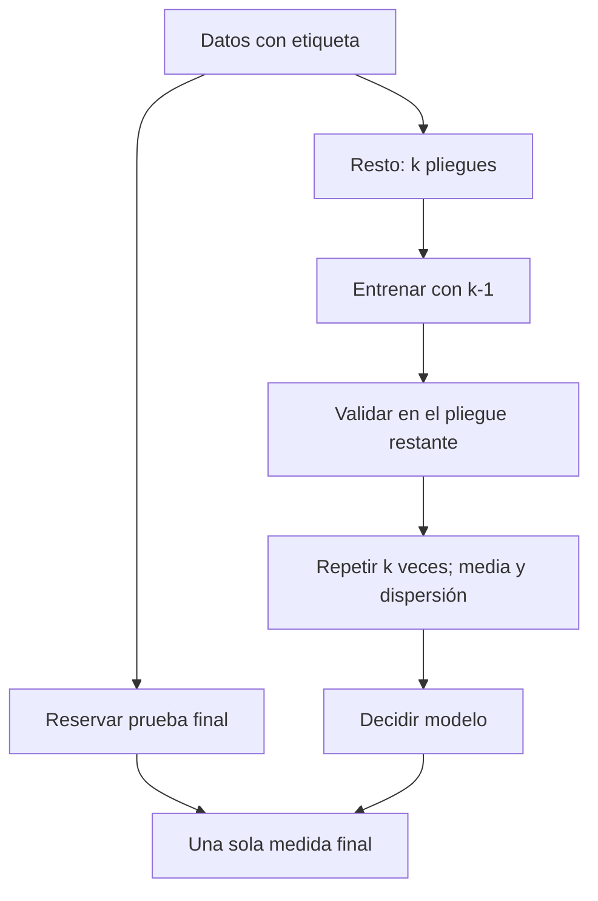

# B17-C02 — Aprendizaje supervisado

<!-- nav:top -->
[🏠 Programa](../../../../README.md) · [📚 Bloque B17](../../../tronco-comun/B17-aprendizaje-automatico-cientifico.md) · [← Anterior: B17-C01 — Ingeniería de características científicas](../B17-C01-ingenieria-de-caracteristicas-cientificas/CLASE.md) · [Siguiente: B17-C03 — Redes neuronales informadas por la física (PINN) →](../B17-C03-redes-neuronales-informadas-por-la-fisica-pinn/CLASE.md)
<!-- /nav -->

## 1. Ubicación, nivel y alcance

Segunda clase del bloque B17. En la [clase anterior](../B17-C01-ingenieria-de-caracteristicas-cientificas/CLASE.md) preparaste características con unidad y sentido físico; ahora las entregas a un modelo que **aprende de ejemplos con respuesta conocida** y mides honestamente cuánto aprendió. Nivel N2. Usas mínimos cuadrados (B10-C07), la distribución normal (B12-C03) y la regresión (B12-C10). No verás aún redes con ecuaciones (C03), modelos sustitutos (C04) ni la prevención de fugas (C09).

## 2. Por qué esta clase existe

Un modelo que clasifica señales como «candidata» o «no candidata» puede acertar el 100 % de los ejemplos con los que se entrenó y fallar la cuarta parte de los nuevos: memorizó. Lo que importa a un equipo científico es el desempeño en datos que el modelo **no vio**. La validación cruzada es la herramienta estándar para estimarlo.

La decisión central: **¿cómo estimo, antes de usarlo, cuánto acertará mi modelo con datos nuevos, y cómo sé que ese número es creíble?**

## 3. Lo que podrás hacer al terminar

1. Distinguir clasificación y regresión, y entrenamiento, validación y prueba.
2. Realizar una validación cruzada de `k` pliegues, a mano y con scikit-learn, e informar media y dispersión.
3. Usar pliegues estratificados cuando las clases están desbalanceadas.
4. Reconocer el sobreajuste comparando el desempeño en entrenamiento y en datos nuevos.
5. Calcular la exactitud máxima alcanzable en un caso gaussiano y usarla como referencia.
6. Ajustar una recta por mínimos cuadrados con las ecuaciones normales y compararla con una solución de biblioteca.

La evidencia es el **informe de validación** del ejercicio 12 (sección 20).

## 4. Con qué llegas y cómo comprobarlo

1. Si una variable aleatoria es normal con media 1 y desviación 1, ¿qué probabilidad hay de que sea mayor que 0? (Usa `Φ(1) = 0,8413`.)
2. ¿Cuánto es la media de 0,84; 0,83; 0,85; 0,86; 0,82?
3. ¿Cuál es la pendiente de la recta que pasa por (0, 1) y (2, 5)?
4. ¿Qué es la matriz transpuesta de `[[1, 1], [1, 2]]`?
5. Si un modelo acierta 99 de 100 casos, ¿cuál es su exactitud?

<details>
<summary>Ver respuestas</summary>

1. `Φ(1) = 0,8413`. 2. 0,84. 3. 2. 4. La misma (es simétrica). 5. 0,99.
</details>

Con cuatro o cinco aciertos, sigue; con tres o menos, repasa B12-C03 (distribuciones) y B10-C07 (mínimos cuadrados).

## 5. Un caso real: clasificar candidatos con etiquetas conocidas

En la búsqueda de planetas con la misión Kepler, un equipo entrenó una red convolucional con señales ya clasificadas como planeta o falso positivo y comprobó su desempeño con una parte reservada de esas señales: el resumen de su trabajo informa que la red ordenó una señal planetaria por encima de un falso positivo en el 98,8 % de los casos de prueba (S1). Dos detalles importan para esta clase. La cifra viene de **datos de prueba separados del entrenamiento**, y es una cifra de ordenamiento, no una exactitud. No vemos aquí la red ni sus datos (solo se leyó el resumen); aprenderás el mecanismo de evaluación que hace creíble una cifra así.

## 6. Vocabulario

El **aprendizaje supervisado** ajusta un modelo a pares (entrada, respuesta): las respuestas se llaman **etiquetas**. En **clasificación** la respuesta es una categoría (planeta o no); en **regresión**, un número (la masa, la temperatura). El **conjunto de entrenamiento** ajusta el modelo; el de **prueba** se reserva para la medida final. El **sobreajuste** es aprender el ruido del entrenamiento y generalizar mal. La **validación cruzada** de `k` pliegues divide los datos en `k` partes, entrena con `k−1` y valida con la restante, y repite para que cada parte valide una vez; luego promedia (S2). Un pliegue **estratificado** conserva en cada parte la proporción de clases. La **exactitud** es la fracción de predicciones correctas. El **error de Bayes** es el error mínimo posible con la información disponible.

## 7. Modelo mental: ajustar, validar, repetir



*Descripción textual:* los datos con etiqueta se separan en una prueba final y el resto, que se divide en `k` pliegues. Se entrena con `k−1`, se valida con el pliegue restante, se repite `k` veces y se promedia. Con el modelo elegido se hace una única medida sobre la prueba final.

Una analogía: un examen de práctica. Si estudias con las mismas preguntas del examen, tu nota no dice cuánto sabes. **Límite:** en un examen, las preguntas nuevas suelen ser del mismo tipo; en ciencia, los datos nuevos pueden venir de otro instrumento u otra época, y eso la validación cruzada simple no lo captura (C07).

## 8. La explicación, paso a paso

### 8.1 Clasificación con una sola variable

Imagina una característica estandarizada `x` (por ejemplo, la razón de duración de C01 convertida a una escala común). Los planetas tienen `x` alrededor de +1 y los falsos positivos alrededor de −1, ambos con dispersión 1. Un modelo de **regresión logística** estima la probabilidad de la clase 1 como

```text
p(x) = 1 / (1 + exp(−(w·x + b)))
```

con `w` y `b` ajustados a los datos, y predice la clase 1 si `p > 0,5`. Con dos campanas iguales y clases equiprobables, la mejor frontera está en `x = 0`.

### 8.2 La exactitud máxima posible

Aun con el mejor modelo, las campanas se solapan y hay errores. Con medias ±1 y desviación 1, un punto de la clase 1 está bien clasificado si `x > 0`, con probabilidad `Φ(1) = 0,8413`. Esa cifra, el **complemento del error de Bayes**, es un techo: ningún modelo puede superarla con esa única variable. Conocerla te permite saber si estás cerca del límite o si hay margen de mejora. Para medias ±0,5 el techo es `Φ(0,5) = 0,6915`; para ±1,5, `Φ(1,5) = 0,9332`.

### 8.3 Validación cruzada

Con `k = 5` y 100 ejemplos, cada pliegue tiene 20; entrenas con 80 y validas con 20, cinco veces. Obtienes cinco exactitudes; informas su **media** y su **desviación estándar** muestral (con `n−1`), que mide cuánto varía la estimación según los datos. Si las cinco exactitudes son 0,84; 0,83; 0,85; 0,86; 0,82, la media es 0,84 y la desviación `√(10⁻³/4) = 0,016`. Un resultado se informa como «0,84 ± 0,02», no como «0,84».

### 8.4 Pliegues estratificados

Si solo el 5 % de los ejemplos son planetas, un pliegue al azar puede quedar sin ninguno. Los pliegues **estratificados** reparten cada clase proporcionalmente (S2). Con 50 ejemplos, 45 de una clase y 5 de otra, y 3 pliegues, los de la clase minoritaria quedan como 2, 2 y 1; sin estratificar algunos pliegues podrían quedar sin ejemplos de ella.

### 8.5 Sobreajuste

Un clasificador de **un vecino** guarda todos los ejemplos y predice la etiqueta del más cercano: acierta el 100 % en entrenamiento por construcción. En datos nuevos acierta menos. La señal del sobreajuste es una **brecha grande** entre el desempeño en entrenamiento y en validación. La corrección es un modelo más simple, más datos, o regularización (que no tratamos aquí).

### 8.6 Regresión por mínimos cuadrados

Para ajustar `y = β₀ + β₁ x` a datos `(xᵢ, yᵢ)`, arma la matriz `A` con una columna de unos y otra con los `xᵢ`. Las **ecuaciones normales** son `AᵀA β = Aᵀy`, y su solución minimiza la suma de los cuadrados de los residuos (B10). Una solución de biblioteca (`numpy.linalg.lstsq`) debe coincidir con ella; esa coincidencia es una prueba.

## 9. Magnitudes, símbolos y unidades

| Símbolo | Qué es | Unidad | Nota |
|---|---|---|---|
| `x` | característica estandarizada | adimensional | de C01 |
| `y` | etiqueta (0 o 1) o valor | — | clasificación o regresión |
| `p(x)` | probabilidad estimada de la clase 1 | adimensional | entre 0 y 1 |
| `w`, `b` | parámetros de la regresión logística | — | ajustados |
| `k` | número de pliegues | adimensional | típico 5 o 10 |
| `Φ` | función de distribución normal estándar | adimensional | `Φ(1) = 0,8413` |
| `β₀`, `β₁` | ordenada y pendiente | unidades de `y` y de `y/x` | mínimos cuadrados |

## 10. Convenciones y referencias

Las etiquetas son 0 (falso positivo) y 1 (planeta). Las cifras se informan con media y desviación muestral de los pliegues. Los datos del laboratorio son **sintéticos**, con semilla fija. Las semillas de los separadores se fijan con enteros para poder repetir el resultado (S3).

## 11. De dónde sale lo que afirmamos

| ID | Fuente | Localizador | Respalda | Estado |
|---|---|---|---|---|
| S1 | Shallue, C. J. y Vanderburg, A., arXiv:1712.05044 | https://arxiv.org/abs/1712.05044 | Red convolucional para ordenar señales de Kepler; ordena planetas sobre falsos positivos en el 98,8 % de los casos de prueba | Resumen consultado el 2026-11-05 |
| S2 | scikit-learn, «Cross-validation: evaluating estimator performance» | https://scikit-learn.org/stable/modules/cross_validation.html | Validación cruzada, `KFold`, `StratifiedKFold`, ejemplo 45/5 en 3 pliegues | Página consultada el 2026-11-05 (mutable) |
| S3 | scikit-learn, «Common pitfalls and recommended practices» | https://scikit-learn.org/stable/common_pitfalls.html | `random_state` entero hace repetibles `split` y `fit` | Página consultada el 2026-11-05 (mutable) |

Límites: de S1 solo se leyó el resumen. El valor `Φ(1)` y las ecuaciones normales son resultados matemáticos estándar que se comprueban numéricamente en el laboratorio.

## 12. Cómo ver los datos

| Medias de las clases | Separación | Exactitud máxima `Φ(μ/σ)` |
|---|---|---|
| ±0,5 | 1σ | 0,6915 |
| ±1 | 2σ | 0,8413 |
| ±1,5 | 3σ | 0,9332 |
| ±2 | 4σ | 0,9772 |

Dibuja dos campanas con medias ±1 y la frontera vertical en 0; el área de cola de cada campana al otro lado de la frontera es el error. En un gráfico accesible, describe con texto las dos curvas y su solape, y usa marcas de forma distintas para las clases además del color.

## 13. Ejemplo trabajado: validar un clasificador gaussiano

**Caso.** 20 000 ejemplos sintéticos, medias ±1, desviación 1, clases equiprobables. Queremos estimar la exactitud con 5 pliegues.

**Paso 1 · techo.** `Φ(1) = 0,8413`.

**Paso 2 · pliegues estratificados.** Cada pliegue tiene 4000 ejemplos, la mitad de cada clase.

**Paso 3 · resultados.** Las cinco exactitudes de la validación cruzada hecha a mano fueron 0,8390; 0,8382; 0,8368; 0,8492; 0,8440 (media 0,8415, desviación 0,0051).

**Paso 4 · comparación.** La media queda a 0,0002 del techo teórico: el modelo logra casi lo máximo posible. La implementación de scikit-learn dio 0,8417, coherente.

**Paso 5 · incertidumbre.** La dispersión de 0,005 indica que la exactitud verdadera podría ser algo mayor o menor; con tal dispersión, decir «0,8415» con cuatro cifras sobra. Informa «0,84 ± 0,01».

## 14. Comparación de formas de evaluar

Evaluar en el mismo conjunto de entrenamiento no sirve (da 1,00 con un vecino). Una **partición única** entrenamiento/prueba es simple, pero depende de la suerte del corte. La **validación cruzada** reduce esa dependencia a costa de entrenar `k` veces. Para clases raras se usan pliegues estratificados; para datos con orden temporal o con fuentes repetidas, los pliegues aleatorios son engañosos (C09). Un modelo debe además compararse con una **línea base** tonta, como predecir siempre la clase mayoritaria.

## 15. Práctica guiada

**Ejercicio 1 · con los pasos indicados.** Con 100 ejemplos y `k = 5`, ¿cuántos ejemplos entrenan y cuántos validan en cada iteración? ¿Cuántas veces valida cada ejemplo? *Pasos:* sección 8.3.

<details><summary>Solución comentada</summary>

Cada pliegue tiene 20; se entrena con 80 y se valida con 20. Cada ejemplo valida exactamente una vez, y entrena en 4 de las 5 iteraciones.
</details>

**Ejercicio 2 · con una pista.** ¿Cuál es el techo de exactitud con medias ±1,5 y desviación 1? *Pista:* sección 8.2 y tabla de la sección 12.

<details><summary>Solución comentada</summary>

`Φ(1,5) = 0,9332`. Un modelo con 0,93 está en el límite; uno con 0,70 tiene mucho margen.
</details>

**Ejercicio 3 · casi autónomo.** Ajusta por ecuaciones normales una recta a los puntos (0, 1), (1, 3), (2, 5).

<details><summary>Solución comentada</summary>

`AᵀA = [[3, 3], [3, 5]]` y `Aᵀy = [9, 13]`. El determinante es 6; `β₀ = (5·9 − 3·13)/6 = 1` y `β₁ = (3·13 − 3·9)/6 = 2`. La recta es `y = 1 + 2x`, que pasa exactamente por los tres puntos.
</details>

## 16. Práctica autónoma, transferencia e integrador

**Ejercicio 4.** Hay 100 ejemplos, 90 de una clase y 10 de otra. Con 5 pliegues estratificados, ¿cuántos de cada clase hay por pliegue?

<details><summary>Solución comentada</summary>

18 de la clase mayor y 2 de la menor en cada pliegue. Sin estratificar, un pliegue podría tener 0 de la clase menor (sección 8.4).
</details>

**Ejercicio 5.** Un modelo siempre responde «no planeta» y el 1 % de los candidatos son planetas. ¿Qué exactitud tiene? ¿Sirve?

<details><summary>Solución comentada</summary>

0,99. No sirve: no encuentra ningún planeta. Por eso la exactitud no basta cuando las clases son desiguales; C12 desarrolla las métricas adecuadas.
</details>

**Ejercicio 6.** Las exactitudes de cinco pliegues son 0,84; 0,83; 0,85; 0,86; 0,82. Calcula media, desviación muestral y escribe el resultado.

<details><summary>Solución comentada</summary>

Media 0,84; desviaciones −0, −0,01, 0,01, 0,02, −0,02; suma de cuadrados `10⁻³`; dividida entre 4 es `2,5 × 10⁻⁴`; raíz 0,0158. Resultado: «0,84 ± 0,02».
</details>

**Ejercicio 7.** Un vecino más cercano da 1,000 en entrenamiento y 0,780 en datos nuevos, con techo 0,8413. Diagnostica y propón una mejora.

<details><summary>Solución comentada</summary>

La brecha de 0,22 indica sobreajuste. Un modelo más simple, como la regresión logística, llega a 0,84 (techo). Otra mejora es usar más vecinos (promedia el ruido).
</details>

**Ejercicio 8.** A la medición con desviación 1 se le suma un ruido instrumental independiente de desviación 1. ¿Cuál es el nuevo techo con medias ±1? (`Φ(0,7071) = 0,7602`.)

<details><summary>Solución comentada</summary>

La desviación total es `√(1² + 1²) = 1,414`; el techo es `Φ(1/1,414) = Φ(0,7071) = 0,7602`. Duplicar el ruido en varianza costó unos 8 puntos de exactitud máxima: el instrumento limita el modelo.
</details>

**Ejercicio 9 · transferencia.** Una serie temporal de brillo de 1000 puntos se divide en pliegues al azar. ¿Qué riesgo ves? (Pista: puntos vecinos se parecen.)

<details><summary>Solución comentada</summary>

Un punto de validación tiene vecinos casi iguales en entrenamiento, y el modelo «acierta» por parecido, no por aprender. La exactitud queda inflada. Se corrige con particiones por tiempo o por fuente (C09).
</details>

**Ejercicio 10 · transferencia.** Los errores de una regresión son 1, 1, 1, 1 y 6 (en las unidades de `y`). Calcula el error absoluto medio y la raíz del error cuadrático medio. ¿Qué diferencia dicen?

<details><summary>Solución comentada</summary>

Error absoluto medio: `(1+1+1+1+6)/5 = 2`. Raíz del error cuadrático medio: `√((4 + 36)/5) = √8 = 2,83`. La segunda castiga más el error grande: elige según cuánto duela un fallo grande.
</details>

**Ejercicio 11 · transferencia.** Tienes 5 candidatos de una clase rara y 45 de la común, y vas a usar 3 pliegues. Explica qué ocurre con y sin estratificación.

<details><summary>Solución comentada</summary>

Con estratificación, los pliegues de prueba tienen 2, 2 y 1 ejemplos de la clase rara (ejemplo de la documentación, S2). Sin ella, un pliegue podría quedar con 0, y su exactitud (calculada solo con clase común) sería engañosa.
</details>

**Ejercicio 12 · integrador.** Redacta un **informe de validación** de un clasificador supervisado (puede ser el del laboratorio): datos y su procedencia, características con unidad, separación entrenamiento/prueba, pliegues usados, métrica, línea base tonta, techo teórico si lo hay, resultados `media ± desviación` y dos riesgos.

<details><summary>Solución modelo</summary>

El informe debe: declarar los datos como sintéticos u observados; listar las características y sus unidades; indicar `k` y si hubo estratificación y semilla; reportar exactitud, línea base y techo; mostrar la brecha entrenamiento–validación; y nombrar riesgos (por ejemplo, datos con orden temporal, o clases desiguales). Se acepta cualquier informe coherente.
</details>

## 17. Laboratorio: validar contra un techo exacto

El script [validacion_cruzada.py](validacion_cruzada.py) implementa pliegues estratificados a mano, los compara con los de scikit-learn, comprueba que con etiquetas aleatorias la exactitud sea 0,5, muestra el sobreajuste de 1-vecino y verifica las ecuaciones normales contra `lstsq`.

**Datos:** sintéticos. **Predice antes de ejecutar:** ¿cuánto se acerca la media al techo 0,8413? **Ejecución del 2026-11-05 (Python 3.12.9, NumPy 2.4.4, scikit-learn 1.8.0):**

```text
Exactitud máxima posible (Bayes) = Phi(1) = 0.8413
Exactitud por pliegue (a mano): [0.839  0.8382 0.8368 0.8492 0.844 ] | media 0.8415 ± 0.0051
scikit-learn StratifiedKFold: media 0.8417
Etiquetas aleatorias: exactitud 0.5003 (esperado ~0,5)
1-vecino: exactitud en entrenamiento 1.000, en datos nuevos 0.780
Regresión lineal: ecuaciones normales [2.0628 0.4811], lstsq [2.0628 0.4811] (verdad 2,0 y 0,5)
Pruebas superadas.
```

```bash
python programa/clases/B17/B17-C02-aprendizaje-supervisado/validacion_cruzada.py
```

**Límites:** una variable, clases gaussianas simétricas, sin dependencia entre ejemplos. En la regresión, el desvío de 0,06 respecto de la verdad (2,0 y 0,5) se debe al ruido de 200 puntos.

## 18. Errores frecuentes y cómo corregirlos

**Evaluar con los datos de entrenamiento.** Da 1,00 con memoria (ejercicio 7).

**Informar una cifra sin dispersión.** Se corrige con el ejercicio 6.

**Usar exactitud con clases desiguales.** Ejercicio 5 y C12.

**Pliegues aleatorios con datos dependientes.** Ejercicio 9 y C09.

**No comparar con una línea base ni con el techo.** Un 0,84 puede ser excelente o mediocre según el techo.

## 19. Cómo sabrás que vas bien

Tras 8.2: ¿calculas el techo para medias ±1,5 sin tabla? Si no, ejercicio 2. Tras 8.3: ¿reportas una validación cruzada con media y dispersión? Si no, ejercicio 6. Tras el laboratorio: ¿por qué con etiquetas aleatorias da 0,5? Al final: ¿qué te diría una brecha grande entre entrenamiento y validación?

## 20. Qué entregas y cómo se evalúa

El producto es tu **informe de validación** (ejercicio 12).

| Criterio | Inicial | En desarrollo | Logrado | Destacado |
|---|---|---|---|---|
| Partición | Evalúa en entrenamiento | Una sola partición | Validación cruzada con semilla | Estratifica y justifica `k` |
| Informe | Una cifra | Media | Media ± desviación | Compara con línea base y techo |
| Sobreajuste | No lo revisa | Lo menciona | Mide la brecha | Propone y prueba una corrección |
| Honestidad | Datos sin rotular | Rotula | Rotula y declara supuestos | Declara riesgos de dependencia entre datos |

**Condiciones críticas:** no medir en lo entrenado; no presentar datos sintéticos como observados; fijar semillas.

## 21. Ética, seguridad y límites

Una cifra de validación tranquiliza más de lo que informa si los datos nuevos serán distintos. No uses un modelo supervisado para decisiones críticas (por ejemplo, descartar candidatos de forma automática) sin revisar una muestra de sus descartes. Accesibilidad: resultados en tablas y en texto. Material educativo.

## 22. Para cerrar y seguir

El aprendizaje supervisado se evalúa con datos que el modelo no vio; la validación cruzada estima ese desempeño con media y dispersión, y un techo teórico dice cuánto margen queda. Queda abierta una pregunta: ¿qué ocurre cuando los datos «nuevos» no se parecen a los de entrenamiento?

**Glosario español–inglés.** aprendizaje supervisado · *supervised learning*; etiqueta · *label*; clasificación · *classification*; regresión · *regression*; validación cruzada · *cross-validation*; sobreajuste · *overfitting*; pliegue · *fold*; exactitud · *accuracy*; línea base · *baseline*.

**Continuidad.** B17-C03 añade una ecuación diferencial a la pérdida de una red. B17-C09 trata los pliegues por tiempo o fuente; B17-C12 las métricas para clases desiguales.

**Referencias:** ver sección 11. De S1 se usó solo el resumen; S2 y S3 son documentación mutable.

<!-- nav:bottom -->
---

[← Anterior: B17-C01 — Ingeniería de características científicas](../B17-C01-ingenieria-de-caracteristicas-cientificas/CLASE.md) · [📚 Bloque B17](../../../tronco-comun/B17-aprendizaje-automatico-cientifico.md) · [Siguiente: B17-C03 — Redes neuronales informadas por la física (PINN) →](../B17-C03-redes-neuronales-informadas-por-la-fisica-pinn/CLASE.md)
<!-- /nav -->
