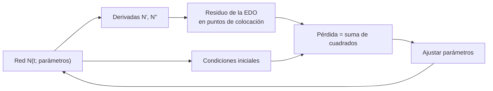

# B17-C03 — Redes neuronales informadas por la física (PINN)

<!-- nav:top -->
[🏠 Programa](../../../../README.md) · [📚 Bloque B17](../../../tronco-comun/B17-aprendizaje-automatico-cientifico.md) · [← Anterior: B17-C02 — Aprendizaje supervisado](../B17-C02-aprendizaje-supervisado/CLASE.md) · [Siguiente: B17-C04 — Modelos sustitutos (surrogates) →](../B17-C04-modelos-sustitutos-surrogates/CLASE.md)
<!-- /nav -->

## 1. Ubicación, nivel y alcance

Tercera clase del bloque B17. En la [clase anterior](../B17-C02-aprendizaje-supervisado/CLASE.md) el modelo aprendía solo de ejemplos; ahora le añades **una ley física escrita como ecuación diferencial** para que además la cumpla. Nivel N2/N3. Usas ecuaciones diferenciales ordinarias (B11-C01 y B11-C02), derivadas (B09) y mínimos cuadrados (B10-C07). No verás redes profundas con diferenciación automática (se hace aquí con derivadas escritas a mano, para ver qué ocurre), ecuaciones en derivadas parciales (B11-C13) ni modelos sustitutos generales (C04).

## 2. Por qué esta clase existe

Un modelo ajustado solo a datos puede reproducir muy bien lo medido y decir disparates fuera de ese rango: no sabe que una cantidad decae, ni que una oscilación conserva su amplitud. Si ya conoces la ecuación que gobierna el fenómeno, dejarla fuera es desperdiciar información. Las **redes informadas por la física** (PINN, por *physics-informed neural networks*) usan la ecuación como parte de lo que se minimiza.

La decisión central: **¿cuándo conviene meter una ecuación diferencial en la función de pérdida de una red, y cómo compruebo que el resultado cumple la física y no solo «parece» bien?**

## 3. Lo que podrás hacer al terminar

1. Escribir el **residuo** de una ecuación diferencial para una función candidata.
2. Construir una pérdida que combine residuo en puntos de colocación y condiciones iniciales.
3. Calcular las derivadas de una red de una capa oculta con funciones `tanh` y verificarlas contra diferencias finitas.
4. Entrenar una red informada por la física y medir su error contra la solución exacta.
5. Comparar con un ajuste solo a datos y explicar por qué extrapola peor.
6. Decidir cuándo un integrador clásico es mejor que una PINN.

La evidencia es el **informe de comparación** del ejercicio 12 (sección 20).

## 4. Con qué llegas y cómo comprobarlo

1. ¿Cuál es la derivada de `e^(−1,5 t)`?
2. ¿Qué derivada tiene `tanh(u)` respecto de `u`? (`1 − tanh²(u)`.) ¿Cuánto vale en `u = 0`?
3. Si `y = 1 − 1,5 t`, ¿cuánto vale `y' + 1,5 y` en `t = 1`?
4. ¿Cuál es el periodo de `cos(2t)`?
5. ¿Qué es un mínimo cuadrático de un conjunto de residuos?

<details>
<summary>Ver respuestas</summary>

1. `−1,5 e^(−1,5 t)`. 2. `1 − tanh²(u)`; en 0 vale 1. 3. `y' = −1,5` e `y(1) = −0,5`; `−1,5 + 1,5(−0,5) = −2,25`. 4. `2π/2 = π ≈ 3,14`. 5. Los parámetros que hacen mínima la suma de los residuos al cuadrado (B10-C07).
</details>

Con cuatro o cinco aciertos, sigue; con tres o menos, repasa B11-C01 y B10-C07.

## 5. Un caso real: ecuaciones en la pérdida

El trabajo que dio nombre a estas redes presenta modelos entrenados para tareas supervisadas **sin dejar de cumplir leyes físicas expresadas como ecuaciones en derivadas parciales no lineales**; sus autores tratan dos problemas, resolver ecuaciones a partir de datos y descubrir ecuaciones a partir de datos, y señalan que el resultado sirve de aproximador eficiente en datos y derivable respecto de todas sus entradas y parámetros (S1, resumen). Aquí solo usarás el primer problema con ecuaciones ordinarias, que es la versión mínima de la misma idea; no se replica ninguno de sus experimentos.

## 6. Vocabulario

Una **ecuación diferencial ordinaria (EDO)** relaciona una función con sus derivadas. Una **condición inicial** fija el valor de la función (y de su derivada, si hace falta) en `t = 0`. El **residuo** de una función candidata `N(t)` en una ecuación `y' + k y = 0` es `r(t) = N'(t) + k N(t)`; vale cero cuando `N` es solución. Los **puntos de colocación** son los instantes donde se exige que el residuo sea pequeño. Una **red de una capa oculta** con `H` neuronas es `N(t) = c + Σᵢ vᵢ tanh(wᵢ t + bᵢ)`, con parámetros `vᵢ`, `wᵢ`, `bᵢ` y `c`. La **pérdida** es la cantidad que el entrenamiento minimiza. Un **problema inverso** busca un parámetro de la ecuación a partir de datos.

## 7. Modelo mental: la ecuación como un dato más



*Descripción textual:* la red produce `N(t)` y sus derivadas; con ellas se calcula el residuo de la ecuación en varios instantes y el desajuste con las condiciones iniciales; ambos se suman en una pérdida que el optimizador reduce ajustando los parámetros, que vuelven a la red.

Una analogía: corregir un ensayo con una pauta. Los datos son lo que el autor escribió; la ecuación es la pauta que dice cómo debe ser. **Límite:** una pauta incorrecta (una ecuación mal escrita o incompleta) hace que la red cumpla con firmeza algo falso. La física incorporada puede estar equivocada.

## 8. La explicación, paso a paso

### 8.1 Un residuo cero es una solución

Para `y' = −k y` con `y(0) = 1`, la solución exacta es `e^(−k t)`. Una función candidata `N(t)` es solución si su residuo `r(t) = N'(t) + k N(t)` es cero en todo el intervalo y `N(0) = 1`. Para `N(t) = 1 − 1,5 t` y `k = 1,5`, en `t = 0` el residuo es `−1,5 + 1,5 = 0`, pero en `t = 1` vale `−2,25` y en `t = 2`, `−4,5`: no es solución, y el residuo cuantifica *cuánto* se equivoca.

### 8.2 La pérdida

Se eligen puntos de colocación `tⱼ` (aquí 60, repartidos uniformemente en [0, 3]) y se arma

```text
L(p) = Σⱼ r(tⱼ)²  +  [λ (N(0) − y₀)]²   (+ [λ (N'(0) − v₀)]²  si la EDO es de segundo orden)
```

con `λ = 10` para que las condiciones iniciales pesen más (`p` agrupa los parámetros). Con la candidata `1 − 1,5 t` y tres puntos `t = 0, 1, 2`, la suma de residuos al cuadrado es `0 + 5,0625 + 20,25 = 25,31`. Minimizar `L` es encontrar la red cuya derivada se parece más a `−k N`.

### 8.3 Derivadas escritas a mano

Para `N(t) = c + Σ vᵢ tanh(wᵢ t + bᵢ)`, llamando `Tᵢ = tanh(wᵢ t + bᵢ)`:

```text
N'(t)  = Σ vᵢ wᵢ (1 − Tᵢ²)
N''(t) = Σ vᵢ wᵢ² · ( −2 Tᵢ (1 − Tᵢ²) )
```

Con `v = 2`, `w = 1,5` y `b = 0`, `N'(0) = 2 × 1,5 × 1 = 3`. Se **verifica** comparando con diferencias centradas: `(N(t+h) − N(t−h))/(2h)` con `h = 10⁻⁵`. Si no coinciden, hay un error de derivación antes de entrenar. (Las bibliotecas de redes calculan estas derivadas automáticamente; aquí las escribes para entender qué se calcula.)

### 8.4 Entrenar

Los parámetros (31 con `H = 10`) se ajustan con `scipy.optimize.least_squares`, que minimiza la suma de cuadrados de un vector de residuos (S2). El método `trf` es el predeterminado y sirve cuando hay menos residuos que parámetros; el método `lm` exige al menos tantos residuos como variables (S2), por eso con solo 8 datos no se usa. El entrenamiento parte de valores aleatorios con semilla fija.

### 8.5 Comparar con el ajuste solo a datos

El mismo tipo de red, ajustado a 8 datos ruidosos en [0, 1] sin la ecuación, reproduce bien ese tramo, pero entre 1 y 3 no tiene nada que lo guíe. La PINN, en cambio, recibe información del intervalo completo a través de la ecuación. Esa diferencia, entre «interpolar datos» y «cumplir una ley», es la esencia de la clase.

### 8.6 Segundo orden: el oscilador

Para `y'' + ω² y = 0` con `y(0) = 1` e `y'(0) = 0`, la solución es `cos(ω t)`. Con `ω = 2`, el intervalo [0, 3] cubre 0,95 periodos. El residuo es `N'' + ω² N`; la pérdida añade dos condiciones iniciales. La candidata `N = 1 − 2t²` tiene `N'' = −4` y residuo `−4 + 4(1 − 2t²) = −8t²`, que en `t = 0,5` vale `−2`: es el comienzo del desarrollo de `cos(2t)`, que se parece a la solución solo cerca de 0.

## 9. Magnitudes, símbolos y unidades

| Símbolo | Qué es | Unidad | Nota |
|---|---|---|---|
| `t` | variable independiente | s (tiempo, en el ejemplo) | dominio [0, 3] |
| `y`, `N(t)` | solución y su aproximación | las de `y` | adimensional en el ejemplo |
| `k` | tasa de decaimiento | s⁻¹ | 1,5 |
| `ω` | frecuencia angular | rad/s | 2 |
| `r(t)` | residuo de la EDO | unidades de `y'` | cero en una solución |
| `H` | neuronas ocultas | adimensional | 10 |
| `λ` | peso de las condiciones iniciales | adimensional | 10 |

## 10. Convenciones y referencias

Las EDO del laboratorio tienen solución exacta, de modo que el error se mide directamente. Los datos son **simulados/sintéticos**. Se informa el **error máximo absoluto** en 301 instantes entre 0 y 3. Con semillas fijas para que el entrenamiento se repita.

## 11. De dónde sale lo que afirmamos

| ID | Fuente | Localizador | Respalda | Estado |
|---|---|---|---|---|
| S1 | Raissi, M., Perdikaris, P. y Karniadakis, G. E., *Physics Informed Deep Learning (Part I)*, arXiv:1711.10561 | https://arxiv.org/abs/1711.10561 | Redes entrenadas con tareas supervisadas consistentes con leyes físicas en forma de EDP no lineales; resolver EDP y descubrir EDP a partir de datos | Resumen consultado el 2026-11-05 |
| S2 | SciPy, documentación de `scipy.optimize.least_squares` | https://docs.scipy.org/doc/scipy/reference/generated/scipy.optimize.least_squares.html | Minimiza una suma de cuadrados de residuos; métodos `trf` (predeterminado), `dogbox`, `lm`; `lm` no funciona si hay menos residuos que variables | Página consultada el 2026-11-05 (mutable) |
| S3 | NIST, CODATA 2022, aceleración estándar de la gravedad | https://physics.nist.gov/cgi-bin/cuu/Value?gn | `g = 9,806 65 m s⁻²` (valor estándar, exacto) | Página consultada el 2026-11-05 |

Límites: de S1 solo se leyó el resumen, y no se replica su método (que usa redes profundas y diferenciación automática). La solución exacta de las EDO del laboratorio es resultado clásico, comprobado derivando.

## 12. Cómo ver los resultados

| Modelo | Datos usados | Error máximo en [0, 3] |
|---|---|---|
| PINN, decaimiento (k = 1,5) | ecuación y condición inicial | 3,5 × 10⁻⁸ |
| PINN, oscilador (ω = 2) | ecuación y condiciones iniciales | 8,8 × 10⁻⁸ |
| Solo datos (8 puntos con ruido en [0, 1]) | datos | 1,7 al extrapolar a [1, 3] |

Grafica la solución exacta, la PINN y el ajuste solo a datos en el mismo eje y con estilos de línea distintos (continua, discontinua, punteada); describe en texto que la PINN se superpone a la exacta y el ajuste solo a datos se separa pasado `t = 1`.

## 13. Ejemplo trabajado: el residuo de una candidata en un problema con arrastre

**Caso.** Una sonda desacelera con `v' = −g − c v`, con `g = 9,806 65 m/s²` (S3, valor estándar) y `c = 0,1 s⁻¹`, `v(0) = 100 m/s`. La solución es `v(t) = −g/c + (v₀ + g/c) e^(−c t)`. Evalúa el residuo de la candidata `N(t) = 100 − 9,806 65 t`.

**Paso 1 · residuo.** `r(t) = N' + g + c N`.

**Paso 2 · derivada.** `N' = −9,806 65`.

**Paso 3 · sustitución.** `r(t) = −9,806 65 + 9,806 65 + 0,1 (100 − 9,806 65 t) = 10 − 0,981 t`.

**Paso 4 · lectura.** En `t = 0` el residuo es 10 m/s²: la candidata ignora el arrastre y sobreestima la velocidad. El residuo decrece en 0,981 por segundo, así que se anula en `t ≈ 10,2 s`, donde por casualidad coincide con la ecuación, pero solo en ese instante; una PINN minimiza el residuo en todo el intervalo.

**Paso 5 · incertidumbre.** El residuo mide el error en la **ecuación**, no en la solución. Un residuo pequeño con una condición inicial mal impuesta daría una solución distinta. Por eso la pérdida incluye ambas.

## 14. Comparación de formas de resolver

Un **integrador clásico** (Runge-Kutta, B11-C07) resuelve EDO directas con error controlado, en milisegundos; es la opción por defecto. Un **ajuste solo a datos** es simple, pero no incorpora leyes y extrapola mal. Una **PINN** brilla cuando hay pocos datos dispersos, se quiere una función derivable en todos sus argumentos o se busca un parámetro de la ecuación (problema inverso); cuesta más cómputo (el laboratorio tarda unos 47 s para tres entrenamientos en un portátil, que un integrador resuelve en milisegundos) y su convergencia no está garantizada. No la uses para lo que un integrador resuelve bien.

## 15. Práctica guiada

**Ejercicio 1 · con los pasos indicados.** Para `N(t) = c + v tanh(w t + b)` con `v = 2`, `w = 1,5`, `b = 0`, calcula `N'(0)`. *Pasos:* sección 8.3.

<details><summary>Solución comentada</summary>

`N'(0) = v w (1 − tanh²(0)) = 2 × 1,5 × 1 = 3`. Si la derivada de `tanh` te falló, recuerda que `tanh(0) = 0`.
</details>

**Ejercicio 2 · con una pista.** Calcula el residuo de `N = 1 − 1,5 t` en `y' + 1,5 y = 0` en `t = 0`, `t = 1` y `t = 2`. *Pista:* sección 8.1.

<details><summary>Solución comentada</summary>

`r = −1,5 + 1,5(1 − 1,5 t) = −2,25 t`: vale 0, −2,25 y −4,5. Crece con `t`, lo que indica que la candidata solo es buena cerca de 0.
</details>

**Ejercicio 3 · casi autónomo.** Con esos tres residuos calcula la suma de cuadrados y la pérdida total, sabiendo que `N(0) = 1`.

<details><summary>Solución comentada</summary>

`0 + 5,0625 + 20,25 = 25,3125`. El término de condición inicial es `[10 (1 − 1)]² = 0`, así que la pérdida vale 25,3125.
</details>

## 16. Práctica autónoma, transferencia e integrador

**Ejercicio 4.** ¿Qué fracción de periodo cubre el intervalo [0, 3] para `ω = 2`? ¿Qué implica para la prueba?

<details><summary>Solución comentada</summary>

Periodo `2π/2 = 3,14 s`; el intervalo cubre `3/3,14 = 0,95` periodos. La prueba apenas recorre un ciclo: no dice nada de una oscilación larga, donde los errores se acumulan.
</details>

**Ejercicio 5.** Calcula el residuo de `y'' + 4y = 0` para `N = 1 − 2t²` en `t = 0,5`.

<details><summary>Solución comentada</summary>

`N'' = −4`, `N(0,5) = 0,5`; `r = −4 + 4(0,5) = −2` (coincide con `−8t² = −2`).
</details>

**Ejercicio 6.** ¿Cuántos parámetros tiene la red con `H = 10`? ¿Y con `H = 20`?

<details><summary>Solución comentada</summary>

`3H + 1`: 31 y 61. Hay `vᵢ`, `wᵢ`, `bᵢ` por neurona más `c`.
</details>

**Ejercicio 7.** Si el desajuste inicial `N(0) − 1` es 0,01 y `λ = 10`, ¿cuánto aporta a la pérdida? ¿Y si `λ = 1`?

<details><summary>Solución comentada</summary>

Con `λ = 10`: `(10 × 0,01)² = 10⁻²`. Con `λ = 1`: `10⁻⁴`. El peso `λ` multiplica el desajuste antes de elevarlo al cuadrado (sección 8.2); elegir `λ` es un equilibrio entre cumplir la ecuación y cumplir la condición inicial.
</details>

**Ejercicio 8.** El error de la PINN fue 3,5 × 10⁻⁸ y el del ajuste solo a datos, al extrapolar, 1,7. ¿Cuántos órdenes de magnitud los separan?

<details><summary>Solución comentada</summary>

`log₁₀(1,7 / 3,5 × 10⁻⁸) = log₁₀(4,9 × 10⁷) = 7,7`: casi ocho órdenes. Ojo: la comparación no es del todo justa, porque la PINN conoce la ecuación exacta y el otro modelo no.
</details>

**Ejercicio 9 · transferencia.** Una red candidata `N(t)` aproxima la velocidad de una sonda. Escribe el residuo y la pérdida para `v' = −g − c v` con 40 puntos de colocación.

<details><summary>Solución comentada</summary>

`r(t) = N'(t) + g + c N(t)`, `L = Σ_{j=1}^{40} r(tⱼ)² + [λ (N(0) − v₀)]²`. Las unidades de `r` son m/s². Con `g` en m/s², `c` en s⁻¹ y `N` en m/s son consistentes (sección 9).
</details>

**Ejercicio 10 · transferencia.** Un equipo propone una PINN para integrar una órbita de dos cuerpos durante cien periodos. Da un argumento a favor de un integrador clásico.

<details><summary>Solución comentada</summary>

Un integrador (Runge-Kutta o simpléctico, B11-C07 y B11-C11) tiene error controlado y conserva cantidades de forma conocida, cuesta poco y se verifica con la energía. Una PINN en un intervalo largo acumula error sin garantía y es más cara. La PINN podría servir si faltaran condiciones o hubiera datos dispersos, no para propagar una órbita bien conocida.
</details>

**Ejercicio 11 · transferencia.** Se mide `y(1) = 0,2231` en un decaimiento `y' = −k y` con `y(0) = 1`. Plantea el problema inverso y estima `k`.

<details><summary>Solución comentada</summary>

La solución es `y(t) = e^(−k t)`, así que `y(1) = e^(−k)` y `k = −ln(0,2231) = 1,50 s⁻¹`. Como PINN, `k` pasa a ser un parámetro más de la pérdida, que incluye el término `(N(1) − 0,2231)²` junto con el residuo. Con ruido en la medida, el estimado hereda esa incertidumbre.
</details>

**Ejercicio 12 · integrador.** Redacta un **informe de comparación** para el decaimiento o el oscilador: ecuación, condiciones, red usada, pérdida, error de la PINN, error del ajuste solo a datos (con el rango extrapolado), y una conclusión sobre cuándo usarías cada uno.

<details><summary>Solución modelo</summary>

Debe incluir: la EDO con unidades; los 31 parámetros; la pérdida; el error contra la exacta (orden 10⁻⁷ o menor); el del ajuste solo a datos (orden 1 fuera de [0, 1]); la prueba de derivadas contra diferencias finitas; y la limitación de que la ecuación es conocida. Acepta cualquier informe coherente.
</details>

## 17. Laboratorio: la ecuación frente al solo-datos

El script [pinn_edo.py](pinn_edo.py) verifica las derivadas analíticas, entrena la red para el decaimiento y el oscilador, y compara con el ajuste solo a datos. Falla si los errores superan las tolerancias o si la línea base no es peor.

**Datos:** simulados y sintéticos. **Predice antes de ejecutar:** ¿qué error tendrá el ajuste solo a datos fuera de [0, 1]? **Ejecución del 2026-11-05 (Python 3.12.9, NumPy 2.4.4, SciPy 1.17.1; unos 47 s):**

```text
Caso A (decaimiento, k=1,5): error máximo en [0,3] = 3.49e-08
Caso B (oscilador, w=2):     error máximo en [0,3] = 8.82e-08
Solo datos (8 puntos con ruido, [0,1]): error en datos 1.66e-02; extrapolando a [1,3] 1.67e+00
Pruebas superadas.
```

```bash
python programa/clases/B17/B17-C03-redes-neuronales-informadas-por-la-fisica-pinn/pinn_edo.py
```

**Límites:** una red pequeña, una dimensión, ecuaciones sin ruido y con solución exacta; el optimizador converge porque el problema es fácil. No muestra el comportamiento en ecuaciones rígidas, no lineales o con coeficientes desconocidos.

## 18. Errores frecuentes y cómo corregirlos

**Creer que un residuo pequeño garantiza una buena solución.** Falta la condición inicial (ejercicio 3 y sección 13).

**No verificar las derivadas.** Se corrige con el ejercicio 1 y la prueba del laboratorio.

**Usar una PINN donde basta un integrador.** Ejercicio 10.

**Confiar en la física incorporada sin revisarla.** Si la ecuación está mal, la red cumple lo falso con precisión (sección 7).

**Medir el error solo donde hay colocación.** Evalúa en puntos distintos (301 en el laboratorio).

## 19. Cómo sabrás que vas bien

Tras 8.1: ¿calculas el residuo de una candidata sin ayuda? Si no, ejercicio 2. Tras 8.3: ¿verificas una derivada con diferencias finitas? Tras el laboratorio: ¿por qué la línea base solo con datos falla fuera de [0, 1]? Al final: ¿cuál es el supuesto más fuerte de tu informe?

## 20. Qué entregas y cómo se evalúa

El producto es tu **informe de comparación** (ejercicio 12).

| Criterio | Inicial | En desarrollo | Logrado | Destacado |
|---|---|---|---|---|
| Residuo y pérdida | Confunde residuo y error | Escribe el residuo | Escribe la pérdida completa | Justifica los pesos |
| Verificación | Sin pruebas | Compara con la exacta | Verifica derivadas y solución | Evalúa fuera de la colocación |
| Comparación | Solo la PINN | Compara sin límites | Compara en el rango extrapolado | Discute costo y alternativas |
| Honestidad | Presenta como general | Declara supuestos | Declara ecuación conocida | Señala qué fallaría con una ecuación errónea |

**Condiciones críticas:** no afirmar que una PINN «descubre» física que se le dio; verificar contra una solución independiente; declarar que los datos son simulados.

## 21. Ética, seguridad y límites

Una red que cumple una ecuación errónea con alta precisión inspira una confianza falsa. Si una PINN apoya una decisión de ingeniería (por ejemplo, de trayectoria), debe validarse contra un integrador de referencia. Accesibilidad: gráficos con descripción y tablas. Material educativo.

## 22. Para cerrar y seguir

Una PINN añade a la pérdida el residuo de una ecuación diferencial; con la ecuación y la condición inicial, una red pequeña reproduce la solución exacta con error del orden de 10⁻⁷, mientras que el mismo modelo solo con datos se separa pasado el rango medido. Queda abierta una pregunta: ¿cómo se detecta una ecuación incorrecta cuando la red la cumple perfectamente?

**Glosario español–inglés.** red informada por la física · *physics-informed neural network (PINN)*; residuo · *residual*; punto de colocación · *collocation point*; condición inicial · *initial condition*; problema inverso · *inverse problem*; pérdida · *loss*.

**Continuidad.** B17-C04 usa un modelo, no la ecuación, para sustituir un simulador costoso. B17-C07 estudia qué pasa cuando los datos salen del rango de entrenamiento.

**Referencias:** ver sección 11 (S3 respalda `g` en la sección 13). De S1 solo se usó el resumen.

<!-- nav:bottom -->
---

[← Anterior: B17-C02 — Aprendizaje supervisado](../B17-C02-aprendizaje-supervisado/CLASE.md) · [📚 Bloque B17](../../../tronco-comun/B17-aprendizaje-automatico-cientifico.md) · [Siguiente: B17-C04 — Modelos sustitutos (surrogates) →](../B17-C04-modelos-sustitutos-surrogates/CLASE.md)
<!-- /nav -->
