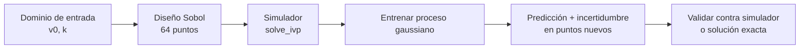

# B17-C04 — Modelos sustitutos (surrogates)

<!-- nav:top -->
[🏠 Programa](../../../../README.md) · [📚 Bloque B17](../../../tronco-comun/B17-aprendizaje-automatico-cientifico.md) · [← Anterior: B17-C03 — Redes neuronales informadas por la física (PINN)](../B17-C03-redes-neuronales-informadas-por-la-fisica-pinn/CLASE.md) · [Siguiente: B17-C05 — Detección de anomalías →](../B17-C05-deteccion-de-anomalias/CLASE.md)
<!-- /nav -->

## 1. Ubicación, nivel y alcance

Cuarta clase del bloque B17. En [C03](../B17-C03-redes-neuronales-informadas-por-la-fisica-pinn/CLASE.md) incorporaste la ecuación al modelo; ahora haces lo contrario: **tratas un simulador como una caja negra costosa** y aprendes un modelo barato que lo imite dentro de un rango. Nivel N2/N3. Usas integración numérica con SciPy (B14-C03), EDO (B11), regresión (C02) y la incertidumbre de B12. No verás optimización bayesiana ni diseño secuencial en profundidad.

## 2. Por qué esta clase existe

Un simulador de trayectoria, de aerodinámica o de transporte de radiación puede tardar minutos u horas por ejecución. Para explorar miles de combinaciones de parámetros (un análisis de sensibilidad, una propagación de incertidumbre, una optimización) no alcanza el tiempo. Un **modelo sustituto** se entrena con unas decenas de ejecuciones del simulador y responde casi al instante.

La decisión central: **¿cuántas simulaciones necesito, dónde las coloco y cómo sé en qué región puedo confiar en la respuesta del sustituto?**

## 3. Lo que podrás hacer al terminar

1. Definir el dominio de entrada y la salida de un simulador y verificarlo contra una solución exacta.
2. Elegir puntos de entrenamiento con una secuencia de baja discrepancia (Sobol).
3. Entrenar un proceso gaussiano y leer su predicción con incertidumbre.
4. Medir el error del sustituto en puntos nuevos dentro del dominio y comprobar la cobertura de su banda.
5. Mostrar qué ocurre fuera del dominio de entrenamiento.
6. Decidir si el ahorro de cómputo justifica construir el sustituto.

La evidencia es la **ficha del sustituto** del ejercicio 12 (sección 20).

## 4. Con qué llegas y cómo comprobarlo

1. Si un ascenso sin arrastre parte con `v₀ = 300 m/s`, ¿qué altura alcanza? (`h = v₀²/(2g)`, `g = 9,806 65 m/s²`.)
2. ¿Cuánto vale `ln(2)`?
3. ¿Qué significa «error relativo» de 2 % sobre una altura de 3000 m?
4. ¿Cómo se pasa `v₀ ∈ [200, 1000]` a una variable `u ∈ [0, 1]`?
5. ¿Qué proporción de una distribución normal cae a menos de dos desviaciones de la media?

<details>
<summary>Ver respuestas</summary>

1. `90 000 / 19,613 = 4589 m`. 2. 0,693. 3. 60 m. 4. `u = (v₀ − 200)/800`. 5. Cerca del 95,4 %.
</details>

Con cuatro o cinco aciertos, sigue; con tres o menos, repasa B14-C03 y B12-C03.

## 5. Un caso real: lo que dice la documentación sobre los procesos gaussianos

La documentación de scikit-learn describe la regresión por procesos gaussianos como un método **probabilístico**: para cada entrada devuelve una media y una desviación estándar, con las que se calculan intervalos de confianza empíricos; interpola las observaciones con núcleos regulares; y se vuelve ineficiente en espacios de dimensión alta (más de unas decenas de variables) (S1). Esas tres propiedades definen cuándo un proceso gaussiano es un buen sustituto: pocas entradas, una respuesta suave y una necesidad de saber cuánto confiar. En esta clase lo aplicas a un problema con solución exacta, para medir su error de verdad.

## 6. Vocabulario

Un **simulador** es un programa que calcula una salida a partir de parámetros de entrada. Un **modelo sustituto** (*surrogate*, o emulador) es un modelo aprendido de pares (entrada, salida del simulador) que lo aproxima. El **diseño de experimentos** elige los puntos de entrada donde se ejecuta el simulador. Una **secuencia de Sobol** es una sucesión de puntos que cubre el espacio de forma más uniforme que los puntos al azar. Un **proceso gaussiano** es un modelo que para cada entrada da una distribución normal; su **núcleo** (*kernel*) define cuánto se parecen las salidas de dos entradas cercanas, y el de **base radial (RBF)** tiene una **longitud de escala** por variable (S1). El **dominio de entrenamiento** es el rango de entradas cubierto. **Extrapolar** es predecir fuera de él.

## 7. Modelo mental: pagar pocas simulaciones, usar muchas predicciones



*Descripción textual:* se define el dominio, se eligen 64 puntos con una secuencia de Sobol, se ejecuta el simulador en ellos, se entrena el proceso gaussiano y se obtienen predicciones con incertidumbre en puntos nuevos; la última caja devuelve a la validación contra el simulador.

Una analogía: un mapa de curvas de nivel dibujado con unas decenas de mediciones topográficas: entre curvas se interpola. **Límite:** el mapa no dice nada del terreno fuera del recorrido medido, y en los bordes del dominio el sustituto empieza a perder la fidelidad.

## 8. La explicación, paso a paso

### 8.1 El simulador de ejemplo

Un cohete sonda asciende en vuelo libre (sin empuje) con la deceleración `a = −g − k v²`, donde `g = 9,806 65 m/s²` (S2) y `k` es un coeficiente de arrastre por unidad de masa (en 1/m). Las entradas son la velocidad de partida `v₀` (m/s) y `k`; la salida, la altura máxima `h_max` (m). El simulador integra las dos ecuaciones `h' = v`, `v' = −g − k v|v|` con `solve_ivp` hasta que `v` cruza cero hacia abajo (evento terminal, S3), con tolerancias `rtol = 10⁻¹¹` (S3).

### 8.2 Verificar el simulador antes de sustituirlo

Para este modelo hay solución exacta: dividiendo `dv/dt` por `v = dh/dt` se obtiene `v dv/dh = −g − k v²`, que se integra a

```text
h_max = ln(1 + k v₀² / g) / (2 k)
```

(si `k → 0` da `v₀²/(2g)`). Con `v₀ = 300 m/s` y `k = 10⁻⁴ m⁻¹`: `k v₀²/g = 0,9177`, `ln(1,9177) = 0,6511` y `h_max = 0,6511 / (2 × 10⁻⁴) = 3255,7 m`, frente a 4588,7 m sin arrastre: el arrastre quita el 29 %. Si el simulador no reproduce la fórmula, no tiene sentido entrenar un sustituto sobre él.

### 8.3 Dónde colocar las simulaciones

Una malla regular de 8×8 puntos solo prueba 8 valores distintos de cada variable. Una secuencia de Sobol de 64 puntos prueba 64 valores distintos de cada una y cubre el cuadrado de forma pareja. Por convención, el número de puntos de Sobol es una potencia de dos. Se transforman las entradas a [0, 1]: `u₁ = (v₀ − 200)/800` y `u₂ = (log₁₀ k + 4,5)/1,5`. Con `v₀ = 600 m/s` y `k = 5 × 10⁻⁴`, `u₁ = 0,5` y `u₂ = 0,799`. Usar `log₁₀ k` es la regla de C01: `k` abarca un orden y medio de magnitud.

### 8.4 Entrenar y leer la predicción

El proceso gaussiano se ajusta maximizando la verosimilitud marginal de los datos para fijar las longitudes de escala; se reinicia varias veces porque puede haber máximos locales (S1). El resultado, para este problema, fue un núcleo RBF con longitudes de escala 0,52 y 0,67 en las variables normalizadas, y un nivel de ruido mínimo (10⁻¹²), porque el simulador es determinista. La predicción en una entrada nueva es una media `μ` y una desviación `σ`; la banda `μ ± 2σ` se espera que contenga el valor verdadero en torno al 95 % de los casos si el modelo está bien calibrado.

### 8.5 Medir el error dentro del dominio

Se evalúan 500 puntos nuevos, distintos de los 64, y se compara con el simulador (aquí, con la fórmula exacta). Dos números importan: el error relativo máximo (el peor caso) y la **cobertura** de la banda `±2σ`. Una cobertura muy inferior al 95 % señala una incertidumbre subestimada.

### 8.6 Fuera del dominio

El sustituto se entrenó con `v₀ ∈ [200, 1000]`. En `v₀ = 1100 … 1500 m/s` no hay datos, y el error crece rápido (sección 12). La incertidumbre `σ` también crece, como debe, y es la alarma: el sustituto no *sabe* la física, solo el comportamiento entre los puntos que vio. Por eso se escribe junto al sustituto su **dominio de validez**.

### 8.7 ¿Compensa?

El sustituto vale la pena si `N · t_sim > N_ent · t_sim + t_ent`, con `N` predicciones necesarias, `N_ent` simulaciones de entrenamiento (64) y `t_ent` el tiempo de ajuste. Con un simulador de 2 s, 64 corridas cuestan 128 s; 10⁵ evaluaciones directas costarían 2 × 10⁵ s (más de dos días), mientras que el sustituto responde en segundos. Con 50 evaluaciones no compensa.

## 9. Magnitudes, símbolos y unidades

| Símbolo | Qué es | Unidad | Nota |
|---|---|---|---|
| `v₀` | velocidad inicial | m/s | [200, 1000] |
| `k` | arrastre por unidad de masa | m⁻¹ | [10^−4,5, 10^−3] |
| `g` | aceleración de la gravedad | m/s² | 9,806 65 (S2) |
| `h_max` | altura máxima | m | salida |
| `u₁`, `u₂` | entradas normalizadas | adimensional | en [0, 1] |
| `μ`, `σ` | media y desviación predichas | m | del proceso gaussiano |

## 10. Convenciones y referencias

Los datos son **simulados**. Gravedad constante y densidad del aire constante (`k` fijo), sin viento ni empuje; el ascenso es vertical. El error relativo es `|μ − h_exacta| / h_exacta`. Semillas fijas para Sobol y para el optimizador del proceso.

## 11. De dónde sale lo que afirmamos

| ID | Fuente | Localizador | Respalda | Estado |
|---|---|---|---|---|
| S1 | scikit-learn, «Gaussian Processes» (`GaussianProcessRegressor`, núcleos) | https://scikit-learn.org/stable/modules/gaussian_process.html | Media y desviación predichas; ajuste por verosimilitud marginal con reinicios; núcleo RBF con longitud de escala; ventajas y desventajas (alta dimensión) | Página consultada el 2026-11-05 (mutable) |
| S2 | NIST, CODATA 2022, aceleración estándar de la gravedad | https://physics.nist.gov/cgi-bin/cuu/Value?gn | `g = 9,806 65 m s⁻²` (exacto) | Página consultada el 2026-11-05 |
| S3 | SciPy, documentación de `scipy.integrate.solve_ivp` | https://docs.scipy.org/doc/scipy/reference/generated/scipy.integrate.solve_ivp.html | Eventos con `terminal` y `direction`; `rtol` y `atol` | Página consultada el 2026-11-05 (mutable) |

Límites: la página S1 no trata el costo cúbico de la inferencia exacta ni la extrapolación; esas afirmaciones se apoyan en los resultados del laboratorio. La fórmula de `h_max` es una integración propia, comprobada contra el simulador.

## 12. Cómo ver los resultados

| `v₀` (m/s) | Error relativo | `σ` predicha (m) | En el dominio |
|---|---|---|---|
| 200 a 1000 (500 puntos) | medio 5,5 × 10⁻⁵; máximo 2,3 × 10⁻³ | — | sí |
| 1100 | 0,05 % | 9 | no |
| 1200 | 0,38 % | 63 | no |
| 1300 | 1,56 % | 255 | no |
| 1400 | 4,46 % | 728 | no |
| 1500 | 9,84 % | 1628 | no |

Grafica `h_max` contra `v₀` con `k` fijo: línea continua para la exacta, puntos para el entrenamiento y una banda sombreada para `μ ± 2σ`; describe con texto que la banda se ensancha pasado `v₀ = 1000`.

## 13. Ejemplo trabajado: ¿cuánto confío en una predicción?

**Caso.** El sustituto da, para `v₀ = 1300 m/s` y `k = 10^−3,75 = 1,78 × 10⁻⁴`, una altura con `σ = 255 m`. ¿Es utilizable?

**Paso 1 · dominio.** `v₀ = 1300` está fuera de [200, 1000]: es extrapolación.

**Paso 2 · incertidumbre declarada.** La banda `±2σ` mide ±510 m.

**Paso 3 · error real.** El error relativo fue 1,56 % de una altura exacta de unos 9,7 km (aprox. 150 m), dentro de la banda.

**Paso 4 · decisión.** La banda avisa correctamente, pero el modelo se entrenó para otro dominio. La acción correcta es volver a simular en la región nueva y reentrenar. La banda predicha no sustituye al simulador; informa dónde hay que pedirlo.

**Paso 5 · incertidumbre.** La banda del proceso gaussiano depende del núcleo elegido; con otro núcleo la cobertura cambia. Valida siempre con puntos reservados.

## 14. Comparación de sustitutos

Un **polinomio de respuesta** es sencillo pero rígido. Un **proceso gaussiano** interpola, ofrece incertidumbre y funciona con pocas entradas (decenas); no escala a dimensiones altas (S1). Una **red neuronal** maneja muchas entradas pero pide muchas más simulaciones y no da una incertidumbre honesta sin añadidos. Elige según el número de entradas y el presupuesto de simulaciones. En todos los casos, el sustituto no reemplaza al simulador para validar un diseño final.

## 15. Práctica guiada

**Ejercicio 1 · con los pasos indicados.** Calcula la altura sin arrastre para `v₀ = 300 m/s` y compárala con la del simulador (3255,7 m). *Pasos:* sección 8.2.

<details><summary>Solución comentada</summary>

`h = 300²/(2 × 9,80665) = 4588,7 m`. El arrastre reduce `1 − 3255,7/4588,7 = 29 %`. El mismo vuelo, con y sin arrastre, difiere un tercio.
</details>

**Ejercicio 2 · con una pista.** Verifica con la fórmula que `h_max(300, 10⁻⁴) = 3255,7 m`. *Pista:* calcula primero `k v₀²/g`.

<details><summary>Solución comentada</summary>

`k v₀²/g = 10⁻⁴ × 9 × 10⁴ / 9,80665 = 0,9177`; `ln(1,9177) = 0,6511`; dividido por `2 × 10⁻⁴` da 3255,7 m, que coincide con el simulador a 5 × 10⁻⁹ m (sección 17).
</details>

**Ejercicio 3 · casi autónomo.** ¿Cuántos valores distintos de `v₀` prueba una malla 8×8 y cuántos una secuencia de Sobol de 64 puntos?

<details><summary>Solución comentada</summary>

La malla prueba 8; Sobol, 64. Si `h_max` dependiera sobre todo de `v₀`, la malla desperdiciaría 56 de las 64 simulaciones repitiendo valores de esa variable.
</details>

## 16. Práctica autónoma, transferencia e integrador

**Ejercicio 4.** Normaliza `v₀ = 600 m/s` y `k = 5 × 10⁻⁴ m⁻¹` al cuadrado unidad.

<details><summary>Solución comentada</summary>

`u₁ = 400/800 = 0,5`. `log₁₀(5 × 10⁻⁴) = −3,301`; `u₂ = (−3,301 + 4,5)/1,5 = 0,799`.
</details>

**Ejercicio 5.** El error relativo medio fue 5,5 × 10⁻⁵ y el máximo 2,3 × 10⁻³. ¿Qué dice la diferencia?

<details><summary>Solución comentada</summary>

El máximo es 42 veces el medio: el error se concentra en algunas regiones (probablemente los bordes del dominio). Informar solo el promedio ocultaría el peor caso; informa ambos.
</details>

**Ejercicio 6.** La banda `±2σ` cubrió el 96,2 % de 500 puntos. ¿Es coherente con lo esperado?

<details><summary>Solución comentada</summary>

Para una normal, ±2σ cubre el 95,4 %. El 96,2 % está en línea (la desviación esperada por azar con 500 puntos es de unos 1 punto). La incertidumbre parece bien calibrada en este caso, algo que no se puede dar por hecho.
</details>

**Ejercicio 7.** En `v₀ = 1500 m/s` el error real fue 9,84 % de unos 10 496 m (aprox. 1033 m) y la `σ` predicha 1628 m. ¿Cubrió la banda?

<details><summary>Solución comentada</summary>

El error de 1033 m es menor que `σ` y que `2σ = 3256 m`: sí cubre. En `v₀ = 1100`, el error es 4,4 m frente a `σ = 9 m`: también. En este caso, la incertidumbre avisó, pero no siempre ocurre fuera del dominio.
</details>

**Ejercicio 8.** Un simulador tarda 2 s. ¿Cuánto cuestan 64 corridas de entrenamiento y cuánto 10⁵ evaluaciones directas?

<details><summary>Solución comentada</summary>

64 × 2 = 128 s; 10⁵ × 2 = 2 × 10⁵ s ≈ 2,3 días. Con el sustituto el costo es el entrenamiento más una predicción casi instantánea por punto (sección 8.7).
</details>

**Ejercicio 9 · transferencia.** Un análisis de incertidumbre propaga 10⁴ combinaciones de `v₀` y `k` por el sustituto. ¿Qué verificas antes de confiar en la distribución de `h_max` resultante?

<details><summary>Solución comentada</summary>

Que todas las combinaciones están dentro del dominio de entrenamiento, que el error en puntos reservados es pequeño frente a la dispersión que quieres medir, y que la cobertura de la banda es adecuada. Se simulan algunas combinaciones críticas (extremos) con el simulador.
</details>

**Ejercicio 10 · transferencia.** Un simulador de reentrada cambia de régimen de flujo en cierto número de Mach. ¿Por qué un proceso gaussiano estándar sufriría?

<details><summary>Solución comentada</summary>

Un núcleo RBF supone una función muy suave (infinitamente diferenciable, S1). Un cambio brusco de régimen (un salto o un cambio de pendiente) viola esa suposición: el sustituto suaviza la transición y comete el mayor error justo ahí. Habría que modelar por regímenes o elegir otro núcleo.
</details>

**Ejercicio 11 · transferencia.** Tras entrenar, los puntos candidatos para añadir una simulación tienen `σ = 4, 17, 9` m. ¿Cuál eliges y por qué?

<details><summary>Solución comentada</summary>

El de `σ = 17 m`: es donde el sustituto es más incierto. Añadir ahí un punto reduce más la incertidumbre. Es la base del diseño secuencial, que aquí solo se enuncia.
</details>

**Ejercicio 12 · integrador.** Redacta la **ficha del sustituto**: simulador, entradas con unidad y rango, salida, verificación del simulador, diseño de puntos, modelo y núcleo, error medio y máximo en puntos reservados, cobertura de la banda, dominio de validez y uso prohibido.

<details><summary>Solución modelo</summary>

La ficha debe citar la verificación contra la fórmula (diferencias de 10⁻⁸ m), el diseño de 64 puntos de Sobol, el núcleo y sus longitudes de escala, el error medio (5,5 × 10⁻⁵) y máximo (2,3 × 10⁻³), la cobertura (96,2 %), el dominio `v₀ ∈ [200, 1000]` y `k ∈ [10^−4,5, 10^−3]`, y una advertencia de no extrapolar. Acepta cualquier ficha coherente.
</details>

## 17. Laboratorio: sustituir un simulador verificado

El script [sustituto_cohete.py](sustituto_cohete.py) verifica el simulador contra la fórmula exacta, entrena el proceso gaussiano con 64 puntos de Sobol, mide el error en 500 puntos nuevos y evalúa fuera del dominio. Falla si el simulador se aleja de la fórmula, si el error dentro del dominio supera 2 % o si fuera del dominio no se degrada.

**Datos:** simulados. **Predice antes de ejecutar:** ¿a partir de qué `v₀` el error pasa de 1 %? **Ejecución del 2026-11-05 (Python 3.12.9, NumPy 2.4.4, SciPy 1.17.1, scikit-learn 1.8.0):**

```text
v0 = 300 m/s, k = 1e-04 1/m: simulador 3255.7490 m, exacta 3255.7490 m, |dif| = 4.9e-09 m
v0 = 600 m/s, k = 5e-04 1/m: simulador 2962.9452 m, exacta 2962.9452 m, |dif| = 4.7e-09 m
v0 = 900 m/s, k = 2e-05 1/m: simulador 24382.2887 m, exacta 24382.2887 m, |dif| = 3.2e-08 m
Núcleo ajustado: 2.94**2 * RBF(length_scale=[0.519, 0.671]) + WhiteKernel(noise_level=1e-12)
Dentro del dominio: error relativo medio 5.54e-05, máximo 2.31e-03; la banda ±2 sigma cubre el 96.2 % de los puntos
  v0 = 1100 m/s (fuera del dominio): error relativo 0.05%, sigma predicha 9 m
  v0 = 1200 m/s (fuera del dominio): error relativo 0.38%, sigma predicha 63 m
  v0 = 1300 m/s (fuera del dominio): error relativo 1.56%, sigma predicha 255 m
  v0 = 1400 m/s (fuera del dominio): error relativo 4.46%, sigma predicha 728 m
  v0 = 1500 m/s (fuera del dominio): error relativo 9.84%, sigma predicha 1628 m
Pruebas superadas.
```

```bash
python programa/clases/B17/B17-C04-modelos-sustitutos-surrogates/sustituto_cohete.py
```

**Límites:** el simulador es una EDO con solución exacta (sirve para validar, no es costoso); dos entradas; sin ruido. En la primera ejecución con 40 puntos, el error máximo fue 2,4 % y la cobertura 63,6 %: con muy pocos puntos la banda subestimó la incertidumbre. Se pasó a 64.

## 18. Errores frecuentes y cómo corregirlos

**Entrenar sobre un simulador no verificado.** Ejercicio 2.

**Informar solo el error medio.** Ejercicio 5.

**Usar el sustituto fuera de su dominio.** Sección 12 y ejercicio 7.

**Creer que la banda siempre cubre.** Con pocos puntos la cobertura fue 63,6 % (sección 17).

**Olvidar el costo del entrenamiento.** Ejercicio 8.

## 19. Cómo sabrás que vas bien

Tras 8.2: ¿verificas el simulador antes del sustituto? Si no, repite el ejercicio 2. Tras 8.5: ¿distingues error medio, máximo y cobertura? Si no, ejercicios 5 y 6. Tras el laboratorio: ¿qué cambió al pasar de 40 a 64 puntos? Al final: ¿qué parte del dominio no puedes garantizar?

## 20. Qué entregas y cómo se evalúa

El producto es tu **ficha del sustituto** (ejercicio 12).

| Criterio | Inicial | En desarrollo | Logrado | Destacado |
|---|---|---|---|---|
| Verificación | No verifica | Compara un punto | Compara varios con tolerancia | Explica la fórmula exacta |
| Diseño | Puntos a mano | Malla | Sobol | Justifica el número |
| Validación | Sobre entrenamiento | Puntos nuevos | Medio, máximo y cobertura | Prueba fuera del dominio |
| Alcance | No declara dominio | Lo declara | Lo declara con advertencia | Propone el siguiente punto a simular |

**Condiciones críticas:** no dar el sustituto como simulador; declarar dominio; rotular los datos como simulados.

## 21. Ética, seguridad y límites

Un sustituto puede dar respuestas con apariencia de precisión donde no la tiene. Para análisis de seguridad (por ejemplo, de carga o de reentrada), el sustituto solo orienta la búsqueda; la decisión final se valida con el simulador y, si corresponde, con ensayos. Accesibilidad: tablas y descripciones de texto de los gráficos. Material educativo.

## 22. Para cerrar y seguir

Un modelo sustituto compra velocidad con aproximación: se verifica el simulador, se eligen puntos que cubran el dominio, se mide el error en puntos nuevos y se declara hasta dónde vale. Queda abierta una pregunta: ¿cómo se elige dónde simular a continuación para ganar más con menos corridas?

**Glosario español–inglés.** modelo sustituto · *surrogate model*; emulador · *emulator*; proceso gaussiano · *Gaussian process*; núcleo · *kernel*; longitud de escala · *length scale*; dominio de validez · *domain of validity*; extrapolar · *extrapolate*; diseño de experimentos · *design of experiments*.

**Continuidad.** B17-C07 trata el desempeño de un modelo cuando los datos salen de su rango de entrenamiento; B17-C08, la interpretación de lo que el modelo aprendió.

**Referencias:** ver sección 11. Todas son documentación mutable consultada el 2026-11-05.

<!-- nav:bottom -->
---

[← Anterior: B17-C03 — Redes neuronales informadas por la física (PINN)](../B17-C03-redes-neuronales-informadas-por-la-fisica-pinn/CLASE.md) · [📚 Bloque B17](../../../tronco-comun/B17-aprendizaje-automatico-cientifico.md) · [Siguiente: B17-C05 — Detección de anomalías →](../B17-C05-deteccion-de-anomalias/CLASE.md)
<!-- /nav -->
