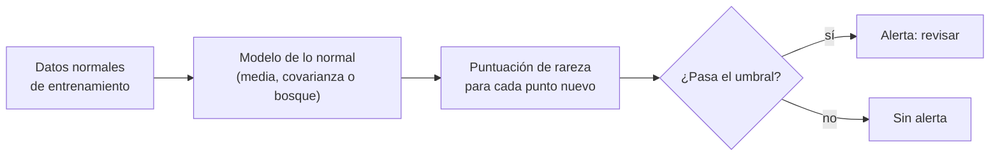

# B17-C05 — Detección de anomalías

<!-- nav:top -->
[🏠 Programa](../../../../README.md) · [📚 Bloque B17](../../../tronco-comun/B17-aprendizaje-automatico-cientifico.md) · [← Anterior: B17-C04 — Modelos sustitutos (surrogates)](../B17-C04-modelos-sustitutos-surrogates/CLASE.md) · [Siguiente: B17-C06 — Aprendizaje no supervisado →](../B17-C06-aprendizaje-no-supervisado/CLASE.md)
<!-- /nav -->

## 1. Ubicación, nivel y alcance

Quinta clase del bloque B17. En B12-C19 tratabas los valores atípicos con reglas estadísticas sobre una variable; aquí detectas **combinaciones** raras de varias variables, con un método estadístico exacto (distancia de Mahalanobis) y uno de aprendizaje (bosque de aislamiento). Nivel N2. Usas covarianza (B12-C18), autovalores (B10-C08) y la distribución normal (B12-C03). No verás detección en series temporales con memoria ni redes autocodificadoras.

## 2. Por qué esta clase existe

El subsistema térmico de un satélite entrega temperatura y corriente. Cada una, por separado, puede estar dentro de su rango normal y sin embargo la **pareja** ser imposible: la corriente alta con temperatura baja no ocurre nunca en operación sana. Una regla «alarma si una variable pasa de 3σ» no la ve.

La decisión central: **¿qué significa «raro» cuando hay varias variables correlacionadas, y cuántas falsas alarmas estoy dispuesto a atender por cada anomalía real?**

## 3. Lo que podrás hacer al terminar

1. Calcular la distancia de Mahalanobis y su umbral con la distribución chi-cuadrado.
2. Explicar por qué una regla por variable falla con variables correlacionadas.
3. Usar un bosque de aislamiento y leer su puntuación.
4. Comparar métodos con el área bajo la curva ROC.
5. Calcular cuántas falsas alarmas esperar y la precisión de las alertas con una prevalencia baja.
6. Distinguir detección de valores atípicos (entrenamiento con anomalías) y de novedades (entrenamiento limpio).

La evidencia es el **informe del detector** del ejercicio 12 (sección 20).

## 4. Con qué llegas y cómo comprobarlo

1. Si una variable es normal, ¿qué fracción cae a más de 3σ de la media? (`≈ 0,27 %`.)
2. ¿Qué es la covarianza entre dos variables con correlación 0,8 y varianzas 1?
3. ¿Cuál es el inverso de `[[1, 0,8], [0,8, 1]]`? (Pista: determinante 0,36.)
4. ¿Cuánto es `−2 ln(0,01)`?
5. Si 1 de cada 1000 casos es anómalo y una alarma falla en el 1 % de los normales, ¿cuántas falsas alarmas hay por 1000?

<details>
<summary>Ver respuestas</summary>

1. 0,27 %. 2. 0,8. 3. `(1/0,36)·[[1, −0,8], [−0,8, 1]] = [[2,778, −2,222], [−2,222, 2,778]]`. 4. 9,21. 5. `999 × 0,01 ≈ 10`.
</details>

Con cuatro o cinco aciertos, sigue; con tres o menos, repasa B12-C18 y B12-C19.

## 5. Un caso real: lo que documenta scikit-learn

La documentación de scikit-learn distingue dos tareas: la **detección de valores atípicos**, donde los datos de entrenamiento ya contienen anomalías y el método ajusta las zonas densas, y la **detección de novedades**, donde el entrenamiento es limpio y se busca marcar observaciones nuevas que se desvían (S1). Menciona, entre otros, la envolvente elíptica (supone datos gaussianos y usa la distancia de Mahalanobis), el bosque de aislamiento (las anomalías tienen caminos más cortos en árboles de partición aleatoria) y el factor de valor atípico local (compara densidades locales) (S1). En esta clase usarás los dos primeros, y verificarás el primero contra su teoría exacta.

## 6. Vocabulario

Una **anomalía** es una observación que no se parece a lo esperado según un modelo de lo normal. La **distancia de Mahalanobis** de un punto `x` a una distribución con media `μ` y covarianza `Σ` es `d² = (x − μ)ᵀ Σ⁻¹ (x − μ)`: mide la distancia en unidades de desviación, tomando en cuenta la correlación. La **distribución chi-cuadrado** con `m` grados de libertad es la de la suma de `m` normales estándar al cuadrado; para datos normales de `m` variables, `d²` la sigue. Un **bosque de aislamiento** divide el espacio con cortes aleatorios; un punto aislado en pocos cortes es anómalo (S1). Una **falsa alarma** es un punto normal señalado como anómalo. La **curva ROC** grafica la fracción de anomalías detectadas contra la de falsas alarmas al variar el umbral; su **área (AUC)** vale 1 si el método separa perfectamente y 0,5 si no distingue (S2).

## 7. Modelo mental: lo normal tiene forma



*Descripción textual:* con datos normales se ajusta un modelo (media y covarianza, o un bosque). Cada punto nuevo recibe una puntuación de rareza; si supera el umbral se emite una alerta de revisión, si no, nada.

Una analogía: un guardia que conoce las costumbres de un edificio. No le avisan de cada persona que entra, sino de lo que no encaja con la rutina. **Límite:** si la rutina cambia (el equipo se desgasta), el guardia da falsas alarmas hasta que se actualice lo «normal».

## 8. La explicación, paso a paso

### 8.1 Dos variables correlacionadas

Sean `T` (temperatura) y `I` (corriente) estandarizadas, con correlación 0,8. Los puntos normales forman una nube alargada en diagonal. La matriz de covarianza es `Σ = [[1, 0,8], [0,8, 1]]`, con autovalores 1,8 (a lo largo de la diagonal) y 0,2 (perpendicular a ella). Un punto con `T = 1,58` e `I = −1,58` tiene cada variable a solo 1,58σ, pero está sobre la dirección perpendicular, la menos variable.

### 8.2 La distancia de Mahalanobis

Con `Σ⁻¹ = [[2,778, −2,222], [−2,222, 2,778]]`, el punto `(1,58; −1,58)` da `d² = 10 × 1,58² ≈ 25`, es decir, a `d = 5` desviaciones del centro. En cambio `(1, 1)`, sobre la diagonal, da `d² = 1,11`: es perfectamente normal pese a tener ambas variables en 1σ. La regla por variable ve lo contrario de lo que debe ver. El criterio por `|z|` máximo ignora la correlación; Mahalanobis la incluye.

### 8.3 El umbral exacto

Si los datos normales son gaussianos, `d²` sigue chi-cuadrado con 2 grados de libertad, cuyo cuantil `q` cumple `P(d² > u) = e^(−u/2)`. Para `q = 0,99`, `u = −2 ln(0,01) = 9,21`; para `0,95`, `u = 5,99`. Elegir el umbral 9,21 fija en 1 % la tasa de falsas alarmas. Esta fijación es el punto fuerte del método, y se comprueba en el laboratorio: 1,16 % de los normales nuevos la superaron (esperado 1 %; con 5000 puntos la variación esperada es de ±0,14 puntos, así que 1,16 es compatible con la teoría).

### 8.4 Bosque de aislamiento

El bosque no supone una forma: parte el espacio con cortes aleatorios y cuenta cuántos hacen falta para dejar un punto solo. Los anómalos quedan aislados con pocos cortes (S1). Su puntuación no tiene una escala probabilística; se usa para **ordenar**. El parámetro de contaminación (fracción esperada de anomalías) fija el umbral por percentil: con contaminación 0,01 y 5000 puntos marcaría 50.

### 8.5 La prevalencia baja manda

Si solo 1 de cada 1000 observaciones es anómala y se detectan todas con un 1 % de falsas alarmas, se emiten `1 + 999 × 0,01 ≈ 11` alertas, de las cuales 1 es real: la **precisión** de las alertas es `1/10,99 = 9 %`. Un método excelente produce alertas mayoritariamente falsas cuando lo buscado es raro. C12 desarrolla esto; aquí basta con calcularlo antes de fijar un umbral.

### 8.6 Comparar métodos

El AUC permite comparar sin elegir un umbral (S2). En el laboratorio, Mahalanobis alcanza 1,000, el bosque 0,978 y el criterio por variable 0,903. El bosque no necesita suponer gaussianidad, pero aquí la suposición es cierta y Mahalanobis gana. Con datos no gaussianos el orden podría invertirse.

## 9. Magnitudes, símbolos y unidades

| Símbolo | Qué es | Unidad | Nota |
|---|---|---|---|
| `x` | vector de variables | estandarizadas | `T`, `I` |
| `μ` | media de lo normal | igual que `x` | del entrenamiento |
| `Σ` | matriz de covarianza | cuadrado de `x` | del entrenamiento |
| `d²` | distancia de Mahalanobis al cuadrado | adimensional | `~ χ²(m)` |
| `u` | umbral | adimensional | `−2 ln(1 − q)` para `m = 2` |
| AUC | área bajo la curva ROC | adimensional | 0,5 a 1 |

## 10. Convenciones y referencias

Datos **sintéticos**: 5000 normales de entrenamiento, 5000 normales nuevos y 25 anomalías inyectadas. Se entrena solo con datos normales (detección de novedades). Semillas fijas.

## 11. De dónde sale lo que afirmamos

| ID | Fuente | Localizador | Respalda | Estado |
|---|---|---|---|---|
| S1 | scikit-learn, «Novelty and Outlier Detection» | https://scikit-learn.org/stable/modules/outlier_detection.html | Diferencia valores atípicos/novedades; envolvente elíptica (gaussianos, Mahalanobis); bosque de aislamiento (caminos cortos); LOF; parámetro `contamination` | Página consultada el 2026-11-05 (mutable) |
| S2 | scikit-learn, «Metrics and scoring» | https://scikit-learn.org/stable/modules/model_evaluation.html | Curva ROC y `roc_auc_score` | Página consultada el 2026-11-05; se leyeron las primeras 100 000 de 174 676 caracteres (mutable) |

Límites: la ley `χ²` de `d²` es un resultado clásico; se comprueba numéricamente. No se consultó literatura sobre detección de anomalías en telemetría real.

## 12. Cómo ver los resultados

| Método | Umbral | Resultado |
|---|---|---|
| Mahalanobis | `χ²(2, 0,99) = 9,21` | falsas alarmas 1,16 %; anomalías detectadas 100 % |
| AUC Mahalanobis | — | 1,000 |
| AUC bosque de aislamiento | — | 0,978 |
| AUC por variable (`|z|` máximo) | — | 0,903 |

Dibuja la nube de normales como elipse, marca las anomalías con cruces y muestra que quedan dentro del rango de cada eje pero fuera de la elipse; describe con texto la elipse y la posición de las cruces.

## 13. Ejemplo trabajado: una alerta de telemetría

**Caso.** Se mide `(T, I) = (1,58; −1,58)` con la covarianza de la sección 8.1. ¿Se emite una alerta con el umbral al 99 %?

**Paso 1 · regla por variable.** Ambas están a 1,58σ: ninguna supera 3σ. Sin alerta.

**Paso 2 · Mahalanobis.** `d² = 10 × 1,58² = 24,96`.

**Paso 3 · umbral.** `u = 9,21`. Como `24,96 > 9,21`, hay alerta.

**Paso 4 · probabilidad bajo lo normal.** `P(d² > 24,96) = e^(−12,48) = 3,8 × 10⁻⁶`: ocurre una vez en 260 000 observaciones normales.

**Paso 5 · incertidumbre.** Eso supone gaussianos con `μ` y `Σ` bien estimados. Si la covarianza se estimó con pocos datos o hay colas pesadas, 3,8 × 10⁻⁶ es optimista; la alerta indica revisión, no diagnóstico.

## 14. Comparación de detectores

La **regla por variable** es simple y no ve combinaciones. **Mahalanobis** incorpora la correlación y da un umbral con garantía probabilística, pero exige gaussianos. El **bosque de aislamiento** no supone forma y escala a muchas variables, pero su puntuación solo ordena. **LOF** compara densidades locales y detecta cúmulos pequeños; es sensible al número de vecinos (S1). Un buen informe prueba al menos dos y los compara con AUC y con el costo de las alarmas.

## 15. Práctica guiada

**Ejercicio 1 · con los pasos indicados.** Calcula `d²` para `(1; 1)` con la `Σ⁻¹` de la sección 8.2. *Pasos:* `x = (1, 1)`, `d² = 2,778 + 2,778 − 2 × 2,222`.

<details><summary>Solución comentada</summary>

`d² = 1,11`. Está sobre la diagonal, la dirección en que los datos varían más: normal, aunque ambas variables valgan 1σ.
</details>

**Ejercicio 2 · con una pista.** Calcula los umbrales `χ²(2)` para 0,95 y 0,99. *Pista:* `u = −2 ln(1 − q)`.

<details><summary>Solución comentada</summary>

`0,95: −2 ln 0,05 = 5,99`; `0,99: −2 ln 0,01 = 9,21`. Un umbral más alto da menos falsas alarmas y más anomalías perdidas.
</details>

**Ejercicio 3 · casi autónomo.** Con 5000 puntos normales nuevos y umbral al 99 %, ¿cuántas falsas alarmas esperas?

<details><summary>Solución comentada</summary>

`5000 × 0,01 = 50`. El laboratorio dio 1,16 % ≈ 58, compatible.
</details>

## 16. Práctica autónoma, transferencia e integrador

**Ejercicio 4.** Calcula `d²` de `(1,58; −1,58)` y la probabilidad `e^(−d²/2)`.

<details><summary>Solución comentada</summary>

`d² = 10 × 2,496 = 24,96`; `e^(−12,48) = 3,8 × 10⁻⁶`.
</details>

**Ejercicio 5.** Prevalencia 1/1000, detección total, 1 % de falsas alarmas. ¿Precisión de las alertas?

<details><summary>Solución comentada</summary>

`1 / (1 + 999 × 0,01) = 1/10,99 = 9,1 %`. Con una falsa alarma del 0,1 %, `1/(1 + 0,999) = 50 %`.
</details>

**Ejercicio 6.** Con contaminación 0,02 y 5000 puntos, ¿cuántos marcaría el bosque?

<details><summary>Solución comentada</summary>

`0,02 × 5000 = 100`, porque el umbral se fija por percentil, sin importar cuántas anomalías hay realmente.
</details>

**Ejercicio 7.** ¿Qué dice que el AUC de un método sea 0,5?

<details><summary>Solución comentada</summary>

Que no distingue anomalías de normales mejor que el azar (S2). Un AUC de 0,903 por variable, frente a 1,000 de Mahalanobis, mide lo que se pierde ignorando la correlación.
</details>

**Ejercicio 8.** ¿Por qué en el laboratorio se entrena solo con normales? ¿Qué tarea es?

<details><summary>Solución comentada</summary>

Es detección de novedades (S1): el entrenamiento limpio define lo normal. Si el entrenamiento contuviera anomalías, sería detección de valores atípicos y la media y covarianza quedarían sesgadas.
</details>

**Ejercicio 9 · transferencia.** La regla de los 3σ en una sola variable normal, ¿qué fracción de normales marca? Compárala con el 1 % de la sección 8.3.

<details><summary>Solución comentada</summary>

`2(1 − Φ(3)) = 0,27 %`. Para varias variables a la vez, cada una con 3σ, la tasa conjunta sube (con 2 variables independientes, ≈ 0,54 %). Fijar el umbral sobre `d²` controla la tasa global con una sola cifra.
</details>

**Ejercicio 10 · transferencia.** La temperatura de un componente deriva lentamente durante meses. ¿Qué le pasa a un detector entrenado al principio? ¿Qué harías?

<details><summary>Solución comentada</summary>

Con el tiempo, lo «normal» se desplaza y el detector emite falsas alarmas crecientes. Se reentrena periódicamente con datos recientes verificados, o se modela la deriva aparte; se vigila la tasa de alertas como señal de deriva (relacionado con C07).
</details>

**Ejercicio 11 · transferencia.** Una falsa alarma cuesta 1 h de operador y una anomalía perdida 1000 h. Con 1000 observaciones y 1 anómala, compara: A) 1 % de falsas alarmas y 0 % de pérdidas; B) 0,1 % de falsas alarmas y 30 % de pérdidas.

<details><summary>Solución comentada</summary>

A: `9,99 h`; B: `0,999 h + 0,3 × 1000 = 301 h` (valor esperado). A cuesta unas 30 veces menos. Con un costo de pérdida alto conviene un umbral bajo, aunque las alertas sean mayoritariamente falsas.
</details>

**Ejercicio 12 · integrador.** Redacta el **informe del detector** de un subsistema (con datos sintéticos): variables y unidades, modelo de lo normal, umbral y su justificación, tasa de falsas alarmas medida frente a la esperada, AUC de al menos dos métodos, precisión de las alertas con una prevalencia declarada y plan de actualización.

<details><summary>Solución modelo</summary>

Incluye la tabla de la sección 12, el cálculo de la precisión (sección 8.5), la advertencia de gaussianidad, la actualización periódica y la regla de revisión humana. Acepta cualquier informe coherente.
</details>

## 17. Laboratorio: falsas alarmas contra la teoría

El script [anomalias.py](anomalias.py) genera datos sintéticos correlacionados, verifica que la tasa de falsas alarmas coincida con la teoría `χ²` y compara Mahalanobis, el bosque de aislamiento y la regla por variable con AUC.

**Datos:** sintéticos. **Predice antes de ejecutar:** ¿qué AUC tendrá el criterio que ignora la correlación? **Ejecución del 2026-11-05 (Python 3.12.9, NumPy 2.4.4, scikit-learn 1.8.0):**

```text
Umbral chi2(2, 0,99) = 9.210: falsas alarmas 1.16 % (teoría 1 %), recuperación de anomalías 100 %
AUC ROC: Mahalanobis 1.000 | Isolation Forest 0.978
AUC con |z| máximo por variable (ignora la correlación): 0.903
Pruebas superadas.
```

```bash
python programa/clases/B17/B17-C05-deteccion-de-anomalias/anomalias.py
```

**Límites:** gaussianos, dos variables, anomalías de un solo tipo inyectadas a propósito (una versión inicial con anomalías demasiado extremas dio AUC 1,000 a todos los métodos y no discriminaba). No dice nada de anomalías reales.

## 18. Errores frecuentes y cómo corregirlos

**Aplicar una regla por variable a datos correlacionados.** Ejercicios 1 y 4.

**Ignorar la prevalencia.** Ejercicio 5.

**Entrenar con anomalías y llamarlo novedades.** Ejercicio 8.

**Suponer gaussianos sin comprobar.** Sección 13, paso 5.

**No actualizar lo normal.** Ejercicio 10.

## 19. Cómo sabrás que vas bien

Tras 8.2: ¿calculas `d²` de un punto sin ayuda? Si no, ejercicio 1. Tras 8.5: ¿estimas cuántas alertas serán falsas? Si no, ejercicio 5. Tras el laboratorio: ¿por qué falla el criterio por variable? Al final: ¿qué tasa de falsas alarmas aceptas y por qué?

## 20. Qué entregas y cómo se evalúa

El producto es tu **informe del detector** (ejercicio 12).

| Criterio | Inicial | En desarrollo | Logrado | Destacado |
|---|---|---|---|---|
| Modelo de lo normal | Regla por variable | Media y desviación | Mahalanobis con umbral `χ²` | Compara con un método sin forma |
| Evaluación | Una cifra | Exactitud | AUC y falsas alarmas | Cuantifica la precisión por prevalencia |
| Umbral | Arbitrario | Justificado por percentil | Justificado por costo | Analiza sensibilidad |
| Alcance | Sin límites | Menciona gaussianidad | Declara actualización | Propone monitorear la deriva |

**Condiciones críticas:** no presentar datos sintéticos como observados; declarar la prevalencia; no usar el detector como único filtro de seguridad.

## 21. Ética, seguridad y límites

Una alerta automática no sustituye la revisión de un operador en sistemas críticos; un detector con muchas falsas alarmas se aprende a ignorar. Registra las anomalías perdidas conocidas. Accesibilidad: tablas y descripciones de texto de las figuras. Material educativo.

## 22. Para cerrar y seguir

Una anomalía multivariable es una combinación inusual; la distancia de Mahalanobis la mide y su umbral se fija con `χ²`, mientras que un bosque de aislamiento ordena sin suponer forma. Con prevalencia baja, incluso un buen detector produce alertas mayormente falsas. Queda abierta una pregunta: ¿cómo se detecta una anomalía cuando lo normal cambia con el tiempo?

**Glosario español–inglés.** anomalía · *anomaly*; distancia de Mahalanobis · *Mahalanobis distance*; bosque de aislamiento · *isolation forest*; falsa alarma · *false alarm*; curva ROC · *ROC curve*; novedad · *novelty*; prevalencia · *prevalence*.

**Continuidad.** B17-C06 agrupa datos sin etiqueta; B17-C07 estudia el cambio de distribución; B17-C12 desarrolla precisión y exhaustividad.

**Referencias:** ver sección 11. Son páginas de documentación mutables.

<!-- nav:bottom -->
---

[← Anterior: B17-C04 — Modelos sustitutos (surrogates)](../B17-C04-modelos-sustitutos-surrogates/CLASE.md) · [📚 Bloque B17](../../../tronco-comun/B17-aprendizaje-automatico-cientifico.md) · [Siguiente: B17-C06 — Aprendizaje no supervisado →](../B17-C06-aprendizaje-no-supervisado/CLASE.md)
<!-- /nav -->
