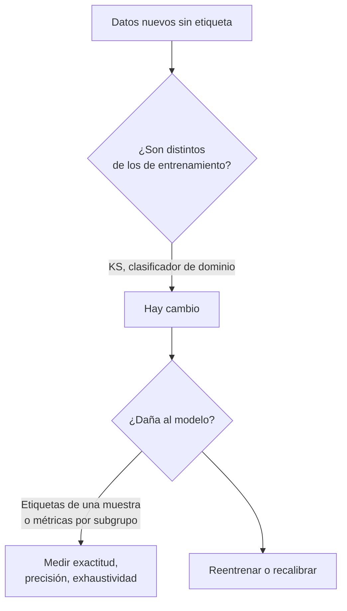

# B17-C07 — Validación fuera de distribución

<!-- nav:top -->
[🏠 Programa](../../../../README.md) · [📚 Bloque B17](../../../tronco-comun/B17-aprendizaje-automatico-cientifico.md) · [← Anterior: B17-C06 — Aprendizaje no supervisado](../B17-C06-aprendizaje-no-supervisado/CLASE.md) · [Siguiente: B17-C08 — Interpretabilidad con consistencia física →](../B17-C08-interpretabilidad-con-consistencia-fisica/CLASE.md)
<!-- /nav -->

## 1. Ubicación, nivel y alcance

Séptima clase del bloque B17. En C02 validaste con datos que se parecen a los de entrenamiento; aquí preguntas qué pasa cuando **no se parecen**: un modelo entrenado con objetos brillantes se aplica a objetos débiles. Aprendes a detectar el cambio, a medir cuánto daña y a no confundir ambas cosas. Nivel N2/N3. Usas la validación de C02, distribuciones (B12-C03) y la prueba de Kolmogorov–Smirnov como herramienta, sin demostrarla. No verás adaptación de dominio avanzada.

## 2. Por qué esta clase existe

Un modelo se entrena con un catálogo y se despliega sobre otro: otro telescopio, otra época, otro brillo límite. Su exactitud medida en validación cruzada deja de valer, y el modelo no avisa: responde con la misma seguridad. En la literatura se lo describe como falla silenciosa, y se estudian métodos para detectar el cambio de los datos y para evaluar si es dañino (S1).

La decisión central: **¿cómo detecto que los datos de despliegue ya no son los de entrenamiento, y cómo estimo cuánto se degrada el modelo antes de tener etiquetas nuevas?**

## 3. Lo que podrás hacer al terminar

1. Distinguir cambio de covariables, cambio de prevalencia y cambio de concepto.
2. Detectar un cambio con una prueba de dos muestras (KS) y con un clasificador de dominio.
3. Calcular valores de referencia exactos (KS y AUC de dominio) para dos normales desplazadas.
4. Medir la degradación de exactitud y de precisión bajo cambio de ruido y de prevalencia.
5. Explicar por qué detectar un cambio no equivale a medir su daño, y por qué la confianza del modelo puede engañar.
6. Proponer un plan de monitoreo con umbrales y respuestas.

La evidencia es el **plan de monitoreo** del ejercicio 12 (sección 20).

## 4. Con qué llegas y cómo comprobarlo

1. Si `Φ(0,5) = 0,6915`, ¿cuánto vale `2Φ(0,5) − 1`?
2. ¿Qué exactitud máxima tienen dos clases normales ±1 con desviación 1? (`Φ(1) = 0,8413`.)
3. ¿Qué es la precisión de una alerta?
4. ¿Qué área bajo la curva ROC tiene un clasificador al azar?
5. Si un modelo acierta 73 de 100 casos, ¿cuál es el error estándar aproximado de esa exactitud? (`√(p(1−p)/n)`.)

<details>
<summary>Ver respuestas</summary>

1. 0,383. 2. 0,8413. 3. De las alertas emitidas, la fracción que son realmente positivas. 4. 0,5. 5. `√(0,73 × 0,27/100) = 0,044`.
</details>

Con cuatro o cinco aciertos, sigue; con tres o menos, repasa C02 y C05.

## 5. Un caso real: lo que estudian los métodos de detección de cambio

El estudio «Failing Loudly» sostiene que los sistemas de aprendizaje automático suelen fallar en silencio cuando sus entradas cambian respecto del entrenamiento, y compara métodos para detectar ese cambio, identificar los ejemplos que mejor lo representan y valorar si es dañino; sus autores encuentran que las pruebas de dos muestras sobre representaciones de dimensión reducida funcionan mejor, y que los enfoques que discriminan dominios ayudan a caracterizar el cambio y su daño (S1, resumen). Por otro lado, un trabajo anterior propuso una línea base para detectar ejemplos mal clasificados y fuera de distribución a partir de las probabilidades de salida del modelo, que funciona en varias tareas pero puede ser superada (S2, resumen). Esta clase reproduce ambas ideas en miniatura sobre datos sintéticos, y muestra una situación en que la segunda **no** alerta.

## 6. Vocabulario

La **distribución de entrenamiento** es la de los datos con que se ajustó el modelo; la de **despliegue**, la de los datos donde se usa. El **cambio de covariables** altera la distribución de las entradas `x`; el **cambio de prevalencia** (o de etiquetas), la proporción de cada clase; el **cambio de concepto**, la relación entre `x` y la clase. La **prueba de Kolmogorov–Smirnov (KS)** de dos muestras mide `D = máx |F₁(x) − F₂(x)|`, la mayor diferencia entre las distribuciones acumuladas empíricas. Un **clasificador de dominio** se entrena para distinguir datos de entrenamiento de datos de despliegue; si lo logra (AUC mayor que 0,5), las distribuciones difieren. La **confianza** de un clasificador es la probabilidad máxima que asigna.

## 7. Modelo mental: dos preguntas distintas



*Descripción textual:* con datos nuevos sin etiqueta, primero se pregunta si son distintos (pruebas de dos muestras o clasificador de dominio); si hay cambio, se pregunta si daña al modelo, lo que exige etiquetas de una muestra o métricas por subgrupo; y de ahí se decide medir, reentrenar o recalibrar.

Una analogía: una balanza calibrada con pesas de 1 a 10 kg, usada ahora con piedras de 100 kg. Que el peso sea distinto del habitual es una cosa; que la balanza lo mida mal es otra. **Límite:** una balanza se desvía siempre de la misma manera; un modelo puede degradarse de forma distinta en cada región del espacio.

## 8. La explicación, paso a paso

### 8.1 Un caso de referencia con respuesta exacta

Dos poblaciones normales `N(0, 1)` y `N(d, 1)` con `d = 1`. La mayor diferencia entre sus distribuciones acumuladas ocurre en el punto medio `d/2`, y vale `D = Φ(d/2) − Φ(−d/2) = 2Φ(d/2) − 1 = 2(0,6915) − 1 = 0,383`. El mejor clasificador de dominio tiene un AUC igual a la probabilidad de que una muestra de la segunda población supere a una de la primera, `Φ(d/√2) = Φ(0,7071) = 0,760`. Si ambas cifras no se reproducen en tus datos de prueba, tu código tiene un error antes de aplicar nada a datos reales.

### 8.2 Sin cambio, sin detección

Con dos muestras de la misma distribución, el AUC de dominio debe ser 0,5 y la prueba KS no debe rechazar. Esta comprobación fija el piso de falsas alarmas. Una prueba KS con p-valor 0,675 no demuestra que no hay cambio; indica que no se detectó uno con ese tamaño de muestra.

### 8.3 El cambio que daña

El modelo se entrena con clases en ±1 y ruido 1 y alcanza `Φ(1) = 0,8413`. En despliegue las clases siguen en ±1 pero el ruido de medida es 1,6 y la clase 1 solo representa el 30 %. La frontera del modelo está en 0. Con ruido 1,6, un punto de la clase 1 queda bien clasificado con probabilidad `Φ(1/1,6) = Φ(0,625) = 0,734`, y como la frontera es simétrica la exactitud total es 0,734 sin importar la prevalencia. El laboratorio midió 0,731. La exactitud cayó 11 puntos.

### 8.4 La precisión sufre más por la prevalencia

Con prevalencia 0,3, tasa de verdaderos positivos 0,734 y de falsos positivos `1 − 0,734 = 0,266`, la precisión es `0,3 × 0,734 / (0,3 × 0,734 + 0,7 × 0,266) = 0,220/0,406 = 0,542`. En el entrenamiento era 0,841. Una cuarta parte del contenido de las alertas se perdió por la combinación de ruido y prevalencia, y la exactitud global no lo refleja bien.

### 8.5 Detectar no es medir el daño

Entre entrenamiento y despliegue, el estadístico KS fue 0,129 y el AUC de dominio 0,573: un cambio modesto en los datos, pero un daño de 11 puntos en exactitud. Y la confianza media del modelo *subió* de 0,842 a 0,867: con más ruido, los puntos se alejan de la frontera y la regresión logística responde con más seguridad. La confianza no es una alarma fiable aquí (S2 describe una línea base basada en ella; este ejemplo muestra un caso en que no basta). Por eso se necesitan etiquetas de una muestra del despliegue.

### 8.6 Estimar el daño con pocas etiquetas

Si etiquetas 100 objetos de despliegue y el modelo acierta 73, la exactitud estimada es 0,73 con error estándar 0,044: un intervalo aproximado `0,73 ± 0,09` al 95 %, que excluye el 0,84 del entrenamiento. Pocas etiquetas bien escogidas bastan para confirmar un daño grande.

## 9. Magnitudes, símbolos y unidades

| Símbolo | Qué es | Unidad | Nota |
|---|---|---|---|
| `x` | característica estandarizada | adimensional | de C01 |
| `d` | desplazamiento entre poblaciones | desviaciones | 1 |
| `D` | estadístico KS | adimensional | `2Φ(d/2) − 1` |
| AUC | área bajo la curva ROC | adimensional | `Φ(d/√2)` |
| `σ_desp` | ruido en despliegue | igual que `x` | 1,6 |
| `π` | prevalencia de la clase 1 | adimensional | 0,5 → 0,3 |

## 10. Convenciones y referencias

Datos **sintéticos**, con 20 000 muestras por población y semillas fijas. Los clasificadores de dominio se evalúan con validación cruzada estratificada de 5 pliegues para que el AUC sea sobre datos no vistos (C02). El «brillante» y el «débil» son nombres didácticos, no un modelo fotométrico.

## 11. De dónde sale lo que afirmamos

| ID | Fuente | Localizador | Respalda | Estado |
|---|---|---|---|---|
| S1 | Rabanser, S., Günnemann, S. y Lipton, Z. C., «Failing Loudly», arXiv:1810.11953 (NeurIPS 2019) | https://arxiv.org/abs/1810.11953 | Fallas silenciosas ante cambio de datos; comparación de métodos de detección; pruebas de dos muestras sobre dimensión reducida; clasificadores de dominio | Resumen consultado el 2026-11-05 |
| S2 | Hendrycks, D. y Gimpel, K., arXiv:1610.02136 (ICLR 2017) | https://arxiv.org/abs/1610.02136 | Línea base con probabilidades de salida para detectar mal clasificados y fuera de distribución | Resumen consultado el 2026-11-05 |
| S3 | scikit-learn, «Metrics and scoring» | https://scikit-learn.org/stable/modules/model_evaluation.html | Curva ROC y `roc_auc_score` | Página consultada el 2026-11-05 (primeros 100 000 de 174 676 caracteres; mutable) |

Límites: de S1 y S2 solo se leyeron los resúmenes. Las dos referencias exactas (KS y AUC de dominio para normales desplazadas) son resultados matemáticos comprobados en el laboratorio, no citados.

## 12. Cómo ver los resultados

| Medida | Valor |
|---|---|
| KS entre `N(0,1)` y `N(1,1)` | teoría 0,3829; medido 0,3828 |
| AUC de dominio, mismo par | teoría 0,7602; medido 0,7605 |
| Sin cambio: AUC de dominio / p KS | 0,5019 / 0,675 |
| Exactitud en brillantes nuevos | 0,8427 (teoría 0,8413) |
| Exactitud en débiles | 0,7310 |
| KS / AUC de dominio, entrenamiento vs. despliegue | 0,129 / 0,573 |
| Confianza media brillantes / débiles | 0,842 / 0,867 |

Grafica los dos histogramas de `x` (entrenamiento y despliegue) superpuestos con contornos distintos y describe en texto que el de despliegue es más ancho.

## 13. Ejemplo trabajado: ¿hay que reentrenar?

**Caso.** El modelo (exactitud 0,843 en validación) se aplica a objetos débiles. Se compara con 100 etiquetas obtenidas por revisión.

**Paso 1 · detección.** KS entre `x` de entrenamiento y despliegue: 0,129; AUC de dominio 0,573. Hay un cambio moderado.

**Paso 2 · daño.** En 100 objetos etiquetados, 73 aciertos: exactitud 0,73 ± 0,09 al 95 %.

**Paso 3 · comparación.** El valor de entrenamiento (0,84) queda fuera del intervalo. Es degradación real.

**Paso 4 · acción.** Reentrenar con una muestra etiquetada de objetos débiles o recalibrar el umbral por prevalencia; revisar la precisión de las alertas (0,54 contra 0,84).

**Paso 5 · incertidumbre.** Con 100 etiquetas, un daño de 3 puntos no se distinguiría. Y si la muestra etiquetada no es representativa (se etiquetan los casos fáciles), la estimación es optimista.

## 14. Comparación de detectores

La **prueba KS** es simple pero por variable. El **clasificador de dominio** mira todas las variables a la vez y dice dónde difieren. La **confianza del modelo** es gratis y a veces útil (S2), pero aquí subió con el ruido. Ninguno mide el daño: solo etiquetas de despliegue lo hacen. Combínalos: detectar con dominio, medir con una muestra etiquetada.

## 15. Práctica guiada

**Ejercicio 1 · con los pasos indicados.** Calcula el KS esperado entre `N(0,1)` y `N(1,1)`. *Pasos:* `D = 2Φ(d/2) − 1` con `Φ(0,5) = 0,6915`.

<details><summary>Solución comentada</summary>

`2(0,6915) − 1 = 0,383`. El laboratorio dio 0,3828.
</details>

**Ejercicio 2 · con una pista.** ¿Qué AUC máximo tiene un clasificador de dominio para ese par? *Pista:* `Φ(d/√2)`, con `Φ(0,7071) = 0,7602`.

<details><summary>Solución comentada</summary>

0,760. Es un cambio de un desvío: se distingue mejor que al azar, pero está lejos de ser evidente.
</details>

**Ejercicio 3 · casi autónomo.** Con ruido de 1,6 y frontera en 0, ¿qué exactitud esperas?

<details><summary>Solución comentada</summary>

`Φ(1/1,6) = Φ(0,625) = 0,734`. Medido: 0,731.
</details>

## 16. Práctica autónoma, transferencia e integrador

**Ejercicio 4.** Calcula la precisión de las alertas con prevalencia 0,3, TPR 0,734 y FPR 0,266.

<details><summary>Solución comentada</summary>

`0,2202/(0,2202 + 0,1862) = 0,542`. Casi la mitad de las alertas son falsas.
</details>

**Ejercicio 5.** Un p-valor de KS de 0,675 entre dos muestras, ¿prueba que no hay cambio?

<details><summary>Solución comentada</summary>

No: indica que no se encontró evidencia con ese tamaño de muestra. Con pocas muestras, un cambio real pasa inadvertido.
</details>

**Ejercicio 6.** Con prevalencia 0,3 y frontera en 0, calcula la función de distribución del despliegue en 0 (`F_desp(0)`) y compárala con la de entrenamiento (0,5).

<details><summary>Solución comentada</summary>

`F_desp(0) = 0,3 Φ(−0,625) + 0,7 Φ(0,625) = 0,3 × 0,266 + 0,7 × 0,734 = 0,594`. La diferencia con 0,5 es 0,094; el KS mide el máximo de estas diferencias en todo `x`, y salió 0,129.
</details>

**Ejercicio 7.** La confianza media subió de 0,842 a 0,867 mientras la exactitud cayó. Explica por qué.

<details><summary>Solución comentada</summary>

Más ruido ensancha la distribución de `x`: hay más puntos lejos de la frontera, a los que el modelo asigna probabilidades extremas. Esa seguridad no tiene relación con haberlos clasificado bien (sección 8.5).
</details>

**Ejercicio 8.** Una regla de monitoreo dice «alarma si el AUC de dominio supera 0,6». ¿Se dispararía aquí? ¿Qué problema muestra?

<details><summary>Solución comentada</summary>

El AUC fue 0,573: no se dispara, aunque la exactitud cayó 11 puntos. Un umbral sobre la detección de cambio no equivale a un umbral sobre el daño; hay que añadir una métrica con etiquetas.
</details>

**Ejercicio 9 · transferencia.** Con 100 etiquetas, 73 aciertos: ¿intervalo aproximado al 95 %? ¿Excluye 0,84?

<details><summary>Solución comentada</summary>

Error estándar 0,044; 1,96 × 0,044 = 0,086; intervalo 0,64 a 0,82. Sí excluye 0,84.
</details>

**Ejercicio 10 · transferencia.** Un modelo clasifica estados de un propulsor entrenado con ensayos en tierra, y se aplica en órbita. Nombra un cambio de covariables y uno de concepto posibles.

<details><summary>Solución comentada</summary>

Covariables: temperatura y presión del suministro distintas (rango fuera del ensayo). Concepto: el mismo patrón de corriente significa otro estado porque cambió el comportamiento del actuador con la microgravedad. El segundo es más grave porque no se ve solo en las entradas.
</details>

**Ejercicio 11 · transferencia.** Propón una política de respuesta con tres niveles según la detección y el daño medido.

<details><summary>Solución comentada</summary>

Sin cambio detectado: sigue; cambio detectado y daño pequeño (dentro de tolerancia): vigila y re-mide; daño fuera de tolerancia: suspende el uso automático, reetiqueta una muestra y reentrena. Cada nivel con un umbral numérico y un responsable.
</details>

**Ejercicio 12 · integrador.** Redacta el **plan de monitoreo** de un clasificador desplegado: distribución de entrenamiento y despliegue, detectores (KS y dominio) con umbrales, muestra etiquetada periódica con su tamaño y el intervalo esperado, métricas (exactitud, precisión), y acciones.

<details><summary>Solución modelo</summary>

Debe incluir los valores de referencia de la sección 12, la advertencia de que detectar no mide el daño, el cálculo del intervalo de confianza con el tamaño de muestra y una política con umbrales numéricos. Acepta cualquier plan coherente.
</details>

## 17. Laboratorio: cambio detectado, daño medido

El script [fuera_de_distribucion.py](fuera_de_distribucion.py) reproduce los valores exactos de KS y de AUC de dominio para dos normales, verifica que sin cambio no hay detección, y compara exactitud y confianza entre entrenamiento y despliegue.

**Datos:** sintéticos. **Predice antes de ejecutar:** ¿subirá o bajará la confianza media en despliegue? **Ejecución del 2026-11-05 (Python 3.12.9, NumPy 2.4.4, SciPy 1.17.1, scikit-learn 1.8.0):**

```text
KS: teoría 0.3829, medido 0.3828
AUC de dominio: teoría 0.7602, medido 0.7605
Sin cambio (misma distribución): AUC de dominio 0.5019 (esperado 0,5), p-valor KS 0.675
Exactitud en brillantes nuevos 0.8427 (teoría 0.8413); en débiles 0.7310
Entrenamiento vs. despliegue: KS 0.129, AUC de dominio 0.573
Confianza media: brillantes 0.842, débiles 0.867 (la confianza declarada no cae como la exactitud)
Pruebas superadas.
```

```bash
python programa/clases/B17/B17-C07-validacion-fuera-de-distribucion/fuera_de_distribucion.py
```

**Límites:** una sola variable, cambios de ruido y de prevalencia solamente; sin cambio de concepto; el modelo es una regresión logística. El comportamiento de la confianza depende del modelo y no se generaliza.

## 18. Errores frecuentes y cómo corregirlos

**Pensar que la validación cruzada cubre el despliegue.** Sección 8.3.

**Confundir detectar con medir el daño.** Ejercicio 8.

**Fiarse de la confianza del modelo.** Ejercicio 7.

**Concluir «sin cambio» de una prueba sin significancia.** Ejercicio 5.

**Medir con una muestra etiquetada sesgada.** Sección 13, paso 5.

## 19. Cómo sabrás que vas bien

Tras 8.1: ¿reproduces KS y AUC de referencia? Si no, ejercicios 1 y 2. Tras 8.4: ¿calculas la precisión bajo otra prevalencia? Si no, ejercicio 4. Tras el laboratorio: ¿por qué subió la confianza? Al final: ¿qué umbral de daño aceptarías para seguir usando el modelo?

## 20. Qué entregas y cómo se evalúa

El producto es tu **plan de monitoreo** (ejercicio 12).

| Criterio | Inicial | En desarrollo | Logrado | Destacado |
|---|---|---|---|---|
| Detección | Ninguna | Una prueba | KS y clasificador de dominio con umbral | Verifica contra valores exactos |
| Daño | No lo mide | Exactitud | Exactitud y precisión con intervalo | Analiza prevalencia y subgrupos |
| Honestidad | Presenta cifras sin intervalo | Con intervalo | Declara qué no cubre | Muestra un caso en que la alarma falla |
| Respuesta | Sin acciones | Acciones vagas | Política con umbrales | Asigna responsables |

**Condiciones críticas:** rotular los datos como sintéticos; no asumir que la confianza informa del acierto.

## 21. Ética, seguridad y límites

Un modelo fuera de su dominio puede dar resultados erróneos con apariencia de seguridad; en decisiones críticas, un monitoreo débil es un riesgo. Documenta el dominio de entrenamiento al publicar un modelo. Accesibilidad: figuras con descripción textual. Material educativo.

## 22. Para cerrar y seguir

Un cambio en los datos se detecta con pruebas de dos muestras o un clasificador de dominio, y su daño se mide con etiquetas de despliegue; la confianza del modelo puede subir mientras el acierto baja. Queda abierta una pregunta: ¿cómo se obtienen etiquetas de despliegue de forma barata y no sesgada?

**Glosario español–inglés.** fuera de distribución · *out-of-distribution*; cambio de covariables · *covariate shift*; cambio de prevalencia · *label/prior shift*; cambio de concepto · *concept drift*; clasificador de dominio · *domain classifier*; confianza · *confidence*; monitoreo · *monitoring*.

**Continuidad.** B17-C08 interpreta qué aprendió el modelo; B17-C09 evita fugas de datos entre entrenamiento y prueba; B17-C12 desarrolla precisión y exhaustividad.

**Referencias:** ver sección 11. De S1 y S2 solo se leyeron los resúmenes.

<!-- nav:bottom -->
---

[← Anterior: B17-C06 — Aprendizaje no supervisado](../B17-C06-aprendizaje-no-supervisado/CLASE.md) · [📚 Bloque B17](../../../tronco-comun/B17-aprendizaje-automatico-cientifico.md) · [Siguiente: B17-C08 — Interpretabilidad con consistencia física →](../B17-C08-interpretabilidad-con-consistencia-fisica/CLASE.md)
<!-- /nav -->
