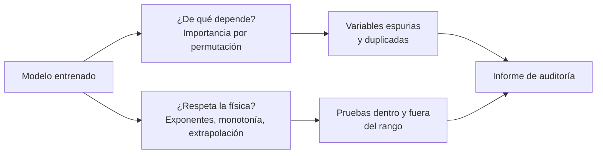

# B17-C08 — Interpretabilidad con consistencia física

<!-- nav:top -->
[🏠 Programa](../../../../README.md) · [📚 Bloque B17](../../../tronco-comun/B17-aprendizaje-automatico-cientifico.md) · [← Anterior: B17-C07 — Validación fuera de distribución](../B17-C07-validacion-fuera-de-distribucion/CLASE.md) · [Siguiente: B17-C09 — Prevención de fuga de datos →](../../../tronco-comun/B17-aprendizaje-automatico-cientifico.md#b17-c09)
<!-- /nav -->

## 1. Ubicación, nivel y alcance

Octava clase del bloque B17. Ya sabes entrenar (C02) y validar (C02, C07); ahora preguntas **qué aprendió el modelo** y si lo que aprendió es compatible con la física que conoces. Nivel N2/N3. Usas regresión (C02), logaritmos (C01) y la tercera ley de Kepler. No verás explicaciones locales como SHAP ni causalidad formal.

## 2. Por qué esta clase existe

Dos modelos pueden tener el mismo error en validación y haber aprendido cosas muy distintas: uno la ley física, otro un atajo que funciona en el rango visto. Si solo miras la métrica, no los distingues, y el atajo falla al primer dato fuera de rango. Interpretar un modelo es una forma de verificarlo.

La decisión central: **¿cómo averiguo de qué variables depende realmente un modelo, y cómo compruebo que esa dependencia respeta la física antes de usarlo fuera de lo visto?**

## 3. Lo que podrás hacer al terminar

1. Calcular la importancia por permutación de cada variable, a mano y con biblioteca.
2. Comparar la importancia medida con un valor teórico en un modelo lineal.
3. Explicar por qué variables correlacionadas reparten su importancia y qué hacer.
4. Comprobar que un modelo ajustado reproduce exponentes físicos conocidos.
5. Mostrar que un modelo flexible puede violar la física fuera del rango de entrenamiento.
6. Redactar una prueba de consistencia física para un modelo.

La evidencia es la **auditoría de consistencia** del ejercicio 12 (sección 20).

## 4. Con qué llegas y cómo comprobarlo

1. Si `P = a^1,5 M^(−0,5)`, ¿qué pendiente tiene `ln P` contra `ln a`?
2. ¿Cuánto vale `30^1,5`?
3. La varianza de una variable uniforme en un intervalo de longitud `L` es `L²/12`. ¿Cuánto da para `L = 3`?
4. ¿Qué es el error cuadrático medio?
5. ¿Qué pasa con una variable si se permuta aleatoriamente su columna?

<details>
<summary>Ver respuestas</summary>

1. 1,5. 2. 164,3. 3. 0,75. 4. El promedio de (predicción − valor)². 5. Pierde su relación con el resto de variables y con la respuesta, pero conserva su distribución.
</details>

Con cuatro o cinco aciertos, sigue; con tres o menos, repasa C01 y C02.

## 5. Un caso real: lo que dice la documentación sobre la importancia por permutación

La documentación de scikit-learn define la importancia por permutación como la caída del desempeño de un modelo ya ajustado cuando se mezcla al azar una sola columna, repetida varias veces; es independiente del tipo de modelo y puede calcularse en datos de entrenamiento o de validación (S1). Avisa de dos precauciones que usarás: con variables fuertemente correlacionadas, el modelo recupera la información de una a través de la otra y ambas parecen poco importantes; y la importancia mide cuánto *este modelo* depende de la variable, no el valor predictivo intrínseco de la variable, y solo tiene sentido si el modelo es bueno en datos retenidos (S1).

## 6. Vocabulario

La **importancia por permutación** de la variable `j` es `s − s̃ⱼ`, donde `s` es el desempeño del modelo en datos de referencia y `s̃ⱼ` el promedio del desempeño tras permutar la columna `j` varias veces (S1). Con el error cuadrático medio como métrica, la importancia es el *aumento* del error. Una **variable espuria** no tiene relación con la respuesta. La **consistencia física** de un modelo es que sus dependencias respeten leyes o restricciones conocidas (exponentes, monotonía, signos, unidades). La **extrapolación** es predecir fuera del rango de entrenamiento. La **dependencia parcial** es la respuesta media del modelo cuando se varía una variable y las demás quedan como están.

## 7. Modelo mental: dos auditorías



*Descripción textual:* un modelo entrenado se somete a dos revisiones paralelas: la importancia por permutación (de qué depende, con atención a variables espurias y duplicadas) y la consistencia física (exponentes, monotonía y extrapolación). Ambas alimentan un informe de auditoría.

Una analogía: abrir el capó de un coche que arranca. Que arranque no garantiza que no esté sujeto con alambres. **Límite:** en un coche las piezas son visibles; en un modelo, mirar sus parámetros rara vez aclara nada, y por eso las pruebas son de comportamiento (permutar, variar, extrapolar).

## 8. La explicación, paso a paso

### 8.1 Un sistema con respuesta conocida

La tercera ley de Kepler en unidades solares dice `P = a^1,5 M^(−0,5)`, con `P` en años, `a` en unidades astronómicas y `M` en masas solares (aproximada: ignora la masa del planeta). En logaritmos, `ln P = 1,5 ln a − 0,5 ln M`. Se generan 4000 sistemas sintéticos con `a` de 0,3 a 10 au y `M` de 0,3 a 2 masas solares, con 2 % de ruido, y una variable espuria sin relación. Si una regresión lineal en logaritmos devuelve pendientes 1,5; −0,5 y 0, sabes que el ajuste y los datos concuerdan con la física.

### 8.2 Importancia por permutación a mano

Para el modelo ajustado y datos de prueba: calcula el error `E₀`; para cada variable `j`, permuta su columna, vuelve a calcular el error `Eⱼ`, y repite 30 veces; la importancia es el promedio de `Eⱼ − E₀`. Para un modelo lineal con variables independientes hay una referencia exacta: permutar la variable `j` introduce un error `βⱼ (xⱼ' − xⱼ)` con `xⱼ'` e `xⱼ` independientes, cuyo cuadrado medio es `2 βⱼ² σⱼ²`. Para `ln M`: `βⱼ = −0,5`, rango `ln(2/0,3) = 1,897`, varianza `1,897²/12 = 0,300`; importancia teórica `2 × 0,25 × 0,300 = 0,15`. El laboratorio dio 0,151.

### 8.3 La importancia depende del rango, no solo del exponente

Para `ln a`: `β = 1,5`, rango `ln(10/0,3) = 3,507`, varianza `1,025`, importancia `2 × 2,25 × 1,025 = 4,61` (medido 4,57). La relación entre las dos importancias es 30, aunque los exponentes difieren solo en un factor 3: `(1,5/0,5)² × (1,025/0,300) = 9 × 3,4`. Moraleja: la importancia mezcla la fuerza de la dependencia (el exponente) con cuánto varía la variable en los datos. No es una propiedad física de la variable.

### 8.4 La variable espuria

La variable aleatoria tiene importancia 0 (el laboratorio: −0,0000): permutarla no cambia nada. Valores ligeramente negativos son ruido. Una importancia claramente positiva para una variable que sabes irrelevante es una señal de fuga o de sobreajuste (C09).

### 8.5 Variables duplicadas

Si añades una copia casi idéntica de `ln a` (con ruido pequeño), un bosque aleatorio reparte su dependencia entre ambas: la importancia de `ln a` cae de 1,998 a 1,369 y la de la copia es 0,071. Ninguna es irrelevante, pero cada una, mirada sola, parece menos importante (S1). Se corrige permutando juntas las variables correlacionadas, o conservando una por grupo (S1).

### 8.6 Consistencia física fuera del rango

Los modelos se entrenaron con `a ≤ 10 au`. A `a = 30 au` y `M = 1`, la ley da `ln P = 1,5 ln 30 = 5,102` (P = 164 años). La regresión lineal en logaritmos predice 5,101. El bosque predice 3,401: es decir, `P = 30 años`, un valor casi igual al que da en el borde del entrenamiento (`a = 10 au`, `M = 1`: `ln P = 3,45`): se aplana y no sigue la ley. Los árboles no extrapolan: devuelven valores ya vistos. El bosque tenía un error pequeño dentro del rango y falla por un factor 5,5 fuera de él.

### 8.7 Pruebas de consistencia que puedes automatizar

Exponentes: ajusta una recta en log–log y compara con el valor teórico dentro de su tolerancia. Monotonía: con las demás variables fijas, el periodo debe crecer con `a`. Signo: debe decrecer con `M`. Unidades: si cambias `a` de au a km, la pendiente en log–log no cambia, pero la ordenada se desplaza en `1,5 × ln(1,496 × 10⁸) = 28,2`. Extrapolación: pide predicciones fuera del rango y compáralas con la ley.

## 9. Magnitudes, símbolos y unidades

| Símbolo | Qué es | Unidad | Nota |
|---|---|---|---|
| `P` | periodo orbital | año | salida |
| `a` | semieje mayor | au | 0,3–10 |
| `M` | masa estelar | masa solar | 0,3–2 |
| `ln a`, `ln M` | logaritmos naturales | adimensional | características (C01) |
| `βⱼ` | pendiente de la variable `j` | adimensional | 1,5; −0,5; 0 |
| `σⱼ²` | varianza de la variable `j` | adimensional | log-uniforme |
| Importancia | aumento del ECM al permutar | adimensional | `2βⱼ²σⱼ²` en el caso lineal |

## 10. Convenciones y referencias

La ley es la de Kepler en unidades solares, aproximada (la masa del planeta se ignora); los datos son **sintéticos** y se generan con ella más un ruido log-normal del 2 %. Se ajusta con 3000 sistemas y se evalúa con 1000 distintos. Todas las importancias se calculan sobre los datos de prueba, no los de entrenamiento (S1).

## 11. De dónde sale lo que afirmamos

| ID | Fuente | Localizador | Respalda | Estado |
|---|---|---|---|---|
| S1 | scikit-learn, «Permutation feature importance» | https://scikit-learn.org/stable/modules/permutation_importance.html | Definición `i_j = s − promedio(s_kj)`; caveats con variables correlacionadas; uso en datos retenidos; importancia del modelo, no intrínseca | Página consultada el 2026-11-05 (mutable) |

Límites: la fórmula `2βⱼ²σⱼ²` es un resultado propio (esperanza del cuadrado de la diferencia de dos variables independientes de igual varianza) comprobado en el laboratorio; no se citó literatura sobre interpretabilidad. La ley de Kepler es una aproximación estándar; no se consultó una fuente para ella en esta clase.

## 12. Cómo ver los resultados

| Variable | Pendiente ajustada | Importancia teórica | Importancia medida (a mano / biblioteca) |
|---|---|---|---|
| `ln a` | 1,5000 | 4,577 | 4,552 / 4,567 |
| `ln M` | −0,4995 | 0,151 | 0,151 / 0,152 |
| espuria | −0,0005 | 0 | −0,0000 / −0,0000 |

| Caso | `ln P` en `a = 30 au`, `M = 1` |
|---|---|
| Ley | 5,102 |
| Regresión lineal en logaritmos | 5,101 |
| Bosque aleatorio | 3,401 |

Grafica `ln P` contra `ln a` con las tres curvas (ley, lineal, bosque) y marca con una línea vertical el límite del entrenamiento; describe en texto que el bosque se aplana pasado ese límite.

## 13. Ejemplo trabajado: ¿puedo confiar en este bosque?

**Caso.** Un bosque predice el periodo con error del 2 % en validación. Quieres usarlo para sistemas con `a` de hasta 30 au.

**Paso 1 · importancia.** `ln a` es la variable dominante y `ln M` la segunda; la espuria vale 0. Es lo esperable.

**Paso 2 · exponentes.** Se ajusta una recta en log–log a las predicciones del bosque dentro del rango y se compara con 1,5 y −0,5 (esta prueba no se ejecutó en el laboratorio; es la que el ejercicio 12 te pide añadir).

**Paso 3 · extrapolación.** A 30 au, el bosque predice `ln P = 3,401` frente a 5,102 de la ley: factor 5,5 en `P`.

**Paso 4 · decisión.** No usar el bosque fuera de `a ≤ 10 au`. Para extrapolar se emplea el modelo lineal en logaritmos, que incorpora la forma física, o se añaden datos del rango nuevo.

**Paso 5 · incertidumbre.** La ley puede no ser válida a 30 au en sistemas reales (por ejemplo, con un compañero estelar). La prueba solo dice que el bosque no *conoce* la ley; no demuestra que la ley siga siendo verdad.

## 14. Comparación de formas de interpretar

La **importancia por permutación** es general y barata, pero depende del rango de los datos y de las correlaciones. Los **coeficientes de un modelo lineal** son directos, y comparables con leyes cuando las variables están transformadas físicamente (C01). La **dependencia parcial** muestra la forma de la respuesta, pero promedia sobre las demás variables. Las **pruebas de consistencia física** (exponentes, signos, monotonía, extrapolación) son las más cercanas a lo que un especialista exige, y se escriben como tests automáticos.

## 15. Práctica guiada

**Ejercicio 1 · con los pasos indicados.** Calcula la importancia teórica de `ln M` en el modelo lineal. *Pasos:* `β = −0,5`, rango `ln(2/0,3)`, varianza `L²/12`, importancia `2β²σ²`.

<details><summary>Solución comentada</summary>

`L = 1,897`; `σ² = 0,300`; importancia `2 × 0,25 × 0,300 = 0,150`. El laboratorio midió 0,151.
</details>

**Ejercicio 2 · con una pista.** Calcula la de `ln a`. *Pista:* `L = ln(10/0,3) = 3,507`.

<details><summary>Solución comentada</summary>

`σ² = 3,507²/12 = 1,025`; `2 × 2,25 × 1,025 = 4,61`. Medido: 4,57 (la varianza muestral difiere un poco).
</details>

**Ejercicio 3 · casi autónomo.** ¿Qué periodo da la ley para `a = 30 au` y `M = 1`? ¿Y el bosque?

<details><summary>Solución comentada</summary>

Ley: `30^1,5 = 164,3 años` (`ln = 5,102`). Bosque: `e^3,401 = 30 años`. Factor 5,5.
</details>

## 16. Práctica autónoma, transferencia e integrador

**Ejercicio 4.** La importancia de `ln a` es 4,57 y la de `ln M` 0,15. ¿Cuántas veces mayor es? Descompón el factor.

<details><summary>Solución comentada</summary>

30 veces. `(β_a/β_M)² = 9` y `σ_a²/σ_M² = 1,025/0,300 = 3,4`; `9 × 3,4 ≈ 31`. Un factor viene de la física (exponentes) y otro de cuánto varió cada variable en la muestra.
</details>

**Ejercicio 5.** Si estrechas el rango de `a` a la mitad en logaritmo, ¿cómo cambia la importancia de `ln a`?

<details><summary>Solución comentada</summary>

La varianza baja a la cuarta parte (`L²`), y con ella la importancia: 4,61 pasa a 1,15. La importancia no es una propiedad de la física sino de la muestra.
</details>

**Ejercicio 6.** Con la copia correlacionada de `ln a`, la importancia de `ln a` fue 1,369 y la de la copia 0,071 (antes 1,998). ¿Qué haces?

<details><summary>Solución comentada</summary>

Permutar las dos juntas como grupo, o quedarte con una (S1). Interpretar las dos por separado llevaría a pensar que la dependencia en `a` es menor de lo que es.
</details>

**Ejercicio 7.** La importancia de la variable espuria sale +0,002 en una ejecución. ¿Qué haces antes de preocuparte?

<details><summary>Solución comentada</summary>

Repites con más permutaciones y comparas con su dispersión (S1 sugiere varias repeticiones). Un valor del tamaño del ruido no es evidencia; uno persistente y grande sí.
</details>

**Ejercicio 8.** Escribe una prueba automática de monotonía para el periodo contra `a`.

<details><summary>Solución comentada</summary>

Fija `M` y `esp`, evalúa el modelo en una malla creciente de `ln a` y exige que las predicciones no decrezcan (con tolerancia por ruido). La prueba falla si algún paso baja más que la tolerancia.
</details>

**Ejercicio 9 · transferencia.** Cambias `a` de au a km (1 au = 1,496 × 10⁸ km). ¿Cómo cambian la pendiente y la ordenada en log–log?

<details><summary>Solución comentada</summary>

La pendiente no cambia (1,5). La ordenada pasa de 0 a `−1,5 ln(1,496 × 10⁸) = −28,2`, porque `a_km = 1,496 × 10⁸ a_au`. Una pendiente que cambiara con la unidad indicaría un error.
</details>

**Ejercicio 10 · transferencia.** Un modelo de dosis de radiación usa temperatura y tiempo de exposición, muy correlacionados en los datos. La importancia de ambos sale baja. ¿Qué concluyes?

<details><summary>Solución comentada</summary>

Nada definitivo: la correlación reparte la información (S1). Permuta ambas juntas como grupo; si la importancia grupal es alta, el modelo depende de ellas aunque cada una sola parezca irrelevante.
</details>

**Ejercicio 11 · transferencia.** Un revisor dice: «La variable X es la más importante, luego causa el fenómeno». Responde.

<details><summary>Solución comentada</summary>

La importancia mide la dependencia del *modelo*, que puede explotar correlaciones (S1). No indica causalidad, y depende del rango de los datos (ejercicio 5). Para afirmar causa harían falta un mecanismo o un experimento.
</details>

**Ejercicio 12 · integrador.** Redacta una **auditoría de consistencia** de un modelo tuyo: variables y unidades; importancias por permutación con repeticiones, en datos de prueba; dos pruebas físicas (exponente y monotonía); una prueba de extrapolación con su resultado; y una decisión de uso con su dominio.

<details><summary>Solución modelo</summary>

Incluye la tabla de la sección 12, el cálculo teórico de al menos una importancia, la prueba de pendientes con su tolerancia, la predicción a 30 au contra la ley y la decisión de usar el modelo lineal o limitar el bosque. Acepta cualquier auditoría coherente.
</details>

## 17. Laboratorio: importancia y física

El script [importancia_y_fisica.py](importancia_y_fisica.py) ajusta un modelo lineal en logaritmos, calcula la importancia por permutación a mano y con biblioteca y la compara con `2βⱼ²σⱼ²`, muestra el reparto con una variable duplicada y compara la extrapolación del modelo lineal y del bosque con la ley.

**Datos:** sintéticos. **Predice antes de ejecutar:** ¿qué prediría el bosque a 30 au? **Ejecución del 2026-11-05 (Python 3.12.9, NumPy 2.4.4, scikit-learn 1.8.0):**

```text
Pendientes ajustadas (a, M, espuria): [ 1.500e+00 -4.995e-01 -5.000e-04]  (física: 1,5; -0,5; 0)
  ln a: teoría 4.5770 | a mano 4.5520
  ln M: teoría 0.1510 | a mano 0.1509
  espuria: teoría 0.0000 | a mano -0.0000
  sklearn (aumento del ECM): [ 4.5668  0.1517 -0.    ]
Bosque: importancia de ln a sola = 1.998; con una copia correlacionada: ln a = 1.369, copia = 0.071
ln P predicho en a = 30 au, M = 1 (fuera del entrenamiento): lineal 5.101, bosque 3.401, ley 5.102
Pruebas superadas.
```

```bash
python programa/clases/B17/B17-C08-interpretabilidad-con-consistencia-fisica/importancia_y_fisica.py
```

**Límites:** la ley es exacta en los datos (lo que favorece al modelo lineal); tres variables; sin interacciones. La teoría `2βⱼ²σⱼ²` vale solo para modelos lineales con variables independientes.

## 18. Errores frecuentes y cómo corregirlos

**Tratar la importancia como propiedad física.** Ejercicios 4 y 5.

**Interpretar variables correlacionadas por separado.** Ejercicios 6 y 10.

**Confiar en un modelo flexible fuera del rango.** Ejercicio 3.

**Calcular importancias sobre el entrenamiento.** Hace parecer importantes variables que sobreajustan (S1).

**Confundir importancia con causalidad.** Ejercicio 11.

## 19. Cómo sabrás que vas bien

Tras 8.2: ¿calculas la importancia teórica de una variable? Si no, ejercicios 1 y 2. Tras 8.5: ¿sabes qué hacer con variables duplicadas? Si no, ejercicio 6. Tras el laboratorio: ¿por qué el bosque falla a 30 au y el lineal no? Al final: ¿qué prueba física añadirías a tu propio modelo?

## 20. Qué entregas y cómo se evalúa

El producto es tu **auditoría de consistencia** (ejercicio 12).

| Criterio | Inicial | En desarrollo | Logrado | Destacado |
|---|---|---|---|---|
| Importancia | Sin cálculo | Con biblioteca | A mano y comparada con teoría | Maneja variables duplicadas |
| Física | Ninguna | Compara un exponente | Exponentes, signo y monotonía | Prueba de extrapolación |
| Honestidad | Importancia = causa | Menciona límites | Declara que depende del rango | Muestra un modelo que falla |
| Decisión | Sin dominio | Dominio vago | Dominio numérico | Alternativa para fuera del dominio |

**Condiciones críticas:** calcular importancias en datos de prueba; no afirmar causalidad; rotular los datos como sintéticos.

## 21. Ética, seguridad y límites

Una explicación convincente puede ser falsa; en decisiones con consecuencias (ingeniería, seguridad), un modelo debe pasar pruebas de comportamiento, no solo tener una explicación plausible. Documenta el dominio válido. Accesibilidad: tablas y descripciones de figuras. Material educativo.

## 22. Para cerrar y seguir

La importancia por permutación mide cuánto depende un modelo de una variable, y depende del rango y de las correlaciones. La consistencia física se comprueba con pruebas concretas: exponentes, monotonía y extrapolación, donde los modelos flexibles pueden fallar aunque validen bien. Queda abierta una pregunta: ¿cómo se incorpora una restricción física directamente en el entrenamiento, en vez de comprobarla después?

**Glosario español–inglés.** importancia por permutación · *permutation importance*; variable espuria · *spurious variable*; consistencia física · *physical consistency*; extrapolación · *extrapolation*; dependencia parcial · *partial dependence*; auditoría · *audit*.

**Continuidad.** B17-C09 trata las fugas de datos que producen importancias engañosas; B17-C03 ya mostró cómo incorporar una ecuación en la pérdida.

**Referencias:** ver sección 11. S1 es documentación mutable.

<!-- nav:bottom -->
---

[← Anterior: B17-C07 — Validación fuera de distribución](../B17-C07-validacion-fuera-de-distribucion/CLASE.md) · [📚 Bloque B17](../../../tronco-comun/B17-aprendizaje-automatico-cientifico.md) · [Siguiente: B17-C09 — Prevención de fuga de datos →](../../../tronco-comun/B17-aprendizaje-automatico-cientifico.md#b17-c09)
<!-- /nav -->
