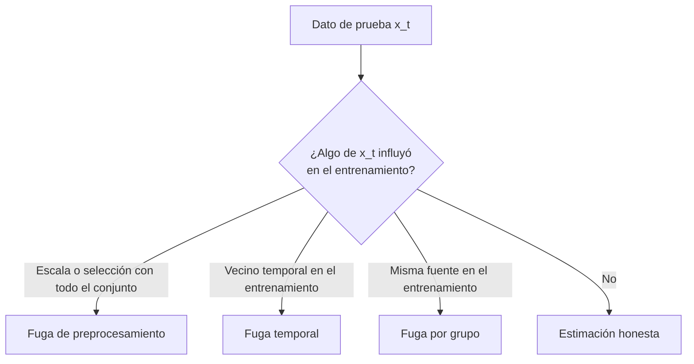

# B17-C09 — Prevención de fuga de datos

<!-- nav:top -->
[🏠 Programa](../../../../README.md) · [📚 Bloque B17](../../../tronco-comun/B17-aprendizaje-automatico-cientifico.md) · [← Anterior: B17-C08 — Interpretabilidad con consistencia física](../B17-C08-interpretabilidad-con-consistencia-fisica/CLASE.md) · [Siguiente: B17-C10 — Conjuntos de datos etiquetados para aprendizaje supervisado →](../B17-C10-conjuntos-de-datos-etiquetados-para-aprendizaje-supervisado/CLASE.md)
<!-- /nav -->

## 1. Ubicación, nivel y alcance

Novena clase del bloque B17. En C02 aprendiste a validar y en C07 viste que el despliegue cambia los datos; aquí estudias el error más traicionero de la validación: que **información de la prueba llegue al entrenamiento** sin que lo notes, y el resultado se vea excelente. Nivel N2/N3. Usas la validación cruzada de C02, el escalado de C01 y la idea de dependencia entre observaciones. No verás privacidad ni seguridad de datos (otro significado de «fuga»).

## 2. Por qué esta clase existe

Un equipo anuncia una exactitud del 95 % para clasificar señales; al aplicarlo a datos de una campaña nueva, baja al 55 %. Nadie mintió: la validación estaba mal hecha. Los datos de prueba compartían información con los de entrenamiento (vecinos en el tiempo, la misma fuente, una selección de variables hecha con todas las etiquetas). La estimación optimista no es un error de cálculo; es un error de diseño.

La decisión central: **¿cómo parto los datos y organizo el preprocesamiento para que cada cifra de validación represente lo que ocurrirá con datos realmente nuevos?**

## 3. Lo que podrás hacer al terminar

1. Definir fuga de datos y reconocer sus tres formas más comunes: preprocesamiento global, dependencia temporal y dependencia por fuente.
2. Reproducir una fuga y medir cuánto infla la exactitud con una verdad conocida.
3. Corregir con `Pipeline`, particiones por bloques de tiempo y particiones por grupo.
4. Elegir una estrategia de partición según la estructura de los datos.
5. Detectar señales de alarma: exactitud demasiado alta, importancia de variables absurdas.
6. Redactar una lista de verificación de fugas para un proyecto.

La evidencia es la **auditoría de fugas** del ejercicio 12 (sección 20).

## 4. Con qué llegas y cómo comprobarlo

1. ¿Qué exactitud tiene un clasificador que acierta al azar entre dos clases equiprobables?
2. ¿Qué es un paseo aleatorio y por qué sus valores consecutivos se parecen?
3. En una validación cruzada de 5 pliegues, ¿cuántos datos validan cada vez, de 100?
4. ¿Por qué estandarizar con la media de todo el conjunto usa información de la prueba?
5. Si hay 40 fuentes y 5 pliegues, ¿cuántas fuentes valida cada pliegue si se reparten por igual?

<details>
<summary>Ver respuestas</summary>

1. 0,5. 2. Cada valor es el anterior más un paso pequeño. 3. 20. 4. La media incluye los datos de prueba, así que el entrenamiento «sabe» algo de ellos. 5. 8.
</details>

Con cuatro o cinco aciertos, sigue; con tres o menos, repasa C01 y C02.

## 5. Un caso real: lo que documenta scikit-learn sobre la fuga

La documentación de buenas prácticas de scikit-learn define la fuga de datos como usar, al construir el modelo, información que no estaría disponible al predecir, lo que produce estimaciones optimistas en validación cruzada y peor desempeño con datos nuevos (S1). Sus reglas son: no llamar nunca a `fit` con datos de prueba, dividir antes de preprocesar, aprender los parámetros de las transformaciones solo del entrenamiento y usar una `Pipeline` (S1). Su ejemplo es contundente: con 200 muestras, 10 000 variables aleatorias y etiquetas aleatorias (sin nada que aprender), seleccionar las 25 mejores variables con todo el conjunto antes de dividir da una exactitud de 0,76, y hacerlo dentro de la partición da 0,5, el valor correcto (S1). Su documentación de validación cruzada añade los separadores para datos con estructura: por grupos (`GroupKFold`, ningún grupo en entrenamiento y prueba a la vez) y por tiempo (`TimeSeriesSplit`, entrena con el pasado y prueba con el futuro) (S2). Tú reproducirás un caso similar con tus propios datos.

## 6. Vocabulario

La **fuga de datos** (*data leakage*) es el uso, al entrenar o ajustar, de información que no estará disponible al predecir (S1). **Preprocesamiento global** es calcular transformaciones (escala, selección, reducción) con todo el conjunto antes de dividirlo. Una **Pipeline** encadena transformaciones y modelo y los reajusta dentro de cada pliegue (S1, S2). La **autocorrelación** es la semejanza entre observaciones cercanas en el tiempo. Un **grupo** (o fuente) es el conjunto de observaciones que comparten un origen, como un mismo objeto observado muchas veces. **GroupKFold** reparte grupos enteros entre pliegues (S2). Una **partición en bloques de tiempo** deja contiguo lo que se valida y lo separa del entrenamiento. Un **hueco de purga** es un margen entre entrenamiento y prueba al menos tan largo como el tiempo de correlación.

## 7. Modelo mental: ¿qué sabía el modelo al predecir?



*Descripción textual:* para cada dato de prueba se pregunta si algo suyo influyó en el entrenamiento. Si la escala o la selección usaron todo el conjunto, hay fuga de preprocesamiento; si hay un vecino temporal en el entrenamiento, fuga temporal; si hay otra observación de la misma fuente, fuga por grupo; si ninguna, la estimación es honesta.

Una analogía: un examen cuyas preguntas el estudiante vio de antemano. **Límite:** una fuga no es trampa deliberada; suele ser un descuido de diseño que ni el autor nota, y por eso se revisa con una lista, no con buena fe.

## 8. La explicación, paso a paso

### 8.1 Preprocesamiento global

Con 200 objetos y 5000 variables sin relación con la etiqueta, algunas variables correlacionarán con ella por azar. Con `n` datos, la mayor correlación casual entre 5000 variables ronda `√(2 ln 5000)/√n = 4,13/14,1 = 0,29`. Si escoges las 25 mejores usando **todas** las etiquetas y después divides, el modelo se entrena y prueba con variables elegidas mirando la prueba: exactitud 0,783 en el laboratorio (promedio de 20 repeticiones) cuando la verdad es 0,5. Si divides primero y eliges solo con el entrenamiento, o encadenas la selección y el modelo en una `Pipeline`, la exactitud vuelve a 0,513 y 0,514. Es el mismo comportamiento que describe la documentación (S1).

### 8.2 Dependencia temporal

Dos paseos aleatorios independientes: uno como característica, otro cuyo signo define la etiqueta. No hay relación alguna, así que la exactitud honesta es 0,5. Pero con pliegues al azar, cada punto de prueba tiene vecinos temporales en el entrenamiento con valores casi iguales y con la **misma** etiqueta (el signo cambia rara vez), y un clasificador de un vecino «acierta» 0,739. Con bloques contiguos, la exactitud baja a 0,610 (el resto de la dispersión viene de que los paseos no son estacionarios). La fuga infló 13 puntos y desapareció casi todo el efecto al separar en el tiempo.

### 8.3 Dependencia por fuente

Cuarenta fuentes con 25 observaciones cada una, con la característica cercana a un valor propio de la fuente y la etiqueta decidida por la fuente. Con pliegues al azar, las observaciones de la misma fuente aparecen en entrenamiento y prueba: 0,871. Con `GroupKFold`, ninguna fuente está en ambos: 0,477 (la verdad es 0,5). El modelo reconocía la fuente, no aprendía el fenómeno. Esto ocurre en astronomía cuando un mismo objeto aparece muchas veces en un catálogo (muchas observaciones, muchos cuadros, muchas bandas).

### 8.4 Cómo elegir la partición

Pregunta: *¿cómo se parecerán los datos nuevos a los de entrenamiento?* Si serán de objetos nuevos, parte por objeto. Si serán de épocas futuras, parte por tiempo (`TimeSeriesSplit` o bloques) con hueco de purga. Si serán de otro instrumento, parte por instrumento. La partición debe copiar la relación que habrá en el uso real (S2).

### 8.5 Fugas por construcción de variables

Una variable calculada con información posterior (por ejemplo, un promedio móvil centrado que usa valores futuros) o con la etiqueta (un parámetro refinado *después* de confirmar el planeta) filtra. La regla: cada variable debe poder calcularse con lo que se sabe en el instante de predecir. Una variable demasiado predictiva (exactitud casi perfecta con datos ruidosos) es motivo para sospechar.

### 8.6 La prueba también se gasta

Si ajustas hiperparámetros mirando una y otra vez la exactitud en la prueba, la estás usando para entrenar. Con 20 modelos sin información real y una prueba de 100 casos (error estándar 0,05 cada uno), el mejor da en promedio unos `0,5 + 1,87 × 0,05 ≈ 0,59`. La solución es reservar una prueba final intacta y usarla una sola vez.

## 9. Magnitudes, símbolos y unidades

| Símbolo | Qué es | Unidad | Nota |
|---|---|---|---|
| `n` | número de observaciones | — | 200, 1000 |
| `p` | número de variables | — | 5000 |
| `k` | variables seleccionadas | — | 25 |
| exactitud | fracción de aciertos | adimensional | verdad 0,5 en los tres casos |
| `ρ_max` | mayor correlación casual | adimensional | `√(2 ln p / n)` |
| `τ` | tiempo de correlación | muestras | define el hueco de purga |

## 10. Convenciones y referencias

Datos **sintéticos** con verdad conocida (0,5): cualquier exactitud superior en la validación es fuga o azar. Cada caso se repite 20 veces con semillas distintas y se informa el promedio. Los pliegues usan semilla entera fija (C02).

## 11. De dónde sale lo que afirmamos

| ID | Fuente | Localizador | Respalda | Estado |
|---|---|---|---|---|
| S1 | scikit-learn, «Common pitfalls and recommended practices» (fuga de datos) | https://scikit-learn.org/stable/common_pitfalls.html | Definición; reglas (dividir antes, ajustar solo con entrenamiento, `Pipeline`); ejemplo de 200 muestras y 10 000 variables con 0,76 frente a 0,5 | Página consultada el 2026-11-05 (mutable) |
| S2 | scikit-learn, «Cross-validation: evaluating estimator performance» | https://scikit-learn.org/stable/modules/cross_validation.html | `GroupKFold`, `TimeSeriesSplit` y su ejemplo; `Pipeline` en validación cruzada | Página consultada el 2026-11-05 (mutable) |

Límites: la fórmula `√(2 ln p / n)` es una aproximación estándar para el máximo de normales, aquí solo orientativa. La cifra 0,59 de la sección 8.6 usa que el máximo esperado de 20 normales ronda 1,87 desviaciones; es un valor estadístico conocido, no consultado en una fuente.

## 12. Cómo ver los resultados

| Caso | Partición con fuga | Partición correcta | Verdad |
|---|---|---|---|
| A) selección de variables | 0,783 | 0,513 (dividir primero) / 0,514 (`Pipeline`) | 0,5 |
| B) paseos aleatorios | 0,739 (al azar) | 0,610 (bloques contiguos) | 0,5 |
| C) 40 fuentes | 0,871 (al azar) | 0,477 (`GroupKFold`) | 0,5 |

Grafica tres barras por caso (con y sin fuga) y una línea horizontal en 0,5; describe en texto que la línea de la verdad queda muy debajo de las barras con fuga.

## 13. Ejemplo trabajado: auditar un resultado «demasiado bueno»

**Caso.** Un clasificador de candidatos alcanza 0,95 con validación cruzada. Los datos son 600 objetos con 30 observaciones cada uno, ordenados por fecha, y las 800 variables se filtraron a las 30 más correlacionadas con la etiqueta antes de entrenar.

**Paso 1 · estructura.** Hay grupos (objeto) y orden (fecha): la partición debe respetar ambos.

**Paso 2 · preprocesamiento.** La selección de 30 variables con todas las etiquetas es fuga A: debe ir dentro del pliegue.

**Paso 3 · partición.** Pliegues al azar mezclan observaciones del mismo objeto: fuga C. Debe usarse `GroupKFold`; si además se predice el futuro, un orden por tiempo con hueco.

**Paso 4 · repetir.** Se rehace la validación con `Pipeline` y particiones por grupo y tiempo.

**Paso 5 · lectura e incertidumbre.** Si la exactitud baja de 0,95 a 0,70, la diferencia es la fuga; 0,70 es la estimación honesta. Si pasa a 0,5, el modelo no aprendía nada. Un valor honesto también tiene incertidumbre: informa la dispersión entre pliegues (C02).

## 14. Comparación de estrategias de partición

La partición **al azar** es válida solo si las observaciones son independientes. La **estratificada** cuida las clases, no la dependencia. **Por grupos** protege contra la misma fuente. **Por tiempo** protege contra la autocorrelación y copia el uso futuro. A veces se combinan (por grupo y por tiempo). Mientras más estructura tengan los datos, más conservadora la partición, y más baja (y más real) la cifra.

## 15. Práctica guiada

**Ejercicio 1 · con los pasos indicados.** Estima la mayor correlación casual entre 5000 variables y una etiqueta con 200 datos. *Pasos:* `√(2 ln 5000)/√200`.

<details><summary>Solución comentada</summary>

`ln 5000 = 8,517`; `2 × 8,517 = 17,03`; raíz 4,127; dividida entre 14,14 da 0,29. Una variable puede correlacionar 0,29 con la etiqueta sin ninguna relación real.
</details>

**Ejercicio 2 · con una pista.** Con 40 fuentes y `GroupKFold` de 5 pliegues, ¿cuántas fuentes entrenan y cuántas validan?

<details><summary>Solución comentada</summary>

32 entrenan y 8 validan (1000 observaciones: 800 y 200). Ninguna fuente está en ambos conjuntos (S2).
</details>

**Ejercicio 3 · casi autónomo.** Con 6 muestras en orden temporal y `TimeSeriesSplit` de 3 divisiones, ¿cuáles son los índices?

<details><summary>Solución comentada</summary>

Entrenamiento y prueba: `[0 1 2]` y `[3]`; `[0 1 2 3]` y `[4]`; `[0 1 2 3 4]` y `[5]` (ejemplo de S2). El entrenamiento solo usa el pasado.
</details>

## 16. Práctica autónoma, transferencia e integrador

**Ejercicio 4.** Lista tres operaciones que, hechas con todo el conjunto antes de dividir, producen fuga.

<details><summary>Solución comentada</summary>

Estandarizar (media y desviación), seleccionar variables según la etiqueta, y reducir con componentes principales calculados con todos los datos (S1). También imputar valores faltantes con la media global.
</details>

**Ejercicio 5.** Con fuga la exactitud fue 0,871 y la honesta 0,477; la verdad es 0,5. ¿Cuánto infló la fuga y cuánto mide el error honesto?

<details><summary>Solución comentada</summary>

Inflación: `0,871 − 0,477 = 0,394` puntos. Error honesto: `0,477 − 0,5 = −0,023`, dentro del azar. La fuga explicaba casi toda la «habilidad».
</details>

**Ejercicio 6.** La autocorrelación dura unas 20 muestras. ¿Qué hueco de purga usas entre entrenamiento y prueba?

<details><summary>Solución comentada</summary>

Al menos 20 muestras: así ningún dato de prueba tiene un vecino correlacionado en el entrenamiento.
</details>

**Ejercicio 7.** Una variable «razón de duración» se calcula con el periodo refinado tras confirmar el planeta. ¿Qué problema tiene?

<details><summary>Solución comentada</summary>

Usa información posterior a la etiqueta (la confirmación): es fuga por construcción. Debe calcularse con el periodo preliminar, disponible al momento de decidir (sección 8.5).
</details>

**Ejercicio 8.** El mismo objeto aparece en dos catálogos con nombres distintos y cae en entrenamiento y en prueba. ¿Cómo lo previenes?

<details><summary>Solución comentada</summary>

Cruzando los catálogos por posición con una tolerancia declarada antes de partir, asignando un identificador único y particionando por ese identificador (por grupos). Registra cuántos duplicados encontraste.
</details>

**Ejercicio 9 · transferencia.** Un promedio móvil centrado de 5 puntos se usa como variable para predecir el punto central. ¿Qué fuga hay y cómo se corrige?

<details><summary>Solución comentada</summary>

Incluye valores posteriores al instante a predecir. Se usa un promedio retrospectivo (solo puntos pasados) y se verifica que cada variable en el instante `t` dependa solo de datos hasta `t`.
</details>

**Ejercicio 10 · transferencia.** Un mosaico de imágenes se normaliza con su media global y luego se recorta en parches para entrenar y probar. ¿Qué ocurre?

<details><summary>Solución comentada</summary>

La normalización incorpora los píxeles de los parches de prueba; además, parches vecinos solapados están en ambos conjuntos. Se normaliza con estadísticos del entrenamiento y se parte el mosaico en regiones separadas (con margen) antes de recortar.
</details>

**Ejercicio 11 · transferencia.** Eliges el mejor de 20 modelos por su exactitud en una prueba de 100 casos. Sin información real en ninguno, ¿qué exactitud esperas del mejor?

<details><summary>Solución comentada</summary>

Cada modelo tiene error estándar `√(0,5 × 0,5/100) = 0,05`. El máximo esperado de 20 normales ronda 1,87σ: `0,5 + 1,87 × 0,05 = 0,59`. Una «mejora» de 9 puntos sin ningún aprendizaje. Se evita con una prueba final intacta.
</details>

**Ejercicio 12 · integrador.** Escribe una **auditoría de fugas** para un proyecto tuyo: estructura de datos (grupos, tiempo, instrumentos), partición elegida con su justificación, lista de transformaciones y dónde se ajustan, variables y su momento de disponibilidad, y una comprobación con etiquetas aleatorias (la exactitud debe ser ≈ 0,5).

<details><summary>Solución modelo</summary>

Debe incluir la tabla de la sección 12 como referencia, la prueba de etiquetas aleatorias, la `Pipeline` usada, la partición por grupo o tiempo con hueco, y un registro de qué variables podrían filtrar información posterior. Acepta cualquier auditoría coherente.
</details>

## 17. Laboratorio: tres fugas con verdad conocida

El script [fuga_de_datos.py](fuga_de_datos.py) reproduce los tres casos, repitiendo 20 veces cada uno. Falla si la fuga no infla la exactitud o si el procedimiento honesto se aleja de 0,5 más que la tolerancia.

**Datos:** sintéticos. **Predice antes de ejecutar:** ¿qué exactitud da la selección con todo el conjunto si no hay relación real? **Ejecución del 2026-11-05 (Python 3.12.9, NumPy 2.4.4, scikit-learn 1.8.0):**

```text
A) selección con todo el conjunto: 0.783 | dentro de la partición: 0.513 | Pipeline con validación cruzada: 0.514 (verdad 0,5)
B) paseos aleatorios: pliegues al azar 0.739 | bloques contiguos 0.610 (verdad 0,5)
C) 40 fuentes x 25 observaciones: pliegues al azar 0.871 | por fuente (GroupKFold) 0.477 (verdad 0,5)
Pruebas superadas.
```

```bash
python programa/clases/B17/B17-C09-prevencion-de-fuga-de-datos/fuga_de_datos.py
```

**Límites:** los datos son artificiales; en el caso B los paseos aleatorios no son estacionarios y la exactitud honesta (0,610) queda por encima de 0,5, por lo que la tolerancia es más holgada (0,15). En una primera versión del caso C, con más ruido dentro de cada fuente, la exactitud con fuga solo llegó a 0,678: la fuga depende de qué tan identificable sea la fuente.

## 18. Errores frecuentes y cómo corregirlos

**Estandarizar o seleccionar antes de dividir.** Ejercicios 1 y 4.

**Particionar al azar datos con grupos.** Ejercicios 2 y 8.

**Ignorar el orden temporal.** Ejercicios 3, 6 y 9.

**Crear variables con información futura o de la etiqueta.** Ejercicio 7.

**Gastar la prueba ajustando hiperparámetros.** Ejercicio 11.

## 19. Cómo sabrás que vas bien

Tras 8.1: ¿explicas por qué 0,783 es falso? Si no, ejercicio 1. Tras 8.3: ¿eliges un separador por grupos sin ayuda? Si no, ejercicio 2. Tras el laboratorio: ¿cómo comprobarías una fuga en tu propio proyecto con etiquetas aleatorias? Al final: ¿qué variable de tu proyecto no podrías calcular al instante de predecir?

## 20. Qué entregas y cómo se evalúa

El producto es tu **auditoría de fugas** (ejercicio 12).

| Criterio | Inicial | En desarrollo | Logrado | Destacado |
|---|---|---|---|---|
| Estructura | No identifica grupos ni tiempo | Identifica una | Identifica ambas | Justifica la partición con el uso real |
| Preprocesamiento | Global | Separado a mano | `Pipeline` | Verifica con etiquetas aleatorias |
| Variables | Sin revisar | Revisa algunas | Revisa disponibilidad de todas | Detecta una fuga por construcción |
| Honestidad | Cifra única | Compara con fuga | Informa inflación medida | Documenta qué no pudo comprobar |

**Condiciones críticas:** no usar la prueba para ajustar; rotular los datos como sintéticos; declarar la estructura de dependencia.

## 21. Ética, seguridad y límites

Publicar una cifra inflada por fuga puede llevar a otros equipos a adoptar un método que no funciona. Es una cuestión de integridad científica: documenta cómo se partieron los datos. Accesibilidad: tablas con encabezados y descripciones de texto. Material educativo.

## 22. Para cerrar y seguir

La fuga de datos se evita preguntando, para cada dato de prueba, qué sabía el modelo al predecir. Las tres formas más comunes (preprocesamiento global, dependencia temporal y por fuente) se corrigen con `Pipeline` y particiones por tiempo y por grupo, y se detectan con etiquetas aleatorias. Queda abierta una pregunta: ¿cómo se parte un conjunto cuando el tiempo, la fuente y el instrumento son dependencias a la vez?

**Glosario español–inglés.** fuga de datos · *data leakage*; autocorrelación · *autocorrelation*; grupo · *group*; hueco de purga · *purge gap*; partición · *split*; prueba final · *held-out test set*; hiperparámetro · *hyperparameter*.

**Continuidad.** B17-C10 trata la construcción de conjuntos etiquetados; B17-C12, las métricas de evaluación.

**Referencias:** ver sección 11. S1 y S2 son documentación mutable.

<!-- nav:bottom -->
---

[← Anterior: B17-C08 — Interpretabilidad con consistencia física](../B17-C08-interpretabilidad-con-consistencia-fisica/CLASE.md) · [📚 Bloque B17](../../../tronco-comun/B17-aprendizaje-automatico-cientifico.md) · [Siguiente: B17-C10 — Conjuntos de datos etiquetados para aprendizaje supervisado →](../B17-C10-conjuntos-de-datos-etiquetados-para-aprendizaje-supervisado/CLASE.md)
<!-- /nav -->
