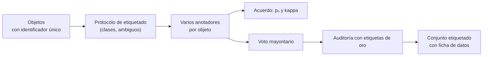

# B17-C10 — Conjuntos de datos etiquetados para aprendizaje supervisado

<!-- nav:top -->
[🏠 Programa](../../../../README.md) · [📚 Bloque B17](../../../tronco-comun/B17-aprendizaje-automatico-cientifico.md) · [← Anterior: B17-C09 — Prevención de fuga de datos](../B17-C09-prevencion-de-fuga-de-datos/CLASE.md) · [Siguiente: B17-C11 — Redes de segmentación semántica de imágenes →](../B17-C11-redes-de-segmentacion-semantica-de-imagenes/CLASE.md)
<!-- /nav -->

## 1. Ubicación, nivel y alcance

Décima clase del bloque B17. Los modelos supervisados (C02) aprenden de etiquetas, y las etiquetas las ponen personas o procesos con errores. Aquí aprendes a **construir un conjunto etiquetado** con calidad medida: protocolo de etiquetado, varios anotadores, acuerdo entre ellos y efecto del ruido de etiquetas sobre el entrenamiento y sobre la evaluación. Nivel N2. Usas probabilidad (B12), clasificación (C02) y partición sin fugas (C09). No verás aprendizaje activo ni etiquetado débil en profundidad.

## 2. Por qué esta clase existe

Se quiere entrenar un modelo que distinga galaxias espirales de elípticas. Hay un millón de imágenes y nadie las ha etiquetado. Si se reparte el trabajo entre voluntarios, cada uno se equivoca a veces; si el modelo se evalúa con esas etiquetas, su exactitud *aparente* queda por debajo de la real. Antes de cualquier algoritmo, la calidad del conjunto manda.

La decisión central: **¿cómo construyo etiquetas de las que pueda medir su calidad, y cómo afecta su ruido al entrenamiento y a la evaluación?**

## 3. Lo que podrás hacer al terminar

1. Redactar un protocolo de etiquetado con clases definidas, casos ambiguos y una categoría «incierto».
2. Calcular el acuerdo observado y el coeficiente kappa de Cohen entre dos anotadores.
3. Calcular la exactitud del voto mayoritario de un número impar de anotadores.
4. Explicar cómo el ruido de etiquetas rebaja la exactitud medida sin cambiar la real.
5. Evitar la circularidad (etiquetas derivadas de las salidas del modelo) y las fugas con la partición.
6. Documentar un conjunto etiquetado con una ficha de datos.

La evidencia es la **ficha del conjunto etiquetado** del ejercicio 12 (sección 20).

## 4. Con qué llegas y cómo comprobarlo

1. Si cada anotador acierta con probabilidad 0,8 de forma independiente, ¿cuál es la probabilidad de que dos acierten ambos?
2. ¿Qué es una proporción esperada por azar entre dos clases equiprobables?
3. ¿Cuántas combinaciones de 2 aciertos hay entre 3 anotadores?
4. ¿Qué exactitud máxima tiene una característica con clases normales ±1, desviación 1? (`Φ(1) = 0,8413`.)
5. ¿Por qué hay que dividir entrenamiento y prueba antes de ajustar?

<details>
<summary>Ver respuestas</summary>

1. `0,8 × 0,8 = 0,64`. 2. 0,5. 3. 3. 4. 0,8413. 5. Para que las cifras de prueba no hayan visto el entrenamiento (C09).
</details>

Con cuatro o cinco aciertos, sigue; con tres o menos, repasa B12-C01 y C09.

## 5. Un caso real: Galaxy Zoo

El proyecto Galaxy Zoo pidió a voluntarios que clasificaran por inspección visual imágenes de galaxias del Sloan Digital Sky Survey. Según el resumen del artículo de presentación, asignó clases morfológicas a cerca de un millón de galaxias, reunió más de 40 millones de clasificaciones de unos 100 000 participantes, y sus resultados concuerdan con los de astrónomos profesionales sobre subconjuntos; los autores destacan que las etiquetas, por derivar de inspección visual, evitan los sesgos de proxies indirectos como el color (S1). Dos ideas de esa construcción son las que usarás: **muchas clasificaciones por objeto** para reducir el error individual, y una **comparación con expertos** para medir la calidad. No se replica su procesamiento.

## 6. Vocabulario

Un **protocolo de etiquetado** es el documento que define cada clase, con ejemplos y reglas para los casos ambiguos. Un **anotador** es quien etiqueta. El **acuerdo observado** `pₒ` es la fracción de objetos en que dos anotadores dan la misma etiqueta. El **acuerdo esperado por azar** `pₑ` se calcula con las proporciones de cada anotador; el **kappa de Cohen** es `κ = (pₒ − pₑ)/(1 − pₑ)`, mide el acuerdo más allá del azar y compara a dos anotadores entre sí, no a un modelo con la verdad (S2). El **voto mayoritario** toma la etiqueta más frecuente entre un número impar de anotadores. El **ruido de etiquetas** es la fracción de etiquetas incorrectas. Es **simétrico** si cualquier clase se confunde con la otra con la misma probabilidad. Una **etiqueta de oro** es la de mayor confianza (de expertos), usada para auditar.

## 7. Modelo mental: del objeto a la etiqueta confiable



*Descripción textual:* los objetos, cada uno con un identificador único, se etiquetan siguiendo un protocolo por varios anotadores. Se calcula el acuerdo entre ellos y el voto mayoritario; el resultado se audita contra etiquetas de oro y termina en un conjunto etiquetado con su ficha de datos.

Una analogía: varios testigos de un mismo suceso. Cada uno puede equivocarse, pero si varios coinciden la confianza sube. **Límite:** si los testigos comparten un sesgo (la misma regla mal entendida, o la misma imagen deficiente), coinciden y se equivocan juntos; el voto no corrige errores correlacionados.

## 8. La explicación, paso a paso

### 8.1 El protocolo

Antes de etiquetar: definir clases en términos observables («espiral: brazos visibles en la imagen»), listar casos ambiguos (galaxias de canto, imágenes de baja calidad), añadir una categoría **«incierto»** y fijar qué hacer con ella (excluir del entrenamiento, no de la auditoría). Sin protocolo, las diferencias entre anotadores serán más diferencias de interpretación que de atención.

### 8.2 Acuerdo y kappa

Con dos anotadores que aciertan cada uno con probabilidad `p = 0,8` e independientes, ambos coinciden si los dos aciertan o los dos fallan (en el caso binario eso lleva a la misma etiqueta): `pₒ = p² + (1 − p)² = 0,64 + 0,04 = 0,68`. Con clases equiprobables, cada anotador da 50 % a cada clase, y `pₑ = 0,5`. Entonces `κ = (0,68 − 0,5)/(1 − 0,5) = 0,36`. En el laboratorio: `pₒ = 0,6846` y `κ = 0,369`. Un kappa de 0,36 es bajo: la documentación sugiere que por encima de 0,8 el acuerdo suele considerarse bueno (S2). Que cada anotador acierte el 80 % no basta para un acuerdo alto entre ellos.

### 8.3 El kappa depende de la prevalencia

Dos anotadores etiquetan 100 objetos: ambos dicen «0» en 85, discrepan en 10 (5 y 5), ambos dicen «1» en 5. `pₒ = (85 + 5)/100 = 0,90`. Cada uno dice «0» en el 90 %, y `pₑ = 0,9² + 0,1² = 0,82`. `κ = (0,90 − 0,82)/(1 − 0,82) = 0,444`. Un 90 % de acuerdo da un kappa mediano porque con una clase dominante el azar ya produce mucho acuerdo. Informa siempre las proporciones junto con el kappa.

### 8.4 Voto mayoritario

Con `n` anotadores impares e independientes que aciertan con probabilidad `p`, la exactitud del voto es la probabilidad de que acierte más de la mitad. Para `n = 3`: `p³ + 3p²(1 − p) = 0,512 + 0,384 = 0,896`. Para `n = 5`: 0,942; `n = 7`: 0,967; `n = 9`: 0,980. La mejora disminuye con cada anotador añadido, y supone errores independientes. El laboratorio dio 0,898 contra un anotador solo de 0,802.

### 8.5 Ruido de etiquetas: entrenar y evaluar son cosas distintas

En el laboratorio, un modelo entrenado con etiquetas con 20 % de ruido simétrico, y evaluado con etiquetas limpias, dio 0,843, igual que uno entrenado con etiquetas limpias (0,843): el ruido simétrico apenas afectó el entrenamiento en este caso (muchos datos, un modelo simple). Pero la **evaluación** sí cambia: si se mide el modelo contra las etiquetas ruidosas, la exactitud aparente es `A(1 − η) + (1 − A)η`, con `A` la exactitud real y `η` el ruido. Con `A = 0,8413` y `η = 0,2`: `0,8413 × 0,8 + 0,1587 × 0,2 = 0,705`. Medido: 0,705. El modelo parecía 14 puntos peor de lo que es. Hay que auditar el conjunto de prueba con etiquetas de oro.

### 8.6 Circularidad y procedencia

Si las etiquetas se obtienen de las salidas de otro modelo (o del propio) el conjunto hereda sus errores y el modelo nuevo «aprende» a imitarlo, sin información nueva. Anota la procedencia de cada etiqueta (humana, de catálogo, de modelo) y evita entrenar y evaluar con etiquetas de la misma cadena.

### 8.7 Partición y tamaño

Un identificador único por objeto permite partir por objeto y evitar duplicados (C09). Con una clase rara, el tamaño efectivo es el de la clase rara: 1000 objetos con 5 % positivos son 50 ejemplos positivos. Reserva una muestra con etiquetas de oro para auditar.

## 9. Magnitudes, símbolos y unidades

| Símbolo | Qué es | Unidad | Nota |
|---|---|---|---|
| `p` | probabilidad de acierto de un anotador | adimensional | 0,8 |
| `pₒ` | acuerdo observado | adimensional | 0,68 teórico |
| `pₑ` | acuerdo esperado por azar | adimensional | 0,5 con equiprobables |
| `κ` | kappa de Cohen | adimensional | −1 a 1 |
| `n` | número de anotadores (impar) | — | 3, 5, 7 |
| `A` | exactitud real del modelo | adimensional | 0,8413 máx. |
| `η` | ruido simétrico de etiquetas | adimensional | 0,2 |

## 10. Convenciones y referencias

Datos **sintéticos**: la clase verdadera se conoce (algo que en datos reales solo se aproxima con etiquetas de oro). Anotadores independientes con errores simétricos. Se usa una sola característica con clases normales ±1 (techo 0,8413, como en C02).

## 11. De dónde sale lo que afirmamos

| ID | Fuente | Localizador | Respalda | Estado |
|---|---|---|---|---|
| S1 | Lintott, C. J. et al., «Galaxy Zoo», arXiv:0804.4483 (MNRAS) | https://arxiv.org/abs/0804.4483 | Etiquetas morfológicas de cerca de un millón de galaxias por inspección visual; más de 40 millones de clasificaciones de unos 100 000 participantes; concordancia con astrónomos profesionales en subconjuntos | Resumen consultado el 2026-11-05 |
| S2 | scikit-learn, «Metrics and scoring» (kappa de Cohen, exactitud equilibrada) | https://scikit-learn.org/stable/modules/model_evaluation.html | Kappa compara etiquetas de anotadores; rango −1 a 1; por encima de 0,8 se considera buen acuerdo | Página consultada el 2026-11-05 (primeros 100 000 de 174 676 caracteres; mutable) |

Límites: de S1 solo se leyó el resumen. La fórmula `κ = (pₒ − pₑ)/(1 − pₑ)`, la probabilidad binomial del voto y la fórmula de exactitud con ruido son resultados estándar de probabilidad, comprobados en el laboratorio; la página de S2 consultada no reproducía la fórmula del kappa.

## 12. Cómo ver los resultados

| Medida | Teoría | Laboratorio |
|---|---|---|
| Acuerdo entre dos anotadores | 0,6800 | 0,6846 |
| Kappa de Cohen | 0,3600 | 0,3693 |
| Voto mayoritario de 3 | 0,8960 | 0,8983 |
| Un anotador solo | 0,8000 | 0,8017 |
| Exactitud del modelo con etiquetas limpias | 0,8413 (techo) | 0,8428 |
| Modelo limpio evaluado con etiquetas con 20 % de ruido | 0,7048 | 0,7052 |

Grafica la exactitud del voto contra el número de anotadores (3, 5, 7, 9) con puntos y una línea; describe en texto que la curva crece y se aplana.

## 13. Ejemplo trabajado: ¿cuántos anotadores necesito?

**Caso.** Cada voluntario acierta el 80 % de las veces. Se quiere un 95 % de exactitud en las etiquetas finales, con errores independientes.

**Paso 1 · un anotador.** 0,80: insuficiente.

**Paso 2 · tres.** 0,896: insuficiente.

**Paso 3 · cinco.** 0,942: casi.

**Paso 4 · siete.** 0,967: supera 0,95.

**Paso 5 · lectura e incertidumbre.** Hacen falta siete, si los errores son independientes. Si hay un sesgo común (por ejemplo, la misma instrucción confusa), el voto mejora mucho menos, y el cálculo es optimista. Se verifica con una muestra de etiquetas de oro: el valor real puede ser menor. El costo también cuenta: pasar de 5 a 7 anotadores añade 40 % de trabajo por 2,5 puntos de exactitud.

## 14. Comparación de formas de etiquetar

Un **experto** etiqueta poco y bien (etiquetas de oro). **Varios no expertos** con voto mayoritario escalan, con calidad que se mide por acuerdo (como Galaxy Zoo, S1). Una **etiqueta heredada de un catálogo** es barata, pero hay que conocer su procedencia y sus errores. Una **etiqueta de otro modelo** es circular. Lo habitual combina: muchas etiquetas baratas, una muestra de oro para auditar y un protocolo.

## 15. Práctica guiada

**Ejercicio 1 · con los pasos indicados.** Dos anotadores con `p = 0,9`. Calcula `pₒ`, `pₑ` y `κ`. *Pasos:* sección 8.2.

<details><summary>Solución comentada</summary>

`pₒ = 0,81 + 0,01 = 0,82`; `pₑ = 0,5`; `κ = 0,32/0,5 = 0,64`. Con anotadores del 90 % el kappa sigue por debajo de 0,8.
</details>

**Ejercicio 2 · con una pista.** Exactitud del voto de tres anotadores con `p = 0,9`. *Pista:* `p³ + 3p²(1 − p)`.

<details><summary>Solución comentada</summary>

`0,729 + 3 × 0,81 × 0,1 = 0,729 + 0,243 = 0,972`.
</details>

**Ejercicio 3 · casi autónomo.** Un modelo con exactitud real 0,95 se evalúa con etiquetas con ruido simétrico del 10 %. ¿Qué exactitud aparente verás?

<details><summary>Solución comentada</summary>

`0,95 × 0,9 + 0,05 × 0,1 = 0,855 + 0,005 = 0,860`. Nueve puntos por debajo de la real.
</details>

## 16. Práctica autónoma, transferencia e integrador

**Ejercicio 4.** Dos anotadores: ambos «sí» en 40, ambos «no» en 40, discrepan 10 y 10. Calcula `κ`.

<details><summary>Solución comentada</summary>

`pₒ = 0,80`. Cada anotador dice «sí» en 50 %: `pₑ = 0,5`. `κ = 0,3/0,5 = 0,6`.
</details>

**Ejercicio 5.** Recalcula la sección 8.3 y explica por qué `κ` es 0,444 con 90 % de acuerdo.

<details><summary>Solución comentada</summary>

`pₒ = 0,90`, `pₑ = 0,82`, `κ = 0,08/0,18 = 0,444`. Con 90 % de la muestra en una clase, mucho del acuerdo se debe al azar; el kappa lo descuenta.
</details>

**Ejercicio 6.** Tienes 1000 objetos con 5 % de positivos. ¿Cuántos ejemplos positivos hay? ¿Qué implica para validar con 5 pliegues?

<details><summary>Solución comentada</summary>

50 positivos; 10 por pliegue de validación. La métrica sobre la clase rara tendrá mucha dispersión (C02, C12). Conviene estratificar y conseguir más positivos.
</details>

**Ejercicio 7.** ¿Por qué el voto mayoritario usa un número impar de anotadores en el caso binario?

<details><summary>Solución comentada</summary>

Para evitar empates. Con un número par habría que decidir con otra regla (un anotador extra, una etiqueta «incierto»).
</details>

**Ejercicio 8.** Redacta tres reglas del protocolo para distinguir espiral y elíptica y una para los casos ambiguos.

<details><summary>Solución comentada</summary>

Ejemplo: espiral si se ven brazos en la imagen; elíptica si el brillo es suave sin estructura; incierto si la imagen tiene menos de N píxeles de ancho o hay un objeto brillante superpuesto. Los ambiguos van a «incierto» y no al entrenamiento.
</details>

**Ejercicio 9 · transferencia.** Con `p = 0,8` verifica que el voto de 5 anotadores da 0,942.

<details><summary>Solución comentada</summary>

`P(≥3 aciertos) = 10 × 0,8³ × 0,2² + 5 × 0,8⁴ × 0,2 + 0,8⁵ = 0,2048 + 0,4096 + 0,3277 = 0,942`.
</details>

**Ejercicio 10 · transferencia.** Etiquetas de un catálogo se obtuvieron con la salida de un clasificador antiguo. ¿Qué riesgo hay al entrenar un modelo nuevo con ellas y evaluarlo con las mismas?

<details><summary>Solución comentada</summary>

Circularidad: el modelo nuevo aprende a imitar al antiguo y su evaluación mide acuerdo con él, no con la realidad. Se audita con una muestra de etiquetas de oro independientes (sección 8.6).
</details>

**Ejercicio 11 · transferencia.** El ruido de etiquetas no es simétrico: el 30 % de las espirales se etiquetan como elípticas y el 5 % de las elípticas como espirales. ¿Es más o menos grave que el simétrico del 20 %? Razona sin calcular.

<details><summary>Solución comentada</summary>

Más grave: el ruido asimétrico desplaza la frontera aprendida hacia una clase y sesga las proporciones; la fórmula de la sección 8.5 ya no se aplica. Se estima la matriz de confusión de las etiquetas contra oro y se corrige.
</details>

**Ejercicio 12 · integrador.** Redacta la **ficha del conjunto etiquetado**: objetos y procedencia, protocolo, número de anotadores, acuerdo y kappa, auditoría con etiquetas de oro, tratamiento de «incierto», partición sin fugas y limitaciones.

<details><summary>Solución modelo</summary>

Debe incluir las clases y su definición operativa, los valores de acuerdo y kappa con las proporciones, la exactitud del voto y su supuesto de independencia, la procedencia de cada etiqueta y los usos prohibidos. Acepta cualquier ficha coherente.
</details>

## 17. Laboratorio: acuerdo, voto y ruido

El script [etiquetas_y_acuerdo.py](etiquetas_y_acuerdo.py) simula tres anotadores, calcula acuerdo y kappa, el voto mayoritario y el efecto del ruido en entrenamiento y evaluación, y compara con las fórmulas. Falla si algún valor se aparta más de 0,01 (0,02 en kappa).

**Datos:** sintéticos. **Predice antes de ejecutar:** ¿qué exactitud aparente tendrá un modelo perfecto de 0,8413 evaluado con 20 % de ruido? **Ejecución del 2026-11-05 (Python 3.12.9, NumPy 2.4.4, scikit-learn 1.8.0):**

```text
Acuerdo entre dos anotadores: 0.6846 (teoría 0.6800); kappa 0.3693 (teoría 0,3600)
Exactitud del voto mayoritario de 3: 0.8983 (teoría 0.8960); un anotador solo: 0.8017
Entrenado con etiquetas limpias, evaluado limpio: 0.8428 (techo 0.8413); entrenado con etiquetas con 20 % de ruido, evaluado limpio: 0.8430
Mismo modelo limpio evaluado contra etiquetas ruidosas: 0.7052 (teoría 0.7048)
Pruebas superadas.
```

```bash
python programa/clases/B17/B17-C10-conjuntos-de-datos-etiquetados-para-aprendizaje-supervisado/etiquetas_y_acuerdo.py
```

**Límites:** anotadores independientes y simétricos; en la realidad los errores se correlacionan y dependen de la clase. El ruido de entrenamiento se probó solo con un modelo simple y 10 000 ejemplos.

## 18. Errores frecuentes y cómo corregirlos

**Sin protocolo escrito.** Ejercicio 8.

**Interpretar el acuerdo sin la prevalencia.** Ejercicios 4 y 5.

**Creer que el voto corrige errores correlacionados.** Sección 8.4 y ejercicio 9.

**Evaluar con etiquetas ruidosas sin auditar.** Ejercicio 3.

**Etiquetas circulares.** Ejercicio 10.

## 19. Cómo sabrás que vas bien

Tras 8.2: ¿calculas `κ` desde una tabla de acuerdos? Si no, ejercicios 1 y 4. Tras 8.4: ¿cuántos anotadores necesitas para una exactitud dada? Si no, ejercicio 9. Tras el laboratorio: ¿por qué el modelo parece peor de lo que es? Al final: ¿cuál es la procedencia de cada etiqueta de tu conjunto?

## 20. Qué entregas y cómo se evalúa

El producto es tu **ficha del conjunto etiquetado** (ejercicio 12).

| Criterio | Inicial | En desarrollo | Logrado | Destacado |
|---|---|---|---|---|
| Protocolo | Sin protocolo | Clases nombradas | Clases operativas y ambiguos | Con ejemplos y categoría «incierto» |
| Calidad | Sin medida | Acuerdo | Acuerdo, `κ` y proporciones | Auditoría con etiquetas de oro |
| Ruido | Ignorado | Mencionado | Efecto en la evaluación calculado | Distingue ruido simétrico y asimétrico |
| Procedencia | No declarada | Declarada en parte | Declarada por etiqueta | Evita circularidad y fuga |

**Condiciones críticas:** rotular los datos como sintéticos u observados; no evaluar con etiquetas de la misma cadena que el entrenamiento; declarar quién etiquetó.

## 21. Ética, seguridad y límites

Etiquetar es trabajo humano: si se usan voluntarios, hay que informarles, reconocer su aporte y proteger sus datos personales. Un conjunto etiquetado hereda los sesgos de quien lo etiqueta y de las imágenes elegidas; documenta limitaciones. Accesibilidad: protocolo en lenguaje claro y alternativa textual de las imágenes. Material educativo.

## 22. Para cerrar y seguir

Un conjunto etiquetado se construye con un protocolo, varios anotadores y una muestra de oro; el acuerdo y el kappa miden su calidad, el voto mayoritario mejora la exactitud si los errores son independientes, y el ruido de etiquetas rebaja la exactitud aparente más de lo que daña el entrenamiento. Queda abierta una pregunta: ¿cómo se etiquetan, sin expertos disponibles, objetos que nadie ha visto antes?

**Glosario español–inglés.** conjunto etiquetado · *labeled dataset*; anotador · *annotator*; acuerdo entre anotadores · *inter-annotator agreement*; kappa de Cohen · *Cohen's kappa*; voto mayoritario · *majority vote*; ruido de etiquetas · *label noise*; etiqueta de oro · *gold label*; procedencia · *provenance*.

**Continuidad.** B17-C11 usa etiquetas por píxel para segmentar imágenes; B17-C12 desarrolla las métricas de evaluación con clases desiguales.

**Referencias:** ver sección 11. De S1 solo se leyó el resumen.

<!-- nav:bottom -->
---

[← Anterior: B17-C09 — Prevención de fuga de datos](../B17-C09-prevencion-de-fuga-de-datos/CLASE.md) · [📚 Bloque B17](../../../tronco-comun/B17-aprendizaje-automatico-cientifico.md) · [Siguiente: B17-C11 — Redes de segmentación semántica de imágenes →](../B17-C11-redes-de-segmentacion-semantica-de-imagenes/CLASE.md)
<!-- /nav -->
