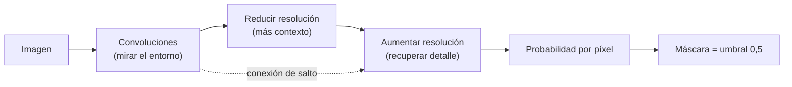

# B17-C11 — Redes de segmentación semántica de imágenes

<!-- nav:top -->
[🏠 Programa](../../../../README.md) · [📚 Bloque B17](../../../tronco-comun/B17-aprendizaje-automatico-cientifico.md) · [← Anterior: B17-C10 — Conjuntos de datos etiquetados para aprendizaje supervisado](../B17-C10-conjuntos-de-datos-etiquetados-para-aprendizaje-supervisado/CLASE.md) · [Siguiente: B17-C12 — Evaluación de modelos: precisión, exhaustividad y falsos positivos →](../B17-C12-evaluacion-de-modelos-precision-exhaustividad-y-falsos-positivos/CLASE.md)
<!-- /nav -->

## 1. Ubicación, nivel y alcance

Undécima clase del bloque B17. En B15-C13 segmentaste imágenes con métodos clásicos (umbrales, regiones); ahora un modelo **aprende** a asignar a cada píxel una clase a partir de máscaras dibujadas. Verás el ingrediente central, la convolución aprendida, la medida estándar de acierto (IoU y Dice) y el diseño de las redes tipo U. Nivel N3. Usas procesamiento de imágenes (B15-C09, C08), clasificación (C02) y etiquetado (C10). No entrenarás una red profunda completa (aquí no hay biblioteca de redes profundas instalada): construyes y entrenas la pieza mínima, una capa convolucional con regresión logística, y razonas el resto con aritmética.

## 2. Por qué esta clase existe

Delimitar una mancha solar, una nube o un cráter a mano en miles de imágenes no escala. Un umbral por píxel falla cuando el ruido es comparable al contraste. Una red de segmentación mira el entorno de cada píxel, no solo su valor, y aprende de máscaras ya dibujadas qué forma de entorno corresponde a la clase de interés.

La decisión central: **¿cómo entreno y mido un modelo que dibuja el contorno de un fenómeno, y cómo sé que mejora algo frente a un método sencillo?**

## 3. Lo que podrás hacer al terminar

1. Calcular una convolución 2D «válida» y su tamaño de salida.
2. Calcular IoU (Jaccard) y Dice a partir de una máscara predicha y una verdadera.
3. Explicar por qué la exactitud por píxel engaña cuando el objeto ocupa poco.
4. Entrenar una capa convolucional aprendida y compararla con un umbral.
5. Describir la arquitectura tipo U (camino que contrae, camino que expande, conexiones de salto) y cuenta de parámetros de una capa.
6. Planificar aumentos de datos que transformen imagen y máscara a la vez.

La evidencia es el **informe de segmentación** del ejercicio 12 (sección 20).

## 4. Con qué llegas y cómo comprobarlo

1. ¿Qué es un conjunto A ∩ B y un A ∪ B?
2. Si una imagen de 48 × 48 se recorre con una ventana de 7 × 7 sin salirse, ¿cuántas posiciones hay por lado?
3. Si el ruido de un píxel tiene desviación 0,9, ¿cuál es la del promedio de 49 píxeles independientes?
4. ¿Qué es una máscara binaria?
5. Una máscara ocupa 3 % de la imagen. ¿Qué exactitud por píxel tiene un modelo que siempre responde «fondo»?

<details>
<summary>Ver respuestas</summary>

1. Los elementos comunes y los que están en alguno. 2. `48 − 7 + 1 = 42`. 3. `0,9/√49 = 0,129`. 4. Una imagen con 1 donde está el objeto y 0 fuera. 5. 97 %.
</details>

Con cuatro o cinco aciertos, sigue; con tres o menos, repasa B15-C08 y B15-C13.

## 5. Un caso real: la arquitectura U-Net

El trabajo que introdujo la U-Net presenta una red y una estrategia de entrenamiento para segmentar imágenes biomédicas aprovechando muy pocas imágenes anotadas gracias a un uso intensivo de aumentos de datos. Su arquitectura tiene un **camino que contrae**, que capta contexto, y un **camino simétrico que expande**, que permite localizar con precisión; se entrena de extremo a extremo con muy pocas imágenes y supera al mejor método previo (de ventana deslizante) en un desafío de segmentación de estructuras neuronales en microscopía electrónica; segmenta una imagen de 512 × 512 en menos de un segundo con un GPU reciente (S1, resumen). La idea es general: no importa que el dominio sea biomédico, la red aprende qué hay en torno de cada píxel. No se replica aquí; se construye su pieza mínima.

## 6. Vocabulario

La **segmentación semántica** asigna una clase a cada píxel. Una **máscara** es la imagen de etiquetas. La **convolución** (en redes, una correlación cruzada: producto punto de un núcleo con cada ventana de la imagen, sin invertir el núcleo) produce un mapa de respuestas; en modo **válido** la salida mide `N − k + 1` por lado. Un **núcleo** de `k × k` tiene `k²` pesos aprendidos y un sesgo. Una **capa convolucional aprendida** ajusta los pesos del núcleo con las etiquetas. El **IoU** (*intersection over union*, índice de Jaccard) es `|P ∩ V| / |P ∪ V|` entre la máscara predicha `P` y la verdadera `V` (S2). El **coeficiente de Dice** es `2|P ∩ V| / (|P| + |V|)`. El **muestreo descendente** reduce la resolución (p. ej., agrupando 2 × 2) para captar contexto; el **ascendente** la restituye. Una **conexión de salto** copia detalles del camino que contrae al que expande. Un **aumento de datos** crea ejemplos nuevos transformando los existentes.

## 7. Modelo mental: contexto para decidir, detalle para dibujar



*Descripción textual:* la imagen pasa por convoluciones que miran el entorno, se reduce la resolución para ganar contexto y luego se aumenta para recuperar el detalle; una conexión de salto lleva detalle fino del primer tramo al segundo; el resultado es una probabilidad por píxel, que con un umbral de 0,5 da la máscara.

Una analogía: reconocer un objeto con los ojos entornados y luego precisar su borde con los ojos abiertos. **Límite:** una red no «entiende» el objeto; reconoce patrones de textura y forma que vio, y falla ante imágenes distintas de las del entrenamiento (C07).

## 8. La explicación, paso a paso

### 8.1 La convolución y su tamaño

Con una imagen de `N × N` y un núcleo de `k × k` en modo válido, la salida es de `(N − k + 1) × (N − k + 1)`. Para `N = 48` y `k = 7`: 42 × 42; para `N = 16` y `k = 5`: 12 × 12. El laboratorio verifica que una convolución escrita con dos bucles coincide con `scipy.signal.correlate2d` hasta 10⁻¹⁰. Con relleno de bordes («same») la salida mantiene `N × N`, necesaria para una máscara del tamaño de la imagen.

### 8.2 IoU y Dice, a mano

Dos cuadrados de 10 × 10 píxeles desplazados 5 píxeles: la intersección mide 5 × 10 = 50, cada uno tiene 100, la unión es `100 + 100 − 50 = 150`. IoU = 50/150 = 1/3; Dice = 2 × 50/200 = 1/2. Ambas se relacionan por `Dice = 2 IoU/(1 + IoU)`: `2(1/3)/(4/3) = 1/2`. Con verdaderos positivos `TP = 80`, falsos positivos `FP = 20` y falsos negativos `FN = 20`, IoU = `80/(80 + 20 + 20) = 0,667` y Dice = `160/200 = 0,8`.

### 8.3 Por qué no basta la exactitud por píxel

Si el objeto ocupa 3 % de la imagen, responder siempre «fondo» da 97 % de exactitud por píxel y un IoU de 0. IoU y Dice ignoran los verdaderos negativos y miden la superposición del objeto, que es lo que interesa. Cuando hay muchos objetos o clases, se informa el IoU por clase.

### 8.4 El problema de ejemplo

Se generan imágenes de 48 × 48 con un disco brillante (radio 7 a 12) de contraste 1,0 sobre un fondo 0, con ruido gaussiano de desviación 0,9. Un píxel aislado tiene una relación contraste–ruido de `1/0,9 = 1,1`: un umbral por píxel clasifica mal muchos píxeles. El promedio de una ventana de 7 × 7 (49 píxeles) reduce el ruido a `0,9/7 = 0,129`, y el contraste pasa a ser 7,8 veces el ruido. Una capa convolucional que promedia el entorno recupera ese cociente.

### 8.5 Una capa convolucional aprendida

La regresión logística sobre parches de 7 × 7 es una capa convolucional con un núcleo de 49 pesos y un sesgo (50 parámetros), seguida de una sigmoide. Se entrena con 24 imágenes (55 296 píxeles) y se evalúa con 12 imágenes distintas. Resultado: IoU medio 0,869 (Dice 0,930) frente a 0,216 del umbral por píxel. El núcleo aprendido tiene todos los pesos con el mismo signo y mayor peso en el centro (1,18) que en los bordes (0,31 en promedio): hace un promedio ponderado, exactamente lo que el razonamiento de 8.4 sugería.

### 8.6 De una capa a una red tipo U

Una U-Net apila muchas capas convolucionales (con no linealidades), reduce la resolución con agrupaciones, la restituye con ampliaciones y une las dos ramas con conexiones de salto (S1). Con una entrada de 48 × 48 y reducciones sucesivas por 2: 48 → 24 → 12; el contexto de cada píxel crece, y la rama expansiva devuelve el tamaño original. El número de parámetros de una capa de núcleo `k × k` con `c_in` canales de entrada y `c_out` de salida es `k² c_in c_out + c_out`: por ejemplo, 3 × 3 con 16 → 32 canales da `9 × 16 × 32 + 32 = 4640`. No se entrena aquí; se razona sobre su tamaño.

### 8.7 Aumentos de datos

Con pocas imágenes anotadas (S1), se amplían volteando y rotando. La **máscara debe sufrir la misma transformación** que la imagen. Con 24 imágenes y las 8 variantes de volteo y giro de 90° (el grupo de simetrías del cuadrado) hay 192 imágenes aumentadas, no independientes: no sirven para la prueba (C09).

## 9. Magnitudes, símbolos y unidades

| Símbolo | Qué es | Unidad | Nota |
|---|---|---|---|
| `N` | lado de la imagen | píxeles | 48 |
| `k` | lado del núcleo | píxeles | 7 |
| `P`, `V` | máscaras predicha y verdadera | binarias | — |
| IoU | `\|P ∩ V\|/\|P ∪ V\|` | adimensional | 0 a 1 |
| Dice | `2\|P ∩ V\|/(\|P\| + \|V\|)` | adimensional | 0 a 1 |
| `σ` | desviación del ruido | intensidad (adimensional) | 0,9 |
| `c_in`, `c_out` | canales de entrada y salida | — | — |

## 10. Convenciones y referencias

Datos **sintéticos**; la intensidad es adimensional. Una máscara predicha se obtiene con umbral 0,5 sobre la probabilidad. El IoU se promedia por imagen. La convolución de las redes (correlación cruzada) no invierte el núcleo.

## 11. De dónde sale lo que afirmamos

| ID | Fuente | Localizador | Respalda | Estado |
|---|---|---|---|---|
| S1 | Ronneberger, O., Fischer, P. y Brox, T., «U-Net: Convolutional Networks for Biomedical Image Segmentation», arXiv:1505.04597 | https://arxiv.org/abs/1505.04597 | Camino que contrae y camino simétrico que expande; entrenamiento con pocas imágenes anotadas y aumentos de datos; segmentación de 512 × 512 en menos de un segundo | Resumen consultado el 2026-11-05 |
| S2 | scikit-learn, «Metrics and scoring» (índice de Jaccard) | https://scikit-learn.org/stable/modules/model_evaluation.html | `J = \|y ∩ ŷ\|/\|y ∪ ŷ\|` y `jaccard_score` | Página consultada el 2026-11-05 (primeros 100 000 de 174 676 caracteres; mutable) |

Límites: de S1 solo se leyó el resumen; los detalles de la arquitectura (número de capas, tamaños) no se citan. Las fórmulas de Dice, el tamaño de la salida y la cuenta de parámetros son resultados estándar comprobados en el laboratorio o por aritmética.

## 12. Cómo ver los resultados

| Método | IoU medio (12 imágenes nuevas) | Dice medio |
|---|---|---|
| Umbral por píxel (`> 0,5`) | 0,216 | — |
| Capa convolucional 7 × 7 aprendida | 0,869 | 0,930 |

Muestra tres paneles por imagen (imagen ruidosa, máscara verdadera, máscara predicha) con bordes de distinto trazo y descripción textual: «disco blanco centrado, con borde casi circular en la predicción».

## 13. Ejemplo trabajado: ¿qué tan buena es esta máscara?

**Caso.** Una mancha verdadera ocupa 120 píxeles. La predicción cubre 120 píxeles, de los cuales 100 coinciden con la verdadera.

**Paso 1 · conteos.** `TP = 100`, `FP = 20`, `FN = 20`.

**Paso 2 · IoU.** `100/(100 + 20 + 20) = 0,714`.

**Paso 3 · Dice.** `200/(120 + 120) = 0,833`.

**Paso 4 · coherencia.** `2(0,714)/(1,714) = 0,833` ✓.

**Paso 5 · lectura e incertidumbre.** Un IoU de 0,71 es bueno, pero si el contorno de referencia lo dibujó una persona, su propio acuerdo con otra persona (C10) fija el techo: un IoU de 0,9 contra un trazo que otro anotador reproduce con 0,85 no es mejora real. Y la métrica de una sola imagen es ruidosa; se promedia sobre imágenes (aquí, 12).

## 14. Comparación de métodos

El **umbral por píxel** no usa el entorno y falla con ruido (IoU 0,216). El **filtrado clásico** (suavizar y luego umbralizar, B15-C13) usa un núcleo fijo elegido a mano. Una **capa aprendida** ajusta el núcleo con datos (0,869). Una **red tipo U** aprende varios niveles de contexto y detalle y se aprecia cuando la forma es compleja y hay muchas máscaras, pero exige más datos y cómputo. Elige el método más sencillo que alcance la calidad pedida, y compáralo siempre con el umbral.

## 15. Práctica guiada

**Ejercicio 1 · con los pasos indicados.** Calcula el tamaño de la salida «válida» para `N = 48` y `k = 7`, y para `N = 16`, `k = 5`. *Pasos:* `N − k + 1`.

<details><summary>Solución comentada</summary>

42 y 12. Para obtener una máscara de 48 × 48 se rellena el borde con 3 píxeles por lado (relleno «same»).
</details>

**Ejercicio 2 · con una pista.** IoU y Dice de dos cuadrados 10 × 10 desplazados 5 píxeles. *Pista:* intersección 5 × 10.

<details><summary>Solución comentada</summary>

IoU = 50/150 = 1/3; Dice = 100/200 = 1/2.
</details>

**Ejercicio 3 · casi autónomo.** `TP = 80`, `FP = 20`, `FN = 20`. Calcula IoU, Dice y comprueba `Dice = 2 IoU/(1 + IoU)`.

<details><summary>Solución comentada</summary>

IoU = 80/120 = 0,667; Dice = 160/200 = 0,8; `2(0,667)/1,667 = 0,8` ✓.
</details>

## 16. Práctica autónoma, transferencia e integrador

**Ejercicio 4.** ¿Cuántos parámetros tiene un núcleo de 7 × 7 con un sesgo? ¿Y una capa 3 × 3 de 16 a 32 canales?

<details><summary>Solución comentada</summary>

`49 + 1 = 50`. Y `9 × 16 × 32 + 32 = 4640`.
</details>

**Ejercicio 5.** Un objeto ocupa 3 % de la imagen. Un modelo responde siempre «fondo». ¿Exactitud por píxel, IoU?

<details><summary>Solución comentada</summary>

Exactitud 97 %; IoU = 0 (la intersección es vacía). Por eso se informa IoU o Dice.
</details>

**Ejercicio 6.** Con reducciones de 2 × 2 sucesivas, ¿qué tamaño tiene el mapa después de dos reducciones desde 48 × 48?

<details><summary>Solución comentada</summary>

48 → 24 → 12: 12 × 12. Cada píxel de ese mapa «ve» una región de 4 × 4 de la imagen original por las reducciones (y más por los núcleos).
</details>

**Ejercicio 7.** ¿Qué hacen las conexiones de salto de una U-Net? (S1)

<details><summary>Solución comentada</summary>

Llevan detalle de alta resolución del camino que contrae al que expande, para localizar con precisión; el camino que contrae aporta contexto y el que expande lo devuelve a la resolución original (S1).
</details>

**Ejercicio 8.** Con 24 imágenes y 8 transformaciones por imagen, ¿cuántas imágenes de entrenamiento hay y por qué no sirven para evaluar?

<details><summary>Solución comentada</summary>

`24 × 8 = 192`. Son versiones de las mismas 24 imágenes: evaluar con ellas es una fuga (C09). La prueba debe ser de imágenes distintas.
</details>

**Ejercicio 9 · transferencia.** Estima la relación contraste–ruido de un píxel y de un promedio 7 × 7 para contraste 1 y desviación 0,9. ¿Qué anticipa sobre el umbral?

<details><summary>Solución comentada</summary>

Píxel: `1/0,9 = 1,1`; promedio de 49: `1/(0,9/7) = 7,8`. Un umbral por píxel debe fallar mucho (IoU 0,216 medido); un promedio local, no.
</details>

**Ejercicio 10 · transferencia.** Normalizas cada imagen con su media y desviación. ¿Es fuga? ¿Qué cambiaría si usaras la media de todo el conjunto?

<details><summary>Solución comentada</summary>

Por imagen no filtra nada entre imágenes (usa solo esa imagen). La media del conjunto completo sí filtra información de la prueba (C09, C01): debe calcularse con el entrenamiento.
</details>

**Ejercicio 11 · transferencia.** Segmentas nubes en imágenes de observación de la Tierra, donde cubren 60 % en algunas escenas y 2 % en otras. ¿Qué cuidados tienes al evaluar?

<details><summary>Solución comentada</summary>

Informar IoU por escena, no solo el promedio global; estratificar las escenas por cobertura; mirar los casos con poca nube, donde los falsos positivos pesan más; y verificar con etiquetas de oro (C10) cómo coinciden los anotadores en bordes difusos.
</details>

**Ejercicio 12 · integrador.** Redacta el **informe de segmentación** del laboratorio: datos y su generación, partición entrenamiento/prueba, umbral y modelo aprendido, IoU y Dice con su dispersión entre imágenes, núcleo aprendido interpretado, una comprobación exacta (IoU de dos cuadrados) y tres limitaciones.

<details><summary>Solución modelo</summary>

Debe incluir la tabla de la sección 12, la verificación de la convolución contra `correlate2d`, el IoU/Dice exactos de los cuadrados, la comparación con la línea base y limitaciones: datos sintéticos, una mancha por imagen, ruido blanco, evaluación con 12 imágenes. Acepta cualquier informe coherente.
</details>

## 17. Laboratorio: convolución, IoU y una capa aprendida

El script [segmentacion.py](segmentacion.py) verifica la convolución y el IoU/Dice con casos exactos, genera imágenes ruidosas con un disco, entrena una capa convolucional 7 × 7 y la compara con un umbral por píxel.

**Datos:** sintéticos. **Predice antes de ejecutar:** ¿qué IoU tendrá el umbral por píxel? **Ejecución del 2026-11-05 (Python 3.12.9, NumPy 2.4.4, SciPy 1.17.1, scikit-learn 1.8.0):**

```text
Convolución a mano = scipy.signal.correlate2d; salida (12, 12) = 16 - 5 + 1 = 12
Cuadrados 10x10 desplazados 5 px: IoU 0.3333, Dice 0.5000
IoU medio en 12 imágenes nuevas: umbral por píxel 0.216 | capa convolucional 7x7 aprendida 0.869 (Dice 0.930)
Núcleo aprendido: suma 17.170; peso central 1.183; peso medio de los bordes 0.306
Pruebas superadas.
```

```bash
python programa/clases/B17/B17-C11-redes-de-segmentacion-semantica-de-imagenes/segmentacion.py
```

**Límites:** esto no es una red profunda: no hay no linealidades intermedias, reducción ni conexiones de salto; las imágenes son sintéticas, con un solo disco y ruido blanco. No se instaló una biblioteca de redes profundas, así que la U-Net no se entrenó.

## 18. Errores frecuentes y cómo corregirlos

**Evaluar con la exactitud por píxel.** Ejercicio 5.

**Aumentar datos sin transformar la máscara igual.** Sección 8.7 y ejercicio 8.

**Mezclar imágenes aumentadas entre entrenamiento y prueba.** Ejercicio 8.

**Comparar solo contra el mejor modelo y no contra el umbral.** Sección 14.

**Ignorar el acuerdo humano en los bordes.** Sección 13, paso 5.

## 19. Cómo sabrás que vas bien

Tras 8.2: ¿calculas IoU y Dice de dos máscaras? Si no, ejercicios 2 y 3. Tras 8.5: ¿por qué el núcleo aprendido es un promedio ponderado? Tras el laboratorio: ¿qué ganó la capa aprendida respecto del umbral? Al final: ¿qué límite de tu informe te preocupa más?

## 20. Qué entregas y cómo se evalúa

El producto es tu **informe de segmentación** (ejercicio 12).

| Criterio | Inicial | En desarrollo | Logrado | Destacado |
|---|---|---|---|---|
| Métricas | Exactitud por píxel | IoU | IoU y Dice verificados | Con dispersión entre imágenes |
| Línea base | Ninguna | Umbral | Umbral y filtro clásico | Explica por qué gana el aprendido |
| Datos | Sin partición | Partición por imagen | Sin imágenes aumentadas en la prueba | Discute acuerdo humano en bordes |
| Arquitectura | No la menciona | Describe la U | Cuenta parámetros y tamaños | Justifica contracción y saltos |

**Condiciones críticas:** rotular los datos como sintéticos; no presentar la capa aprendida como una red profunda; no evaluar con imágenes de entrenamiento o sus aumentos.

## 21. Ética, seguridad y límites

Una máscara automática puede medir áreas (manchas, nubes, cráteres) que se usan en conclusiones científicas; un sesgo sistemático en el borde sesga la medida. En observación de la Tierra, las máscaras pueden afectar decisiones sobre personas y territorios: documenta datos, errores y usos adecuados. Accesibilidad: describe cada figura con texto. Material educativo.

## 22. Para cerrar y seguir

Segmentar es clasificar píxeles mirando su entorno; una capa convolucional aprendida ya supera a un umbral con ruido (IoU 0,869 frente a 0,216), y IoU y Dice son las métricas apropiadas. Las redes tipo U extienden la idea con contexto y detalle. Queda abierta una pregunta: ¿cómo se mide la calidad de una máscara cuando ni los expertos coinciden en el borde?

**Glosario español–inglés.** segmentación semántica · *semantic segmentation*; máscara · *mask*; convolución · *convolution*; núcleo · *kernel*; intersección sobre unión · *intersection over union (IoU)*; coeficiente de Dice · *Dice coefficient*; conexión de salto · *skip connection*; aumento de datos · *data augmentation*.

**Continuidad.** B17-C12 desarrolla las métricas de evaluación (precisión, exhaustividad y falsos positivos) que cierran el bloque.

**Referencias:** ver sección 11. De S1 solo se leyó el resumen.

<!-- nav:bottom -->
---

[← Anterior: B17-C10 — Conjuntos de datos etiquetados para aprendizaje supervisado](../B17-C10-conjuntos-de-datos-etiquetados-para-aprendizaje-supervisado/CLASE.md) · [📚 Bloque B17](../../../tronco-comun/B17-aprendizaje-automatico-cientifico.md) · [Siguiente: B17-C12 — Evaluación de modelos: precisión, exhaustividad y falsos positivos →](../B17-C12-evaluacion-de-modelos-precision-exhaustividad-y-falsos-positivos/CLASE.md)
<!-- /nav -->
