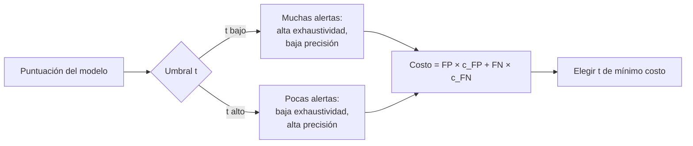

# B17-C12 — Evaluación de modelos: precisión, exhaustividad y falsos positivos

<!-- nav:top -->
[🏠 Programa](../../../../README.md) · [📚 Bloque B17](../../../tronco-comun/B17-aprendizaje-automatico-cientifico.md) · [← Anterior: B17-C11 — Redes de segmentación semántica de imágenes](../B17-C11-redes-de-segmentacion-semantica-de-imagenes/CLASE.md) · [Siguiente: B18-C01 — Procesos, hilos y concurrencia →](../../B18/B18-C01-procesos-hilos-y-concurrencia/CLASE.md)
<!-- /nav -->

## 1. Ubicación, nivel y alcance

Duodécima y última clase del bloque B17. En C02 usaste la exactitud; en C05 y C10 viste que, cuando lo buscado es raro, la exactitud no sirve. Aquí construyes el conjunto de métricas con que se juzga un **sistema de alertas**: la matriz de confusión, precisión, exhaustividad, F, las curvas ROC y de precisión–exhaustividad, y la elección de un umbral según el costo. Nivel N2/N3. Usas probabilidad (B12-C01, B12-C03), clasificación (C02) y detección de anomalías (C05). No verás calibración de probabilidades ni evaluación multietiqueta en profundidad.

## 2. Por qué esta clase existe

Un modelo marca candidatos a planeta, y cada alerta cuesta horas de revisión. Si el modelo acierta el 99 % en una muestra donde el 99 % son negativos, no dice nada útil. Lo que importa es cuántas alertas son reales, cuántos reales se pierden y cuánto cuesta cada tipo de error. Un catálogo que trata los falsos positivos solo para casos particulares (biofirmas, tránsitos) deja sin respuesta general la pregunta que todo sistema de alertas debe responder.

La decisión central: **¿con qué métricas juzgo un detector de eventos raros, y qué umbral elijo para que el costo de revisar falsos positivos y el de perder eventos reales queden equilibrados?**

## 3. Lo que podrás hacer al terminar

1. Construir la matriz de confusión y calcular precisión, exhaustividad y F1 a mano.
2. Calcular la precisión de un sistema de alertas a partir de la exhaustividad, la tasa de falsos positivos y la prevalencia.
3. Distinguir ROC y precisión–exhaustividad, y explicar por qué la segunda informa mejor con clases raras.
4. Elegir un umbral minimizando un costo esperado.
5. Usar F con `β` para dar más peso a la exhaustividad o a la precisión.
6. Redactar un informe de evaluación que no dependa de la exactitud.

La evidencia es el **informe de evaluación** del ejercicio 12 (sección 20).

## 4. Con qué llegas y cómo comprobarlo

1. Si 1 % de los objetos son positivos y un modelo responde siempre «negativo», ¿qué exactitud tiene?
2. ¿Qué probabilidad hay de que una normal estándar supere 2? (`1 − Φ(2) = 0,0228`.)
3. Si hay 5352 alertas y el 18 % son reales, ¿cuántas son reales?
4. ¿Cuál es la media armónica de 0,75 y 0,6?
5. ¿Qué es un umbral de decisión?

<details>
<summary>Ver respuestas</summary>

1. 0,99. 2. 0,0228. 3. ≈ 963. 4. `2 × 0,75 × 0,6/1,35 = 0,667`. 5. El valor de la puntuación por encima del cual se emite la alerta.
</details>

Con cuatro o cinco aciertos, sigue; con tres o menos, repasa C02 y C05.

## 5. Un caso real: ordenar planetas por encima de falsos positivos

Para la misión Kepler, un equipo entrenó una red convolucional que clasifica señales candidatas como planetas o falsos positivos astrofísicos o instrumentales; según el resumen, la red ordena una señal planetaria plausible por encima de un falso positivo en el 98,8 % de los casos del conjunto de prueba, y con ella validaron dos planetas nuevos (S1). Esa cifra es de **ordenamiento**, el equivalente de un área bajo la curva ROC: no dice cuántas alertas son reales a un umbral dado, que depende además de cuántos candidatos son planetas. Esta clase te da las herramientas para pasar de una cifra de ordenamiento a una decisión operativa. No se replica ese trabajo.

## 6. Vocabulario

La **matriz de confusión** cuenta aciertos y errores: **verdaderos positivos** (TP), **falsos positivos** (FP), **verdaderos negativos** (TN) y **falsos negativos** (FN) (S2). La **precisión** es `TP/(TP + FP)`: de las alertas, cuántas son reales. La **exhaustividad** (*recall*, sensibilidad, tasa de verdaderos positivos) es `TP/(TP + FN)`: de los reales, cuántos se encontraron (S2). La **tasa de falsos positivos** es `FP/(FP + TN)`. La **medida F** con parámetro `β` es `(1 + β²) P R/(β² P + R)`; `F1` es la media armónica de precisión y exhaustividad; `β > 1` pesa más la exhaustividad (S2). La **prevalencia** `π` es la fracción de positivos. La **curva ROC** grafica exhaustividad contra tasa de falsos positivos al variar el umbral; su área es el AUC. La **curva de precisión–exhaustividad** grafica precisión contra exhaustividad, y la **precisión promedio** resume su área (S2). Un **costo esperado** pondera cada tipo de error por su costo.

## 7. Modelo mental: el umbral reparte errores



*Descripción textual:* con un umbral bajo se emiten muchas alertas, con alta exhaustividad y baja precisión; con uno alto, pocas, con baja exhaustividad y alta precisión. Ambos extremos se convierten en un costo (falsos positivos por su costo más falsos negativos por el suyo), y se elige el umbral de costo mínimo.

Una analogía: un detector de humo. Si es muy sensible, suena al tostar pan (falsos positivos); si es poco sensible, no suena en un incendio lento (falsos negativos). **Límite:** el detector de humo tiene dos tipos de error con un costo muy desigual y se decide una vez; en un catálogo, los costos varían con el uso y se revisan.

## 8. La explicación, paso a paso

### 8.1 La matriz de confusión a mano

Con 8 casos (3 negativos y 5 positivos) y las predicciones del ejemplo de la documentación: `TN = 2`, `FP = 1`, `FN = 2`, `TP = 3` (S2). Precisión `3/(3 + 1) = 0,75`; exhaustividad `3/(3 + 2) = 0,6`; `F1 = 2(0,75)(0,6)/(1,35) = 0,667`. El laboratorio reproduce esos valores con la biblioteca. Con `β = 2` (más peso a la exhaustividad): `F₂ = 5(0,75)(0,6)/(4 × 0,75 + 0,6) = 2,25/3,6 = 0,625`; con `β = 0,5`: `F₀,₅ = 1,25 × 0,45/(0,25 × 0,75 + 0,6) = 0,714`.

### 8.2 Por qué la prevalencia manda

Por la regla de Bayes, la precisión depende de la prevalencia: `precisión = π·TPR/(π·TPR + (1 − π)·FPR)`. Un detector con `d = 2` (negativos `N(0,1)`, positivos `N(2,1)`) y umbral 2 tiene `TPR = 0,50` y `FPR = 0,0228`. Con prevalencia 50 %, la precisión sería `0,5/(0,5 + 0,0228) = 0,956`. Con prevalencia 1 %: `0,005/(0,005 + 0,99 × 0,0228) = 0,181`. El **mismo detector** produce alertas confiables en una muestra equilibrada y mayoritariamente falsas en una realista.

### 8.3 La exactitud no sirve

Con prevalencia 1 %, el modelo «siempre negativo» tiene exactitud 0,99, exhaustividad 0 y no encuentra nada. La exactitud mezcla los negativos abundantes con los positivos escasos; la precisión y la exhaustividad ignoran los verdaderos negativos y miran lo que importa.

### 8.4 ROC frente a precisión–exhaustividad

El AUC ROC del detector es `Φ(d/√2) = Φ(1,414) = 0,921` (medido 0,922): parece excelente. Pero la precisión promedio, que depende de la prevalencia, es 0,271 (el azar daría 0,01). La curva ROC no cambia con la prevalencia, porque usa tasas dentro de cada clase; la de precisión–exhaustividad sí, y por eso refleja la carga de falsos positivos. Con clases raras, mira ambas (S2). La cifra de 98,8 % de Kepler (S1) se parece a un AUC; faltaría la precisión a un umbral dado.

### 8.5 Cuántas alertas y de qué calidad

En 200 000 objetos con 1 % de positivos (≈ 2000 positivos), los resultados medidos y teóricos son:

- Umbral 1: 33 003 alertas; exhaustividad 0,841; precisión 0,051.
- Umbral 2: 5352 alertas; exhaustividad 0,491; precisión 0,184.
- Umbral 3: 546 alertas; exhaustividad 0,148; precisión 0,546.

Revisar a 10 minutos por alerta es 5500 h con el umbral 1, 892 h con el 2 y 91 h con el 3. Hay una compensación inevitable entre el trabajo de revisión y la fracción de reales que se encuentran.

### 8.6 Elegir el umbral por costo

Si cada falso positivo cuesta 1 unidad y cada real perdido 50, el costo es `FP + 50 FN`. Recorriendo umbrales de 0 a 4, el mínimo se alcanzó en 1,5, con costo 43 616. Con el umbral 3 el costo sería unas 2 veces mayor (≈ 8,6 × 10⁴) porque se pierde el 85 % de los reales. El umbral óptimo depende de la razón de costos, no de la métrica elegida; si la razón cambia, el umbral cambia.

### 8.7 Intervalos de incertidumbre

Una exhaustividad medida sobre 50 positivos tiene error estándar `√(0,5 × 0,5/50) = 0,07`. Informa siempre el número de positivos y un intervalo. Con pocas muestras raras, la comparación entre modelos puede ser ruido.

## 9. Magnitudes, símbolos y unidades

| Símbolo | Qué es | Unidad | Nota |
|---|---|---|---|
| TP, FP, TN, FN | recuentos de la matriz de confusión | casos | — |
| `P` | precisión `TP/(TP+FP)` | adimensional | 0 a 1 |
| `R` | exhaustividad `TP/(TP+FN)` | adimensional | = TPR |
| FPR | tasa de falsos positivos | adimensional | `FP/(FP+TN)` |
| `π` | prevalencia | adimensional | 0,01 |
| `F_β` | medida F | adimensional | `β = 1, 2, 0,5` |
| `t` | umbral de decisión | unidades de la puntuación | — |
| `c_FP`, `c_FN` | costos | h de revisión u otra | 1 y 50 |

## 10. Convenciones y referencias

Los positivos son la clase de interés (candidato real). Las alertas se emiten cuando la puntuación supera el umbral. Datos **sintéticos**: negativos `N(0,1)`, positivos `N(2,1)`, prevalencia 1 %, 200 000 objetos, semilla fija. Los costos son ilustrativos, no de una misión.

## 11. De dónde sale lo que afirmamos

| ID | Fuente | Localizador | Respalda | Estado |
|---|---|---|---|---|
| S1 | Shallue, C. J. y Vanderburg, A., arXiv:1712.05044 | https://arxiv.org/abs/1712.05044 | Red convolucional que separa planetas de falsos positivos en datos de Kepler; ordena un planeta plausible sobre un falso positivo en el 98,8 % de los casos de prueba | Resumen consultado el 2026-11-05 |
| S2 | scikit-learn, «Metrics and scoring: quantifying the quality of predictions» | https://scikit-learn.org/stable/modules/model_evaluation.html | Matriz de confusión (ejemplo `(2, 1, 2, 3)`); precisión, exhaustividad, F-beta; precisión promedio (ejemplo 0,83); curva de precisión–exhaustividad; ROC y AUC | Página consultada el 2026-11-05 (primeros 100 000 de 174 676 caracteres; mutable) |

Límites: de S1 solo se leyó el resumen. La fórmula de la precisión en función de la prevalencia (regla de Bayes), el AUC de dos normales `Φ(d/√2)` y el costo esperado son resultados matemáticos comprobados en el laboratorio.

## 12. Cómo ver los resultados

| Umbral | Alertas | Exhaustividad | Tasa de FP | Precisión (medida / teoría) |
|---|---|---|---|---|
| 1 | 33 003 | 0,841 | 0,1582 | 0,051 / 0,051 |
| 2 | 5352 | 0,491 | 0,0221 | 0,184 / 0,182 |
| 3 | 546 | 0,148 | 0,0013 | 0,546 / 0,543 |

AUC ROC 0,9223 (teoría 0,9214); precisión promedio 0,271; umbral de mínimo costo 1,50 (costo 43 616). Grafica las dos curvas (ROC y precisión–exhaustividad) en paneles separados con trazos distintos y describe en texto que la primera se acerca a la esquina superior izquierda y la segunda cae pronto.

## 13. Ejemplo trabajado: decidir si el sistema de alertas es utilizable

**Caso.** El detector sintético opera con umbral 2 sobre 200 000 candidatos con 1 % de reales. Revisar una alerta toma 10 minutos; hay 300 horas de revisión disponibles.

**Paso 1 · alertas.** Con umbral 2 hay 5352 alertas: 892 h. Excede la capacidad.

**Paso 2 · umbral 3.** 546 alertas (91 h), precisión 0,546, exhaustividad 0,148.

**Paso 3 · puntos intermedios.** Entre 2 y 3 hay umbrales con unas 1800 alertas (300 h) y exhaustividad intermedia: se elegiría un umbral de ≈ 2,5 por capacidad.

**Paso 4 · costo.** Si perder un real cuesta 50 veces un falso positivo, el umbral de costo mínimo (1,5) exige más revisión de la que se puede hacer: hay que ampliar capacidad o aceptar perder más reales.

**Paso 5 · incertidumbre y lectura.** Con 2000 positivos, la exhaustividad tiene error estándar de ±0,01; el costo depende de supuestos de costo y prevalencia. En una muestra real con menos positivos, las cifras serían más inciertas. Se informa la decisión con sus supuestos.

## 14. Comparación de métricas

**Exactitud**: resume bien con clases equilibradas y mal con raras. **ROC/AUC**: independiente de la prevalencia, mide ordenamiento. **Precisión–exhaustividad**: depende de la prevalencia y refleja la carga de alertas. **F1**: un solo número que supone que precisión y exhaustividad pesan igual; si no, F con `β`. **Costo esperado**: el que lleva a una decisión; exige conocer costos. **Exactitud equilibrada** (promedio de la exhaustividad por clase): útil en multiclase desiguales (S2). Combínalas, y comunica siempre la prevalencia.

## 15. Práctica guiada

**Ejercicio 1 · con los pasos indicados.** Con `TN = 2`, `FP = 1`, `FN = 2`, `TP = 3`, calcula precisión, exhaustividad y F1. *Pasos:* sección 8.1.

<details><summary>Solución comentada</summary>

`P = 3/4 = 0,75`; `R = 3/5 = 0,6`; `F1 = 0,667`. Coincide con la biblioteca (S2).
</details>

**Ejercicio 2 · con una pista.** Detector con `TPR = 0,50` y `FPR = 0,0228`: precisión con prevalencia 1 %. *Pista:* sección 8.2.

<details><summary>Solución comentada</summary>

`0,005/(0,005 + 0,99 × 0,0228) = 0,005/0,02757 = 0,181`. Con 1 % de positivos, solo uno de cada cinco alertas es real.
</details>

**Ejercicio 3 · casi autónomo.** ¿Qué exactitud, precisión y exhaustividad tiene «siempre negativo» con prevalencia 1 %?

<details><summary>Solución comentada</summary>

Exactitud 0,99; exhaustividad 0; precisión indefinida (no hay alertas; la biblioteca la fija en 0 por defecto, S2).
</details>

## 16. Práctica autónoma, transferencia e integrador

**Ejercicio 4.** Calcula `F₂` y `F₀,₅` para `P = 0,75` y `R = 0,6`. ¿Cuál es mayor y por qué?

<details><summary>Solución comentada</summary>

`F₂ = 0,625`; `F₀,₅ = 0,714`. `F₀,₅` es mayor porque pesa más la precisión, que es la mayor de las dos.
</details>

**Ejercicio 5.** El AUC ROC es 0,92 y la precisión promedio 0,27. ¿Por qué tan distintos?

<details><summary>Solución comentada</summary>

El AUC no depende de la prevalencia; la precisión promedio sí, y con 1 % de positivos incluso un buen ordenamiento da muchas alertas falsas (S2). Ambas dicen cosas distintas.
</details>

**Ejercicio 6.** Verifica que `alertas × precisión ≈ exhaustividad × positivos` para el umbral 3 (546 alertas, precisión 0,546, exhaustividad 0,148, 2008 positivos).

<details><summary>Solución comentada</summary>

`546 × 0,546 = 298`; `0,148 × 2008 = 297`. Ambos cuentan los verdaderos positivos.
</details>

**Ejercicio 7.** A 10 minutos por alerta, ¿cuántas horas necesitan 5352 y 546 alertas?

<details><summary>Solución comentada</summary>

`5352 × 10/60 = 892 h`; `546 × 10/60 = 91 h`. La ganancia de tiempo se paga con exhaustividad: de 0,491 a 0,148.
</details>

**Ejercicio 8.** Costo de un umbral con 248 FP y 1710 FN, con costos 1 y 50.

<details><summary>Solución comentada</summary>

`248 + 50 × 1710 = 85 748`, casi el doble del mínimo (43 616). Perder reales cuesta mucho más que revisar de más.
</details>

**Ejercicio 9 · transferencia.** El estudio de Kepler informa 98,8 % en una medida de ordenamiento. ¿Qué dato adicional pedirías para decidir cuántas alertas revisar?

<details><summary>Solución comentada</summary>

La prevalencia de planetas en los candidatos, y la precisión y exhaustividad a umbrales concretos (o la curva de precisión–exhaustividad). El ordenamiento no da el número de falsos positivos (sección 8.4).
</details>

**Ejercicio 10 · transferencia.** Solo tienes capacidad para revisar 500 alertas. ¿Qué estrategia usas y qué precisión esperas, con los datos del laboratorio?

<details><summary>Solución comentada</summary>

Revisar las 500 con mayor puntuación (precisión en K). Ronda la del umbral 3 (546 alertas: 0,546), algo mayor por ser las de puntuación más alta: ≈ 0,55. Exhaustividad ≈ 0,14.
</details>

**Ejercicio 11 · transferencia.** Tres clases con exhaustividades 0,9; 0,5; 0,1 y soportes 900, 90, 10. Calcula el promedio ponderado por soporte y el macro.

<details><summary>Solución comentada</summary>

Ponderado: `(0,9 × 900 + 0,5 × 90 + 0,1 × 10)/1000 = 0,856`. Macro: `(0,9 + 0,5 + 0,1)/3 = 0,5`. El macro revela que la clase rara casi no se detecta (S2).
</details>

**Ejercicio 12 · integrador.** Redacta el **informe de evaluación** de un sistema de alertas: datos y prevalencia, matriz de confusión a un umbral, precisión, exhaustividad y F con su incertidumbre, ROC y precisión–exhaustividad, costo esperado y umbral elegido con sus supuestos, carga de revisión y una línea base «siempre negativo».

<details><summary>Solución modelo</summary>

Debe incluir una tabla como la de la sección 12, la fórmula de la precisión con prevalencia, el cálculo del costo por umbral, la capacidad de revisión y los supuestos de costo. Acepta cualquier informe coherente.
</details>

## 17. Laboratorio: métricas contra la teoría

El script [metricas_de_alertas.py](metricas_de_alertas.py) reproduce los casos de referencia de la documentación de scikit-learn, compara a mano precisión/exhaustividad/F1, verifica exhaustividad, tasa de falsos positivos y precisión contra la teoría de dos normales, y busca el umbral de costo mínimo.

**Datos:** sintéticos. **Predice antes de ejecutar:** ¿qué precisión tendrá el umbral 2? **Ejecución del 2026-11-05 (Python 3.12.9, NumPy 2.4.4, scikit-learn 1.8.0):**

```text
Matriz de confusión (tn, fp, fn, tp) = (2, 1, 2, 3); precisión 0.7500, exhaustividad 0.6000, F1 0.6667
Precisión promedio del caso de referencia: 0.8333 (documentación: 0,83)
Muestra: 200000 objetos, 2008 positivos (1.00 %)
  umbral 1: exhaustividad 0.841 (teoría 0.841) | tasa de falsos positivos 0.1582 (teoría 0.1587) | precisión 0.051 (teoría 0.051) | alertas 33003
  umbral 2: exhaustividad 0.491 (teoría 0.500) | tasa de falsos positivos 0.0221 (teoría 0.0228) | precisión 0.184 (teoría 0.182) | alertas 5352
  umbral 3: exhaustividad 0.148 (teoría 0.159) | tasa de falsos positivos 0.0013 (teoría 0.0013) | precisión 0.546 (teoría 0.543) | alertas 546
AUC ROC 0.9223 (teoría 0.9214) | precisión promedio 0.2711 (azar = prevalencia 0.01)
Umbral de mínimo costo (FP = 1, FN = 50): 1.50, costo 43616
Pruebas superadas.
```

```bash
python programa/clases/B17/B17-C12-evaluacion-de-modelos-precision-exhaustividad-y-falsos-positivos/metricas_de_alertas.py
```

**Límites:** puntuaciones normales con la misma varianza; costos inventados; sin calibración de probabilidades. Con solo ≈ 2000 positivos, la exhaustividad del umbral 3 (0,148) difiere de la teoría (0,159) en el rango del azar, y la tolerancia del script (0,03) lo refleja.

## 18. Errores frecuentes y cómo corregirlos

**Usar exactitud con clases raras.** Ejercicio 3.

**Ignorar la prevalencia al reportar la precisión.** Ejercicio 2.

**Confiar en el AUC sin mirar precisión–exhaustividad.** Ejercicio 5.

**Elegir el umbral sin costos.** Ejercicio 8.

**No informar incertidumbre ni el número de positivos.** Sección 8.7.

## 19. Cómo sabrás que vas bien

Tras 8.1: ¿calculas precisión, exhaustividad y F1 desde una tabla? Si no, ejercicio 1. Tras 8.2: ¿calculas la precisión con otra prevalencia? Si no, ejercicio 2. Tras el laboratorio: ¿por qué un AUC de 0,92 no basta? Al final: ¿qué costo relativo de errores usarías en tu aplicación y por qué?

## 20. Qué entregas y cómo se evalúa

El producto es tu **informe de evaluación** (ejercicio 12).

| Criterio | Inicial | En desarrollo | Logrado | Destacado |
|---|---|---|---|---|
| Métricas | Exactitud | Precisión y exhaustividad | Matriz, P, R, F, ROC y PR | Maneja `F_β` y macro/ponderado |
| Prevalencia | Ignorada | Mencionada | Precisión recalculada con ella | Muestra el efecto de cambiarla |
| Umbral | Arbitrario | Por F1 | Por costo con supuestos | Analiza sensibilidad a los costos |
| Incertidumbre | Ninguna | Cifras sueltas | Con número de positivos e intervalo | Compara con una línea base |

**Condiciones críticas:** declarar datos sintéticos y costos ilustrativos; no reportar solo la exactitud; informar la prevalencia.

## 21. Ética, seguridad y límites

Un sistema de alertas con muchos falsos positivos cansa a quienes lo revisan y acaba ignorado; uno con muchos falsos negativos oculta eventos importantes. Elegir un umbral es una decisión sobre quién asume qué riesgo: documéntala. En aplicaciones críticas (seguridad de una misión, salud de tripulación) no sustituye la revisión humana. Accesibilidad: tablas y descripciones textuales de las curvas. Material educativo.

## 22. Para cerrar y seguir

La precisión, la exhaustividad y la tasa de falsos positivos se calculan desde la matriz de confusión; la precisión depende de la prevalencia, el AUC mide ordenamiento y el umbral se elige por costo. Con eventos raros, la exactitud engaña. Con esto cierras el bloque B17: construyes características (C01), entrenas y validas (C02, C09, C10), incorporas física (C03), sustituyes simuladores (C04), detectas y agrupas (C05, C06), vigilas el cambio (C07), interpretas (C08), segmentas (C11) y evalúas (C12). Queda abierta una pregunta: ¿cómo se mantiene calibrado un umbral cuando la prevalencia cambia con el tiempo?

**Glosario español–inglés.** matriz de confusión · *confusion matrix*; precisión · *precision*; exhaustividad · *recall*; falso positivo · *false positive*; falso negativo · *false negative*; umbral · *threshold*; prevalencia · *prevalence*; costo esperado · *expected cost*; precisión promedio · *average precision*.

**Continuidad.** Continúas en los bloques de análisis de datos y en los de aplicación (observación terrestre, ciencia de datos de misión), que reutilizan estas métricas.

**Referencias:** ver sección 11. De S1 solo se leyó el resumen; S2 es documentación mutable.

<!-- nav:bottom -->
---

[← Anterior: B17-C11 — Redes de segmentación semántica de imágenes](../B17-C11-redes-de-segmentacion-semantica-de-imagenes/CLASE.md) · [📚 Bloque B17](../../../tronco-comun/B17-aprendizaje-automatico-cientifico.md) · [Siguiente: B18-C01 — Procesos, hilos y concurrencia →](../../B18/B18-C01-procesos-hilos-y-concurrencia/CLASE.md)
<!-- /nav -->
