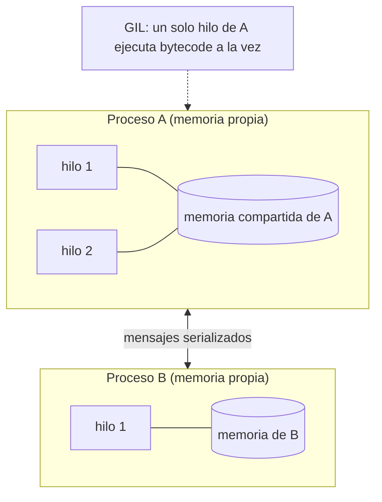

# B18-C01 — Procesos, hilos y concurrencia

<!-- nav:top -->
<!-- /nav -->

## 1. Ubicación, nivel y alcance

Primera clase del bloque B18, «Computación de alto rendimiento». En [B14-C13](../../../tronco-comun/B14-computacion-cientifica-y-ciencia-abierta.md) vas a encontrar el paralelismo como idea general; aquí le das un **modelo de ejecución**: qué es exactamente un proceso, qué es un hilo, qué impone el intérprete de Python y por qué una misma tarea puede acelerarse, quedarse igual o empeorar según cómo la repartas. Nivel N2 → N3.

Verás procesos, hilos, concurrencia frente a paralelismo, el bloqueo global del intérprete (GIL), tareas limitadas por CPU y por entrada/salida, condiciones de carrera y cerrojos, y el coste de arrancar procesos. No verás paso de mensajes entre máquinas (C02), memoria y caché (C03), perfilado (C04) ni leyes de escalado (C05). Tampoco cubre GPU ni el soporte experimental de Python sin GIL (no consultado).

## 2. Por qué esta clase existe

Tienes ocho órbitas simuladas que propagar y un portátil con varios núcleos. La tentación es «lanzar ocho hilos y listo». La pregunta motivadora es: **¿qué unidad de ejecución uso para que el trabajo se reparta de verdad entre los núcleos, y cómo compruebo que lo hizo?**

La decisión central es: **¿mi tarea espera (entrada/salida) o calcula (CPU), y por tanto necesito hilos, procesos o ninguno?** Quien la responde antes de programar evita el error más caro de esta clase: pagar la complejidad de la concurrencia y no ganar tiempo.

## 3. Lo que podrás hacer al terminar

1. Distinguir proceso e hilo por lo que comparten, y concurrencia de paralelismo.
2. Explicar con la definición oficial qué hace el GIL y en qué casos se libera.
3. Clasificar una tarea como limitada por CPU o por E/S y elegir hilos o procesos con ese criterio.
4. Reconocer y corregir una condición de carrera con un cerrojo.
5. Medir un lote en serie, con hilos y con procesos, y comprobar que los resultados son idénticos.
6. Explicar un resultado de aceleración menor que la esperada en términos de arranque, serialización y carga de la máquina.

La evidencia es la **comparación medida y comentada** del ejercicio 12 (sección 20).

## 4. Con qué llegas y cómo comprobarlo

Necesitas B14-C01 (separar núcleo y pruebas) y B14-C02 (arreglos). Cinco preguntas:

1. Si una tarea dura 3 s y tienes 6 tareas, ¿cuánto dura hacerlas una tras otra?
2. ¿Qué significa que una función sea «determinista»?
3. ¿Qué es un bucle `for` que acumula con `total += x`?
4. ¿Por qué un programa científico necesita una prueba contra un caso conocido?
5. ¿Qué diferencia hay entre tiempo de pared y tiempo de CPU?

<details>
<summary>Ver respuestas</summary>

1. 18 s. 2. Que con las mismas entradas da siempre la misma salida. 3. Una operación de leer, sumar y escribir sobre una variable. 4. Para detectar errores que el programa no avisa por sí solo. 5. El de pared es el que marca un reloj en la pared (incluye esperas); el de CPU es el que la CPU dedicó a tu código.
</details>

Con cuatro o cinco aciertos, sigue; con tres o menos, repasa B14-C01.

## 5. Un caso real: lo que la documentación de Python dice sobre el GIL

La documentación oficial de Python 3.12 (S1) define el bloqueo global del intérprete como el mecanismo que usa CPython para asegurar que **solo un hilo ejecuta *bytecode* de Python a la vez**. Añade que se libera siempre durante las operaciones de entrada/salida y que algunos módulos de extensión (estándar o de terceros) lo liberan en cálculos intensivos, como compresión o *hash*; subraya que son «algunos», no todos. La página de `threading` (S2) concluye de ahí que, para aprovechar varios núcleos con código Python, conviene `multiprocessing` o `ProcessPoolExecutor`, y que los hilos siguen siendo adecuados para varias tareas de E/S a la vez. La de `multiprocessing` (S3) explica que usa subprocesos en lugar de hilos y por eso esquiva el GIL.

Nuestro **ejemplo conductor** es un lote de **ocho órbitas circulares simuladas** en unidades canónicas (la constante gravitacional por la masa central vale 1, el radio 1, la velocidad 1 y el periodo 2π), cada una propagada con el integrador *leapfrog* en Python puro durante 600 000 pasos. Sabemos la respuesta exacta —tras un periodo, la posición vuelve a `(1, 0)`—, así que podremos comprobar que ninguna forma de repartir el trabajo corrompe el resultado.

## 6. Vocabulario

Un **proceso** es un programa en ejecución con su propio espacio de memoria. Un **hilo** es una línea de ejecución dentro de un proceso; los hilos de un mismo proceso **comparten** su memoria. La **concurrencia** es gestionar varias tareas cuyo progreso se entrelaza en el tiempo (aunque haya un solo núcleo); el **paralelismo** es ejecutar varias a la vez en núcleos distintos. El **GIL** es el bloqueo descrito arriba. Una tarea **limitada por CPU** gasta su tiempo calculando; una **limitada por E/S** lo gasta esperando (disco, red, espera simulada). Una **condición de carrera** es un resultado que depende del orden, no controlado, en que varios hilos tocan un dato compartido. Un **cerrojo** (*lock*) deja pasar a un solo hilo a la vez por un trozo de código. La **serialización** (*pickling*) convierte un objeto en bytes para enviarlo a otro proceso. El **tiempo de pared** es el que mide un reloj externo.

## 7. Modelo mental: casas y cocinas



*Descripción textual:* hay dos procesos, cada uno con su memoria. El proceso A tiene dos hilos que ven la misma memoria; el GIL permite que solo uno de ellos ejecute *bytecode* de Python en cada instante. El proceso B tiene un hilo y su memoria no es visible para A: solo se comunican enviándose mensajes serializados.

**Analogía y su límite.** Un proceso es una casa con su cocina; los hilos son cocineros que comparten esa cocina y, con el GIL, hay un único fogón de Python. Dos casas tienen dos cocinas y dos fogones, pero para pasarse un plato hay que empaquetarlo y llevarlo. Límite: en una cocina real un cocinero que espera el horno deja el fogón libre; en Python eso ocurre solo cuando la espera es de E/S, que es justo el caso en que los hilos sí ayudan.

## 8. La explicación, paso a paso

### 8.1 Qué comparten procesos e hilos

Dos hilos del mismo proceso ven las mismas variables: es cómodo (no hay que copiar nada) y peligroso (pueden pisarse). Dos procesos no ven nada del otro; todo lo que cruza se serializa y se copia. Por eso un proceso tarda más en arrancar y en recibir datos, y por eso es más seguro.

### 8.2 Concurrencia no es paralelismo

Con un solo núcleo puedes tener concurrencia (la CPU alterna entre tareas) sin paralelismo. Con hilos de CPython sobre código Python puro tienes concurrencia, pero el paralelismo está limitado por el GIL (S1). Con varios procesos tienes paralelismo real si hay núcleos libres. La palabra importa porque «concurrente» promete orden confuso, no velocidad.

### 8.3 El GIL, con precisión

El GIL no impide que haya muchos hilos; impide que dos ejecuten *bytecode* de Python simultáneamente (S1). Por eso un lote de tareas de cálculo en Python puro repartido en hilos tarda lo mismo que en serie, o algo más por el coste de conmutar. Cuando un hilo hace E/S, el lock se libera y otro avanza. Algunos módulos de extensión lo liberan en su cálculo intensivo (S1), de modo que hilos + biblioteca compilada **a veces** sí escala: hay que medirlo, no suponerlo.

### 8.4 Tareas de CPU y tareas de E/S

El criterio práctico: si la CPU está ocupada, es de CPU; si el programa está esperando algo externo, es de E/S. Una propagación orbital en Python puro es de CPU. Descargar cien archivos de efemérides, leer de un puerto serie o, en el laboratorio, `time.sleep`, es de E/S. A las segundas los hilos les sirven (S2); a las primeras, los procesos (S2, S3).

### 8.5 Condiciones de carrera

Ejecutar `cuenta += 1` en realidad son tres pasos: leer `cuenta`, sumar 1, escribir. Si dos hilos leen 0 antes de que cualquiera escriba, ambos escriben 1 y se pierde un incremento. El resultado depende del azar del planificador: puede salir bien mil veces y fallar la mil uno, lo que hace estas fallas difíciles de reproducir. La defensa es un cerrojo (`with cerrojo: cuenta += 1`) o, mejor, **no compartir** datos mutables: que cada hilo devuelva su resultado y combinarlos al final.

### 8.6 El coste de los procesos

Un proceso nuevo debe arrancar, y los argumentos y resultados se serializan. En Windows y macOS el método de arranque por defecto es `spawn` (S3): se lanza un intérprete nuevo que importa tu módulo principal, por lo que el código de arranque debe protegerse con `if __name__ == "__main__":`; sin esa guarda, el código de nivel superior se ejecutaría de nuevo en cada hijo (S3). Una tarea debe durar bastante más que ese arranque para compensar.

## 9. Magnitudes, símbolos y unidades

| Símbolo | Qué es | Unidad | Nota |
|---|---|---|---|
| `T_s` | tiempo de pared del lote en serie | s | medido con `time.perf_counter` |
| `T_h`, `T_p` | tiempo con hilos / con procesos | s | ídem |
| `S` | aceleración = `T_s / T_X` | adimensional | `S > 1` es ganancia |
| `E` | eficiencia = `S / N` | adimensional | `N` = trabajadores |
| `pasos`, `dt` | pasos del integrador y paso de tiempo | adimensional (unidades canónicas) | `dt = 2π / pasos` |
| `err` | distancia de la posición final a `(1, 0)` | adimensional | tolerancia 1e-5 |

## 10. Convenciones y referencias

Unidades canónicas: GM = 1, radio de la órbita = 1, por lo que la velocidad circular vale 1 y el periodo 2π. Los datos son **simulados**: no representan un satélite real. Los tiempos son de pared, tomados con `time.perf_counter`, en una máquina con CPU i7-8550U de 4 núcleos físicos y 8 lógicos, Windows 11, con **otras tareas en marcha** durante la medición (la carga de CPU era del 100 % al consultar el sistema). Eso hace los tiempos ruidosos; las conclusiones se basan en las razones y en la corrección de los resultados.

## 11. De dónde sale lo que afirmamos

| ID | Fuente | Localizador | Respalda | Estado |
|---|---|---|---|---|
| S1 | Python Software Foundation, *Python 3.12 — Glosario*, entrada «global interpreter lock» | https://docs.python.org/3.12/glossary.html | Definición del GIL; se libera en E/S; algunos módulos de extensión lo liberan | Consultada el 2026-11-05 (mutable) |
| S2 | Python Software Foundation, *threading — Paralelismo basado en hilos* (3.12) | https://docs.python.org/3.12/library/threading.html | Recomendación de procesos para CPU y de hilos para E/S | Consultada el 2026-11-05; leída a través de un resumen automático de la página, no íntegra |
| S3 | Python Software Foundation, *multiprocessing* (3.12) | https://docs.python.org/3.12/library/multiprocessing.html | Subprocesos que esquivan el GIL; `spawn` por defecto en Windows/macOS; guarda `__main__` | Consultada el 2026-11-05; se leyeron los primeros 100 000 de 155 262 caracteres |

Límites: la descripción de la condición de carrera (sección 8.5) y la comparación hilos/procesos son conocimiento general que el laboratorio ilustra pero no demuestra en ausencia de fallo; no se consultó una fuente para ellas. No se trata el soporte de Python sin GIL.

## 12. Cómo ver la decisión

Tabla de decisión, versión accesible del modelo mental.

| Tipo de tarea | Hilos | Procesos | Comentario |
|---|---|---|---|
| CPU, Python puro | sin ganancia (GIL) | sí, si la tarea dura más que el arranque | caso de la propagación orbital |
| E/S (red, disco, espera) | sí | posible, más caro | los hilos se solapan al liberar el GIL |
| CPU en extensión que libera el GIL | puede ayudar | sí | hay que medir |
| Estado mutable compartido | exige cerrojos | sin carrera, pero copia datos | prefiere no compartir |

## 13. Ejemplo trabajado: ocho órbitas

1. **Corrección primero.** `propagar()` hace 600 000 pasos con `dt = 2π/600 000`. Tras una vuelta completa la posición debe volver a `(1, 0)`. El script mide `err = 2,31 × 10⁻¹⁰`, muy por debajo de la tolerancia `10⁻⁵`.
2. **Tiempo en serie.** 8 tareas: `T_s = 7,80 s`, es decir, unos `0,975 s` por tarea.
3. **Hilos.** `T_h = 8,51 s`: `S = 0,92`. Es peor que la serie, como predice el GIL (sección 8.3): ocho hilos de Python puro no corren a la vez, y conmutar cuesta.
4. **Procesos.** `T_p = 6,79 s`: `S = 1,15`, eficiencia `1,15/8 ≈ 0,14`. Mejora, pero muy lejos de lo ideal: en 4 núcleos físicos, 8 tareas deberían tardar unas dos rondas de 0,975 s ≈ 1,95 s más el arranque.
5. **Qué explica la distancia.** (a) Arranque con `spawn` de ocho intérpretes; (b) serialización, mínima aquí; (c) los 4 núcleos físicos compartidos con otros procesos de la máquina en ese momento. No se separó cuánto aporta cada causa: es una hipótesis que el perfilado (C04) y los experimentos de escalado (C05) permitirían cuantificar.
6. **Comprobación.** Los tres modos devuelven resultados **idénticos** (comparación exacta de tuplas de números en coma flotante), así que la diferencia es solo de tiempo.
7. **Incertidumbre.** Cada tiempo es una sola medición en una máquina ruidosa. Una ejecución preliminar con una tarea tres veces más corta (200 000 pasos) dio serie 2,51 s, hilos 3,05 s y procesos 5,38 s: ahí el arranque domina y los procesos **empeoran**. La moraleja numérica es que el mismo código cambia de signo según la duración de la tarea.

## 14. Comparación: serie, hilos y procesos

La serie es la referencia para probar y a menudo la mejor para tareas cortas. Los hilos solapan esperas y comparten memoria sin copiar, pero no aceleran Python puro de CPU y obligan a cuidar las carreras. Los procesos dan paralelismo real y aislamiento a cambio de arranque, serialización y memoria duplicada. Una cuarta vía es mover el cálculo a código vectorizado o compilado (B14-C02, C03 de este bloque), que a menudo elimina la necesidad de concurrir. Ningún método gana siempre: depende de la duración de la tarea, el tipo de trabajo y el número de núcleos libres.

## 15. Práctica guiada

**Ejercicio 1 · con los pasos.** Ocho tareas de CPU en Python puro, de 2 s cada una. Estima el tiempo en serie, con ocho hilos y con cuatro procesos (cuatro núcleos libres, arranque despreciable). *Pasos:* serie = suma; hilos = ¿qué dice la sección 8.3?; procesos = tareas ÷ núcleos, por rondas.

<details><summary>Solución comentada</summary>

Serie: `8 × 2 = 16 s`. Hilos: por el GIL (S1) las ocho no corren a la vez; esperable ≈ 16 s o algo más. Procesos: 8 tareas en 4 núcleos son 2 rondas de 2 s = 4 s más el arranque. Aceleración ideal: `16/4 = 4`, eficiencia 1.
</details>

**Ejercicio 2 · con una pista.** Clasifica como concurrencia, paralelismo o ambos: (a) un solo núcleo alterna entre leer un sensor y registrar en disco; (b) cuatro procesos propagan cuatro órbitas en cuatro núcleos. *Pista:* ¿hay ejecución simultánea?

<details><summary>Solución comentada</summary>

(a) Concurrencia sin paralelismo: las tareas se entrelazan, no se ejecutan a la vez. (b) Paralelismo (y también concurrencia, porque progresan en el mismo periodo). Lo decisivo es si hay simultaneidad real.
</details>

**Ejercicio 3 · casi autónomo.** Dos hilos ejecutan `cuenta += 1` cada uno sobre `cuenta = 0`. Escribe un entrelazado de los pasos leer/sumar/escribir que termine con `cuenta = 1`.

<details><summary>Solución comentada</summary>

Hilo A lee 0; hilo B lee 0; A escribe 1; B escribe 1. Resultado 1 en vez de 2. Con cerrojo, el trozo leer-sumar-escribir se hace entero por un hilo antes de que entre el otro (sección 8.5).
</details>

## 16. Práctica autónoma, transferencia e integrador

**Ejercicio 4.** Con los datos del ejemplo trabajado, calcula la aceleración y la eficiencia de los procesos si `T_s = 7,80 s`, `T_p = 6,79 s`, `N = 8`. ¿Qué dice la eficiencia?

<details><summary>Solución comentada</summary>

`S = 7,80/6,79 = 1,15`; `E = 1,15/8 = 0,14`. Solo el 14 % de la capacidad nominal se tradujo en ganancia. Dice que algo —arranque, núcleos físicos insuficientes o carga— consume el resto; no dice cuál (sección 13, paso 5).
</details>

**Ejercicio 5.** Cien archivos de efemérides tardan 0,5 s cada uno en llegar (espera de red). Usas 10 hilos. Estima el tiempo total.

<details><summary>Solución comentada</summary>

Tarea de E/S: los hilos se solapan. 100 tareas en 10 hilos son 10 rondas de 0,5 s = 5 s, frente a 50 s en serie. Aceleración ideal 10.
</details>

**Ejercicio 6.** Decide hilos o procesos y justifica: (a) comprimir 20 archivos con un módulo que libera el GIL; (b) analizar 20 archivos de texto con un analizador escrito en Python puro.

<details><summary>Solución comentada</summary>

(a) Hilos pueden bastar porque el módulo libera el GIL en su cálculo (S1: «algunos» módulos); hay que medirlo. (b) Procesos: CPU en Python puro, el GIL impide el paralelismo con hilos (S2).
</details>

**Ejercicio 7.** ¿Por qué `ProcessPoolExecutor.map(lambda x: x*2, datos)` suele fallar en Windows, y qué lo evita?

<details><summary>Solución comentada</summary>

La función debe viajar al proceso hijo, y las funciones anónimas no se pueden serializar con el mecanismo estándar. Se evita definiendo la función con `def` a nivel de módulo, como `tarea()` del laboratorio. (La causa concreta del fallo con `lambda` es conocimiento general que no se contrastó en una fuente de esta clase.)
</details>

**Ejercicio 8.** Quitas `if __name__ == "__main__":` de un script que crea un `Pool` y en Windows ves un error o ejecuciones repetidas. Explica por qué.

<details><summary>Solución comentada</summary>

Con `spawn` cada hijo importa el módulo principal (S3). Sin la guarda, el código que crea el `Pool` se ejecuta de nuevo en cada hijo y el programa se bifurca sin control o falla. La guarda hace que el código de arranque corra solo en el proceso principal.
</details>

**Ejercicio 9 · transferencia.** Cruzas un catálogo de 10⁶ estrellas con observaciones y cada estrella se procesa de forma independiente en Python puro, 50 µs cada una. Propón cómo repartirlo y qué trozo mínimo por tarea conviene.

<details><summary>Solución comentada</summary>

CPU en Python puro → procesos. Total serie ≈ `10⁶ × 50 µs = 50 s`. Enviar una estrella por mensaje sería absurdo porque la serialización cuesta más que el cálculo; se reparten **trozos** de, por ejemplo, 10⁴ estrellas (0,5 s de trabajo por trozo, mayor que el arranque) y se combinan los resultados al final. Se comprueba contra el resultado en serie sobre una muestra.
</details>

**Ejercicio 10 · transferencia.** Una estación recibe telemetría por una conexión de red y debe además ajustar un modelo con cada paquete (cálculo pesado en Python). Diseña la división.

<details><summary>Solución comentada</summary>

Un hilo (o tarea de E/S) lee la conexión: es espera y libera el GIL. El ajuste es CPU: va a procesos. Los une una cola de paquetes. El hilo de lectura nunca debe ejecutar el ajuste, o dejaría de leer y se perderían paquetes.
</details>

**Ejercicio 11 · transferencia.** Un colega suma con 8 hilos, sin cerrojo, 50 000 incrementos cada uno y a veces obtiene 400 000 y a veces menos. Explica, propón la corrección y di por qué ejecutar su prueba una vez y verla pasar no prueba que esté bien.

<details><summary>Solución comentada</summary>

Es una condición de carrera (sección 8.5). Corrección: cerrojo, o que cada hilo cuente aparte y se sume al final. Una ejecución que pasa solo muestra que ese entrelazado fue favorable; las carreras dependen del azar. La prueba del laboratorio con cerrojo comprueba que el resultado exacto se cumple, pero la ausencia de carrera se argumenta por diseño, no por una prueba que pase.
</details>

**Ejercicio 12 · integrador.** Entrega una función `propagar_lote(modo, n_tareas)` con `modo ∈ {serie, hilos, procesos}`, una prueba de que los tres dan el mismo resultado, una tabla con tus tiempos medidos (mínimo de tres repeticiones, declarando máquina y carga), el cálculo de aceleración y eficiencia, y una nota de cinco líneas que diga cuándo gana cada modo y por qué en tu máquina.

<details><summary>Solución modelo</summary>

Estructura del laboratorio: tres funciones de lote, comparación de resultados exactos, `medir()` con `perf_counter`. Se acepta cualquier solución que: (1) pruebe la igualdad de resultados; (2) rotule los datos como simulados; (3) informe `S` y `E` con sus fórmulas; (4) explique al menos una causa de ineficiencia (arranque, núcleos, carga, GIL) y declare qué no se midió; (5) incluya al menos una duración de tarea en la que el modo de procesos pierda.
</details>

## 17. Laboratorio

El script [hilos_y_procesos.py](hilos_y_procesos.py) propaga el lote de ocho órbitas en serie, con hilos y con procesos, verifica que los resultados son idénticos, comprueba que las esperas se solapan con hilos y que un contador protegido por cerrojo es exacto.

**Datos:** simulados (unidades canónicas). **Predice antes de ejecutar:** ¿qué modo será más lento que la serie? (los hilos.) **Ejecución del 2026-11-05 (Python 3.12.9, 8 CPU lógicas, GIL activo):**

```text
Python 3.12.9  CPU lógicas=8  GIL activo=True
Tarea: 600000 pasos leapfrog; lote de 8 órbitas (simuladas)
error de posición tras una órbita: 2.31e-10 (tolerancia 1e-5)
serie    :   7.80 s
8 hilos  :   8.51 s  (aceleración 0.92x)
procesos :   6.79 s  (aceleración 1.15x)
esperas serie=2.69 s  esperas con hilos=0.73 s
contador con cerrojo: 400000 (exacto: 400000)
Pruebas superadas.
```

```bash
python programa/clases/B18/B18-C01-procesos-hilos-y-concurrencia/hilos_y_procesos.py
```

**Límites:** una sola medición por modo, en una máquina con la CPU saturada por otros procesos; los tiempos absolutos no son reproducibles y las esperas con hilos (0,73 s) quedaron por encima del ideal de 0,3 s por la misma razón. La prueba de tiempos exige solo que las esperas con hilos tarden menos de la mitad que en serie.

## 18. Errores frecuentes y cómo corregirlos

**Esperar aceleración de los hilos en cálculo puro.** Se corrige con la sección 8.3 y el ejercicio 1.

**Lanzar procesos para tareas cortas.** Se corrige con el ejercicio 9 y el paso 7 del ejemplo trabajado.

**Compartir estado mutable sin protección.** Se corrige con los ejercicios 3 y 11.

**Olvidar la guarda `__main__`.** Se corrige con el ejercicio 8.

**No comprobar que el resultado paralelo coincide con el de serie.** Se corrige con la prueba del laboratorio y el ejercicio 12.

## 19. Cómo sabrás que vas bien

Tras 8.3: ¿puedes decir, sin ejecutar, qué hace un lote de 8 tareas de CPU en 8 hilos? Si no, rehaz el ejercicio 1. Tras 8.5: ¿escribes un entrelazado que pierde un incremento? Si no, rehaz el 3. Tras el ejemplo trabajado: ¿por qué la eficiencia fue 0,14 y qué no sabes aún? Si no puedes decirlo, rehaz el 4. Tras el laboratorio: ¿qué prueba detectaría que un modo paralelo cambió el resultado? Al final: ¿cuándo perdería tu solución del ejercicio 12 frente a la serie?

## 20. Qué entregas y cómo se evalúa

El producto es tu **comparación medida** del ejercicio 12.

| Criterio | Inicial | En desarrollo | Logrado | Destacado |
|---|---|---|---|---|
| Criterio de elección | Sin criterio | Nombra CPU/E/S | Elige con el criterio y lo justifica | Predice y contrasta con la medición |
| Corrección | Sin comprobar | Compara a ojo | Prueba de igualdad exacta | Añade caso con respuesta conocida |
| Medición | Una vez, sin contexto | Repite sin declarar entorno | Declara máquina, carga y repeticiones | Explica la dispersión |
| Honestidad | Presenta ideal como medido | Mezcla | Separa medido de esperado | Declara lo no medido |

**Condiciones críticas:** no presentar tiempos esperados como medidos; no omitir la comprobación de igualdad de resultados; no ocultar la carga de la máquina.

## 21. Ética, seguridad y límites

Lanzar procesos en exceso puede saturar un equipo compartido, un servidor o una red; limita los trabajadores y avisa en un entorno común. Una carrera de datos en software de misión o de seguridad puede ser peligrosa; este material es educativo y no sirve para validar software de vuelo. Accesibilidad: el diagrama tiene descripción textual y tabla equivalente. El consumo de energía crece con los núcleos ocupados: un paralelismo que no acelera también gasta de más.

## 22. Para cerrar y seguir

Un proceso tiene memoria propia y un hilo comparte la de su proceso; el GIL de CPython hace que los hilos no aceleren Python puro de CPU pero sí solapen esperas; los procesos dan paralelismo real a cambio de arranque y copia; y la regla de oro es medir y comprobar que el resultado no cambió. Queda abierta una pregunta: si los procesos no comparten memoria, ¿cómo se comunican de forma ordenada, incluso entre máquinas?

**Glosario español–inglés.** proceso · *process*; hilo · *thread*; concurrencia · *concurrency*; paralelismo · *parallelism*; bloqueo global del intérprete · *global interpreter lock (GIL)*; condición de carrera · *race condition*; cerrojo · *lock*; serialización · *pickling / serialization*; limitada por CPU · *CPU-bound*; limitada por E/S · *I/O-bound*.

**Continuidad.** B18-C02 resuelve la comunicación entre procesos con paso de mensajes (MPI). B18-C04 enseña a medir dónde se va el tiempo y B18-C05 a cuantificar cuánto escala.

**Referencias:** ver sección 11.

<!-- nav:bottom -->
<!-- /nav -->
