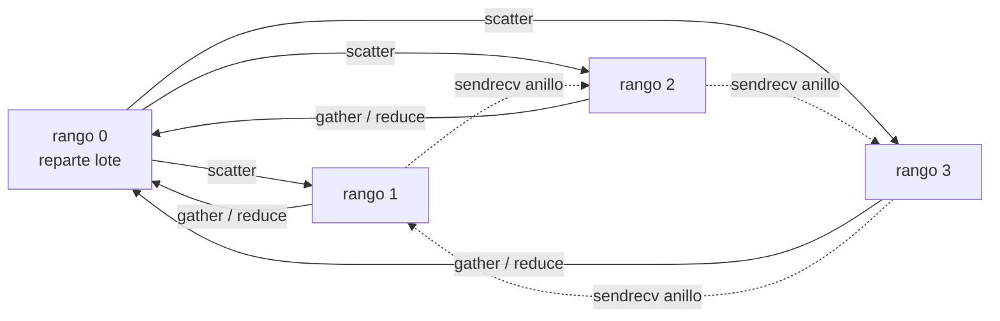

# B18-C02 — Paso de mensajes con MPI

<!-- nav:top -->
[🏠 Programa](../../../../README.md) · [📚 Bloque B18](../../../tronco-comun/B18-computacion-de-alto-rendimiento.md) · [← Anterior: B18-C01 — Procesos, hilos y concurrencia](../B18-C01-procesos-hilos-y-concurrencia/CLASE.md) · [Siguiente: B18-C03 — Jerarquía y estructuras de memoria →](../B18-C03-jerarquia-y-estructuras-de-memoria/CLASE.md)
<!-- /nav -->

## 1. Ubicación, nivel y alcance

Segunda clase del bloque B18. En la [clase anterior](../B18-C01-procesos-hilos-y-concurrencia/CLASE.md) viste que los procesos no comparten memoria y que todo lo que cruza entre ellos se copia. Aquí aprendes el modelo estándar para organizar esa comunicación, también entre máquinas: el **paso de mensajes** con MPI. Nivel N3.

Verás rangos y comunicadores, mensajes punto a punto, comunicación colectiva (difusión, reparto, reunión y reducción), la diferencia entre enviar objetos y enviar *buffers*, el riesgo de bloqueo mutuo y el efecto del orden de las sumas sobre el resultado. No verás MPI de una sola cara (memoria compartida remota), comunicación no bloqueante en profundidad, E/S paralela ni rendimiento fino de red; tampoco se instala ni configura un clúster. Para el trabajo con los datos en memoria, C03.

## 2. Por qué esta clase existe

Ocho, cuarenta o cuatro mil núcleos de un clúster no comparten memoria. Para que cada uno propague su parte de un catálogo de órbitas y luego se junten los resultados, hay que decir quién envía qué a quién, y cuándo. La pregunta motivadora es: **¿cómo reparto un cálculo entre procesos que no comparten memoria y recojo un resultado correcto?**

La decisión central es: **¿qué datos viajan, entre quién y con qué operación de comunicación?** Quien la responde por escrito antes de programar evita los dos errores típicos: bloqueos y resultados que dependen del número de procesos.

## 3. Lo que podrás hacer al terminar

1. Explicar el modelo SPMD, el rango y el tamaño de un comunicador.
2. Escribir y razonar un intercambio punto a punto sin bloqueo mutuo.
3. Elegir entre difusión, reparto, reunión y reducción para un patrón dado.
4. Distinguir la API de objetos (minúsculas) de la de *buffers* (mayúsculas) y su coste.
5. Repartir un cálculo entre procesos y comprobar el resultado contra una solución exacta.
6. Explicar por qué una reducción puede cambiar las últimas cifras según el número de procesos.

La evidencia es el **programa MPI probado** del ejercicio 12 (sección 20).

## 4. Con qué llegas y cómo comprobarlo

Necesitas B18-C01 (procesos), B14-C01 (pruebas) y la regla del punto medio para integrales (B09). Cinco preguntas:

1. ¿Qué comparten dos procesos distintos del mismo programa?
2. ¿Cuánto vale `∫₀¹ 4/(1+x²) dx`? (pista: `d/dx arctan x = 1/(1+x²)`).
3. ¿Cuántos elementos recibe cada uno de 4 procesos si se reparten 10⁶ elementos por igual?
4. ¿Cuántos bytes ocupan 2 × 10⁶ valores `float64`?
5. ¿Por qué `(a + b) + c` puede diferir de `a + (b + c)` en coma flotante?

<details>
<summary>Ver respuestas</summary>

1. Nada de memoria; solo lo que se envíen. 2. `4·(arctan 1 − arctan 0) = 4·π/4 = π`. 3. 250 000. 4. `2 × 10⁶ × 8 = 1,6 × 10⁷` bytes = 16 MB. 5. Porque cada suma redondea y el redondeo depende del orden (B14-C02, sección 8.5).
</details>

Con cuatro o cinco aciertos, sigue; con tres o menos, repasa B18-C01 y B09.

## 5. Un caso real: lo que dice la documentación

El Foro MPI mantiene el estándar y lista sus versiones; la última publicada es **MPI 5.0, aprobada el 5 de junio de 2025** (S1). El estándar define la interfaz, no un programa: existen varias implementaciones que la cumplen. `mpi4py` (S2) es el enlace de Python: su tutorial indica que los programas se lanzan con `mpiexec`, por ejemplo `mpiexec -n 4 python script.py` para cuatro procesos; que los métodos en **minúsculas** (`send`, `recv`, `bcast`, `scatter`, `gather`) manejan objetos arbitrarios de Python mediante *pickle* y son cómodos pero más lentos; y que los de **mayúsculas** (`Send`, `Recv`, `Bcast`, `Scatter`, `Gather`) manejan objetos tipo *buffer*, como arreglos NumPy, a velocidad cercana a la de C.

Nuestro **ejemplo conductor** vuelve al lote de órbitas simuladas: un proceso las reparte, cada uno propaga su parte y el proceso 0 recoge los resultados. Como referencia exacta usamos además el cálculo de `π` por integración, porque su valor se conoce con todas las cifras necesarias.

## 6. Vocabulario

Un **comunicador** es el grupo de procesos que pueden comunicarse; `COMM_WORLD` contiene a todos los lanzados. El **tamaño** es cuántos procesos hay y el **rango** (*rank*) es el número de cada uno, de 0 a tamaño−1. **SPMD** (un programa, muchos datos) significa que todos ejecutan el mismo código y se comportan distinto según su rango. Un mensaje **punto a punto** va de un proceso a otro; una operación **colectiva** involucra a todo el comunicador. La **difusión** (*broadcast*) copia un dato del proceso raíz a todos; el **reparto** (*scatter*) divide una colección de la raíz entre los procesos; la **reunión** (*gather*) hace lo contrario; la **reducción** (*reduce*) combina valores de todos con una operación (suma, máximo…) y la deja en la raíz, y `allreduce` la deja en todos. Un **bloqueo mutuo** (*deadlock*) ocurre cuando dos procesos esperan indefinidamente algo que solo el otro puede darles. Una operación es **bloqueante** si no devuelve el control hasta que su buffer puede reutilizarse.

## 7. Modelo mental: cartas entre casas



*Descripción textual:* cuatro procesos. El rango 0 reparte trozos del lote a los demás (`scatter`) y de ellos recoge resultados (`gather` o `reduce`). Con trazo punteado, los rangos 1, 2 y 3 forman un anillo en el que cada uno envía a su vecino siguiente y recibe del anterior en una sola operación (`sendrecv`).

**Analogía y su límite.** Cada proceso es una casa con su propio archivo; la comunicación es el correo: nadie puede abrir el archivo del vecino, solo enviarle copias. Límite: en el correo real una carta enviada ya salió de tu casa; en MPI una operación bloqueante puede no volver hasta que el receptor la reciba, y eso es lo que causa los bloqueos mutuos.

## 8. La explicación, paso a paso

### 8.1 SPMD, rango y tamaño

Todos los procesos ejecutan el mismo archivo. `comm.Get_rank()` dice quién eres y `comm.Get_size()` cuántos son. Un `if rango == 0:` reserva un trozo del programa para la raíz. Todo lo demás es igual para todos, y de ahí que un error se manifieste de forma distinta según el rango.

### 8.2 Punto a punto

`comm.send(obj, dest=…)` en un proceso casa con `comm.recv(source=…)` en otro. Si dos procesos hacen primero `send` el uno al otro y solo después `recv`, cada uno puede quedarse esperando; que ocurra depende de si la implementación almacena el mensaje en un *buffer* interno (algo común en mensajes pequeños, no garantizado). Es un patrón **inseguro**: puede funcionar en tus pruebas y bloquearse con mensajes grandes. Soluciones: `sendrecv` (envío y recepción combinados, que es lo que usa el laboratorio para el anillo), o ordenar las operaciones (los rangos pares envían primero y los impares reciben primero).

### 8.3 Colectivas

`bcast` envía a todos los parámetros que solo la raíz conoce; `scatter` reparte una lista con tantos trozos como procesos; `gather` junta; `reduce` combina con una operación; `allreduce` equivale a reducir y difundir el resultado. Todas deben ser llamadas **por todos** los procesos del comunicador, en el mismo orden: si un rango se salta una colectiva, los demás esperan para siempre. Las colectivas suelen estar optimizadas por la implementación (por ejemplo, con estructura de árbol), de modo que son preferibles a escribirlas con `send`/`recv`.

### 8.4 Objetos y *buffers*

Con minúsculas, MPI serializa tu objeto con *pickle* (S2): es flexible y cuesta tiempo y memoria extra. Con mayúsculas, le entregas el bloque de memoria de un arreglo (`[datos, MPI.DOUBLE]`) y el receptor debe haber preparado un arreglo del tamaño y tipo correctos. En el laboratorio, un eco de 16 MB ida y vuelta tardó 0,4142 s con *pickle* y 0,0222 s con *buffer*.

### 8.5 Repartir el trabajo

Dos reparticiones habituales de `n` elementos entre `P` procesos: **por bloques** (el rango `r` toma un tramo contiguo) y **cíclica** (el rango `r` toma `r, r+P, r+2P…`; en Python `range(rango, n, tam)`). La cíclica equilibra la carga cuando el coste varía a lo largo del índice y reparte bien aunque `n` no sea múltiplo de `P`: con `n = 10` y `P = 4`, los rangos 0 y 1 reciben 3 elementos y los 2 y 3 reciben 2.

### 8.6 El orden de las sumas y el resultado

Una reducción suma los parciales en un orden que depende de la implementación y del número de procesos. La suma en coma flotante no es asociativa, así que **el mismo cálculo con 1 o con 4 procesos puede diferir en las últimas cifras**. No es un error; es una razón para comparar con una tolerancia y no con igualdad exacta (excepto con enteros).

## 9. Magnitudes, símbolos y unidades

| Símbolo | Qué es | Unidad | Nota |
|---|---|---|---|
| `P` (`tam`) | número de procesos | adimensional | `Get_size()` |
| `r` (`rango`) | identificador del proceso | adimensional | `0 … P−1` |
| `n` | número de intervalos de la integral | adimensional | 10⁶ en el laboratorio |
| `h` | ancho de intervalo = 1/n | adimensional | integral sobre [0, 1] |
| `π_calc` | valor calculado de π | adimensional | punto medio: `h·Σ 4/(1+x_i²)`, `x_i = (i+½)h` |
| `err` | `|π_calc − π|` | adimensional | tolerancia 10⁻⁹ |
| `t` | tiempo de pared (`MPI.Wtime`) | s | |
| `m` | tamaño del mensaje | bytes | 2 × 10⁶ × 8 = 1,6 × 10⁷ B |

## 10. Convenciones y referencias

Un solo comunicador, `COMM_WORLD`. Rango 0 como raíz. Datos **simulados** o **analíticos**: órbitas circulares en unidades canónicas (como en C01) y la integral con solución exacta `π`. Entorno de las medidas: Windows 11, CPU i7-8550U (4 núcleos físicos), Python 3.12.9, NumPy 2.5.4, mpi4py 4.1.2 sobre Intel MPI 2021.19.0 (instalado dentro de un entorno virtual desechable con `pip install impi-rt mpi4py numpy`); los cuatro procesos corrieron en la misma máquina (memoria compartida), no en una red, y con otras tareas ocupando la CPU.

## 11. De dónde sale lo que afirmamos

| ID | Fuente | Localizador | Respalda | Estado |
|---|---|---|---|---|
| S1 | MPI Forum, *MPI Documents* (página de versiones) | https://www.mpi-forum.org/docs/ | Versiones del estándar; MPI 5.0 aprobada el 2025-06-05 | Consultada el 2026-11-05; solo la página índice, **el PDF del estándar no se leyó** |
| S2 | mpi4py, *Tutorial* (versión estable) | https://mpi4py.readthedocs.io/en/stable/tutorial.html | Lanzamiento con `mpiexec -n`; punto a punto; colectivas; minúsculas (pickle) frente a mayúsculas (buffers) | Consultada el 2026-11-05 (mutable); leída a través de un resumen automático |

Límites: la semántica detallada de bloqueo, el riesgo de bloqueo mutuo con `send` simultáneos, la estructura de árbol de las colectivas y el hecho de que la suma en coma flotante no es asociativa son conocimiento general; no se contrastaron con el texto del estándar. El laboratorio ilustra la no asociatividad (sección 17) pero no la demuestra.

## 12. Cómo ver la comunicación

Tabla de operaciones del laboratorio, versión accesible del diagrama.

| Paso | Operación | Quién envía | Quién recibe | Resultado |
|---|---|---|---|---|
| Anillo | `sendrecv` | cada rango a su vecino derecho | cada rango de su izquierdo | rango 0 recibe el rango 3 |
| Parámetros | `bcast` | rango 0 | todos | todos conocen `n` |
| Integral | `reduce` y `allreduce` | todos con su parcial | rango 0 / todos | suma de parciales |
| Lote | `scatter` y `gather` | rango 0 / todos | todos / rango 0 | 16 órbitas propagadas |
| Eco | `send/recv` y `Send/Recv` | rango 0 ↔ rango 1 | ídem | 16 MB ida y vuelta |

## 13. Ejemplo trabajado: π repartido

1. **Modelo.** `π = ∫₀¹ 4/(1+x²) dx`. Con la regla del punto medio, `π ≈ h Σ_{i=0}^{n-1} 4/(1+x_i²)`, `x_i = (i+½)h`, `h = 1/n`.
2. **Reparto cíclico.** El rango `r` suma los índices `r, r+P, …`. Con `n = 10⁶` y `P = 4`, cada rango suma 250 000 términos.
3. **Reducción.** `allreduce(parcial, SUM)` deja el total en todos; `reduce` lo deja solo en el rango 0.
4. **Comprobación.** Contra `π` exacto (`math.pi`), tolerancia 10⁻⁹. Con 4 procesos el laboratorio da `π = 3,141592653590`, `err = 1,10 × 10⁻¹³`; con 1 proceso, `err = 2,89 × 10⁻¹⁴`.
5. **Lectura.** Ambos cumplen la tolerancia con holgura (el error teórico de la regla del punto medio con `n = 10⁶` es del orden de 10⁻¹³ o menor). Que difieran entre sí es la sección 8.6: la suma se hizo en otro orden. **Paso final · incertidumbre.** Los errores observados son redondeo más truncamiento del método; no hay incertidumbre de datos porque el problema es analítico.
6. **Sentido físico del tiempo.** Con 4 procesos tardó 0,439 s y con 1 proceso 0,446 s: ninguna ganancia. Con una máquina cargada y un bucle de Python puro de 250 000 términos por rango, el coste de arrancar y sincronizar procesos y la competencia por los núcleos anulan la ganancia; es lo que C05 enseña a medir.

## 14. Comparación: colectiva, punto a punto y memoria compartida

Para repartir y combinar datos, una colectiva es más corta, más legible y suele estar mejor optimizada que su equivalente con `send/recv`. El punto a punto es necesario cuando el patrón no es uniforme (el anillo, intercambios entre vecinos). La alternativa de hilos con memoria compartida (C01) evita copiar, pero no cruza máquinas y expone a carreras; MPI obliga a copiar, escala entre máquinas y hace explícita toda comunicación. La comunicación explícita es una ventaja para razonar y una carga para programar: la regla práctica es comunicar lo mínimo, en trozos grandes y con colectivas siempre que se pueda.

## 15. Práctica guiada

**Ejercicio 1 · con los pasos.** Con `P = 5` y `n = 12` en reparto cíclico, ¿cuántos índices recibe cada rango? *Pasos:* cuenta `r, r+5, r+10…` menores que 12.

<details><summary>Solución comentada</summary>

Rango 0: 0, 5, 10 → 3. Rango 1: 1, 6, 11 → 3. Rango 2: 2, 7 → 2. Rangos 3 y 4: 2 cada uno. Total 3+3+2+2+2 = 12. El reparto cíclico admite resto (sección 8.5).
</details>

**Ejercicio 2 · con una pista.** Cada rango contribuye con su propio rango a un `allreduce` con suma. ¿Qué valor ve cada rango con `P = 4`? *Pista:* suma de 0 a 3.

<details><summary>Solución comentada</summary>

`0+1+2+3 = 6`. En general `P(P−1)/2`; para `P = 4` son 6 en todos los rangos (`allreduce` entrega el resultado a todos).
</details>

**Ejercicio 3 · casi autónomo.** En el anillo del laboratorio con `P = 4`, ¿qué recibe cada rango? Compruébalo con el resultado impreso.

<details><summary>Solución comentada</summary>

Cada rango envía su rango al vecino de la derecha `(r+1) mod 4` y recibe del izquierdo `(r−1) mod 4`: rango 0 recibe 3, rango 1 recibe 0, rango 2 recibe 1, rango 3 recibe 2. El laboratorio muestra que el rango 0 recibió 3.
</details>

## 16. Práctica autónoma, transferencia e integrador

**Ejercicio 4.** Dos rangos ejecutan `comm.send(x, dest=otro)` y luego `comm.recv(source=otro)`. ¿Por qué es inseguro y cómo lo corriges de dos maneras?

<details><summary>Solución comentada</summary>

Si el envío bloquea hasta que el otro reciba, ambos esperan en `send` y nadie llega a `recv` (bloqueo mutuo, sección 8.2). Que funcione con mensajes pequeños no lo hace correcto. Correcciones: `sendrecv`; o que el rango par haga `send` y luego `recv`, y el impar `recv` y luego `send`.
</details>

**Ejercicio 5.** ¿Cuántos pasos necesita una reducción de 8 valores si se combinan de dos en dos formando un árbol, frente a una cadena secuencial?

<details><summary>Solución comentada</summary>

Árbol: `log₂ 8 = 3` pasos (8→4→2→1). Cadena: 7 sumas en secuencia. Por eso las colectivas suelen escalar mejor (idea general, no contrastada en una fuente de esta clase).
</details>

**Ejercicio 6.** Un arreglo de 10⁷ `float64` se envía con `Send`. ¿Cuántos MB son? Con el ancho de banda efectivo del eco del laboratorio (≈ 1,44 GB/s en ida y vuelta de 32 MB totales), ¿cuánto tardaría en cada sentido?

<details><summary>Solución comentada</summary>

`10⁷ × 8 = 8 × 10⁷ B = 80 MB`. Cada sentido a 1,44 GB/s: `80 MB / 1440 MB/s ≈ 0,056 s`. La cifra es una estimación a partir de una sola medición en memoria compartida; en una red real será otra.
</details>

**Ejercicio 7.** El laboratorio mide con *pickle* 0,4142 s y con *buffer* 0,0222 s para el mismo eco de 16 MB. ¿Cuántas veces más rápido es el segundo? Da dos razones por las que esa razón no es general.

<details><summary>Solución comentada</summary>

`0,4142 / 0,0222 ≈ 18,7`. No es general porque (1) fue una sola medición, y la primera comunicación incluye costes de arranque de la conexión; (2) depende de la implementación MPI, del tamaño y de la carga de la máquina.
</details>

**Ejercicio 8.** Con el reparto `lote[i::tam]` de 16 órbitas entre 4 procesos, ¿qué órbitas recibe el rango 2?

<details><summary>Solución comentada</summary>

Índices 2, 6, 10, 14: cuatro órbitas. `lote[i::tam]` es el reparto cíclico de la sección 8.5 aplicado a una lista.
</details>

**Ejercicio 9 · transferencia.** Un catálogo de 10⁹ valores de flujo se reparte entre `P` procesos y se pide la media global. ¿Qué dos cantidades debe reducir cada proceso, y por qué no basta promediar las medias parciales si los trozos son desiguales?

<details><summary>Solución comentada</summary>

Debe reducir la **suma** y el **número de elementos** (o devolver ambos): media global = suma total / total de elementos. Promediar medias parciales pondera igual a trozos distintos y da un resultado sesgado cuando los trozos no tienen el mismo tamaño.
</details>

**Ejercicio 10 · transferencia.** Un esquema de red usa un proceso maestro que envía una tarea a cada trabajador, uno por uno, y espera su resultado antes de enviar la siguiente. Critica el diseño y propón uno mejor usando operaciones de esta clase.

<details><summary>Solución comentada</summary>

Es secuencial: el maestro espera a cada uno y los trabajadores quedan ociosos. Mejor: `scatter` de todas las tareas, cálculo simultáneo y `gather` de resultados. Si las tareas son desiguales, el maestro envía una nueva a quien termina (reparto dinámico; fuera del alcance de esta clase).
</details>

**Ejercicio 11 · transferencia.** Tu colega ejecuta su simulación con 1 y con 8 procesos y obtiene energías que difieren en la décima cifra decimal. ¿Es un error? ¿Qué prueba pides?

<details><summary>Solución comentada</summary>

Probablemente no: es la no asociatividad de la suma (sección 8.6). Se pide una comparación con tolerancia relativa justificada y una prueba contra un caso con solución exacta (como `π` aquí). Si la diferencia creciera con el número de procesos o superara la tolerancia, sí habría que investigar.
</details>

**Ejercicio 12 · integrador.** Entrega un programa MPI que calcule `ln 2 = ∫₁² dx/x` con la regla del punto medio repartida entre `P` procesos y con una tolerancia justificada. Debe incluir: reparto elegido y por qué, `allreduce`, comparación con `math.log(2)` en todos los rangos, ejecución con `P = 1, 2, 4` y una tabla de errores y tiempos que diga qué no puedes concluir.

<details><summary>Solución modelo</summary>

`h = 1/n`, `x_i = 1 + (i+½)h`, `ln 2 ≈ h Σ 1/x_i`. Error teórico del punto medio ≈ `h²/24 · |f'(b) − f'(a)|`, con `f' = −1/x²`: `|−1/4 + 1| = 3/4`, así que ≈ `h²/32`; para `n = 10⁶`, ~3 × 10⁻¹⁴. Una tolerancia razonable es 10⁻¹¹. Prueba colectiva con `allreduce(…, op=LAND)` para que todos los rangos se detengan a la vez. Se acepta cualquier solución que cumpla las seis partes y que no concluya aceleración sin medirla con repeticiones.
</details>

## 17. Laboratorio

El script [mensajes_mpi.py](mensajes_mpi.py) ejecuta, con cualquier número de procesos: un anillo con `sendrecv`, una difusión de parámetros, el cálculo de π con `reduce` y `allreduce`, el reparto y reunión de 4 órbitas por proceso, y un eco de 16 MB con objetos y con *buffers*. Cada paso se verifica con una prueba colectiva.

**Datos:** simulados y analíticos. **Predice antes de ejecutar:** ¿qué valor recibe el rango 0 en el anillo con 4 procesos? (3.) **Requisitos:** `mpi4py` y una implementación MPI instalada. **Ejecución del 2026-11-05** (Python 3.12.9, NumPy 2.5.4, mpi4py 4.1.2, Intel MPI 2021.19.0; 4 procesos en una sola máquina):

```text
Python 3.12.9  NumPy 2.5.4  Intel(R) MPI Library 2021.19.0 for Windows* OS  procesos=4
anillo: cada rango recibió el rango de su vecino izquierdo (rango 0 recibió 3)
pi = 3.141592653590  error = 1.10e-13  (n = 1000000, 0.439 s)
órbitas: 16 propagadas; peor error de cierre = 2.07e-07
eco de 2 x 10^6 doubles (16 MB, ida y vuelta): pickle = 0.4142 s ; buffer = 0.0222 s ; datos íntegros = True
Pruebas superadas.
```

Con 1 proceso: `error = 2.89e-14`, tiempo 0,446 s, 4 órbitas, mismas pruebas superadas.

```bash
mpiexec -n 4 python programa/clases/B18/B18-C02-paso-de-mensajes-con-mpi/mensajes_mpi.py
```

**Límites:** una medición por caso; la comunicación fue en memoria compartida de un solo equipo; el eco con *pickle* es la primera comunicación entre esos rangos y puede incluir costes de arranque; el tiempo con 4 procesos no mejora el de 1 en una máquina cargada. El error de cierre de las órbitas (2,07 × 10⁻⁷) es el del integrador con 20 000 pasos, no de MPI.

## 18. Errores frecuentes y cómo corregirlos

**Bloqueo mutuo por `send` simultáneos.** Se corrige con el ejercicio 4.

**Una colectiva que no llaman todos los rangos.** Se corrige revisando que no esté dentro de un `if rango == …`.

**Comparar con igualdad exacta resultados de reducciones.** Se corrige con la sección 8.6 y el ejercicio 11.

**Promediar medias parciales.** Se corrige con el ejercicio 9.

**Mandar objetos grandes con minúsculas.** Se corrige con el ejercicio 7.

## 19. Cómo sabrás que vas bien

Tras 8.2: ¿reconoces en un esquema el riesgo de bloqueo? Si no, rehaz el ejercicio 4. Tras 8.5: ¿repartes 12 elementos entre 5 procesos? Si no, rehaz el 1. Tras el ejemplo trabajado: ¿por qué dos números distintos de `err` son ambos correctos? Si no puedes decirlo, relee 8.6 y rehaz el 11. Tras el laboratorio: ¿qué prueba te avisaría de que `reduce` perdió un parcial? Al final: ¿qué concluir —y qué no— de la tabla de tiempos del ejercicio 12?

## 20. Qué entregas y cómo se evalúa

El producto es tu **programa MPI del ejercicio 12** con sus pruebas colectivas y la tabla de resultados.

| Criterio | Inicial | En desarrollo | Logrado | Destacado |
|---|---|---|---|---|
| Comunicación | Solo punto a punto manual | Usa colectivas sin justificar | Elige operación y reparto con razón | Analiza coste de comunicación |
| Corrección | Sin prueba | Compara a ojo | Prueba con tolerancia justificada | Estima el error teórico |
| Robustez | Puede bloquearse | Funciona con un P | Funciona con P = 1, 2, 4 | Prueba un P que no divide a n |
| Honestidad | Concluye aceleración sin datos | Mezcla | Declara qué no se midió | Separa ruido de efecto |

**Condiciones críticas:** no usar un patrón con riesgo de bloqueo mutuo sin advertirlo; no presentar una medición única como ley; todos los rangos deben participar en cada colectiva.

## 21. Ética, seguridad y límites

En un clúster compartido se lanza trabajo a través del planificador de la instalación y no en los nodos de acceso; consulta la política antes de ejecutar. Un bloqueo mutuo en un nodo compartido consume recursos de otros: usa límites de tiempo. Los resultados de este laboratorio no certifican software de misión. Accesibilidad: el diagrama tiene descripción textual y tabla equivalente. El coste energético de un clúster es real; no lances más procesos de los que puedas justificar.

## 22. Para cerrar y seguir

MPI organiza procesos sin memoria compartida mediante rangos y mensajes: punto a punto cuando el patrón es irregular, colectivas cuando es uniforme, objetos por comodidad y *buffers* por velocidad, y una tolerancia en lugar de igualdad cuando se suman en otro orden. Queda abierta una pregunta: si comunicar es caro, ¿qué parte del tiempo se va en mover datos dentro de cada máquina?

**Glosario español–inglés.** paso de mensajes · *message passing*; rango · *rank*; comunicador · *communicator*; difusión · *broadcast*; reparto · *scatter*; reunión · *gather*; reducción · *reduce*; bloqueo mutuo · *deadlock*; bloqueante · *blocking*; punto medio · *midpoint rule*.

**Continuidad.** B18-C03 estudia cómo el patrón de acceso a la memoria de cada proceso condiciona el rendimiento. B18-C05 usa estos programas para medir el escalado.

**Referencias:** ver sección 11.

<!-- nav:bottom -->
---

[← Anterior: B18-C01 — Procesos, hilos y concurrencia](../B18-C01-procesos-hilos-y-concurrencia/CLASE.md) · [📚 Bloque B18](../../../tronco-comun/B18-computacion-de-alto-rendimiento.md) · [Siguiente: B18-C03 — Jerarquía y estructuras de memoria →](../B18-C03-jerarquia-y-estructuras-de-memoria/CLASE.md)
<!-- /nav -->
