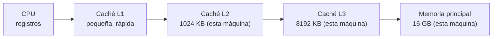

# B18-C03 — Jerarquía y estructuras de memoria

<!-- nav:top -->
[🏠 Programa](../../../../README.md) · [📚 Bloque B18](../../../tronco-comun/B18-computacion-de-alto-rendimiento.md) · [← Anterior: B18-C02 — Paso de mensajes con MPI](../B18-C02-paso-de-mensajes-con-mpi/CLASE.md) · [Siguiente: B18-C04 — Perfilado de rendimiento →](../B18-C04-perfilado-de-rendimiento/CLASE.md)
<!-- /nav -->

## 1. Ubicación, nivel y alcance

Tercera clase del bloque B18. Las dos anteriores repartieron el trabajo entre procesos; esta mira dentro de **un** proceso: cómo se mueven los datos entre la memoria principal y la CPU, y por qué el orden en que los recorres puede multiplicar el tiempo por tres o por cuatro sin cambiar ni una operación aritmética. Nivel N3.

Verás la jerarquía de memoria y la caché, la disposición de arreglos (filas o columnas), los pasos (*strides*), registros de campos frente a campos separados, el ancho de banda y la idea de tarea limitada por memoria. No verás arquitectura de CPU en detalle, memoria en GPU, ni NUMA; tampoco optimización de compiladores.

## 2. Por qué esta clase existe

Un catálogo con millones de estrellas o una rejilla de simulación pasan cada dato por la CPU una o pocas veces. Cuando las operaciones por dato son pocas, el tiempo no lo fija la CPU sino el viaje de los datos. La pregunta motivadora es: **¿por qué dos recorridos con la misma aritmética tardan tiempos tan distintos?**

La decisión central es: **¿en qué orden y con qué estructura guardo y recorro mis datos para que cada byte que la memoria trae sea un byte útil?**

## 3. Lo que podrás hacer al terminar

1. Describir la jerarquía de memoria y la función de la línea de caché.
2. Calcular los *strides* de un arreglo en orden C y en orden Fortran, y compararlos con los que informa NumPy.
3. Predecir qué recorrido de una matriz es más rápido y estimar cuánto, justificándolo con líneas de caché.
4. Elegir entre registros de campos y campos separados según el acceso.
5. Estimar el ancho de banda efectivo de una operación sencilla y decidir si está limitada por memoria.
6. Contrastar una predicción con una medición ruidosa sin sobreinterpretarla.

La evidencia es la **nota de rendimiento con predicción y medición** del ejercicio 12 (sección 20).

## 4. Con qué llegas y cómo comprobarlo

Necesitas B14-C02 (arreglos NumPy, forma y `strides`). Cinco preguntas:

1. ¿Cuántos bytes ocupa un arreglo `float64` de forma `(3000, 2000)`?
2. ¿Qué `strides` tiene un arreglo C `(3, 4)` de `float64`?
3. ¿Qué es una vista de un arreglo?
4. ¿Cuántos valores `float64` caben en 64 bytes?
5. ¿Qué es un GB/s?

<details>
<summary>Ver respuestas</summary>

1. `3000 × 2000 × 8 = 48 000 000` B = 48 MB. 2. `(32, 8)`. 3. Un arreglo que mira los mismos datos sin copiarlos. 4. 8. 5. Mil millones de bytes por segundo (10⁹ B/s, definición SI de giga).
</details>

Con cuatro o cinco aciertos, sigue; con tres o menos, repasa B14-C02.

## 5. Un caso real: cómo NumPy y STREAM describen la memoria

La documentación de NumPy (S1) explica que un `ndarray` es un bloque unidimensional contiguo de memoria más un esquema de **pasos** que traduce índices en posiciones: el desplazamiento en bytes de `(n₀, …, n_{k-1})` es la suma de cada índice por su paso. En orden C (por filas, el predeterminado) el paso del eje `k` es el tamaño del elemento por el producto de las longitudes de los ejes posteriores; en orden Fortran (por columnas), por el de los anteriores. Para forma `(2, 3)` con elementos de 4 bytes, los pasos son `(12, 4)` en C y `(4, 8)` en Fortran. Una rebanada suele dar una vista con otra disposición.

El *benchmark* STREAM (S2) mide el ancho de banda de memoria sostenible con cuatro núcleos sencillos: copia `a = b`, escala `a = q·b`, suma `a = b + c` y *triad* `a = b + q·c`. Exige arreglos mucho mayores que la caché: al menos cuatro veces el tamaño combinado de las cachés de último nivel, o un millón de elementos, lo que sea mayor, para que se mida la memoria principal y no la caché.

Nuestro **ejemplo conductor** es el estado de un conjunto de satélites simulados: millones de registros `(x, y, vx, vy)` que se recorren muchas veces, por ejemplo para sumar todas las `x`. Es un caso de pocas operaciones por dato, donde la memoria manda.

## 6. Vocabulario

La **jerarquía de memoria** es la escalera de almacenamientos de la CPU: registros, cachés de nivel 1, 2 y 3, memoria principal; cuanto más cerca de la CPU, más pequeña y rápida. Una **caché** guarda copias de datos recientes. Una **línea de caché** es el bloque de bytes que se trae de una vez; en CPU de uso general suele ser de 64 bytes (dato general; no consultado en una fuente para esta clase). La **localidad espacial** es acceder a datos vecinos; la **temporal**, repetir el acceso a un mismo dato. Un **acierto** (*hit*) es encontrar el dato en caché; un **fallo** (*miss*), tener que ir a un nivel inferior. El **orden C** (*row-major*) guarda las filas contiguas; el **orden Fortran** (*column-major*), las columnas. Un **paso** (*stride*) es el salto en bytes entre elementos consecutivos de un eje. **AoS** (arreglo de estructuras) guarda registros completos uno tras otro; **SoA** (estructura de arreglos) guarda un arreglo por campo. El **ancho de banda** es los bytes movidos por segundo. Una tarea **limitada por memoria** es aquella cuyo tiempo lo fija el ancho de banda y no la aritmética.

## 7. Modelo mental: una escalera y una bolsa de 64 bytes



*Descripción textual:* de izquierda a derecha, cinco niveles. La CPU con sus registros accede a la caché L1; si falla, a la L2 (1024 KB en la máquina de las medidas); luego a la L3 (8192 KB) y por último a la memoria principal (16 GB). Cada flecha hacia la derecha es más lenta y más grande.

**Analogía y su límite.** Vas al almacén por un tornillo, pero solo te dejan traer una bolsa de 64 bytes del estante; si el tornillo siguiente está en la misma bolsa, ya lo tienes. Si cada tornillo que necesitas está en un estante distinto, cada uno cuesta un viaje. Límite: el hardware real además **anticipa** lecturas (prefetch) cuando detecta patrones regulares, lo que suaviza el castigo de los saltos constantes pequeños; la analogía de la bolsa no lo recoge.

## 8. La explicación, paso a paso

### 8.1 Por qué existe la jerarquía

La memoria grande es lenta y la rápida es pequeña. La caché aprovecha dos hechos: lo que acabas de usar probablemente lo usarás de nuevo (localidad temporal) y lo vecino a lo que usaste probablemente se use pronto (localidad espacial). Cuando pides un `float64`, el sistema trae la línea entera que lo contiene.

### 8.2 Strides: la regla

Para un arreglo en orden C de forma `(m, n)` con elementos de `s` bytes, los pasos son `(n·s, s)`: avanzar una columna salta `s` bytes (el vecino) y avanzar una fila salta `n·s`. En orden Fortran son `(s, m·s)`. Con `(3000, 2000)` y `float64` (`s = 8`): C `(16 000, 8)`; Fortran `(8, 24 000)`. La traspuesta `a.T` **no copia**: es una vista con los pasos intercambiados, `(8, 16 000)`, y deja de ser contigua en C (S1).

### 8.3 Recorrer por filas o por columnas

En un arreglo C, recorrer por filas avanza de 8 en 8 bytes: de cada línea de 64 B se aprovechan 8 valores. Recorrer por columnas salta 16 000 B por elemento: cada lectura trae una línea de 64 B de la que se usa 1 valor de 8. Si no hubiera reutilización, tocarías 8 veces más líneas, una cota superior del castigo. Con reutilización —la línea que trajiste para la columna `j` sirve a la `j+1`, `j+2`…— el castigo baja; que una columna de 3000 valores ocupe 3000 líneas × 64 B = 192 KB y quepa en la L2 de 1024 KB es una hipótesis razonable de por qué la razón observada es menor que 8.

### 8.4 Saltos constantes

Leer un valor de cada `k` hace que el programa lea `1/k` de los elementos, pero la memoria sigue trayendo líneas casi completas mientras `k·8 B < 64 B` (es decir, `k < 8`). Esperarás que el tiempo total baje mucho menos que `1/k` y que el tiempo **por valor leído** suba.

### 8.5 AoS frente a SoA

Si cada registro tiene cuatro campos de 8 B, un registro mide 32 B. Sumar solo `x` en AoS salta 32 B entre valores: cada línea de 64 B trae 2 valores de `x` y 6 de otros campos que no se usan. En SoA, `x` es un arreglo propio con paso 8 B: la línea trae 8 valores útiles. SoA conviene cuando se recorre un campo a la vez; AoS cuando se usan todos los campos del mismo registro juntos.

### 8.6 Ancho de banda e intensidad aritmética

Para `d = b + c`, por elemento se leen 16 B, se escriben 8 B (24 B movidos) y se hace 1 operación en coma flotante: **intensidad aritmética** `1/24 ≈ 0,042` operaciones por byte. Si el ancho de banda sostenido es `B` bytes/s, el máximo es `B/24` operaciones/s por mucha CPU que sobre. Cuando la intensidad es así de baja, la tarea está limitada por memoria y optimizar la aritmética no ayuda. Los 24 B por elemento son un recuento **nominal**: ignora lecturas adicionales que el hardware pueda hacer al escribir.

## 9. Magnitudes, símbolos y unidades

| Símbolo | Qué es | Unidad | Nota |
|---|---|---|---|
| `s` | tamaño del elemento | B | 8 para `float64` |
| `(m, n)` | forma de la matriz | adimensional | filas × columnas |
| `strides` | pasos por eje | B | C: `(n·s, s)` |
| `k` | salto de lectura | adimensional | lee 1 de cada `k` |
| `L` | número de elementos | adimensional | `2²³` en el ancho de banda |
| `BW` | ancho de banda efectivo nominal | GB/s (10⁹ B/s) | `bytes nominales / tiempo` |
| `I` | intensidad aritmética | operaciones/B | `1/24` para `b + c` |

## 10. Convenciones y referencias

Orden C por defecto. Un GB es 10⁹ bytes. Datos **sintéticos** (ceros, unos, `np.arange`), sin datos observados. Máquina: CPU i7-8550U, caché L2 de 1024 KB y L3 de 8192 KB según una consulta al sistema operativo (propiedades `L2CacheSize` y `L3CacheSize` de `Win32_Processor`), 16 GB de RAM, Windows 11, Python 3.12.9, NumPy 2.4.4. El equipo tenía otras tareas ejecutándose y poca memoria libre durante las medidas (menos de 1 GB libre al comprobarlo), de modo que los tiempos son ruidosos. Cada tiempo es el mínimo de cinco repeticiones.

## 11. De dónde sale lo que afirmamos

| ID | Fuente | Localizador | Respalda | Estado |
|---|---|---|---|---|
| S1 | NumPy, *The N-dimensional array (ndarray)*, sección de disposición interna | https://numpy.org/doc/stable/reference/arrays.ndarray.html | Bloque contiguo más pasos; orden C y Fortran; fórmulas de pasos; ejemplo `(2,3)` | Consultada el 2026-11-05 (versión estable, mutable) |
| S2 | J. D. McCalpin, *STREAM: Sustainable Memory Bandwidth in High Performance Computers* (referencia del *benchmark*) | https://www.cs.virginia.edu/stream/ref.html | Núcleos copia/escala/suma/triad; regla de tamaño respecto de la caché | Consultada el 2026-11-05 |

Límites: la jerarquía de memoria, la línea de 64 B y la anticipación de lecturas son conocimiento general no contrastado con una fuente en esta clase. Las medidas del laboratorio **no son STREAM** (otra implementación, NumPy, y sin las condiciones de ejecución del *benchmark*): solo ilustran el concepto.

## 12. Cómo ver los pasos

Tabla de pasos de un arreglo `float64` de forma `(3000, 2000)`, versión accesible del esquema.

| Objeto | Forma | Pasos (B) | ¿Contiguo en C? |
|---|---|---|---|
| `a` (orden C) | `(3000, 2000)` | `(16000, 8)` | sí |
| `a` en orden Fortran | `(3000, 2000)` | `(8, 24000)` | no (sí en Fortran) |
| `a.T` (vista) | `(2000, 3000)` | `(8, 16000)` | no |

## 13. Ejemplo trabajado: sumar por filas o por columnas

Matriz de `3000 × 3000` valores `float64` (`np.arange`, 72 MB). La suma exacta de `0 … 9 × 10⁶ − 1` es `N(N−1)/2` con `N = 9 × 10⁶`: representable sin error en `float64` (≈ 4,05 × 10¹³ < 2⁵³).

1. **Predicción.** Por filas se usan 8 de 8 valores por línea; por columnas, 1 de 8 sin reutilización. Cota del castigo: hasta 8×. Con reutilización en L2 (sección 8.3), menos.
2. **Medición** (mínimo de 5): por filas 41,9 ms; por columnas 169,2 ms; razón **4,03**.
3. **Lectura.** La razón es positiva y menor que 8: coherente con la cota, y compatible con la reutilización de líneas en L2. No se investigó otra causa (anticipación de lecturas, páginas de memoria, ruido). Con otras dimensiones o cargas la razón cambiará.
4. **Comprobación de corrección.** `m.sum()` es exactamente `N(N−1)/2`; el laboratorio lo exige antes de medir.
5. **Prueba adicional.** Copiar la matriz (56,3 ms) frente a copiar su traspuesta como arreglo contiguo (180,0 ms): razón 3,20; leer contiguo y escribir con salto tiene un costo parecido al de recorrer por columnas.
6. **Incertidumbre.** Una máquina cargada: son órdenes de magnitud, no valores de referencia.

## 14. Comparación: disposiciones y herramientas

Orden C y Fortran son equivalentes en información y distintos en rendimiento según el recorrido: elige el que haga contiguo el eje del bucle interior. AoS es natural para pensar (un satélite = un registro) y SoA es mejor para barridos por campo; NumPy permite ambos (matriz de registros o arreglos separados). Reordenar los bucles o trasponer una vez al principio suele costar menos que recorrer mal muchas veces. Los métodos por bloques (procesar la matriz en teselas que caben en caché) mejoran la localidad temporal, a cambio de código más complejo. Una optimización de memoria solo está justificada por una medición (C04), no por una intuición.

## 15. Práctica guiada

**Ejercicio 1 · con los pasos.** Calcula los `strides` de un arreglo C `float32` de forma `(100, 50)` y los de su equivalente en orden Fortran. *Pasos:* `s = 4`; aplica la sección 8.2.

<details><summary>Solución comentada</summary>

C: `(50·4, 4) = (200, 4)`. Fortran: `(4, 100·4) = (4, 400)`. Bytes totales `100·50·4 = 20 000`, iguales en ambos.
</details>

**Ejercicio 2 · con una pista.** En el arreglo C del ejercicio 1, ¿qué recorrido (por filas o por columnas) es contiguo? *Pista:* ¿qué paso es igual al tamaño del elemento?

<details><summary>Solución comentada</summary>

Por filas: el paso del eje 1 es 4 B = tamaño del elemento. Por columnas salta 200 B por elemento.
</details>

**Ejercicio 3 · casi autónomo.** Con líneas de 64 B y `float64`, ¿cuántos valores útiles hay por línea si lees uno de cada `k = 1, 2, 4, 8, 16`?

<details><summary>Solución comentada</summary>

Valores por línea: `8/k` para `k ≤ 8`: 8, 4, 2, 1; para `k = 16` cada línea contiene a lo sumo 1 valor útil, y una de cada dos líneas ni siquiera se toca. Por eso el tiempo por valor leído sube (sección 8.4).
</details>

## 16. Práctica autónoma, transferencia e integrador

**Ejercicio 4.** El laboratorio midió leer 1 de cada `k` en un arreglo de `2²⁴` elementos: `k = 1`: 32,52 ms; `k = 16`: 9,47 ms. ¿Cuántas veces menos tiempo con 16 veces menos elementos? ¿Qué dice?

<details><summary>Solución comentada</summary>

`32,52 / 9,47 ≈ 3,43`, no 16. Leer 1/16 de los elementos no recorta el tiempo en 1/16 porque la memoria sigue trayendo líneas casi enteras. El tiempo por valor leído pasó de 1,94 a 9,03 ns.
</details>

**Ejercicio 5.** Para `N = 2²¹` registros de 32 B (AoS), ¿cuántos MB ocupa el arreglo y cuántos se mueven realmente al sumar solo `x` con paso 32 B si cada línea de 64 B se trae completa?

<details><summary>Solución comentada</summary>

Tamaño: `2 097 152 × 32 = 67 108 864 B ≈ 67,1 MB`. Sumar solo `x` toca todas las líneas (cada línea contiene 2 registros): se traen ≈ 67,1 MB para usar `2 097 152 × 8 = 16,8 MB`, un 25 % de aprovechamiento. En SoA solo se mueven los 16,8 MB.
</details>

**Ejercicio 6.** El laboratorio dio AoS 8,05 ms y SoA 4,33 ms. ¿Cuál es la razón? ¿Por qué no es 4?

<details><summary>Solución comentada</summary>

Razón `8,05/4,33 ≈ 1,86`. La cota por bytes movidos es 4 (67 MB frente a 16,8 MB), pero el tiempo incluye otros costos (la suma, la anticipación de lecturas, el ruido); es otra medición donde la cota no se alcanza. Se concluye la dirección del efecto, no su magnitud.
</details>

**Ejercicio 7.** La suma `d = b + c` de `2²³` elementos tardó `24 · 2²³ / 9,4 × 10⁹ s` ≈ 21,4 ms al ancho de banda nominal medido (9,4 GB/s). ¿Cuántas operaciones por segundo hace? ¿Cuántas podría hacer una CPU de 10 Gflop/s?

<details><summary>Solución comentada</summary>

`2²³ ≈ 8,39 × 10⁶` operaciones en 21,4 ms: ≈ 0,39 Gflop/s, un 4 % de los 10 Gflop/s. Está limitada por memoria: `BW × I = 9,4 × 10⁹ × (1/24) ≈ 0,39 × 10⁹`. El número no mide la CPU, mide el bus.
</details>

**Ejercicio 8.** ¿Por qué `a.T` no cuesta tiempo ni memoria y `np.ascontiguousarray(a.T)` sí?

<details><summary>Solución comentada</summary>

`a.T` es una vista con los pasos intercambiados (S1): no mueve datos. `ascontiguousarray` crea un arreglo nuevo con el orden C de la traspuesta y copia todo: coste en tiempo (180 ms para 72 MB en el laboratorio) y en memoria (otros 72 MB).
</details>

**Ejercicio 9 · transferencia.** Una rejilla 3D de temperatura de `(nx, ny, nz)` se guarda en orden C. Un bucle triple lo recorre con `z` como bucle interior. ¿Es correcto el orden? ¿Y si el arreglo fuera Fortran?

<details><summary>Solución comentada</summary>

En orden C el eje de variación más rápida es el último (`z`): el bucle interior debe recorrerlo y el orden `x → y → z` es el correcto. En Fortran es el primero, y el bucle interior debería recorrer `x`. Regla: el bucle interior sigue el eje de paso más pequeño.
</details>

**Ejercicio 10 · transferencia.** Un catálogo estelar tiene campos `ra`, `dec`, `mag`, `parallax`. El programa A calcula solo la magnitud media de millones de estrellas; el programa B calcula la distancia usando `ra`, `dec` y `parallax` de cada estrella a la vez. ¿AoS o SoA para cada uno?

<details><summary>Solución comentada</summary>

A recorre un campo: SoA. B usa varios campos del mismo registro: AoS puede ser buena porque los campos del registro quedan en la misma línea, aunque si el cálculo se vectoriza por campos, SoA también sirve. La decisión final se mide.
</details>

**Ejercicio 11 · transferencia.** Un colega afirma «mi código es lento porque el compilador no optimiza la aritmética». Su bucle suma `a[i] + b[i]` sobre 10⁸ elementos. ¿Qué le preguntas y qué estimas?

<details><summary>Solución comentada</summary>

Pregunto por la intensidad aritmética: 1 operación por 24 B es muy baja (sección 8.6), así que probablemente está limitado por memoria. Estimo el tiempo mínimo como `24 × 10⁸ B / BW`; con 9,4 GB/s serían ≈ 0,26 s. Si su tiempo se parece a eso, la aritmética no es el problema. Si es muy superior, buscaría el patrón de acceso o la conversión de tipos.
</details>

**Ejercicio 12 · integrador.** Entrega una nota de rendimiento sobre un recorrido de tu elección (filas/columnas, AoS/SoA o saltos): predicción por escrito con cálculo de bytes y líneas, cinco repeticiones declarando mínimo y dispersión, comprobación de corrección con un valor exacto, la razón medida y una frase sobre qué no puedes concluir.

<details><summary>Solución modelo</summary>

Se acepta cualquier solución que: (1) escriba la predicción antes de medir, con la cota de la sección 8.3 o 8.5; (2) compruebe un resultado exacto (suma de `np.arange`); (3) rotule los datos como sintéticos y declare máquina, versión de NumPy y carga; (4) informe razón y dispersión; (5) no atribuya la desviación de la predicción a una causa que no investigó.
</details>

## 17. Laboratorio

El script [memoria_y_cache.py](memoria_y_cache.py) verifica las fórmulas de `strides`, compara recorridos por filas y columnas, los saltos constantes, AoS frente a SoA, el ancho de banda de una copia y una suma, y la copia de la traspuesta. Cada resultado se comprueba contra un valor exacto antes de medir.

**Datos:** sintéticos. **Predice antes de ejecutar:** ¿qué recorrido de la matriz será más rápido? (por filas.) **Ejecución del 2026-11-05 (Python 3.12.9, NumPy 2.4.4):**

```text
Python 3.12.9  NumPy 2.4.4
strides C=(16000, 8)  Fortran=(8, 24000)  traspuesta(vista)=(8, 16000)
matriz 3000x3000 float64 (72 MB): por filas    41.9 ms | por columnas   169.2 ms | razón 4.03
saltos k | elementos leídos | tiempo (ms) | ns por elemento leído
       1 |         16777216 |       32.52 |     1.94
       2 |          8388608 |       21.92 |     2.61
       4 |          4194304 |       16.09 |     3.84
       8 |          2097152 |       11.84 |     5.65
      16 |          1048576 |        9.47 |     9.03
suma de x con N=2097152: AoS (paso 32 B)   8.05 ms | SoA (paso 8 B)   4.33 ms | razón 1.86
copia (16 B/elem):  16.2 GB/s | suma d=b+c (24 B/elem):   9.4 GB/s  (nominal, 3 arreglos de 67 MB)
copiar 3000x3000: contigua   56.3 ms | traspuesta  180.0 ms | razón 3.20
Pruebas superadas.
```

```bash
python programa/clases/B18/B18-C03-jerarquia-y-estructuras-de-memoria/memoria_y_cache.py
```

**Límites:** máquina cargada y con poca memoria libre; un único conjunto de medidas; el ancho de banda es nominal; los tres arreglos de 64 MB superan la L3 de 8 MB pero la prueba no controla el prefetch ni la afinidad de hilos; no se afirma STREAM.

## 18. Errores frecuentes y cómo corregirlos

**Recorrer contra el orden de almacenamiento.** Se corrige con el ejercicio 9.

**Creer que `a.T` copia.** Se corrige con el ejercicio 8.

**Esperar que leer 1/k elementos cueste 1/k.** Se corrige con el ejercicio 4.

**Optimizar la aritmética de un código limitado por memoria.** Se corrige con los ejercicios 7 y 11.

**Medir una sola vez.** Se corrige con el ejercicio 12: mínimo y dispersión de varias repeticiones.

## 19. Cómo sabrás que vas bien

Tras 8.2: ¿calculas los pasos de `(100, 50)` en `float32` sin mirar? Si no, rehaz el ejercicio 1. Tras 8.3: ¿explicas por qué la cota es 8 y no 64? Si no, rehaz el 3. Tras el ejemplo trabajado: ¿por qué 4,03 y no 8? Si solo dices «el hardware», relee 8.3 y declara qué no investigaste. Tras el laboratorio: ¿qué prueba detectaría un recorrido que no sume lo mismo? Al final: ¿cuál es tu predicción para otro tamaño y por qué podría fallar?

## 20. Qué entregas y cómo se evalúa

El producto es tu **nota de rendimiento** del ejercicio 12.

| Criterio | Inicial | En desarrollo | Logrado | Destacado |
|---|---|---|---|---|
| Predicción | Sin predicción | Cualitativa | Cuantitativa con bytes y líneas | Con cota y razón del límite |
| Corrección | Sin comprobar | Compara a ojo | Valor exacto verificado | Prueba varios tamaños |
| Medición | Una vez | Repite sin declarar | Mínimo y dispersión | Explica la dispersión |
| Honestidad | Atribuye causas sin evidencia | Mezcla | Declara qué no investigó | Propone el experimento que lo resolvería |

**Condiciones críticas:** no presentar una medición única como ley; no afirmar una causa de hardware sin evidencia; no omitir la comprobación de corrección.

## 21. Ética, seguridad y límites

Arreglos grandes pueden agotar la memoria de un equipo compartido: calcula los bytes antes de reservar (el laboratorio mantiene unos 500 MB reservados a la vez). Los benchmarks consumen energía sin producir ciencia por sí mismos: ejecútalos con propósito. Accesibilidad: la escalera de memoria tiene descripción textual y tabla. Los resultados no caracterizan ningún equipo de forma certificada.

## 22. Para cerrar y seguir

La memoria es una escalera cuyo escalón lento se paga por líneas de 64 bytes; recorrer en el orden de almacenamiento, elegir bien entre registros y campos separados y contar los bytes movidos explican gran parte del rendimiento de un código con pocas operaciones por dato. Queda abierta una pregunta: si no mides, ¿cómo sabes qué parte de tu programa es la lenta?

**Glosario español–inglés.** jerarquía de memoria · *memory hierarchy*; caché · *cache*; línea de caché · *cache line*; acierto / fallo · *hit / miss*; paso · *stride*; orden por filas / columnas · *row-major / column-major*; arreglo de estructuras · *array of structures (AoS)*; estructura de arreglos · *structure of arrays (SoA)*; ancho de banda · *bandwidth*; intensidad aritmética · *arithmetic intensity*.

**Continuidad.** B18-C04 enseña a medir con un perfilador dónde se va el tiempo antes de optimizar. B18-C05 usa el ancho de banda como techo que explica por qué el escalado a más núcleos puede detenerse.

**Referencias:** ver sección 11.

<!-- nav:bottom -->
---

[← Anterior: B18-C02 — Paso de mensajes con MPI](../B18-C02-paso-de-mensajes-con-mpi/CLASE.md) · [📚 Bloque B18](../../../tronco-comun/B18-computacion-de-alto-rendimiento.md) · [Siguiente: B18-C04 — Perfilado de rendimiento →](../B18-C04-perfilado-de-rendimiento/CLASE.md)
<!-- /nav -->
