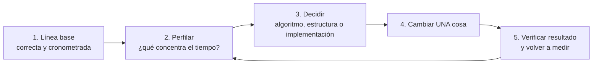

# B18-C04 — Perfilado de rendimiento

<!-- nav:top -->
<!-- /nav -->

## 1. Ubicación, nivel y alcance

Cuarta clase del bloque B18. Ya sabes repartir trabajo (C01, C02) y cómo la memoria condiciona el tiempo (C03). Falta la pregunta previa a todo eso: **¿dónde se va realmente el tiempo de mi programa?** Esta clase enseña a medirlo con un perfilador y a decidir con evidencia qué optimizar. Nivel N3.

Verás cronometrar con `time.perf_counter`, el perfilador determinista `cProfile` y las columnas `ncalls`, `tottime` y `cumtime`, la diferencia con el perfilado estadístico, el sobrecoste del propio perfilador, y el ciclo medir → decidir → cambiar → verificar. No verás perfilado de línea, de memoria, de GPU ni de aplicaciones MPI; tampoco ajuste de compiladores.

## 2. Por qué esta clase existe

Casi todo programa científico tiene un cuello de botella que el autor no sospecha. Optimizar a ojo suele mejorar lo que no importa. La pregunta motivadora es: **¿qué parte del programa debo cambiar para ganar tiempo, y cuánto puedo ganar como máximo?**

La decisión central es: **¿qué función concentra el tiempo y es el algoritmo, la estructura de datos o la implementación lo que debo cambiar?** Quien perfila antes de tocar el código evita dos pérdidas: horas optimizando lo irrelevante y errores introducidos al «mejorar» algo que no importaba.

## 3. Lo que podrás hacer al terminar

1. Cronometrar un fragmento de forma fiable (varias repeticiones, mínimo, sin medir la preparación).
2. Perfilar un programa con `cProfile` y leer `ncalls`, `tottime` y `cumtime`.
3. Predecir con un cálculo el número de llamadas de una función y compararlo con el perfil.
4. Explicar por qué un perfilador altera lo que mide.
5. Decidir si el cuello de botella es del algoritmo o de la implementación y cambiarlo.
6. Verificar que la versión optimizada da el mismo resultado y cuantificar la ganancia.

La evidencia es el **informe de perfilado** del ejercicio 12 (sección 20).

## 4. Con qué llegas y cómo comprobarlo

Necesitas B14-C01 (pruebas), B14-C02 (vectorización) y la idea de eficiencia de B18-C01. Cinco preguntas:

1. ¿Cuántos pares distintos hay entre `N` objetos?
2. ¿Qué diferencia hay entre tiempo de pared y tiempo de CPU?
3. Si una parte de un programa ocupa el 80 % del tiempo, ¿cuánto se puede acelerar el programa como máximo eliminándola por completo?
4. ¿Por qué hay que medir varias veces?
5. ¿Qué es una prueba contra un caso con respuesta conocida?

<details>
<summary>Ver respuestas</summary>

1. `N(N−1)/2`. 2. El de pared es el del reloj externo; el de CPU, el que la CPU dedicó al código. 3. Hasta 5× (queda el 20 % del tiempo: `1/0,2`). 4. Porque el tiempo varía con la carga de la máquina. 5. Una ejecución cuyo resultado se conoce de antemano, para detectar errores.
</details>

Con cuatro o cinco aciertos, sigue; con tres o menos, repasa B14-C01 y B01-C18.

## 5. Un caso real: lo que dice la documentación del perfilador

La documentación oficial de Python 3.12 (S1) distingue dos tipos de perfilado. El **determinista**, que es el de `cProfile`, observa cada llamada, retorno y excepción y mide los intervalos entre ellos. El **estadístico** muestrea periódicamente el puntero de instrucciones y deduce dónde se gasta el tiempo; añade menos sobrecoste, pero da solo indicaciones relativas. La página define las columnas: `ncalls` es el número de llamadas; `tottime`, el tiempo en la propia función sin contar las que llama; `cumtime`, el tiempo en ella y todo lo que llama. Advierte además que los perfiladores añaden sobrecoste al código Python pero no al de funciones de C, así que pueden hacer parecer más rápido el código C que el Python, y recomienda `timeit` para comparar rendimiento.

Nuestro **ejemplo conductor** es un problema de proximidad: dados `N` objetos en una región, calcular la **separación mínima**, el dato que se busca al vigilar posibles acercamientos de detritos o satélites. Los puntos son **sintéticos** (en un cubo de lado 1, unidades canónicas) y reproducibles con una semilla.

## 6. Vocabulario

Un **perfil** es un informe de cuánto tiempo gasta cada parte de un programa. Un **perfilador** es la herramienta que lo produce. Un **cuello de botella** es la parte que fija el tiempo total. El **perfilado determinista** instrumenta cada evento de llamada; el **estadístico** muestrea. El **sobrecoste** (*overhead*) es el tiempo que añade medir. La **complejidad algorítmica** describe cómo crece el trabajo con el tamaño del problema (aquí, `N²/2`). La **línea base** (*baseline*) es la versión de referencia contra la que se mide una mejora. La **regresión de rendimiento** es una versión nueva más lenta que la anterior. La **vectorización** es sustituir un bucle de Python por operaciones sobre arreglos (B14-C02).

## 7. Modelo mental: el ciclo medir, decidir, cambiar, verificar



*Descripción textual:* cinco pasos en ciclo. Se parte de una línea base correcta y cronometrada; se perfila para ver qué concentra el tiempo; se decide qué cambiar (algoritmo, estructura de datos o implementación); se cambia una sola cosa; se verifica que el resultado no cambió y se vuelve a medir, lo que lleva de nuevo a perfilar.

**Analogía y su límite.** Es como la analítica de una consulta médica: no se opera sin diagnóstico, y tras operar se vuelve a medir. Límite: un paciente no se descompone en funciones; en un programa, quitar un cuello de botella a menudo revela el siguiente, y el perfil que mides con el perfilador encendido ya no es exactamente el del programa sin él.

## 8. La explicación, paso a paso

### 8.1 Cronometrar bien

Para un fragmento corto: `time.perf_counter()` antes y después, varias repeticiones, y quedarse con el **mínimo** (el menos perturbado por otros procesos) declarando cuántas repeticiones. No se cronometra la generación de datos si no es lo que interesa, ni se cronometra una sola vez en una máquina compartida.

### 8.2 Perfilar con `cProfile`

`cProfile.Profile()` con `enable()` y `disable()` alrededor del código, y `pstats.Stats` para leerlo. Cada fila es una función: cuántas veces se llamó (`ncalls`), cuánto tiempo gastó ella misma (`tottime`) y con lo que llama (`cumtime`) (S1). Se ordena por `tottime` para ver quién consume y por `cumtime` para ver qué rama del programa es cara.

### 8.3 Leer un perfil

Primero se **comprueba** que el número de llamadas es el esperado: si en un problema de `N` objetos se espera `N(N−1)/2` llamadas a una función y el perfil dice otra cosa, el programa no hace lo que crees. Después se mira quién gasta: una función con muchas llamadas y poco tiempo por llamada es candidata a eliminar o vectorizar; una con pocas llamadas y mucho tiempo, a mejorar por dentro. Las filas de funciones internas (`{built-in method math.sqrt}`) son parte del reparto.

### 8.4 El perfilador cambia lo que mide

Instrumentar cada llamada cuesta, y cuesta más cuanto más llamadas hay (S1). Un programa con cientos de miles de llamadas pequeñas puede ir varias veces más lento bajo `cProfile`, y las funciones con muchas llamadas parecen peores de lo que son. Por eso el perfil dice **dónde mirar**, no la ganancia real: ésta se mide después, sin perfilador, con `perf_counter` (sección 8.1).

### 8.5 Algoritmo, estructura o implementación

El perfil del ejemplo muestra `N(N−1)/2` llamadas: eso es el algoritmo (todos contra todos). Cambiar la implementación (vectorizar con NumPy) reduce el coste por par, pero el trabajo sigue siendo cuadrático. Cambiar el algoritmo (por ejemplo, una rejilla espacial que solo compare vecinos) cambia la complejidad, pero queda fuera de esta clase. Distinguir cuál de los tres es el problema evita optimizar donde no se puede ganar mucho.

### 8.6 Cuánto se puede ganar como máximo

Si una parte ocupa una fracción `f` del tiempo y la aceleras `a` veces, la aceleración del conjunto es `1 / ((1 − f) + f/a)`; si la eliminaras (`a → ∞`), `1/(1 − f)`. Es el mismo argumento de las leyes de escalado que verás en C05, aplicado a una función en lugar de a un procesador. Antes de invertir esfuerzo, calcula este techo.

## 9. Magnitudes, símbolos y unidades

| Símbolo | Qué es | Unidad | Nota |
|---|---|---|---|
| `N` | número de objetos | adimensional | 600 en el laboratorio |
| `ncalls` | número de llamadas | adimensional | esperado `N(N−1)/2` |
| `tottime` | tiempo propio de una función | s | sin sus subllamadas |
| `cumtime` | tiempo acumulado | s | con sus subllamadas |
| `f` | fracción del tiempo total en una parte | adimensional | `tottime / tiempo total` |
| `a` | aceleración de esa parte | adimensional | |
| `d_min` | separación mínima | adimensional (unidades canónicas) | |

## 10. Convenciones y referencias

Puntos sintéticos `(x, y, z)` en `[0, 1)³`, con `random.Random(20261105)`; distancia euclídea; unidades canónicas. Entorno: Python 3.12.9, NumPy 2.4.4, Windows 11, CPU i7-8550U; el equipo tenía otras tareas en marcha, así que **los tiempos varían mucho entre ejecuciones** (se observó una primera ejecución del perfil que tardó 0,615 s y otra 1,551 s para el mismo código). Se informa la corrida cuyos resultados se copian en la sección 17; los recuentos de llamadas, en cambio, son deterministas.

## 11. De dónde sale lo que afirmamos

| ID | Fuente | Localizador | Respalda | Estado |
|---|---|---|---|---|
| S1 | Python Software Foundation, *The Python Profilers* (3.12) | https://docs.python.org/3.12/library/profile.html | Perfilado determinista frente a estadístico; columnas `ncalls`, `tottime`, `cumtime`; sobrecoste; recomendación de `timeit` | Consultada el 2026-11-05 (mutable); leída a través de un resumen automático |

Límites: la fórmula de la sección 8.6 es una deducción algebraica (la comprueba el ejercicio 4), no una cita; su vínculo con la ley de Amdahl se desarrolla en C05. No se ejecutó `timeit` ni perfilado estadístico en el laboratorio.

## 12. Cómo leer el perfil

Tabla de lectura de las filas del perfil del ejemplo (versión accesible de la salida de `pstats`).

| Fila | Qué significa | Qué decide |
|---|---|---|
| `separacion_minima_python`, 1 llamada, `tottime` alto | el doble bucle y su comparación | el coste del recorrido |
| `distancia`, `N(N−1)/2` llamadas | una llamada por par | candidata a vectorizar |
| `math.sqrt`, mismas llamadas | la raíz de cada par | coste menor, ligado a la anterior |

## 13. Ejemplo trabajado: separación mínima de 600 objetos

1. **Línea base correcta.** Antes de medir, el laboratorio prueba la función con una recta de puntos separados 1 en 1: la separación mínima debe ser **exactamente 1**.
2. **Predicción.** Con `N = 600` hay `600 · 599 / 2 = 179 700` pares, luego `distancia()` debe llamarse 179 700 veces.
3. **Perfil.** `cProfile` informa 179 700 llamadas a `distancia` y 359 403 llamadas en total (hay una llamada a `distancia` y otra a `math.sqrt` por par, más unas pocas del propio perfilador): la predicción se cumple exactamente.
4. **Reparto.** En la corrida copiada: `separacion_minima_python` 0,751 s propios (48 %), `distancia` 0,565 s (36 %), `math.sqrt` 0,234 s (15 %), sobre 1,551 s totales perfilados.
5. **Techo.** Si `distancia` + `sqrt` (≈ 51,5 %) desaparecieran, `1/(1 − 0,515) ≈ 2,1×`; el bucle quedaría. Para ganar más hay que cambiar también el recorrido: vectorizar por filas.
6. **Cambio.** Versión B: una fila contra todas las siguientes con NumPy; mismo problema, mismo resultado.
7. **Verificación y medición.** A y B coinciden con error relativo menor que 10⁻¹²; sin perfilador, A tarda 0,208 s y B 32,8 ms: razón **6,3**. Con el perfilador, A tarda 0,527 s: sobrecoste ×2,53.
8. **Llamadas.** Bajo el perfil, A hace 359 403 llamadas y B, 4 197.
9. **Incertidumbre.** Los tiempos de A y B cambian mucho entre ejecuciones (la razón A/B fue 10,2 en una corrida y 6,3 en otra, ambas del mismo código en la misma máquina cargada). La conclusión sólida es que B es varias veces más rápida; la cifra exacta no es reproducible. Seguiría quedando el costo cuadrático: con `N = 10⁶`, `N(N−1)/2 ≈ 5 × 10¹¹` pares.

## 14. Comparación: cronómetro, perfil determinista y perfil estadístico

El cronómetro (`perf_counter`, `timeit`) mide el total de un fragmento con poca perturbación y es la herramienta para **comparar** versiones. El perfilador determinista (`cProfile`) da el recuento exacto de llamadas y un reparto de tiempo por función, a costa de sobrecoste proporcional al número de llamadas. El perfilado estadístico perturba menos y sirve para programas largos, pero da solo proporciones aproximadas y no cuenta llamadas (S1). La práctica sensata: perfil para encontrar, cronómetro para confirmar.

## 15. Práctica guiada

**Ejercicio 1 · con los pasos.** Predice cuántas veces se llama a `distancia()` para `N = 1000`. *Pasos:* pares distintos.

<details><summary>Solución comentada</summary>

`1000 · 999 / 2 = 499 500`. Si el perfil mostrara 999 000, el programa estaría comparando cada par dos veces (a con b y b con a).
</details>

**Ejercicio 2 · con una pista.** En un perfil, una función tiene `tottime = 0,02 s` y `cumtime = 3,5 s`. ¿Dónde se gasta el tiempo? *Pista:* ¿qué incluye `cumtime`?

<details><summary>Solución comentada</summary>

Casi todo el tiempo está en lo que ella llama, no en ella (S1). El camino a seguir es mirar las filas de sus subllamadas, no optimizar esa función.
</details>

**Ejercicio 3 · casi autónomo.** Una función ocupa el 60 % del tiempo. La haces 4 veces más rápida. ¿Cuánto se acelera el programa? ¿Y si la eliminaras?

<details><summary>Solución comentada</summary>

`1 / (0,4 + 0,6/4) = 1 / 0,55 ≈ 1,82`. Eliminada: `1 / 0,4 = 2,5`. La parte no mejorada fija el techo (sección 8.6).
</details>

## 16. Práctica autónoma, transferencia e integrador

**Ejercicio 4.** Deduce la fórmula de la sección 8.6: parte del tiempo original `T = 1 = (1 − f) + f`; la parte `f` pasa a durar `f/a`.

<details><summary>Solución comentada</summary>

Tiempo nuevo `T' = (1 − f) + f/a`. Aceleración `T/T' = 1/((1 − f) + f/a)`. Con `a → ∞`, `1/(1 − f)`. Es el mismo razonamiento que la ley de Amdahl (C05).
</details>

**Ejercicio 5.** En el perfil del ejemplo, `distancia + sqrt` suman `0,565 + 0,234 = 0,799 s` de `1,551 s`. Calcula `f` y el techo si se eliminan.

<details><summary>Solución comentada</summary>

`f = 0,799 / 1,551 ≈ 0,515`; techo `1/(1 − 0,515) ≈ 2,06`. Es un techo bajo el perfilador (sección 8.4), no la ganancia real.
</details>

**Ejercicio 6.** El laboratorio midió A = 0,208 s sin perfilador y 0,527 s con él. Calcula el sobrecoste y explica por qué no basta el perfil para decidir una ganancia.

<details><summary>Solución comentada</summary>

`0,527 / 0,208 ≈ 2,53`. El perfilador instrumenta ~359 000 eventos y por eso la función con más llamadas pesa más en el perfil que en el programa real; la ganancia real se mide con cronómetro.
</details>

**Ejercicio 7.** Con `N = 10⁶` y 1 µs por par, ¿cuántos días tarda la versión de todos contra todos?

<details><summary>Solución comentada</summary>

`N(N−1)/2 ≈ 5 × 10¹¹` pares × 10⁻⁶ s = 5 × 10⁵ s ≈ 5,8 días. Aunque se vectorice 100×, serían ~1,4 h: el problema es el algoritmo.
</details>

**Ejercicio 8.** Tu perfil muestra 998 001 llamadas a `distancia` en un problema de 1000 objetos. ¿Qué sospechas?

<details><summary>Solución comentada</summary>

`998 001 = 999²`. No coincide con `N(N−1)/2 = 499 500` ni con `N(N−1) = 999 000`. Sugiere un bucle doble de 999 × 999 iteraciones: mira los rangos de `i` y `j`, porque el programa no hace lo que crees (compara pares repetidos y se salta objetos). La lección es contrastar siempre el recuento con la predicción.
</details>

**Ejercicio 9 · transferencia.** Un programa de reducción de imágenes pasa el 90 % del tiempo leyendo archivos del disco. Un colega quiere reescribir el filtro numérico, que ocupa el 8 %. ¿Qué le dices y qué techo calculas?

<details><summary>Solución comentada</summary>

Que perfile antes. Eliminando por completo el filtro, el techo es `1/(1 − 0,08) ≈ 1,09`. La parte que domina es la lectura: si es E/S, tal vez hilos (C01) o mejor formato de archivo.
</details>

**Ejercicio 10 · transferencia.** Un perfil de un código que llama a NumPy dentro de un bucle muestra que casi todo el tiempo cae en filas `{built-in method …}` de NumPy. ¿Qué conviene mirar y por qué el perfil de Python puede engañar?

<details><summary>Solución comentada</summary>

El tiempo está en código C que el perfilador no desglosa y cuyo coste no se ve inflado (S1). Conviene vectorizar para sacar el bucle de Python, medir con cronómetro y, si hace falta, usar una herramienta que vea código nativo (no cubierta aquí).
</details>

**Ejercicio 11 · transferencia.** Tras optimizar, tu programa es 3× más rápido pero el resultado difiere en la octava cifra. ¿Qué haces antes de aceptarlo?

<details><summary>Solución comentada</summary>

Comprobar si la diferencia cae dentro de una tolerancia justificada (reordenar sumas la altera, como en C02) y contrastar ambas versiones contra un caso con respuesta exacta. Si no hay tolerancia declarada, no se acepta la mejora: la rapidez no compensa un resultado sin validar.
</details>

**Ejercicio 12 · integrador.** Entrega un informe de perfilado de un programa tuyo (≥ 30 líneas): línea base con prueba de corrección, predicción de un recuento de llamadas, perfil (3 filas con más `tottime` interpretadas), techo calculado, un cambio, verificación de que el resultado no cambió, tiempos antes y después sin perfilador (mínimo de ≥ 3 repeticiones) y una nota sobre qué no puedes concluir.

<details><summary>Solución modelo</summary>

Se acepta cualquier solución que: (1) pruebe la línea base con un caso conocido; (2) compare el recuento previsto con el real; (3) calcule el techo antes de optimizar; (4) cambie una sola cosa; (5) mida sin perfilador; (6) declare datos sintéticos u observados y el entorno; (7) no atribuya la ganancia a una causa que no aisló.
</details>

## 17. Laboratorio

El script [perfilado.py](perfilado.py) construye 600 puntos sintéticos, comprueba la función con una recta de separación exacta 1, perfila la versión de Python puro, verifica que el recuento de llamadas sea exactamente `N(N−1)/2`, compara con la versión NumPy y mide el sobrecoste del perfilador.

**Datos:** sintéticos. **Predice antes de ejecutar:** ¿cuántas llamadas a `distancia`? (179 700.) **Ejecución del 2026-11-05 (Python 3.12.9, NumPy 2.4.4):**

```text
Python 3.12.9  NumPy 2.4.4
N=600: llamadas a distancia() = 179700 (esperado N(N-1)/2 = 179700)
--- cProfile: 359403 llamadas, 1.551 s en total (4 filas con más tottime) ---
  ncalls  tottime  cumtime  función
       1    0.751    1.551  separacion_minima_python
  179700    0.565    0.800  distancia
  179700    0.234    0.234  <built-in method math.sqrt>
       1    0.000    0.000  <method 'disable' of '_lsprof.Profiler' objects>
separación mínima = 0.014428
A (Python puro):  0.208 s | con cProfile:  0.527 s (sobrecoste x2.53) | B (NumPy):   32.82 ms | razón A/B =    6.3
llamadas totales perfiladas: A = 359403 ; B = 4197
Pruebas superadas.
```

```bash
python programa/clases/B18/B18-C04-perfilado-de-rendimiento/perfilado.py
```

**Límites:** máquina cargada; los tiempos varían entre ejecuciones (la razón A/B fue 10,2 en una corrida previa); solo los recuentos de llamadas son deterministas. No se ejecutó perfilado estadístico ni `timeit`.

## 18. Errores frecuentes y cómo corregirlos

**Optimizar sin perfilar.** Se corrige con el ejercicio 9.

**Tomar el reparto del perfil como la ganancia real.** Se corrige con el ejercicio 6.

**Confundir `tottime` y `cumtime`.** Se corrige con el ejercicio 2.

**No comparar el recuento de llamadas con la predicción.** Se corrige con los ejercicios 1 y 8.

**Aceptar una mejora sin verificar el resultado.** Se corrige con el ejercicio 11.

## 19. Cómo sabrás que vas bien

Tras 8.3: ¿predices el recuento de llamadas de tu programa antes de perfilar? Si no, rehaz el ejercicio 1. Tras 8.6: ¿calculas el techo de una mejora? Si no, rehaz el 3. Tras el ejemplo trabajado: ¿por qué el perfil dice 36 % para `distancia` y el sobrecoste es ×2,53? Si no puedes explicarlo, rehaz el 6. Tras el laboratorio: ¿qué prueba detectaría que B cambia el resultado? Al final: ¿qué parte de tu informe no repetirías sin perfilador?

## 20. Qué entregas y cómo se evalúa

El producto es tu **informe de perfilado** del ejercicio 12.

| Criterio | Inicial | En desarrollo | Logrado | Destacado |
|---|---|---|---|---|
| Línea base | Sin prueba | Resultado a ojo | Prueba con caso conocido | Varios casos y tolerancia justificada |
| Lectura del perfil | Copia la salida | Identifica la fila principal | Predice y contrasta recuentos | Distingue algoritmo de implementación |
| Decisión | Intuición | Cita el perfil | Calcula el techo antes de cambiar | Descarta cambios por su techo |
| Honestidad | Presenta el perfil como ganancia | Mezcla | Mide sin perfilador y declara ruido | Aísla la causa de la mejora |

**Condiciones críticas:** no aceptar una optimización sin verificar el resultado; no presentar el reparto bajo perfilador como ganancia medida; no omitir el entorno.

## 21. Ética, seguridad y límites

Perfilar código de otros equipos o de datos protegidos exige permiso; el perfil puede revelar la estructura interna de un sistema. Una optimización mal verificada en software de misión es un riesgo: este laboratorio es educativo y no valida software de vuelo. El tiempo y la energía ahorrados no justifican resultados no validados. Accesibilidad: el ciclo tiene descripción textual y la lectura del perfil tiene tabla.

## 22. Para cerrar y seguir

Perfilar es medir antes de decidir: se predice el recuento de llamadas, se lee `tottime` y `cumtime`, se calcula el techo de la mejora, se cambia una cosa y se verifica el resultado con un cronómetro, sin el perfilador encendido. Queda abierta una pregunta: si ya sabes qué parte es lenta y la repartes entre procesadores, ¿cuánto escala de verdad el conjunto?

**Glosario español–inglés.** perfilador · *profiler*; cuello de botella · *bottleneck*; sobrecoste · *overhead*; línea base · *baseline*; llamada · *call*; tiempo propio / acumulado · *total time / cumulative time*; vectorización · *vectorization*; regresión de rendimiento · *performance regression*.

**Continuidad.** B18-C05 usa el techo del paso 8.6 en su forma general (ley de Amdahl) y enseña a medir cómo escala un programa al añadir procesadores.

**Referencias:** ver sección 11.

<!-- nav:bottom -->
<!-- /nav -->
