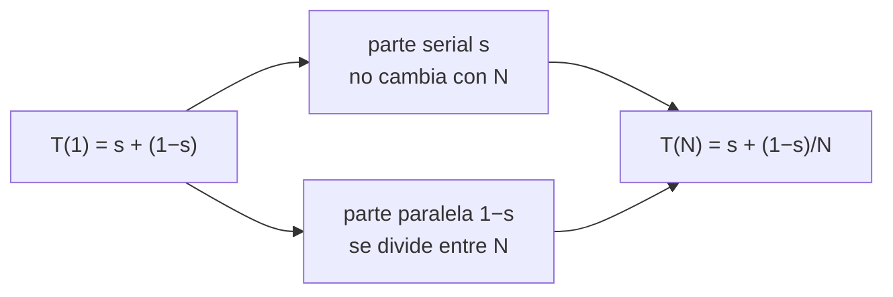

# B18-C05 — Experimentos de escalabilidad

<!-- nav:top -->
[🏠 Programa](../../../../README.md) · [📚 Bloque B18](../../../tronco-comun/B18-computacion-de-alto-rendimiento.md) · [← Anterior: B18-C04 — Perfilado de rendimiento](../B18-C04-perfilado-de-rendimiento/CLASE.md) · [Siguiente: B19-C01 — Priors físicamente informados →](../../B19/B19-C01-priors-fisicamente-informados/CLASE.md)
<!-- /nav -->

## 1. Ubicación, nivel y alcance

Quinta y última clase del bloque B18. Ya sabes repartir trabajo (C01, C02), cómo la memoria lo limita (C03) y dónde se va el tiempo (C04). Aquí aprendes a **medir y predecir cuánto mejora un programa al añadirle procesadores**: escalado fuerte y débil, la ley de Amdahl, la de Gustafson y la métrica de Karp–Flatt. Nivel N3 → N4.

Verás cómo diseñar un experimento de escalado, calcular aceleración y eficiencia, deducir las dos leyes y diagnosticar por qué un programa no escala. No verás optimización de redes, balanceo dinámico de carga ni GPU.

## 2. Por qué esta clase existe

Un grupo pide tiempo en un clúster para propagar un catálogo grande de órbitas. Antes de pedir mil núcleos hay que saber si el programa los aprovechará. La pregunta motivadora es: **¿cuántos procesadores tiene sentido usar, y cómo lo demuestro con datos?**

La decisión central es: **¿mi problema crece con los procesadores (escalado débil) o es fijo (escalado fuerte), y qué fracción del tiempo no se paraleliza?** Responderla evita pedir recursos que no se usarán y presentar como «escalabilidad» una medición sin método.

## 3. Lo que podrás hacer al terminar

1. Distinguir escalado fuerte y débil y elegir el experimento adecuado.
2. Calcular aceleración, eficiencia y métrica de Karp–Flatt a partir de tiempos.
3. Deducir la ley de Amdahl y la de Gustafson y decir cuándo aplica cada una.
4. Diseñar un experimento de escalado con repeticiones, línea base serie y entorno declarado.
5. Diagnosticar si una pérdida de eficiencia es fracción serial o sobrecoste creciente.
6. Comprobar que el resultado paralelo coincide con el serie.

La evidencia es el **informe de escalado** del ejercicio 12 (sección 20).

## 4. Con qué llegas y cómo comprobarlo

Necesitas B18-C01 a C04. Cinco preguntas:

1. Si una tarea dura 20 s en serie y 8 s con 4 procesos, ¿cuál es la aceleración?
2. ¿Qué es la eficiencia de ese caso?
3. Si el 10 % de un programa es serial, ¿qué fracción es paralelizable?
4. ¿Por qué hay que comprobar que el resultado paralelo no cambia?
5. ¿Qué fracción del tiempo ocupa una parte que dura 3 s de 12 s?

<details>
<summary>Ver respuestas</summary>

1. `20/8 = 2,5`. 2. `2,5/4 = 0,625`. 3. 90 %. 4. Porque un paralelismo mal hecho puede dar resultados erróneos más rápido. 5. 25 %.
</details>

Con cuatro o cinco aciertos, sigue; con tres o menos, repasa B18-C01 y C04.

## 5. Un caso real: dos artículos y una pregunta de método

Gene Amdahl publicó en 1967 «Validity of the single processor approach to achieving large scale computing capabilities» en las actas de la AFIPS Spring Joint Computer Conference (S1), y John Gustafson, en 1988, «Reevaluating Amdahl's law» en *Communications of the ACM*, vol. 31, n.º 5, pp. 532–533 (S2). Solo pude verificar sus datos bibliográficos en el registro Crossref; **no leí los artículos**. Una página enciclopédica secundaria (S3) da la forma `S(N) = 1/((1−p) + p/N)` de la ley de Amdahl y su límite `1/(1−p)`; en esta clase deduzco ambas leyes yo mismo y las compruebo en el laboratorio, sin apoyarme en lo que dicen los artículos.

Nuestro **ejemplo conductor** es el lote de órbitas circulares simuladas de las clases anteriores (unidades canónicas, *leapfrog* en Python puro), repartido con `multiprocessing` en 1, 2, 4 y 8 procesos.

## 6. Vocabulario

El **escalado fuerte** mantiene fijo el tamaño del problema y aumenta los procesadores `N`. El **escalado débil** aumenta el problema con `N` (trabajo por procesador constante). La **aceleración** es `S(N) = T(1)/T(N)`, con `T` el tiempo de pared. La **eficiencia** es `E = S/N`. La **fracción serial** `s` es la parte del tiempo en un procesador que no se puede repartir; la paralelizable es `1 − s`. La **línea base** es el mejor código serie, no el código paralelo con un proceso. El **sobrecoste** es el tiempo extra de arrancar, comunicar y sincronizar. La **escalabilidad** es cómo cambian `S` y `E` con `N`.

## 7. Modelo mental: una parte que no se divide



*Descripción textual:* el tiempo con un procesador se separa en una parte serial `s`, que no cambia al añadir procesadores, y una parte paralela `1−s`, que se divide entre `N`. La suma da `T(N) = s + (1−s)/N` en unidades de `T(1)`.

**Analogía y su límite.** Una obra con un tramo que solo puede hacer una persona (el permiso) y otro que se reparte entre cuadrillas. Límite: en una obra real añadir gente también crea trabajo de coordinación; el modelo simple lo ignora, y justamente ese sobrecoste es lo que Karp–Flatt ayuda a detectar.

## 8. La explicación, paso a paso

### 8.1 Ley de Amdahl (escalado fuerte)

Con el trabajo fijo, `T(N) = T(1)[s + (1−s)/N]`. Luego `S(N) = 1/(s + (1−s)/N)`. Cuando `N` crece, `S` tiende a `1/s`: con `s = 0,05` el techo es 20 aunque haya mil procesadores. Con `s = 0,05` y `N = 8`: `S = 1/(0,05 + 0,95/8) = 5,9259`.

### 8.2 Ley de Gustafson (escalado débil)

Ahora el problema crece con `N` y el tiempo en la máquina paralela es fijo, de valor 1: una fracción `s` serial y `1−s` paralela ejecutada por `N` procesadores. El mismo trabajo en un solo procesador tardaría `s + N(1−s)`. Por tanto `S_G(N) = s + N(1−s) = N − s(N−1)`. Con `s = 0,05` y `N = 8`: `7,65`; con `N = 64`: `60,85`. **Ojo:** aquí `s` se mide sobre la ejecución paralela, no sobre la de un procesador; no son la misma `s` que en Amdahl.

### 8.3 Karp–Flatt: estimar la fracción serial

De `1/S = s + (1−s)/N` se despeja `s = (1/S − 1/N)/(1 − 1/N)`. Esa `e(N)` se calcula con cada medición. Si `e` es constante al variar `N`, la pérdida se explica por una fracción serial. Si **crece** con `N`, hay sobrecoste que crece (comunicación, contención de memoria, desequilibrio, núcleos compartidos).

### 8.4 Diseño del experimento

(1) Baseline serie declarada. (2) Misma máquina, mismo software y versiones. (3) Calentamiento para no medir el arranque. (4) Varias repeticiones y mínimo o mediana, con dispersión. (5) Comprobar en cada caso que el resultado coincide con el serie. (6) Declarar carga de la máquina, núcleos físicos y lógicos. (7) Informar `T`, `S`, `E` y `e` en tabla.

### 8.5 Núcleos físicos y lógicos

Una CPU de 4 núcleos físicos con 8 hilos lógicos no da 8 veces el rendimiento de un núcleo: los hilos lógicos comparten recursos. Más procesos que núcleos físicos suelen dar eficiencia decreciente.

## 9. Magnitudes, símbolos y unidades

| Símbolo | Qué es | Unidad | Nota |
|---|---|---|---|
| `N` | procesos o procesadores | adimensional | 1, 2, 4, 8 |
| `T(N)` | tiempo de pared | s | mínimo de repeticiones |
| `S(N)` | aceleración `T(1)/T(N)` | adimensional | |
| `E(N)` | eficiencia `S/N` | adimensional | ideal 1 |
| `s` | fracción serial | adimensional | `0 ≤ s ≤ 1` |
| `e(N)` | Karp–Flatt | adimensional | estimación de `s` |
| `S_G(N)` | aceleración escalada | adimensional | `N − s(N−1)` |

## 10. Convenciones y referencias

Datos **simulados** (órbitas en unidades canónicas) y tiempos **observados** en esta máquina: i7-8550U, 4 núcleos físicos y 8 lógicos, Windows 11, Python 3.12.9, `multiprocessing.Pool`. El equipo estaba cargado por otras tareas. En el escalado fuerte, la línea base `T(1)` se midió con un `Pool` de un proceso (incluye el coste de comunicación), no con código serie puro: es una limitación declarada. Escalado fuerte: 16 órbitas de 100 000 pasos; débil: 2 órbitas por proceso.

## 11. De dónde sale lo que afirmamos

| ID | Fuente | Localizador | Respalda | Estado |
|---|---|---|---|---|
| S1 | G. M. Amdahl, «Validity of the single processor approach…», AFIPS '67 (Spring), p. 483 | doi:10.1145/1465482.1465560 (vía api.crossref.org) | Existencia y datos bibliográficos | Consultada el 2026-11-05; solo metadatos, **artículo no leído** |
| S2 | J. L. Gustafson, «Reevaluating Amdahl's law», CACM 31(5), 532–533, 1988 | doi:10.1145/42411.42415 (vía api.crossref.org) | Existencia y datos bibliográficos | Consultada el 2026-11-05; solo metadatos, **artículo no leído** (la página de ACM devolvió 403) |
| S3 | Wikipedia, «Amdahl's law» | https://en.wikipedia.org/wiki/Amdahl%27s_law | Forma `1/((1−p)+p/N)` y límite `1/(1−p)` (fuente secundaria) | Consultada el 2026-11-05; no sostiene decisiones |
| S4 | Python Software Foundation, *multiprocessing* (3.12) | https://docs.python.org/3.12/library/multiprocessing.html | Uso de subprocesos y `Pool` | Consultada el 2026-11-05; lectura parcial (100 000 de 155 262 caracteres) |

Límites: la deducción de las dos leyes y de Karp–Flatt es propia (álgebra comprobada en el laboratorio); no se contrastó con los textos originales. El nombre de la métrica de Karp–Flatt no se verificó en una fuente.

## 12. Cómo ver el escalado

Tabla de valores teóricos con `s = 0,05` (versión accesible de una gráfica `S` frente a `N`).

| `N` | Amdahl `S` | Gustafson `S_G` |
|---|---|---|
| 2 | 1,9048 | 1,95 |
| 4 | 3,4783 | 3,85 |
| 8 | 5,9259 | 7,65 |
| 16 | 9,1429 | 15,25 |
| 64 | 15,4217 | 60,85 |

## 13. Ejemplo trabajado: leer una tabla de escalado

Medición real (laboratorio, mínimo de 2 repeticiones):

1. `T(1) = 2,495 s`; `T(2) = 1,379`; `T(4) = 1,366`; `T(8) = 0,918`.
2. Aceleraciones: 1,81; 1,83; 2,72. Eficiencias: 0,90; 0,46; 0,34.
3. Karp–Flatt: `e(2) = 0,105`; `e(4) = 0,397`; `e(8) = 0,278`.
4. **Lectura.** `e` no es constante: no es solo una fracción serial. Con 2 procesos `e ≈ 0,10`; con 4 sube a ~0,40, justo donde se agotan los 4 núcleos físicos libres de una máquina cargada. Hipótesis: contención por núcleos compartidos y arranque; no se aisló cuál domina.
5. Escalado débil (2 órbitas por proceso): eficiencia `T(1)/T(N)` = 1,01; 0,57; 0,49. Con 2 procesos escala bien; con 4 y 8 cae a la mitad.
6. **Incertidumbre.** Una sola serie de medidas, máquina cargada, línea base con `Pool(1)`. Solo es fiable el patrón (la eficiencia cae al pasar de 2 a 4), no las cifras exactas.

## 14. Comparación: fuerte, débil y métrica

El escalado fuerte responde «¿cuánto más rápido resuelvo este problema?» y está limitado por Amdahl. El débil responde «¿cuánto más grande puedo resolver en el mismo tiempo?» y es más favorable cuando la parte serial no crece. Karp–Flatt no predice: diagnostica. Ninguna ley sustituye medir.

## 15. Práctica guiada

**Ejercicio 1 · con los pasos.** Con `s = 0,10`, calcula Amdahl para `N = 8` y el límite.

<details><summary>Solución comentada</summary>

`S = 1/(0,10 + 0,90/8) = 1/0,2125 = 4,706`. Límite `1/s = 10`.
</details>

**Ejercicio 2 · con una pista.** Con `s = 0,05`, calcula Gustafson para `N = 16`. *Pista:* `N − s(N−1)`.

<details><summary>Solución comentada</summary>

`16 − 0,05 · 15 = 15,25`.
</details>

**Ejercicio 3 · casi autónomo.** Mides `T(1) = 100 s` y `T(4) = 40 s`. Calcula `S`, `E` y `e(4)`.

<details><summary>Solución comentada</summary>

`S = 2,5`; `E = 0,625`; `e = (0,4 − 0,25)/(1 − 0,25) = 0,2`.
</details>

## 16. Práctica autónoma, transferencia e integrador

**Ejercicio 4.** Deduce `S(N)` de Amdahl partiendo de `T(N) = T(1)[s + (1−s)/N]`.

<details><summary>Solución comentada</summary>

`S = T(1)/T(N) = 1/(s + (1−s)/N)`; con `N → ∞`, `1/s`.
</details>

**Ejercicio 5.** Si `s = 0,02`, ¿qué `N` da `S = 33,56`? Verifica con `N = 100`.

<details><summary>Solución comentada</summary>

`S(100) = 1/(0,02 + 0,98/100) = 1/0,0298 = 33,56`. Techo 50.
</details>

**Ejercicio 6.** Con los tiempos del ejemplo, ¿qué `s` de Karp–Flatt esperarías si fuera Amdahl puro y por qué no coincide?

<details><summary>Solución comentada</summary>

Debería ser constante (≈ 0,10 si se tomara `N = 2`). Salen 0,105, 0,397 y 0,278: no constante, luego hay sobrecoste o contención que crecen con `N`.
</details>

**Ejercicio 7.** ¿Por qué la línea base debe ser el mejor código serie y no el paralelo con un proceso?

<details><summary>Solución comentada</summary>

Un `Pool(1)` incluye comunicación y arranque y hace parecer mejor el escalado (aceleración relativa inflada). Es una limitación de este laboratorio que debe declararse.
</details>

**Ejercicio 8.** Convierte la eficiencia débil 0,49 con `N = 8` en tiempo: si `T(1) = 0,306 s`, ¿cuánto vale `T(8)`?

<details><summary>Solución comentada</summary>

`T(8) = 0,306/0,49 ≈ 0,62 s`; el laboratorio midió 0,630 s.
</details>

**Ejercicio 9 · transferencia.** Un simulador gasta 4 % en leer entrada en un solo proceso y el resto es paralelizable. ¿Qué techo tiene y cuántos procesos justifican el 90 % del techo?

<details><summary>Solución comentada</summary>

Techo `1/0,04 = 25`. Para `S = 22,5`: `0,04 + 0,96/N = 1/22,5 = 0,04444`, `N = 0,96/0,00444 ≈ 216`. Más procesos rinden muy poco.
</details>

**Ejercicio 10 · transferencia.** Un equipo pide 1000 núcleos porque «su malla es enorme». ¿Qué experimentos pides antes?

<details><summary>Solución comentada</summary>

Escalado fuerte y débil en pocos núcleos, con Karp–Flatt, para estimar `s` y tendencia del sobrecoste; luego extrapolar con cautela y justificar la solicitud.
</details>

**Ejercicio 11 · transferencia.** Un colega informa «escalabilidad perfecta» con 4 procesos, una sola ejecución. Critícalo.

<details><summary>Solución comentada</summary>

Una medición en máquina compartida no sustenta la afirmación: faltan repeticiones, dispersión, línea base serie, comprobación de resultados y entorno declarado.
</details>

**Ejercicio 12 · integrador.** Entrega un informe de escalado de un programa tuyo: línea base serie, N = 1, 2, 4, 8, repeticiones, tabla de `T`, `S`, `E`, `e`, comprobación de resultados idénticos, entorno y carga, y conclusiones acotadas.

<details><summary>Solución modelo</summary>

Se acepta cualquier informe con las siete partes, datos rotulados y sin conclusiones más allá de lo medido.
</details>

## 17. Laboratorio

El script [escalabilidad.py](escalabilidad.py) verifica las fórmulas contra valores exactos, comprueba que Karp–Flatt recupera `s = 0,08` de tiempos sintéticos y mide el escalado fuerte y débil del lote de órbitas.

**Datos:** simulados (modelo) y observados (tiempos). **Ejecución del 2026-11-05 (Python 3.12.9, 8 CPU lógicas):**

```text
Python 3.12.9  CPU lógicas=8
Amdahl s=0.05: N=8 -> 5.9259 ; límite 1/s = 20.0
Gustafson s=0.05: N=8 -> 7.65
Karp-Flatt sobre tiempos sintéticos recupera s = 0.08 exactamente.
ESCALADO FUERTE (16 órbitas fijas)
 N | tiempo (s) | aceleración | eficiencia | Karp-Flatt e
 1 |      2.495 |        1.00 |       1.00 |      nan
 2 |      1.379 |        1.81 |       0.90 |    0.105
 4 |      1.366 |        1.83 |       0.46 |    0.396
 8 |      0.918 |        2.72 |       0.34 |    0.277
ESCALADO DÉBIL (2 órbitas por proceso)
 N | tiempo (s) | eficiencia débil T(1)/T(N)
 1 |      0.306 |     1.00
 2 |      0.303 |     1.01
 4 |      0.537 |     0.57
 8 |      0.630 |     0.49
Pruebas superadas.
```

```bash
python programa/clases/B18/B18-C05-experimentos-de-escalabilidad/escalabilidad.py
```

**Límites:** máquina cargada, una sola serie de medidas, línea base con `Pool(1)`; las cifras absolutas no son reproducibles. (En el ejemplo trabajado se redondea `e(4)` a 0,397; el script imprime 0,396.)

## 18. Errores frecuentes y cómo corregirlos

**Línea base inadecuada.** Ejercicio 7. **Confundir las dos `s`.** Sección 8.2. **Concluir con una sola medición.** Ejercicio 11. **Ignorar núcleos físicos.** Sección 8.5. **No verificar resultados.** Laboratorio.

## 19. Cómo sabrás que vas bien

Tras 8.1: ¿calculas el techo de `s = 0,05`? Tras 8.3: ¿distingues `e` constante de creciente? Tras el ejemplo: ¿qué no puedes concluir? Si no lo sabes, rehaz los ejercicios 3 y 6.

## 20. Qué entregas y cómo se evalúa

El producto es tu **informe de escalado** del ejercicio 12.

| Criterio | Inicial | En desarrollo | Logrado | Destacado |
|---|---|---|---|---|
| Diseño | Sin método | Parcial | Siete partes de 8.4 | Anticipa amenazas |
| Análisis | Solo `S` | `S` y `E` | Añade `e` e interpreta | Distingue serial de sobrecoste |
| Corrección | Sin comprobar | A ojo | Resultados idénticos | Con tolerancia justificada |
| Honestidad | Extrapola sin base | Mezcla | Acota a lo medido | Declara limitaciones |

**Condiciones críticas:** no extrapolar más allá de lo medido sin decirlo; no omitir la comprobación de resultados; no ocultar la carga de la máquina.

## 21. Ética, seguridad y límites

Pedir recursos de cómputo compartidos exige justificación con datos; el escalado perfecto aparente puede desperdiciar energía. Estos resultados son educativos y no sirven para dimensionar sistemas de misión. Accesibilidad: diagrama con descripción textual y tablas equivalentes.

## 22. Para cerrar y seguir

Escalar es medir con método: fuerte o débil, línea base serie, repeticiones, resultados verificados y Karp–Flatt para saber si lo que pierdes es fracción serial o sobrecoste. Queda abierta una pregunta: ¿qué límites aparecen cuando el sobrecoste depende de la red y no de un solo equipo?

**Glosario español–inglés.** escalado fuerte · *strong scaling*; escalado débil · *weak scaling*; aceleración · *speedup*; eficiencia · *efficiency*; fracción serial · *serial fraction*; sobrecoste · *overhead*; línea base · *baseline*.

**Continuidad.** Cierra el bloque B18; los bloques siguientes de A02 usan estos criterios para justificar el cómputo de sus simulaciones.

**Referencias:** ver sección 11.

<!-- nav:bottom -->
---

[← Anterior: B18-C04 — Perfilado de rendimiento](../B18-C04-perfilado-de-rendimiento/CLASE.md) · [📚 Bloque B18](../../../tronco-comun/B18-computacion-de-alto-rendimiento.md) · [Siguiente: B19-C01 — Priors físicamente informados →](../../B19/B19-C01-priors-fisicamente-informados/CLASE.md)
<!-- /nav -->
