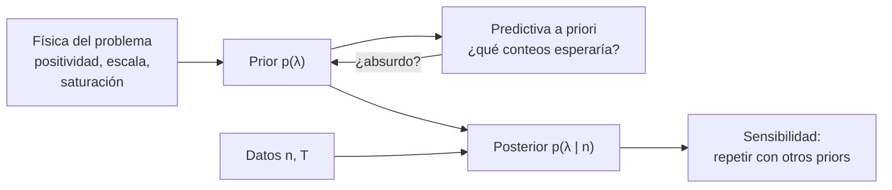

# B19-C01 — Priors físicamente informados

<!-- nav:top -->
[🏠 Programa](../../../../README.md) · [📚 Bloque B19](../../../tronco-comun/B19-inferencia-bayesiana-y-computacion-probabilistica.md) · [← Anterior: B18-C05 — Experimentos de escalabilidad](../../B18/B18-C05-experimentos-de-escalabilidad/CLASE.md) · [Siguiente: B19-C02 — Modelos jerárquicos →](../B19-C02-modelos-jerarquicos/CLASE.md)
<!-- /nav -->

## 1. Ubicación, nivel y alcance

Primera clase del bloque B19. Parte de lo que viste de inferencia bayesiana en B12-C12 (el teorema de Bayes y una posterior sencilla) y de lo que sabes de unidades y modelos de B01 y B13. Aquí dejas de tratar el *prior* como un trámite («pongo uno plano y sigo») y lo conviertes en una decisión de modelado que se construye, se justifica con física y se pone a prueba.

Verás cómo traducir restricciones físicas (positividad, escala, saturación del instrumento) a una distribución previa, cómo comparar varios priors sobre los mismos datos y cómo detectar un conflicto entre prior y datos. No verás todavía modelos con varios niveles (C02) ni algoritmos de muestreo (C03): todo se resuelve con fórmulas exactas y con una rejilla numérica.

## 2. Por qué esta clase existe

Un contador de partículas a bordo de un CubeSat registra 3 eventos en 1 hora. ¿Cuál es la tasa verdadera `λ`, en eventos por hora? Con tan pocos datos la respuesta depende de lo que supusiste *antes* de medir. Si la conclusión cambia según el prior, el prior es parte del resultado y debes poder defenderlo. Si no cambia, puedes decirlo con una tabla en la mano.

La decisión central es: **¿qué distribución previa codifica lo que sé físicamente de `λ`, y cuánto depende mi conclusión de esa elección?** Esto sostiene las clases siguientes: los modelos jerárquicos (C02) usan priors sobre parámetros de población, los diagnósticos (C04) y la calibración (C08) revisan si el modelo completo, prior incluido, se comporta como se espera.

## 3. Lo que podrás hacer al terminar

1. Escribir la posterior de una tasa de Poisson con un prior Gamma y calcular su media y varianza.
2. Traducir una restricción física (positividad, escala, cota por saturación) a una distribución previa.
3. Convertir «la tasa de fondo está entre 2 y 8 por hora» en los parámetros de un prior Gamma.
4. Calcular e interpretar la distribución predictiva a priori de un conteo.
5. Comparar la posterior bajo varios priors y reportar cuánto cambia con la cantidad de datos.
6. Distinguir un prior informativo de uno «no informativo» y detectar un conflicto prior–datos.

La evidencia es el **informe de sensibilidad del prior** del ejercicio 12 (sección 20).

## 4. Con qué llegas y cómo comprobarlo

Necesitas B12-C12 (teorema de Bayes), B09 (funciones exponenciales y logaritmos, integrales sencillas) y B13 (unidades). Cinco preguntas:

1. Escribe el teorema de Bayes para un parámetro `θ` y datos `y`.
2. ¿Qué distribución de probabilidad describe el número de eventos independientes en un intervalo, si ocurren a tasa constante?
3. Si `λ` está en eventos por hora y el intervalo dura 2 h, ¿cuántos eventos esperas con `λ = 3`?
4. ¿Cuál es la media de una variable con densidad `∝ λ^(a−1) e^(−bλ)`?
5. ¿Qué cambia si mides `λ` en eventos por minuto en vez de por hora?

<details>
<summary>Ver respuestas</summary>

1. `p(θ | y) = p(y | θ) p(θ) / p(y)`, con `p(y) = ∫ p(y | θ) p(θ) dθ`. 2. Poisson. 3. `λ T = 6`. 4. Es una Gamma con forma `a` y tasa `b`; su media es `a/b`. 5. El número cambia (`λ_min = λ_h / 60`) y también la forma de cualquier prior escrito en `λ`: por eso conviene escribir las unidades siempre.
</details>

Con cuatro o cinco aciertos, sigue; con tres o menos, repasa B12-C12.

## 5. Un caso real: la discusión sobre qué prior usar

Gelman, Simpson y Betancourt (fuente S1) parten de una observación que cualquier analista bayesiano reconoce: elegir el prior es una de las dificultades centrales del análisis, y existen muchas opciones por defecto (uniforme, de Jeffreys, de referencia, de máxima entropía, débilmente informativo). Su tesis, tal como la resume el resumen del artículo, es que el prior solo se entiende en el contexto de la verosimilitud: un prior que parece razonable aislado puede implicar predicciones absurdas cuando se combina con el modelo de medida, y por eso la elección forma parte del análisis completo (inferencia, predicción y evaluación del modelo).

Esa es la idea que organiza la clase. No discutimos si «el prior es subjetivo»: construimos el prior con restricciones físicas, calculamos qué datos predice *antes* de medir y comparamos varias opciones. De esa fuente solo se leyó el resumen (ver sección 11). Los datos del ejemplo conductor son **sintéticos**: no hay un CubeSat real detrás.

## 6. Vocabulario

El **parámetro** `λ > 0` es la tasa de eventos, en eventos por hora (h⁻¹). Los **datos** son `n`, el número de eventos contados en un tiempo de exposición `T` (h). La **verosimilitud** `p(n | λ)` dice qué tan probables son los datos para cada `λ`; aquí es Poisson: `p(n | λ) = (λT)ⁿ e^(−λT) / n!`. El **prior** `p(λ)` resume lo que se sabe de `λ` antes de ver `n`. La **posterior** `p(λ | n)` lo que se sabe después.

Una distribución **Gamma(a, b)** (forma `a`, tasa `b`) tiene densidad `∝ λ^(a−1) e^(−bλ)`, media `a/b` y varianza `a/b²`. Es **conjugada** de la Poisson: si el prior es Gamma(a, b), la posterior es Gamma(a + n, b + T), sin integrales. Un prior **impropio** no integra 1 (por ejemplo, el plano en `λ > 0`); sirve si la posterior sí es propia. El **tamaño de muestra equivalente** de un Gamma(a, b) es el de «a eventos vistos en b horas». Un prior **débilmente informativo** excluye lo físicamente imposible sin forzar un valor. La **predictiva a priori** es la distribución de los datos antes de medir: `p(n) = ∫ p(n | λ) p(λ) dλ`.

## 7. Modelo mental: el prior como un dato imaginario

Una buena imagen es que el prior equivale a haber medido ya algo: un Gamma(4, 1) es como «4 eventos en 1 hora» anteriores a tu medición. La posterior suma ese pseudo-dato al dato real. Si el real es pequeño, el pseudo-dato pesa; si es grande, se diluye.



*Descripción textual:* la física del problema alimenta el prior; del prior se deduce la predictiva a priori, que se revisa y puede devolverte a corregir el prior (flecha de retorno). Prior y datos producen la posterior, y esta se somete a un análisis de sensibilidad con otros priors.

**Límite de la analogía:** un dato real tiene una procedencia (un instrumento, una fecha); un prior elegido «por comodidad» no. La analogía sirve para dimensionar su peso, no para olvidar que hay que justificarlo.

## 8. La explicación, paso a paso

### 8.1 Las restricciones físicas que sí sabes

Antes de elegir una familia, escribe lo que la física te garantiza. La tasa es **positiva**: `λ > 0`, así que un prior Normal sobre `λ` (con masa en negativos) es un error de modelado. Tiene una **escala**: ¿es del orden de 1 por hora o de 1000? Si ignoras la escala por completo, eliges un prior que asigna la mayor parte de su masa a valores absurdos. Y puede tener una **cota**: un detector que se satura no registra más de `λ_max` eventos por hora, así que `λ ≤ λ_max`.

### 8.2 Prior Gamma y posterior exacta

Con verosimilitud Poisson y prior Gamma(a, b), multiplicas: `p(λ | n) ∝ λ^(a+n−1) e^(−(b+T)λ)`, que es una Gamma(a + n, b + T). La media posterior es

```text
E[λ | n] = (a + n)/(b + T) = [b/(b+T)] · (a/b) + [T/(b+T)] · (n/T)
```

Es un **promedio ponderado** entre la media del prior `a/b` y la tasa observada `n/T`, con pesos `b/(b+T)` y `T/(b+T)`. Cuando `T` crece, el peso del prior se diluye.

### 8.3 Cómo elegir `a` y `b` desde una afirmación física

Si sabes que la tasa de fondo en laboratorio ronda `μ` con dispersión `σ`, iguala la media `a/b = μ` y la varianza `a/b² = σ²`. Resuelve: `b = μ/σ²` y `a = μ²/σ²`. «Fondo de 4 por hora con incertidumbre de 2» da `a = 4`, `b = 1`.

### 8.4 Priors «no informativos»: ¿qué significan?

El prior **plano** en `λ` corresponde a Gamma(1, 0) (impropio). El de **Jeffreys** para la Poisson, `p(λ) ∝ λ^(−1/2)`, corresponde a Gamma(1/2, 0). Un prior **log-uniforme**, `p(λ) ∝ 1/λ`, reparte la masa por igual entre órdenes de magnitud y es el apropiado cuando solo conoces la escala por rangos como «entre 0,1 y 100». Ninguno es «sin información»: un prior plano en `λ` no es plano en `log λ`, y afirma que `λ > 10` es mucho más probable que `λ < 1`. La palabra honesta es **de referencia**, no «objetivo».

### 8.5 La predictiva a priori como prueba del prior

Si el prior es Gamma(a, b), la distribución del conteo `N` en una exposición `T` es binomial negativa; en particular, `P(N = 0) = [b/(b+T)]^a`. Es la herramienta más barata para detectar un mal prior: ¿te parece razonable lo que predice *antes* de medir? Un prior con `P(N = 0)` del 93 % para un detector que siempre cuenta algo es una advertencia.

### 8.6 Sensibilidad y conflicto

Repite el análisis con varios priors razonables y compara. Si las posteriores coinciden, tu conclusión es robusta al prior; si difieren, dilo. Hay **conflicto prior–datos** cuando la tasa observada queda muy lejos de lo que el prior consideraba plausible: la posterior queda entre ambos y no se parece a ninguno, lo cual es una señal para revisar el modelo, no para confiar en el promedio.

## 9. Magnitudes, símbolos y unidades

| Símbolo | Qué es | Unidad | Nota |
|---|---|---|---|
| `λ` | tasa de eventos | h⁻¹ | `λ > 0` |
| `n` | eventos contados | adimensional | entero ≥ 0 |
| `T` | tiempo de exposición | h | conocido, sin error |
| `a`, `b` | forma y tasa del prior Gamma | adimensional, h⁻¹ | `a/b` tiene unidad h⁻¹ |
| `μ`, `σ` | media y desviación del prior | h⁻¹ | `b = μ/σ²`, `a = μ²/σ²` |
| `N` | conteo futuro en una exposición `T` | adimensional | binomial negativa a priori |

El parámetro `b` tiene unidad de tiempo (b = 1 h equivale a «1 hora de datos previos»): por eso `b + T` suma horas con horas.

## 10. Convenciones y referencias

La tasa se expresa en h⁻¹ y las exposiciones en horas. «Gamma(a, b)» usa la parametrización de **forma y tasa** (no forma y escala). Los intervalos son **intervalos creíbles centrales**: extremos en los cuantiles 5 % y 95 %. Un 90 % creíble significa que, dados el modelo y el prior, `λ` está dentro con probabilidad 0,90; no es una afirmación de frecuencia (eso se verifica en C08).

## 11. De dónde sale lo que afirmamos

| ID | Fuente | Localizador | Respalda | Estado |
|---|---|---|---|---|
| S1 | Gelman, A., Simpson, D. y Betancourt, M., «The prior can generally only be understood in the context of the likelihood», 2017 | arXiv:1708.07487 | Opciones por defecto de prior; tesis de que el prior se entiende con la verosimilitud (sección 5) | Resumen consultado el 2026-11-05 |
| S2 | Trotta, R., «Bayes in the sky: Bayesian inference and model selection in cosmology», *Contemporary Physics* 49, 71 (2008) | arXiv:0803.4089 | Revisión que trata el papel de los priors en astrofísica y cosmología | Resumen consultado el 2026-11-05 |
| S3 | Gelman, A. et al., «Bayesian Workflow», 2020 | arXiv:2011.01808 | El análisis bayesiano como proceso iterativo (construir, revisar, comparar modelos) | Resumen consultado el 2026-11-05 |
| S4 | Gelman, A. et al., *Bayesian Data Analysis*, 3.ª ed. | https://sites.stat.columbia.edu/gelman/book/ | Referencia general del libro (existe versión PDF gratuita para uso no comercial, según la página) | Solo página del libro; no se leyó el texto |
| S5 | Este bloque, `sensibilidad_del_prior.py` | misma carpeta | Cifras de las secciones 13 y 17 (datos **sintéticos**) | Ejecutado el 2026-11-05 |

**Límites.** De S1–S3 se leyeron solo los resúmenes; no respaldan las fórmulas, que son resultados clásicos (Gamma–Poisson conjugada) comprobados aquí contra una rejilla numérica independiente. Las equivalencias Gamma(1/2, 0) = Jeffreys y la binomial negativa se verifican en la clase, no en una fuente consultada. El libro de S4 no se leyó: úsalo como guía de lectura, no como respaldo de esta clase.

## 12. Cómo ver el efecto del prior

La tabla de la sección 17 es la visualización principal. Además, dibuja a mano, o con hoja de cálculo, tres curvas de `p(λ | n)` en el eje `λ` (de 0 a 10): una ancha y sesgada a la derecha (prior plano, `n = 3`, `T = 1`), una más estrecha (prior Gamma(4, 1)) y una muy estrecha centrada en 3 (`n = 300`, `T = 100`). Marca con una línea vertical la tasa observada `n/T = 3`. **Accesibilidad:** si el gráfico va a otras personas, usa patrones de línea además del color y acompaña con la tabla de valores.

## 13. Ejemplo trabajado: tres priors para 3 eventos en 1 hora

**Dato (sintético):** `n = 3`, `T = 1 h`. Tasa observada: `n/T = 3 h⁻¹`.

**Prior plano** (Gamma(1, 0)): posterior Gamma(4, 1). Media `4/1 = 4,00 h⁻¹`.
**Prior de Jeffreys** (Gamma(0,5, 0)): posterior Gamma(3,5, 1). Media `3,50 h⁻¹`.
**Prior informado** (Gamma(4, 1), fondo ~4 ± 2 h⁻¹): posterior Gamma(7, 2). Media `3,50 h⁻¹`, desviación `√7/2 = 1,32 h⁻¹`.

Con el mismo dato, tres conclusiones distintas: 4,00; 3,50; 3,50 h⁻¹. Con 30 eventos en 10 h la diferencia se reduce a 3,10 / 3,05 / 3,09, y con 300 en 100 h ya es imperceptible (3,01 los tres). La lección: con pocos datos el prior es una parte sustancial del resultado, y por eso se reporta; con muchos, se diluye. El laboratorio (sección 17) comprueba estas medias contra una integración numérica.

## 14. Comparación de formas de elegir un prior

Un prior **plano** es simple, pero depende de la parametrización y asigna masa a valores físicamente absurdos. Uno **de Jeffreys** es invariante a la reparametrización, pero no codifica escala física y puede ser impropio. Uno **informado por la física** (Gamma con la media y dispersión del fondo conocido) usa lo que sabes y se diluye con los datos, pero exige justificar de dónde salen `μ` y `σ`. Uno **débilmente informativo** deja fuera lo imposible y deja que los datos decidan lo demás; suele ser un buen punto de partida. Ninguno es correcto en abstracto: se comparan por su predictiva a priori y por la sensibilidad de la conclusión.

## 15. Práctica guiada

**Ejercicio 1 · con los pasos indicados.** Con prior Gamma(4, 1) y datos `n = 3`, `T = 1 h`, escribe la posterior y calcula su media y desviación. *Pasos:* aplica la regla de la sección 8.2.

<details><summary>Solución comentada</summary>

Posterior Gamma(4 + 3, 1 + 1) = Gamma(7, 2). Media `7/2 = 3,5 h⁻¹`; varianza `7/4`, desviación `√7/2 ≈ 1,32 h⁻¹`. Coincide con la tabla del laboratorio (3,50). Si te dio 3, olvidaste sumar `b + T` en vez de solo `T`.
</details>

**Ejercicio 2 · con una pista.** Calcula las medias posteriores con prior plano y de Jeffreys para `n = 3`, `T = 1`. *Pista:* son Gamma(1, 0) y Gamma(1/2, 0); sustituye en `(a + n)/(b + T)`.

<details><summary>Solución comentada</summary>

Plano: `(1 + 3)/(0 + 1) = 4,0`. Jeffreys: `(0,5 + 3)/1 = 3,5`. El prior plano «empuja» media unidad más arriba: equivale a un evento previo, frente a medio evento del de Jeffreys.
</details>

**Ejercicio 3 · casi autónomo.** Con prior Gamma(4, 1), ¿qué probabilidad asigna *a priori* a no contar ningún evento en 1 hora? *Pista:* sección 8.5 con `T = 1`.

<details><summary>Solución comentada</summary>

`[b/(b+T)]^a = (1/2)⁴ = 0,0625`. Un 6,25 % de que el detector no cuente nada en una hora: coherente con un fondo medio de 4 h⁻¹.
</details>

## 16. Práctica autónoma, transferencia e integrador

**Ejercicio 4.** Se sabe que el fondo de laboratorio es de 10 h⁻¹ con incertidumbre de 2 h⁻¹. Halla `a` y `b` del prior Gamma y su tamaño de muestra equivalente.

<details><summary>Solución comentada</summary>

`b = μ/σ² = 10/4 = 2,5 h`; `a = μ²/σ² = 100/4 = 25`. Equivale a «25 eventos en 2,5 h». Comprobación: `a/b = 10`, `a/b² = 4 = σ²`.
</details>

**Ejercicio 5.** Con prior Gamma(4, 1) y datos `n = 60`, `T = 2 h`, calcula la media posterior y los pesos del prior y de los datos. ¿Hay conflicto?

<details><summary>Solución comentada</summary>

Media `(4 + 60)/(1 + 2) = 21,33 h⁻¹`. Pesos: `b/(b+T) = 1/3` para el prior (media 4) y `2/3` para los datos (30 h⁻¹): `4/3 + 20 = 21,33`. Sí hay conflicto: la tasa observada (30) está lejos de la que el prior consideraba plausible (4 ± 2), y la posterior (21,3) no se parece a ninguna. La señal es revisar el modelo (¿hubo una ráfaga, o el prior de fondo está mal?). El laboratorio da 21,33 con intervalo 90 % [17,14; 25,90].
</details>

**Ejercicio 6.** Un compañero usa un prior Normal sobre `λ`. Señala el problema físico y propón una alternativa.

<details><summary>Solución comentada</summary>

Una Normal asigna probabilidad a `λ < 0`, imposible para una tasa. Alternativas: Gamma (conjugada), log-normal o una Normal truncada en `λ > 0`.
</details>

**Ejercicio 7.** El detector se satura a 20 h⁻¹. Con prior Gamma(4, 1), ¿cuánta masa del prior queda sobre 20? Con los datos `n = 30`, `T = 10`, ¿cambia la media si truncas el prior en 20?

<details><summary>Solución comentada</summary>

`P(λ > 20) = e⁻²⁰ (1 + 20 + 200 + 1333,3) ≈ 3,2 × 10⁻⁶`, despreciable. La media posterior es 3,0909 con y sin truncar (laboratorio). Una cota física que casi no pesa no cambia el resultado; sí importaría si el prior asignara masa apreciable a valores mayores.
</details>

**Ejercicio 8.** Prior log-uniforme en `λ` entre 0,1 y 100 h⁻¹. ¿Qué probabilidad asigna a `λ < 1`? ¿Y un prior plano en el mismo intervalo? Explica la diferencia.

<details><summary>Solución comentada</summary>

Log-uniforme: `ln(1/0,1)/ln(100/0,1) = 2,303/6,908 = 1/3`. Plano: `(1 − 0,1)/(100 − 0,1) = 0,009`. El plano dice que `λ` casi seguramente supera 10; el log-uniforme reparte por décadas. Elegir uno u otro es una afirmación física sobre la escala.
</details>

**Ejercicio 9 · transferencia.** Para la masa `M` de un objeto desconocido que puede estar entre 1 y 1000 unidades, ¿qué prior propondrías y qué probabilidad asigna a `M < 10`? Justifica con la sección 8.4.

<details><summary>Solución comentada</summary>

Positiva y con rango de tres órdenes de magnitud: log-uniforme entre 1 y 1000. `P(M < 10) = ln 10/ln 1000 = 1/3`. Un prior plano daría `9/999 ≈ 0,9 %`, es decir, casi descartaría los objetos pequeños sin razón física.
</details>

**Ejercicio 10 · transferencia.** Alguien propone Gamma(0,01; 0,001) «para no influir». Calcula `P(N = 0)` en 1 h y juzga si el prior es razonable para un detector que cuenta unos pocos eventos por hora.

<details><summary>Solución comentada</summary>

`[b/(b+1)]^a = (0,001/1,001)^0,01 = exp(0,01 · ln 0,000999) = exp(−0,0691) = 0,933`. Predice que en el 93 % de las horas no se cuenta nada y, con media 10 y desviación ≈ 100 h⁻¹, que a veces se cuentan miles. No es «sin información»: es información absurda. Se descarta con la predictiva a priori.
</details>

**Ejercicio 11 · transferencia.** «Mi prior es objetivo porque es plano.» Evalúa la frase con tus palabras usando las secciones 5 y 8.4.

<details><summary>Solución comentada</summary>

Plano en `λ` no es plano en `log λ` ni en `1/λ`: la «ausencia de información» depende de la parametrización, y favorece valores grandes. El resumen de S1 sostiene además que el prior se evalúa junto con la verosimilitud. Mejor: llamarlo prior de referencia, mostrar su predictiva y comparar con otros.
</details>

**Ejercicio 12 · integrador.** Con los datos `n = 12` eventos en `T = 4 h`, produce un **informe de sensibilidad** de media página: (a) restricciones físicas y su prior, (b) tres priors (plano, Jeffreys y Gamma(4, 1)) con posterior y media, (c) predictiva a priori de cada uno para 1 h, (d) conclusión y cuándo cambiaría.

<details><summary>Solución modelo</summary>

Posteriores: plano Gamma(13, 4), media 3,25; Jeffreys Gamma(12,5; 4), media 3,125; informado Gamma(16, 5), media 3,20 h⁻¹ (sd `4/5 = 0,80`). Tasa observada 3,0 h⁻¹. Las tres difieren en menos de 0,13 h⁻¹: la conclusión es robusta al prior. Predictivas a priori (`T = 1`): `P(N=0)` = Gamma(4,1): 0,0625; el plano y Jeffreys son impropios y no tienen predictiva propia (se dice). Un informe válido nombra las unidades, indica que los datos son sintéticos, advierte que la robustez se perdería con `T` mucho menor o con un conflicto de la forma del ejercicio 5, y no afirma un «verdadero» valor.
</details>

## 17. Laboratorio: sensibilidad del prior en 100 líneas

El script [sensibilidad_del_prior.py](sensibilidad_del_prior.py) calcula la posterior en una rejilla de 600 001 puntos y la compara con la solución Gamma exacta. Las pruebas detienen la ejecución si la media o la varianza de la rejilla difieren más de 10⁻⁴ (relativo) de las exactas, si la predictiva a priori no suma 1, o si con 300 eventos los tres priors difieren en más de 0,05. **Datos:** sintéticos. **Predice antes de ejecutar:** ¿qué prior dará la media posterior más alta con `n = 3`? (El plano.)

**Ejecución del 2026-11-05 (Python 3.12.9, numpy 2.4.4):**

```text
Pruebas: OK

Posterior de lambda [1/h]: media [intervalo central 90 %]  (tasa observada n/T = 3.00)
prior             n=3,T=1       n=30,T=10      n=300,T=100
uniforme(1,0)      4.00 [1.37, 7.75]   3.10 [2.24, 4.07]   3.01 [2.73, 3.30]
Jeffreys(0.5,0)    3.50 [1.08, 7.03]   3.05 [2.20, 4.01]   3.01 [2.73, 3.30]
informado(4,1)     3.50 [1.64, 5.92]   3.09 [2.27, 4.01]   3.01 [2.73, 3.30]

Conflicto: Gamma(4,1) con n=60, T=2 h (n/T = 30.0/h): media posterior 21.33 (exacta 21.33), 90 % [17.14, 25.90]
Truncar el prior en 20 /h con (30,10): media 3.0909 vs sin truncar 3.0909
```

```bash
python programa/clases/B19/B19-C01-priors-fisicamente-informados/sensibilidad_del_prior.py
```

Observa que con `n = 3` el intervalo del prior informado (1,64 a 5,92) es más estrecho que el del plano (1,37 a 7,75): usó información adicional, que debe justificarse. **Límites:** tasa constante, sin tiempo muerto; la rejilla va de 0 a 60 h⁻¹.

## 18. Errores frecuentes y cómo corregirlos

**Creer que un prior plano «no influye».** Se nota cuando la media sube respecto de Jeffreys con pocos datos. Se corrige con el ejercicio 2.

**Ignorar las unidades de `b`.** Sumar `b` con `T` solo tiene sentido si ambos están en horas. Se corrige releyendo la sección 9.

**Usar una distribución que permite valores imposibles.** Normal sobre una tasa, ejercicio 6.

**Escoger un prior enorme «para ser prudente».** Gamma(0,01; 0,001), ejercicio 10: se detecta con la predictiva a priori.

**Interpretar un intervalo creíble como frecuencia.** Es una afirmación condicionada al modelo; su calibración se estudia en C08.

## 19. Cómo sabrás que vas bien

Tras la 8.2: ¿puedes escribir la posterior Gamma sin mirar? Si no, rehaz el ejercicio 1. Tras la 8.3: ¿conviertes «10 ± 2» en `(a, b)`? Si no, ejercicio 4. Tras la 8.5: ¿calculas `P(N = 0)` a priori? Ejercicio 3. Tras el laboratorio: ¿sabes decir en qué celda de la tabla el prior importa? Si no, vuelve a la sección 13. Al final: ¿tu informe nombra de dónde sale cada prior?

## 20. Qué entregas y cómo se evalúa

El producto es el **informe de sensibilidad del prior** del ejercicio 12 (media página más la tabla del laboratorio, con unidades).

| Criterio | Inicial | En desarrollo | Logrado | Destacado |
|---|---|---|---|---|
| Construcción del prior | Elige uno sin razón | Cita una restricción | Traduce restricciones a `(a, b)` | Justifica `μ` y `σ` con una fuente o dato |
| Cálculo | Errores de fórmula | Posterior correcta | Posterior y predictiva correctas | Verifica con la rejilla |
| Sensibilidad | No compara | Compara dos priors | Compara tres y concluye | Identifica un conflicto prior–datos |
| Honestidad | Presenta resultado único | Menciona el prior | Rotula datos como sintéticos y declara límites | Indica qué dato cambiaría la conclusión |

**Condiciones críticas:** no presentar un prior «plano» como objetivo; no mezclar unidades; rotular los datos como sintéticos; citar solo lo consultado.

## 21. Ética, seguridad y límites

Un prior fija supuestos que otras personas pueden no compartir: publicarlo con su justificación permite criticarlo. No se debe ajustar el prior después de ver el resultado para obtener la conclusión deseada. Los datos son sintéticos y el material es educativo: no sirve para dimensionar blindajes, alertas ni decisiones de operación de una misión. Accesibilidad: tablas con valores, diagramas con descripción textual, ejercicios sin conexión.

## 22. Para cerrar y seguir

El prior es parte del modelo: se construye con restricciones físicas, se prueba con su predictiva a priori y se sacude con otros priors. Con pocos datos pesa mucho; con muchos, se diluye. Queda abierta una pregunta: si un solo parámetro ya depende del prior, ¿qué pasa cuando hay varios sensores y cada uno tiene el suyo? Eso es C02.

**Glosario español–inglés.** prior / distribución previa · *prior*; posterior · *posterior*; verosimilitud · *likelihood*; conjugada · *conjugate*; predictiva a priori · *prior predictive*; débilmente informativo · *weakly informative*; intervalo creíble · *credible interval*; tasa · *rate*.

**Continuidad.** B19-C02 (modelos jerárquicos) usa tu capacidad de **construir priors y medir su peso** para que el prior de cada sensor se aprenda de los demás. B19-C06 retomará la predictiva, ahora la posterior.

**Referencias:** ver sección 11. De S1, S2 y S3 solo se leyeron resúmenes; S4 solo la página del libro.

<!-- nav:bottom -->
---

[← Anterior: B18-C05 — Experimentos de escalabilidad](../../B18/B18-C05-experimentos-de-escalabilidad/CLASE.md) · [📚 Bloque B19](../../../tronco-comun/B19-inferencia-bayesiana-y-computacion-probabilistica.md) · [Siguiente: B19-C02 — Modelos jerárquicos →](../B19-C02-modelos-jerarquicos/CLASE.md)
<!-- /nav -->
