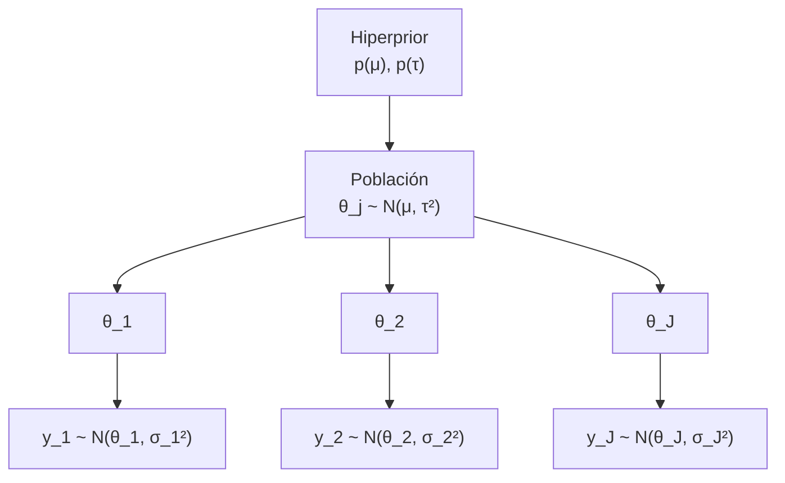

# B19-C02 — Modelos jerárquicos

<!-- nav:top -->
[🏠 Programa](../../../../README.md) · [📚 Bloque B19](../../../tronco-comun/B19-inferencia-bayesiana-y-computacion-probabilistica.md) · [← Anterior: B19-C01 — Priors físicamente informados](../B19-C01-priors-fisicamente-informados/CLASE.md) · [Siguiente: B19-C03 — Hamiltonian Monte Carlo y NUTS →](../B19-C03-hamiltonian-monte-carlo-y-nuts/CLASE.md)
<!-- /nav -->

## 1. Ubicación, nivel y alcance

Segunda clase del bloque B19. En [C01](../B19-C01-priors-fisicamente-informados/CLASE.md) construiste priors para un parámetro. Aquí el parámetro no es uno: son varios (uno por sensor, por estrella, por detector) y se parecen entre sí sin ser idénticos. Aprendes a modelar esa semejanza con un prior de dos niveles cuyos parámetros se aprenden de los propios datos.

Verás la estructura de niveles, el encogimiento parcial, la posterior de la dispersión entre unidades y cómo se predice para una unidad nueva. No verás todavía cómo se muestrea cuando no hay fórmula exacta (C03 y C04): aquí todo se calcula en una rejilla unidimensional.

## 2. Por qué esta clase existe

Seis sensores de temperatura de un satélite miden cada uno un desvío de calibración. Tres decisiones ingenuas son posibles: tratar a cada sensor por separado, ignorar las diferencias y promediar todo, o confiar en el sensor más preciso. Las tres tienen un coste: la primera desperdicia lo que los sensores se dicen entre sí; la segunda niega diferencias reales; la tercera ignora a los demás.

La decisión central es: **¿cuánto debe parecerse el valor de cada unidad al del grupo, y cómo dejo que los datos decidan ese grado?** Un modelo jerárquico lo responde con un parámetro más, `τ`, que mide la dispersión real entre unidades. Esto sostiene C03 (los modelos jerárquicos son el caso difícil para el muestreo) y C04 (donde aparecen las divergencias).

## 3. Lo que podrás hacer al terminar

1. Escribir un modelo normal de dos niveles con sus parámetros, unidades y supuestos.
2. Distinguir agrupación nula, completa y parcial y decir cuándo cada una es razonable.
3. Calcular el factor de encogimiento `B_j` y explicar por qué cambia entre unidades.
4. Obtener la posterior de `τ` en una rejilla y leer su significado.
5. Predecir el valor de una unidad nueva con la incertidumbre correcta.
6. Reconocer cuándo la intercambiabilidad no se sostiene.

La evidencia es el **análisis de tres agrupaciones** del ejercicio 12 (sección 20).

## 4. Con qué llegas y cómo comprobarlo

Necesitas C01, la distribución normal y el promedio ponderado por la inversa de la varianza (B12). Cinco preguntas:

1. Si dos mediciones independientes tienen varianzas `σ₁²` y `σ₂²`, ¿qué peso se da a cada una en el promedio óptimo?
2. ¿Cuál es la media posterior cuando prior `N(m₀, s₀²)` y dato `y ~ N(θ, σ²)`?
3. ¿Qué es la intercambiabilidad?
4. ¿Qué mide la desviación `τ` de un conjunto de valores?
5. ¿Qué pasa con un intervalo creíble si ignoras una fuente de incertidumbre?

<details>
<summary>Ver respuestas</summary>

1. Proporcionales a `1/σ₁²` y `1/σ₂²`. 2. Promedio ponderado por precisiones: `(m₀/s₀² + y/σ²)/(1/s₀² + 1/σ²)`. 3. Que, sin información adicional, no hay razón para distinguir entre unidades: el orden o las etiquetas no importan. 4. Cuánto se dispersan las unidades alrededor de su media. 5. Se estrecha de más y deja de cubrir lo que dice.
</details>

Con cuatro o cinco aciertos, sigue; con tres o menos, repasa C01 y B12.

## 5. Un caso real: el encogimiento de estimaciones en grupos

El estudio de poblaciones agrupadas, donde cada unidad tiene pocos datos, es el caso de uso habitual de los modelos jerárquicos. El libro de referencia *Bayesian Data Analysis* (fuente S1) los trata con ejemplos de grupos; en esta clase solo se consultó la página del libro, así que no se reproducen sus ejemplos ni se afirma nada de su contenido. Lo que sí se consultó (fuente S2, resumen) es que Hamiltonian Monte Carlo puede aplicarse a modelos jerárquicos, que son complejos y plantean problemas a los métodos habituales de inferencia: eso motiva C03 y C04.

Por eso el ejemplo conductor es **sintético** y está construido para que la solución exacta se pueda calcular y comprobar: seis sensores de un satélite con desvíos medidos `y_j` (mK) e incertidumbres conocidas `σ_j` (mK), de la tabla de la sección 13. No hay un satélite real detrás.

## 6. Vocabulario

Un **modelo jerárquico** describe los datos en niveles. Nivel 1 (medida): `y_j | θ_j ~ N(θ_j, σ_j²)`, donde `θ_j` es el valor verdadero del sensor `j` y `σ_j` su incertidumbre de medida, conocida. Nivel 2 (población): `θ_j | μ, τ ~ N(μ, τ²)`: los valores verdaderos salen de una población con media `μ` y dispersión `τ`. Los parámetros `μ` y `τ` se llaman **hiperparámetros** y llevan su propio prior, el **hiperprior**. Nivel 3: ese hiperprior (aquí, plano).

**Agrupación nula** (*no pooling*): cada `θ_j` se estima con su `y_j` (equivale a `τ → ∞`). **Agrupación completa** (*complete pooling*): todos los sensores comparten un valor, el promedio ponderado (equivale a `τ = 0`). **Agrupación parcial**: un compromiso aprendido de los datos. El **factor de encogimiento** `B_j = σ_j²/(σ_j² + τ²)` es la fracción por la que el sensor `j` se acerca al grupo. **Intercambiables**: las unidades se tratan como sorteos de una misma población.

## 7. Modelo mental: un prior que se aprende

En C01 el prior era una elección tuya. Aquí el prior de cada `θ_j` es la propia población, y la población se estima con los seis sensores a la vez. Cada sensor «pide prestada fuerza» a los demás: el sensor con más ruido recibe más ayuda.



*Descripción textual:* de arriba hacia abajo: los hiperparámetros definen una población; de ella salen los valores verdaderos `θ_1…θ_J`; cada valor verdadero produce su medición `y_j` con su ruido `σ_j`. La inferencia recorre el diagrama en sentido contrario.

**Límite de la analogía:** «pedir prestado» solo es razonable si los sensores son realmente intercambiables. Si uno es de otro modelo o está dañado, el préstamo lo arrastra.

## 8. La explicación, paso a paso

### 8.1 Dos casos extremos

Si `τ = 0`, todos los `θ_j` valen lo mismo y el mejor estimador es el promedio ponderado `μ̂ = Σ w_j y_j / Σ w_j`, con `w_j = 1/σ_j²`. Si `τ → ∞`, el prior de población es tan ancho que no informa y `θ_j ≈ y_j`. La agrupación parcial vive entre los dos.

### 8.2 Encogimiento parcial con `τ` conocida

Con `τ` fija, el prior de `θ_j` es `N(μ, τ²)` y el dato `y_j ~ N(θ_j, σ_j²)`. La media posterior es el promedio ponderado por precisiones:

```text
E[θ_j | y, μ, τ] = B_j · μ + (1 − B_j) · y_j ,    B_j = σ_j² / (σ_j² + τ²)
```

Si `σ_j` es grande frente a `τ`, `B_j → 1`: el sensor ruidoso casi se reemplaza por la media del grupo. Si `σ_j` es pequeño frente a `τ`, `B_j → 0`: el sensor preciso conserva su medida.

### 8.3 Aprender `τ`: la posterior de la dispersión

Con prior plano en `μ`, se puede integrar `μ` y queda

```text
p(τ | y) ∝ p(τ) · Π_j N(y_j | μ̂(τ), σ_j² + τ²) · [Σ_j 1/(σ_j² + τ²)]^(−1/2)
```

con `μ̂(τ) = Σ w_j(τ) y_j / Σ w_j(τ)` y `w_j(τ) = 1/(σ_j² + τ²)`. Cada factor dice que, al marginalizar `θ_j`, la medida `y_j` tiene varianza `σ_j² + τ²`: ruido de medida más dispersión real entre sensores. Es una función de una sola variable, así que se evalúa en una rejilla.

### 8.4 De `τ` a los `θ_j`

Para cada `τ` de la rejilla, `μ | τ, y` es normal con media `μ̂(τ)` y varianza `V_μ = 1/Σ w_j`. Dados `μ` y `τ`, cada `θ_j` es normal con media `B_j μ + (1 − B_j) y_j` y varianza `(1/σ_j² + 1/τ²)⁻¹`. Promediar sobre `τ` con su posterior da la distribución de cada `θ_j`. La incertidumbre sobre `τ` ensancha esas distribuciones respecto de usar un `τ` fijo.

### 8.5 Una unidad nueva y la intercambiabilidad

Para un sensor aún no medido, el valor verdadero es un sorteo de la población: `θ_nuevo ~ N(μ, τ²)`, y la incertidumbre incluye la de `μ`. Su varianza (con `τ` fija) es `τ² + V_μ`. Si además lo mides con ruido `σ`, súmale `σ²`. Esto solo vale si el nuevo sensor es intercambiable con los anteriores.

### 8.6 Cuando hay pocas unidades

Con `J` pequeño (seis aquí), los datos saben poco de `τ`: su posterior es ancha y depende del hiperprior. Esa dependencia se muestra, no se esconde. Otra consecuencia: el estimador «por momentos» `τ̂² = s² − σ²` puede salir negativo y dar `τ̂ = 0` aunque la posterior de `τ` no esté concentrada en cero (ejercicio 6).

## 9. Magnitudes, símbolos y unidades

| Símbolo | Qué es | Unidad | Nota |
|---|---|---|---|
| `y_j` | desvío medido por el sensor `j` | mK | dato (sintético) |
| `σ_j` | incertidumbre de medida | mK | conocida |
| `θ_j` | desvío verdadero del sensor `j` | mK | desconocido |
| `μ` | media de la población | mK | hiperparámetro |
| `τ` | dispersión entre sensores | mK | hiperparámetro, `τ ≥ 0` |
| `w_j` | peso `1/(σ_j² + τ²)` | mK⁻² | |
| `B_j` | factor de encogimiento | adimensional | entre 0 y 1 |
| `V_μ` | varianza de `μ` dado `τ` | mK² | `1/Σ w_j` |

## 10. Convenciones y referencias

Los desvíos se dan en milikelvin (mK) respecto de una referencia de calibración que se supone común. Las incertidumbres `σ_j` se tratan como **conocidas** y se interpretan como desviaciones típicas. El hiperprior de `τ` es plano en `[0, 60] mK`: la masa posterior sobre 50 mK es 3,5 × 10⁻⁵, así que el límite superior no condiciona. El «punto estimado» de `θ_j` es la media posterior.

## 11. De dónde sale lo que afirmamos

| ID | Fuente | Localizador | Respalda | Estado |
|---|---|---|---|---|
| S1 | Gelman, A. et al., *Bayesian Data Analysis*, 3.ª ed. | https://sites.stat.columbia.edu/gelman/book/ | Referencia general (no se afirma contenido específico) | Solo página del libro, 2026-11-05 |
| S2 | Betancourt, M. J. y Girolami, M., «Hamiltonian Monte Carlo for Hierarchical Models», 2013 | arXiv:1312.0906 | Los modelos jerárquicos son complejos y plantean problemas a métodos comunes; HMC puede evitarlos en la práctica | Resumen consultado el 2026-11-05 |
| S3 | Gelman, A. et al., «Bayesian Workflow», 2020 | arXiv:2011.01808 | Se ajustan muchos modelos por problema; flujo iterativo | Resumen consultado el 2026-11-05 |
| S4 | Este bloque, `encogimiento_parcial.py` | misma carpeta | Cifras de las secciones 13 y 17 (datos **sintéticos**) | Ejecutado el 2026-11-05 |

**Límites.** Las fórmulas de las secciones 8.2–8.5 son el modelo normal–normal estándar; aquí se verifican con pruebas analíticas y con simulación (sección 17), no contra una fuente leída. De S1–S3 no se leyó más que su página o resumen.

## 12. Cómo ver el encogimiento

Dibuja un gráfico con tres columnas (sin agrupar, parcial, agrupada) y seis líneas, una por sensor, que unen su valor en cada columna. El encogimiento se ve como líneas que convergen hacia el centro, y más para los sensores ruidosos. **Accesibilidad:** rotula cada línea con el número del sensor en ambos extremos, usa trazos distintos y entrega la tabla de la sección 13.

## 13. Ejemplo trabajado: seis sensores

**Datos (sintéticos):** `y = (12,1; 9,4; 15,8; 7,2; 10,9; 18,3) mK`, `σ = (2,0; 3,5; 4,0; 2,5; 3,0; 5,0) mK`.

**Agrupación completa.** Pesos `1/σ²`: 0,25; 0,0816; 0,0625; 0,16; 0,1111; 0,04; suma 0,7052. Promedio ponderado `μ̂ = 7,875/0,7052 = 11,17 mK`.

**Aprender `τ`.** La rejilla da mediana de `τ` en 2,49 mK, intervalo 90 % [0,24; 8,33] mK, moda 1,22 mK. La dispersión entre sensores es pequeña, pero muy incierta con solo seis.

**Encogimiento** (valores del laboratorio; `B_j` en la mediana de `τ`):

| j | y (mK) | σ (mK) | agrupada | parcial | sd parcial | sin agrupar | B |
|---|---|---|---|---|---|---|---|
| 1 | 12,1 | 2,0 | 11,17 | 11,74 | 1,67 | 12,1 | 0,39 |
| 2 | 9,4 | 3,5 | 11,17 | 10,64 | 2,40 | 9,4 | 0,66 |
| 3 | 15,8 | 4,0 | 11,17 | 12,83 | 2,84 | 15,8 | 0,72 |
| 4 | 7,2 | 2,5 | 11,17 | 9,37 | 2,24 | 7,2 | 0,50 |
| 5 | 10,9 | 3,0 | 11,17 | 11,16 | 2,15 | 10,9 | 0,59 |
| 6 | 18,3 | 5,0 | 11,17 | 13,21 | 3,33 | 18,3 | 0,80 |

El sensor 6, el más ruidoso, se mueve 5,1 mK hacia el grupo (de 18,3 a 13,2); el sensor 1, el más preciso, solo 0,4 mK. El 18,3 no se interpreta como un valor extraordinario: con σ = 5 mK es compatible con el grupo.

## 14. Comparación de las tres agrupaciones

La **agrupación nula** no toma prestado nada: es honesta con cada sensor pero tiene intervalos anchos y trata como señal lo que puede ser ruido. La **completa** da el intervalo más estrecho pero niega que los sensores difieran: sesga a cada uno hacia el centro aunque sea diferente. La **parcial** es un compromiso aprendido, pero depende del supuesto de intercambiabilidad y, con pocas unidades, de la elección del hiperprior de `τ`. Elegir entre ellas no es cuestión de gusto: se evalúa con predicción (C06 y C07).

## 15. Práctica guiada

**Ejercicio 1 · con los pasos indicados.** Calcula el promedio ponderado de los seis sensores (agrupación completa). *Pasos:* pesos `1/σ²`, producto `w y`, divide sumas (sección 8.1).

<details><summary>Solución comentada</summary>

`w = (0,25; 0,0816; 0,0625; 0,16; 0,1111; 0,04)`, `Σ w = 0,7052`. `Σ w y = 3,025 + 0,767 + 0,988 + 1,152 + 1,211 + 0,732 = 7,875`. `μ̂ = 11,17 mK`, igual que el laboratorio.
</details>

**Ejercicio 2 · con una pista.** Con `τ = 2,49 mK` y `μ = 11,17`, calcula `B` y la media condicional de `θ₄` (`y₄ = 7,2`, `σ₄ = 2,5`). *Pista:* `τ² = 6,2`.

<details><summary>Solución comentada</summary>

`B₄ = 6,25/(6,25 + 6,2) = 0,50`. `θ₄ ≈ 0,50·11,17 + 0,50·7,2 = 9,19 mK`. El laboratorio da 9,37: promedia sobre todos los valores posibles de `τ`, no solo la mediana, y la relación entre `τ` y la media no es lineal.
</details>

**Ejercicio 3 · casi autónomo.** Repite para el sensor 6 (`y = 18,3`, `σ = 5`) y compara con el valor del laboratorio (13,21).

<details><summary>Solución comentada</summary>

`B = 25/(25 + 6,2) = 0,80`; `θ ≈ 0,80·11,17 + 0,20·18,3 = 12,6 mK`. El valor completo (13,21) es algo mayor: la posterior de `τ` tiene cola hacia valores grandes, donde el sensor se encoge menos. Estimar con un solo `τ` subestima la incertidumbre.
</details>

## 16. Práctica autónoma, transferencia e integrador

**Ejercicio 4.** Explica con la fórmula de `B_j` qué pasa con el modelo cuando `τ → 0` y cuando `τ → ∞`.

<details><summary>Solución comentada</summary>

`τ → 0`: `B_j → 1`, todos los `θ_j` se igualan a `μ̂`: agrupación completa. `τ → ∞`: `B_j → 0`, `θ_j → y_j`: sin agrupar. El laboratorio lo comprueba con pruebas a `τ = 0` y `τ = 10⁶`.
</details>

**Ejercicio 5.** ¿Por qué se encoge más el sensor 6 que el 1? Responde con `σ` y `B`, y con una frase sobre el significado físico.

<details><summary>Solución comentada</summary>

Porque `B` crece con `σ`: 0,80 frente a 0,39. Un sensor ruidoso aporta poca información propia y el grupo aporta más; uno preciso se «defiende» solo.
</details>

**Ejercicio 6.** Cuatro sensores con `σ = 3 mK` miden `y = (10, 12, 8, 14) mK`. (a) Calcula la varianza muestral de `y` y el estimador por momentos `τ̂² = s² − σ²`. (b) El laboratorio, con estos datos, da mediana de `τ` = 2,55 mK. ¿Se contradicen?

<details><summary>Solución comentada</summary>

(a) Media 11; `s² = (1 + 1 + 9 + 9)/3 = 6,67`; `τ̂² = 6,67 − 9 = −2,33 < 0`, luego `τ̂ = 0`. (b) No se contradicen: el estimador por momentos no admite negativos y devuelve el borde; la posterior de `τ` tiene moda en 0 pero mediana 2,55 y 90 % [0,23; 12,58]. Con cuatro sensores no se descarta una dispersión apreciable. La estimación puntual en cero, repetida como «τ = 0», es un error.
</details>

**Ejercicio 7.** Con `τ = 2,49 mK` y `V_μ = 2,66 mK²` (ver sección 13), calcula la desviación de `θ_nuevo` para un sensor intercambiable. ¿Y de una medición suya con `σ = 3 mK`?

<details><summary>Solución comentada</summary>

`√(τ² + V_μ) = √(6,2 + 2,66) = 2,98 mK`. Con la medición: `√(8,86 + 9) = 4,23 mK`. Se suman varianzas: dispersión poblacional, incertidumbre de `μ` y ruido de medida.
</details>

**Ejercicio 8.** El sensor 3 resulta ser de otro fabricante. ¿Qué haces con el modelo?

<details><summary>Solución comentada</summary>

La intercambiabilidad se rompe. Opciones: excluirlo de la población y tratarlo aparte; agregar un nivel (fabricante); o incluir una covariable. No se deja «para ver qué pasa»: un sensor distinto sesga `μ` y `τ`.
</details>

**Ejercicio 9 · transferencia.** Doce detectores de una constelación cuentan eventos con tasas `λ_j` parecidas pero no iguales. Escribe el modelo jerárquico (los tres niveles, con unidades) usando lo de C01.

<details><summary>Solución modelo</summary>

Nivel 1: `n_j | λ_j ~ Poisson(λ_j T_j)`. Nivel 2: `λ_j | a, b ~ Gamma(a, b)` con `λ_j` en h⁻¹. Nivel 3: hiperprior sobre `a` (adimensional) y `b` (h⁻¹), por ejemplo distribuciones débilmente informativas positivas. Cada `λ_j` se encoge hacia `a/b` según su `T_j`.
</details>

**Ejercicio 10 · transferencia.** Con `J = 6`, la posterior de `τ` depende del hiperprior. Propón cómo comprobar cuánto, sin muestreo.

<details><summary>Solución comentada</summary>

Repetir la rejilla con otro prior para `τ` (por ejemplo, con soporte hasta 20 mK o decreciente) y comparar mediana, intervalo y los `θ_j`. Si las conclusiones cambian, el resultado es sensible al hiperprior y se reporta.
</details>

**Ejercicio 11 · transferencia.** Un colega propone agrupar completamente «porque el intervalo sale más estrecho». Evalúa el argumento.

<details><summary>Solución comentada</summary>

El intervalo más estrecho no es mejor si el supuesto (`τ = 0`) es falso: el modelo está seguro de algo que los datos no sostienen (la posterior de `τ` no está concentrada en 0). Se mide con predicción y cobertura (C06, C08), no con el ancho.
</details>

**Ejercicio 12 · integrador.** Con los datos de la sección 13, haz el **análisis de tres agrupaciones** (nula, completa, parcial) y escribe media página: tabla de resultados con unidades, interpretación del encogimiento, qué dice la posterior de `τ`, la predicción para un sensor nuevo y una frase sobre la intercambiabilidad.

<details><summary>Solución modelo</summary>

Tabla de la sección 13; `μ̂ = 11,17 mK`; `τ` mediana 2,49 mK con 90 % [0,24; 8,33]; predicción de un sensor nuevo: `θ_nuevo` con media 11,2 mK y desviación ≈ 3,0 mK (ejercicio 7). La interpretación debe notar que el sensor 6 se encoge más y que la conclusión «hay diferencias reales entre sensores» no está sostenida con seis sensores (el 90 % incluye valores cercanos a 0). Debe declarar los datos como sintéticos y la intercambiabilidad como supuesto.
</details>

## 17. Laboratorio: encogimiento en una rejilla

El script [encogimiento_parcial.py](encogimiento_parcial.py) calcula la posterior de `τ` en una rejilla de 6001 puntos entre 0 y 60 mK y de ahí las distribuciones de `μ` y de cada `θ_j`. **Pruebas que detienen la ejecución:** la posterior de `τ` integra 1; con `τ = 0` los `θ_j` son iguales al promedio ponderado; con `τ = 10⁶` valen `y_j`; y la media de 200 000 sorteos Monte Carlo coincide con la de la cuadratura a 0,05 mK. **Datos:** sintéticos. **Predice antes de ejecutar:** ¿qué sensor se moverá más? (El 6.)

**Ejecución del 2026-11-05 (Python 3.12.9, numpy 2.4.4):**

```text
Pruebas: OK

posterior de tau [mK]: mediana 2.49, 90 % [0.24, 8.33]; moda 1.22; masa en tau>50: 3.52e-05
media agrupada completa (tau=0): 11.17 mK
j        y  sigma   agrup.  parcial     sd  sin agrupar  factor B
1     12.1    2.0    11.17    11.74   1.67         12.1      0.39
2      9.4    3.5    11.17    10.64   2.40          9.4      0.66
3     15.8    4.0    11.17    12.83   2.84         15.8      0.72
4      7.2    2.5    11.17     9.37   2.24          7.2      0.50
5     10.9    3.0    11.17    11.16   2.15         10.9      0.59
6     18.3    5.0    11.17    13.21   3.33         18.3      0.80
```

```bash
python programa/clases/B19/B19-C02-modelos-jerarquicos/encogimiento_parcial.py
```

**Límites:** `σ_j` conocidas, normalidad, prior plano para `μ` y `τ`; el modelo no incluye correlaciones entre sensores.

## 18. Errores frecuentes y cómo corregirlos

**Tratar la estimación puntual de `τ` como cierta.** Ejercicio 6.

**Confundir `σ_j` (ruido de medida) con `τ` (dispersión real).** La varianza marginal es `σ_j² + τ²`; se corrige con la sección 8.3.

**Creer que encoger es «corregir» el dato.** El dato no cambia: cambia la estimación del valor verdadero, ejercicio 5.

**Aplicar agrupación a unidades distintas.** Ejercicio 8.

**Usar un solo `τ` para los intervalos.** Subestima la incertidumbre, ejercicio 3.

## 19. Cómo sabrás que vas bien

Tras la 8.2: ¿calculas `B_j` y la media condicional sin mirar? Si no, ejercicio 2. Tras la 8.3: ¿puedes explicar por qué la varianza marginal es `σ_j² + τ²`? Tras el laboratorio: ¿por qué la mediana de `τ` (2,49) y la moda (1,22) no coinciden? Si no lo sabes, la posterior es asimétrica con cola a la derecha. Al final: ¿tu informe declara el supuesto de intercambiabilidad?

## 20. Qué entregas y cómo se evalúa

El producto es el **análisis de tres agrupaciones** del ejercicio 12, con tabla y unidades.

| Criterio | Inicial | En desarrollo | Logrado | Destacado |
|---|---|---|---|---|
| Modelo | Sin niveles | Niveles sin unidades | Tres niveles con unidades | Justifica la intercambiabilidad |
| Cálculo | Errores | Promedio ponderado correcto | `B_j` y medias correctas | Incluye la incertidumbre de `τ` |
| Interpretación | Solo describe | Explica el encogimiento | Relaciona `B_j` con `σ_j` | Discute la sensibilidad al hiperprior |
| Honestidad | Datos sin rótulo | Rotula | Declara sintéticos y supuestos | Señala qué cambiaría la conclusión |

**Condiciones críticas:** no dar `τ = 0` como hecho; rotular los datos como sintéticos; no agrupar unidades que se sabe diferentes; citar solo lo consultado.

## 21. Ética, seguridad y límites

Agrupar unidades equivale a hacer afirmaciones sobre quién se parece a quién: con personas o poblaciones sensibles puede ocultar a las minorías. En instrumentación, el encogimiento puede esconder un sensor realmente defectuoso: no sustituye una revisión de fallos. Los datos son sintéticos; no calibres un instrumento real con este material. Accesibilidad: tablas, diagramas con descripción textual, ejercicios sin conexión.

## 22. Para cerrar y seguir

Un modelo jerárquico aprende de los datos cuánto deben parecerse las unidades, y encoge más a las que tienen menos información propia. La dispersión `τ` se infiere con incertidumbre, y con pocas unidades esa incertidumbre es grande. Queda abierta una pregunta: cuando no hay fórmulas exactas (más niveles, datos no normales), ¿cómo se obtiene la posterior? Eso es C03.

**Glosario español–inglés.** modelo jerárquico · *hierarchical model*; hiperparámetro · *hyperparameter*; encogimiento · *shrinkage*; agrupación parcial · *partial pooling*; intercambiabilidad · *exchangeability*; dispersión entre unidades · *between-unit scatter*.

**Continuidad.** B19-C03 muestrea modelos como este con gradientes; B19-C04 muestra por qué los jerárquicos producen *divergencias* y cómo repararlas; B19-C07 comparará agrupaciones por su capacidad predictiva.

**Referencias:** ver sección 11. De S1 solo la página del libro; de S2 y S3 solo resúmenes.

<!-- nav:bottom -->
---

[← Anterior: B19-C01 — Priors físicamente informados](../B19-C01-priors-fisicamente-informados/CLASE.md) · [📚 Bloque B19](../../../tronco-comun/B19-inferencia-bayesiana-y-computacion-probabilistica.md) · [Siguiente: B19-C03 — Hamiltonian Monte Carlo y NUTS →](../B19-C03-hamiltonian-monte-carlo-y-nuts/CLASE.md)
<!-- /nav -->
